# C++ 基础

## 基础语法

C语言是结构化的语言，不适合大型程序开发时。Bjarne 等人顺应面向对象思想在C语言的基础上发明了一种新的语言，名为 C++。C++ 以C语言为基础，最初叫做 C with class 新增了类的概念，后逐步更新迭代，变得更加丰富完善。

历代最重要的是 C++98 和 C++11 两个版本，C++98 是 C++ 标准的第一个版本，以模板的方式重写C++标准库，引入了STL。C++11 为其增加了许多实用的特性。

C++ 在C的32个关键字的基础上新增了31个关键字，故C++兼容C绝大多数的特性。也暗示着C++的基础语法也是为了弥补C语言的某些缺陷。

### 1. 命名空间

命名空间的出现是为了解决 C 语言中经常出现的命名冲突的问题：定义的全局变量、函数有可能与库文件或者项目中其他成员写的变量发生命名冲突。

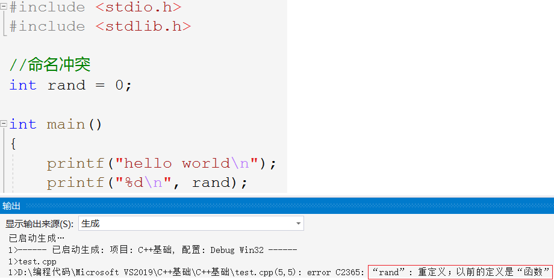

> 如图所示，定义的全局变量`rand`和库中的rand发生冲突。C语言没有办法解决这样的问题，C++就此提出新的语法命名空间。

#### 1.1 命名空间的定义

命名空间，即定义一个域。在这个域中定义变量、函数或类型，使用这些变量时在其名称前面加上命名空间的标识，以避免命名冲突。

```cpp
namespace test
{
    //1.
    int rand = 0;
    //2.
    int Add(int a, int b)
    {
        return a+b;
    }
    //3.
    struct Node
    {
        int data;
        struct Node* next;
    };
}
```

1. **这样的一个“域”，只是给变量的访问加上了一层“锁”，并不会影响变量的属性仍然是全局变量**。
2. 命名空间中只能定义变量或函数并进行初始化，不可以进行其他操作。

##### 命名空间的嵌套

```cpp
namespace N1
{
    int a = 0;
    int b = 0;
    int Add(int a, int b)
    {
        return a + b;
    }
    namespace N2
    {
        int c = 0;
        int d = 0;
        int Sub(int c, int d)
        {
            return c - d;
        }
    }
}
```

此外，当命名空间重名时，两个同名的命名空间会被合并为一个命名空间。

#### 1.2 命名空间的使用

在命名空间中定义变量，相当于将变量封锁起来，访问时要加上命名空间的标识。域作用限定符`::`。

使用命名空间中的变量有如下三种方式。

##### 用时展开

```cpp
int main() {
    std::cout << "hello world" << std::endl;
}
```

在变量名前加上空间名和`::`，告诉编译器使用该命名空间中的变量。

> 域作用限定符并不是C++新增的，C语言中同样可以使用。

```cpp
int a = 0;

int main()
{
    int a = 1;
    printf("%d\n", ::a); // ::前不写空间的名称，就表示使用全局范围的变量。
}
```

##### 全局展开

```cpp
using namespace std;

int main() {
    cout << "hello world" << endl;
}
```

这种写法会将该命名空间中的所有变量或者函数都在当前文件展开。

好处是比较方便，坏处是使整个命名空间失效，可能造成命名冲突。相当于取消隔离，所以要慎用。

##### 部分展开

```cpp
using std::cout;
using std::endl;

int main() {
    cout << "hello world" << endl;
}
```

引入命名空间中的指定成员。

1. 第一种用时展开，隔离效果最好但使用繁琐，
2. 第二种全局展开，最简单但效果最差，容易导致命名冲突，
3. 第三种部分展开，只展开常用成员，相对来说更加安全可靠。

### 2. 输入输出

```cpp
#include <iostream>  // C++标准输入输出流文件
using namespace std;

int main()
{
    int i = 0;

    cin >> i;          // 输入
    cout << i << endl; // 输出

    return 0;
}
```

C++ 库的实现都放在一个叫`std`的命名空间中。一般学习时可以直接展开整个命名空间。

- `cout`是一个全局变量在 C++ 中称为对象，为标准输出即控制台。`cin`是C++的标准输入即键盘。
- `<<`是流插入运算符，`>>`时流提取运算符。

> `cout`,`cin`可以自动识别类型，不需要格式控制符，也可以根据变量的值自动控制小数点位数。

```cpp
int i = 0;
double d = 1.11;

cin >> i >> d;
cout << i << " " << d << endl;
```

C 和 C++ 的输入输出都可以使用，一般哪个方便选哪个。如果需要控制格式，最好使用 prinf 和 scanf。

> cin 和 scanf 都存在缓冲区遗留回车字符`\n`的问题。

### 3. 缺省参数

缺省就是默认的意思，就像备胎一样，如果有就用给的，如果没有就用默认值。

#### 3.1 缺省参数的定义

缺省参数，是在声明或者定义函数的时候，为函数的参数指定一个默认值。

在调用函数时，若对应位置没有传入实参，则使用该参数的缺省值，反之，则使用传入值。

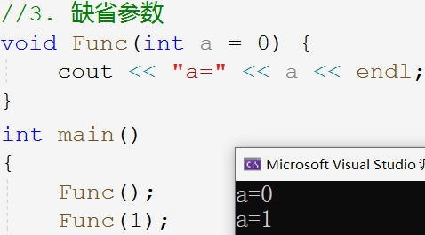

#### 3.2 缺省参数的类型

| 类型       | 含义                   |
| ---------- | ---------------------- |
| 全缺省参数 | 所有的形参都带有缺省值 |
| 半缺省参数 | 只有部分形参带有缺省值 |

```cpp
//1.全缺省参数
void Func(int a = 10, int b = 20, int c = 30)
{
    cout << "a=" << a << endl;
    cout << "b=" << b << endl;
    cout << "c=" << c << endl << endl;
}

//2.半缺省参数
void Func(int a, int b, int c = 30)
{
    cout << "a=" << a << endl;
    cout << "b=" << b << endl;
    cout << "c=" << c << endl << endl;
}
```

#### 3.3 缺省参数的要求

- **传参也必须连续地从左向右传参**。不可以跳过，不可以只针对某个参数传参。

```cpp
void Func(int a = 10, int b = 20, int c = 30)
{
    cout << "a=" << a << endl;
    cout << "b=" << b << endl;
    cout << "c=" << c << endl << endl;
}
int main()
{
    Func();        // 不传参
    Func(1);       // 传 a=1
    Func(1, 2);    // 传 a=1,b=2
    Func(1, 2, 3); // 传 a=1,b=2,c=3

    //错误写法
    Func(,2,);
    Func(,,3);
    Func(1,,3);
    return 0;
}
```

- **缺省参数的设置必须从右往左且必须连续**。所以通常将需要缺省的参数放在右边，如下所示：

```cpp
void Func(int a = 10, int b = 20, int c = 30) {} //1.
void Func(int a,      int b = 20, int c = 30) {} //2.
void Func(int a,      int b,      int c = 30) {} //3.

//错误形式
void Func(int a = 10, int b, int c = 30) {}
void Func(int a = 10, int b, int c)      {}
```

- 缺省参数不可在函数声明和函数定义中同时出现，只能放在声明处。

### 4. 函数重载

#### 4.1 函数重载的定义

C++ 创造出了一种新语法叫函数重载，函数重载是指一个函数具有多种功能。

函数重载允许在同一个作用域中出现“同名函数”。这些同名函数的参数列表必须不同，即**参数个数，参数顺序，参数类型三者任有一个不同即可**。

**返回类型不同不算重载**。因为仅靠返回类型无法在调用时区分重载的函数。

```cpp
int Add(int a, int b)
{
    return a + b;
}
int Add(int a, int b, int c)
{
    return a + b + c;
}

float Add(int a, float b)
{
    return a + b;
}
float Add(float a, int b)
{
    return a + b;
}
```

只有类型不同才算不同，名称不在考虑范围，因为编译器根本不关心形参的名称。

```cpp
//1.
void f(int a) {
    cout << "f(int a)" << endl;
}
void f(int a = 0) {
    cout << "f(int a = 0)" << endl;
}
//2.
void f() {
    cout << "f()" << endl;
}
void f(int a = 0) {
    cout << "f(int a = 0)" << endl;
}
```

第一组函数不可构成重载，参数与缺省值无关。

第二组函数参数个数不同，构成重载，但调用时存在歧义。

#### 4.2 函数重载的原理

```cpp
int Add(int a, int b)
{
    return a + b;
}

void func(int i, double d, int* pi)
{
    return;
}
```

C/C++的源文件都是需要进行预处理，编译，汇编，链接，最后生成可执行程序。

C语言编译时，**C语言单纯使用函数名查找函数地址**，两个同名函数的符号表存在冲突，所以编译失败，都到不了链接的步骤。

> C++是如何支持函数重载的呢？

C++的函数查找规则更严格，C++不是直接用函数名来查找函数地址的，查找规则如下图所示：

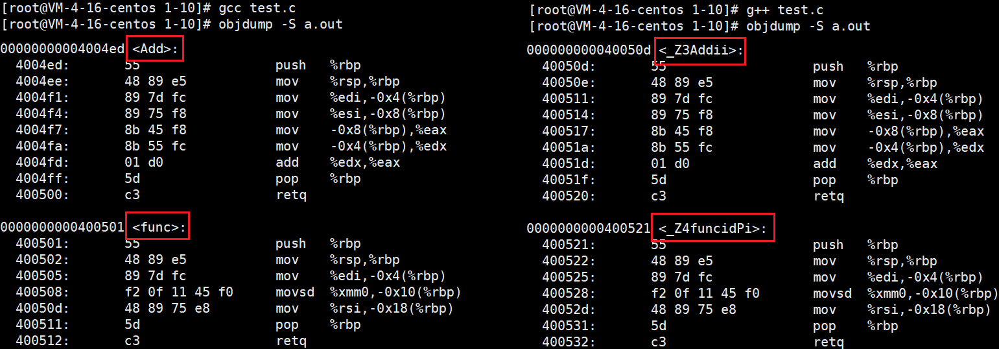

```cpp
add   ->  _Z3Addii
func  ->  _Z4funcidPi
```

| 拆分         | 解释                     |
| ------------ | ------------------------ |
| `_Z`         | 函数的前缀               |
| 数字`3`,`4`  | 函数名字符长度           |
| `Add`,`func` | 函数名                   |
| `i`,`d`,`Pi` | 参数类型首字母以表示参数 |

可以看出，C++函数的编译符号名称和函数名、参数类型有关。对于编译器来说，这些函数并不相同，这就是函数重载的原理。

#### 4.3 extern "C"

当我们使用C语言程序去调用C++所写的库，或者使用C++程序去调用C所写的库时，必须要在C++文件中引入`extern "C"`，这样才能让C++程序按照C的方式调用函数。

可以将`.lib`库文件和头文件放入工程文件的位置，也可以记下文件位置以待在调用工程中配置相关设置。下面仅介绍 vs 环境下的配置方法，其他平台大同小异。

由于工程中没有库文件，所以要在工程的属性设置中的链接设置中填写库文件的位置和文件名。如下图所示：

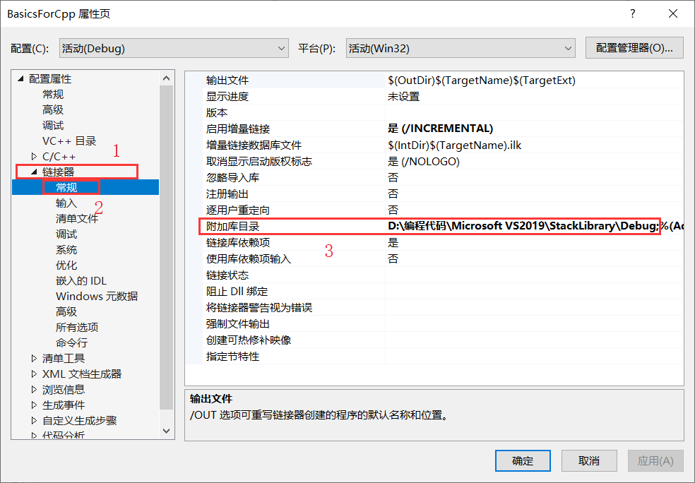

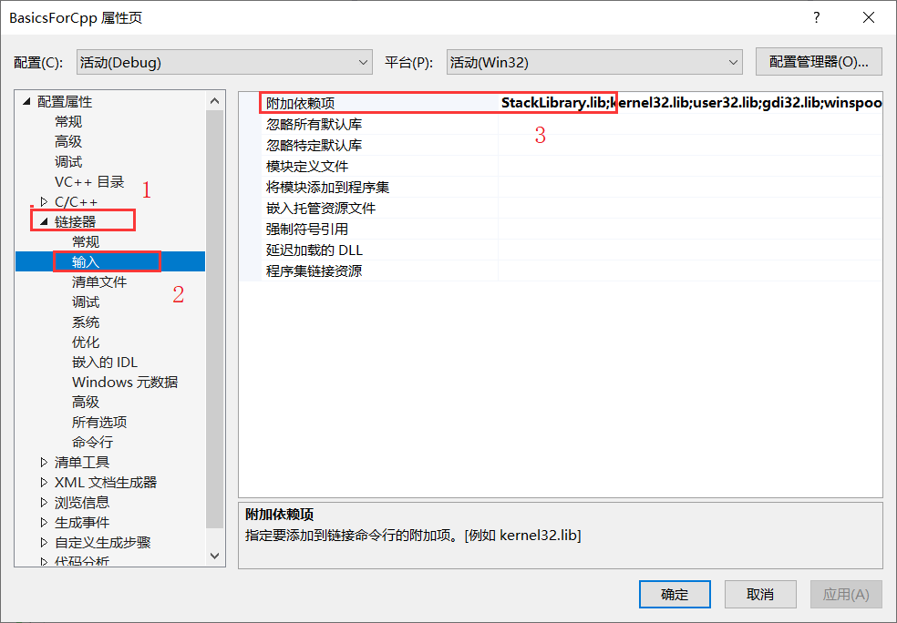

经过上述步骤，工程便可以找到库文件了，下面解决调用问题，调用报错找不到找不到函数地址，这是因为C/C++的函数名修饰规则不同导致的。所以要在C++文件中使用`extern"C"`。`extern "C"`命令就是为了让该文件使用C语言的名字修饰规则，以免C程序调用时找不到函数。

##### C++程序调用C的库

C++的工程去调用C语言所写的库，只需要在工程包头文件时加上这样的语句即可。

```cpp
extern "C"
{
#include "../../StackLibrary/StackLibrary/Stack.h"
}
```

##### C程序调用C++的库

C程序调用C++的库相对来说要繁琐一点，因为头文件须在C和C++的文件都展开。必须在C++工程中将头文件加上条件编译指令，免得C语言调用的时候遇到`extern"C"`。基本方法如下：

这里有两种方式，一种是利用`#ifdef __cplusplus`给头文件加上`extern"C"{}`的代码，现在C++的工程中编译一下生成可以让C语言程序可以调用的`.lib`文件。

```c
#define FRISTSOLUTION 1
//第一种方案
#ifdef FRISTSOLUTION
    #ifdef __cplusplus
    extern "C" {
    #endif
        void StackInit(ST* ps);
        void StackPush(ST* ps, STDataType data);
        void StackPop(ST* ps);
        STDataType StackTop(ST* ps);
        int StackSize(ST* ps);
        bool StackEmpty(ST* ps);
        void StackDestroy(ST* ps);
    #ifdef __cplusplus
    }
    #endif
//第二种方案
#else
    #ifdef __cplusplus
        #define EXTERN_C extern "C"
    #else
        #define EXTERN_C
    #endif
    EXTERN_C void StackInit(ST* ps);
    EXTERN_C void StackPush(ST* ps, STDataType data);
    EXTERN_C void StackPop(ST* ps);
    EXTERN_C STDataType StackTop(ST* ps);
    EXTERN_C int StackSize(ST* ps);
    EXTERN_C bool StackEmpty(ST* ps);
    EXTERN_C void StackDestroy(ST* ps);
#endif
```

### 5. 引用

引用是 C++ 中一个重要的语法，在后期应用非常广泛。相较于指针，它更加方便也更好理解。

#### 5.1 引用的定义

**引用是给已存在的变量取一个别名，并不是定义一个新的变量**。取别名就相当于取外号，相当于给一块空间取了两个名字。

```cpp
int a = 0;
int& b = a;
```

> `b`是`a`的引用，b 和 a 指向同一块空间，改变 b 就是改变 a 。

语法层面上，引用变量没有开辟空间，它和它所引用的变量使用同一块空间。

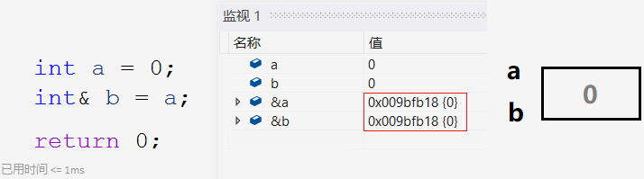

#### 5.2 引用的特性

- 一个变量可以有多个引用；
- **定义引用时必须要初始化**；
- **引用初始化后不可改变引用实体**。

```cpp
//1.
int& b = a;
int& c = a;
int& d = a;

//2.
int a = 10;
int& b;//Err 引用必须要初始化

//3.
int e = 1;
int& f = a;
f = e; //把e赋值给f
```

定义引用时必然要初始化，不然别名就没有意义了。

一个变量可以取多个别名，但一个别名被使用后便不可以指代其他变量，只能是赋值操作。

#### 5.3 常引用

常变量是具有常属性的变量，那么常引用就是具有常属性的引用。常引用会涉及到权限的问题，如：

```cpp
const int a = 0;
int& ra = a;       // 权限放大 Err

int b = 0;
const int rb = b;  // 权限缩小

const int c = 0;
const int& rc = c; // 权限相同
```

权限不允许扩大，但是可以不变和缩小。

```cpp
double d = 1.11;
int i = d;

double d = 1.11;
const int& i = d;
```

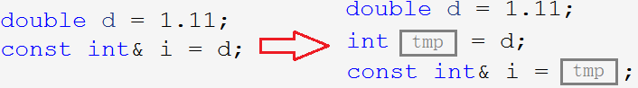

隐式类型转换，中间会创建一个临时变量来“过渡”。不同类型变量的赋值，其实是将变量的数据截断放入临时变量，再将临时变量赋值给另一个变量。

这样的临时变量是个右值，具有常属性，只有常引用才能引用这样的临时变量。也就使得`const Type&`的引用类型可以引用任意类型的变量。

> 创建临时变量的方式不仅存在于类型转换，还有整型提升，传参返回等。

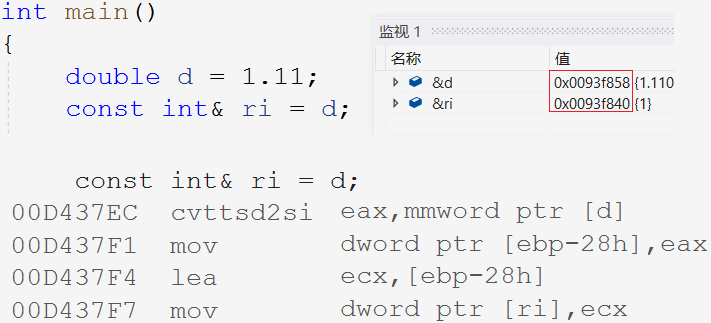

>  d 和 ri 并没有指向同一块空间，ri 指向的临时变量那块空间。

#### 5.4 引用的应用

> 引用实际使用时通常有两种用法，作参数和返回值。

##### 作函数参数

```cpp
void Swap(int& rx, int& ry) {
    int tmp = rx;
    rx = ry;
    ry = tmp;
}
```

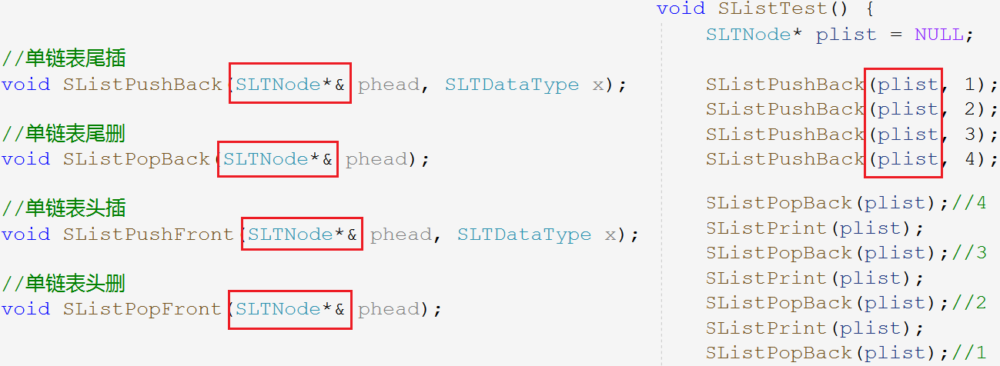

> 单链表插入删除操作可能会修改头指针，可以传入头指针的引用，免得使用二级指针。
>
> `phead`就是`plist`的引用，改变`phead`就是改变`plist`。

##### 作返回类型

```cpp
int& Add(int a, int b)
{
    int c = a + b;
    return c;
}
int main()
{
    int ret = Add(1, 2);
    cout << ret << endl;
}
```

取 c 的值赋值给 ret，而 c 的空间已还给操作系统，就造成了非法访问。

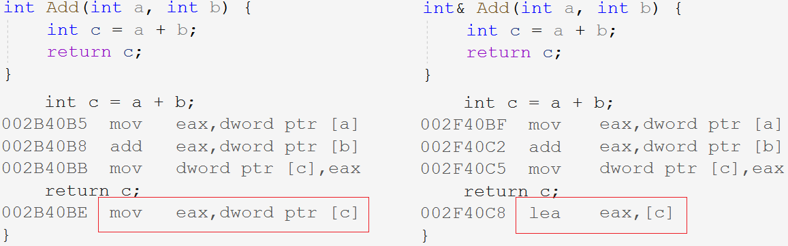

```asm
mov eax, dword ptr [c] ; 将变量c的值放入寄存器eax中
lea eax, [c]           ; 将变量c的地址放入寄存器eax中
```

> 之所以将地址放到寄存器中带回，是因为引用的底层实现是指针，要通过地址访问 c 的内存空间。

- 值返回用临时变量存储了c 的值，返回的是拷贝临时对象。
- 引用返回用引用访问了原来 c 的内存空间。

引用作返回值可能会造成非法访问，所以不要返回局部变量的引用。引用作返回值自有其的应用场景，在后续的学习中会遇到。

```cpp
int& At(int i)
{
    static int a[N];
    return a[i];
}
int main()
{
    for (int i = 0; i < N; i++)
        cout << At(i) << endl;
}
```

#### 5.5 引用和指针的区别

- 传引用和传指针差不多，每次调用都访问的是同一块空间，
- 传引用的效率比传值高很多，数据越大对性能的提升越大。

引用可以作输出型参数或输出型返回值，就是达到改变函数外面的实参的目的。

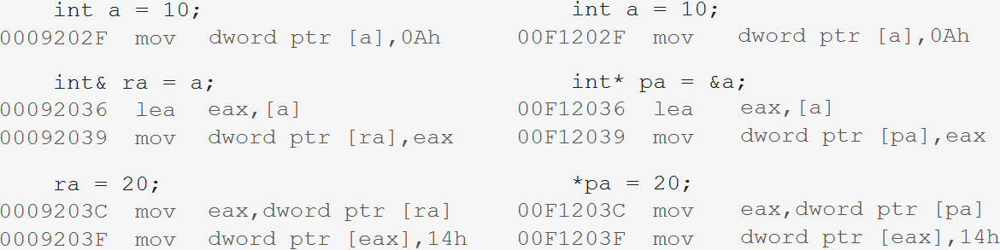

引用和指针在语法层面上是完全不同的两种语法，但从汇编代码可以看出引用的底层也是指针，引用就是为了解决多级指针造成的理解困扰。

| 引用                                  | 指针                                |
| ------------------------------------- | ----------------------------------- |
| 引用是变量的别名，没有独立空间        | 指针是变量，存储变量的地址          |
| 引用必须初始化                        | 指针没有要求初始化                  |
| 引用定义后就无法改变引用实体          | 指针可以任意改变指向                |
| 没有空引用                            | 只有空指针                          |
| `sizeof(Type&)`表示引用对象的类型大小 | `sizeof(Type*)`表示当前平台地址大小 |
| 引用自增自减改变引用实体的大小        | 指针自增自减表示地址位置的前后移动  |
| 无多级引用                            | 有多级指针                          |
| 引用编译器处理，相对指针更加安全      | 指针需要显式解引用                  |

### 6. 内联函数

函数栈桢的创建和销毁会有不少的消耗，像一些小的被频繁调用的如`Swap`,`Add`等仅有几行的函数，封装成函数浪费性能。

解决这种问题除了使用C语言的语法宏以外，C++还有新语法叫内联函数。

#### 6.1 内联函数的定义

用`inline`修饰的函数就叫内联函数，编译时编译器会自动将其在调用处展开，不会产生函数压栈的一系列开销，提升了程序的效率。

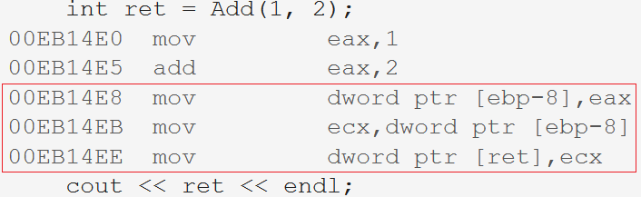

> 内联函数只在release模式下起作用，若想在Debug模式下查看需要配置项目属性。

#### 6.2 内联函数的特性

1. 内联函数以空间换时间，省去调用函数开销，但在调用处展开会增加程序大小。故**一般适用于十行以内且没有递归迭代的函数**。
2. **内联函数仅是对编译器的一种建议**，编译器会选择性的优化。
3. **内联函数不能声明定义分离**，内联函数不会调用就没有函数地址，分离会导致链接失败。

**宏可以增强代码的复用性，提高性能，缺点是无法调试，可维护性差，没有类型检查**。因此推荐使用内联函数。

> 以下是C++11中的部分语法，了解即可。

### 7. auto 关键字

> C语言的 auto 关键字，表示自动变量，可以自动销毁释放，忽略即可，切莫与 C++ 中的 auto 混淆。

#### 7.1 auto 的定义

auto 定义的变量，**其类型由编译器根据初始化的内容自动推导，因此 auto 修饰的变量必须初始化**。

auto 并非是一种类型的声明，而是一种类型的“占位符”，编译器会在编译时将auto替换成实际的类型。

```cpp
int a = 10;
auto b = a;
auto c = 10;
auto d = 'A';
auto f = 11.11;
auto e = "aaaa";
```

> auto 意义在于，类型很长时可以使用 auto 代替，更简单省事。

#### 7.2 auto 的使用

##### auto 声明指针和引用

```cpp
//定义指针
auto pa = &a;
auto* pa = &a;
//定义引用
auto& ra = a;
```

- auto 定义指针可以带`*`也可以不带，通过初始化的内容都能确定指针的类型。
- 但引用必须要加`&`，不然无法确定是引用还是普通变量。

##### auto 一行定义多个变量

```cpp
auto a = 1, b = 2;
auto c = 3, d = 4.0; // Err
```

auto **连续定义多个变量时，变量的类型必须相同**，因为编译器只对第一个变量的类型进行推导，以推得的类型定义之后的变量。

##### auto 不能推导的情况

此外，**auto 不能用来声明函数形参类型**，即使给了缺省值也不行，auto 也不可用来声明数组。

```cpp
int Add(auto a);       // Err
auto arr[] = { 10,20 };// Err
```

> auto 的常见用法是用在 C++11 提供的新式 for 循环，还有 lambda 表达式等进行配合使用。

### 8. 范围for

#### 8.1 范围for的语法

对于一个有范围的集合仍需说明它的范围，这无疑是多余的，因此C++11引入范围 for。

`:`前是循环变量，后面是迭代的对象。范围for和普通for类似，也可以使用`continue`和`break`。

```cpp
for (auto e : arr)
{
    cout << e << endl;
}
```

范围 for 循环提取的对象是集合元素的拷贝，**若要修改迭代的对象，需要使用引用**。

```cpp
for (int i = 0; i < sz; i++) {
    arr[i] *= 2;
}
for (auto& e : arr) {
    e *= 2;
}
```

#### 8.2 范围for的使用条件

范围for的范围必须确定。数组传参本质就是指针，并不能确定数组的具体范围，因此是错误的。

迭代的对象要支持 ++ 和 == 操作。

```cpp
void testFor(int arr[])
{
    for (auto e : arr)
        cout << e << endl;
}
```

### 9. 指针空值nullptr

传统C语言中对于`NULL`的定义可以在`stddef.h`中找到，如下图所示：

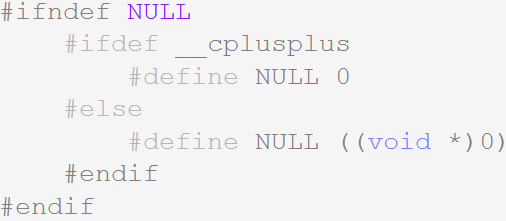

可以发现`NULL`是个宏，且在C++文件中是被当成整型数字0来处理的，可能在某些情况下会导致隐患，所以C++推荐我们使用`nullptr`，它是C++11作为关键字引入的。

### 10. 四种强制类型转换

C语言的隐式类型转换容易发生意外，C++为规范使用类型转换提出了四种强制类型转换的操作符。

#### 10.1 static_cast

静态转换static_cast，就是隐式类型转换。相近类型的转换用static_cast。

```cpp
i = d1;
i = static_cast<int>(d1);
```

#### 10.2 reinterpret_cast

非相近类型的转换用static_cast会报错，就要用reinterpret_cast表示重新解释。

```cpp
int* p = static_cast<int*>(i); //err
int* p = reinterpret_cast<int*>(i);
```

#### 10.3 const_cast

const_cast用来去掉const变量的const属性。

```cpp
volatile const int a = 2;
int* pa = const_cast<int*>(&a);

cout << a << endl;
cout << *pa << endl;
```

#### 10.4 dynamic_cast

dynamic_cast支持向下转型，就是能让父类指针或引用赋值给子类的指针或引用，并保证安全。条件是父子类支持多态。

如果随意将父类指针改为子类指针类型，会导致越界访问。

所谓保证安全，是如果父类指针指向的是子类对象，那么dynamic_cast可以转成功。反之，则返回空。

> 父类对象无论如何都不可以赋值给子类对象。

```cpp
A* pa = new A;
B* pb = dynamic_cast<B*>(pa); // nullptr

A* pa = new B;
B* pb = dynamic_cast<B*>(pa);

cout << "pa1" << pa1 << "\tdynamic_cast: " << pb1 << endl;
cout << "pa2" << pa2 << "\tdynamic_cast: " << pb2 << endl;
```

## 类和对象

#### 面向对象

直到七十年代面向过程编程在开发大型程序时表现出不足，计算机界提出了面向对象思想（Object Oriented Programming），**面向对象三大特性是封装、继承和多态**。

面向过程和面向对象只是计算机编程中两种侧重点不同的思想，面向过程算是一种最为实际的思考方式，其中重要的是模块化的思想，面向过程更注重过程或者说动作的步骤。

面向对象也是含有面向过程的，面向对象主要是把事物给对象化，把事物看作为对象和对象之间的关系，更符合人对事物的认知方式。

面向对象是一个广泛而深刻的思想，不可能一时半会就理解透彻，需要在学习和工作中慢慢体会。

> C++不是纯面向对象语言，它支持面向对象，又兼容C也支持面向过程。

### 1. 类的定义

```cpp
struct Student
{
    //成员变量
    char _name[20];
    int _age;
    int _id;

    //成员方法
    void Init(const char* name, int age, int id)
    {
        strcpy(_name, name);
        _age = age;
        _id = id;
    }

    void Print()
    {
        cout << _name << " " << _age << " " << _id << endl;
    }
};

int main()
{
    Student s1, s2;
    s1.Init("yyo", 19, 1);
    s1.Print();
    s2.Init("yyx", 18, 2);
    s2.Print();
}
```

C语言的结构体中只能定义变量，就相当于是个多个变量的集合，操作成员变量的方式也比较繁琐且容易出现错误。

C++ 中定义类有两个关键字分别是`struct`和`class`，结构体在C++中也升级成了类。

类名可以直接作类型使用，类中不仅可以定义变量，还可以定义函数。类中的变量和函数都叫类的成员。

### 2. 类的封装

面向对象讲究“封装”二字，封装体现在两方面，一是将数据和方法都放到类中封装起来，二是给成员增加访问权限的限制。

#### 2.1 访问限定修饰符

C++共有三个访问限定符，分别为**公有`public`，保护`protect`，私有`private`**。

- `public`修饰的成员可以在类外直接访问，`private`和`protect`修饰的成员在类外不能直接访问。
- `class`类中成员默认访问权限为`private`，`struct`类中默认为`public`。
- 从访问限定符出现的位置到下一个访问限定符出现的位置之间都是该访问限定符的作用域。

> 和 public 相比，private 和 protect 是类似的，它二者具体区别会在之后的继承中谈到。

封装的意义就在于**规范成员的访问权限，更好的管理类的成员**，一般是将成员的访问权限标清楚。

```cpp
class Student
{
private:
    //成员变量
    char _name[20];
    int _age;
    int _id;

public:
    //成员方法
    void Init(const char* name, int age, int id)
    {
        strcpy(_name, name);
        _age = age;
        _id = id;
    }
    void Print()
    {
        cout << _name << " " << _age << " " << _id << endl;
    }
};
```

注意，访问限定修饰符只在编译阶段起作用，之后不会对变量和函数造成任何影响。

#### 2.2 类的封装

面向对象三大特性是封装、继承和多态。

C++ 相对 C 语言，数据和方法都封装到类里，数据的访问是受限制的。不允许在函数外操作和改变结构。使得代码更加安全且易于操作。

```cpp
class Stack {
public:
    void Init();
    void Push(STDataType x);
    void Pop();
    STDataType Top();
    int Size();
    bool Empty();
    void Destroy();
private:
    STDataType* _a;
    int _top;
    int _capacity;
};
```

### 3. 类的特性

#### 3.1 类的作用域

类定义了一个新的作用域，类中所有成员都在类的作用域中。

1. 在满足内联函数的要求的情况下，编译器默认将**类内定义的函数当作内联函数处理**。
2. 在类外定义成员函数时，需要使用域作用限定符`::`指明该成员归属的类域。

```cpp
void	   Stack::Init();
void 	   Stack::Push(STDataType x);
void 	   Stack::Pop();
STDataType Stack::Top();
int  	   Stack::Size();
bool 	   Stack::Empty();
void 	   Stack::Destroy();
```

#### 3.2 类的实例化

用类创建对象的过程，就称为类的实例化。

1. 类只是一个“模型”，类中的成员变量也只是声明，并没有为其分配空间。
2. 由类可以实例化得多个对象，对象在内存中占据实际的空间，用于存储类成员变量。

> 类和对象的关系，就与类型和变量的关系一样，可以理解为图纸和房子的关系。

#### 3.3 类对象的存储

> 既然类中既有成员变量又有成员函数，类对象如何存储？

```cpp
class Stack {
public:
    void Init();
    void Push(int x);
    // ...
private:
    int* _a;
    int _top;
    int _capacity;
};
Stack st;
cout << sizeof(Stack) << endl;
cout << sizeof(st) << endl;
```

由类实例化出多个对象时，各个对象的成员变量相互独立，但成员函数是相同的。因此，**对象中仅存储类变量，成员函数存放在公共代码段**。

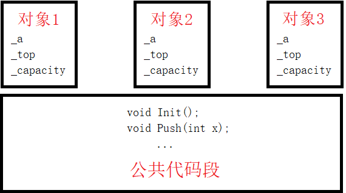

类的大小就是该类中成员变量之和，要求内存对齐，和结构体一样。

注意，空类的大小为1个字节，用来标识这个对象的存在。

#### 3.4 this 指针

```cpp
class Date {
public:
    void Init(int year, int month, int day) {
        _year = year;        //1.
        Date::month = month; //2.
        this->day = day;     //3.
    }
private:
    int _year;
    int month;
    int day;
};
```

如果成员变量和形参重名的话，赋值操作会优先使用形参，无法指定成员变量，这种问题有三种解决方案：

1. 在成员变量名前加`_`，以区分成员和形参。
2. 使用域访问修饰符`::`，指定前面的变量是成员变量。
3. 使用 this 指针。

##### this 指针的定义

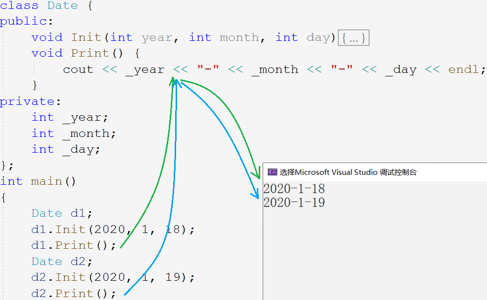

> 但函数并不存放在类对象中，那调用`Print()`时如何区分不同对象呢？

C++ 中引入 this 指针解决该问题，this 是 C++ 的一个关键字，代表当前对象的指针。

编译器给每个非静态的成员函数增加了一个隐含的形参叫 this 指针。

this 指针指向当前调用对象，函数体中所有对成员变量的操作都通过该指针访问，但这些操作由编译器自动完成，不需要主动传递。

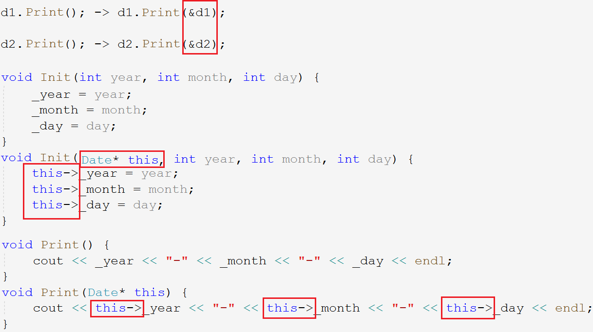

在传参时隐式传入了对象指针，形参列表中也隐藏增加了对象指针，函数体中访问成员变量的前面也隐藏了 this 指针。

> 这些操作都由编译器自动处理，不用也不能手动传递。

##### this 指针的特性

1. 调用成员函数时，不可以显式传入 this 指针，成员函数参数列表也不可显示声明 this 指针。
2. 成员函数中可以显式使用 this 指针。
3. this 的类型为`classType* const`，加 const 是为了防止 this 指针被改变。

4. this 指针是成员函数的形参，函数被调用时对象传入该指针，所以 this 指针存储在函数栈帧中，对象中不存储 this 指针。

```cpp
class A {
public:
    void Print() { cout <<  _a      << endl; }
    void Show()  { cout << "Show()" << endl; }
private:
    int _a;
};

int main()
{
    A* a = nullptr;

    a->Show();	//1.
    a->Print();	//2.
}
```

- 函数没有存储在对象中，调用函数并不会访问空指针`a`，空指针仅作参数传入成员函数而已。
- `Show()`函数没有访问对象中的内容，故没有访问空指针。
- `Print()`函数需到访问成员`_a`，故访问空指针程序崩溃。

### 4. 默认成员函数

对象一般都要进行初始化，释放空间，拷贝复制等等操作。由于这些操作经常使用，在设计之初就被放到类中作为默认的成员函数使用。

C++的默认成员函数机制较为复杂，一个类有6个默认的成员函数，分别为构造函数、析构函数、拷贝构造、赋值运算符重载以及取地址操作符重载（以及const版本）。

他们都是特殊的成员函数，这些特殊函数不能被当作常规函数调用。

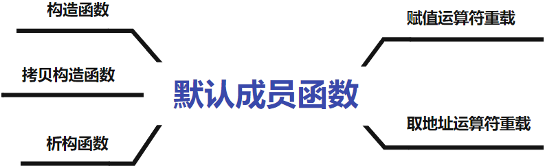

默认的意思是我们不写编译器会自动生成一份，但如果我们写了编译器就不生成了。自动生成默认函数有的时候功能不够全面，还是得自己写。

#### 4.1 构造函数

##### 构造函数的定义

构造函数和析构函数分别是完成初始化和清理资源的工作。

构造函数是一个特殊的函数，名字与类名相同，没有返回值。创建对象时被编译器自动调用，用于初始化每个成员变量，并且在对象的生命周期中只调用一次。

```cpp
class Date
{
public:
    Date()
    {}
private:
    // ...
};
```

##### 构造函数的特性

构造函数并不是开辟空间定义成员变量，成员变量在创建对象时就已被创建，而初始化对象中的成员变量。

- 函数名和类名相同，且无返回类型。
- 对象实例化时由编译器自动调用对应的构造函数。
- 构造函数支持函数重载。

```cpp
Date d1;            // 调用无参的构造函数
Date d2();          // Err 会被解释为函数声明
Date d2(2020,1,18); // 调用带参的构造函数
```

对象实例化时，就是在调用构造函数，且调用无参的构造函数不能带括号，否则会当成函数声明。

- 若类中没有显式定义构造函数，程序默认创建的构造函数是无参的。一旦显式定义了编译器就不会生成。
- 无参的构造函数、全缺省的构造函数和默认生成的构造函数都算作是默认构造函数，为防止冲突默认，构造函数只能有一个。

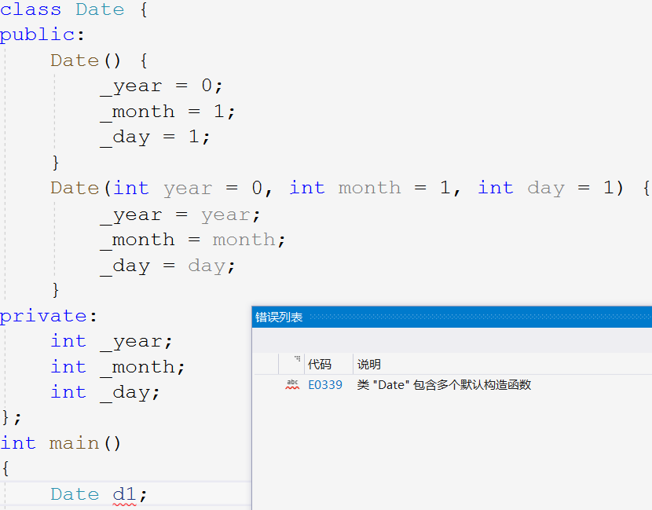

##### 默认构造初始化规则

默认构造函数对内置类型的成员不作处理，对自定义类型成员会调用它们的默认构造来初始化自定义类型成员。

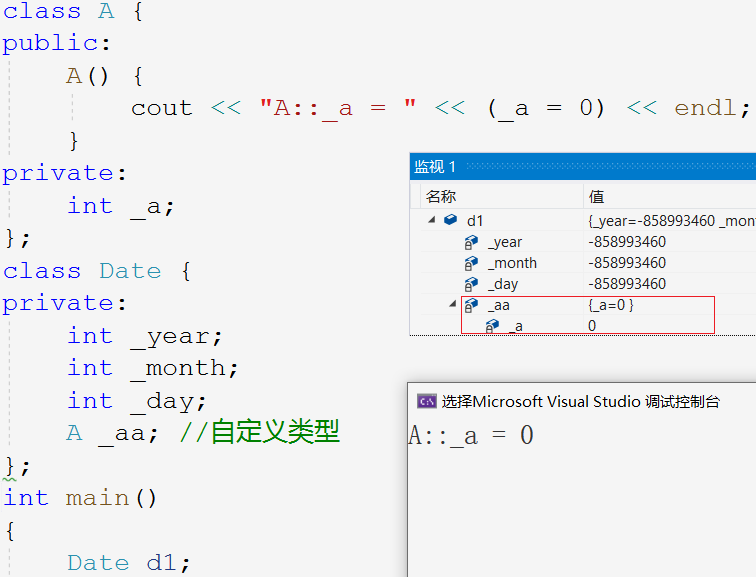

#### 4.2 析构函数

##### 析构函数的定义

析构函数的名字是`~`加类名，是无参无返回值的，故不支持重载。

析构函数不是完成对象的销毁，而是负责清理资源，对象是随生命周期结束而销毁，析构函数会在对象销毁时自动调用。

```cpp
class Date {
public:
    Date (int year = 1, int month = 1, int day = 1) {
        _year = year;
        _month = month;
        _day = day;
    }
    ~Date()
    {}
private:
    int _year;
    int _month;
    int _day;
};
```

##### 析构函数的特性

- 一个类中有且仅有一个析构函数，同样若未显式定义，编译器自动生成默认的析构函数。
- 对象生命周期结束时，编译器自动调用析构函数。
- 调用析构函数的顺序和创建对象的顺序是相反的，因为哪个对象先压栈哪个对象就后销毁。

> 自动调用析构函数，可以避免内存泄漏的问题。不是所有类都需要析构函数，但对于有些类就很方便。

##### 默认析构清理规则

默认生成的析构函数同样对内置类型的成员变量不作处理，**对自定义类型的成员会调用它们的析构函数**。

> 不释放内置类型的成员也是有一定道理的，防止释放一些文件指针等等可能导致程序崩溃。

#### 4.3 拷贝构造

除了初始化和销毁以外，最常见的就是对象赋值和拷贝对象。而类这种复杂类型直接赋值是不起作用的，拷贝对象要由拷贝构造实现，每次拷贝对象都要调用拷贝构造函数。

##### 拷贝构造的定义

拷贝构造函数也是特殊的成员函数，负责对象的拷贝赋值工作。

拷贝构造只会在用同类型的对象初始化新对象时，由编译器自动调用。拷贝构造是构造函数的一种重载，故拷贝构造的函数名和构造函数相同。

```cpp
class Date
{
public:
    Date(int year = 1, int month = 1, int day = 1) {
        _year = year;
        _month = month;
        _day = day;
    }
    Date(const Date& d) {
        _year = d.year;
        _month = d.month;
        _day = d.day;
    }
};
int main()
{
    Date d2(d1);  // 调用拷贝构造
    Date d2 = d1; // 同样也是调用拷贝构造
}
```

`()`和`=`的方式，都是在定义对象并初始化，都需要调用拷贝构造。

##### 拷贝构造的特性

- 拷贝构造函数是构造函数的一个重载形式。
- 拷贝构造函数只有一个参数，且**必须是同类型的对象的引用**，否则会引发无穷递归。

> 传值传参就要拷贝对象，要想拷贝对象就要调用拷贝构造，而调用拷贝构造函数又要传值传参，这样就会在调用逻辑死循环出不来了。

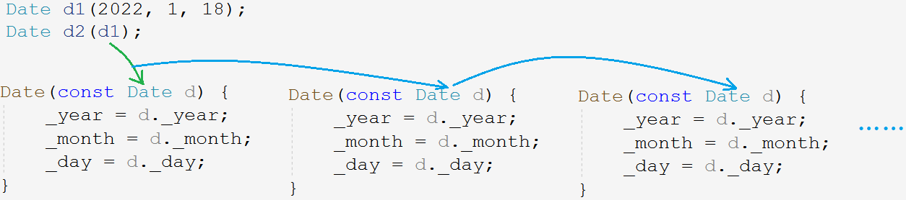

- 一般拷贝构造另一个对象时，不希望原对象发生改变，所以形参对象的引用被`const`修饰。
- 若只显式定义拷贝构造，系统就不会生成默认的构造函数，因为拷贝构造是构造函数的一份重载。

##### 默认拷贝构造拷贝规则

默认生成的拷贝构造，对于内置类型的成员，是把该成员逐字节拷贝至新对象中。这样的拷贝被称为浅拷贝或值拷贝。

默认生成的拷贝构造，对于自定义类型的成员，会调用该自定义类型成员的拷贝构造。

> 浅拷贝有时会发生错误，是否实现拷贝构造看情况而定。

### 5. 运算符重载

运算符重载是 C++ 的一大利器，使得对象也可以用各种运算符更方便的进行有意义的运算。编译器无法生成默认的各种运算符重载函数，这里的规则需要我们自行定义。

#### 5.1 运算符重载的定义

运算符重载是具有特殊函数名的函数，也具有返回类型、函数名和参数列表。由编译器自动识别和调用。

1. 函数名是关键字`operator`加需要重载的运算符符号，如`operator+`，`operator=`等。
2. 返回类型和参数都要根据运算符的规则和含义的实际情况来定。

```cpp
bool operator>(const Date& d1, const Date& d2) {
    if (d1._year > d2._year)
        return true;
    else if (d1._year == d2._year && d1._month > d2._month)
        return true;
    else if (d1._year == d2._year && d1._month == d2._month && d1._day > d2._day)
        return true;
    else
        return false;
}
//...
int main()
{
    d1 > d2;
    operator>(d1, d2);
}
```

两种调用方式都可以，编译器把`d1>d2`转化成`operator>(d1,d2)`。大大提高了代码的可读性。

#### 5.2 运算符重载的特性

- 只能重载已有的运算符，不能使用其他符号来定义新的运算，如`operator@`。
- 运算符重载函数最多有两个形参，分别作为运算符的左右操作数，自定义类型最好采用常引用传参。
- 操作符重载，不建议改变该操作符本身含义。
- 共有5个运算符不可被重载，分别是：`.*`、`::`、`sizeof`、`?:`、`.`。
- 运算符重载和类无关，并不单独局限于某个类。如果要**将运算符重载放到类中，作为类成员函数，具有隐藏形参 this 指针，所以只有一个参数位置**。

```cpp
bool operator==(const Date& d1, const Date& d2) {
    return d1._year == d2._year && d1._month == d2._month && d1._day == d2._day;
}

class Date {
public:
    Date(int year = 0, int month = 1, int day = 1);
    bool operator==(const Date& d) {
        return _year == d._year && _month == d._month && _day == d._day;
    }

private:
    int _year;
    int _month;
    int _day;
};

int main()
{
    d1 == d2;
    d1.operator==(d2);
}
```

#### 5.3 赋值运算符重载

赋值重载实现的是对象的赋值操作，和拷贝构造不同，**拷贝构造是用一个已存在的对象去初始化一个对象，赋值重载是将一个对象赋值给自身对象**。

```cpp
Date d5 = d1; // 用已存在的对象初始化新对象，调用的是拷贝构造
d5 = d1;      // 把一个已存在的对象赋值给另一个已存在的对象，调用的是赋值重载
```

- 参数列表：自身作为左操作数，参数为右操作数的引用。
- 返回类型：返回当前对象的引用，以支持连续赋值。

```cpp
// i = j = k = 1;
Date& Date::operator=(const Date& d)
{
    if (this != &d) // 优化自己给自己赋值
    {
        _year = d._year;
        _month = d._month;
        _day = d._day;
    }
    return *this;
}
```

> 不使用引用会调用拷贝构造，为减少拷贝和避免修改原对象，最好使用常引用。

##### 默认赋值重载赋值规则

如果没有显式定义赋值重载，编译器会生成一个默认赋值重载。

默认赋值重载对于内置类型的成员采用浅拷贝的方式，对于自定义类型的成员会调用它内部的赋值重载函数。

> 所以写不写赋值重载仍然要视情况而定。

### 6. 日期类的实现

#### 6.1 日期类的构造函数

```cpp
int Date::GetMonthDay()
{
    static int MonthDayArray[13] = { 0, 31 ,28, 31, 30, 31, 30, 31, 31, 30, 31, 30, 31 };

    if (_month == 2 && ((_year % 4 == 0 && _year % 100 != 0) || (_year % 400 == 0)))
        return 29;
    return MonthDayArray[_month];
}

Date::Date(int year, int month, int day)
{
    _year = year;
    _month = month;
    _day = day;
}
```

#### 6.2 比较运算符的重载

```cpp
//运算符重载 >
bool Date::operator>(const Date& d) {
    if (_year > d._year) {
        return true;
    }
    else if (_year == d._year && _month > d._month) {
        return true;
    }
    else if (_year == d._year && _month == d._month && _day > d._day) {
        return true;
    }
    return false;
}
//运算符重载 >=
bool Date::operator>=(const Date & d) {
    return (*this > d) || (*this == d);
}
//运算符重载 <
bool Date::operator<(const Date& d) {
    return !(*this >= d);
}
//运算符重载 <=
bool Date::operator<=(const Date& d) {
    return !(*this > d);
}
//运算符重载 ==
bool Date::operator==(const Date& d) {
    return (_year == d._year) && (_month == d._month) && (_day == d._day);
}
//运算符重载 !=
bool Date::operator!=(const Date& d) {
    return !(*this == d);
}
```

#### 6.3 加法运算符的重载

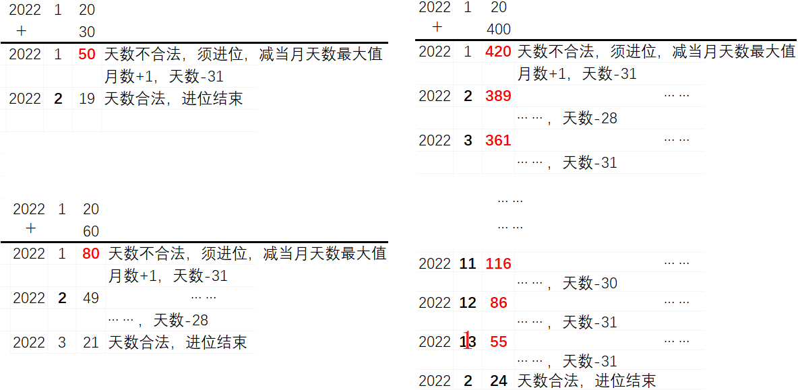

先将天数加到天数位上，然后判断天数是否合法。

1. 如果不合法则要减去当月的最大合法天数值，相当于进到下一月，即**先减值再进位**。
2. 若天数合法，则进位运算结束。
3. 在天数进位的同时，月数如果等于13则赋值为1，再年份加1，可将剩余天数同步到明年。

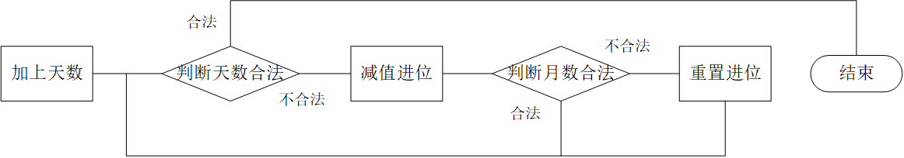

先减值再进位的原因是，减值所减的是当月的最大合法天数。

```cpp
// 运算符重载 +=
Date& Date::operator+=(int day)
{
    _day += day;
    while (_day > GetMonthDay()) // 检查天数是否合法
    {
        _day -= GetMonthDay(); // 天数减当月合法最大值
        _month++;

        if (_month == 13) // 检查月数是否合法
        {
            _month = 1;
            _year += 1; // 年份进位
        }
    }
    return *this;
}
// 运算符重载 +
Date Date::operator+(int day) // 临时变量会销毁，不可传引用
{
    Date ret(*this);
    ret += day;

    return ret;
}
```

#### 6.4 减法运算符的重载

先将天数减到天数位上，再检查天数是否合法：

1. 如果天数不合法，向月份借位，再加上上月的最大合法天数，即**先借位再加值**。并检查月份是否合法，月份若为0则置为12年份再借位。
2. 如果天数合法，则停止借位。

先借位再加值是因为加值相当于去掉上个月的过的天数，所以应加上的是上月的天数。

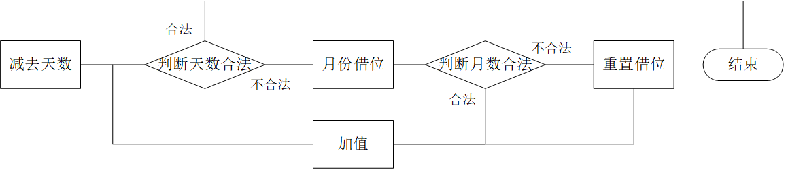

```cpp
//运算符重载 -=
Date& Date::operator-=(int day)
{
    if (_day < 0) // 防止天数是负数
        return *this += -day;

    _day -= day;
    while (_day <= 0) // 检查天数是否合法
    {
        _month--;

        if (_month == 0) // 检查月份是否合法
        {
            _month = 12;
            _year--; // 年份借位
        }
        _day += GetMonthDay();// 天数加上当月合法最大值
    }
    return *this;
}

//运算符重载 -
//日期 - 天数 = 日期
Date Date::operator-(int day)
{
    Date ret(*this);
    ret -= day;
    return ret;
}
//日期 - 日期 = 天数
int Date::operator-(const Date& d)
{
    int flag = 1;
    Date max = *this;
    Date min = d;

    if (max < min)
    {
        max = d;
        min = *this;
        flag = -1;
    }

    int gap = 0;
    while ((min + gap) != max)
        gap++;

    return gap * flag;
}
```

#### 6.5 自增自减的重载

C++为区分前置和后置，**规定后置自增减的重载函数设置一个`int`参数占位**，可以和前置构成重载。

```cpp
//前置++
Date& Date::operator++() {
    return *this += 1;
}
//后置++
Date Date::operator++(int) {
    return (*this += 1) - 1;
}
//前置--
Date& Date::operator--() {
    return *this -= 1;
}
//后置--
Date Date::operator--(int) {
    return (*this -= 1) + 1;
}
// 实现方式2
Date ret = *this;
*this + 1;
return ret;
```

### 7. const 类

被 const 修饰的类即为 const 类，const 类调用成员函数时出错，因为参数 this 指针从`const ClassType*`到`ClassType*`涉及权限放大的问题。如图所示：

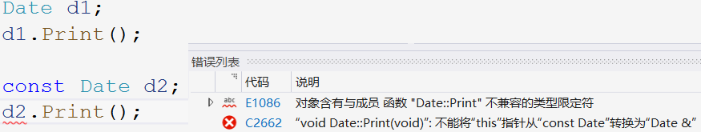

#### 7.1 const 类的成员函数

this 指针作为隐含参数不可被修改，C++规定在函数声明后面加上 const ，就相当于给形参 this 指针添加 const 修饰。

```cpp
//运算符重载 !=
//声明
bool Date::operator!=(const Date& d) const;
//定义
bool Date::operator!=(const Date& d) const {
    return !(*this == d);
}
```

const 修饰成员函数，实际修饰函数的隐含形参 this 指针，这样函数内就不可修改对象的成员变量。

#### 7.2 取地址操作符重载

取地址操作符重载和 const 取地址操作符重载，这两个默认成员函数一般不用定义，编译器默认生成的就够用了。

```cpp
Date* operator&() {
    return this;
}
const Date* operator&() const {
    return this;
}
```

> 当不允许获取对象的地址时，返回空即可。

### 8. 初始化列表

#### 8.1 初始化列表的定义

进入构造函数内时，成员变量已经创建好，此时再修改成员变量的值是赋值而不是初始化。如果想要定义成员时就初始化，就使用初始化列表。

```cpp
Date(int year = 1, int month = 1, int day = 1)
    : _year(year)
    , _month(month)
    , _day(day)
{}
```

在构造函数的参数列表后函数体前，以`:`起始，`,`间隔，用类似构造函数的方式初始化变量。

#### 8.2 初始化列表的特性

- 初始化列表只能用在构造函数中（拷贝构造也是一种构造函数）。
- 变量只能初始化一次，故每个成员变量只能在初始化列表出现一次。
- 三种成员变量必须放在初始化列表进行初始化：
  - 引用成员变量
  - const 常变量成员
  - 无默认构造函数的自定义类型成员。

```cpp
class test {
public:
    Date(int year = 1, int month = 1, int day = 1, int i = 1)
        : _ref(i)
        , _j(0)
        , _a(10);
    {}
private:
    int& _ref;    // 引用必须初始化
    const int _j; // const修饰的变量必须初始化
    A _a;         // 自定义类型必须要有默认构造函数
};
```

- 成员在**类中的声明次序就是其在初始化列表中的初始化顺序**，与初始化列表中的顺序无关。

```cpp
class A {
public:
    A()
        : _a2(1)
        , _a1(_a2)
    {}
    void Print() { cout << _a1 << " " << _a2 << endl; }
private:
    int _a1;
    int _a2;
};

int main()
{
    A().Print(); // 2078469811 1
}
```

> 声明次序是先 _a1_ 后 _a2_，所以初始化列表中先初始化 _a1_ 后初始化 _a2_。

初始化列表的效率更高，尽量使用初始化列表初始化成员。

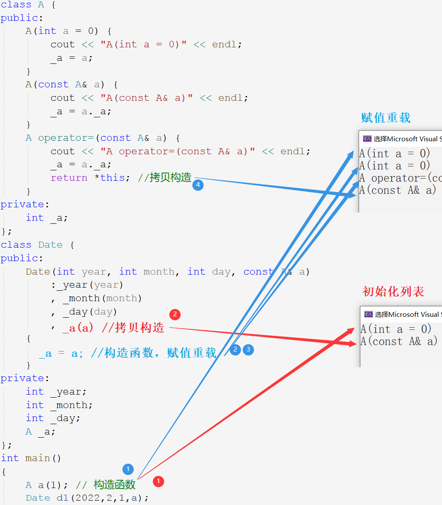

##### 成员初始化新方法

构造函数默认不初始化内置类型的成员，后以打补丁的方式，新增了一种初始化成员变量的方式。

C++11 支持在声明处对非静态成员予以缺省值，如果该变量没有初始化，就会使用该缺省值。缺省值会在初始化列表中起作用初始化。

```cpp
class B {
public:
    B(int b1 = 0, int b2 = 0)
        : _b1(b1)
        , _b2(b2)
    {}
private:
    int _b1;
    int _b2;
};
class A {
private:
    int _a = 1; // 声明变量缺省值
    B _b = { 20,10 };
    int _arr[] = { 1,2 };
    int* _p = (int*)malloc(4);
};
```

#### 8.3 关键字 explicit

C++中支持两种实例化对象的方式。

```cpp
Date d (2022) ;  // 构造函数
Date d = 2022; // 隐式类型转换
```

隐式类型转换过程中，产生了一个类类型的临时变量`Date tmp (2022) `，再用该临时变量初始化`d`。

```cpp
Date d = 2022;
--------------
Date tmp (2022) ; // 调用构造函数初始化临时对象
Date d(tmp);    // 调用拷贝构造初始化目标对象
```

编译器会将这一次构造函数和一次拷贝构造，优化成一次构造函数。也就是直接用该值去调用构造函数。

如果不想发生这样的隐式类型转换，可以用`explicit`修饰构造函数：

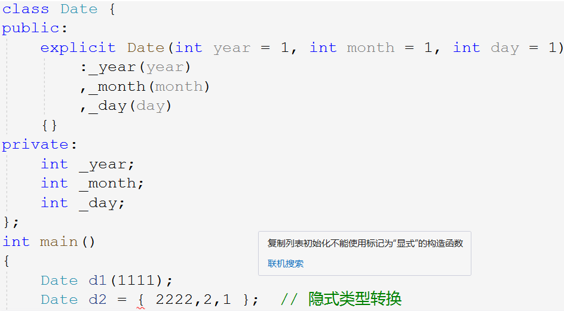

```cpp
void func1(A aa)        {}
void func2(const A& aa) {}

int main()
{
    A aa = 1;    // 构造函数+拷贝构造，优化成一次构造

    func1(aa);   // 无优化
    func1(1);    // 构造函数+拷贝构造，优化成一次构造
    func1(A(1)); // 构造函数+拷贝构造，优化成一次构造

    func2(aa);   // 无优化
    func2(1);    // 一次构造函数
    func2(A(1)); // 一次构造函数
}

A func3() { A aa; return aa; }
A func4() { return A(); }

int main()
{
    func3();        // 返回值一次拷贝构造
    A aa = func3(); // 返回值一次拷贝构造+接收返回值一次拷贝构造，优化成拷贝构造

    func4();        // 匿名对象一次构造函数+返回值一次拷贝构造，优化成一次构造
    A aa = func4(); // 构造+拷贝构造+拷贝构造，优化为构造
}
```

### 9. 静态成员

#### 9.1 静态成员的定义

用 _static_ 修饰的成员变量叫静态成员变量，用 _static_ 修饰的成员函数叫静态成员函数。静态变量存储在静态区，其生命周期被扩大到整个程序的开始到结束。

```cpp
//计算创建了多少个类对象
class A {
public:
    A(int a = 0)  { _sCount++; }
    A(const A& a) { _sCount++; }
    static int GetCount() { return _sCount; }
private:
    static int _sCount; // 声明
};

int A::_sCount = 0; // 定义

int main()
{
    A a1;
    //...
    cout << A::GetCount() << endl;
}
```

#### 9.2 静态成员的特性

- 静态成员变量必须在类外定义，定义时不能用 _static_ 修饰。
- 静态成员变量为所有类对象共享。静态成员存储在静态区，故计算类的大小时不算静态成员。
- 静态成员可用类名加域作用符`::`访问，也可以使用对象名加访问符`.`访问。
- 静态成员函数没有隐含的 _this_ 指针，不能访问任何非静态成员。
- 非静态成员函数可以调用静态成员函数，但静态成员函数不能调用非静态成员函数。

### 10. 友元

友元是一种突破封装的机制，有时提供了便利，但会增加耦合度，破坏封装，所以友元不宜多用。

 友元分为：友元函数和友元类。

#### 10.1 友元函数的定义

**友元函数是定义在类外的普通函数，但作为类的友元可以访问类的私有成员**。声明的方式是在类体中声明函数并用 friend 修饰。

```cpp
class Date {
public:
    // 友元声明
    friend ostream& operator<<(ostream& out, const Date& d); // 流插入<<
    friend istream& operator>>(istream& in,        Date& d); // 流提取>>
private:
    int _year;
    int _month;
    int _day;
};
ostream& operator<<(ostream& out, const Date& d) {
    return out << d._year << "-" << d._month << "-" << d._day << endl;
}
istream& operator>>(istream& in, Date& d) {
    return in >> d._year >> d._month >> d._day;
}
```

####  10.2 友元函数的特性

- 友元函数可以访问类的私有和保护成员，但其本身不是类的成员函数，不受访问限定符的限制，友元函数可以声明在类的任意地方。
- 友元函数不是成员函数，所以不能用 _const_ 修饰。
- 一个函数可以是多个类的友元，调用方式和普通函数一致。

#### 10.3 友元类

友元类的所有成员函数都是另一个类的友元函数，都可以访问另一个类的成员变量。比如下方例子：日期类是时间类的友元类，故日期类中所有函数都可以访问时间类的成员变量。

```cpp
class Time {
public:
    friend class Date; //声明日期类是时间类的友元类
    Time(int hour = 0, int minute = 0, int second = 0)
        : _hour(hour)
        , _minute(minute)
        , _second(second)
    {}
private:
    int _hour;
    int _minute;
    int _second;
};
class Date {
public:
    Date(int year = 1,int month = 1,int day = 1)
        :_year(year)
        ,_month(month)
        ,_day(day)
    {
        _t._hour = _t._minute = _t._second = 0;
    }
private:
    int _year;
    int _month;
    int _day;
    Time _t;
};
```

> 友元类声明在另一个类中，相当于另一个类拿着小本本记下友元类是自己的好朋友，这样“好朋友”就可以随便访问自己的成员啦。友元类的关系容易搞混，记住上面的比喻就可以了。

- **友元关系是单项的**，友元类可以访问另一个类，但另一个类不可以访问友元类。
- 友元关系不具有传递性，即 A 是 B 的友元，B 是 C 的友元，但 A 不是 C 的友元。

### 11. 内部类

> C++ 开发时并不喜欢使用内部类。视情况而定。

#### 11.1 内部类的定义

将一个类定义在另一个类的内部，这个定义在内部的类就叫内部类。

- 内部类只是**作用域被限定在外部类中**，空间上不算外部类。
- **内部类是外部类的友元类**，但外部类不是内部类的友元。

> 可以想象成外部类把内部类放在心里，所以内部类随意访问外部类。

- 内部类可以定义在外部类的任意地方，但被外部访问时会受访问限定符的限制。
- 计算外部类的大小和内部类无任何关系，因为内部类并不属于外部类。

```cpp
class A
{
public:
    class B
    {
        void setA() { _a = 1 };
        int _b;
    };

private:
    class C
    {
        void setA() { _a = 1 };
        int _c;
    };

    int _a;
};
```

## C/C++内存管理

### 1. 内存分布

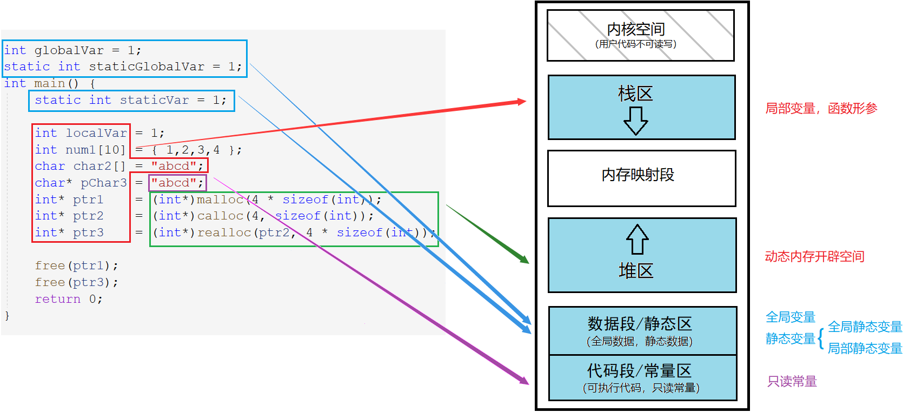

| 区域          | 解释                                                         |
| ------------- | ------------------------------------------------------------ |
| 栈区          | 函数栈帧、函数形参、局部变量都会在栈区上创建。               |
| 堆区          | 动态开辟的空间。                                             |
| 数据段/静态区 | 存放全局变量，静态数据。                                     |
| 代码段/常量区 | 存放可执行代码、指令一类的和只读常量，这些东西一般不会被修改。 |

- 字符串数组`char2`的内容`"abcd"`是存储在栈上的，是从常量区拷贝过来的。（数组是开辟在栈上的，数组地址也就是元素首地址）
- `pchar3`指针所指向的内容是存在常量区的。

### 2. 动态内存管理

#### 2.1 C动态内存管理

##### malloc

```c
void* malloc ( size_t size );
```

- `malloc`返回通用类型的指针，将其强制转换为所需类型，并用该类型的指针维护该内存空间。
- 开辟成功返回空间起始地址，开辟失败则返回`NULL`。

##### calloc

```c
void* calloc ( size_t num, size_t size );
```

`calloc`函数在堆区上申请`num`个`size`大小的空间，返回起始地址并将内容初始化为0。

##### realloc

```c
void* realloc ( void* memblock, size_t size );
```

`realloc`函数为已开辟的空间重新开辟大小。

- 当原空间后有足够大小时，就紧接原空间开辟剩余空间，并返回整个空间的起始地址。反之，就在堆区寻找新空间，再将原空间的内容移动到新空间，返回新空间的地址且释放原空间。
- 当剩余空间不够无法开辟时，增容失败，返回`NULL`。

##### free

```c
void free ( void* memblock );
```

- `free`函数释放指针指向的动态开辟的空间，但不对指针造成任何影响。

#### 2.2 C++动态内存管理

```cpp
// C++动态申请
int* p3 = new int;
int* p4 = new int[5];
// 动态释放
delete p3;
delete[] p4;
```

使用关键字 new 开辟空间，不需要强转。不需要判空，new 会以抛异常的形式提示错误，符合面向对象的错误处理机制。

new 后面可以使用`()`进行初始化，C++11支持用`{}`初始化连续空间。

```cpp
//初始化空间
int* p1 = new int(5);
int* p2 = new int[5] {1,2,3,4,5};
```

| 开辟     | 实现原理                                                     |
| -------- | ------------------------------------------------------------ |
| new      | 调用 operator new 申请空间，调用构造函数构造对象             |
| delete   | 调用析构函数清理资源，调用 operator delete 释放空间          |
| new[N]   | 调用 operator new[] ，由该函数调用 operator new 申请N块空间，再调用N次构造函数构造对象 |
| delete[] | 调用N次析构函数清理资源，再调用 operator delete[]，去调用N次 operator delete 释放空间 |

##### new/delete开辟销毁规则

- malloc/free只会开辟空间和释放空间，不会做任何处理。
- **new/delete不仅开辟空间和释放空间，对自定义类型，会调用构造和析构**。

> 如果混用，规则不会发生变化，但可能因调用构造和析构的次数不匹配而导致程序出错。

故最好匹配使用，不要随意搭配，否则可能会出错。

```cpp
//1.
int* p = (int*)malloc(sizeof(int));
free(p);

//2.
int* p = new int;
delete p;

//3.
int* p = new int[5];
delete[] p;
```

##### 不匹配报错情况测试

```cpp
void test1()
{
    A* p = (A*)malloc(sizeof(A) * 4);
    delete[] p; // 死循环调用析构
    delete p;
    free(p);
}
void test2()
{
    A* p = new A;
    delete[] p; // 死循环调用析构
    delete p;
    free(p);
}
void test3()
{
    A* p = new A[2];
    delete[] p;
    delete p;   // 程序异常终止
    free(p);    // 程序异常终止
}
```

### 3. operator new/delete函数

new 和 delete 是C++提供动态内存申请和释放的操作符。operator new 和 operator delete 是C++提供的全局函数，注意不是操作符重载。

- **new 底层先是调用 operator new 开辟空间，再调用构造函数初始化**。
- **delete 底层先是调用析构函数清理资源，再调用 operator delete 释放空间**。

> new/delete 的底层是分别调用 operator new/operator delete 来实现的，
>
> 而 operator new/operator delete 又是分别调用C语言的 malloc/free 实现的。

#### 3.1 operator new/delete函数实现

```cpp
void *__CRTDECL operator new(size_t size) _THROW1(_STD bad_alloc)
{       // try to allocate size bytes
    void *p;
    while ((p = malloc(size)) == 0)
        if (_callnewh(size) == 0)
        {       // report no memory
            static const std::bad_alloc nomem;
            _RAISE(nomem);
        }

    return (p);
}
void operator delete(void *pUserData)
{
        _CrtMemBlockHeader * pHead;
        RTCCALLBACK(_RTC_Free_hook, (pUserData, 0));
        if (pUserData == NULL)
            return;
        _mlock(_HEAP_LOCK);  /* block other threads */
        __TRY
            /* get a pointer to memory block header */
            pHead = pHdr(pUserData);
             /* verify block type */
            _ASSERTE(_BLOCK_TYPE_IS_VALID(pHead->nBlockUse));
            _free_dbg( pUserData, pHead->nBlockUse );
        __FINALLY
            _munlock(_HEAP_LOCK);  /* release other threads */
        __END_TRY_FINALLY
        return;
}
```

**operator new/operator delete 就是对 malloc/free 的封装，在此基础上多了抛异常的错误处理机制**。

除此以外还有 operator new[]/operator delete[]，封装的是 operator new/operator delete。

> operator new/operator delete 并不是提供给用户使用的函数，是提供给 new 和 delete 使用的。

#### 3.2 new/delete 类专属重载*

operator new 一般有两种形式，一是全局重载的 operator new，二是针对某个类专属定制的重载 operator new。

```cpp
void* operator new (size_t size);
void* A::operator new (size_t size);
```

一般 operator new 就是用来分配内存的，系统默认的全局重载也是用 malloc 实现向堆上申请内存，并返回地址。

```cpp
class ListNode {
public:
    void* operator new(size_t size) {
        void* p = nullptr;
        p = allocator<ListNode>().allocate(1); //STL中内存池--空间配置器
        return p;
    }
    void operator delete(void* p) {
        allocator<ListNode>().deallocate((ListNode*)p, 1);
    }
private:
    ListNode* _prev;
    ListNode* _next;
    int _val;
};
```

new 不能被重载，其行为总是一致的。它先调用 operator new 分配内存，然后调用构造函数初始化那段空间。要实现不同的内存分配行为，应该重载函数 operator new，而不是重载操作符 new。

使用 new/delete 操作对象时，系统会优先调用类专属的重载 operator new/delete，没有的话才会调用全局的。

> 不管是全局还是类专属的 operator new 都是用来实现内存空间的开辟的。除此以外，operator new[]、operator delete、operator delete[] 也是可以重载的。

### 4. 定位 new

#### 4.1 使用方式

定位 new 是**为已分配的空间调用构造函数初始化**。

```cpp
test* pt = (test*)malloc(sizeof(test));
new(pt) test;    //已开辟好的空间，调用构造函数
new(pt) test(1); //已开辟好的空间，调用构造函数
```

```cpp
//1.
A* a = new A;
//2.
A* a = (A*)operator new(sizeof(A));
new(a) A;
```

可以认为使用`new`开辟空间并初始化，和先`operator new`开空间再调用定位`new()`初始化，二者是等价的。

#### 4.2 使用场景

定位 new 一般配合内存池使用。内存池的内存没有被初始化，需要在分配给自定义对象前，使用定位 new 调用构造函数。

> 构造函数不可以显式调用，所以要使用定位 new，但析构函数可以直接调用。

```cpp
A* pA = (A*)operator new(sizeof(A)); // 开辟空间
new(pA) A;                           // 初始化
new(pA) A(1);                        // 初始化

a2->~A();             // 清理资源
operator delete(a2);  // 释放空间
```

### 5. 常见面试题

#### 5.1 malloc/free 和 new/delete 的区别

malloc/free 和 new/delete 的相同点是都是从堆上主动申请空间和释放空间，不同点是：

| 用法上的区别                                                 |
| ------------------------------------------------------------ |
| malloc 申请空间需要计算大小并强转类型，new 只需要在后面跟上对象类型 |
| malloc 申请空间失败时会返回NULL，new 失败时会抛异常          |
| **底层上的区别**                                             |
| malloc/free 是函数，new/delete 是操作符                      |
| malloc/free 申请/释放空间不存在初始化，new/delete 可以初始化和销毁空间 |

#### 5.2 内存泄漏

##### 内存泄漏的定义

内存泄漏指给程序分配内存后，因错误失去了对该段内存的控制，造成了内存的浪费。

泄漏的内存可以在程序结束后返还给系统，但长期运行的程序出现内存泄漏的影响很大，如操作系统、服务器后台等，出现内存泄漏会导致程序变慢，最终卡死。

##### 如何避免内存泄漏

1. 良好的设计规范，良好的编码规范。
2. 采用 RAII 思想或者智能指针来管理资源。
3. 公司内部规范使用内部实现的私有内存管理库。这套库自带内存泄漏检测的功能选项。
4. 出问题了使用内存泄漏工具检测。
