# C++进阶

## 模板编程

```cpp
void Swap(int& l, int& r) { // 交换两个整型
    int t = l;
    l = r;
    r = t;
}
void Swap(double& l, double& r) { // 交换两个浮点型
    double t = l;
    //...
}
void Swap(char*& l, char*& r) { // 交换两个指针
    char* t = l;
    //...
}
```

> 上述代码功能相似，只是处理的数据类型不同。为每种类型都写出对应的代码，复用率可维护性低。

可以在函数中传入通用的数据类型，从而合并代码，泛型的出现就是专门解决这个问题的。泛型编程的定义就是：编写与类型无关的代码，是一种代码复用的手段。

C++泛型编程就体现在模板上，用模板来抽象类型。模板分为函数模板和类模板。

### 1. 函数模板
#### 1.1 函数模板的格式

```cpp
template <class T1, class T2, ..., class Tn>
ret_type func (parm_list)
{}

template <typename T1, typename T2, ..., typename Tn>
ret_type func (parm_list)
{}
```

> 两种都可以，typename和class都可以用来定义模板关键字。

```cpp
// 交换两个变量
template <class T>
void Swap(T& l, T& r) {
    T t = l;
    l = r;
    r = t;
}
```

#### 1.2 函数模板的原理

> 当不同数据类型调用该函数模板时，使用的是同一个函数吗？

函数模板是编译器产生具体函数的模具，它是函数模板而不是函数本身。在编译阶段，**编译器根据传入的实参类型，生成对应类型的函数**。

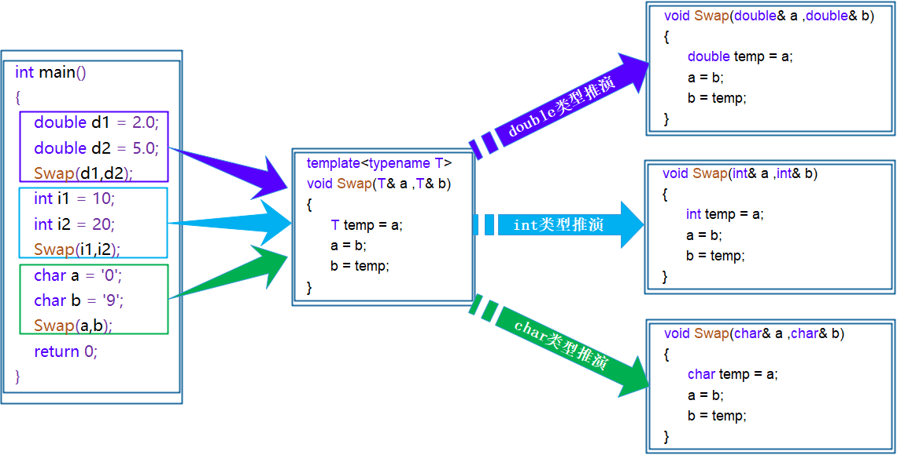

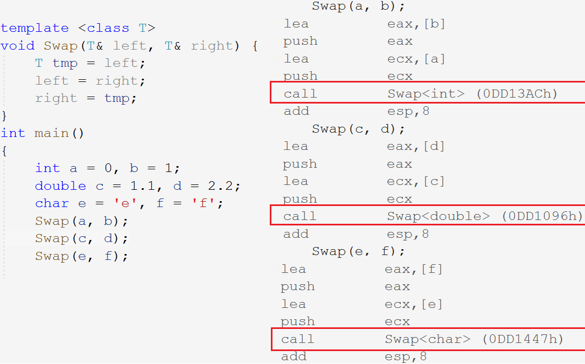

> 函数地址不同，可见调用的不是一个函数。

#### 1.3 函数模板的实例化

不同类型的参数使用该函数模板的过程，称为函数模板的实例化。模板参数实例化分为两种：隐式实例化和显式实例化。

- 隐式实例化：编译器根据实参类型**自动推演形参类型**。
- 显式实例化：函数名加`<type>`**指定参数类型**。

```cpp
template <class T>
T Add(const T& rx, const T& ry) {
    return rx + ry;
}
int main()
{
    int a = 10, b = 20;
    double c = 3.33, d = 4.44;
    // 隐式实例化
    Add(a, b);
    Add(c, d);
    // 显式实例化
    Add<int>(a, d);
    Add<double>(a, d);

    Add(a, d); // Err:类型不一致
    Add((double)a, d); // 提前强转参数类型
    return 0;
}
```

类型不匹配编译器会报错。要么强转实参类型，要么显式实例化。

#### 1.4 函数模板的匹配原则

```cpp
int Add(const int& rx, const int& ry) // 适用于int类型
{
    return rx + ry;
}

template <class T>
T Add(const T& rx, const T& ry) // 通用类型模板
{
    return rx + ry;
}
```

当存在和函数模板同名同参数列表的函数时，编译器会**优先调用普通函数而非模板**。

> 调用普通函数也可以省去模板实例化的环节。

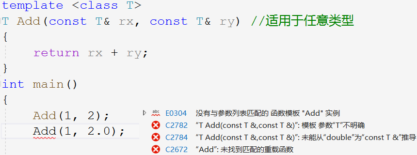

**函数模板传参时不允许发生类型转换**，但普通函数传参时允许发生隐式类型转换。

### 2. 类模板

#### 2.1 类模板的格式

定义格式和函数模板类似：

```cpp
template <class T1, class T2,..., class Tn>
class class_name {
    //...
};
```

```cpp
template <class T>
class stack
{
public:
    stack(int capacity) : _top(0), _capacity(capacity)
    {
        _data = new T[capacity];
    }
    ~stack()
    {
        delete[] _data;
    }
private:
    T* _data;
    int _top;
    int _capacity;
};
```

#### 2.2 类模板的实例化

类模板必须要显式实例化，在模板类名后跟`<type>`。**类模板是模板而不是类，实例化生成的类才是真正的类**。

```cpp
//stack是类模板名，stack<int>才是类型
stack<int> st;
```

若想成员函数声明定义分离，函数体类外定义不仅要声明类域，还要声明模板类型。

```cpp
template <class T> // 声明模板类型
void stack<T>::Push(T x) { // 声明所属类域
    _data[top++] = x;
    //...
}
```

### 3. 非类型模板参数

模板参数不一定是类型参数，还有非类型的模板参数。

```cpp
template <class T> // 类型参数
class A;
template <size_t N> // 非类型参数
class A;
```

比如实现一个静态栈，数组长度可以宏定义，也可以使用非类型模板参数：

```cpp
template <class T, size_t N = 100>
class stack {
    T _a[N];
};
stack<int> st1;
stack<int, 200> st2;
```

使用非类型模板参数可以灵活控制该常量的数值。

- 非类型模板参数的**类型只能是整型家族类型**，`char`、`short`、`int`、`long`等。
- 非类型模板参数**只能是常量**，和宏一样编译被替换成对应的常量。
- 非类型模板参数**支持给缺省值**，和普通参数的缺省值一样只能从右到左给。

### 4. 模板的特化

#### 4.1 函数模板特化

使用模板对于一些特殊类型的可能得不到想要的结果，比如：

```cpp
template <class T>
bool less(T l, T r) {
    return l < r;
}
int main()
{
    date d1(2020, 1, 2);
    date d2(2020, 3, 3);
    less(d1, d2); // 结果不确定
    return 0;
}
```

实例化为基本类型时能够完成任务，实例化为指针类型时，我们的需求并不是比较指针大小而是比较指针所指向的对象的大小。

此时该模板就不能起作用，需要特化该函数专门针对指针类型的比较函数。

```cpp
template <class T>
bool less(T l, T r) {
    return l < r;
}

template <>
bool less<date*>(date* l, date* r) { //针对指针类型
    return *l < *r;
}

bool less(date* l, date* r) {
    return *l < *r;
}
```

函数模板特化是从原来的函数模板特化出一个类型专有的版本，相当于针对一个类型的特殊解法。

> 函数模板特化不如直接重载，模板特化在函数处显得比较鸡肋。模板特化主要是用于类模板特化。

#### 4.2 类模板特化

类模板特化和函数模板特化差不多，都是针对某些特殊类型进行特殊处理。

```cpp
template<class T>
struct greater
{
    bool operator()(const T& x, const T& y)
    {
        return x > y;
    }
};

template<>
struct greater<date*>
{
    bool operator()(const date* p1, const date* p2)
    {
        return *p1 > *p2;
    }
};
```

##### 全特化

全特化是模板参数列表中所有模板参数都进行特化。

```cpp
template <class T1, class T2>
struct Data {
    Data() { cout << "Data<T1, T2>" << endl; }
    T1 _a;
    T2 _c;
};
template <>
struct Data<int, char> { // 特化处理int,char类型
    Data() { cout << "Data<int, char>" << endl; }
    int _a;
    char _c;
};
```

```cpp
template<class T>
struct less
{
    bool operator()(const T l, const T r)
    {
        return l < r;
    }
};
template<>
struct less<date*> {
    bool operator()(const date* l, const date* r) {
        return l < r;
    }
};
less<date>()(date(2020, 1, 2), date(2020, 3, 3));
less<date*>()(new date(2020, 1, 2), new date(2020, 3, 3));
```

##### 偏特化

偏特化是只限制部分参数为固定类型，其他仍是模板参数类型。

```cpp
template <class T1>
class Data<T1, char> //第二个模板参数为char
{
public:
    Data() {
        cout << "Data<T1, char>" << endl;
    }
private:
    T1 _a;
    char _c;
};
```

**模板参数的指针和引用也算偏特化**。

```cpp
template<class T>
struct less {
    bool operator()(const T l, const T r) {
        return l < r;
    }
};
template<class T>
struct less<T*> {
    bool operator()(const T* l, const T* r) {
        return l < r;
    }

};

less<int*>()(new int(1), new int(2));
less<date>()(date(2020, 1, 2), date(2020, 3, 3));
less<date*>()(new date(2020, 1, 2), new date(2020, 3, 3));
```

**非类型模板参数也支持特化**。

```cpp
template ＜size_t N>
struct A {
    A() { cout << "A<N>" << endl; }
}

template <>
struct A<10> {
    A() { cout << "A<10>" << endl; }
}

A<20> a1;
A<10> a2；
```

### 5. 模板分离编译

模板声明定义分离，会出现链接错误：

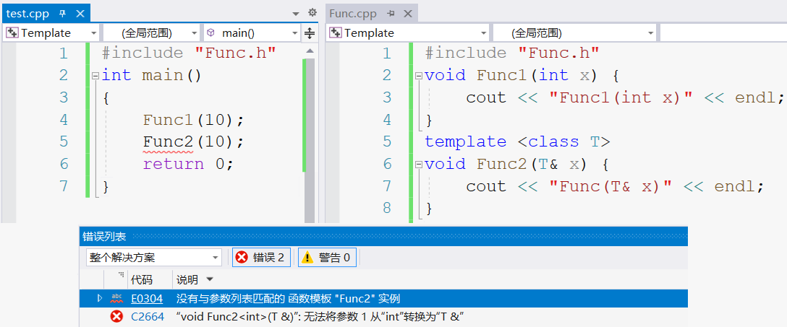

模版在编译阶段会根据调用生成对应的函数，**但定义模版的文件中没有函数调用，就不会生成函数**。

当然我们可以显式实例化，在定义模版的文件里显式实例化需要的版本。

```cpp
template<class T>
void func(T& x)
{
    cout << "func(T& x)" << endl;
}
//显式实例化
template void func<int>(int& x);
template void func<double>(double& x);
```

### 6. 模板总结

| 优点                                         |
| -------------------------------------------- |
| 模板复用代码，更快的开发，增强了代码的灵活性 |
| **缺点**                                     |
| 导致代码膨胀，导致编译时间变长               |
| 编译报错信息非常凌乱，不易定位错误           |

## IO流

### 1. C语言IO

C语言中常用的输入输出函数有如下几种：前者是格式化标准输入输出，后者是格式化文件输入输出，最后是格式化字符串输入输出。

| 函数名    | 内容                                     |
| :-------- | :--------------------------------------- |
| `scanf`   | 从标准输入流（键盘）读取格式化的数据     |
| `fscanf`  | 从所有输入流读取读取格式化数据           |
| `sscanf`  | 从字符串中读取格式化的数据               |
| `printf`  | 将格式化的数据输出到标准输出流（屏幕）上 |
| `fprintf` | 将格式化数据输出到所有输出流上           |
| `sprintf` | 将格式化的数据输出到字符串中             |

文件的输入输出需要以下几个函数：

| 函数名    | 功能                           |
| --------- | ------------------------------ |
| `fopen`   | 打开文件流                     |
| `fclose`  | 关闭文件流                     |
| `fscanf`  | 从所有输入流读取读取格式化数据 |
| `fprintf` | 将格式化数据输出到所有输出流上 |
| `fread`   | 二进制输入                     |
| `fwrite`  | 二进制输出                     |

```c
//文件开关
FILE* fopen   (const char* filename, const char* mode);
int   fclose  (FILE* stream);
//格式化读写
int fprintf (FILE* stream, const char* format [, argument ]...);
int fscanf  (FILE* stream, const char* format [, argument ]...);
//二进制读写
size_t fwrite  (const void* buffer, size_t size, size_t count, FILE* stream);
size_t fread   (      void* buffer, size_t size, size_t count, FILE* stream);
```

使用方式如下：

```cpp
struct ServerInfo
{
    char _ip[32];
    int _port;
    friend ostream& operator<<(ostream& os, ServerInfo& info);
    friend ostream& operator>>(ostream& os, ServerInfo& info);
};
//测试C语言二进制读写
void testC_Write_Bin() {
    ServerInfo info = { "192.168.1.1",80 };
    FILE* fout = fopen("info.bin", "wb");
    //assert();
    fwrite(&info, sizeof(ServerInfo), 1, fout);
    fclose(fout);
}
void testC_Read_Bin() {
    ServerInfo info;
    FILE* fin = fopen("info.bin", "rb");
    fread(&info, sizeof(ServerInfo), 1, fin);
    printf("%s:%d", info._ip, info._port);
    fclose(fin);
}
//测试C语言字符读写
void testC_Write_Text() {
    ServerInfo info = { "192.168.1.1",80 };
    FILE* fout = fopen("info.txt", "w");
    fprintf(fout, "%s %d", info._ip, info._port);
    fclose(fout);
}
void testC_Read_Text() {
    ServerInfo info;
    FILE* fin = fopen("info.txt", "r");
    fscanf(fin, "%s %d", &info._ip, &info._port);
    printf("%s:%d", info._ip, info._port);
}
```

### 2. C++IO

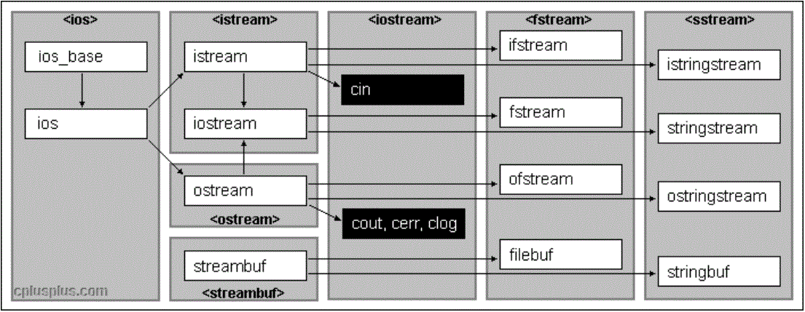

C++ 标准库提供了4个全局流对象`cin`、`cout`、`cerr`、`clog`。cout、cerr、clog 是 ostream 类的三个不同的对象。使用 cout 进行标准输出，使用 cin 进行标准输入。同时 C++ 标准库还提供了 cerr 用来进行标准错误的输出，以及 clog 进行日志的输出。

#### 2.1 C++标准IO流

`cout`,`cin`是`ostream`,`istream`类的对象，`operator<<`,`operator>>`分别是两个对象的操作符重载成员函数。

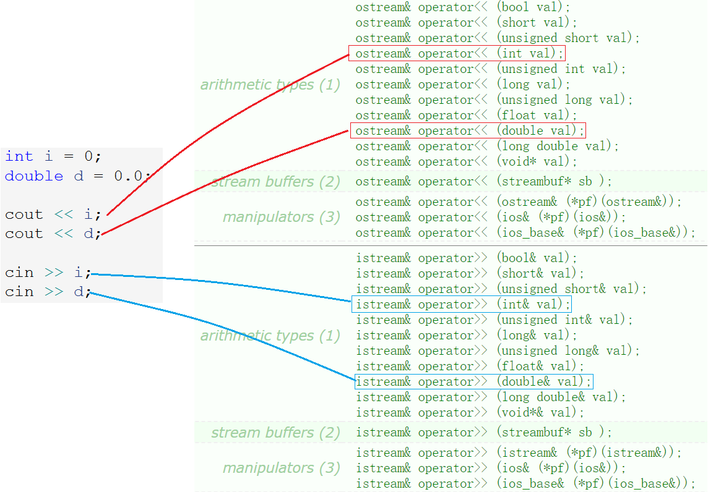

C++输出输入可直接使用`cout>>`和`cin>>`，因为其重载了所有内置类型，对于自定义类型需要自行重载操作符`>>`和`<<`。

```cpp
cin >> a >> b;
```

`operator<<`和`operator>>`的返回值也是`ostream&`或`istream&`，因此支持连续输入输出，又是一次函数调用。

> cout/cin 取代 printf/scanf 的真正原因是 cout/cin 支持自定义类型，符合面向对象的思想。

当需要循环读入数据时，可以采用如下的方式：

```cpp
string str;
while (cin >> str) {
    ;
}
```

从文档中可以看到，`operator>>`的返回值是`istream`类型，这个对象类型是如何作真假判断的呢？

原因是`istream`类的对象支持一个操作符的重载函数叫`operator bool`，C++98中叫`operator void*`，C++11中叫`operator bool`。

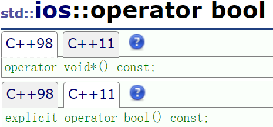

这是个特殊的运算符重载函数，该函数不允许限定返回类型，当类型被当作条件判断时，自动调用并将返回值强转为内置的标识，该标识如果为真就继续，如果为假就停止读取。

#### 2.2 C++文件IO流

采用面向对象的思想，C++中文件指针被文件输入输出流对象`ofstream`、`ifstream`代替。

和`fopen`的调用方式类似，创建输入输出流对象，调用其构造函数传入文件地址以及打开模式。`fclose`被析构函数代替，且析构函数可以自动调用。

| 对象构造函数                                                 | 解释                                     |
| ------------------------------------------------------------ | ---------------------------------------- |
| **ofstream (const char* fileName, ios_base::openmode mode=ios_base::out)** | 创建输出流对象，并指定文件地址和打开模式 |
| **ifstream (const char* fileName, ios_base::openmode mode=ios_base::in)** | 创建输入流对象，并指定文件地址           |

打开模式变量的类型是`ios_base::openmode`，该变量有如下几个特定的值：

| 模式       | 解释           |
| ---------- | -------------- |
| **in**     | 文件读取模式   |
| **out**    | 文件写入模式   |
| **binary** | 二进制文件模式 |
| ...        |                |

常用的有如上几种，该变量的值以二进制位中的不同位为1来标识，也就是说使用异或`|`就可以组合起来用。

| 函数                                              | 解释                                                         |
| ------------------------------------------------- | ------------------------------------------------------------ |
| **istream& read(char* s, streamsize n);**         | `read`接口是输入流`istream`对象的成员函数，参数是变量和大小。 |
| **ostream& write(const char* s , streamsize n);** | `write`接口是输出流`ostream`对象的成员函数，参数是写入变量和写入大小。 |

##### 示例

使用一个`ConfigManage`类来演示几种文件读写的方式。

```cpp
struct ServerInfo
{
    char _ip[32];
    int _port;
    friend ostream& operator<<(ostream& os, ServerInfo& info);
    friend ostream& operator>>(ostream& os, ServerInfo& info);
};
class ConfigManage {
public:
    ConfigManage(const char* fileName)
        :_fileName(fileName)
    {}
    //二进制写入
    void WriteBin(ServerInfo& info)
    {
        ofstream ofs(_fileName.c_str(), ios_base::out | ios_base::binary); //创建输出流对象
        ofs.write((const char*)&info, sizeof(ServerInfo)); //调用write接口
    }
    //二进制读取
    void ReadBin(ServerInfo& info)
    {
        ifstream ifs(_fileName.c_str(), ios_base::in | ios_base::binary);
        ifs.read((char*)&info, sizeof(ServerInfo));
        cout << info << endl;
    }
private:
    string _fileName;
};
```

读写文件更常用的方式是以文本形式读写，因此就可以省略打开模式参数。

`ifstream`,`ofstream`文件输入输出类中还继承了`iostream`的流插入`<<`流提取`>>`操作符，也就是对象`ofs`和`ifs`也可以使用`<<`或`>>`操作符。

```cpp
struct ServerInfo {
    friend ostream& operator<<(ostream& os, ServerInfo& info);
    friend ostream& operator>>(ostream& os, ServerInfo& info);
    char _ip[32];
    int _port;
};
ostream& operator<<(ostream& os, ServerInfo& info) {
    os << info._ip << " " << info._port;
    return os;
}
istream& operator>>(istream& is, ServerInfo& info) {
    is >> info._ip >> info._port;
    return is;
}
//文本写入
void WriteText(ServerInfo& info)
{
    ofstream ofs(_fileName.c_str());
    //write
    ofs.write((const char*)&info, sizeof(ServerInfo));
    //1.
    ofs << info._ip << info._port; //对象未重载<<
    //2.
    ofs << info; //对象已重载>>
}
//文本读取
void ReadText(ServerInfo& info)
{
    ifstream ifs(_fileName.c_str());
    //read
    ifs.read((char*)&info, sizeof(ServerInfo));
    //1.
    ofs << info._ip << info._port; //对象未重载<<
    //2.
    ifs >> info; //对象已重载>>
    cout << info << endl;
}
```

具体调用方式则是如下：

```cpp
void testCPP_Write_Bin() {
    ServerInfo info = { "192.168.1.1",80 };
    ConfigManage con("config.bin");
    con.WriteBin(info);
}
void testCPP_Read_Bin() {
    ServerInfo info;
    ConfigManage con("config.bin");
    con.ReadBin(info);
}
void testCPP_Write_Text() {
    ServerInfo info = { "192.168.1.1",80 };
    ConfigManage con("config.bin");
    con.WriteText(info);
}
void testCPP_Read_Text() {
    ServerInfo info;
    ConfigManage con("config.bin");
    con.ReadText(info);
}
```

文件的输入输出流对象调用构造函数时也可能会失败，C++采取面向对象抛异常的形式。

#### 2.3 C++ stringstream

在头文件`<sstream>`下，有三个类：istringstream、ostringstream 和 stringstream，分别用来进行字符串流的输入、输出和输入输出操作。

- 字符串流`ostringstream`可以将一个其他类型的数据转化为字符串格式，该类中的成员函数`str`可以返回转出的字符串。
- 字符串流`istringstream`可以将一个字符串格式转化其他类型的数据，该类中的成员函数`str`可以传入需要转化的字符串，或直接在构造时传入。

```cpp
struct PersonInfo
{
    string _name;
    int _age;
    friend ostream& operator<<(ostream& os, PersonInfo& info);
    friend istream& operator>>(istream& is, PersonInfo& info);
};
//序列化
PersonInfo info1 = { string("zhangsan"), 20 };
ostringstream oss;
//1.
oss << info1._name << " " << info1._age; //对象未重载<<
//2.
oss << info1;
string str = oss.str();
cout << str << endl;

//反序列化
PersonInfo info2;
istringstream iss(str);
iss.str(str);
//1.
iss >> info2._name >> info2._age; //对象未重载>>
//2.
iss >> info2;
cout << info2 << endl;
```

## 继承

> 面向对象三大特性：封装、继承、多态。继承实际中用的也不多，但必须熟练掌握。

### 1. 继承的概念

继承是面向对象中复用代码的一种手段，它能够在原有类的特性的基础上进行扩展。继承体现了面向对象设计的层次结构，不同于面向过程只有函数复用，继承是类设计层面上的复用。

#### 1.1 继承的定义

对于具有一定关系的一类群体，将其抽象成一类对象后，这些对象必然会具有重复的属性。

比如学生老师都属于人，他们都有名字、年龄等共有属性，不同的是学生有学号，教师有职工号。因此可将共有属性放到人这个类，将二者独有属性放入各自的类。避免代码冗余，也更能体现出类的层次设计。

```cpp
class Son : public Father; //中间用:间隔
```

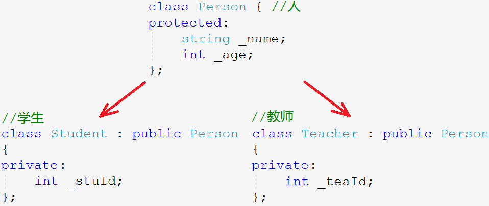

原有类称为基类或父类，继承而来的类叫派生类或子类。**继承后子类也拥有了父类的成员变量和函数，使得子类可以使用父类的成员**，这便是继承的意义。

#### 1.2 继承关系和访问限定

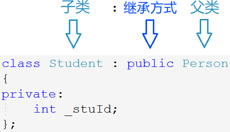

子类和父类中间用`:`间隔，并声明继承关系，继承关系有三种：`public`，`protected`，`private`。

因为成员的访问权限有三种，而类的继承关系也有三种，组合起来有九种情况。这些会影响到子类继承来的成员的访问权限，具体如表所示：

| 父类成员\继承方式   | public 继承         | protect 继承      | private 继承      |
| ------------------- | ------------------- | ----------------- | ----------------- |
| 父类 public 成员    | 子类 public 成员    | 子类 protect 成员 | 子类 private 成员 |
| 父类 protected 成员 | 子类 protected 成员 | 子类 protect 成员 | 子类 private 成员 |
| 父类 private 成员   | 子类不可见成员      | 子类不可见成员    | 子类不可见成员    |

- **父类中的访问限定和继承方式二者中取最低的权限**，就是子类中该成员的访问权限。（防止权限放大）
- 任何继承方式下，**父类私有成员在子类中都是存在但不可访问的**。
- 若不显式指定继承方式，`class`类默认私有继承，`struct`类默认为公有继承，不提倡这种方式。

> 实际中很少使用、也不提倡使用除公有继承以外的继承方式，可维护性不强。

### 2. 父子对象赋值兼容

**公有继承下，子类对象可以赋值给父类对象或父类对象的指针或引用**。

子类赋值给父类，就是把子类中从父类继承下来的成员“切割”出来调用拷贝构造赋值过去，这就叫做“切片”。

- 父类的指针或引用也只能指向或引用来自父类的那一部分成员。
- **父类对象不可以赋值给子类对象**，因为父类无法构造子类所有成员。

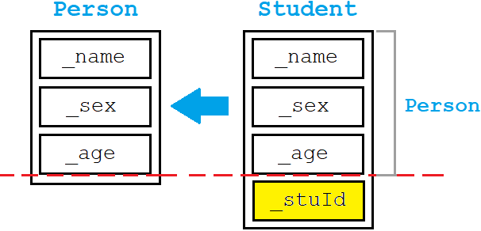

- 子类赋值父类的转换，**不存在类型转换，是编译器语法所支持的行为**。
- 子类赋值父类的转换，只能发生在公有继承的情况下，因为其他继承会影响到成员的访问权限，可能会造成权限放大。

```cpp
Student s;
Person p;

//子类赋值给父类，发生赋值兼容
p = s;
Person& rp = s;
Person* pp = &s;

//父类赋值给子类
s = p;           // Err
s = (Student)p;  // Err
Student& rs = p; // Err
Student* ps = p; // Err
```

### 3. 继承的作用域

类的定义就是一个作用域，父子类都有独立的作用域，父类成员可能会与子类成员重名。

父子类出现同名成员时会发生隐藏，即**子类成员会屏蔽从父类继承来的同名成员**，这种情况叫隐藏或重定义。

> 实际上在使用继承时，不要定义重名变量。

#### 3.1 成员变量的隐藏

```cpp
struct Person {
    string _name = "人名";
    int _num = 111;
};
class Student : public Person {
public:
    void getNum() {
        cout << "学号->" << _num << endl;
    }
    void getPersonNum() {
        cout << "证件->" << Person::_num << endl; // 访问隐藏成员，必须加域名限定
    }
protected:
    int _num = 999;
};
```

#### 3.2 成员函数的隐藏

```cpp
struct A {
    void func() { cout << "A::func()" << endl; }
};
class B : public A {
public:
    void func(int i) {
        A::func(); // 访问隐藏成员，必须加域名限定
        cout << "B::func(int i)" << endl;
    }
};

b.A::Func(); //访问隐藏成员，必须加域名限定
b.Func(1);
```

**父子类同名成员函数，函数名相同就构成隐藏，不构成函数重载**，因为二者不在一个作用域。

#### 3.3 总结

- 成员变量构成隐藏时，直接调用其会导致访问不明确，所以编译不通过。
- 成员函数构成隐藏时，默认访问子类中的成员函数，若想访问父类中的必须加父类域名限定。
- 成员函数和成员变量一样只需名称相同即可构成隐藏。可通过类名::的方式访问隐藏的父类成员。

### 4. 子类的默认成员函数

> 子类的默认成员函数会有哪些变化呢？

#### 4.1 构造函数

- 构造子类对象时，构造函数会先调用父类的构造函数，再初始化子类成员。
- 如果父类有默认构造，编译器可以自动调用。如果父类没有默认构造，则需要在初始化列表中显式调用。
- 子类中不可直接初始化父类成员，只能调用父类构造函数。

```cpp
student(const char* name, int num)
    : person(name)
    , _num(num)
{}
```

#### 4.2 拷贝构造

- 拷贝子类对象时，拷贝构造不会自动调用父类的拷贝构造，需手动调用父类拷贝构造。
- 显式调用父类拷贝构造时，传子类对象自动切片即可。

```cpp
student(const student& s)
    : person(s)
    , _num(s._num)
{}
```

#### 4.3 赋值重载

- 赋值子类对象时，赋值重载需要显式调用父类的赋值重载，再对子类成员赋值。
- 显式调用父类赋值重载时，需指定父类域，也传子类对象自动切片。

```cpp
student& operator=(const student& s)
{
    if (this != &s)
    {
        person::operator=(s);
        _num = s._num;
    }
    return *this;
}
```

#### 4.4 析构函数

- 子类析构会在析构完子类后，自动调用父类析构，规定不允许在子类析构中手动调用父类析构。
- 先构造父类再构造子类。析构反之，先析构子类再析构父类，保证栈后进先出的特性。

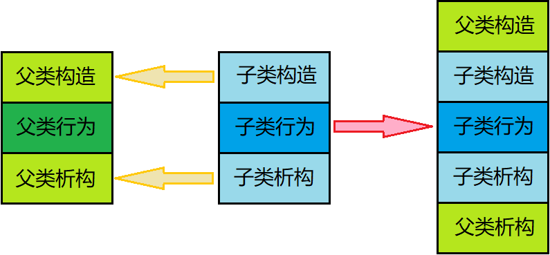

```cpp
~student()
{
    // person::~person(); // ERROR
}
```

析构函数的名称会被统一处理成`destructor`，父子类析构会构成隐藏。

> 主动调用父类析构，会导致父类析构两遍，可能会出错。因为要满足栈帧后进先出，只能由编译器调用。

#### 4.5 总结

- 如果父类有默认构造，子类构造会自动调用父类默认构造。
- 析构函数会自动调用且不允许手动调用父类析构。
- 拷贝构造、赋值重载都不会自动调用父类对应函数，只能手动调用。

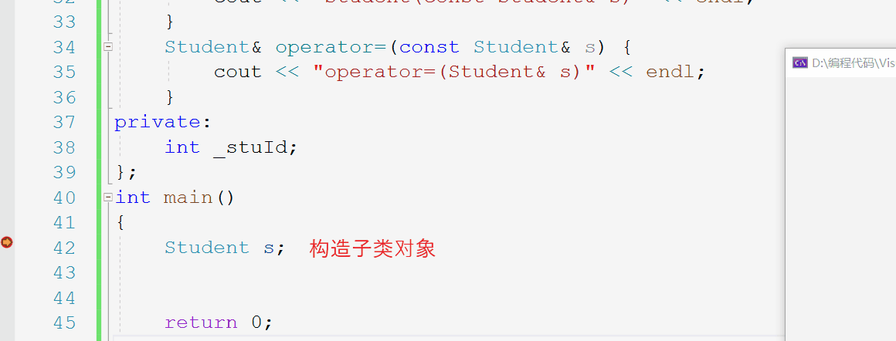

### 5. 继承和友元

**友元关系无法继承**，也就是说父类中的友元，无法访问子类的成员。

```cpp
struct Person {
    friend void Display(const Person& p, const Student& s);
    string _name;
};
class Student : public Person {
private:
    int _stuId;
};
void Display(const Person& p, const Student& s) {
    cout << "Person::_name" << p._name << endl;
    cout << "Student::_stuId" << s._stuId << endl; //无法访问子类成员
}
```

### 6. 继承和静态成员

子类不会继承父类的静态成员，但可以访问，且操作的是同一个变量，不会影响其静态的特性。

```cpp
struct A {
    A() { _si += 1; }
    static int _si;
};
int A::_si = 0;

struct B : public A {
    B() { _si += 1; }
};
struct C : public A {
    C() { _si += 1; }
};

cout << _si << endl; // 5
```

### 7. 菱形继承和虚拟继承

#### 7.1 单继承和多继承

单继承：一个子类只有一个直接父类，这样的继承关系为单继承。

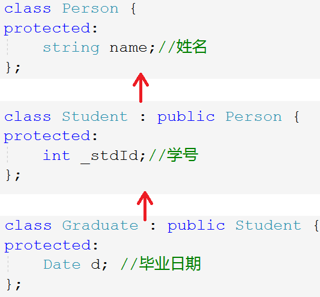

多继承：一个子类有两个及以上的直接父类，这样的继承关系为多继承。

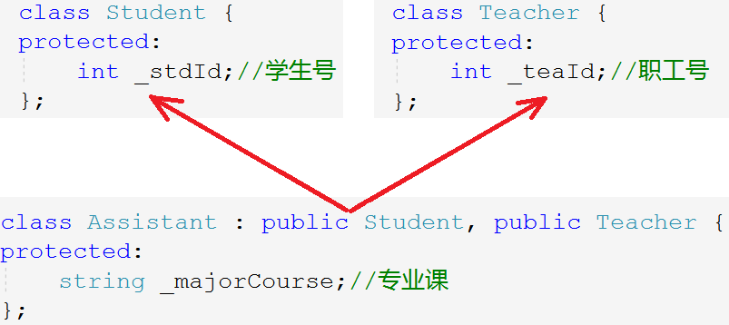

#### 7.2 菱形继承

菱形继承是继承关系呈现出菱形的状态，是多继承的一种特殊情况。

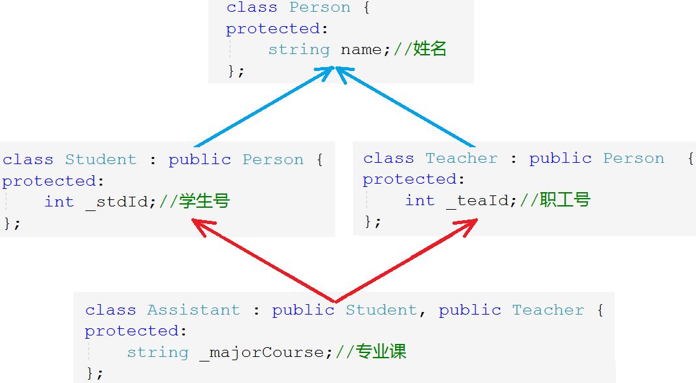

菱形继承会产生的问题是：数据冗余和二义性。

| 问题     | 解释                                     | 现象                                               | 解决办法               |
| -------- | ---------------------------------------- | -------------------------------------------------- | ---------------------- |
| 数据冗余 | 两个父类都继承了爷类的成员               | Student类和Teacher类中都有name成员                 | 虚拟继承               |
| 二义性   | 子类访问爷类的成员，不能确定来自哪个父类 | Assitant类访问name不确定是Student类还是Teacher类的 | 访问变量时加上类域限定 |

```cpp
// 二义性需要访问变量时加上域限定
assitant a;
a.student::_name = "小张";
a.teacher::_name = "老张";
```

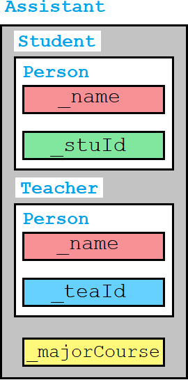

> 一般不会用到多继承，一定要避免菱形继承。

#### 7.3 菱形虚拟继承

数据冗余根源在于两个父类都继承了爷类的成员，这两个父类叫做虚基类，让虚基类使用虚拟继承即可解决。

```cpp
class person {
public:
    string _name;
};

class student : virtual public person {
public:
    int _stuid;
};

class teacher : virtual public person {
public:
    int _jobid;
};

class assitant : public student, public teacher {
public:
    int _major_course;
};
```

虚继承让虚基类从爷类中继承的成员是同一个变量。因此不存在数据冗余了。

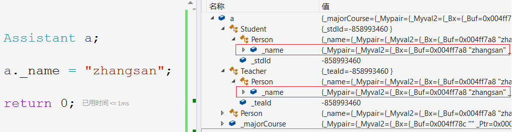

##### 虚拟继承的原理

```cpp
struct A {
    int _a;
};                                         A
struct B : virtual public A {            /   \
    int _b;                             /     \
};                                     B       C
struct C : virtual public A {           \     /
    int _c;                              \   /
};                                         D
struct D : public B, public C {
    int _d;
};

void test()
{
    D d;
    d.B::_a = 1;
    d.B::_b = 2;

    d.C::_a = 3;
    d.C::_c = 4;

    d.D::_d = 5;
}
```

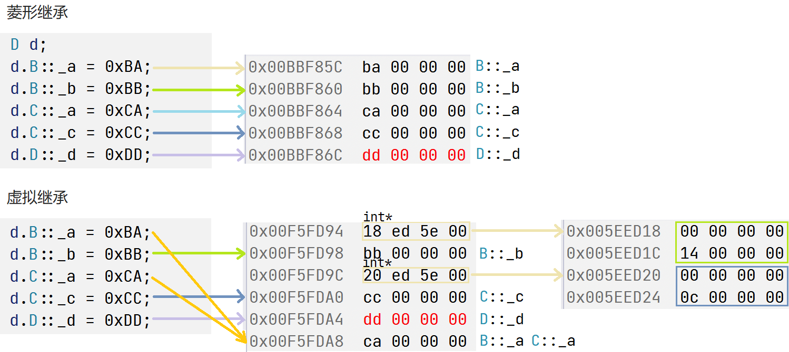

如果采用菱形继承：创建`D`类对象时，会按继承顺序依次开辟变量`B::_a`、`B::_b`、`C::_a`、`C::_c`、`D::_d`。

如果采用虚拟继承：

- 最上层的公共基类叫虚基类，继承虚基类的类叫做虚拟派生类。
- 普通成员仍然按继承顺序开辟，虚基类成员被单独放在最后。两个虚拟派生类空间上方分别存放一个指针。
- 指针指向的空间存有两个整型值。第一个用于多态，第二个表示该指针距虚基类空间的偏移量。以此定位虚基类成员。

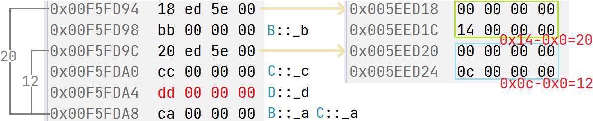

```cpp
struct A {
    A(string s1) { cout << s1 << endl; }
};

struct B : virtual public A {
    B(string s1, string s2) : A(s1) { cout << s2 << endl; }
};

struct C : virtual public A {
    C(string s1, string s2) : A(s1) { cout << s2 << endl; }
};

struct D : public B, public C
{
    D(string s1, string s2, string s3, string s4) : C(s1, s3), B(s1, s2), A(s1) {
        cout << s4 << endl;
    }
};

D* pd = new D("class A", "class B", "class C", "class D");
delete pd;
```

### 8. 继承和组合

#### 8.1 继承和组合的概念

```cpp
//继承
class B : public A
{};
//组合
class B {
    A _a;
};
```

| 方式 | 解释                                              | 举例                       |
| ---- | ------------------------------------------------- | -------------------------- |
| 继承 | 每个派生类对象都是一个基类对象（is-a）            | 学生是一种人，宝马是一款车 |
| 组合 | 类里面使用其他类作为成员，本类有一个他类（has-a） | 车上有轮胎，笔记本上有屏幕 |

继承符合“是一个”的关系，组合符合“有一个”的关系。

#### 8.2 组合和继承的对比

- 继承导致父类的实现细节对子类是可见的，故称继承为一种白盒复用。
- 组合通过接口使用原有类的功能，原有类的细节是不可见的，这种复用被称为黑盒复用。
- 使用继承，子类可直接使用父类成员，一定程度上破坏了封装性，二者之间耦合度较高。
- 组合反之，通过创建对象进行复用，只能通过接口访问，并不破坏封装性，耦合度也比较低。

组合比继承更满足高内聚、低耦合的设计要求。所以优先组合而不是继承。

## 多态

### 1. 虚函数的定义

**`virtual`修饰的、非静态的成员函数称为虚函数**。

```cpp
struct test {
    virtual void func() { cout << "func" << endl; }
};
```

虚函数可以像普通函数一样调用，但虚函数的作用主要是实现多态。

> 虚继承也用到virtual关键字，但虚函数和虚继承没有任何关系。

### 2. 重写的定义

子类重新定义父类中的虚函数，就叫做子类重写/覆盖了父类的虚函数。

**具有继承关系的两个类中，返回类型、函数名、参数列表完全相同的虚函数构成重写**，不构成隐藏。

#### 2.1 重写的条件

##### 协变

重写允许虚函数返回类型不同，但必须是父子类对象的指针或引用。父类的返回父类引用指针，子类的返回子类引用指针，这种情况被称为协变。

> 不一定是自身父子类指针引用，也可以是其他父子类指针引用。

```cpp
struct person {
    virtual person*  buy_ticket() { cout << "成人全价" << endl; }
};
struct student : public person {
    virtual student* buy_ticket() { cout << "学生半价" << endl; }
};
```

##### 析构函数的重写

```cpp
struct person {
    ~person() { cout << "~person()" << endl; }
};
struct student : public person {
    ~student() { cout << "~student()" << endl; }
};

void test() {
    person* p = new student;
    delete p;  // p->_destructor(); + operator delete(p);
}
```

析构函数名会被编译器处理为 destructor，所以父子类的析构函数名是相同的。

不构成重写的话，父类指针指向子类对象会发生切片，只能访问到父类的内容，所以 delete 只能调用父类析构函数。

```cpp
struct person {
    virtual ~person() { cout << "~person()" << endl; }
};
struct student : public person {
    virtual ~student() { cout << "~student()" << endl; }
};

void test() {
    person* p = new student;
    delete p; // p->_destructor(); + operator delete(p);
}
```

**virtual 修饰父子类析构函数可以构成重写**。这样父类指针就能调用子类析构，不会有资源泄漏的风险。

##### 子类允许省略virtual

重写可以只给父类函数加 virtual，允许省略子类的。

```cpp
struct person {
    virtual void buy_ticket() { cout << "成人全价" << endl; }
};
struct student : public person {
    void buy_ticket() { cout << "学生半价" << endl; }
};
```

| 概念     | 解释                                                         |
| -------- | ------------------------------------------------------------ |
| 实现继承 | 普通成员函数继承就是实现继承，继承的是父类成员函数的实现。   |
| 接口继承 | 虚函数的继承是一种接口继承，继承接口声明并重写其实现，以构成多态。 |

重写是一种接口继承，子类把父类的虚函数继承下来重新实现，只改变函数内容，不会改变函数声明和属性。

子类会继承下重写的虚函数的属性，再完成重写所以不加声明也是虚函数。

#### 2.2 重载重写重定义的对比

| 概念        | 要求1          | 要求2                        | 要求3            |
| ----------- | -------------- | ---------------------------- | ---------------- |
| 重载        | 在同一作用域   | 函数名相同，参数列表不同     |                  |
| 重定义/隐藏 | 在父子类作用域 | 函数名相同                   |                  |
| 重写/覆盖   | 在父子类作用域 | 函数名、参数、返回值完全相同 | 函数必须是虚函数 |

### 3. 多态的定义

多态就是不同对象执行同一行为产生不同结果。具有继承关系的对象才会产生多态，如父子对象通过父类指针引用，调用重写函数。

#### 3.1 多态的条件

1. 子类必须**重写父类的虚函数**；
2. **通过父类的指针或引用**调用重写函数；

> 重写条件：一虚三同。多态条件：父类的指针引用，重写的虚函数。

```cpp
struct person {
    virtual void buy_ticket() { cout << "成人全价" << endl; }
};
struct student : public person {
    virtual void buy_ticket() { cout << "学生半价" << endl; }
};

void func_ref(person& p) { p.buy_ticket();  }
void func_ptr(person* p) { p->buy_ticket(); }

void test()
{
    person p;
    student s;

    func_ref(p);  // 成人全价
    func_ref(s);  // 学生半价

    func_ptr(&p); // 成人全价
    func_ptr(&s); // 学生半价
}
```

#### 3.2 多态的效果

构成多态的话，传入子类对象才会调用到子类的虚函数。如果不构成多态，只会调用父类的虚函数。

```cpp
//----------------------------- 第一题 ----------------------------
struct A {
    virtual void func(int i = 1) { cout << "A->" << i << endl; }
    void test() { func(); }
};

struct B : public A {
    void func(int i = 0) { cout << "B->" << i << endl; }
};

void test()
{
    B* p = new B;
    p->test();
}

p->test() 把子类对象指针传给 test 函数 this 形参，test 函数的 this 类型是父类指针，相当于父类指针指向子类对象。

父子类 func 函数构成重写，this->func() 构成多态，所以调用子类的 func。

重写不会改变函数声明，所以 i 值为 1。B->1

//----------------------------- 第二题 ----------------------------
struct A {
    virtual void func(int i = 1) { cout << "A->" << i << endl; }
};

struct B : public A {
    void func(int i = 0) { cout << "B->" << i << endl; }
    void test() { func(); }
};

void test()
{
    B* p = new B;
    p->test();
}

不构成多态，就不用关心重写，func 函数构成隐藏，默认调用子类 func。B->0
```

### 4. final override

C++11中新出的两个关键字final和override，与继承和多态有关。

#### 4.1 final修饰类

final修饰的类无法被继承。

```cpp
class A final // final修饰类
{};
class B : public A // Error
{};
```

> final 表示最终的意思，也就是该类是继承关系中最后的类。

#### 4.2 final修饰虚函数

final修饰的虚函数无法被重写。

```cpp
class A {
protected:
    virtual void f() final // final修饰虚函数
    {}
};
class B : public A {
protected:
    virtual void f() // Error
    {}
};
```

#### 4.3 override

override修饰虚函数，用来检查该虚函数是否和父类虚函数构成重写，相当于对重写的断言。

```cpp
class A {
protected:
    virtual void f(int)
    {}
};
class B : public A {
protected:
    virtual void f() override // Error
    {}
};
```

### 5. 纯虚函数和抽象类

- `=0`修饰的虚函数为纯虚函数，也称接口。纯虚函数无法调用，一般只声明不实现。
- 包含纯虚函数的类叫做抽象类或接口类。抽象类作为框架无法实例化，子类继承后重写其中所有纯虚函数，子类才能实例化。

```cpp
class car {
    virtual void drive() = 0;
};
class tsla : public car {
    void drive()
    {}
};
```

### 6. 多态的原理

```cpp
class A { // 普通类
    int _a;
};
class B { // 包含虚函数的类
    virtual void func() {}
    int _a;
};

void test()
{
    cout << sizeof(A) << endl; // 4
    cout << sizeof(B) << endl; // 8 只有一个整型成员和一个虚函数，类的大小为8，难道虚函数占用类的空间？
}
```

#### 6.1 虚表指针

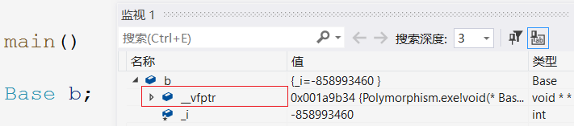

含有虚函数的类，实例化后会有虚函数表指针`_vfptr`这一隐藏成员，存储在类的头四个字节空间。

虚表指针指向的空间称为虚函数表，用来存储虚函数的地址。

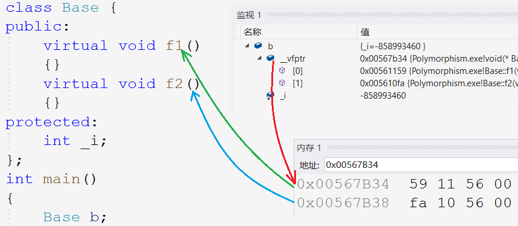

- 同类的不同对象的虚表指针都指向同一块空间。
- 虚表指针只能由编译器调用，故不考虑它作为成员变量的属性。

#### 6.2 虚函数表

虚函数表本质是函数指针数组。构成多态时，编译器访问对象空间拿到虚表，再根据偏移量找到对应虚函数。这就是多态原理。

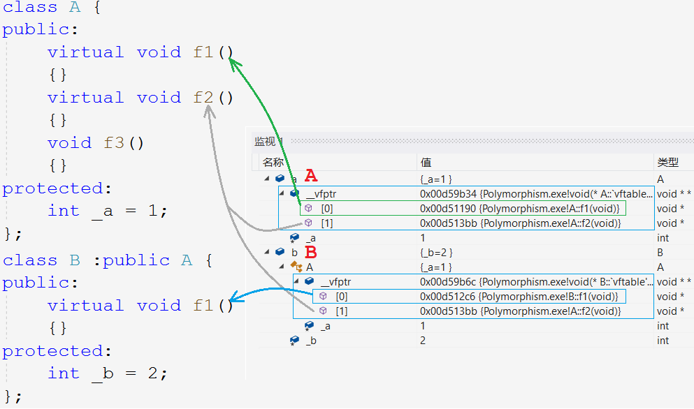

- 父子类不共用虚表，子类的虚表是父类的一份拷贝。
- 子类会将子类重写的虚函数地址覆盖到父类对应虚函数的虚表位置上。
- 子类新增的虚函数依次增加在虚表的尾部。

> 重写体现在语法上，覆盖体现在原理上。

- 虚表在编译阶段就生成好了。编译时就可以确定地址。
- 对象的虚表会在构造函数的初始化列表中初始化。
- 虚表一般存在于代码段，具体还要看编译器。

#### 6.3 多态条件的解释

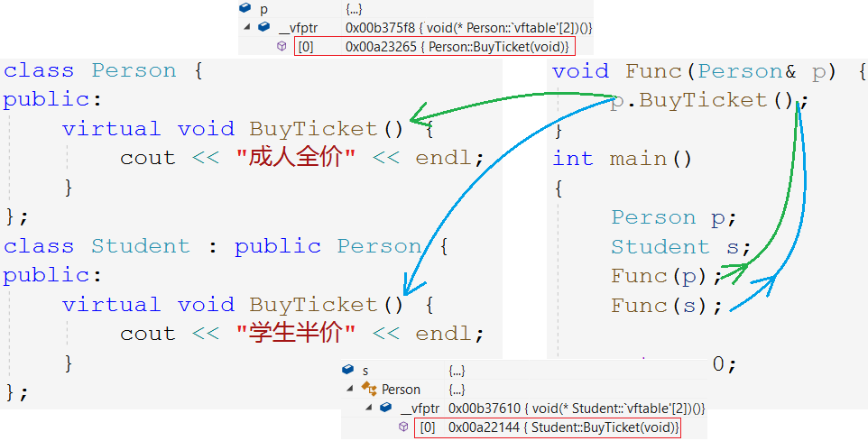

多态的构成条件可以解释为：

1. 重写的虚函数：虚函数地址存储在虚表中，运行时才从虚表指针中确定地址。
2. 父类指针引用：父类指针或引用指向子类空间，能拿到子类虚表，从而访问子类的虚函数。

> 对象直接调用不构成多态，因为父子类赋值切片时不允许拷贝虚表指针，就拿不到子类虚表。

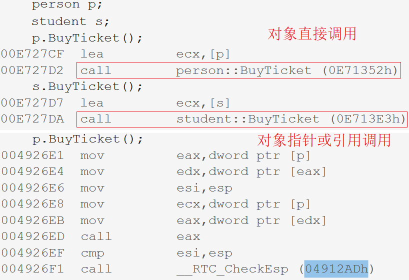

### 7. 不同继承下的虚表

> vs的监视会隐藏子类本身具有的虚函数。我们只能打印。

```cpp
// 虚表指针存储在类的最头上四个字节
// 解引用虚表指针，该空间直接裸存虚函数指针

typedef void(*vf_t)();

void print_vftable(vf_t* vft)
{
    for (int i = 0; vft[i]; i++)
    {
        printf("vft[%d]=0x%p->", i, vft[i]);
        vft[i]();
    }
}
```

#### 7.1 单继承的虚表

```cpp
namespace signle_inherit {
class A {
public:
    virtual void vFunc1() { cout << "A::vFunc1()" << endl; }
    virtual void vFunc2() { cout << "A::vFunc2()" << endl; }
protected:
    int _a;
};
class B : public A {
public:
    virtual void vFunc1() { cout << "B::vFunc1()" << endl; }
    virtual void vFunc3() { cout << "B::vFunc3()" << endl; }
    virtual void vFunc4() { cout << "B::vFunc4()" << endl; }
protected:
    int _b;
};
void test() {
    A a;
    B b;
    vf_t* vft_a = *(vf_t**)&a;
    vf_t* vft_b = *(vf_t**)&b;
    print_vftable(vft_a);
    print_vftable(vft_b);
}
}
```

#### 7.2 多继承的虚表

```cpp
namespace mutiple_inherit {
class A {
public:
    virtual void vFunc1() { cout << "A::vFunc1()" << endl; }
    virtual void vFunc2() { cout << "A::vFunc2()" << endl; }
    int _a;
};
class B {
public:
    virtual void vFunc1() { cout << "B::vFunc1()" << endl; }
    virtual void vFunc2() { cout << "B::vFunc2()" << endl; }
    int _b;
};
class C : public A, public B {
public:
    virtual void vFunc1() { cout << "C::vFunc1()" << endl; }
    virtual void vFunc3() { cout << "C::vFunc3()" << endl; }
    int _c;
};
void test() {
    C c;
    vf_t* vft_from_a = *(vf_t**)&c;
    // vf_t* vft_from_b = *(vf_t**)((char*)&c + sizeof(A));
    B* pc_from_b = &c;
    vf_t* vft_from_b = *(vf_t**)(pc_from_b);
    print_vftable(vft_from_a);
    print_vftable(vft_from_b);
}
}
```

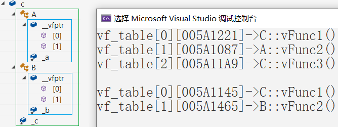

- 多继承中子类会有多个虚表，分别记录来自不同父类的虚函数。
- 子类新增的虚函数会放在第一个虚表中。

> C类重写了父类A和父类B的函数vFunc1，但两张虚表中vFunc1的地址却不同，这是为什么？

```cpp
// 观察下面程序的汇编代码。
C c;
A* pa =&c;
B* pb =&c;
pa->vFunc1();
pb->vFunc1();
```

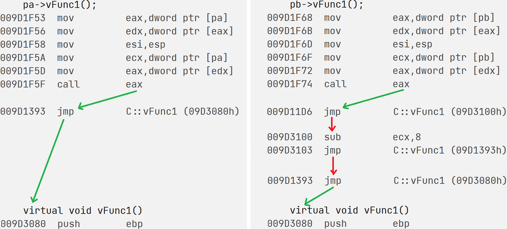

从第一张虚表和第二张虚表，调用 vfunc1 的汇编是不同的。从第二张虚表调用 vFunc1 需要去第一张虚表中跳转地址。

[C++ 虚函数表解析 (coolshell.cn)](https://coolshell.cn/articles/12165.html)

[C++ 对象内存布局 (coolshell.cn)](https://coolshell.cn/articles/12176.html)

## 异常和智能指针

传统错误处理机制是`assert`断言和`errno`错误码。两种方式都有很大的局限性：

| 错误处理机制 | 局限性                                                       |
| ------------ | ------------------------------------------------------------ |
| 断言         | 强制终止程序，用户难以接受                                   |
| 错误码       | 返回值传递错误码，占用函数返回位置；无法直接展示信息，需查错误码表 |

### 1. 异常

#### 1.1. 异常的概念

异常是面向对象语言对错误的处理机制。更加灵活和全面。

当一个函数发现自己无法处理错误时就可以抛出异常，让函数的调用者处理这个错误。

| 关键字  | 含义                                                         |
| ------- | ------------------------------------------------------------ |
| `throw` | 使用`throw`可以抛出一个异常                                  |
| `catch` | 在处理问题的地方，使用`catch`用来捕获并处理异常。            |
| `try`   | `try`块中的代码将被激活的特定异常，它后面通常跟着一个或多个`catch`块。 |

异常机制可以帮助我们将异常检测和处理机制解耦，这样异常检测部分可以不必知道异常如何处理。

```cpp
int Division(int a, int b)
{
    if (b == 0)
        throw "Division by zero condition";
    else
        return a / b;
}

void Func()
{
    int a, b;
    cin >> a >> b;
    cout << Division(a, b) << endl;
}

int main()
{
    try
    {
        Func();
    }
    catch (const char* errmsg)
    {
        cerr << errmsg << endl;
    }
    catch (...)
    {
        cerr << "Unkown Exception" << endl;
    }
    return 0;
}
```

#### 1.2. 异常的使用

##### 1.2.1 抛出和捕获规则

1. `throw`可抛任意类型的变量，类型对应才能被捕获，`catch(...)`可以捕获任意类型。
2. 抛出异常后，会直接跳到调用链上最近的匹配的`catch`块。
3. 异常处理后程序会从`catch`位置向后运行。如果异常没有被捕获就会终止程序。
4. 抛出异常后，会生成一份拷贝的异常对象，该临时对象会在`catch`后销毁。
5. 捕获异常是可以用父类对象捕获子类对象，原理是多态对象切片。

> 实际工程中也都是用自定义异常类，用父类对象捕获子类对象，这非常实用。

```cpp
try
{
    throw memory_exception; // 子类
}
catch (const exception& e)  // 父类
{
}
```

###### 函数调用链展开异常匹配原则

1. 首先检查`throw`语句是否在`try`内部，如果是再从`try`块的结束位置查找匹配的`catch`语句，如果不是则直接终止程序。
2. 如果当前函数栈没有匹配的`catch`块，则退出当前函数栈在其调用栈查找匹配的`catch`块。如果到`main`函数栈桢依旧没有匹配的`catch`块，则直接终止程序。
3. 找到匹配的`catch`子句并处理以后，会继续沿着`catch`子句后面继续执行。

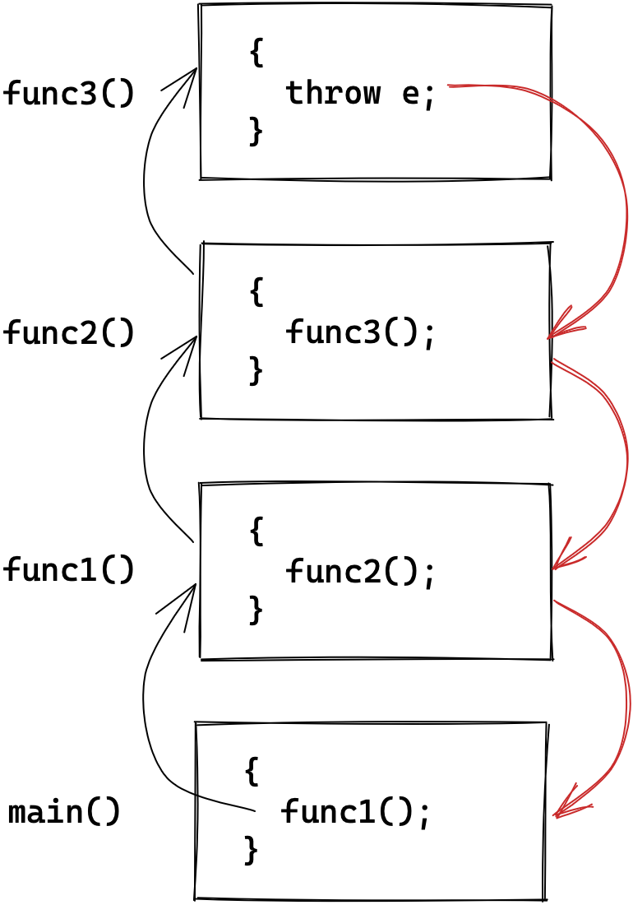

一般在大型项目中都是在最外层统一进行处理异常，但资源的释放需要在当前层完成，为防止异常跳过资源释放，可以在当前层捕获并释放再抛出，再在最外层重新捕获并处理。

```cpp
void Func()
{
    try {
        some();
    }
    catch (...) {
        delete resource; // 释放资源
        throw; // 重新抛出
    }
}
int main()
{
    try {
        Func();
    }
    catch(...) {
        HandlerException(); // 处理异常
    }
}
```

##### 1.2.2 异常安全和规范

C++ 中经常会出现异常导致资源泄漏的问题。比如：

在`new`和`delete`中间抛出异常，可能导致内存泄漏。在`lock`和`unlock`中间抛出异常，可能导致死锁。

###### 异常规范

针对异常，C++标准也有规范，

- 如果函数不会抛异常可以在其声明后加上关键字`noexcept`。
- 在函数声明后加上`throw(...)`表明该函数可能抛出的异常类型。

```cpp
// 表示函数可能抛出的异常有指定类型
void Func() throw(int, char, string, vector);

// 表示函数只可能会抛出std::bad_alloc一种异常
void New(size_t size) throw (std::bad_alloc);

// 表示函数不会抛出异常
void Delete(size_t size, void* ptr) throw();
```

> 编译器不对这两条声明作检查。

###### 异常安全

- 不要在构造析构函数内抛出异常，以防对象初始化或释放不全。
- 对于异常导致的资源泄漏、死锁等问题，通常使用锁守卫和智能指针来初始化和析构。

#### 1.3. 自定义异常体系

实际项目中不可随便抛任意类型的异常，这样会增加处理难度。很多公司都会定义自己的异常类体系进行规范的异常管理。

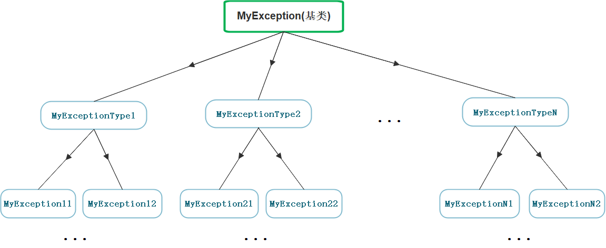

实际工程中也都是自定义异常类体系，用父类对象捕获子类对象，这非常实用。

```cpp
class Exception
{
public:
    Exception(const string& errmsg, int id)
        :_errmsg(errmsg), _id(id)
    {}
    virtual string What() const {
        return _errmsg;
    }
protected:
    string _errmsg;
    int _id;
};

class SqlException : public Exception
{
public:
    SqlException(const string& errmsg, int id, const string sql)
        : Exception(errmsg, id), _sql(sql)
    {}
    virtual string What() const {
        return "SqlException: " + _sql + " : " + _errmsg;
    }
private:
    string _sql;
};

class CacheException : public Exception
{
public:
    CacheException(const string& errmsg, int id)
        : Exception(errmsg, id)
    {}
    virtual string What() const {
        return "CacheException: " + _errmsg;
    }
};

class HttpException : public Exception
{
public:
    HttpException(const string& errmsg, int id, const string& type)
        : Exception(errmsg, id), _type(type)
    {}
    virtual string What() const {
        return "HttpException: " + _type + " : " + _errmsg;
    }
private:
    string _type;
};
```

模拟网络服务体系：

```cpp
void SqlMgr()
{
    //...
    if (rand() % 7 == 0)
        throw SqlException("sql sytanx wrong!", 100, "some error sql");
    if (rand() % 8 == 0)
        throw SqlException("permission denied!", 101, "select * from secret");
    //...
    throw "Unkown Exception";
}

void CacheMgr()
{
    //...
    if (rand() % 5 == 0)
        throw CacheException("insufficient space!", 100);
    if (rand() % 6 == 0)
        throw CacheException("permission denied!", 101);
    //...
    SqlMgr();
}

void HttpMgr()
{
    //...
    if (rand() % 3 == 0)
        throw HttpException("resource is not exist!", 100, "post");
    if (rand() % 4 == 0)
        throw HttpException("permission denied!", 101, "post");
    //...
    CacheMgr();
}

void ServerStart()
{
    srand((unsigned int)time(nullptr));
    while (1)
    {
        this_thread::sleep_for(chrono::seconds(1));
        try {
            HttpMgr();
        }
        catch (const Exception& e) {
            cout << e.What() << endl;
        }
        catch (...) {
            cout << "Unkown Exception" << endl;
        }
    }
}

int main()
{
    ServerStart();
    return 0;
}
```

#### 1.4. 标准库的异常体系

C++标准库也提供了标准异常类[std::exception](https://cplusplus.com/reference/exception/exception/)。

继承体系结构图如下：

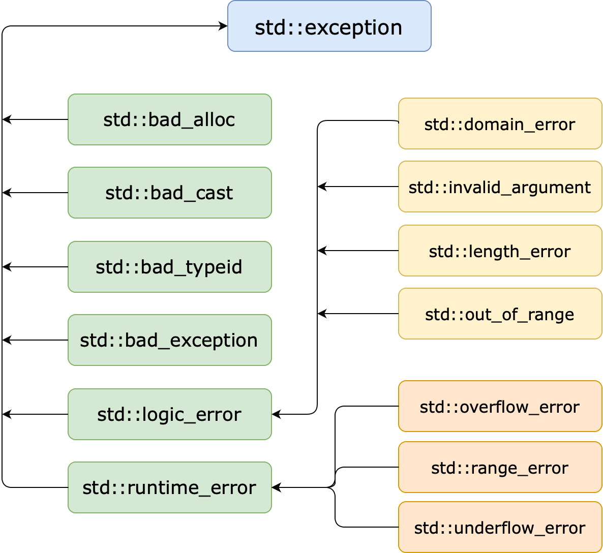

| 异常                  | 描述                           |
| --------------------- | ------------------------------ |
| std::exception        | 该异常是所有标准异常的父类     |
| std::bad_alloc        | new出现异常，内存不足          |
| std::bad_cast         | dynamic_cast出现异常           |
| std::bad_exception    | 出现无法预期的异常             |
| std::bad_typeid       | typeid出现异常                 |
| std::logic_error      | 逻辑错误                       |
| std::domain_error     | 无效的数学域异常               |
| std::invalid_argument | 无效的参数异常                 |
| std::length_error     | td::string出现异常，字符串太长 |
| std::out_of_range     | 越界访问                       |
| std::runtime_error    | 运行时异常                     |
| std::overflow_error   | 溢出异常                       |
| std::range_error      | 存储超出范围异常               |
| std::underflow_error  | 数学下溢异常                   |

#### 1.5. 异常的优缺点

| 异常的优点                                           |
| ---------------------------------------------------- |
| 清晰准确地展示出各种错误信息                         |
| 不需要层层返回，一次性到达异常处理的地方             |
| 不占用函数的返回位置                                 |
| **异常的缺点**                                       |
| 异常可能导致执行流乱跳，易混乱                       |
| 异常容易导致资源泄漏，需要智能指针管理资源           |
| 标准库的异常体系定义得不好，导致没有规范的异常体系。 |

### 2. 智能指针

异常会导致资源泄露等安全问题，可以用智能指针管理这些资源。

#### 2.1. RAII

智能指针需要解决三个问题：

1. 支持模拟`*`、`->`、`++`、`--`等指针运算；
2. 自动初始化自动销毁；
3. 解决指针拷贝问题。

```cpp
template <class T>
class SmartPtr
{
public:
    SmartPtr(T* ptr) : _ptr(ptr)
    {}

    ~SmartPtr()
    {
        delete _ptr;
    }

private:
    T* _ptr;
};

void Func()
{
    try {
        SmartPtr<int> sp = new int;
    }
    catch(const exception& e) {
        cout << e.what() << endl;
    }
}
```

`RAII`是一种利用对象生命周期来管理资源的初始化和销毁的简单思想。

给资源“套了对象的壳”，把管理资源的责任托管给了一个对象。对象构造时获取资源，对象析构时自动释放。

此间对象控制对资源的访问，使之在对象的生命周期内始终保持有效。

```cpp
int main()
{
    SmartPtr<int> sp1 = new int;
    SmartPtr<int> sp2(sp1); // 程序崩溃 ...
}
```

智能指针是用来管理资源的，如果要支持拷贝构造那必是浅拷贝，管理同一份资源。但析构两遍会导致程序崩溃。

多个对象管理同一份资源才是实现智能指针的难点。

> 跟随智能指针的发展历程讨论如何实现智能指针。

#### 2.2. auto_ptr

C++98标准库中第一个智能指针就是`auto_ptr`，而`auto_ptr`对智能指针拷贝的处理方案是**管理权转移**。

```cpp
template <class T>
class auto_ptr
{
public:
    auto_ptr(T* ptr) : _ptr(ptr)
    {}

    auto_ptr(auto_ptr& sp)
        : _ptr(sp._ptr) // 将资源的管理权移交到自己手上
    {
        sp._ptr = nullptr; // 将原指针置空
    }

    T& operator*()
    {
        return *_ptr;
    }
    T& operator->()
    {
        return _ptr;
    }

    auto_ptr& operator++()
    {
        ++_ptr;
    }
    auto_ptr& operator--()
    {
        --_ptr;
    }

    ~auto_ptr()
    {
        delete _ptr;
    }

private:
    T* _ptr;
};

void test_auto_ptr()
{
    auto_ptr<int> p1(new int);
    auto_ptr<int> p2(p1); // 管理权转移

    cout << *p2 << endl;
    cout << *p1 << endl; // 程序崩溃
}
```

将原指针置空，并将资源的管理权移交到自己手上，就不需要担心析构的问题。

**这样虽然实现拷贝的功能，但原智能指针`sp1`已经变成了空指针**。所以库中的`auto_ptr`是个失败的半成品。

[std::auto_ptr](https://cplusplus.com/reference/memory/auto_ptr/)

#### 2.3. unique_ptr

当时Boost库设计出了三个智能指针`scoped_ptr`、`shared_ptr`、`weak_ptr`。

C++11更新的`std::unique_ptr`就是Boost库的`scoped_ptr`改名来的。`unique_ptr`简单粗暴，**禁止拷贝构造**。

```cpp
template <class T>
class unique_ptr
{
public:
    unique_ptr(T* ptr) : _ptr(ptr)
    {}

    unique_ptr(const unique_ptr<T>& sp) = delete; // 直接禁止拷贝构造

    T& operator*()
    {
        return *_ptr;
    }
    T& operator->()
    {
        return _ptr;
    }

    unique_ptr& operator++()
    {
        ++_ptr;
    }
    unique_ptr& operator--()
    {
        --_ptr;
    }

    ~unique_ptr()
    {
        delete _ptr;
    }

private:
    T* _ptr;
};

void test_unique_ptr()
{
    std::unique_ptr<int> up1(new int);
    std::unique_ptr<int> up2(up1); // 编译报错
}
```

[std::unique_ptr](https://cplusplus.com/reference/memory/unique_ptr/)

#### 2.4. shared_ptr

> 那如何让智能指针可以拷贝，也可以准确析构呢？

**使用引用计数，为管理的资源配一个变量用来计数**。只有最后一个对象析构时再去释放资源，其他对象析构只需减减引用计数。

注意是<u>为被管理的资源配一个引用计数，而不是给对象</u>，所以不能用静态成员变量。

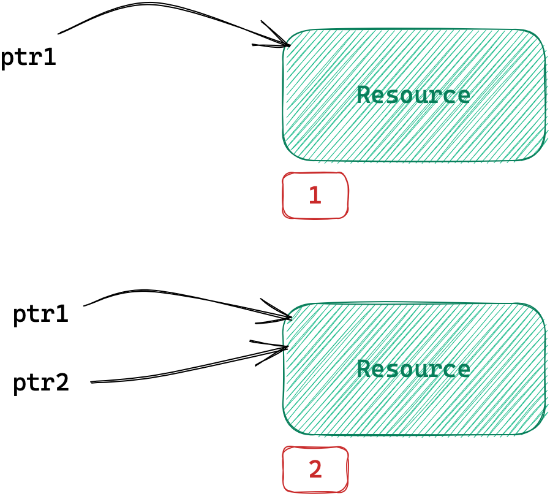

```cpp
template<class T>
class shared_ptr
{
public:
    shared_ptr(T* ptr)
        : _ptr(ptr)
        , _pcnt(new int(1))
    {}

    shared_ptr(const shared_ptr& p)
        : _ptr(p._ptr)
        , _pcnt(p._pcnt)
    {
        ++(*_pcnt);
    }

    shared_ptr& operator=(const shared_ptr& p)
    {
        if (_ptr != p._ptr)
        {
            if (--(*_pcnt) == 0)
            {
                delete _ptr;
                delete _pcnt;
                _ptr = nullptr;
                _pcnt = nullptr;
            }

            _ptr = p._ptr;
            _pcnt = p._pcnt;
            _pmtx = p._pmtx;
            ++(*_pcnt);
        }

        return *this;
    }

    ~shared_ptr()
    {
        if (--(*_pcnt) == 0)
        {
            delete _ptr;
            delete _pcnt;
            _ptr = nullptr;
            _pcnt = nullptr;
        }
    }

    T& operator*()
    {
        return *_ptr;
    }

    T* operator->()
    {
        return _ptr;
    }

    T* get()
    {
        return _ptr;
    }

    size_t use_count()
    {
        return *_pcnt;
    }

private:
    T* _ptr;
    int* _pcnt;
};
```

在构造函数首次接受资源的托管时，开辟一个堆变量作引用计数，就实现资源和引用计数配套了。

##### 线程安全

除此之外，多线程下无法保证引用计数的安全，智能指针需要考虑引用计数的线程安全。可以使用标准库中的原子操作封装引用计数，也可以在`AddRef`和`Release`处加锁。

故库中的`shared_ptr`的引用计数是线程安全的，但不是保证资源的线程安全。

```cpp
template<class T>
class shared_ptr
{
private:
    void add_ref()
    {
        _pmtx->lock();
        ++(*_pcnt);
        _pmtx->unlock();
    }

    void release()
    {
        _pmtx->lock();

        bool flag = false;
        if (--(*_pcnt) == 0)
        {
            cout << "delete: " << _ptr << endl;
            delete _ptr;
            delete _pcnt;
            _ptr = nullptr;
            _pcnt = nullptr;

            flag = true;
        }

        _pmtx->unlock();

        if (flag)
        {
            delete _pmtx;
            _pmtx = nullptr;
        }
    }

public:
    shared_ptr(T* ptr)
        : _ptr(ptr)
        , _pcnt(new int(1))
        , _pmtx(new mutex)
    {}

    shared_ptr(const shared_ptr& p)
        : _ptr(p._ptr)
        , _pcnt(p._pcnt)
        , _pmtx(p._pmtx)
    {
        add_ref();
    }

    shared_ptr& operator=(const shared_ptr& p)
    {
        if (_ptr != p._ptr)
        {
            release();

            _ptr = p._ptr;
            _pcnt = p._pcnt;
            _pmtx = p._pmtx;
            add_ref();
        }

        return *this;
    }

    ~shared_ptr()
    {
        release();
    }

    T& operator*()
    {
        return *_ptr;
    }

    T* operator->()
    {
        return _ptr;
    }

    T* get()
    {
        return _ptr;
    }

    size_t use_count()
    {
        return *_pcnt;
    }

private:
    T* _ptr;
    int* _pcnt;
    mutex* _pmtx;
};
```

##### 循环引用

普通场景下不会产生循环引用的问题，但在某些的特殊场景，如双向链表节点的前后指针。

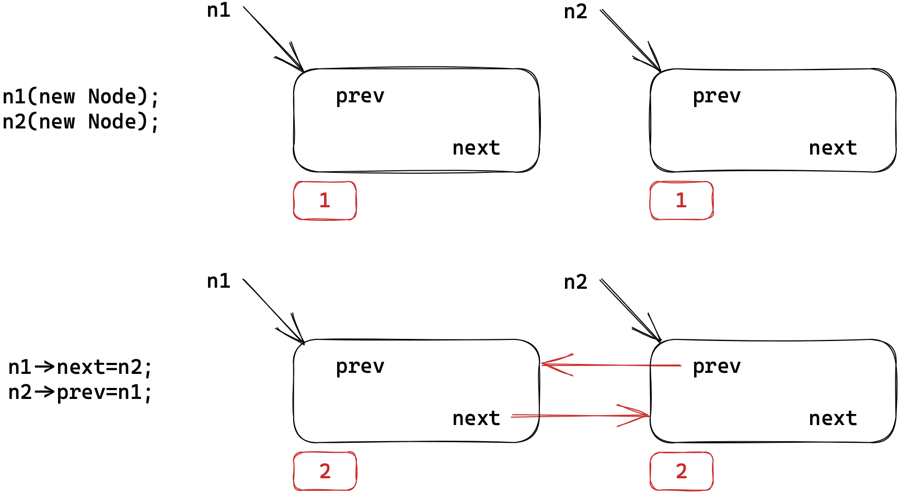

```cpp
// 双向链表
struct ListNode
{
    shared_ptr<ListNode> _prev;
    shared_ptr<ListNode> _next;
    int _val;
};

void test()
{
    shared_ptr<ListNode> n1 = new ListNode;
    shared_ptr<ListNode> n2 = new ListNode;
    n1->_next = n2;
    n2->_prev = n1;
}
```

- `n2->prev`和`n1`一起管理第一块资源，释放第一块资源不仅需要`n1`析构还需要`n2->prev`析构。
- `n1->next`和`n2`一起管理第二块资源，释放第二块资源不仅需要`n2`析构还需要`n1->next`析构。

> 出作用域后`n1`、`n2`相继析构，两个资源分别由`n2->prev`和`n1->next`管理。

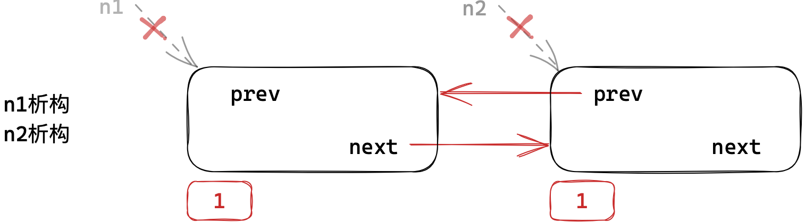

`n2->prev`和`n1->next`分别属于第二块资源和第一块资源。现在就出现了循环引用的问题：

- **释放第一块资源需要先析构`n2->prev`，也就是需要先释放第二块资源**；
- **释放第二块资源需要先析构`n1->next`，也就是需要先释放第一块资源；**

#### 2.5. weak_ptr

```cpp
template <class u>
weak_ptr (const shared_ptr<u>& x) noexcept;
```

weak_ptr不是常规意义的智能指针。它用于辅助shared_ptr解决重复引用问题。

weak_ptr可以访问资源，但不参与资源的释放，**所以不改变引用计数，就避免循环引用的问题**。

> weak_ptr比原生指针的优势在于weak_ptr支持和share_ptr进行相互赋值和拷贝。

```cpp
template <class T>
class weak_ptr
{
public:
    weak_ptr(T* ptr = nullptr)
        : _ptr(ptr)
    {}

    weak_ptr(const weak_ptr<T>& wp)
        : _ptr(wp._ptr)
    {}

    weak_ptr(const shared_ptr<T>& sp)
        : _ptr(sp.get())
    {}

    ~weak_ptr()
    {}

    weak_ptr<T>& operator=(const shared_ptr<T>& sp)
    {
        _ptr = sp.get();
        return *this;
    }

    weak_ptr<T>& operator=(const weak_ptr<T>& wp)
    {
        _ptr = wp._ptr;
        return *this;
    }

    T* operator->()
    {
        return _ptr;
    }
    T& operator*()
    {
        return *_ptr;
    }

private:
    T* _ptr;
};
```

```cpp
struct ListNode
{
    int _val = 0;
    weak_ptr<ListNode> _prev = nullptr;
    weak_ptr<ListNode> _next = nullptr;
};

void test_weak_ptr()
{
    shared_ptr<ListNode> n1(new ListNode);
    shared_ptr<ListNode> n2(new ListNode);

    n1->_next = n2;
    n2->_prev = n1;
}
```

#### 2.6. 定制删除器

智能指针的析构要适配delete和delete两种情况，我们使用定制删除器解决这个问题。

提供一个删除器的仿函数，作智能指针的模版参数，析构时调用该仿函数释放资源。

```cpp
template <class T>
struct default_delete {
    void operator()(const T* ptr) { delete ptr; }
};

template <class T>
struct delete_array {
    void operator()(const T* ptr) { delete[] ptr; }
};

struct delete_file {
    void operator()(FILE* ptr) { fclose(ptr); }
};

template <class T, class D = default_delete<T>>
class unique_ptr {
public:
    unique_ptr(T* ptr) : _ptr(ptr) {}

    unique_ptr(const unique_ptr<T>&) = delete;
    unique_ptr<T>& operator=(const unique_ptr<T>&) = delete;

    ~unique_ptr() { D()(_ptr); }

    T& operator*() { return *_ptr; }
    T* operator->() { return _ptr; }
private:
    T* _ptr;
};
```

#### 2.7. 对比总结

| 智能指针     | 实现方案                                 |
| ------------ | ---------------------------------------- |
| `auto_ptr`   | 管理权转移，悬空被拷贝对象               |
| `unique_ptr` | 直接禁止拷贝赋值                         |
| `shared_ptr` | 添加引用计数以支持拷贝，但会出现循环引用 |
| `weak_ptr`   | 不修改引用计数，用于解决循环引用         |

不建议使用`auto_ptr`，无拷贝需求就使用`unique_ptr`，有拷贝需求就使用`shared_ptr`。
