# C语言基础

## 1. 基础常识

#### 头文件

```c
#include <stdio.h> //stdio-标准输入输出 standard input & output headfile
```

引用编译器自带的标准输入输出文件，一般放在程序的开头，以便使用其内容。

#### 主函数

主函数main函数，主函数有且仅有一个。它是程序的入口，一切程序都是从此处开始执行的，没有它程序就不完整。

```c
int main()
{
    //库函数-打印函数-输出函数
    printf("hello world!\n");
    printf("hello world!\n");
    printf("hello world!\n");

    return 0;
}

int main(void) //这种写法明确告诉你，main函数不需要传参
int mian(int argc, char* argv[]) //这种写法有用，但不是重点
```

### 数据类型 {.ignore-header}

程序语言中变量需要类型来描述，也就是用类型定义变量。C语言主要有六种数据类型，如下述表格所示：

| 类型关键字 | 类型名       | 类型解释               | 类型长度 |
| ---------- | ------------ | ---------------------- | -------- |
| char       | 字符型       | 定义字符变量           | 1字节    |
| short      | 短整型       | 定义比较小的整型变量   | 2字节    |
| int        | 整形         | 定义整型变量           | 4字节    |
| long       | 长整型       | 定义比较大的整型变量   | 4/8字节    |
| float      | 单精度浮点型 | 定义精度较低浮点型变量 | 4字节    |
| double     | 双精度浮点型 | 定义精度较高浮点型变量 | 8字节    |

char,short,int,long属于整型家族，float,double属于浮点型家族。这六种类型都是内置的，可以直接使用。

每种类型都有自己的类型长度，即用该类型创建的变量所占的内存空间。关键字`sizeof`用于计算一个类型所占空间的大小。

```c
int main()
{
    printf("%d\n", sizeof(char));//1个字节
    printf("%d\n", sizeof(short));//2个字节
    printf("%d\n", sizeof(int));//4个字节
    printf("%d\n", sizeof(long));//4个字节
    printf("%d\n", sizeof(long long));//8个字节
    printf("%d\n", sizeof(float));//4个字节
    printf("%d\n", sizeof(double));//8个字节
    return 0;
}
```

### 变量 {.ignore-header}

变量分为全局变量和局部变量。定义在`{}`内是局部变量。定义在全局、可全局使用是全局变量，如`a`。

局部是一个相对的概念，如`b`变量就是定义在main函数内的局部变量，`c`是定义在其所在的`{}`内的局部变量。

如果全局变量和局部变量重名，则局部变量优先。

```c
int a = 0;//1.
int main()
{
    int b = 0;//2.
    {
        int c = 0;//3.
    }
}
```

使用`scanf`读取多个变量时，可以写成如下几种形式：

```c
scanf("%d%d%d", &a, &b, &c);//1.
scanf("%d %d %d", &a, &b, &c);//2.
scanf("%d,%d,%d", &a, &b, &c);//3.
```

第一种形式虽然%d之间没有空格，但输入变量时仍需以空格相隔，使用上和第二种无异。第三种形式%d以`,`相隔，故输入时同样要以`,`相隔。

#### 作用域

变量有作用域的概念，作用域就是变量能够作用的范围。变量只能在变量的作用域内使用，作用域以外变量失效。

一般来说，全局变量的作用域就是全局，也就是整个工程，局部变量的作用域就是它所在的`{}`。

#### 生命周期

变量入作用域生命周期开始，出作用域生命周期结束。但生命周期和作用域不同，生命周期是时间上的概念，程序运行到该范围就开始出该范围结束。

- 全局变量的生命周期就是整个工程的生命周期，也就是`main`函数的生命周期。从程序运行到程序结束。
- 局部变量的生命周期就是入该变量的作用域到出作用域。

### 常量 {.ignore-header}

#### 字面常量

如字母`a`,数字`1`等，可直接写出的常量。

#### const修饰的常变量

`const`修饰变量，将变量修饰成常量。但需要警惕的是，`const`修饰只是将变量变成具有常属性的变量，仅是不可修改而已，归根结底它还是变量。

```c
const int a = 0;
a = 1;//Err const修饰的变量不可修改
```

#### #define定义的标识符常量

使用`#define`定义一个标识符常量，这种常量就相当于标识符。

程序编译时会将所有标识符常量直接进行文本替换。所以在程序运行时早已已经不存在这个常量了。

```c
#define MAX 100
```

#### 枚举常量

以枚举的形式定义出一串具有一定意义的常量。

```c
enum color { RED, BULE, YELLOW, BLACK };
```

每个成员都是一个常量，`RED`只是一个字面的标识符名，所代表的是从0开始的连续数字常量，如RED=0,BULE=1,……,BLACK=3。当然也可自行初始化赋值，之后的变量就从该初始值开始向后延续。

### 字符串 {.ignore-header}

字符：被单引号引起来的，如`'w'`,`'r'`，字符串：被双引号引起来的，`"yyx"`,`"abcdef"`。

字符串以`'\0'`结尾隐含在字符串的末尾。`'\0'`为字符串结束标志，在计算字符串长度时**不算作字符串内容**。

定义字符串有如下两种方式：

```c
int main()
{
    //1.
    char ch1[] = "abcdef";//初始化字符数组
    //a, b, c, d, e, f, \0
    printf("%s\n", ch1);//abcdef
    printf("%d\n", strlen(ch1));//6

    //2.
    char ch2[] = { 'a','b','c','d','e','f' };
    //a ,b ,c ,e ,f
    printf("%s\n", ch2);//abcdef烫烫烫烫烫abcdef
    printf("%d\n", strlen(ch2));//随机值

    char ch3[] = { 'a','b','c','d','e','f','\0' };
    //a ,b ,c ,d ,e ,f ,\0
    printf("%s\n", ch3);//abcdef
    printf("%d\n", strlen(ch3));//6

    return 0;
}
```

> `%s`是字符串形式的格式控制符，`printf("%s",a);`也即是以字符串的形式打印。
>
> `strlen`是字符串库函数，传入字符串名`strlen(a)`可以计算该字符串长度并返回。具体是从开头到`\0`的位置，`\0`不算作字符串元素。

### 转义字符 {.ignore-header}

| 转义字符 | 内容用法                                     |
| -------- | -------------------------------------------- |
| `\`      | 加在各自转义字符前防止其被转移，当成普通字符 |
| `\n`     | 换行符、回车符                               |
| `\ddd`   | 八进制数字                                   |
| `\xdd`   | 十六进制数字                                 |
| `\t`     | 水平制表符（后移四个空格长度）               |
| `\v`     | 垂直制表位                                   |
| `\a`     | 警告，蜂鸣                                   |
| `\b`     | 退格符                                       |
| `\f`     | 进纸符                                       |

```c
// 转义字符 \
    printf("c:\\code\test.c\n");
    //单个\是转义序列符，想要出现该\，则必须要搭配两个\\，防止其被转义
    //\' \"
    printf("%c\n", 'a');
    printf("%c\n", 'b');
    printf("%c\n",'\'');//在'前面加上\，以单纯的将其视为字符'
    printf("%s\n", "\"");//在"前面加上\，以单纯的将其视为字符"

//\ddd八进制数字  \xdd十六进制数字
int main()
{
    printf("%c\n", '\065');
    //打印八进制数065转化为十进制数53所代表的字符（ASCII码）
    printf("%d\n", '\065');
    //以十进制的形式打印八进制数065

    printf("%c\n", '\x15');
    printf("%d\n", '\x15');
    //以十进制的形式打印十六进制数15

    return 0;
}
```

### 注释 {.ignore-header}

| 注释方式    | 优缺点                            |
| ----------- | --------------------------------- |
| `//xxxxx`   | 缺点是只能注释一行。              |
| `/*xxxxx*/` | C语言的风格，缺点是不可嵌套注释。 |

### 关键字 {.ignore-header}

#### typedef

类型重命名，就是将变量的类型重新取个名字。一般用于非常长的类型名如`unsigned int`这样，或者是结构体类型。

```c
//typedef 变量类型重命名
typedef unsigned int unint;
```

之后就可以把`unsigned int` 直接写成 `unint`了。

#### extern

`extern`，翻译过来就是外部的意思，用于声明引用外部文件（其他`.c`文件）的变量或是函数。但由于函数自带外部链接属性，所以可以不用声明。

用法如`extern int g_val;`（`g_val`是外部的变量）

#### static

`static`有修饰局部变量、全局变量和函数三种不同的用法。

- 修饰局部变量时，使其出作用域不会被销毁。虽不被销毁但是仍不可在作用域之外使用该变量，准确的来说就是**延长了他的生命周期，但不影响作用域**。
- 修饰全局变量和函数时，会**使其外部链接属性失效**，也是就使其不可以在其他源文件中被使用。

```c
void test()
{
    static int a = 1;
    a++;
    printf("%d ", a);
}
int main()
{
    int i = 0;
    while (i < 10)
    {
        test();
        i++;
    }
    return 0;
}
```

```c
static int g_val = 2021;

static int Add(int x, int y)
{
    return x + y;
}
```

> 其它如`auto`，`goto`，`register`，`union`，稍微了解一下即可。

## 2. 分支循环

#### 语句的概念

以分号`;`结尾、用分号`;`隔开的就是一条语句。只有一个分号`;`的语句就是空语句。

```c
printf("hehe\n");
1+2;
;//空语句
```

### 2.1 选择结构

#### if语句

条件表达式为真就进入语句，为假则不执行。if语句分为单分支和多分支两种逻辑结构。

```c
//1.单分支
if (表达式) {
    语句;
}
else {
    语句;
}

//2. 多分支
if (表达式) {
    语句;
}
else if (表达式) {
    语句;
}
else if (表达式) {
    语句;
}
...
else {
    语句;
}
```

##### 示例

```c
int age = 20;

//多分支
if (age < 18)
    printf("青少年\n");
else if (age >= 18 && age < 30)
    printf("青年\n");
else if (age >= 30 && age < 50)
    printf("壮年\n");
else if (age >= 50 && age < 80)
    printf("老年\n");
else
    printf("快没了\n");
```

if 语句**使用代码块可以控制多条语句**。即用一对大括号将所以语句括在一起。这样还有一个明显的好处就是可以提高代码的可读性，如：

```c
int age = 10;
if (age >= 18)
{
    printf("成年了\n");
    printf("可以谈恋爱了\n");
}
```

##### 常见问题

1. 条件表达式错误：`18 <= age && age < 30` 写成  `18 <= age < 30`。

```c
if (18 <= age < 30) // 18 <= age && age < 30
    printf("青年\n");
```

C语言中18<=age<30是一个表达式。从左向右计算，左边的18<=age是一个表达式，真则为1，假则为0。无论如何都是小于30的，故整个表达式为真，无论怎样都会执行if语句。

2. 悬空`else`：else总是与其上最近的一个if搭配，不受代码对齐的影响。

```c
if (a == 1)
    if (b == 2)
        printf("hehe\n");
else
    printf("haha\n"); // else与其上最近的一个if匹配
```

应修改为下方示例，提示了代码的可读性。

```c
if (a == 1)
{
    if (b == 2)
        printf("hehe\n");
    else
        printf("haha\n"); // else与其上最近的一个if匹配
}
```

3. 判断条件写成赋值表达式

```c
if (a = 5) // a == 5 写成 a = 5
    printf("hehe\n");
```

a=5是赋值表达式，表达式的值为5，无论如何都执行if语句。

```c
if (5 == a)
    printf("hehe\n");
```

把`a == 5`改成`5 == a`，这样一来如果再写成赋值表达式，就出现了语法错误，常量是不可赋值的，编译器就会报警。

```c
void test()
{
    if (1)
    {
        printf("hehe\n");
        return 0;
    }
    //函数返回值后，后面的代码不执行
    printf("haha\n");
}
```

#### switch 语句

在条件过多的情况下，使用 if...else 会显得过于繁琐。

```c
switch (day) // 整型表达式
{
case 1: // 整型常量表达式
{
	printf("星期一\n");
	printf("美好的一天，从上班开始5555~");
	break;
}
case 2:
	printf("星期二\n");
	break;
case 3:
	printf("星期三\n");
	break;
case 4:
	printf("星期四\n");
	break;
case 5:
	printf("星期五\n");
	break;
case 6:
	printf("星期六\n");
	break;
case 7:
	printf("星期日\n");
	break;
}
```

- `switch ()`的表达式必须是**整型表达式**。
- `case`语句也必须判断的是**整型常量表达式**。
- `case`语句项内若想控制多条语句，仍需使用代码块。但我们不推荐这样，一般封装成函数才不显得臃肿。
- 每种情况下都要有 break 跳出去，不然会一直向下执行。case是入口，break是出口。
- 当所有的 case 标签都不满足时，便会执行 default 子句。

```c
switch (day)
{
    case 1:
    case 2:
    case 3:
    case 4:
    case 5:
        printf("工作日\n");
        break;
    case 6:
    case 7:
        printf("休息日\n");
        break;
    default:
        printf("输入数据有误，请重新输入\n");
        break;
}
```

### 2.2 循环结构

#### while 循环

`while`语句的执行流程如下：

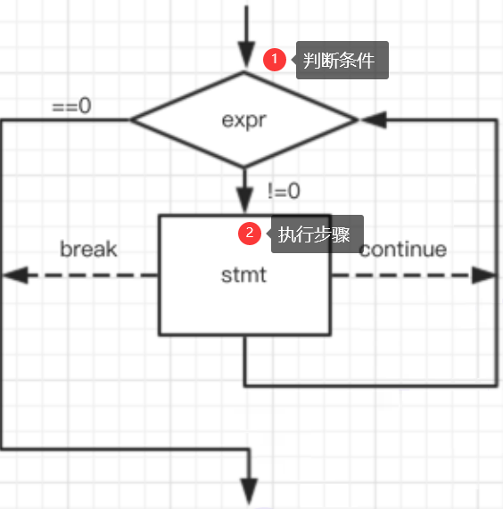

1. 条件判断：条件为真，则进入循环，反之则退出循环。
2. 执行内部逻辑：内部逻辑执行完毕后，又会回到条件判断部分。

##### break&continue

- `break`用来**直接终止循环**。
- `continue`用于停止本次循环，继续下次循环。本次循环`continue` 后边的代码不会再执行，直接跳到 while 的判断部分，进行下一次循环。

```c
int i = 0;
while (i <= 10)
{
    if (i == 6)
        break;

    printf("%d ", i);
    i++;
}
```

当 i=6 时，break 终止循环，所以输出结果为0 1 2 3 4 5 。

```c
int i = 0;

while (i <= 10)
{
    if (i == 6)
        continue;

    printf("%d ", i);
    i++;
}
```

先是输出了0 1 2 3 4 5 ，当 i=6 时`continue`跳出了本次循环，进入下次循环。但i并没有`++`，一直等于6，故下一次循环仍会发生`continue`，一直死循环。

```c
int i = 0;
while (i <= 10)
{
    i++;
    if (i == 6)
        continue;

    printf("%d ", i);//1 2 3 4 5 7 8 9 10 11
}
```

##### 应用实例

```c
int ch = 0;
while ((ch = getchar()) != EOF)
    putchar(ch);
```

- `getchar`就是<u>从键盘获取字符</u>，`getchar`就是<u>把字符打印到屏幕</u>。
- `EOF`即end of file是文件结束标志。判断条件中的ch=`getchar`，同样返回的也是字符的ACSII码值。

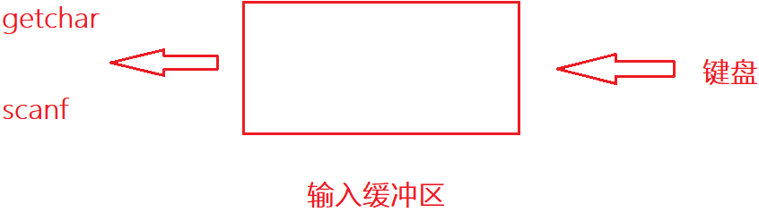

`getchar`和`scanf`两个常见的输入函数，都是从键盘上读取字符。先从键盘再到输入缓冲区，输入缓冲区是一块特殊的内存空间。`getchar`和`scanf`是从输入缓冲区里读取的字符。

> 二者读取的方式有所不同，`scanf`读取到空格就停下不读了，`getchar`一次只读取一个字符。相同之处，如果输入缓冲区没东西，那么就等待我们从键盘上输入。如果输入缓冲区有东西，就直接读取。

```c
int ch = 0;
char password[20] = { 0 };
printf("请输入密码>:");
scanf("%s", password);
printf("请确认密码(Y/N):>");

while ((ch = getchar()) != '\n') { // 清理\n
    ;
}
ch = getchar();

if (ch == 'Y')
    printf("确认成功\n");
else
    printf("确认失败\n");
```

#### for 循环

for 循环是使用最多的循环语句。

```c
for (表达式1, 表达式2, 表达式3)
    循环语句;
```

1. 表达式1为**初始化部分**，用于初始化循环变量。
2. 表达式2为**条件判断部分**，用于判断什么时候终止循环。
3. 表达式3为**循环更新部分**，用于循环条件的调整。

循环最重要的三个部分被集中在一起，不容易漏写错写。

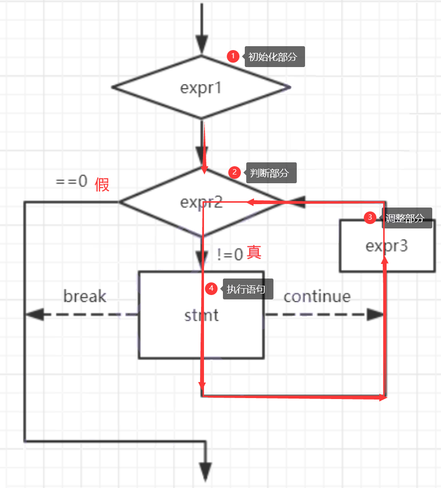

```c
int i = 0;
for (i = 1; i <= 10; i++)
{
    printf("%d ", i);
}
```

##### break&continue

- for循环里`break`作用和其他循环一样。是直接终止循环，或者说是跳出循环。
- for循环里`continue`跳过循环体下面的代码，来到本次循环的变量更新部分。**for循环的调整部分在循环体上面所以不受影响**

```c
int i = 0;
for (i = 1; i <= 10; i++)
{
    if (i == 5)
        break;
    printf("%d ",i);//1 2 3 4
}
```

```c
int i = 0;

for (i = 1; i <= 10; i++)
{
    if (i == 5)
        continue;
    printf("%d ", i);//1 2 3 4 6 7 8 9 10
}
```

1 2 3 4 6 7 8 9 10，显然跳过了i=5的情况，直接跳到了for循环的调整部分，调整循环变量，不容易造成死循环。

##### 注意

1. 不可在for循环内部修改循环变量，容易使for循环失去控制。

```c
int i = 0;
for (i = 1; i <= 10; i++)
{
    printf("%d ", i);
    i++;
}
```

2. 建议for的循环条件判断采用"左闭右开"写法。

```c
int i = 0;
for (i = 0; i < 10; i++) // 左闭右开
{
    printf("%d ", arr[i]);
}
```

采用“左闭右开”的写法，循环变量i就拥有了更多的意义。

i可以表示数组下标从0开始，i<10表示循环10次。也不是说必须要左开右闭，根据事实情况，目的是使循环变量拥有更多的意义。

3. for循环的三个部分可以省略。

- 初始化部分省略，则在创建变量时就已经初始化。
- 判断部分省略，意味着判断条件恒为真。
- 调整部分省略，那就不调整。

```c
int i = 0;
for (;;)
{
    printf("%d ", i);
}

int i = 0;
for ( ; i < 10; i++)
    printf("hehe\n");
```

4. 多循环变量的情况

```c
int x = 0;
int y = 0;
for (x = 0, y = 0; x < 5 && y < 7; x++, y++)
{
    printf("hehe\n");
}
```

> 请问下面代码循环几遍？

```c
int i = 0;
int k = 0;
for (i = 0, k = 0; k = 0; i++, k++)
{
    k++;
}
```

一遍都不循环。判断条件写成赋值表达式，k=0恒为假。

#### do..while循环

先看它的语法结构。

```c
do
{
    循环语句;
} while(表达式);
```

他的特点显而易见，是先执行再判断。所以就算条件不满足，也至少执行一次。一般do while循环使用的场景有限。

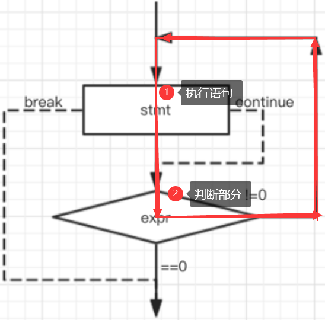

##### break&continue

- `break`仍是终止循环。
- `continue`仍提前结束本次循环，继续下次循环。本次循环`continue`后边的代码不会再执行，直接跳到do while的判断部分，进行下一次循环。

```c
int i = 1;
do
{
    if (i == 5)
        continue;
    printf("hehe\n");
    i++;

} while (i < 10); // 死循环
```

- 三种循环的break作用都是一样的。
- while和do..while的continue作用一样，跳到下一次循环的条件判断处。for的continue作用是跳到本次循环的条件更新处。

### 2.3 跳转语句

C语言中提供了可以随意跳转的`goto`语句。如：

```c
again:
    //...
    goto again;
```

`again`只是一个标记名字而已。代码执行到goto语句处，会跳转到标记位置，继续向下执行。

> 一般`goto`语句是没有必要的，其常见用法就是使程序在各种深层嵌套的代码中一次性跳出来。一般出现在各种服务端程序的差错处理代码的复杂逻辑判断中。

## 3. 函数

函数又被叫做子程序，有一或多个语句项组成，负责完成某项特定任务。通常是将一项任务或者功能封装在一个函数中，对外提供接口，这样代码更加结构化。

特点：

1. 具备相对的独立性
2. 一般有输入值和返回值
3. 功能单一且灵活

### 3.1 库函数

#### 库函数的定义

库函数就是库里供使用的函数。如打印输出这样的基础功能，他不是业务性的代码，在开发过程中使用率高且可移植性强，故C语言的基础库里提供了这样的一系列基础功能的代码。

一般库函数有：

- IO函数（input&output）—— printf、scanf、getchar、putchar …
- 字符串操作函数 —— strlen、strcmp、strcat、strcpy …
- 字符操作函数 —— tolower、toupper …
- 内存操作函数 —— memcpy、menset、memmove、memcmp …
- 时间/日期操作函数 —— time …
- 数学函数 —— sqrt、abs、fabs、pow …
- 其他库函数

c/cpp权威网站 [cplusplus](https://cplusplus.com/)。

- 函数的基本信息：函数名，参数，返回类型
- 功能描述：函数的具体作用

##### strcpy

```c
char* strcpy (char* destination, const char* source);
```

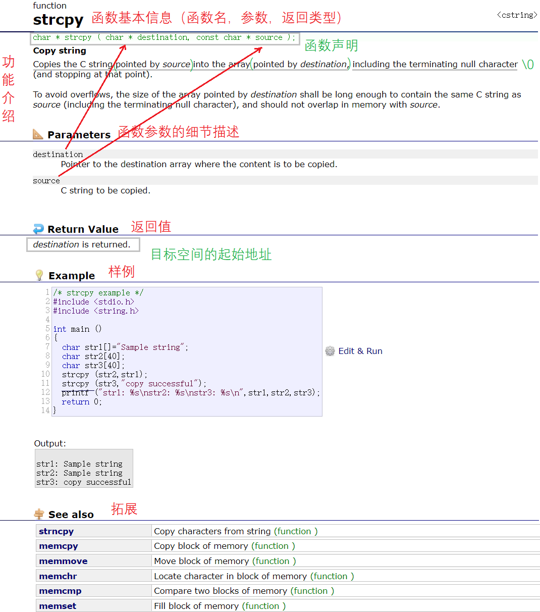

```c
//当然这里 strcpy 函数的返回值是目标空间的首地址，故接收时也可以使用函数的返回值。
char arr1[20] = { 0 };
char arr2[] = "damn it!";
//1.
char* ret = strcpy(arr1, arr2);
printf("%s\n", ret);
//2.
printf("%s\n",strcpy(arr1, arr2));
```

#### memset

```c
void* (void* ptr, int value, size_t num);
```

memset 是以字节为单位，修改地址中的内容。

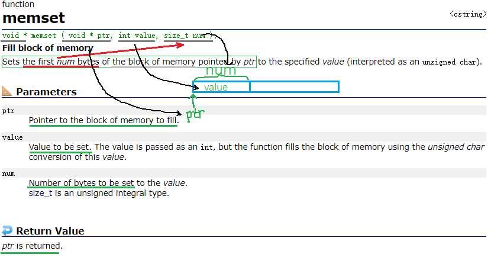

```c
int arr[30];
memset(arr, 0, 30 * sizeof(int));
```

### 3.2 自定义函数

#### 函数的定义

库函数虽多，毕竟是有限的，还是需要自定义函数来实现某些具体的需求。自定义函数和库函数一样，有函数名、返回类型和函数参数，但不同的是这些都由我们自己来设计。

```c
ret_type fun_name (para1, ...)
{
    statment;//语句项
}
ret_type //返回类型
fun_name //函数名
para1    //参数
```

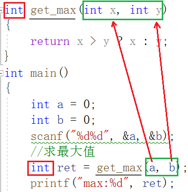

如图所示，写函数，函数名、参数、返回类型都要对应。

#### 函数的参数

函数参数分为实际参数和形式参数两种：

1. 实际参数/实参：实参可以是任意有确定值的形式，以便在进行函数调用时，将其传给形参。
2. 形式参数/形参：只有当函数调用时，他们才被分配确定值以及内存单元，调前不存在，调后销毁，所以形参只是形式上存在。

#### 函数的调用

1. 传值调用：**形参相当于实参的一份临时拷贝**，并且形参和实参占用不同的内存单元，本质上是两个不同的变量，形参的修改不影响实参。
2. 传址调用：**将外部变量的地址传给函数参数**，这样的调用可使函数内外建立真正的联系，即形参实参建立联系。

#### 两数交换

先看何进行两数交换，用酱油、醋和空瓶举例。

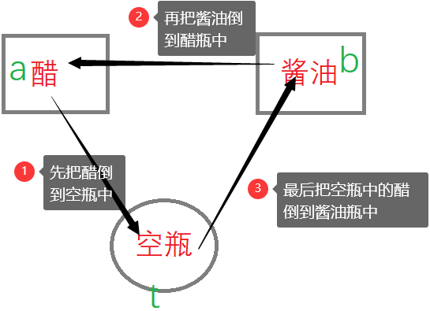

1. 先把a赋值给t，那么现在t里面存的就是a的值；
2. 再把b赋值给a，这样a里就是b的值，但a原本的值还在t里不会被覆盖；
3. 最后把t赋值给b，这样a原本的值就到了b中，就完成了a和b的互换。

```c
void Swap1(int x, int y) {
    int t = 0;
    t = x;
    x = y;
    y = t;
}
void Swap2(int* px, int* py) {
    int t = 0;
    t = *px;
    *px = *py;
    *py = t;
}
int main() {
    int a = 10;
    int b = 20;

    Swap1(a,b);
    printf("Swap1：a=%d,b=%d\n", a, b);

    Swap2(&a, &b);
    printf("Swap2：a=%d,b=%d\n", a, b);

    return 0;
}
```

- Swap1仅仅是把a和b传值给x和y，修改x和y是影响不到a和b的。
- Swap2是把a，b的地址传给指针变量px和py，样在函数内将px和py解引用再修改，就可以修改ab

简而言之，**通过指针指向实参的地址使得外边的实参发生变化**。

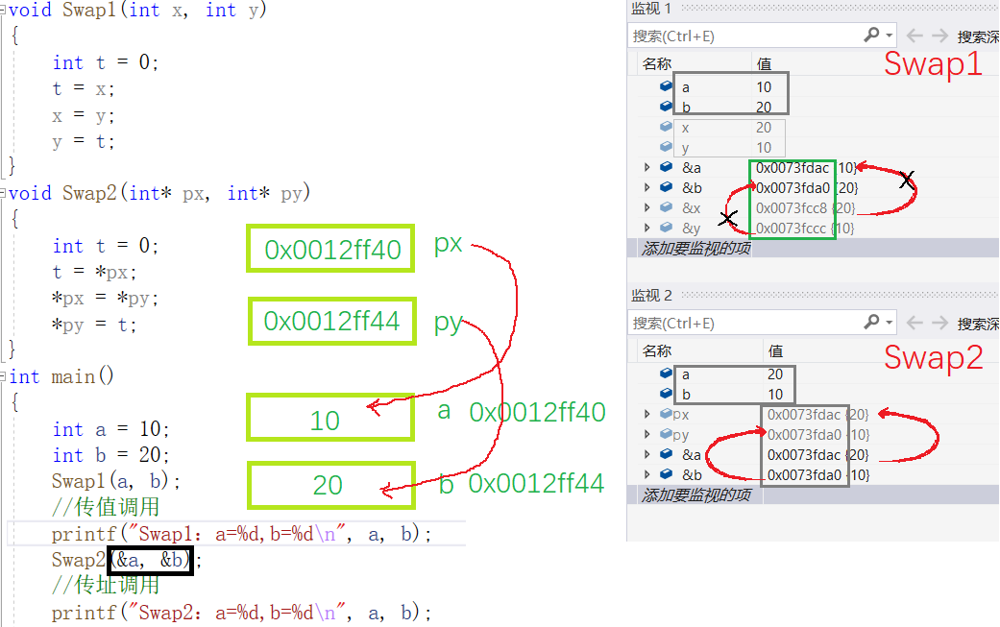

由图可知，px和py内部存储的是变量a和b的地址，这样对px和py解引用就可以修改a和b的值。

监视图可看出，Swap1函数x和y确实发生了交换，但并没有影响到a和b。Swap2函数的px、py和&a、&b是一个意思。

#### 嵌套调用

函数不可以嵌套定义，函数与函数是平等的，是并列关系，不可以在任意函数（包括主函数）中定义其他函数。但函数是可以互相调用的。

```c
void fun1()
{
    printf("hehe\n");
}
void fun2()
{
    fun1();
}
int main()
{
    fun2();
    return 0;
}
```

#### 链式访问

链式访问（chain access），把一个函数的返回值作为另一个函数的参数。像是用链子把函数首尾相连拴起来。如：

```c
int main()
{
    printf("%d\n",strlen("abcde")); //把strlen的返回值作为printf的参数
    return 0;
}
```

```c
int main()
{
    char arr1[20] = "xxxxxxx";
    char arr2[20] = "abcde";
    //strcpy(arr1,arr2);
    printf("%s\n", strcpy(arr1, arr2));//strcpy函数的返回值是目标空间首元素地址
    return 0;
}
```

如果觉得掌握了的话，可以看看这个经典例子。

```c
printf("%d", printf("%d", printf("%d", 43)));
```

printf函数的返回值是打印字符的个数，如果发生错误，则返回负值。（ps:scanf的返回值是输出字符的个数）

1. 首先可以看出第三个printf打印了43；
2. 然后第二个printf打印了第三个printf的返回值为2；
3. 最后第一个printf打印第二个printf的返回值1；

> 所以屏幕上打印了4321。

#### 函数声明

代码是从前往后执行的，如果在函数调用处之前并没有发现函数的定义，便会发出警告：函数未定义。若想消除警告，需要在前面声明一下。

```c
void test1();

int test2() {
    tes1();
}

void test1()
{}
```

函数声明目的是告诉编译器函数的返回类型、函数名、参数这些具体信息，表示这个函数是真实存在的。

工作中一般是把函数的声明、定义和使用放在三个不同的文件内，方便所有人协作。如：

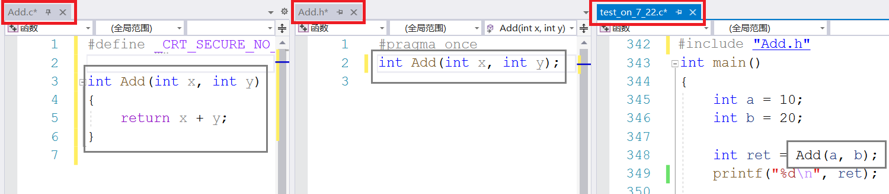

> 链接：两个.c的源文件编译之后，会分别生成.obj的目标文件，然后再链接起来，最后生成.exe的可执行文件。

#### 头文件引用

`#include`的预编译指令是**在预编译阶段将头文件内的所有内容拷贝到源文件**内。头文件中的内容若被重复包含则会造成效率降低。

1. 头文件中包含语句`#pragma once`，就可使得头文件不会被其他文件重复包含。
2. 添加这样的代码，将代码包含起来。

 ```c
 #ifndef __ADD_H__ // if not define
 #define __ADD_H__ // define

 extern int Add(int x, int y); //Add函数声明

 #endif            // end if
 ```

两种方法是完全等价。

#### 函数递归

函数自身调用自身的逻辑叫做递归。递归的思维方法在于：大事化小。

1. 大型复杂问题层层转化为小规模的问题
2. 少量程序描述出多次运算

##### 示例1

接收一个无符号整型值，按照顺序打印其每一位。如输入：1234，输出：1 2 3 4 .

1. 创建一个函数叫print，
2. 若print(1234)，则剥离一位变成print(123)+4，
3. 再剥离一位成print(12)+3+4，
4. 再来一位就是print(1)+2+3+4，
5. 最后只有一位了，那就用`printf`打印。如：

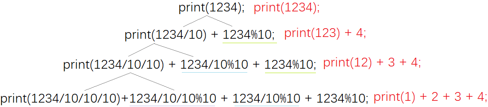

> 我们发现只要将数字1234模10就可以得到4，除10便可以得到123，如此模10除10循环往复，可以将1 2 3 4全部剥离出来。

```c
//函数递归
void print(size_t n)
{
    if (n > 9)//只有1位便不再往下进行
    {
        print(n / 10);
    }
    printf("%d ", n%10);
}
```

具体流程可参考下面这张图。

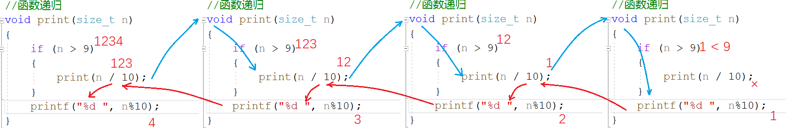

递归递归，就是递推加回归。红线部分即在返回的时候，n是本次函数n，而不是前一次调用的n。

现在有两个问题

1. `if(n > 9)`这个条件没有行不行？没有会怎么样？

自然是不行的，我们在上面的推导中发现，最后1<9条件不成立，就结束了递归，否则会永远递归下去，死循环且耗干了栈区。

2. 或者是我们不论代码的正确性，将`print(n / 10)`改成`print(n)`会怎么样？

改成`print(n)`的话每次递归都是相同的值，递归也会无止境的延续下去。

##### 示例2

不创建临时变量，实现`Strlen`函数。

```c
//my_strlen求字符串长度
int my_strlen(char* pa)
{
    if (*pa == 0)
        return 0;

    return 1+my_strlen(pa + 1);//直接返回长度
}
```

思考方式：只要第一个字符不是0，那我们就在外面+1并且跳到下一个字符，直到找到‘\0’，那么我们返回0。

> 字符指针+1，向后跳一个字节，整型指针+1，向后跳四个字节，指针+1都是向后跳一个元素的地址，指针类型不同向后跳的字节也不同。

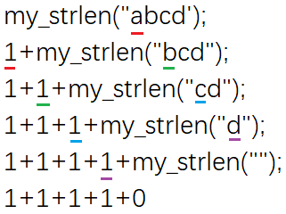

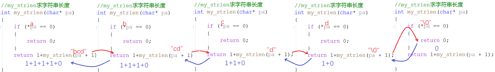

> 有这两题我们可以发现，什么时候用递归简单呢？

1. 有公式有模板的时候
2. 递归简单，非递归复杂的时候

当递归有明显问题的时候，就不要用递归了。

#### 递归的优缺点

- **优点**是为具有某些特征的编程问题提供了最简单的策略，
- **缺点**是层层调用，算法的复杂度可能过高，以致于快速耗干了计算机的内存资源，不方便阅读和维护等。

#### 递归的使用场景及必要条件

##### 使用场景

1. 能够要求转化为新的问题，且二者解决方法相同，所处理的对象存在规律变化。
2. 非递归比较麻烦，而递归很简单。
3. 有模板或是公式可以直接套用，不会出现明显问题。

##### 必要条件

- 明确存在限制条件
- 每次递归越来越逼近条件

##### 栈溢出

在第一个问题中，如果我们要去试验的话，编译器会报出这样的错误：名叫Stackoverflow（栈溢出）。

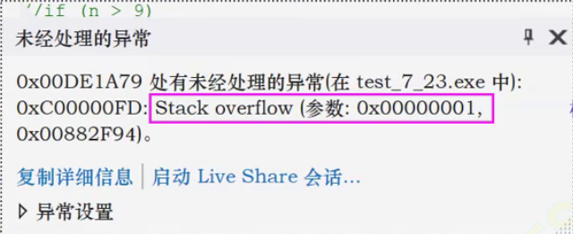

首先我们看看内存的划分：

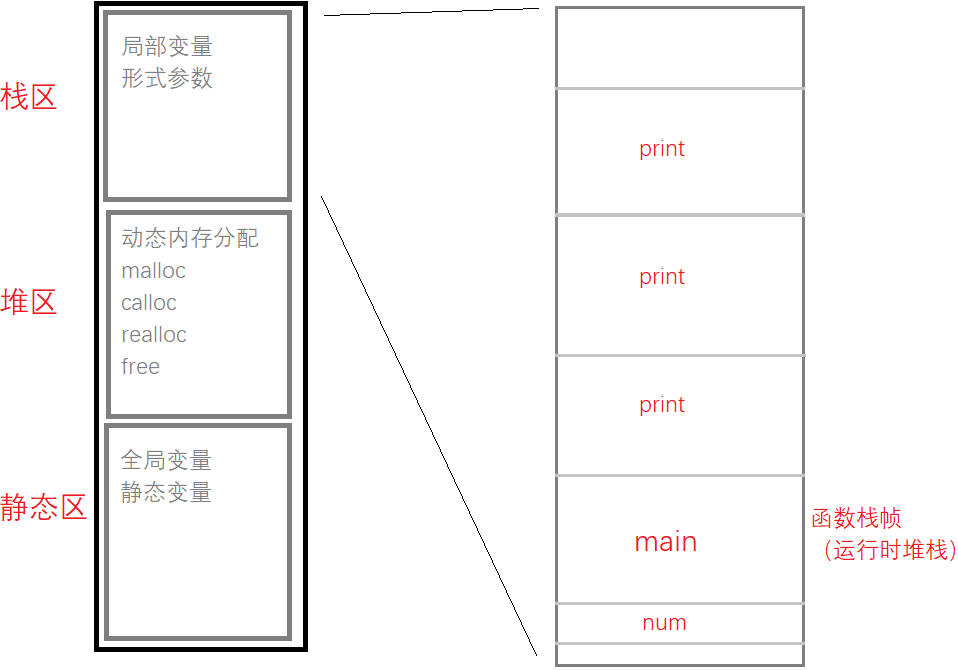

1. 内存粗略的划分为栈区，堆区，静态区。
2. 栈区主要存放：局部变量，形参
3. 动态内存分配：`malloc calloc`等函数开辟空间

静态区主要存放：全局变量，static修饰的静态变量

若是把栈区放大细看的话，有为main函数开辟的空间和print函数开辟的空间，为函数开辟的空间叫函数栈帧也可以叫运行时堆栈。

程序开始执行时开辟空间，程序结束时销毁空间，函数每调用一次就在栈上开辟一次空间，递归返回时，空间会被回收。

#### 递归的细节说明

- 每级递归都有自己的变量，名称相同，但其值不同。

递归调用时，系统自动保留当前函数的参数，每次调用系统都会为函数开辟相应的空间。

- 每次调用都要返回值，递归执行结束后，控制权传回到上一级函数。

调用结束后，系统释放本次调用所开辟的空间，程序返回到上一次的调用点，同时获得初进该级调用的参数。每级递归必须逐级返回，不可跳跃或间断。

- 函数中递归语句之前的代码，按被调函数的顺序执行，递归之后的代码，与被调函数相反的顺序执行。

#### 递归的习题讲解

##### 1打印整数每一位

用递归的方式，实现打印一个整数的每一位的功能。

###### 输入输出示例

> 输入：1234
>
> 输出：1 2 3 4

###### 解题思路

> `print(1234)`
> $\small =$ `print(123)`+4
> $\small =$ `print(12)`+3+4
> $\small =$ `print(1)`+2+3+4
> $\small =$ `printf(1)`+2+3+4

 这便是前面使用场景中所写的，将题目要求问题转化为新的问题，且变量有规律的变化

###### 代码逻辑

> `n`是不是个位数，递推调用`n / 10`
>
> `n`是个位数，回归打印`n % 10`

```c
void Print(int n)
{
    if (n > 9)
    {
        Print(n / 10);
    }
    printf("%d ", n%10);
}
int main()
{
    int num = 0;
    scanf("%d", &num);
    Print(num);
    return 0;
}
```

##### 2递归和非递归求n阶乘

用递归和非递归的方法，分别实现求n的阶乘的功能（不考虑溢出）。

###### 输入输出示例

> 输入：5
>
> 输出：120

###### 解题思路

> $\small n*n-1*n-2*n-3*…*1$

###### 代码逻辑

> $\small fac(n) = n * fac(n-1) , n>0$
>
> $\small fac(n) = 1 , n=0$

```c
int fac(int n)//非递归
{
    int ret = 1;
    for (int i = 1; i <= n; i++)
    {
        ret *= i;
    }
    return ret;
}
int fac(int n)//递归
{
    if (n > 0)
        return n * fac2(n - 1);
    else
        return 1;
}
int main()
{
    int n = 0;
    scanf("%d", &n);
    printf("%d\n", fac(n));
    return 0;
}
```

##### 3strlen函数模拟

###### 输入输出示例

> 输入：abcdef
>
> 输出：6

###### 解题思路

> `strlen(abcdef\0)
> 1+strlen(bcdef\0)
> 1+1+strlen(cdef\0)
> 1+1+1+strlen(def\0)
> 1+1+1+1+strlen(ef\0)
> 1+1+1+1+1+strlen(f\0)
> 1+1+1+1+1+1+strlen(\0)`

###### 代码逻辑

> $\small 若*ch≠0 , strlen(arr) = 1 + strlen(arr+1)$
> $\small 若*ch=0 , strlen(arr) = 0$


```c
int my_strlen(char* ch)
{
    if (*ch != '\0')
    {
        return 1 + my_strlen(ch + 1);
    }
    return 0;
}
int main()
{
    char ch[20] = { 0 };
    scanf("%s", &ch);
    printf("%d", my_strlen(ch));
    return 0;
}
```

##### 4逆序字符串

不开辟额外空间的情况下，不使用字符串库函数，递归实现字符串反向排列，而不是倒序打印。

###### 输入输出示例

> 输入：abcdef
>
> 输出：fedcba

###### 解题思路

> `abcdef`
>
> 递推：（先把后面赋值给前面，后面用覆盖\0）
>
> $\small \Rightarrow$ `f b c d e \0`
>
> $\small \Rightarrow$ `f e c \0\0`
>
> $\small \Rightarrow$ `f e d \0\0\0`
>
> 回归：（把前面转移出去的字符对应赋值给\0）
>
> $\small \Rightarrow$ `f e d c \0\0`
>
> $\small \Rightarrow$ `f e d c b \0`
>
> $\small \Rightarrow$ `f e d c b a`

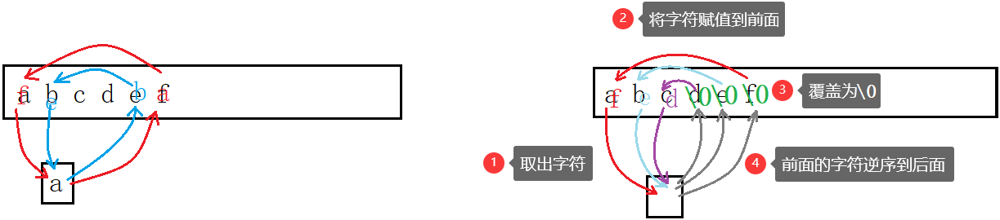

###### 代码逻辑

> `reverse("abcdef\0")
> 交换a和f+reverse("f bcde\0\0")
> 交换a和f+交换b和e+reverse("fe cd\0\0\0")
> 交换a和f+交换b和e+交换c和d+reverse("fed \0\0\0\0")`

> - 交换两个字符
>   1. 将在前的字符先放到一边存着
>   2. 把在后的字符赋值到前面的位置
>   3. 再把后面的位置对应覆盖为`\0`
> - 原在前字符替换`\0`
>   1. 把事先存好的在前的字符对应替换到`\0`的位置上

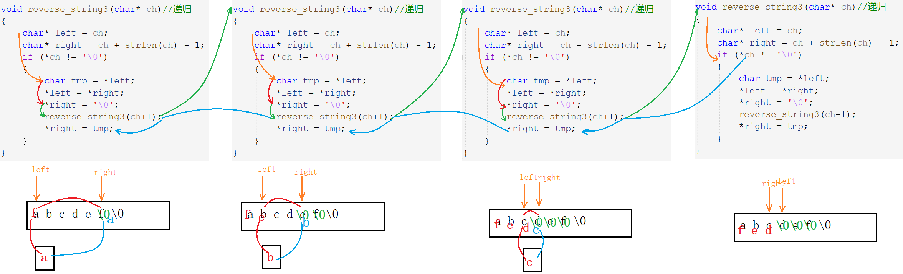

```c
void reserve_string1(char* ch)//指针
{
    char* left = ch;
    char* right = ch + strlen(ch) - 1;
    while (left < right)
    {
        char tmp = *left;//不能交换地址，只能交换内容
        *left = *right;
        *right = tmp;
        left++;
        right--;
    }
}
void reserve_string2(char* ch)//数组
{
    int left = 0;
    int right = strlen(ch) - 1;
    while (left < right)
    {
        char tmp = ch[right];
        ch[right] = ch[left];
        ch[left] = tmp;
        left++;
        right--;
    }
}

void reverse_string3(char* ch)//递归
{
    char* left = ch;
    char* right = ch + strlen(ch) - 1;

    if (*ch != '\0')
    {
        char tmp = *left;//提取
        *left = *right;//赋值
        *right = '\0';//赋\0

        reverse_string3(ch+1);//ch+1,而不是ch++

        *right = tmp;//赋值
    }
}
int main()
{
    char ch[20] = "abcdef";
    //char* ch = "abcdef";//err - 常量字符串不可修改
    reverse_string3(ch);
    printf("%s\n", ch);

    return 0;
}
```

##### 5递归实现数字各位之和

写一个递归函数`DigitSum()`，输入一个非负整数，返回组成它的数字之和

###### 输入输出示例

> 输入：1234
>
> 输出：10

###### 解题思路

> 1234
> `DigitSum(123)`+4
> `DigitSum(12)`+3+4
> `DigitSum(1)`+2+3+4
>
> 1+2+3+4

> 1234%10=4
> 1234/10=123
>
> 123%10=3
> 123/10=12
>
> 12%10=2
> 12/10=1
>
> 1%10=1
> 1/10=0
>
> 一个数模10得到尾数，除10得到尾数前面的数字
>
> 通过不断的除10模10，就可以把每一位数字放到末尾，从而得到每一位数字

###### 代码逻辑

> 若n不为个位数，先%10得到尾数，再/10
>
> 一定要有递归的出口，即当n为个位数时，函数返回n

```c
int DigitSum(int n)
{
    if (n > 9)
        return DigitSum(n / 10) + n % 10;
    else
        return n;//递归的出口
}
int main()
{
    int n = 0;
    scanf("%d", &n);
    printf("%d\n", DigitSum(n));

    return 0;
}
```

##### 6求n的k次幂

输入两个整数分别代表底数和次幂，递归实现n的k次幂的功能。

###### 输入输出示例

> 输入：2   3
>
> 输出：8

###### 解题思路

> 当`k>0`时，函数返回`n*power(n,k-1)`
>
> 当`k=0`时，函数返回1，这是程序的出口，是程序递归到最后必须要计算的值

###### 代码逻辑

> $\small n^k = n * n^{k-1} ,k > 0$
> $\small n^k = 1 , k = 0$

```c
double power(int n,int k)
{
    if (k > 0)
        return n * power(n, k - 1);
    else if (k == 0)
        return 1.0;//递归的出口k=0
    else
        return 1.0 / power(n, -k);
}
int main()
{
    int n = 0;
    int k = 0;
    scanf("%d%d", &n, &k);
    printf("%lf\n", power(n, k));
    return 0;
}
```

##### 7递归求斐波那契数列

递归和非递归分别实现求第n个斐波那契数

###### 输入输出示例

> 输入：5
>
> 输出：5

###### 解题思路

> $\small 1\quad 1\quad 2\quad 3\quad 5\quad 8\quad 13\quad 21\quad 34\quad 55\quad 89\quad ...$

###### 代码逻辑

> 递归：
>
> $\small Fib(n) = Fib(n-1) + Fib(n-2) , n>2$
> $\small Fib(1) = Fib(2) = 1$
>
> 非递归：
>
> 上一次的b换成这一次的a
>
> 上一次的c换成这一次的b
>
> 如此循环，就可以从前往后一个一个求。

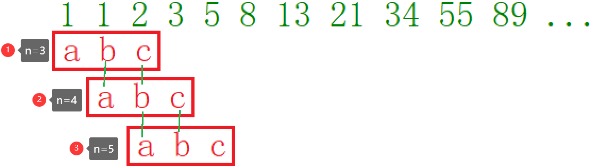

```c
int Fib(int n)
{
    if (n > 2)
        return Fib(n - 1) + Fib(n - 2);
    else
        return 1;
}
```

> 但是这个方法效率是非常低的，当数字特别大时，层层拆分下来，时间效率是$\small O(2^n)$。
>
> 根据公式可知，第三个斐波那契数可由前两个得到，我们利用这个规律

```c
int Fib(int n)
{
    if (n <= 2)
        return 1;
    int a = 1;
    int b = 1;
    int c = 1;//n=3时不用运算
    while (n >= 3)//从头开始移动n-2次，n=3时不用
    {
        c = a + b;
        a = b;//b赋值给a
        b = c;//c赋值给b
        n--;
    }
    return c;
}

int main()
{
    int n = 0;
    scanf("%d", &n);
    printf("%d",Fib(n));

    return 0;
}
```

#### 经典问题 - 汉诺塔问题

##### 游戏规则

有三根柱子，分别为A、B、C ，A柱上从上到下依次排列着由小到大的圆盘，我们需要把圆盘从A柱按照同样的摆放顺序放到C柱上，期间我们可以借助B柱。

- 每次只能挪动一个且是最上面的圆盘
- 按照从上到下依次是由小到大的顺序摆放。

##### 解题思路

假设由N个盘子，只需要考虑第$\small N$个盘子和其上$\small N-1$个盘子的整体。显然思路就是，第$\small N$个是要放在$\small C$柱上的，

1. 首先将$\small N-1$个整体是先放在$\small B$柱上；
2. 其次将第$\small N$个放在$\small C$柱上；
3. 最后将$\small N-1$个整体放到$\small C$柱上。

即：第$\small N$个$\small A\rightarrow B$，$N-1$个整体$\small A\rightarrow B\rightarrow C$ 。然后再考虑$\small N-1$个中把第$\small N-1$个当作最后一个，其上$\small N-2$个当作整体，到最后只剩一个直接放到$\small C$柱上。这便是递归的整体思路。

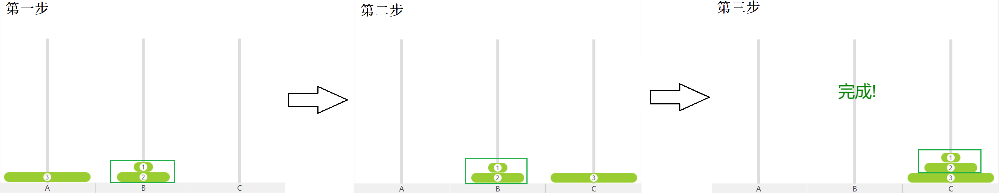

```c
void move(int n, int x, int z)
{
    printf("%d盘：%c->%c\n", n, x, z);
}
void hannoi(int n, char x, char y, char z)
{
    if (n == 1)
        move(n, x, z);
    else
    {
        hannoi(n - 1, x, z, y);
        move(n, x, z);
        hannoi(n - 1, y, x, z);
    }
}
int main()
{
    int input = 0;
    do
    {
        printf("输入盘数开始测试（0. 退出测试）\n");
        scanf("%d", &input);
        switch (input)
        {
        case 0:
            break;
        default:
            hannoi(input, 'A', 'B', 'C');
            break;
        }
    } while (input);
    return 0;
}
```

#### 经典问题 - 青蛙跳台阶

##### 游戏规则

**初阶版本**：青蛙一次可以跳一级台阶，也可以跳两级台阶。求该青蛙跳n级台阶共有多少种跳法？

**进阶版本**：青蛙一次可以跳一级台阶，也可以跳两级台阶，……，也可以跳n级台阶，求该青蛙跳上n级台阶的跳法种数。

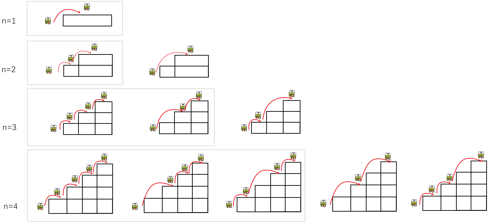

##### 解题思路

我们反向思考，当青蛙跳到最高阶$\small N$阶时，他是怎么跳到第$\small N$阶的呢？有两种情况，

- 从第$\small N-1$阶，跳到第$\small N$阶，最后一次跳一阶。
- 从第$\small N-2$阶，跳到第$\small N$阶，最后一次跳两阶。

> 图中用灰框框出的部分，是最后一次跳一阶的，其余的是最后一次跳两阶的。

很显然，除了这两种情况，别无他法。所以计算青蛙跳到$\small N$阶的方法数$\small =$跳$\small N-1$阶的方法数$\small +$跳$\small N-2$阶的方法数。

> 同样，图中用灰框框出的部分，也代表的是跳$\small N-1$阶的方法数，其余的是跳$\small N-2$阶的方法数。

这其实就是斐波那契数列。

```c
int fib(int n)
{
    if (n > 1)
        return fib(n - 1) + fib(n - 2);
    else
        return 1;
}
```

##  4. 数组

### 4.1 一维数组

#### 一维数组的创建

数组是一组相同类型的元素的集合。语法形式是：

```c
type_t arr_name [const_n]
//如：
int arr[10];
```

> `type_t` 指的是数组元素的类型。`const_n` 指的是一个常量表达式，用来指定数组的大小。

此时运行程序的话，系统会报一个警告：未初始化变量。打开调试就会发现系统默认将数组填入一些随机值。

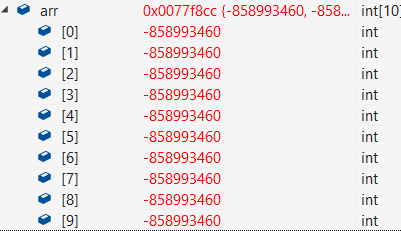

- 局部数组，不会初始化，因此默认是随机值。
- 全局数组，系统默认初始化为0。

```c
int arr[10];// 0 0 ... 0
int main()
{
  return 0;
}
```

##### 创建实例

```c
//1.
int arr[10];
//2.
int count = 10;
int arr2[count];//这样的创建数组可不可以呢？
//3.
float arr3[20];//浮点型数组
char ch[10];
```

**数组的`[]`内必须为常量，不能使用变量**，即便是const修饰的常变量也不行。

> 数组控制不好容易越界访问，所以C语言只允许用常量的指明数组大小。

#### 一维数组的初始化

初始化，即在创建数组的同时给予一些合理的初始值。一般有如下两种方式：

1. 不完全初始化

```c
int arr[10] = { 1,2,3 };
```

前三个元素分别为1，2，3，剩余的元素默认初始化为0。

2. 省略数组大小

```c
int arr2[] = { 1,2,3,4 };//利用初始化内容，指定数组大小
```

由初始化内容指定数组的大小，初始化了四个元素分别为1，2，3，4。数组的大小即为4个元素。

##### 初始化字符数组

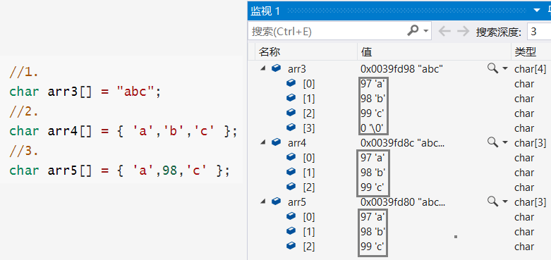

- 第一种是用字符串初始化数组

字符串有`\0`作为结束标志。虽不算字符串内容，但它也被初始化作为数组内容。共有4个元素。

- 第二种和第三种是一样的

因为数组元素类型是字符型，且字符`'b'`的ACSII码值是98，自动将98解析为字符。这样初始化就不会自带`\0`，所以有3个元素。

#### 一维数组的使用

数组是通过下标来访问的，下标默认是从0开始。通过下标引用操作符`[]`我们可以访问到数组元素。

```c
//定义数组
int arr[10] = { 1,2,3,4,5,6,7,8,9,10 };
//计算数组长度
int sz = sizeof(arr) / sizeof(arr[0]);
//循环打印数组
for (int i = 0; i < sz; i++)
{
    printf("%d ", arr[i]);
}
//1 2 3 4 5 6 7 8 9 10
```

- `sizeof(arr)`，即`sizeof`+数组名，指的是以字节为单位计算整个数组的大小。
- `sizeof(arr[0])`是计算数组首元素的大小。

数组大小为40个字节，而数组首元素为4个字节，相除得数组长度为10。这样可以灵活的控制打印的个数，在编程中很常见。

##### 总结

1. 数组是通过下标访问的，下标从0开始。
2. 数组的大小可以通过计算得到。

#### 一维数组的存储

通过如下代码可以循环打印数组每个元素的在内存中存储的地址。可以通过它看到该数组在内存中的存储情况。

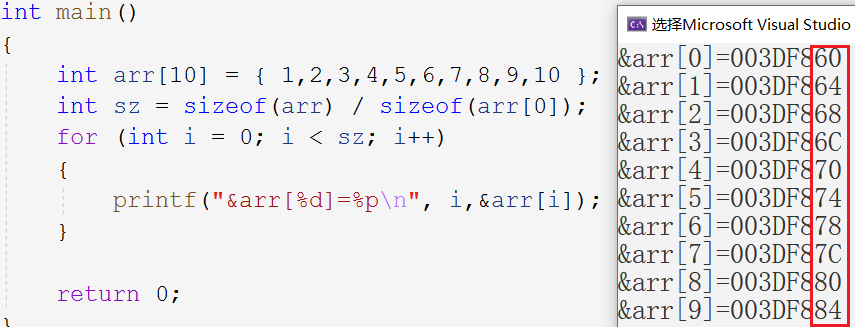

打印结果是十六进制的内存编号，可以看见每一个元素之间都相差4个字节，而一个整型元素正好占4个字节。很明显的是，**数组在内存中是连续存放的**。

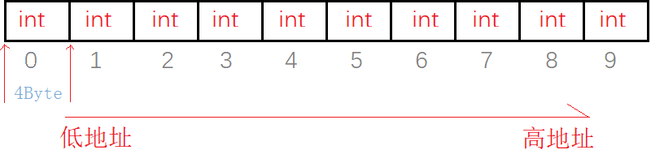

随着数组下标的增长地址也在增长，这也是为什么指针变量+1可以访问到下一个元素。所以数组本质就是**内存中一组连续存放的相同类型的元素**。

### 4.2 二维数组

#### 二维数组的创建

二维数组的创建方式与一维数组类似，不过多了行列的概念而已。

```c
type_t arr_name[const_n][const_n]
//
int arr[3][5];//3行5列
char ch[4][7];//4行5列
double arr2[2][4]//2行4列
```

如上述代码所示：二维数组的语法结构就是，类型+数组名+\[行][列]。

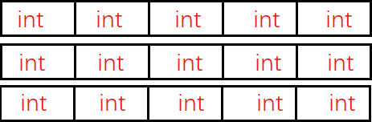

如图所示，二维数组在逻辑上就是这样的3行5列的元素排列类似于表格、矩阵，矩阵的定义就是一组数组成数表。

#### 二维数组的初始化

二维数组的初始化有如下两种方式：

```c
//1.
int arr1[3][5] = { 1,2,3,4,5,6,7,8,9,10,11 };
//2.
int arr2[3][5] = { {1,2},{3,4},{5,6,7} };
```

- 第一种：按行填入，第一行是`1 2 3 4 5`，第二行是`6 7 8 9 10`，第三行不够就补零`11 0 0 0 0` 。
- 第二种：按行填入，每一行看成一个一维数组，每行不够还是补零。第一行`1 2 0 0 0`，第二行`3 4 0 0 0`，第三行`5 6 7 0 0` 。

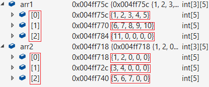

##### 初始化字符数组

```c
char ch1[2][4] = { 'a','b' };
char ch2[2][4] = { {'a'},{'b'} };
char ch3[3][4] = { "abc","def","gh" };
```

用字符串去初始化二维数组的话，也是需要注意`\0`的问题。第一行：`a b c \0 `；第二行：`d e f \0`；第三行：`g h \0 0`。

##### 行列的省略问题

总的来说就是**行可省，列不可省**，如：

```c
int arr2[][5] = { {1,2},{3,4},{5,6,7} };
```

省略行可以，但是不能省略列，行数可以根据初始化内容来判定，但如果列省略了就会造成歧义。

列确定了就可以确定行，而行的确定并不能确定列。省略必须在已初始化的前提下，不然行和列一概不知就无法分配空间。

#### 二维数组的使用

二维数组同样是用下标访问，如：

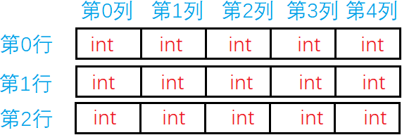

访问二维数组的方式，是用两次循环遍历这个数组。

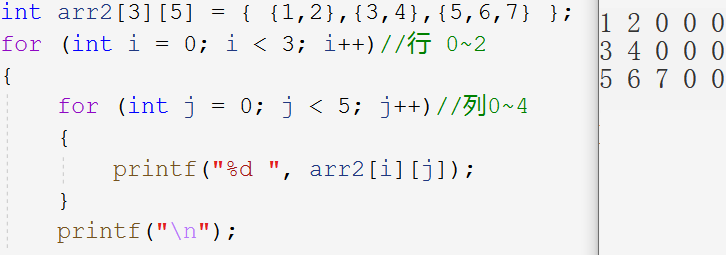

#### 二维数组的存储

同样打印出每个元素的地址，如：

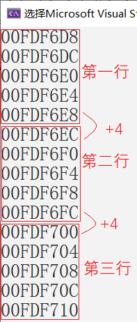

每行的最后一个和下一行的第一个元素之间仍相隔一个元素大小。二维数组也是在内存中连续存放的。

二维数组将二维形式的每一行理解为一个一维数组，整体仍然是一个一维数组。因此二维数组在内存中的存储形式还是一维的。

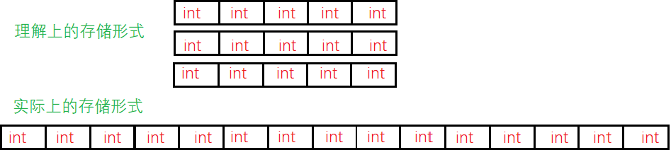

> 从这里我们也可以理解到，二维数组的初始化里，为什么可以省略行不能省略列。把行省略了，但是我们知道列，一个一个填满就是了，能填到多少行就有多少行。

##### 存储方式的理解

对于二维数组，我们可以将其每一行理解为一个元素，其中每一个元素又是一个一维数组。二维数组的整体又是一个一维数组。

例如二维数组`arr[3][5]` 是一个具有3个元素的一维数组，每个元素是一个有5个元素的一维数组。指向二维数组的指针+1，指向的是下一行。

> 对于二维数组在内存存储形式的理解还是很重要的，有了这样的思想，我们就可以通过指针遍历得到数组元素，如：

```c
int arr[3][5] = { {1,2,3},{4,5,6},{7,8} };
int* p = &arr[0][0];
for (int i = 0; i < 15; i++)
{
    printf("%d ", *p++);//1 2 3 0 0 4 5 6 0 0 7 8 0 0 0
}
```

### 4.3 数组越界问题

数组通过下标访问，那么下标也就可以控制数组的访问范围。下标在数组前后进行访问，就是非法访问内存，即数组越界。

```c
//1 2 3 4 5 -858993460
int arr[5] = { 1,2,3,4,5 };
for (int i = 0; i <= 5; i++)//越界访问到第6个
{
    printf("%d ", arr[i]);
}
```

> 数组越界访问到最后一个元素之后的一块内存，这就属于越界访问，-858993460是编译器自动生成的随机值。

一般编译器是不会去检查数组越界访问的情况，所以我们就要有意识的主动检查。如果编译器提示这样数组溢出的错误信息，那么一般就是数组越界了：

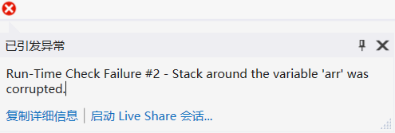

### 4.4 数组作函数参数

在写代码时，我们经常会将数组作为参数，这里以冒泡排序为例。

冒泡排序的核心思想：两两相邻的元素进行比较。

- 一趟冒泡排序搞定一个数字，让其来到最终的位置上。
- $\small n$ 个元素，则总共需要 $\small n-1$ 趟冒泡排序，每一趟排序需要进行 $\small n-1-i$ 次判断大小。如分析图所示：

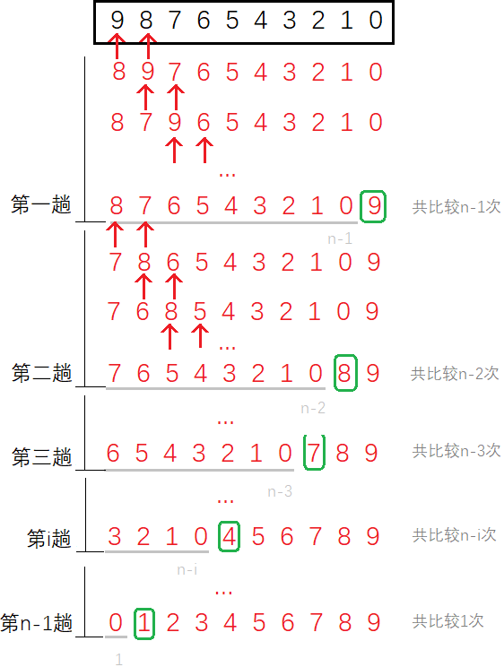

```c
void Print(int* arr, int sz)
{
    for (int i = 0; i < sz; i++)
    {
        printf("%d ", *arr++);
    }
}
void Sort(int arr[],int sz)//int* arr - 数组作形参本质是指针
{
    //int sz = sizeof(arr) / sizeof(arr[0]);//err
    for (int i = 0; i < sz - 1; i++)//n-1趟
    {
        for (int j = 0; j < sz - 1 - i; j++)//n-1-i次
        {
            if (arr[j] > arr[j + 1])//目标升序
            {
                //交换
                int tmp = arr[j];
                arr[j] = arr[j + 1];
                arr[j + 1] = tmp;
            }
        }
    }
}
int main()
{
    int arr[] = { 1,4,6,3,7,9,3,2,8,5 };
    int sz = sizeof(arr) / sizeof(arr[0]);
    //排序
    Sort(arr,sz);
    //打印
    Print(arr,sz);
    return 0;
}
```

**定义数组作形参时，本质上是指针**。

`void Sort(int arr[],int sz)`本质就是`void Sort(int *arr,int sz)`。

`sizeof(arr)`算的就是指针`arr`的大小，所以数组大小只能传参进去，不可在函数内计算。

### 4.5 数组名的意义

`sizeof(arr)`和`&arr`代表的是整个数组，除此以外都是代表首元素的地址。

## 5. 操作符

### 5.1 操作符

| 操作符种类                   | 具体                                                         |
| ---------------------------- | ------------------------------------------------------------ |
| 算术操作符                   | +     -     *     /     %                                    |
| 移位操作符                   | <<     >>                                                    |
| 位操作符                     | &     ^     \|                                               |
| 赋值操作符                   | =     +=     -=     *=     /=     %=     >>=     <<=         |
| 单目操作符                   | !     -     +     &     sizeof     ~     --     ++     *     () |
| 关系操作符                   | >     >=     <     <=     !=     ==                          |
| 逻辑操作符                   | &&     \|\|                                                  |
| 条件操作符                   | exp1 ? exp2 : exp3                                           |
| 逗号表达式                   | exp1 , exp2 , exp3 , ... , expN                              |
| 下标引用、函数调用和结构成员 | []     ()     .     ->                                       |

#### 算术操作符

```c
+   -   *   /   %
```

```c
//1.
int ret = 9 / 2;
printf("%d", ret);//4
//2.
double ret2 = 9 / 2;
printf("%lf", ret2);//4.000000
//3.
double ret3 = 9 / 2.0;
printf("%lf", ret3);//4.500000
```

按计算机的运算规则，9/2执行整数除法其值就是4。

从前两个对比可以看出不是存储形式的问题，若要得到小数结果，要改成9.0/2或者9/2.0。

1. `/` 的两个操作数都为整数时，执行整数除法，只要有浮点数就执行浮点数除法。
2. `%` 的两个操作数必须为整数，所得结果的范围在 $\small [0, 除数-1]$ 之间。

#### 移位操作符

```c
<<   //左移操作符
>>   //右移操作符
```

##### 整数存储规则

移位操作符移动的是二进制位，**整数在内存中存的是二进制补码**，移位操作符操作的也是内存中的补码。

整数在内存中的存储形式分为正数和负数两种：

- 正数：原码反码补码相同。
- 负数：
  - 原码：二进制序列；
  - 反码：原码符号位不变，其他位按位取反；
  - 补码：反码$\small +1$。

##### 左右移位规则

1. 左移操作符：左边舍弃，右边补0。

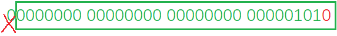

```c
int a = 5;
int b = a << 1;
```

`a<<1`的意思就是a的补码向左移动一位。

正数的原反补相同，所以得补码为`00000000 00000000 00000000 00000101` ，向左移动一位得`00000000 00000000 00000000 00001010`，换算一下就可得到10。

```c
int c = -1;
int d = c << 1;
```

先写出-1的原码，再取反加一得补码，补码向左移动一位，然后将得到的补码按相同规则换算成原码，就可以得到-2了。

```c
10000000 00000000 00000000 00000001 - -1的原码
11111111 11111111 11111111 11111110 - -1的反码
11111111 11111111 11111111 11111111 - -1的补码

11111111 11111111 11111111 11111110 - -1<<1的补码
11111111 11111111 11111111 11111101 - 反码
10000000 00000000 00000000 00000010 - 原码 = -2
```

2. 右移操作符

右移规则分两种，一种是逻辑右移一种是算术右移。但绝大多数编译器都是采用**算术右移**。

- 算术右移：左边补原符号位，右边舍弃
- 逻辑右移：左边补0，右边舍弃

```c
int a = -1;
printf("%d\n", a >> 1);
//10000000 00000000 00000000 00000001 - 原码
//11111111 11111111 11111111 11111110 - 反码
//11111111 11111111 11111111 11111111 - 补码
//11111111 11111111 11111111 11111111 - 补码
```

> 逻辑右移会把负数搞成整数，所以算术右移显得更正确一些。值得一提的是，-1的补码右移一位后仍是-1。

###### 补充

1. 左移就是数据$\small ×2$，右移即数据$\small ÷2$ 。
2. 左右移操作数必须为整数。

#### 位操作符

```c
&    //按位与
|   //按位或
^   //按位异或
```

##### 运算规则

| 操作符      | 运算规则         |
| ----------- | ---------------- |
| 按位与`&`   | 全1则1，有0则0   |
| 按位或`\|`   | 有1则1，全0则0   |
| 按位异或`^` | 相异为1，相同为0 |

```c
int a = 3;
int b = -2;
int c = a & b;

//1.求a的补码
100000000 000000000 000000000 000000010 - -2的原码
111111111 111111111 111111111 111111101 - -2的反码
111111111 111111111 111111111 111111110 - -2的补码
//2.求b的补码
000000000 000000000 000000000 000000011 -  3的原反补相同!!
//3.求a & b
111111111 111111111 111111111 111111110 - -2的补码
000000000 000000000 000000000 000000011 -  3的补码
000000000 000000000 000000000 000000010 - 所得数的补码!! (全1为1，有0则0)
//4.转化为原码
000000000 000000000 000000000 000000010 - 正数的原反补相同
```

1. 求两操作数的补码
2. 计算按位与、或、异或的结果
3. 将补码转换成原码

> 这几步很绕人千万要仔细。正数的原反补相同，别照负数规则求。按位与、按位或的结果同样是补码，**最后还需转换成原码**。

##### 例1

不创建临时变量，实现两数交换。

```c
int a = 10;
int b = 20;
printf("a=%d,b=%d\n", a, b);
//1.
a = a + b;
b = a - b;//(a+b)-b = a
a = a - b;//(a+b)-a = b
printf("a=%d,b=%d\n", a, b);
//溢出风险
//2.
a = a ^ b;
b = a ^ b;//(a ^ b) ^ b = a
a = a ^ b;//(a ^ b) ^ a = b
//可读性差，只支持正数
```

`a^b`的值再和a异或，则得到b；`a^b`的值再和b异或，则得到a，`a ^ a = 0`  `a ^ 0 = a`/

> `(a ^ a) ^ b = b` `(a ^ b) ^ a = b` ，由此也可以说异或支持交换律。

##### 例2

给出一个正整数，想知道其（如果是负数的话，就是补码）二进制位最低位是0是1，怎么办？将这个正整数按位与1，如果所得结果为1则最低位为1，反之则为0。如：

```c
int a = 15;
int b = a & 1;
00000000 00000000 00000000 00001111 - 15原反补相同
00000000 00000000 00000000 00000001 - 1
00000000 00000000 00000000 00000001 - b=1原反补相同
```

从这个例子可以看出，某个正数`&`1，所得结果为1则最低位为1，反之则为0。如果搭配上`>>`右移操作符，可以得到每一位的数字。 如：

```c
int num = 15;
int count = 0;
for (int i = 0; i < 32; i++)
{
    if (((num >> i) & 1) == 1) {
        count++;
    }
}
printf("%d\n", count);
```

#### 赋值操作符

```c
=
//复合赋值符
+=   -=   *=   /=   %=   >>=   <<=
```

赋值操作符的左右的类型必定相同。浅显地来说，`=`左边是左值右边是右值，左值必须是个可修改的变量，右值可为常量。

```c
int a = 10;
int x = 0;
int y = 20;
a = x = y+1;//连续赋值
```

如何理解这个连续赋值呢？先是把y+1赋值给了x，再把表达式x=y+1的值赋值给了a 。

#### 单目操作符

```c
!        //逻辑反操作
-        //取负
+        //取正
&       //取地址
sizeof    //操作数的类型长度
~        //按位取反
--        //前后置——
++        //前后置++
*        //解引用操作符
(type)  //强制类型转换
```

##### 逻辑取反!

非零即为真，零为假。

###### 取地址& 解引用*

```c
int a = 10;
int* p = &a; //*说明p为指针变量 ,&说明p中存储的是a的地址
*p = 20;     //解引用访问其存储的地址中的内容
printf("%d\n", *p);
```

###### 数组名作首元素地址问题

```c
int arr[10] = { 0 };
//1.
printf("%p\n", arr + 1);
//2.
printf("%p\n", &arr[0] + 1);
//3.
printf("%p\n", &arr + 1);
```

arr和arr[0]是首元素的地址，&arr是整个数组的地址，打印结果是一样的。但当他们都+1区别就出现了，前两个加1都是第二个元素的地址，而&arr加1就跳过了整个数组的地址。

拓宽一点，*p放在=左边就是一块空间，而放在=右边就是一个值。

```c
//1.
int b = *p; //这里*p代表值
//2.
*p = b;     //这里*p就代表一块空间用以存放值
```

> 任何一个变量都可以这样理解，放在=的左边代表一块空间`a = 10;`，就是左值。放在=右边就是代表值`p = a;`，即右值。

##### 类型长度操作符sizeof

`sizeof`计算变量或类型所占内存空间的大小，与其内存中存放的数据是什么无关。

```c
printf("%d\n", sizeof arr); //1.
printf("%d\n", strlen(arr)); //2.
```

###### sizeof与strlen的区别

- sizeof 是计算所占空间，不关心存放的数据，strlen() 计算字符串长度，关注存放的数据中\0 前的字符个数。
- sizeof 后面的()是表达式的括号，而不是函数调用操作符，正因sizeof 是操作符，所以可以省略。

###### 例1

```c
int a = 5;
short s = 10;
printf("%d\n", sizeof(s = a + 2));//?
printf("%d\n", s);//?
```

> 把int型数据a+2赋值给short型数据s，会发生整型截断，还是short 型的数据。

- sizeof计算的是类型大小，(s = a + 2)表达式的类型为short，故sizeof结果为2。
- **sizeof内部的表达式是不参与运算的，所以s不变**。

###### 例2

```c
void test1(int arr[]){
    printf("%d\n", sizeof(arr));//(2)
}
void test2(char ch[]){
    printf("%d\n", sizeof(ch));//(4)
}
int main(){
    int arr[10] = { 0 };
    char ch[10] = { 0 };
    printf("%d\n", sizeof(arr));//(1)
    printf("%d\n", sizeof(ch));//(3)
    test1(arr);
    test2(ch);

    return 0;
}
```

1. (1) 和 (3) 没问题，数组名单独放在`sizeof`内，计算的是整个数组的大小，分别是40和10。
2. (2) 和 (4) 是数组名作函数参数。表面上是用数组接收，其实是用指针接收，计算的都是指针的大小。

数组名作函数参数，不可能将数组整个传参过去，**编译器自动将其降级优化为指向元素首地址的指针**。

##### 按位取反操作符~

将其二进制位所有位统统取反。

###### 举例

如何将二进制位指定一位1修改为0，0修改为1？

```c
int a = 13;
//00000000 00000000 00000000 00001101 - 13
//00000000 00000000 00000000 00000010 - 1<<1
//00000000 00000000 00000000 00001111 - 15
int b = a | (1<<1);
printf("%d\n", b);

//00000000 00000000 00000000 00001111 - 15
//11111111 11111111 11111111 11111101 - ~(1<<1)
//00000000 00000000 00000000 00001101 - 13
int c = b & (~(1 << 1));
printf("%d\n", c);
```

该二进制位为0想改为1，则<u>按位或</u>上这么一个数字`..00100..`。该二进制位为1想改为0，则<u>按位与</u>上这么一个数字`..11011..`

##### 自增自减操作符

前置`++`,`--`是先使用在修改，后置`++`,`--`先修改再使用。

```c
int a = 0;
printf("%d\n", a);
int b = a++;
printf("%d\n", b);
int c = --a;
printf("%d\n", c);
```

> `++`,`--`这样使用就可以了，不追求没用的繁琐使用，写代码的目的不是让人看不懂。这样的代码在不同的编译器上会跑出不同的结果，没必要在这个上浪费时间。如：

```c
int a = 0;
int b=(++a)+(a++)+(a++);
```

##### 强制类型转换操作符 (type)

在C语言中，强制类型转换的本质可以概括为以下三个层面：

1. **数值转换**：改变二进制表示以保持数值的数学意义（大多数算术转换）

```c
int a = 10;
float b = (float)a;  // 不是重新解释内存，而是将整数10转换为浮点数10.0
```

2. **重新解释**：保持二进制不变，改变对数据的解释方式（指针转换、union复用）

```c
int i = -1;
unsigned int j = i; // 重新解释i变量内存，以无符号数视角解释二进制序列
```

3. **截断扩展**：在整数类型间转换时调整数据宽度

```c
int i = 1000;
char c = (char)i;  // 截断：只保留低8位
```

#### 关系操作符

```c
>    >=   <   <=   !=    ==
```

#### 逻辑操作符

```c
&&     //逻辑与
||       //逻辑或
```

逻辑操作符只关注真假，逻辑与 `&&` 就是并，逻辑或 `||` 就是或。

逻辑与 `&&` 两边操作数都为真，整个条件才为真。逻辑或 `||`两边操作数有一个是真，整个条件就为真。

##### 短路运算

```c
int main()
{
    int i = 0,a=0,b=2,c =3,d=4;
    i = a++ && ++b && d++;
    i = a++||++b||d++;
    printf("a = %d\n b = %d\n c = %d\nd = %d\n", a, b, c, d);
    return 0;
}
```

1. 逻辑与 `&&`，当左边的表达式为假时，整个条件为假，不再进行运算。
2. 逻辑或 `||`，当左边的表达式为真时，整个条件为真，不再进行运算。

> `i = a++ && ++b && d++`，第一步`a++=0`为假，则整个表达式为假，`i=0`；`i = a++||++b||d++`，第二步`a++`为真，整个表达式为真，后面的表达式也不进行运算了。

#### 条件操作符

```c
exp1 ? exp2 : exp3
```

表达式`exp1`的结果为真，执行`exp2`并将`exp2`的结果作为整个表达式的结果，反之，则执行`exp3`并将其赋值给整个表达式。

##### 逗号表达式

```c
exp1, exp2, exp3,...,expN
```

从左向右依次计算，整个表达式的结果为最后一个表达式的结果。但前面的表达式可能会影响到最后一个表达式的值。如：

```c
int a = 1，b = 2;
int c = (a>b, a=b+10, a, b=a+1);
```

##### 下标引用、函数调用和结构成员

```c
[]   ()   .   ->
```

###### 下标引用操作符[]

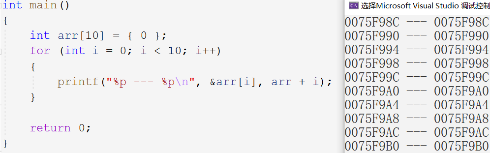

> `arr+i`即为数组中下标为`i`的元素的地址。

`[]`是一个操作符，它的两个操作数分别为数组名和下标，缺一不可。对于`arr[i]`可理解为`*(arr+i)`，既然如此我们就可写出：

```c
arr[i] <=> *(arr+i) <=> *(i+arr) <=> i[arr]
```

```c
int arr[10] = { 0 };
for (int i = 0; i < 10; i++){
    printf("%p --- %p\n", &i[arr], i+arr);
}
```

> 这就体现出了`[]`是个操作符，这样的写法语法是支持的。

###### 函数调用操作符()

```c
printf("%u\n", strlen("abc"));
```

这里`printf`和`strlen`函数都必须带上`()`，不传参也要带上，不然就错。对于函数调用操作符`()`，可以有一个或者两个操作数都可以。

###### 结构成员操作符. ->

结构体用于描述一个复杂的对象。

```c
struct Book {
    char name[50];
    char id[15];
    float price;
};
```

1. 结构体`.`成员名
2. 结构体指针 `->` 成员名

```c
Print(struct Book b1) {
    printf("书名为：%s\n", b1.name);
    printf("价格为：%f\n", b1.price);
    printf("书号为：%s\n", b1.id);
}
int main()
{
    struct Book b1 = { "谭浩强C语言程序设计",55.5f,"2020322222" };
    Print(b1);
    return 0;
}
```

使用结构体类型`struct Book`创建了一个结构体类型的变量`b`，`b`中成员有三个`name`，`id`和`price`。我们还可以后续去修改价格，如：

```c
b1.price = 100.0f;
```

那我们能不能用`b1.name="数据结构";`把书名或者书号都给改了呢？

当然不行，书名`name `和书号`id`都是通过数组创建的，`b1.name`是数组的首地址。**使用库函数`strcpy`对字符串赋值**改变结构体变量的数组成员。

```c
strcpy(b1.name, "数据结构");
```

将变量地址传过去，如何使用呢？

1. `(*结构体指针).成员名`

```c
Print2(struct Book* pb) {
    printf("书名为：%s\n", (*pb).name);
    printf("价格为：%f\n", (*pb).price);
    printf("书号为：%s\n", (*pb).id);
}
```

2. `结构体指针->成员名`

```c
Print3(struct Book* pb) {
    printf("书名为：%s\n", pb->name);
    printf("价格为：%f\n", pb->price);
    printf("书号为：%s\n", pb->id);
}
```

### 5.2 表达式求值

一个表达式在求值时，一部分取决于它的操作符的优先级和结合性，一部分取决于编译器自己的规则。

我们写出的表达式一定要让编译器的逻辑与自己的代码逻辑相一致，否则就是没用的代码。与此同时，有一些表达式中的操作数可能需要类型提升。

#### 隐式类型转换

在运算的过程中，一些小字节的类型会向大字节的类型转换后再加以运算，整个过程是编译器自动一次完成的。

##### 整型提升

如，`short`和`char`会转化为`int`，再进行运算。不是说只有不同类型数据运算时才会发生类型转换，而是为适应CPU4个字节的运算器，都会转化为普通整型，这个过程被称为整型提升。**只要有运算就会有整型提升**。如：

```c
char a=1,b=2,c=3;
...
char d=a+b+c;
```

> 如这样的一个例子，先将字符型的`a`,`b`,`c`整型提升为普通整型，然后进行运算，再放到`d`中，最后再发生截断，只取最后一个字节，转化回为字符型。

##### 如何整型提升

按类型的符号位进行整型提升。如：

```c
char c = -1;
//11111111 11111111 11111111 11111111
//11111111
printf("%d\n",c);
//11111111 11111111 11111111 11111111
```

- 有符号数：二进制补码按**最高位符号位**进行填充。
- 无符号数：填充0。

如何得到`c`的补码？

1. 先把c当成int类型然后，写出32位补码
2. 然后进行截断，只得最后8位。
3. 最后再按此时的最高位填充，是0就填充0，反之则1。

###### 例1

```c
char a = 3;
//00000000 00000000 00000000 00000011 - int a
//00000011 - char a
char b = 127;
//00000000 00000000 00000000 01111111 - int b
//01111111 - char b
char c = a + b;
//00000000 00000000 00000000 00000011 - int a 发生整型提升
//00000000 00000000 00000000 01111111 - int b
//00000000 00000000 00000000 10000010 - int c
//10000010 - char c 发生截断
printf("%d\n", c);
//11111111 11111111 11111111 10000010 - int c - 补码 发生整型提升
//10000000 00000000 00000000 01111110 - int c - 原码
```

1. 写出`a` 和`b`的32位补码
2. 进行截断，存入内存
3. 整型提升，按最高位进行填充
4. 进行运算
5. 进行截断，再整型提升
6. 将所得补码转换回原码

如：

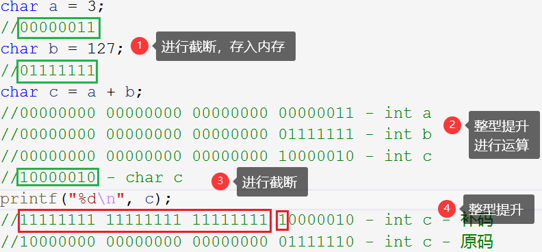

我们在得到两个变量的二进制码后，对其进行整型提升，再对所得结果进行截断，因为要存入字符型变量c中。

又因为要以`%d`的形式打印变量`c`，再次对已经截断过的补码（存入内存中的都是补码），进行整型提升，转换成原码。

###### 例2

```c
char a = 0xb6;
//10110110
short b = 0xb600;
//10110110 00000000
int c = 0xb6000000;
//10110110 00000000 00000000 00000000
if (a == 0xb6)
    //11111111 11111111 11111111 10110110
    //10000000 00000000 00000000 01001001
    //10000000 00000000 00000000 01001010 - int a
    //00000000 00000000 00000000 10110110 - 0xb6
    printf("a");
if (b == 0xb600)
    //11111111 11111111 10110110 00000000
    //10000000 00000000 01001001 11111111
    //10000000 00000000 01001010 00000000 - int b
    //00000000 00000000 10110110 00000000 - 0xb600
    printf("b");
if (c == 0xb60000)
    //10110110 00000000 00000000 00000000 - int c
    //10110110 00000000 00000000 00000000 - 0xb6000000
    printf("c");
```

1. 首先写出`a`，`b`，`c` 的二进制补码（都是正数）。
2. 然后发现有运算（`==`也是运算），**只要有运算就要整型提升**，整型提升后好巧不巧最高位都是1，默认为负数了。
3. 这样经过原反补转化后无论怎样都是负数，不会和`0xb6`和`0xb600`相等的。只有`c`本身就是默认整型，不用提升。

###### 例3

```c
char c = 1;
printf("%u\n", sizeof(c));//1
printf("%u\n", sizeof(+c));//4
printf("%u\n", sizeof(-c));//4
```

计算`sizeof(c)`时，没有运算所以没有发生整型提升。取正取负也是运算符，`sizeof(±c)`时`(+c)`和`(-c)`两个表达式发生了整型提升，故变成了四个字节。

#### 算术转换

对于`short`和`char`需要整型提升为`int`，那浮点型，长整型呢？对于这些类型，就不叫整型提升了，叫算术转换。

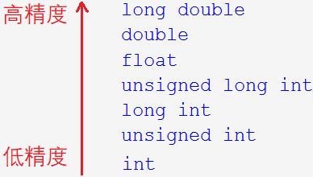

顺序由高到低，当精度低的类型与精度高的类型相运算时，会将低精度转换为高精度，然后在和高精度数据进行运算。例：

```c
int a = 4;
float f = 4.5f;
f = a + f;
printf("%f\n", f);//8.500000
```

计算`f`时需要先把`a`转化为单精度浮点型。

##### 操作符的属性

表达式的求值有三个影响因素：

1. 操作符的优先级
2. 操作符的结合性
3. 是否控制求值顺序

两个相邻的操作符先执行那个？先看优先级，优先级相同看结合性。

```c
//表达式1.
a*b+c*d+e*f;
//表达式2
c + --c;
//表达式3
int a = 1;
a=(++i)+(++i)+(++i);
```

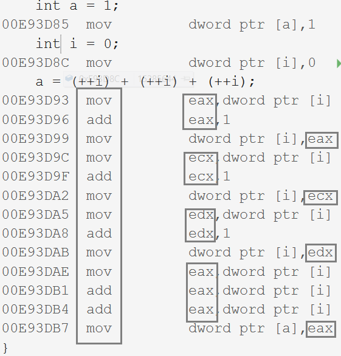

> 这样的表达式在不同的编译器下，会跑出不同的结果，因为各个编译器的标准不一样。

对于这样的表达式，我们知道操作符的优先级和结合性，但我们依然无法确定表达式计算的唯一路径，所以这样的代码是不好的，宁愿多写几步，规范确定出表达式的唯一执行路径，也不要追求过分的简洁，这不是代码的目的。

我们写出的表达式如果不能通过操作符的属性**确定唯一的计算路径**，那这个表达式就是存在问题的。


## 6. 指针

> 这次的指针不是全部内容，后面进阶部分还会深入。

### 6.1 指针的定义

了解指针先理解内存，指针指向的就是一个个的内存单元。

#### 内存划分

内存是一块很大的空间，由一个个小的的内存单元组成，每一个内存单元占一字节。每个内存单元对应一个地址也就是内存单元的编号，像是身份证号一样，通过地址我们就可以唯一确定地找到一块内存单元。如：

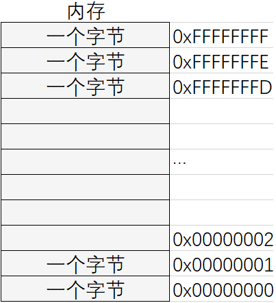

#### 指针与指针变量

地址直接指向了内存数据的位置，也就是地址指向了唯一确定的内存单元，故将地址形象化称为指针。

定义一个整型变量`a`，就是在内存中给它分配了4个字节的空间。由此也能看出定义变量的本质就是在内存中分配空间。变量`a`的第一个字节的地址为`0x0012ff40`，它就代表变量`a`的地址。

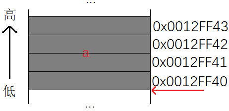

定义一个“指针”指向一个变量`a`。我们用`&a`把变量`a`的地址取出来，再放到变量`pa`中，由于变量`pa`中存的是地址，所以用类型`int*`去定义变量`pa`。

```c
int * pa = &a;
```

`pa`也是存在内存中的一个变量，其中存储的是地址编号。这样的变量叫**指针变量**。

1. 指针即地址，地址即指针。
2. 指针变量是存放地址的变量，其中的内容都被当作地址处理。

一般指针变量经常被人们简称为指针，我们要去从语境中区分他人说的是指针还是指针变量。

#### 指针的大小

> 一个内存单元有多大？地址是如何进行编号的？

32位机器，有32根地址线，每一个地址线在寻址时产生的电信号转化为数字信号。

32根地址线有 $\small 2^{32}$ 种二进制序列，即从32个全0到32个全1。

```
00000000 00000000 00000000 00000000
11111111 11111111 11111111 11111111
```

指针变量用来存储地址，一个地址32个比特位即4个字节。所以**无论是什么类型的指针变量的大小都是4个字节**。

32位指针4个字节，64位指针8个字节。

#### 指针的类型

 ```c
 int a = 10;
 int * pa = &a;
 ```

- `*` 代表`pa`是指针
- `int` 代表`pa`所指向的变量类型为`int`

任何类型的指针大小都是4个字节。指针类型的作用体现在两个方面：一是指针解引用，二是指针加减整数。

#### 指针解引用

 ```c
 int a = 0x11223344;
 int* pa = &a;
 *pa = 0;
 ```

> 创建变量`a`，用指针`pa`指向它，再对`pa`解引用把`a`置为0，从内存中可以看到：
>
> 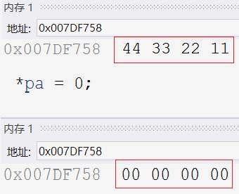

> 把`int* pa`改成`char* pa`，就可以看到`char*`指针只修改了1个字节。
>
> 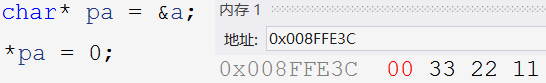

所以**指针的类型决定了解引用时能够访问的字节数**。

#### 指针 ± 整数

用不同类型的指针指向同一个变量，对其`+1`。如：

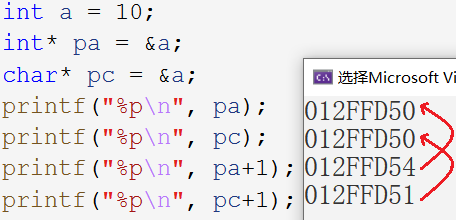

可以看到`int*`指针+1向后跳过了4个字节，`char*`指针+1向后跳过了1个字节。

所以**指针的类型决定了指针±整数时能跳过几个字节**（步长）。

#### 总结

指针类型决定了：

1. 指针解引用操作时能够访问的字节（内存大小）。
2. 指针`±`整数时能跳过几个字节（步长）。

这样的话，用不同类型的指针可以跳过不同的字节，继而更细致的访问。如：

```c
int arr[10] = { 0 };
//1.
int* pa = arr;
//2.
char * pa = arr;
for (int i = 0; i < 10; i++)
{
    *(pa + i) = 1;
}
```

两种不同的指针，带来不同的效果，如图所示：

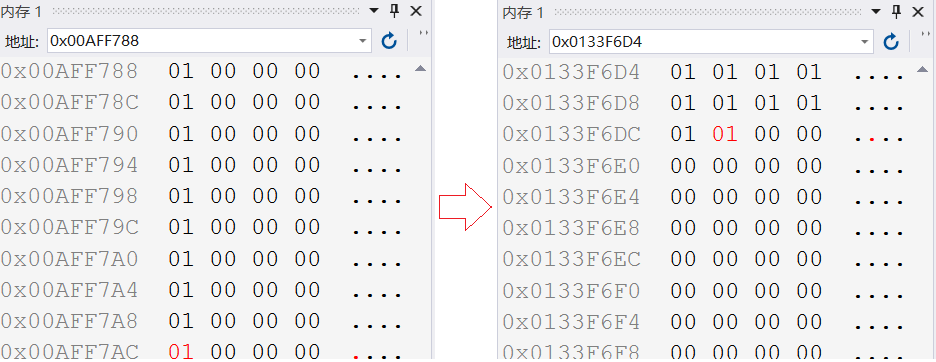

> 第一种是按整型访问数组，第二个是按字符访问。如：

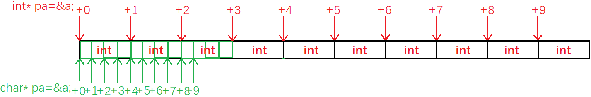

#### 野指针

指向不明确的位置（随机的，不正确的，无明确限制的）的指针是野指针，可能造成越界访问。野指针的成因：

1. **指针未初始化**

```c
int* p; //未初始化
*p = 20;
```

2. **指针越界访问**

```c
//例1
int arr[10] = { 0 };
int* p = arr;
for (int i = 0; i <= 10; i++) //越界访问
{
    *(p + i) = i;
}
//例2
int* test() {
    int a = 10;
    return &a;
}
int main() {
    int* p = test();
    printf("%d\n", *p); //野指针越界访问
    return 0;
}
```

a是test函数中定义的，出了作用域就会被销毁，所以*p这里就属于越界访问。

> 但执行程序能发现结果是10，这是为什么呢？
>
> 原因是a所占空间回收后系统未销毁，编译器对其作一次保留。且传参先行于调用，调用printf之前*p就已经替换为10。

```c
int* p = test();
printf("hehe\n");
printf("%d\n", *p);
```

我们稍作修改，在打印*p的前面再调用一次printf函数。这次调用，使得原来分配给a的空间被覆盖，分配给了`printf`函数。

```c
int* p = test();
*p = 20;//访问非法内存
```

如果把打印改为赋值`*p = 20`的话，编译器就直接检测出这块空间是非法内存，就会直接报错。

3. **指针指向空间已释放**

指针指向原先占有但已被释放的内存空间，也是一件非常危险的事情。动态开辟时也会将指针`free`掉，也是防止其成为野指针。

##### 如何规避野指针

1. **明确指针初始化，确定指向**

```c
int* p = &a;
int* p =NULL;//不知道该指向何处时，置为空NULL
```

2. **谨防指针越界**
3. **指针指向空间释后，立即置空**
4. **避免函数返回局部变量地址**

```c
void test(int x) {
    return &x //err调用结束后形参已经销毁，返回地址无意义
}
```

5. **检查指针有效性**

空指针不可解引用。

  ```c
  if(p != NULL) {
      *p=20;//检验不为空指针，再使用
  }
  ```

### 6.2 指针运算

指针加减整数还是指针，就像日期加天数还是日期。指针减指针为偏移量，就像日期减日期为天数。指针加指针是没有意义的。

> 指针解引用和指针加减整数上文已讲。

#### 指针-指针

```c
int arr[] = { 1,2,3,4,5,6,7,8,9,10 };
printf("%d\n", &arr[9] - &arr[0]); //9
```

语法规定**指针`-`指针，得到的是两地址之间的元素个数差**（下标相减）。也可以理解为总字节长度除以类型长度。

#### 指针关系运算

指针也是地址、是编号、是数字，就可进行大小比较。**指针的关系运算就是比较大小**。

```c
for( vp = &values[N - 1]; vp >= &values[0]; vp--) {
    *vp = 0;
}
// 指针最后指向values[0]前面的空间，再判断已不满足条件，就退出循环。
```

C语言标准规定：允许指针与末尾元素之后的位置比较，但不允许与首元素之前的位置进行比较。如图：

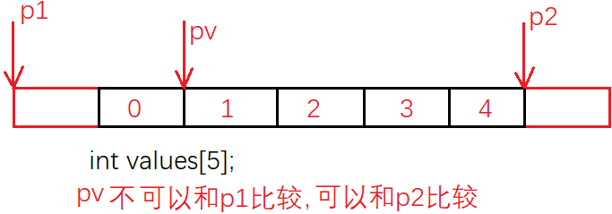

原因是编译器可能会在数组前的位置存储和数组有关的信息，如数组元素个数等。这样可能会影响到程序的运行。

### 6.3 指针和数组

- 数组是相同类型元素的集合，其元素存放在连续空间中。数组大小取决于元素类型和个数。
- 指针存储地址，是一个变量。大小固定为4或8个字节。

```c
int arr[10] = { 0 };
printf("%p\n", arr);      //0x0012ff40
printf("%p\n", &arr[0]);  //0x0012ff40
```

由此可得：**数组名就是数组首元素的地址**。`sizeof(数组名)`和`&数组名`代表整个数组，除此以外，数组名都代表首元素地址。

```c
int arr[10] = { 1,2,3,4,5,6,7,8,9,10 };
int* p = arr;
for (int i = 0; i < sz; i++) {
    printf("&arr[%d] = %p <===> p+%d = %p\n", i, &arr[i], i, p + i);
}
```

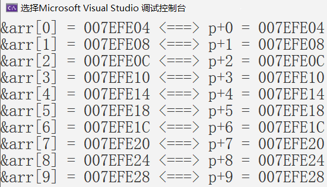

**`arr+i`其实就是`arr[i]`的地址**，二者本质上是一回事。

### 6.4 二级指针

#### 多级指针的定义

二级指针用来存放一级指针的地址，通过二级指针可以访问到一级指针。

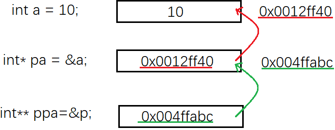

> 1. 首先创建变量`a`，类型`int`，地址`0x0012ff40`。
> 2. 然后创建`pa`，存`&a`，类型一级指针`int*`，地址`0x004ffabc`。
> 3. 最后创建`ppa`，存`&pa`，类型二级指针`int**`。

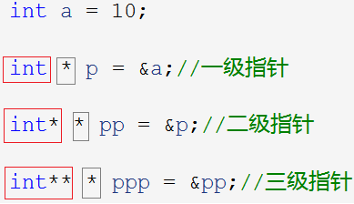

灰框`*`代表变量是一个指针变量。

- 一级指针`p`前的`int`表示指向的对象是`int`型的。
- 二级指针`pp`前的`int*`表示`pp`指向的对象是`int*`型的。
- 三级指针`ppp`前的`int**`表示`ppp`指向的对象是`int**`型的。

#### 多级指针的使用

```c
*p = 1;
* *pp = 2;
* * *ppp = 3;
```

- 对一级指针`p`解引用`*p`，找到`a`。
- 对二级指针`pp`解引用`*pp`，找到`p`，再解引用`**pp`，找到`a`。
- 对三级指针`ppp`解引用`*ppp`找到`pp`，再解引用`**ppp`，找到`p`，再解一次引用`***ppp`，找到`a`。

> 所以可以看出，有多少级指针，就要解多少次引用。

#### 指针数组

```c
int arr[10] = {0}; //整型数组 - 存放整型变量的数组
char ch[10] = {'0'}; //字符数组 - 存放字符变量的数组
int* parr[10]; //整型指针数组
char* pch[5]; //字符型指针数组
```

**指针数组就是存放指针变量的数组**。

整型指针数组，每个元素都是整型变量的地址，字符型指针数组，每个元素都是字符型变量的地址。指针数组的大小，仅取决于数组元素个数。

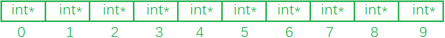

## 7. 结构体

> 后面的自定义类型会更加深入的讲这部分内容。

`char`,`int`,`float`,`double`等，都只能描述单一变量。所以C语言就发明了结构体用于描述复杂对象。

### 7.1 结构体的定义

#### 结构体的语法

结构体是值的集合，这些值被称为成员变量。结构体的每个成员可以具有不同类型。

```c
struct tag //结构体名称
{
    member-list;//成员列表

}variable-list;//变量列表（全局变量）
```

在结构体声明的`{}`后面创建的变量是全局变量，如果我们只想创建局部变量，就在`mian`函数里创建。

```c
struct tag // 这个叫结构体类型名，或者叫结构体类型
struct S s = { "abc", "man", 3.1415 }; // 这个用结构体定义的变量，叫结构体变量。
```

#### 结构体的声明

结构体用于描述复杂对象，必然有多个成员变量。结构体成员的类型可以是任意类型，也可是其他结构体。

```c
struct book
{
    char name[20];//书名
    char author[15];//作者
    float price;//价格
}b1,b2; //全局变量

struct point
{
    int x;
    int y;
};
```

当然也可以把结构体类型声明在函数内部，此时仅函数内部可使用。

```c
int main() {
    struct book {
        char name[20];
        char author[15];
        float price;
    }b1, b2;
    struct book b;
}
```

还可以使用`typedef`对类型重命名，使用`typedef`就不能在声明后面直接创建全局变量。

```c
typedef struct human {
    char name[20];
    int age;
    char sex[10];
    char id[20];
}human;

struct human man; //1.
human man; //2.
```


只是将`struct human`取名叫`human`。本质都是类型是不占用空间的，只有变量才会占用空间。

### 7.2 结构体的使用

```c
struct book {
    char name[20];
    char author[15];
    float price;
}b1, b2; // 全局变量仅定义
struct book b3 = { 0 }; // 全局变量定义和初始化
```

```c
int main() {
    struct human man1 = { "张三",20,"女装大佬","20203100" }; // 局部变量定义和初始化
    point p1 = { 1,2 };
    return 0;
}
```

```c
struct S {
    int a;
    char c;
    double d;
};
struct T {
    struct S s;
    char name[20];
    int num;
};
int main() {
    struct T t = { {10, 'x', 1.00}, "yourfriendyo", 21 }; // 嵌套定义和初始化
}
```

#### 结构体成员访问

##### .操作符

成员通过操作符`.`进行访问。`.`操作符具有两个操作数，左边是结构体变量名，右边是结构体成员名。

```c
int main() {
    struct T t = { {10, 'x', 1.00}, "yyx", 21 };
    printf("%d %c %lf %s %d\n", t.s.a, t.s.c, t.s.d, t.name, t.num);
}
```

> `s`是`t`的成员变量，`a`,`c`,`d`分别是`s`的成员变量，所以是`t.s.a`，`t.s.c`，`t.s.d`。

##### ->和*操作符

有时须通过结构体的指针访问成员，就需要操作符`->`。

```c
struct T* pt = &t;
printf("%d %c %lf %s %d\n", (*pt).s.a, (*pt).s.c, (*pt).s.d, (*pt).name, (*pt).num);
printf("%d %c %lf %s %d\n",   pt->s.a,   pt->s.c,   pt->s.d,   pt->name,   pt->num);
```

1. 第一种是对指针解引用获得结构体变量，再通过`.`访问。
2. 第二种`->`是专门在访问结构体时使用指针的方法，更高效。

#### 结构体作参数

```c
struct S {
    char arr[100];
    int num;
    float f;
};
void Print(struct S ss) {
    printf("%c %c %c %d %f\n", ss.arr[0], ss.arr[1], ss.arr[2], ss.num, ss.f);
}
void Print2(struct S* ps) {
    printf("%c %c %c %d %f\n", ps->arr[0], ps->arr[1], ps->arr[2], ps->num, ps->f);
}
int main() {
    struct S s = { {'1','2','3','4'}, 22, 3.14};
    Print1(s);
    Print2(&s);
}
```

结构体作为函数参数，此时传址调用和传址调用就会有很大区别。

- 传值调用，`s`本身占用空间很大，又创建一份一样大的形参拷贝，时间空间上浪费非常严重。
- 传址调用，无论`s`占用空间有多大，都只传4个字节的地址。

故结构体传参通常使用传址调用。
