# C语言进阶

## 1. 数据的表示和存储

### 1.1 数据的表示

#### 整型

```c
char
    signed char
    unsigned char
short
    signed short [int]
    unsigned short [int]
int
    signed int
    unsigned int
long
    signed long [int]
    unsigned long [int]
long long
    ...
```

#### 浮点型

```c
float
double
```

#### 构造类型

```c
数组类型：
    int[5]
    char[10]
    ...
结构体类型：
    struct type { v1; v2; };
    ...
枚举类型：
	enum type { v1, v2, ...};
	...
联合类型：
    union type { v1; v2; };
    ...
```

数组也是有类型的，去掉数组名`int[N]`就是数组类型。

```c
int arr[10] = {0};
printf("%d\n", sizeof(int));//4
printf("%d\n", sizeof(arr));//40
printf("%d\n", sizeof(int[10]));//40
```

#### 指针类型

```c
int*
char**
float*
```

#### 空类型

```c
void
void test(void) {}
void*
```

`void`表示空或无。通常用于函数的返回类型表示无返回类型，函数的参数表示不传参，`void*`指针类型也叫通用指针类型，可接收任意类型的指针变量。

#### 类型的意义

| 意义                     | 解释                                           |
| ------------------------ | ---------------------------------------------- |
| 类型决定了开辟空间的大小 | 存的角度，变量使用的类型就代表分配多大的空间。 |
| 类型决定了看待数据的方式 | 取的角度，以什么样的方式去看待空间里的数据。   |

如`int a`和`unsigned int b`和`float c`，空间中都是32位二进制数据，编译器认为`a`空间中的是有符号整型，`b`空间中的是无符号整型，`c`空间中的是浮点型。

##### signed和unsigned

有符号和无符号的区别，在于内存中的二进制序列的最高位是符号位还是数值位。

如`char`和`unsigned char`都只有8个比特位。若这8个比特位全1，即`11111111`，对于`unsigned char`来说就是都是数值位，换成十进制就是255，对于`char`来说就只有后七位是数值位，换成十进制就是-1。


`char`的范围是$[-128,127]$（`10000000`代表$-128$），`unsigned char`的范围是$[0,255]$。

### 1.2 数据的存储

> 创建变量的实质是在内存上为其开辟一块空间，空间大小由变量类型决定。那么数据在内存中到底是如何存储的呢？

#### 整数的存储

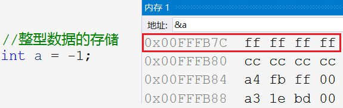

> 为什么`-1`存到内存中变成了`ffffffff`呢？接下来我们会系统的讲解这个问题。

##### 原反补

有符号数的存储涉及到原码、反码、补码的概念。

符号位：正数为0，负数为1。正数的原反补码相同，负数有如下转换规则：

- 原码：数值的二进制序列
- 反码：符号位不变，其他位按位取反
- 补码：反码$+1$

```c
int a = -1;
10000000 00000000 00000000 00000001 - 原码
11111111 11111111 11111111 11111110 - 反码
11111111 11111111 11111111 11111111 - 补码
ff ff ff ff
```

所以说，**内存中存放的是整数的补码**。

##### 补码的意义

为什么计算机中，数值统一用补码进行表示和存储呢？

1. **加法和减法可以统一处理**（CPU只有加法器）

假设使用原码进行运算减法，计算 $1-1$ 即 $1+(-1)$，只能得到错误结果$-2$。

```
 // 使用原码
 1+(-1)
 00000000 00000000 00000000 00000001 - 1  原码
 10000000 00000000 00000000 00000001 - -1 原码
 10000000 00000000 00000000 00000010 - -2

 // 使用补码
 1+(-1)
 00000000 00000000 00000000 00000001 - 1  补码
 11111111 11111111 11111111 11111111 - -1 补码
100000000 00000000 00000000 00000000 - 0  补码 - 发生截断
 00000000 00000000 00000000 00000000 - 0
```

> 二者补码相加后发现出现了第33位二进制位，当然就会发生截断，截断后全零，自然是0。使用补码进行计算可以统一加减法。

2. 使用补码运算：可以将符号位和数值位统一处理。

> 从刚刚的补码运算过程可以看出，符号位也被带入运算当中，当作数值位统一处理，二者不做区分。

3. 补码和原码相互转换时，运算逻辑相同，不需要额外的硬件电路。

> **补码符号位不变其他位按位取反再+1也会得到原码**。

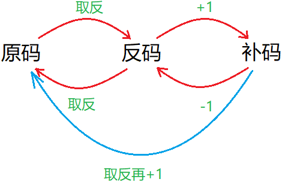

##### 大小端字节序

> 为什么存在大小端之分呢？
>
> 内存以字节为单位，一个地址对应一个字节。很多长度都大于一个字节。因此必然存在多个字节的内容如何存放的问题，故衍生了大端字节序和小端字节序。

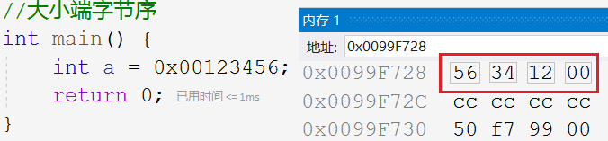

**以字节为单位，讨论计算机的存储顺序**，就是大小端字节序问题。

- 大端字节序：数据的低位存在内存的高地址处，高位存在低地址处。
- 小端字节序：数据的低位存在内存的低地址处，高位存在高地址处。

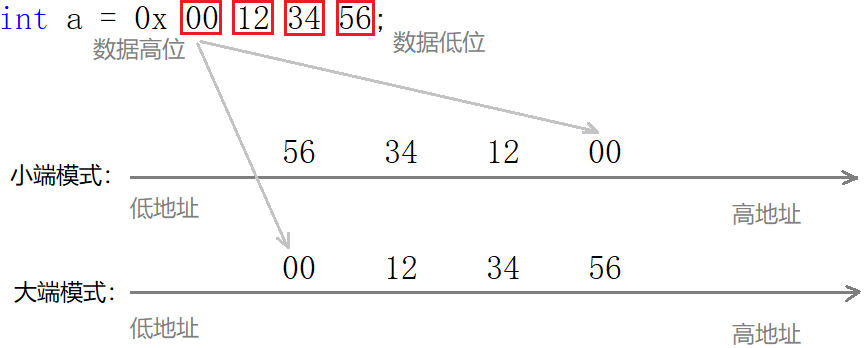

> 很明显，小端存储更合规矩，数据低位放低处，高位放高处。从数据发生截断和提升时来看，同样截出低地址内容，增加高地址内容。

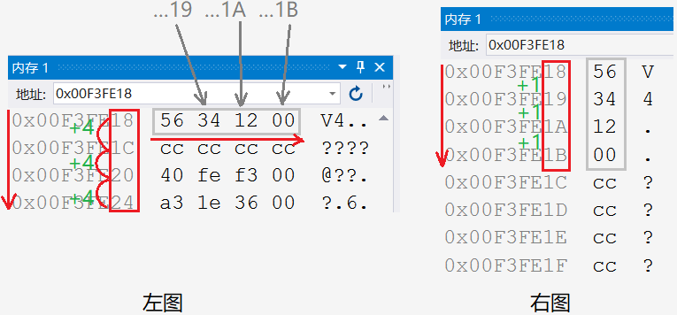

很明显，对于`0x00123456`，最低数据位`56`在低地址处，最高数据位`00`在高地址处。可见VS采用小端存储。事实上，绝大多数编译器都是小端存储。

```c
// 判断当前编译器是大端存储还是小端存储。
int check_sys() {
	int a = 1;
	return a & 1;
}
int check_sys() {
	int a = 1;
	return *(char*)&a;
}
int main() {
	if (check_sys())
		printf("小端\n");
	else
		printf("大端\n");
	return 0;
}
```

##### 例1~7

在看例题之前，对于数据存和取的问题不够清楚的话，我们再强调一下。举个简单的例子：

```c
int main()
{
    unsigned int n = -10;
    printf("%d\n", n);
    printf("%u\n", n);
}
```

> 有人可能会问，无符号整型数据怎么能放负数呢？这说明你对整数的存储的概念不够清晰。
>
> - 存：首先往`n`里放的不是-10，放的是-10的二进制补码，32位二进制序列怎么会不能放呢？只不过对`n`来说，从无符号整型的角度看这是一个很大的数，它并不意味着-10而已。
> - 取：现在我们补码有了，对该补码如何解读，那是%d和%u的事情。也就是说，如果以%d的形式打印，就把该补码当作有符号数来看，反之%u的话，就当作无符号数。

##### 例题1

```c
1.
//输出什么？
#include <stdio.h>
int main()
{
  char a= -1;
  signed char b=-1;
  unsigned char c=-1;
  printf("a=%d,b=%d,c=%d",a,b,c);
  return 0;
}
```

答案：

```c
int main()
{
	char a = -1;
	//11111111 11111111 11111111 11111111 - -1的补码
	//11111111 - 截断存入a
	//11111111 11111111 11111111 11111111 - %d打印整型提升（负整数）
	//11111111 11111111 11111111 11111110 - -1 反码
	//10000000 00000000 00000000 00000001 - -1 原码

	signed char b = -1;
	//11111111 11111111 11111111 11111111
	//11111111
	//11111111 11111111 11111111 11111111
	//10000000 00000000 00000000 00000000
	//10000000 00000000 00000000 00000001 - -1

	unsigned char c = -1;
	//11111111 11111111 11111111 11111111 - -1的补码
	//11111111 - 截断存入
	//00000000 00000000 00000000 11111111 - 255 %d打印整型提升（正整数）

	printf("a=%d,b=%d,c=%d", a, b, c);//-1，-1，225
	return 0;
}
```

> 1. 存什么，如何存入-1？
>
> $-1$是怎么存入`a`,`b`,`c`的，**存的是$-1$的补码**，先把$-1$的补码写出来，三者都是`char`类型只有一个字节的空间，必然发生截断，只存了`11111111`。
>
> 2. 怎么看，如何整型提升？
>
> 类型为`signed char`的`a`,`b`认为是有符号数，`unsigned char`的`c`认为是无符号数。
>
> `%d`是打印有符号整型。`11111111`不够整型怎么办？重点：要整型提升，怎么整型提升？正数补0，负数补1。有符号数`a`,`b`，最高位都是1，则是负数。无符号数`c`，最高位虽是1，但认为是正数。**整型提升的区别导致二者数值的不同**。
>
> 3. 怎么用，二进制序列怎么用？
>
> 用`%d`的形式打印`a`,`b`,`c`，把三个二进制序列都当成有符号数来打印。

变题：

```c
#include <stdio.h>
int main()
{
  char a= -1;
  signed char b=-1;
  unsigned char c=-1;
  printf("a=%u,b=%u,c=%u",a,b,c);
  return 0;
}
```

> 无论以`%d`还是`%u`的形式打印，都要整型提升，整型提升只关心它是正数还是负数。（有无符号数，最高位是0还是1）
>
> 提升后我们如何看待得到的二进制位，怎么去打印，那就是`%u`的事情了，把二进制序列都当成无符号数。（%d还是%u）

答案：

```c
int main()
{
	char a = -1;
	//11111111 - 截断存入
	//11111111 11111111 11111111 11111111 - 整型提升并%u打印
	signed char b = -1;
	//11111111
	//11111111 11111111 11111111 11111111 - 整型提升并%u打印
	unsigned char c = -1;
	//11111111 - 截断存入
	//00000000 00000000 00000000 11111111 - 整型提升并%u打印

	printf("a=%u,b=%u,c=%u", a, b, c);//2^32-1 2^32-1 255
	return 0;
}
```

> 前者整型提升补1，最高位是1，使用%d还是%u对其有影响。后者整型提升补0，%d还是%u都当作正数所以无影响。

类型只能决定字节大小和有无符号数，而`%d`,`%u`决定了如何使用该数据。

##### 例题2

```c
2.
#include <stdio.h>
int main()
{
	char a = 128;
	printf("%u\n", a);
	return 0;
}
```

答案：

```c
int main()
{
	char a = -128;
	//10000000 00000000 00000000 10000000 - 原码
	//11111111 11111111 11111111 01111111 - 反码
	//11111111 11111111 11111111 10000000 - 补码

	//10000000 - 截断存入
	//11111111 11111111 11111111 10000000 - 整型提升并以无符号数打印

	printf("%u\n", a);//4,294,967,168
	return 0;
}
```

> 1. 写出`-128`的补码，变量`a`里存入截断后的结果`10000000`，%u打印整型要整型提升，负数高位补1。
> 2. 得到整型提升后的结果，用%u以无符号数的形式打印整型，即将该二进制序列当作无符号数，那自然原反补相同。

##### 例题3

```c
3.
#include <stdio.h>
int main()
{
	char a = 128;
	printf("%u\n", a);
	return 0;
}
```

答案：

```c
int main()
{
	char a = 128;
	//00000000 00000000 00000000 10000000 - 原码
	//01111111 11111111 11111111 01111111 - 反码
	//01111111 11111111 11111111 10000000 - 补码
	//10000000 - 截断后存入
	//11111111 11111111 11111111 10000000 - 整型提升并以无符号数打印

	printf("%u\n", a);//4,294,967,168
	return 0;
}
```

> 本题和例2一样，都是补码截断再存入，再整型提升并以无符号形式打印。
>
> 例2和例3唯一的不同就是一正一负，符号位不同，但当截断后存入，这个差别就消除了。

##### 例题4

```c
4.
int main()
{
    int i = -20;
	unsigned int j = 10;
	printf("%d\n", i+j);
	//按照补码的形式进行运算，最后格式化成为有符号整数
    return 0;
}
```

答案：

```c
int main()
{
	int i = -20;
	//10000000 00000000 00000000 00010100 - 原码
	//11111111 11111111 11111111 11101011 - 反码
	//11111111 11111111 11111111 11101100 - 补码
	unsigned int j = 10;
	//00000000 00000000 00000000 00001010 - 原反补

	//11111111 11111111 11111111 11101100 - i 补码
	//00000000 00000000 00000000 00001010 - j 补码
	//11111111 11111111 11111111 11110110 - i+j 补码
	//10000000 00000000 00000000 00001001
	//10000000 00000000 00000000 00001010 - i+j 原码

	printf("%d\n", i + j);//-10
	return 0;
}
```

> 想要得到`i+j`，就要先得到`i`和`j`的补码（前面已经说过整数运算是补码的运算），二者补码相加得到的当然是`i+j`的补码。可以看到`i+j`的补码符号位是1，而且我们要以%d的形式打印，那必然当作负数，再将补码转化为原码。

##### 例题5

```c
5.
int main()
{
	unsigned int i;
	for (i = 9; i >= 0; i--)
	{
		printf("%u\n", i);
	}
	return 0;
}
```

答案：

```c
#include <windows.h>
int main()
{
	unsigned int i;
	//00000000 00000000 00000000 00000000 - 0  原反补
	//11111111 11111111 11111111 11111111 - -1 补码
    //11111111 11111111 11111111 11111111 - 0+(-1)的补码

	for (i = 9; i >= 0; i--)
	{
		printf("%u\n", i);
		Sleep(100);
	}
	return 0;
}
```

> 问题出在当i=0时，i再`--`就是`0–1`也就是`0+(-1)`，该结果的补码是全1，又是无符号数，说明i又从最大数开始循环了。i是不可能小于0的，所以这是个死循环。

##### 例题6

```c
6.
int main()
{
	char a[1000];
	int i;
	for (i = 0; i < 1000; i++)
	{
		a[i] = -1 - i;
	}
	printf("%d", strlen(a));
	return 0;
}

```

答案：

```c
a[] = { -1, -2, -3,..., -128, 127, 126,...,  2, 1, 0 };
```

> 求字符串的长度，也就是找`'\0'`前有多少个字符，而`'\0'`的ASCII码就是0，也就是找什么时候数组元素为0。
>
> `-1-i`每次`i++`，这样数组元素依次是-1,-2,-3,…,-128，-128往后是什么呢？这要看`-1-i`的补码，其实是补码每次减1。-128的补码是`10000000`，再减1，就是`01111111`，这就从负数轮回到正数了，正数再每次减1，一直减到0。

`signed char`轮回如图所示：（相当于反着转）


甚至于`signed short`补码轮回图我们也可以画出来。


##### 例题7

```c
7.
#include <stdio.h>
unsigned char i = 0;
int main()
{
	for (i = 0; i <= 255; i++)
	{
		printf("hello world\n");
	}
	return 0;
}
```

答案：

> unsigned char类型的变量范围在0到255之间，255再加1就变成0，和例5一样死循环。

从例5和例7还可以看出，循环变量不要用无符号数。

#### 浮点数的存储

###### 举例

```c
int main()
{
	int n = 9;
	float* pFloat = (float*)&n;

	printf("n的值为：%d\n", n);//9
    //1.
	printf("*pFloat的值为：%f\n", *pFloat);

	*pFloat = 9.0;
    //2.
	printf("num的值为：%d\n", n);
	printf("*pFloat的值为：%f\n", *pFloat);//9.0
	return 0;
}
```

> 先来看一下这个例子，将正数n的地址强制转化再存入浮点型指针中。（二者都是4个字节，所以不会丢失或忽略数据）问：
>
> - 对该指针解引用后，以浮点型的形式打印
> - 将指针指向的内容修改为9.0，再解引用并以浮点型的形式打印

这个问法背后的意义是：

1. 将整数的补码，以浮点型的视角读取会解析成什么？
2. 将浮点型数据的补码，再以整型的视角读取会解析成什么？

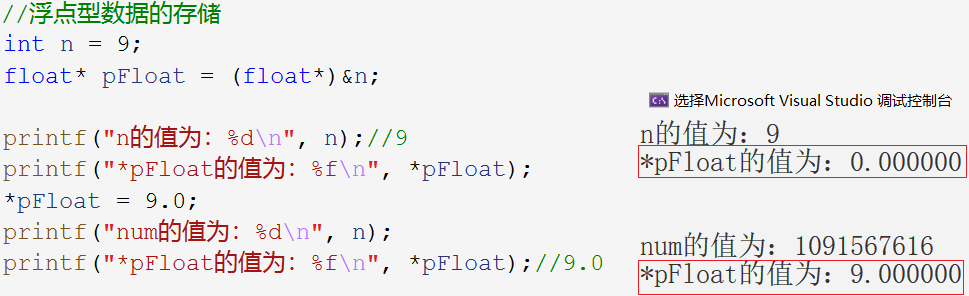

> 整数和浮点数存储方式截然不同。若要理解这个过程，需要认识浮点型的表示和存储方法。

##### 浮点数表示

浮点数的表示和存储请看[计组第二章 IEEE754浮点数](/docs/408/02-计算机组成原理#IEEE754浮点数)。

##### 浮点数存储

32位`float`型浮点数。

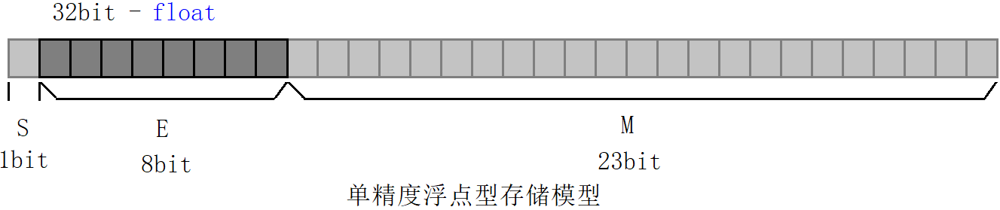

64位`double`型的浮点数。

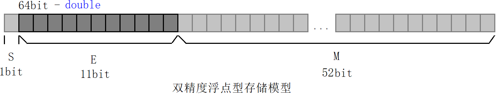

## 2. 指针进阶

> 我们已了解指针的：
>
> - 定义：指针变量，用于存放地址。地址唯一对应一块内存空间。
> - 大小：固定32位占4个字节，64位8个字节。
> - 类型：类型决定指针±整数的步长及解引用时访问的大小。
> - 运算：指针解引用，指针±整数，指针-指针，指针关系运算。
>
> 本章节在此基础上，对指针进行更深层次的研究。

### 2.1 字符指针

字符指针，存入字符的地址，类型为`char*`

#### 字符指针的作用

1. 指向单个字符变量

```c
char ch = 'w';
const char* pch = &ch; // 这种容易理解，就是指针解引用访问字符变量
```

2. 指向字符串首字符

```c
char* pc = "hello";
printf("%s\n", pc);
```

类似于数组名，该指针存的是**常量字符串"hello"的首字符的地址**。通过对指针解引用访问首字符地址，从而找到整个字符串。

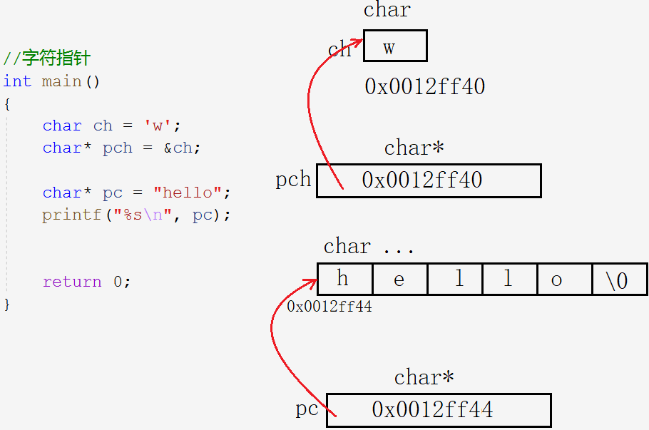

```c
char* pc = "hello";
printf("%c\n", *pc);//h
printf("%s\n", pc);//hello
```

字符串在空间上连续存放。把地址给`%s`会将其内容看作字符串并持续打印直到`\0` 。

#### 字符指针的特点

```c
char str1[] = "hello bit";
char str2[] = "hello bit";

char* str3 = "hello bit";
char* str4 = "hello bit";

if (str1 == str2)
	printf("str1 == str2\n");//1
else
	printf("str1 != str2\n");//2

if (str3 == str4)
	printf("str3 == str4\n");//3
else
	printf("str3 != str4\n");//4
```

str1,str2,str3,str4都是指针，判断相等就是判断指针变量中存储的内容是否相同。

答案是`str1!=str2`和`str3==str4`。

- str1和str2是数组，先后开辟的两块不同的空间，地址当然不同。
- str3和str4字符串指针，其中存放的是存放在内存常量区、不可被修改、且具有唯一性的同一个常量字符串地址。

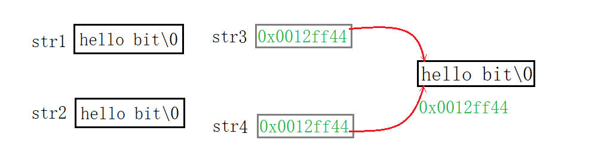

### 2.2 指针数组

#### 指针数组的定义

```c
char* pch[5];
int* parr[10];
float* pf[20];
```

指针数组就是存放指针的数组。

```c
int arr[10];
int* arr[10];
```

- 整型数组的数组名`arr`，即首元素地址，是一级指针。
- 整型指针数组的数组名`parr`，也是首元素地址，不过首元素为`int*`类型变量，所以`parr`就是二级指针。

#### 指针数组的使用

```c
int  arr1[] = { 1,2,3,4,5 };
int  arr2[] = { 2,3,4,5,6 };
int  arr3[] = { 3,4,5,6,7 };
int* parr[] = { arr1,arr2,arr3 };

for (int i = 0; i < 3; i++) {
	for (int j = 0; j < 5; j++) {
		printf("%d ", parr[i][j]); //1.
		printf("%d ", *(*(parr + i) + j)); //2.
	}
	printf("\n");
}
	 parr[i] <=> *(parr+i)
*(parr[i]+j) <=> *(*(parr+i)+j) <=> (*parr+i)[j] <=> parr[i][j]
```

通过指针数组访问整型数组的每个元素。`parr[i][j]`和`*(*(parr+i)+j)`本质上是等价的。

```c
const char* pch[] = { "abcde", "bcdef", "cdefg" };
for (int i = 0; i < 3; i++) {

	printf("%s", pch[i]);//1.
	printf("%s", *(pch + i));//2.

	for (int j = 0; j < 5; j++) {
		printf("%c", pch[i][j]); //3.
		printf("%c", *(*(pch + i) + j));//4.
	}

	printf("\n");
}
```

> 打印字符串使用`%s`更简单，若要使用`%c`，就是得到每个字符串的起始地址，分别向后访问。

### 2.3 数组指针

> 数组指针是指向数组的指针，是指针而非数组。

#### 数组指针的定义

**数组的地址存放在数组指针中**。且数组指针的类型为数组的类型再加个`*` 。

```c
//int a[10];
int* pa[10] = &arr; //[]的优先级比*高，故pa先与[]结合成数组名，所以pa是个指针数组
int(*pa)[10] = &arr;
```

数组指针的类型由数组类型决定，先找出数组类型`int[10]`，且不能让`[]`先与`pa`结合，所以用`()`先将`parr`和`*`结合，即成`int(*parr)[10]`。

C语言规定`[]`必须在最后面，所以不可写成`int[10]* parr`。

```c
int* parr[10];//指针数组
int(*parr)[10];//数组指针
```

去掉名字就是类型。所以`int[10]`是整型数组，`int*[10]`是指针数组，`int(*)[10]`是数组指针。

#### 数组指针的使用

##### 反面用例

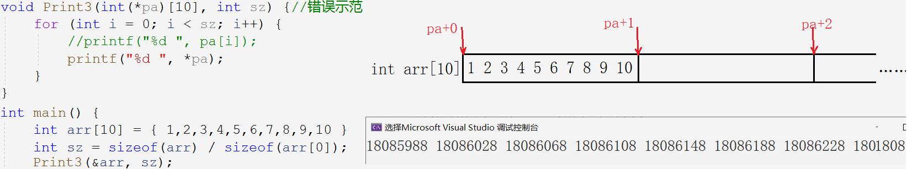

##### 正面用例

```c
// 二维数组传参,用二维数组接收
void Print(int arr[3][5], int r, int c) {
	for (int i = 0; i < r; i++) {
		for (int j = 0; j < c; j++) {
			printf("%d ", *(*(arr + i) + j));
		}
		printf("\n");
	}
}

//二维数组传参,用数组指针接收
void Print2(int(*pa)[5], int r, int c) {
	for (int i = 0; i < r; i++) {
		for (int j = 0; j < c; j++) {
			printf("%d ", pa[i][j]);//1.
			printf("%d ", *(*(pa + i) + j));//2.
		}
		printf("\n");
	}
}

int arr[3][5] = { 1,2,3,4,5, 2,3,4,5,6, 3,4,5,6,7 };
Print(arr, 3, 5);
```

- 把二维数组想象成**一个拥有三个元素的一维数组**（每个元素也为一维数组）。
- 由于其每个元素是有5个元素的一维数组，数组指针定义为`int(*p)[5]`，指向首行这个“一维数组”。（传参传的是数组名）
- 第一层循环用于“跳行”，即每次跳过5个元素。第二层循环遍历每行“一维数组”。

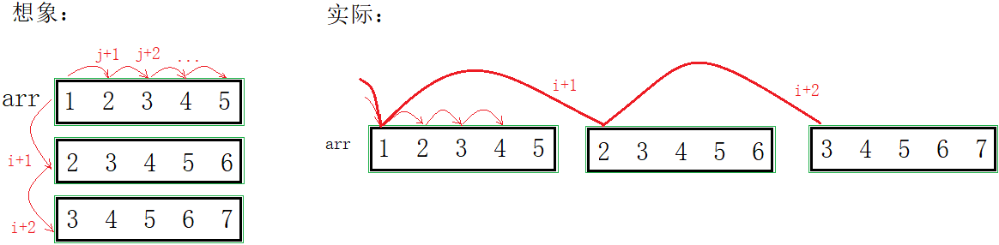

二维数组首元素为其首行，相当于一个一维数组，该一维数组的地址类型为`int(*)[5]`。

二维数组名作参数，降级为首元素指针即首行指针，所以它是数组指针，类型为`int(*)[5]`。

##### 举例

```c
int a[5]; //1. 整型数组
int *pa[5]; //2. 存放整型指针的数组
int (*pa)[10]; //3. 指向整型数组的指针
int (*pa[10])[5]; //4. 存放数组指针的数组
```

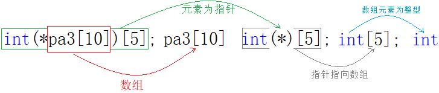

`pa`先和`[10]`结合为数组，剩下`int(*)[5]`是数组指针算pa数组的元素。所以是个元素个数为10的数组指针数组。

##### 类型辨别方法

1. 名称先和`[]`结合则为数组，只去掉数组名就是数组类型，去掉`[n]`和数组名便是其元素的类型。
2. 名称先和`*`结合则为指针，只去掉指针名就是指针类型，去掉`*`和指针名便是指向的变量的类型。

### 2.4 指针传参

#### 一维数组传参

```c
void test(int arr[]);   //1.
void test(int arr[10]); //2.
void test(int* arr);    //3.

int arr[10] = { 0 };
test(arr);
```

1. 用数组接收可行，但会降级优化成指针，编译器不会真创建一个数组。
2. 由于形参数组形同虚设，所以数组大小随便无意义。
3. 数组传参本质就是首元素地址，首元素类型为`int`，所以指针的类型为`int*`。

#### 二维数组传参

```c
void test(int arr[ ][5]); //1.
void test(int arr[3][5]); //2.
void test(int (*arr)[5]); //3.

int arr[3][5] = { 0 };
test(arr);
```

- 二维数组传参可以用二维数组接收，**行可省略，但列不可以**。
- 二维数组传参用首行数组类型的数组指针接收。

#### 一级指针传参

```c
void test(int* ptr, int n); //1.
void test(int arr[],int n); //2.

int a;
int arr[10];
test(&a);
test(arr);
```

- 一级指针传参，形参用指针和数组都行，但不提倡用数组。
- 若形参为指针，实参也可以是指针，也可以是数组。

#### 二级指针传参

```c
void test(int** pp);
void test(int* arr[]);

int** pp;
test(pp);
```

当二级指针作函数参数时，形参可以是二级指针和指针数组。

> 当形参为二级指针，实参可以传什么呢？

```c
void test(int** pp);

int* p;
int** pp;
int* arr[10];

test(&p); //1.
test(pp); //2.
test(arr); //3.
```

当形参为二级指针时，实参可以是：二级指针、一级指针地址、指针数组首元素的地址。

### 2.5 函数指针

#### 函数指针的定义

函数指针指向函数，存放函数的地址。搞懂函数指针，先了解函数的地址，**&函数名或函数名代表函数地址**。

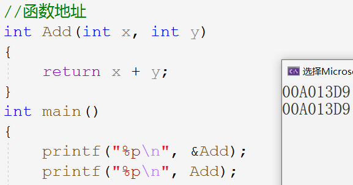

> 函数指针的类型该如何写呢？

```c
int(*pf)(int, int) = &Add;
int *pf(int, int) = &Add;
```

`int* pf(int, int)`，`pf`变成函数，返回类型是`int*`。所以必须带括号。函数指针去掉`*`和指针名，即函数类型`int(int,int)`。

#### 函数指针的使用

```c
int(*pf)(int, int) = &Add;
int(*pf)(int, int) = Add;
int ret = (*pf)(2, 3);
int ret = pf(2, 3); //函数指针pf不解引用也可以直接调用函数
```

##### 举例

```c
(*(void(*)())0)(); //1.
void (*signal(int, void(*)(int)))(int); //2.
```

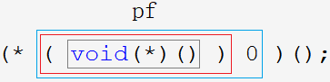

`void(*)()`是函数指针类型，放在`( )0`中，也就是把0强转成地址，该地址处存放一个函数其类型为`void(*)(void)`。

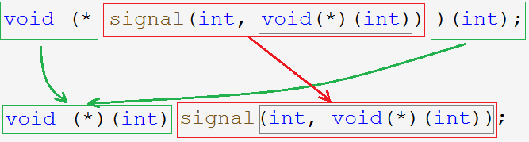

1. `signal`先和`()`结合，说明`signal`为函数名，其后`(int, void(*)(int))`，为其参数列表。
2. 去掉函数名称和参数列表，剩下的`void(*)(int)`就是返回类型，所以是一次函数声明。

### 2.6 函数指针数组

#### 函数指针数组的定义

```c
int(*pfar[10])(int, int);
```
函数指针数组存放函数指针，故元素类型为函数指针类型。

#### 函数指针数组的使用

```c
int Add(int x, int y);
int Sub(int x, int y);
int Mul(int x, int y);
int Div(int x, int y);

//函数指针数组 - pfArr
int(*pfArr[4])(int, int) = { Add,Sub,Mul,Div };
```
类型相同的函数，存放在同一个函数指针数组中。

### 2.7 函数指针数组的指针

```c
//函数指针
int (*pf)(int, int) = Add;
//函数指针数组
int (*pfArr[10])(int, int) = { Add };
//指向函数指针数组的指针
int(*(*ppfArr)[10])(int, int) = &pfArr;
```

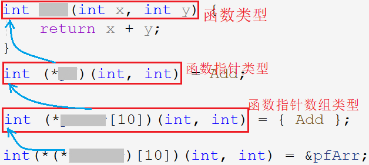

从后往前看，指向函数指针数组的指针去掉`*`和指针名就是函数指针数组的类型，函数指针数组去掉`*`和指针名就是函数指针类型，函数指针去掉`*`和指针名就是函数类型。

> 再研究下去就没有必要了。

### 2.8 回调函数

#### 回调函数定义

如下图所示，被通过函数指针调用的函数叫做**回调函数**，第三方调用的参数也在其中被调用。

> 若想在调用函数中随条件变化而调用不同的函数，就必须使用回调函数的方法：调用函数中使用函数指针，指向不同函数。回调函数在大型工程中显得非常方便。

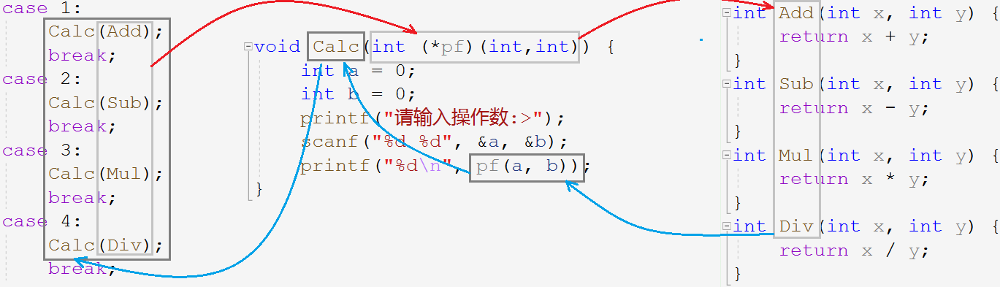

#### 快速排序qsort

```c
void qsort(void* base, size_t num, size_t width, int (*cmp)(const void* e1, const void* e2));
```

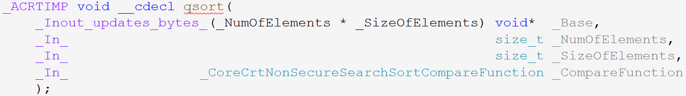

##### 模拟实现

```c
//打印函数
void print_arr(int arr[],int sz) {
	for (int i = 0; i < sz; i++) {
		printf("%d ", arr[i]);
	}
}
//交换函数
void Swap(char* buf1, char* buf2, size_t width) {
	for (size_t i = 0; i < width; i++) {//宽度次
		char tmp = *buf1;
		*buf1 = *buf2;
		*buf2 = tmp;
		buf1++;
		buf2++;
	}
}
//比较函数
int cmp(const void* e1, const void* e2) {
	return *(int*)e1 - *(int*)e2;
}
//排序函数
void my_sort(void* base, size_t num, size_t width, int(*cmp)(const void* e1, const void* e2)) {
	for (size_t i = 0; i < num - 1; i++) {
		for (size_t j = 0; j < num - 1 - i; j++) {
			if (cmp((char*)base + j * width, (char*)base + (j + 1) * width) > 0) {//以字节为单位
				Swap((char*)base + j * width, (char*)base + (j + 1) * width, width);
			}
		}
	}
}
int main() {
	int arr[10] = { 9,8,7,6,5,4,3,2,1,0 };
	int sz = sizeof(arr) / sizeof(arr[0]);
	my_sort(arr, sz, sizeof(arr[0]), cmp);
	print_arr(arr, sz);

	return 0;
}
```

### 2.9 指针和数组笔试题

#### 数组辨析题

##### 一维数组

```c
int a[] = { 1,2,3,4 };
printf("%d\n", sizeof(a));//16
printf("%d\n", sizeof(a + 0));//4/8
printf("%d\n", sizeof(*a));//4
printf("%d\n", sizeof(a + 1));//4/8
printf("%d\n", sizeof(a[1]));//4
printf("%d\n", sizeof(&a));//4/8
printf("%d\n", sizeof(*&a));//16
printf("%d\n", sizeof(&a + 1));//4/8
printf("%d\n", sizeof(&a[0]));//4/8
printf("%d\n", sizeof(&a[0] + 1));//4/8
```

1. 只有数组名单独放在`sizeof`内部才是整个数组。

   `a+0`放在`sizeof`内部表示首元素地址+0。

2. 只要是地址，不管是什么类型的地址大小都是4/8

   基本类型指针，数组指针，函数指针大小都是4/8个字节，故`sizeof(&a)=sizeof(int(*)[4])=4`。`sizeof()`求指针所占字节而不是解引用访问权限大小。

3. `*`和`&`在一起会抵消。

   `sizeof(*&a)`，&a为整个数组的地址类型`int(*)[4]`，解引用后`int[4]`大小为16。

##### 字符数组

```c
char arr[] = { 'a','b','c','d','e','f' };
printf("%d\n", sizeof(arr));//6
printf("%d\n", sizeof(arr + 0));//4/8
printf("%d\n", sizeof(*arr));//1
printf("%d\n", sizeof(arr[1]));//1
printf("%d\n", sizeof(&arr));//4/8
printf("%d\n", sizeof(&arr + 1));//4/8
printf("%d\n", sizeof(&arr[0] + 1));//4/8

printf("%d\n", strlen(arr));//随机值x
printf("%d\n", strlen(arr + 0));//随机值x
printf("%d\n", strlen(*arr));//报错
printf("%d\n", strlen(arr[1]));//报错
printf("%d\n", strlen(&arr));//随机值x
printf("%d\n", strlen(&arr + 1));//随机值x-6
printf("%d\n", strlen(&arr[0] + 1));//随机值x-1
```

1. `sizeof(*arr)`，`*arr`对首元素地址解引用，计算首元素所占空间大小。

   `strlen(*arr)`，`*arr`依然是首元素，`strlen`把a也就是97当成地址，访问到非法内存所以报错。

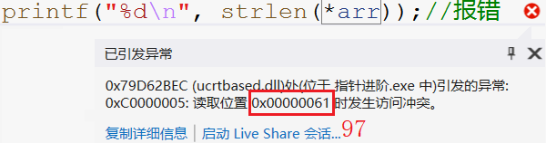

2.`strlen(&arr)`虽然是整个数组的地址，但依然是从首元素开始的，所以`strlen`依然从第一个元素开始找。

	`strlen(&arr+1)`，先计算`&arr+1`然后再传参过去，也就是跳过了整个数组去找。

**`sizeof`和`strlen`的区别**

- `sizeof` — 操作符 — 以字节为单位，求变量或类型所创建变量的所占空间的大小

> `sizoef`不是函数，计算类型是必须带上类型说明符`()`。`sizoef`内容不参与运算，在编译期间便转化完成。

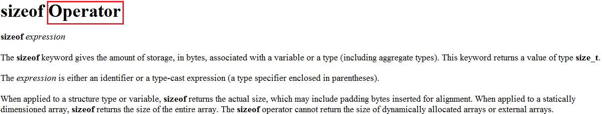

- `strlen` — 库函数 — 求字符串长度即字符个数，遇`\0`停止。

> 库函数，计算字符串长度没有遇到`\0`就会一直持续下去。返回类型`size_t`，参数`char* str` ，接收的内容都会认为是`char*`类型的地址。

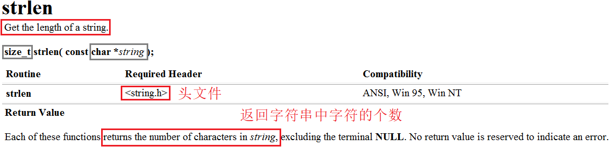

一个求变量所占空间，一个求字符串大小，二者本身是没有关系的，但总有人把二者绑在一起“混淆视听”。

##### 字符串数组

首先明确二者的区别：

```c
//1.字符初始化数组
char arr[] = { 'a','b','c','d','e','f' };//[a] [b] [c] [d] [e] [f]
//2.字符串初始化数组
char arr[] = "abcdef";//[a] [b] [c] [d] [e] [f] [\0]
```

> 字符初始化数组，存了什么元素数组里就是什么元素。而字符串初始化数组，除了字符串中可见的字符外，还有字符串末尾隐含的`\0`。`\0`存在于字符串的末尾，是自带的，虽不算字符串内容，但是字符串中的字符。

```c
char arr[] = "abcdef";
printf("%d\n", sizeof(arr));//7
printf("%d\n", sizeof(arr + 0));//4/8
printf("%d\n", sizeof(*arr));//1
printf("%d\n", sizeof(arr[1]));//1
printf("%d\n", sizeof(&arr));//4/8
printf("%d\n", sizeof(&arr + 1));//4/8
printf("%d\n", sizeof(&arr[0] + 1));//4/8

printf("%d\n", strlen(arr));//6
printf("%d\n", strlen(arr + 0));//6
printf("%d\n", strlen(*arr));//报错
printf("%d\n", strlen(arr[1]));//报错
printf("%d\n", strlen(&arr));//6
printf("%d\n", strlen(&arr + 1));//随机值
printf("%d\n", strlen(&arr[0] + 1));//5
```

1. `sizeof`计算变量的长度，变量可以是数组，数组元素以及指针。数组就是整个数组的大小，数组元素则是数组元素的大小，指针大小都为4/8。
2. `strlen`把传过来的参数都当作地址，是地址就从该地址处向后遍历找`\0`，不是地址当作地址非法访问就报错。

##### 常量字符串

```c
char* p = "abcdef";
```

> `"abcdef"`是常量字符串，用一个字符指针`p`指向该字符串，实质是`p`存入了首字符`a`的地址。由于字符串在内存中连续存放，依此特性便可以遍历访问整个字符串。

```c
char* p = "abcdef";
printf("%d\n", sizeof(p));//4/8
printf("%d\n", sizeof(p + 1));//4/8
printf("%d\n", sizeof(*p));//1
printf("%d\n", sizeof(p[0]));//1
printf("%d\n", sizeof(&p));//4/8
printf("%d\n", sizeof(&p + 1));//4/8
printf("%d\n", sizeof(&p[0] + 1));//4/8

printf("%d\n", strlen(p));//6
printf("%d\n", strlen(p + 1));//5
printf("%d\n", strlen(*p));//报错
printf("%d\n", strlen(p[0]));//报错
printf("%d\n", strlen(&p));//随机值
printf("%d\n", strlen(&p + 1));//随机值
printf("%d\n", strlen(&p[0] + 1));//5
```

1. `p`,`p+1`,`&p`,`&p+1`,`&p[0]+1`都是地址对于地址`sizeof`都求得4/8，`*p`,`p[0]`是数组元素，`sizeof`计算元素大小。
2. `p`,`p+1`,`&p`,`&p+1`,`&p[0]+1`都是地址对于地址`strlen`都向后遍历访问找`\0`，`*p`,`p[0]`是数组元素其对于ASCII值当作地址会访问到非法内存。
3. `p`,`p+1`,`&p[0]+1`都是字符串字符的地址，`&p`,`&p+1`都是指针变量`p`或其之后的地址。

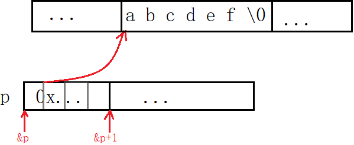

##### 二维数组

访问数组元素的方式是`数组名+[j]`。若将二维数组的每一行可以看成一个一维数组，则`a[0],a[1],a[2]`可以看成“每行“的数组名，和一维数组的数组名具有同样的效果。

> 1. 数组名单独放在`sizeof()`内部代表整个数组
> 2. `&`数组名同样代表整个数组（每行的数组名同样适用）

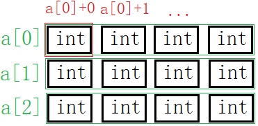

```c
int a[3][4] = { 0 };
printf("%d\n", sizeof(a));//12X4=48
printf("%d\n", sizeof(a[0][0]));//4
printf("%d\n", sizeof(a[0]));//16
printf("%d\n", sizeof(a[0] + 1));//4/8
printf("%d\n", sizeof(*(a[0] + 1)));//4
printf("%d\n", sizeof(a + 1));//4/8 - 第二行地址不代表第二行数组名
printf("%d\n", sizeof(*(a + 1)));//16
printf("%d\n", sizeof(&a[0] + 1));//4/8 - 第二行地址不代表第二行数组名
printf("%d\n", sizeof(*(&a[0] + 1)));//16 - 第二行数组地址解引用为数组名
printf("%d\n", sizeof(*a));//16
printf("%d\n", sizeof(a[3]));//16
```

- 对于二维数组来说，`sizeof(a[0])`求首行的整个数组大小。若是`sizeof(a[0]+1)`代表首行数组名没有单独放在`sizeof()`内部，故`a[0]`退化成了首元素地址。
- `sizeof(a+1)`代表第二行的地址仅为地址，但并不能第二行该“一维数组”的数组名，不可与`sizeof(a[1])`混淆。`&a[1]`等价于`a+1`。
- `sizeof(*(a+1))`，对第二行的地址解引用，相当于`sizeof(int[4])`。
- `*(&a[0]+1)`第二行数组地址解引用为数组名。**数组地址解引用代表整个数组，相当于数组名。切莫将数组地址和数组名混淆**。（`*&arr=arr`）

**总结**

搞清楚二维数组数组名的意义，必须搞清楚如下变量的含义。

```c
a[0]//首行数组名
a[0] + 1//首元素地址+1为第二个元素地址
&a[0] + 1//首行地址+1为第二行数组地址（a+1）
a//二维数组名
a + 1//首行地址+1为第二行数组地址
&a + 1//数组地址+1为第二个数组地址
*(a + 1) <=> *(&a[0] + 1)//第二行数组地址解引用为数组名
```

1. `a`是二维数组名，`a[0]`是首行数组名。
2. 参与运算后`a`退化为首行地址，`a[0]`退化为首元素地址。
3. `&a+1`跳过一个二维数组，`&a[0]+1`跳过一个一维数组。

#### 指针笔试题

##### 例1

```c
int main()
{
	int a[5] = { 1, 2, 3, 4, 5 };
	int* ptr = (int*)(&a + 1);
	printf("%d,%d", *(a + 1), *(ptr - 1));
	return 0;
}
//程序的结果是什么？
```

指针运算要考虑指针类型，`&a+1`跳过了`int[4]`的长度，得到这个位置的地址后指针转化成`int*`型，此时再+1就只能跳过一个`int`。

本题考察指针类型决定指针±整数的长度。

##### 例2

```c
//由于还没学习结构体，这里告知结构体的大小是20个字节
struct test
{
	int Num;
	char* pcName;
	short sDate;
	char cha[2];
	short sBa[4];
}*p;
//假设p 的值为0x100000。 如下表表达式的值分别为多少？
int main()
{
	p = 0x10000000;
	printf("%p\n",  (struct test*)p + 0x1);
	printf("%p\n", (unsigned long)p + 0x1);
	printf("%p\n", (unsigned int*)p + 0x1);
	return 0;
}
```

p本是`struct test*`的指针，后分别强制转换成`unsigned long`和`unsigned int*`类型分别+1跳过多少字节。`struct test*`的指针+1跳过一个`struct test`字节长度。`unsigned long`为整数类型+1即整数+1，不属于指针运算。

##### 例3

```c
int main()
{
	int a[4] = { 1, 2, 3, 4 };
	int* ptr1 = (int*)(&a + 1);
	int* ptr2 = (int*)((int)a + 1);
	printf("%x,%x", ptr1[-1], *ptr2);
	return 0;
}
```

`ptr1`和`ptr2`都是把不同的意义的变量强转成`int*`类型的地址。先进行一系列的操作后再读取该地址处的后4个字节。

> `&a`类型为`int(*)[4]`故+1跳过1个数组；`a`首先为首元素地址强转为`int`型整数再+1执行整数加法，由于内存以字节为单位，一个字节一个地址，故+1相当于下一个字节的地址。最后都强制转换为`int*`的指针，都向后访问4个字节。

由于系统为小端存储方案，也就按小端的方式读取数据。以%x的形式打印故不需要我们再去转换成十进制，答案分别为2000000，4。

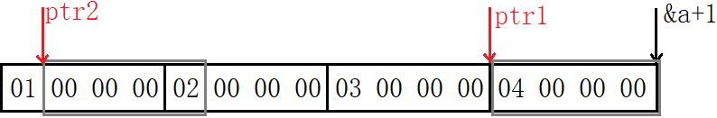

##### 例4

```c
#include <stdio.h>
int main()
{
	int a[3][2] = { (0, 1), (2, 3), (4, 5) };
	int* p;
	p = a[0];
	printf("%d", p[0]);
	return 0;
}
```

这题相对来说很简单，需注意到`()`内部为逗号表达式，所以数组元素分别为1,3,5,0,0,0 。

##### 例5

 ```c
 int main()
 {
	int a[5][5];
	int(*p)[4];
	p = a;
	printf("%p,%d\n", &p[4][2] - &a[4][2], &p[4][2] - &a[4][2]);
	return 0;
 }
 ```

本题一眼就可以看到二维数组`a[5][5]`，本应用`int(*)[5]`的数组指针接收，为什么用4个元素的数组指针接收呢？

其实可以看出，数组在内存中都是连续存放的，对于这“一排“的数据，怎么看是我们的事，把它当成3列的4列的5列甚至是10列的都可以。所以数组指针大小仅仅决定一次访问几个元素，或是说决定了所指数组的列数。

>  本质上列数的改变并不会影响该二维数组，仅仅影响的是编译器如何看待该数组。

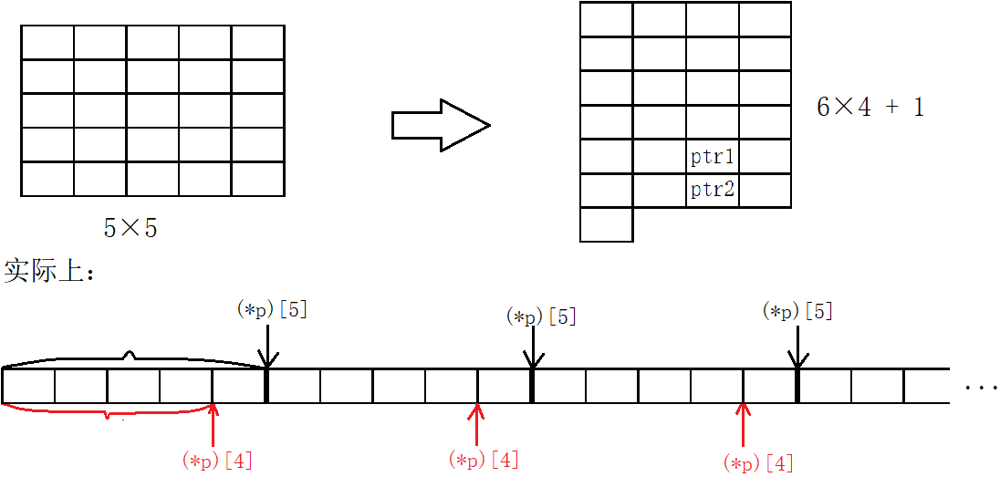

可以看出指针ptr1-ptr2为-4，故%d打印为-4，若以%p打印，因内存中存储的是-4的补码，再以无符号数的十六进制形式打印：

```
10000000 00000000 00000000 00000100
11111111 11111111 11111111 11111011
11111111 11111111 11111111 11111100
FF FF FF FC
```

##### 例6

```c
int main()
{
	int aa[2][5] = { 1, 2, 3, 4, 5, 6, 7, 8, 9, 10 };
	int* ptr1 = (int*)(&aa + 1);
	int* ptr2 = (int*)(*(aa + 1));
	printf("%d,%d", *(ptr1 - 1), *(ptr2 - 1));
	return 0;
}
```

&aa取出数组地址并+1跳过整个数组，aa相当于首行地址+1为第二行地址并解引用得第二行数组名，**数组地址解引用得数组名**。

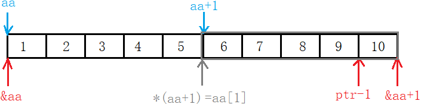

> aa+1得到第二行数组的数组地址，再解引用即对数组地址解引用，得到整个数组也就是数组名，`*(&arr)=arr` 。

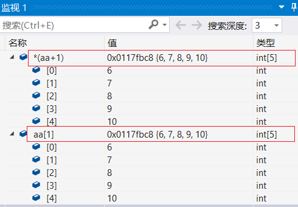

##### 例7

```c
#include <stdio.h>
int main()
{
	char* a[] = { "work","at","alibaba" };
	char** pa = a;
	pa++;
	printf("%s\n", *pa);
	return 0;
}
```

指针数组a分别存入`"work"`,`"at"`,`"alibaba"`三个字符串的首字符地址。又将指针数组名即首元素地址存入二级指针变量中。指针++访问第二个元素a的地，随后%s打印整个字符串。

##### 例8

```c
int main()
{
	char* c[] = { "ENTER","NEW","POINT","FIRST" };
	char** cp[] = { c + 3,c + 2,c + 1,c };
	char*** cpp = cp;
	//1.
	printf("%s\n", **++cpp);
	//2.
	printf("%s\n", *-- * ++cpp + 3);
	//3.
	printf("%s\n", *cpp[-2] + 3);
	//4.
	printf("%s\n", cpp[-1][-1] + 1);
	return 0;
}
```

> 首先字符指针数组`c`存有字符串首地址，其次指针数组`cp`存有”与指针c相关“的二级指针，最后三级指针`cpp`指向二级指针`cp`。

本题是最有难度的一题，需要注意到的是指针`++--`属于自增自减，会影响到本值。

1. `cpp`+1指向了数组`cp`的第二个元素，并解引用得到`c+2`。再解引用得到`"POINT"`的首地址。

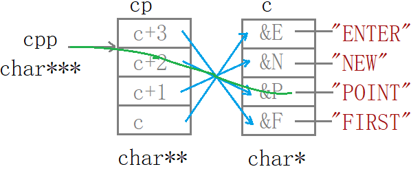

2. `cpp`+1指向数组`cp`的第三个元素并解引用得到`c+1`，`(c+1)--`后将数组`cp`的第三个元素修改为`c`，解引用访问数组`c`的首元素即`"ENTER"`的首地址再+3，打印出`ER`。

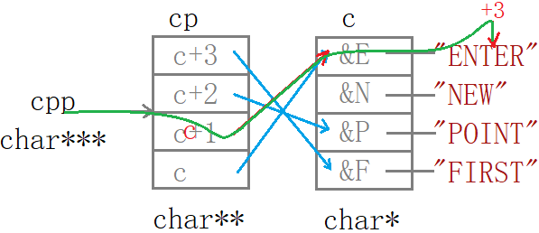

3. `cp[-2]=*(cp-2)`即`cpp`前移2个元素指向并访问了`c+3`，并解引用得数组`c`的第4个元素也就得到了`"FIRST"`的首地址+3，访问到`ST`并打印。

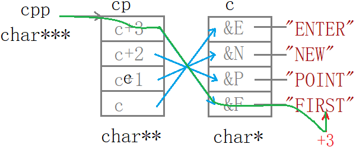

> `cpp-1`不是`cpp--`，虽然效果一样，但是对`cpp`的意义不同。`(cpp-2)`并没有改变`cpp`，所以`cpp`仍指向`cp`的第三个元素。

4. `cpp[-1][-1]`就相当于`*(*(cpp-1)-1)`即`cpp`-1解引用访问到了`c+2`-1再解引用访问到了数组`c`的第二个元素再+1，打印出`EW`。

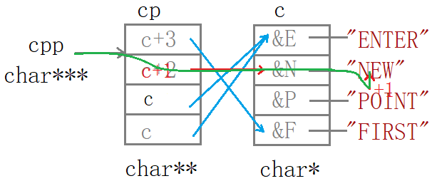

研究清楚之后再回头看代码其实非常简单，首先了解`cpp`和`cp`和`c`的关系：都是指针并从左向右一次指向，再看有关的操作。

```c
**++cpp;
*--*++cpp+3;
*cpp[-2]+3;
cpp[-1][-1]+1;
```

这四行代码其实本质上完全相同，都是1.`cpp`±整数并解引用；2.`cp`元素±整数并解引用；3.`c`元素±整数并解引用。如图所示：

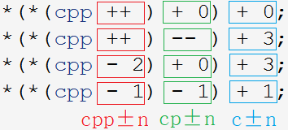

## 3. 字符串和内存函数

### 3.1 字符串函数

#### 字符串求长strlen

##### 函数声明

```c
size_t strlen ( const char* string );
```

故`strlen`函数计算`\0`之前的字符个数。字符串必须以`\0`结尾。

```c
//1.
char arr1[] = "abcd";
printf("%d\n", strlen(arr1)); // 传过去的是以\0结尾的字符串，满足strlen的要求
//2.
char arr2[] = { 'a','b','c','d' };
printf("%d\n", strlen(arr2));// 字符数组而非字符串，不以\0结尾
//3.
int a = 10;
printf("%d\n", strlen(a));// 10被当作地址看待，访问0x0A地址处的非法内存，结果如下图
```

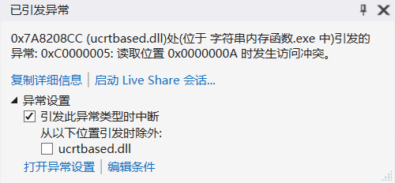

strlen函数返回类型为`size_t`，无符号数接收，以无符号的形式打印。

```c
size_t ret = strlen("abcdef");
printf("%u\n", ret);
```

无符号数可以直接比较但不要进行运算。

```c
if (strlen("abc") - strlen("abcdef") < 0)
	printf("hehe\n");
else
	printf("haha\n");
```

无符号数的运算结果被整形提升为无符号数，结果被视为无符号数是不会小于零的。

##### 模拟实现

```c
//1.计数器
size_t my_strlen(const char* str) {
	assert(str);
	size_t count = 0;
	while (*str) {
		count++;
		str++;
	}
	return count;
}
//2.指针相减
size_t my_strlen(const char* str) {
	assert(str);
	char* begin = str;
	while (*str) {
		str++;
	}
	return str - begin;
}
//3.递归
size_t my_strlen(const char* str) {
	assert(str);
	if (*str) {
		return 1 + my_strlen(str + 1);
	}
	else {
		return 0;
	}
}
```

#### 字符串拷贝strcpy

##### 函数声明

```c
char* strcpy ( char* strDestination, const char* strSource );
```

`strcpy`将源字符串的内容（包括`\0`）依次拷贝到目标空间。目标空间可修改且足够大，确保能够且足以存放源字符串。

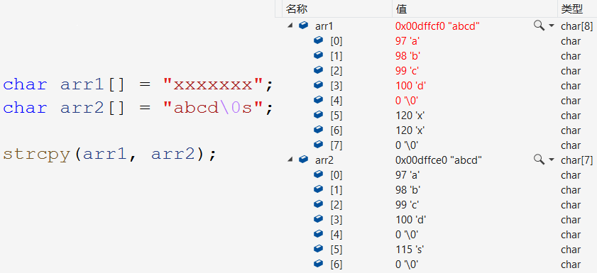

若源字符串不以`\0`结尾，则strcpy会向后一直访问到非法内存。

```c
//1.
char arr1[] = "xxx";//目标空间不够大
char arr2[] = "abcdef";
//.2
const char arr1[] = "xxxxxxxxxx";//目标空间不可修改
char arr2[] = "abcdef";

strcpy(arr1, arr2);
```

> `strcpy`在`vs2019`环境下使用会报出不安全的警告，该函数在拷贝前不会去检查是否会发生数组越界，警告也是正常的。

##### 模拟实现

```c
char* my_strcpy(char* dest, const char* src) {
	assert(dest && src);
	char* begin = dest;
	while (*dest++ = *src++) {
		;
	}
	return begin;
}
```

#### 字符串追加strcat

##### 函数声明

```c
char* strcat ( char* strDestination, const char* strSource );
```

`strcat`将源字符串包括`\0`，追加到目标字符串的结尾并覆盖掉原本的`\0`。目标空间必须足够大且可修改，确保能够且足以追加字符串。

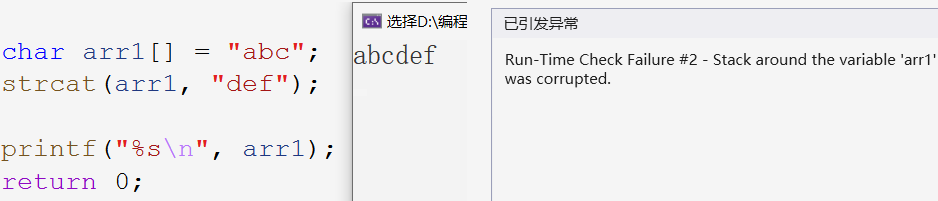

##### 模拟实现

```c
char* my_strcat (char* dest, const char* src) {
	assert(dest && src);
	char* begin = dest;
	//移到末尾
	while (*dest) {
		dest++;
	}
	//追加
	while (*dest++ = *src++) {
		;
	}
	return begin;
}
```

下面三种while循环的特点：

```c
while (*dest++) { ; } //1.
while (*dest) { dest++; } //2.
while (*dest++ = *src++) { ; } //3.
```

- 第一种：指针解引用后就`++`，第二种指针解引用后进入循环才能`++` 。
- 第一种：解引用的次数和`++`的次数是相等的，当指针指向`\0`时也要`++`访问下一个元素。而第二种为真后`++`，指向`\0`时便停留在`\0`处。
- 第三种：将赋值运算`*dest=*src`放入while循环内，当`src`指向`\0`时也要赋值给`dest`，在这之后判断整个表达式为假，退出循环。

#### 字符串比较strcmp

##### 函数声明

```c
int strcmp ( const char* string1, const char* string2 );
```

`strcmp`遍历比较两个字符串对应位置的字符的ASCII码值是否相等。

* 函数的返回值
  1. 字符串1小于字符串2时，返回小于0的数字
  2. 字符串1等于字符串2时，返回0
  3. 字符串1大于字符串2时，返回大于0的数字

##### 模拟实现

```c
int my_strcmp(const char* str1, const char* str2) {
	assert(str1 && str2);
	while (*str1 == *str2) {
		if (*str1 == '\0') {
			return 0;
		}
		str1++;
		str2++;
	}
	return *str1 - *str2;
}
```

> 都是`\0`就返回0，不是就都`++`，直到不等时返回二者之差。

长度不受限制的字符串函数的通病是不安全，这些函数不做溢出检查直到程序出错才被迫停止。所以C语言还内置了相对安全的长度受限制的字符串函数，以及更加通用的内存函数。

#### 字符串拷贝strncpy

##### 函数声明

```c
char* strncpy ( char* strDest, const char* strSource, size_t count );
```

`strcpy`函数从源字符串拷贝`count`个字符到目标字符串，若`count`大于源字符串长度则以`\0`填充。

目标字符串可修改且足够大，若`count`小于源字符串个数则不追加`\0`，若大于源字符串个数则以`\0`填充到`count`个字符。

##### 模拟实现

```c
char* my_strncpy(char* dest, const char* src, size_t count) {
	char* begin = dest;
	assert(dest && src);
	while (count && (*dest = *src)) {
		dest++, src++;
		count--;
	}
	while (count--) {
		*dest++ ='\0';
  }
	return begin;
}
int main()
{
	char arr1[10] = "abcdef";
	char arr2[] = "xxx";

	my_strncpy(arr1, arr2, 5);
	printf("%s\n", arr1);
	return 0;
}
```

下列三种是进行字符串拷贝时的代码。当`count`小于源字符串个数时三者都没问题，但当`count`大于源字符串个数时，三者的情况却是不一样的。

```c
//1.
while (count && *src) {
	*dest++ = *src++;
	count--;
}
//2.
while (count && (*dest++ = *src++)) {
	count--;
}
//3.
while (count-- && (*dest++ = *src++)) {
	;
}
```

1. 当指向源字符串的指针遇到`\0`时，不进行赋值和`++`也不进行`count--`操作。

赋值赋了3次，`count`也减了3次。此时`count`为2，随后追加了2个`\0`。

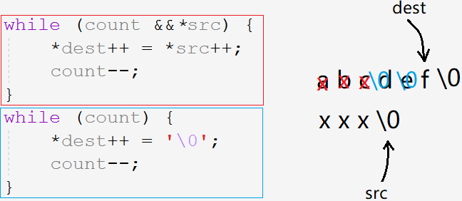

2. 指针指向`\0`时执行赋值操作后，赋值表达式为假，结束循环。

由于赋值操作放在循环的判断部分，故赋值执行了4次，而`count`减了3次。

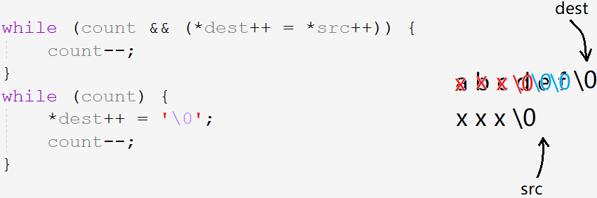

即源字符串末尾`\0`也被拷贝了过去，但`count`仍为2，所以最后还要追加2个`\0`。但这样就改变了6个字符，显然是错误的。

3. 将第二种代码稍作修改，将`count--`的操作也放入判断部分，这样就避免了上述问题。

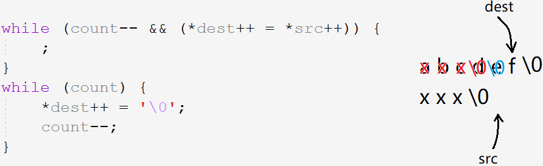

1. 如果循环条件只有循环变量`count`大小的判断，则进步条件放在判断部分还是循环体内没有影响。
2. 但如果还有赋值或是其他语句，那么该语句相对于将其放在循环体内部的情况多被执行一次。
3. 由于`count`是无符号数当条件为假退出后，随即`--`就会变成很大的数字。后续再使用该循环变量的时候就会出错。

#### 字符串追加strncat

##### 函数声明

```c
char* strncat ( char* strDest, const char* strSource, size_t count );
```

在目标字符串末尾追加`count`个源字符串的字符，结尾默认添加`\0`。

追加到目标字符串末尾默认补`'\0'`，`count`超出源字符串个数不在追加。

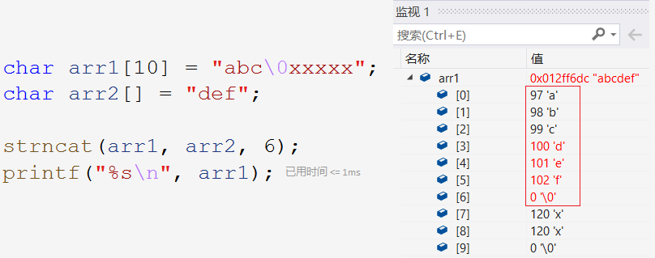

##### 模拟实现

```c
char* my_strncat(char* dest, const char* src, size_t count) {
	assert(dest && src);
	char* begin = dest;
	//1. 来到目标字符串末尾
	while (*dest) {
		dest++;
	}
	//2. 追加
	while (count && (*dest++ = *src++)) {
		count--;
	}
	//3. count小于字符个数补0
	if (count == 0) {
		*dest = '\0';
	}
	return begin;
}
```

#### 字符串比较stnrcmp

##### 函数声明

```c
int strncmp ( const char* string1, const char* string2, size_t count );
```

比较两个字符串的前`count`个字符，并返回相关的数值。

##### 模拟实现

```c
int my_strncmp(const char* str1, const char* str2, size_t count) {
	assert(str1 && str2);
	while (count-- && (*str1 == *str2)) {
		str1++;
		str2++;
	}
	return *str1 - *str2;
}
```

#### 字符串查找strstr

##### 函数声明

```c
char* strstr ( const char* string, const char* strCharSet );
```

查找子字符串在目标字符串中首次出现的位置，有则返回之起始位置，无则返回空指针。

##### 模拟实现

```c
char* my_strstr(const char* str, const char* set) {
	assert(str && set);
	char* s1 = str;
	char* s2 = set;
	while (*s1) {
		//归位
		str = s1;
		set = s2;
		//防止s1=s1=\0
		while ((*str && *set) && (*str == *set)) {
			str++;
			set++;
		}
		//判断
		if (*set == '\0') {
			return s1;
		}
		//进位
		s1++;
	}
	return NULL;
}
```

> `s1`和`s2`存放`str`和`set`每次归位时的位置，以便匹配错误时返回重新开始。

- 特殊情况`set="\0"`时，\0是任意字符串的子字符串，即无任何字符的字符串是任意字符串的子字符串。所以返回母字符串
- 一次匹配错误时，str和set要归位初始位置，即`str=++s1;set=s2;`要放在判断部分的后面。（`set=s2`下次循环再执行就相当于在后面）

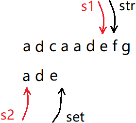

> KMP算法专门针对字符串匹配和查找这种功能。

#### 字符串分割strtok

##### 函数声明

```c
char* strtok ( char* strToken, const char* strDelimit );
```

`strtok`函数通过以`\0`替换分隔符的方式修改需分割的字符串，并返回该标记的地址。
如字符串`"192.168.11.1"`或者`"yyx@ms.com"`二者字符串都有相似之处，即整个字符串由分隔符`.`,`@`分割。如果需要得到分隔符所分割出的每个小字符串，则可以用`strtok`函数切分。

- 参数`strDelimit`是所有分隔符所组成字符串，参数`strToken`是由一个或多个分隔符和标记组成的字符串。

类似于`.`,`@`称为分隔符，而分隔符所分割出的子字符串如`192`,`com`被称作标记。

- `strstr`将标记以`\0`结尾且返回指向该标记的指针。故被操作字符串会发生修改，故一般使用临时拷贝的内容。
- 首个参数传入字符串地址时，找到其首个标记。随后保存分隔符的位置，此时仅需传入`NULL`则可访问该字符串的下一个标记。

第一次调用传入需分割字符串的地址，函数保存首个标记后的分隔符被`\0`替换的位置。之后的调用就无需在传入地址。当访问到最后一个标记时，返回`NULL`。

```c
char arr[] = "www.yourfriendyo.top";
printf("%s\n", strtok(arr2, "."));
printf("%s\n", strtok(NULL, "."));
printf("%s\n", strtok(NULL, "."));
```

```c
int main()
{
	char arr[] = "yourfriendyo@ms.com";
	char* sep = "@.";
	for (char* i = strtok(arr, sep); i != NULL; i = strtok(NULL, sep)) {
		printf("%s\n", i);
	}
	return 0;
}
```

#### 字符串报错strerror

##### 函数声明

```c
char *strerror ( int errnum );
```

`strerror`返回内置错误码所对应的错误信息的字符串地址。

```c
printf("%s\n", strerror(40));//Function not implemented
printf("%s\n", strerror(30));//Read - only file system
printf("%s\n", strerror(20));//Not a directory
```

一个错误码对应一个错误信息，手动传参并打印函数的返回值。当然没有人会这样使用报错函数，这也不是报错函数设计的初衷。

- 当程序发生错误时，程序会自动将错误码存入内置全局变量`errno`中，此时我们调用`strerror`函数即可获得此次错误的报错信息。
- 更为直接的报错函数`perror`，优点简单方便加入自定义信息，缺点必须打印错误信息。

```c
int main()
{
	FILE* pFile = fopen("D:test.txt", "r");
	if (pFile == NULL) {
		//text.txt: No such file or directory
		printf("text.txt: %s\n", strerror(errno));
		perror("text.txt");
	}
	return 0;
}
```

### 3.2 内存函数

> 字符串操作函数适用于字符串内容，而内存操作函数适用于任意类型的数据如整形数据或是结构体，更具普适性。

#### 内存拷贝memcpy

##### 函数声明

```c
void* memcpy ( void* dest, const void* src, size_t count );
```

`memcpy`将源内存的前`count`个字节的内容拷贝到目标内存中。若源空间和目标空间有重叠，则拷贝时会覆盖源字符串内容。

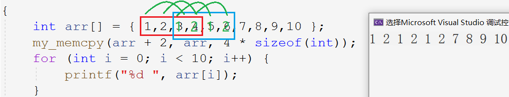

C标准并未要求`memcpy`完成发生内存重叠的内容拷贝，但编译器也可能对其进行优化。对内存重叠的内容进行拷贝时，可以使用`memmove`。

##### 模拟实现

以字节为单位拷贝内存中的内容，以适用所有类型的数据。

```c
void* my_memcpy(void* dest, const void* src, size_t count) {
	void* begin = dest;
	while (count--) {
		*(char*)dest = *(char*)src;
		dest = (char*)dest + 1;
		src = (char*)src + 1;
	}
	return begin;
}
```

#### 内存移动memmove

##### 函数声明

```c
void* memmove ( void* dest, const void* src, size_t count );
```

`memmove`将源空间的前`count`个字节的内容拷贝到目标空间中，并支持完成内存重叠的拷贝。

##### 模拟实现

当发生内存重叠时，在源空间该字节未拷贝之前要保护其不被修改。

当目标空间在源空间的后边时，从后向前拷贝，当目标空间在源空间的前面时，从前向后拷贝。

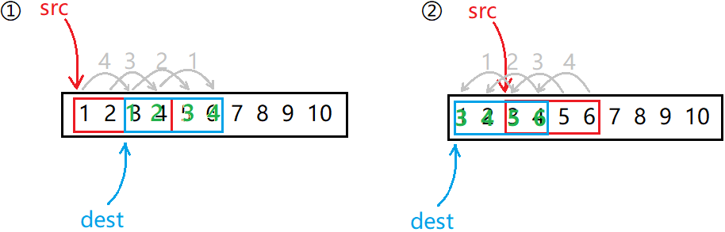

##### 实现方案

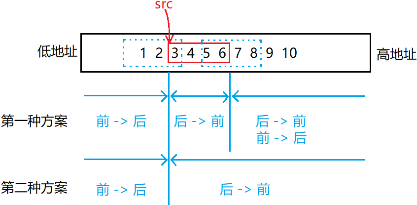

```c
void* my_memmove(void* dest, const void* src, size_t count) {
	assert(dest && src);
	char* begin = dest;
	if (dest > src) {
		//后->前
		while (count--) {
			*((char*)dest + count) = *((char*)src + count);
		}
	}
	else {
		//前—>后
		while (count--) {
			*(char*)dest = *(char*)src;
			(char*)dest += 1;
			(char*)src += 1;
		}
	}
	return begin;
}
int main() {
	int arr[] = { 1,2,3,4,5,6,7,8,9,10 };
	//1234->3456
	my_memmove(arr + 2, arr, 4 * sizeof(int));
	//3456->1234
	my_memmove(arr, arr + 2, 4 * sizeof(int));
	for (int i = 0; i < 10; i++) {
		printf("%d ", arr[i]);
	}
	return 0;
}
```

> C语言没有字符串类型，但凡遇到对字符串的操作都要细化到操作每个字符。

#### 内存比较memcmp

##### 函数声明

```c
int memcmp ( const void* buf1, const void* buf2, size_t count );
```

比较两块内存空间的前`count`个对应字节内容，并返回相关的数值。

##### 模拟实现

```c
int my_memcmp(const void* buf1, const void* buf2, size_t count) {
	assert(buf1 && buf2);
	while (count-- && (*(char*)buf1 == *(char*)buf2)) {
		(char*)buf1 += 1;
		(char*)buf2 += 1;
	}
	return *(char*)buf1 - *(char*)buf2;
}
int main()
{
	int arr1[] = { 1,2,3,4,5 };
	int arr2[] = { 1,2,3,4,6 };
	int ret = my_memcmp(arr1, arr2, 1 * sizeof(int));
	printf("%d\n", ret);
	return 0;
}
```

#### 内存初始化memset

##### 函数声明

```c
void* memset ( void* dest, int c, size_t count );
```

将目标空间前`count`个字节初始化为整形数据`c`。

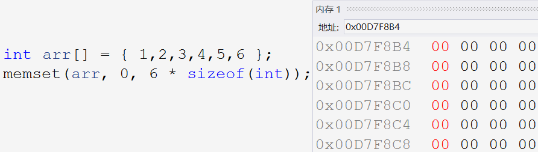

## 4. 自定义类型

### 4.1 结构体

结构体是值的集合，这些值称为成员变量。结构体的每个成员类型可不同。结构体可用来描述复杂对象，成员即是对象的属性。

#### 结构体的声明

```c
struct tag {

  member_list;

}value_list;
```

- `struct`是结构体的关键词，`tag`是结构体的标签名，
- `member_list`是定义成员变量的列表，`value_list`是用该结构体类型创建的全局变量的列表，可缺省。

##### 匿名结构体

```c
struct {
	int a;
	char c;
	double d;
} s1, s2;
```

定义匿名结构体类型，省去标签名，所以只能在成员列表处创建变量。

```c
struct { int a; char c; double d; } s1, s2;
struct { int a; char c; double d; } *ps;

s2 = s1; //类型不兼容
```

两个匿名结构体虽成员相同，但本质是两个结构体类型，故二者类型不兼容。

#### 结构体自引用

> 结构体中该如何引用自身类型的变量呢？或者说，在定义结构体时包含自身类型的成员变量是否可行呢？

```c
struct Node
{
	int data;
	struct Node next;
};
```

自身嵌套一个同类型的结构体变量，如果一直嵌套下去是无法计算出大小的，所以是错误的。

```c
struct Node
{
	int data;
	struct Node* next;
};
```

这才是结构体自引用的正确方法。类似于数据结构中链表的使用方法，使用指针存入下一个节点的地址。如图：

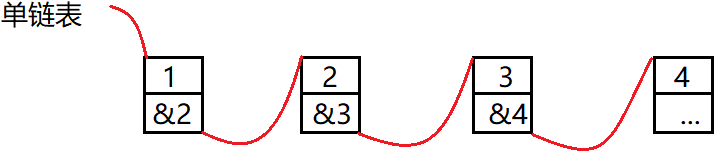

```c
typedef struct {
	int data;
	Node* next;
}Node;
```

`typedef`对结构体的重命名，必须在结构体定义之后才生效，所以在结构体内，编译器无法识别该类型名。

#### 结构体内存对齐

> 探讨结构体的大小有一个不可避免的问题：内存对齐。而内存对齐一般体现在结构体这里，所以也叫结构体内存对齐。

##### 内存对齐的规则

简单版规则请看[计组第二章 边界对齐](/docs/408/02-计算机组成原理#边界对齐)。

1. 结构体第一个成员永远位于结构体距起始位置偏移量为0的位置。

> 即首个成员一定放在为结构体所开辟的内存空间的第一个位置。

2. 从第二个成员开始，各自放在偏移量为对齐数的整数倍处。对齐数为变量自身大小和默认对齐数的较小值。

> Linux环境下无默认对齐数，Windows环境下对齐数为8。而一般无变量类型所占字节大于8，故对齐数一般为变量的自身大小。

3. 结构体的总大小必须为所有成员变量的对齐数的最大值的整数倍。

> 笔者猜测是为了凑齐读取域宽的整数倍，不至于让之后创建的变量紧随其后而造成不必要的麻烦。

4. 若结构体嵌套，内嵌结构体对齐到其成员最大对齐数的整数倍处，整体结构体总大小须为其成员最大对齐数的整数倍。

> 由第3条可推得，**内嵌结构体和整个结构体同样都是结构体，都要对齐到各自成员变量对齐数的最大值的整数倍处**。而一般整个结构体的最大成员变量都是内嵌结构体。

```c
//1.
struct S1 {
	char c1;
	int a;
	char c2;
};
//2.
struct S2 {
	char c1;
	char c2;
	int a;
};
```

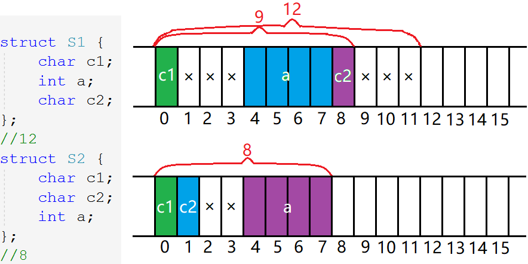

求出下列结构体所创建的变量的大小。

```c
//3.
struct S3 {
	double d;
	char c;
	int a;
};
//4.
struct S4 {
	char c1;//1
	struct S3 s;//8
	double d;//8
};
```

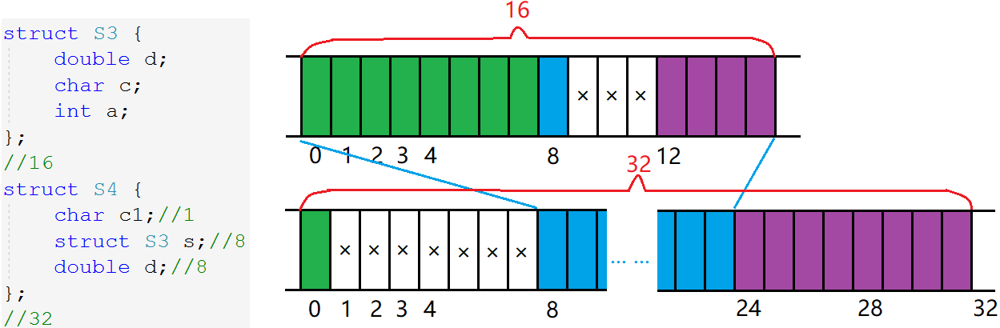

##### 存在内存对齐的原因

1. 移植原因

不是所有硬件平台都能任意的读取地址上的任意数据。某些平台只能在特定的地址处以特定的方式读取特定的数据。如只在地址为4的倍数处读取，且每次读取4个字节的数据。平台之间移植性差。

2. 性能原因

数据应尽可能地存储在地址的自然边界上并对齐，以防止同一块空间的数据要作两次访问，提升读取数据的效率。

> 总结就是内存对齐是为了牺牲空间复杂度降低时间复杂度，以空间换取时间。当然我们要做的就是尽己所能既节省空间又节省时间。

结构体中不同的变量放在不同的位置，结构体所占的大小不同。**让占用空间小的成员集中在后面**，可以是实现一定程度上的节约空间。

##### 默认对齐数的修改

```c
//设置默认对齐数
#pragma pack(n);

struct Tag {
  member_list;
};

//恢复默认对齐数
#pragma pack();
```

默认对齐数是可以被修改的，使用前设置，使用后取消。当认为结构体的默认对齐数不适当时，可自行设置。同时对齐数 $n$ 一般都设置为 $2^n$ 。

宏计算结构体中某变量相对于首地址的偏移量。

```c
#include <stddef.h>
struct S1 {
	char c1;
	int a;
	char c2;
};
int main()
{
	printf("%d\n", offsetof(struct S1, c1));
	printf("%d\n", offsetof(struct S1, c2));
	printf("%d\n", offsetof(struct S1, a));
	return 0;
}
```

### 4.2 位段

#### 位段的定义

位段的声明和结构体类似，但又两点不同。

1. 类型不同：位段的成员必须是整型变量，如`char,int,unsigned int`等。
2. 写法不同：位段的成员名后使用`:`和`数字`来规定分配的空间。如：

```c
struct A {
	int _a : 2;
	int _b : 5;
	int _c : 10;
	int _d : 30;
};
```

计算位段`A`的大小得8，而4个整形变量最小占16个字节。说明**位段一定程度上可以节省空间**。

位段中的“位”表示二进制位，而`:`后的数字代表系统分配给该变量的比特位数。

> 在描述对象时，属性变量中的所有位数不一定全部使用，使用位段可以规定系统分配给变量的空间。当然数据过大仍会溢出。

#### 位段的内存分配

- 系统按成员变量类型来为位段开辟空间，一次性开辟一个变量类型大小的空间。

> 如该成员为`int`型，则一次开辟4个字节，若不够则再开辟4个字节。若为`char`类型，则开辟1个字节。

- 位段使用时涉及很多不确定因素，程序可移植性差，故位段是不跨平台的。

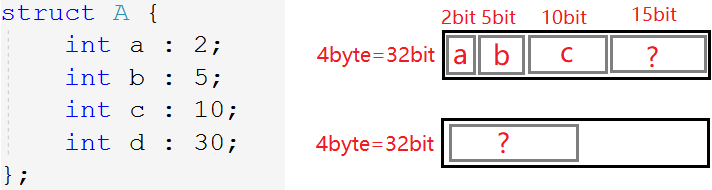

> 如图所示，先开辟4个字节的空间，`a`占用2bit，`b`占用5bit,`c`占用10bit。这4个字节还剩15个bit不够`d`的存放，必然要在开辟4个字节的空间。这就是算出来的8个字节。

问题是`d`接着一半存放在第一个字节一半存放在第二个字节，还是全部存放在新开辟的空间内?

> 不同的编译环境下可能会产生不同的结果，这是C标准中未规定的内容。笔者在此仅考虑Windows环境的情况，请看接下来的例子。

```c
struct S {
	char a : 3;
	char b : 4;
	char c : 5;
	char d : 4;
};
struct S s = { 0 };
int main() {
	s.a = 10;
	s.b = 12;
	s.c = 3;
	s.d = 4;
	return 0;
}
```

> 对位段变量进行赋值操作，就又带来了一个问题单个字节内先使用高地址还是低地址？这也是标准未规定的。
>
> 我们先进行假设：位段中先使用高地址再使用低地址，同时剩余空间不足则将其抛弃并重新开辟。如果vs中的最后结果和预期一致，则假设正确。

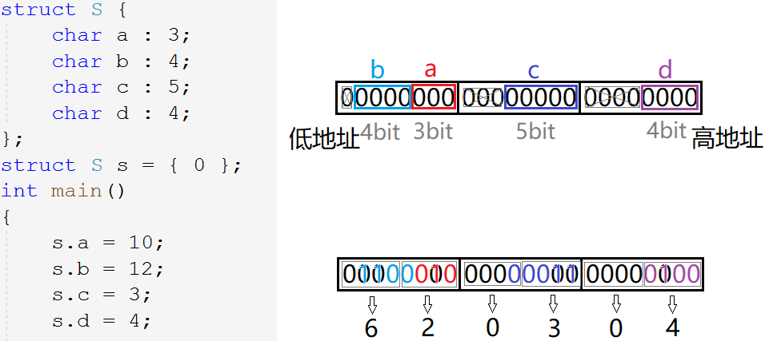

我们按照假设写出位段的内存情况：
$$
\begin{aligned}
(& 0110 & 0010 & 0000 & 0011 & 0000 & 0100 & )_2 \\[4pt]
(& 6 & 2 & 0 & 3 & 0 & 4 & )_{10}
\end{aligned}
$$


> vs显示结果和我们的假设完全相符。故假设正确。所以可以得出结论，在vs环境下：

1. 每次开辟空间所开辟的字节个数，由需开辟空间的成员变量的类型所决定。
2. 内存使用时，先使用低字节再使用高字节，单个字节内从高位到低位使用。
3. 所开辟内存空间不足时，抛弃剩余内存，重新开辟类型大小的空间。

> 由于这些规则C标准并未明确规定，因而这些结论因编译器而异。所以位段的平台移植性差。

#### 位段的跨平台问题

1. `int`位段的最高位是否被当做符号位不确定。
2. 位段中成员类型的所占比特位数目不确定。

> 早期16位机器`int`占2个字节共16个比特位，而变量分配bit位数目不得多于最大值。

3. 位段成员在内存中先使用高地址还是低地址不确定。
4. 所开辟内存空间不足时，是否抛弃剩余内存重新开辟还是接着使用剩余内存不确定。

#### 位段的应用

和结构相比，位段可达到同样的效果，可以节省空间，但是需使用小心且跨平台性差。而位段可以应用到网络协议中，不至于浪费大量的空间，网络传输协议中每几个比特位成一组用于传输不同的数据。

### 4.3 枚举

> 枚举顾名思义一一列举，有很多数据可以列举出来，如：性别，月份，颜色等。

#### 枚举的定义

```c
enum Tag {
	con1,
	con2,
	...
	con3
};
```

- `enum`是枚举关键字，`Tag`是枚举对象名；
- `con1,con2,...,con3`是枚举常量列表。

> 同时枚举就相当于整形常量，故所有枚举常量都是4个字节。

```c
//星期
enum Day {
	Mon,
	Tues,
	Wed,
	Thur,
	Fri,
	Sat,
	Sun
};
//性别
enum Sex {
	FAMALE,
	MALE,
	SECRET
};
//颜色
enum Color {
	RED,
	GREEN,
	BLUE
};
```

> 上述定义的`enum Day`,`enum Sex`,`enum Color`都是枚举类型。`{}`内是枚举类型的可能取值，即枚举常量。

枚举常量取值默认从0开始，依次递增。也可进行（完全或不完全）初始化对其赋初值，所初始化常量之前的常量取值不受影响，之后的常量仍然依次递增。


当然常量只能进行初始化，而不能进行赋值操作。

```c
//1.
enum Color c = GREEN;
//2.
enum Color c = 1;
```

上述操作为创建枚举类型的变量，赋值为`GREEN`。

> C语言对语法的检测没有那么严格。所以1和2都行。在C++中认为`1`是字面常量而`GREEN`为枚举常量。二是不相等的，所以不能赋值。

#### 枚举的优点

| 枚举的优点               | 解释                                                         |
| ------------------------ | ------------------------------------------------------------ |
| 提高代码可读性和可维护性 | `#define`定义的常量不如枚举常量有意义，且枚举常量是具有类型的更严谨。 |
| 防止命名污染             | `#define`定义的常量属于全局常量，易冲突。                    |
| 便于调试                 | `#define`定义的常量在预编译期间就已经被替换。而枚举类型一直存在有值有类型便于调试。 |
| 使用方便                 | 一次可定义多个常量，且便于管理。                             |

### 4.4 联合

联合是一种特殊的自定义类型，同样包含一系列成员，特殊在于这些成员共用同一块空间。所以联合体也叫共用体。

#### 联合的定义

```c
union Un {
	char c;//1
	int i;//4
};
int main()
{
	union Un u = { 0 };
	printf("%d\n", sizeof(u));
	return 0;
}
```

算出该联合体变量大小为4个字节，可一个整型和字符型变量最少也要5个字节，为什么会这样呢？

#### 联合的特点

```c
printf("%p\n", &u);//00EFF934
printf("%p\n", &u.c);//00EFF934
printf("%p\n", &u.i);//00EFF934
```

> 从上述代码可以看出`c`,`i`共用4个字节。


- 改变`i`就会改变`c`，改变`c`就会改变`i`。故使用时仅可以使用1个成员，另一个成员也会被修改。
- 联合的成员共用一块空间，故联合体变量的大小是至少是最大成员的大小。

利用联合体判断当前机器的大小端存储。

```c
int check_sys() {
	union U {
		char c;
		int i;
	}u;
	u.i = 1;
	return u.c;
}
int main()
{
	if (check_sys() == 1) {
		printf("小端存储\n");
	}
	else {
		printf("大端存储\n");
	}
	return 0;
}
```

#### 联合大小的计算

而联合体也存在内存对齐。这个内存对齐相对结构体来说就简单一些了。

```c
//1.
union Un1 {
	char c[5];
	int i;
};
//2.
union Un2 {
	short c[7];
	int i;
};
int main() {
	printf("%d\n", sizeof(union Un1));
	printf("%d\n", sizeof(union Un2));
	return 0;
}
```

- 联合体变量大小至少是最大成员的大小。
- 当最大成员大小不够最大对齐数的整数倍时，对齐到最大对齐数的整数倍处。

> 因为联合体所有成员共用一块空间，故算出最大成员大小后，只在最后需要再浪费几个字节的空间以对齐到最大对齐数的整数倍。


原大小应为5个字节，最大对齐数应为4，则要对齐到8个字节。


原大小应为14个字节，最大对齐数应为4，则要对齐到16个字节。

## 5. 动态内存管理

#### 动态内存分配的意义


在语言学习时，对于内存的划分为上述三者：栈区，堆区，静态区。栈区存放临时变量，静态区存放静态变量，堆区用来动态开辟。

动态内存开辟是在堆区上开辟空间，为了灵活的使用内存，以满足程序的需要。具体如何开辟请看下列函数。

### 5.1  动态内存函数的介绍

#### 开辟释放函数 malloc & free

##### 函数声明

```c
void* malloc( size_t size );
void free( void* memblock );
```

- `malloc`函数在堆区上申请`size`个字节的空间，并返回该空间的起始地址。
- `free`函数释放指针指向的动态开辟的空间，但不会置空指针。

##### 函数用法

- `malloc`返回通用类型的指针，将其强制转换为所需类型，并用该类型的指针维护该内存空间。
- 开辟成功返回空间起始地址，开辟失败则返回`NULL`。
- 使用结束`free`释放内存以防内存泄漏，将指针置空避免成为野指针。

```c
//申请空间
int* p = (int*)malloc(40);
//检查
if (p == NULL) {
	printf("%s\n", strerror(errno));
	return -1;
}
//使用
for (int i = 0; i < 10; i++) {
	*(p + i) = i;
	printf("%d ", *(p + i));
}
//释放空间
free(p);
//置空
p = NULL;
```

#### 内存开辟函数 calloc

##### 函数声明

```c
void* calloc( size_t num, size_t size );
```

`calloc`函数在堆区上申请`num`个`size`大小的空间，返回起始地址并将内容初始化为0。

##### 函数用法

```c
int* p = (int*)calloc(10, sizeof(int));
if (p == NULL) {
	perror("");
	return -1;
}
for (int i = 0; i < 10; i++) {
	*(p + i) = i;
	printf("%d ", p[i]);
}
free(p);
p = NULL;
```

#### 内存调整函数 realloc

##### 函数声明

```c
void* realloc( void* memblock, size_t size );
```

`realloc`函数为已开辟的空间重新开辟大小。

1. 当原空间后有足够大小时，就紧接原空间开辟剩余空间，并返回整个空间的起始地址。


2. 当原空间后无足够大小时，就在堆区寻找新空间，再将原空间的内容移动到新空间，返回新空间的地址且释放原空间。


3. 当剩余空间不够无法开辟时，增容失败，返回`NULL`。

##### 函数用法

```c
//1.
p = (int*)realloc(p, 20 * sizeof(int));
//2.
int* ptr = (int*)realloc(p, 20 * sizeof(int));
if (ptr == NULL) {
	return -1;
}
p = ptr;
```

> 防止增容失败将原空间指针置空，故不可直接使用原指针接受返回值。判断非空后再赋给原指针。

### 5.2 常见的动态内存错误

#### 1. 不检查空指针

```c
void test() {
	int* p = (int*)malloc(INT_MAX / 4);
	*p = 20;
	free(p);
}
```

对指向动态开辟的空间的指针一定要做有效的判断。

#### 2. 越界访问

```c
void test() {
	int i = 0;
	int* p = (int*)malloc(10 * sizeof(int));
	if (NULL == p) {
		exit(EXIT_FAILURE);
	}
	for (int i = 0; i <= 10; i++) {
		*(p + i) = i;
	}
	free(p);
	p = NULL;
}
```

作为程序员必须有意识地检查所写的代码是否有越界访问的问题。

#### 3. 释放非动态开辟内存

```c
void test() {
	int a = 10;
	int* p = &a;
	free(p);
	p = NULL;
}
```

不可用`free`释放非动态开辟的空间。

#### 4. 释放部分内存

```c
int main()
{
	int* p = (int*)malloc(100);
	p++;
	free(p);
	return 0;
}
```

改变指向动态开辟内存的指针，内存将无法管理。释放不完全导致内存泄漏。

#### 5. 重复释放内存

```c
void test() {
	int* p = (int*)malloc(100);
	free(p);
	free(p);
}
```

使用`free`释放已释放的空间，即访问非法内存。建议释放内存和指针置空搭配使用。

#### 6. 忘记释放内存

```c
void test() {
	int *p = (int*)malloc(100);
	if(NULL != p) {
		*p = 20;
	}
}
int main() {
	test();
	while(1);
}
```

使用结束不释放内存造成内存泄漏。程序不停止，系统也不会自动回收。

### 5.3 笔试题

#### 例1

```c
void GetMemory(char* p) {
	p = (char*)malloc(100);
}
void test() {
	char* str = NULL;
	GetMemory(str);
	strcpy(str, "hello world");
	printf(str);
	free(str);
	str = NULL;
}
```

> 程序报错。

**传值调用**：并没有改变`str`的值仍为不予修改的空指针，可以使用二级指针接收`str`的地址。函数调用结束后指针销毁故无法释放空间以致内存泄漏。

#### 例2

```c
char* GetMemory() {
	char p[] = "hello world";
	return p;
}
void test() {
	char* str = NULL;
	str = GetMemory();
	printf(str);
	free(str);
	str = NULL;
}
```

> 程序打印随机值。

**返回栈空间地址**：数组`p`在函数内创建，出函数销毁，返回这部分空间的地址 ，属于访问非法空间。

#### 例3

```c
void GetMemory(char** p,int num) {
	*p = (char*)malloc(num);
}
void test() {
	char* str = NULL;
	GetMemory(&str, 100);
	strcpy(str, "hello");
	printf(str);
	free(str);
	str = NULL;
}
```

> 程序运行成功，打印`"hello"`。

**传址调用**：本题是例一的正确写法。

#### 例4

```c
void test(void) {
	char* str = (char*)malloc(100);
	strcpy(str, "hello");
	free(str);
	if (str != NULL) {
		strcpy(str, "world");
		printf(str);
	}
}
```

> 程序报错。

**野指针**：动态开辟的内存释放后指针不置空，造成野指针访问非法内存。释放内存和指针置空应该搭配起来使用。

> 释放空间就是将空间归还给系统，即将此空间的使用权限归还操作系统。
>
> 虽不会改变空间内容以致打印出所谓的“正确结果”，但可能在之后被操作系统分配给其他程序时发生修改。但无论改变与否，一旦空间归还后再去访问就是访问非法内存。

### 5.4 C/C++内存划分

#### 用例展示

```c
int globalVar = 1;
static int staticGlobalVar = 1;
int main()
{
	static int staticVar = 1;

	int localVar = 1;
	int num1[10] = { 1,2,3,4 };
	char char2[] = "abcd";
	char* pChar3 = "abcd";
	int* ptr1 = (int*)malloc(4 * sizeof(int));
	int* ptr2 = (int*)calloc(4, sizeof(int));
	int* ptr3 = (int*)realloc(ptr2, 4 * sizeof(int));

	free(ptr1);
	free(ptr3);
	return 0;
}
```

1. `globalVal`,`staticGobalVar`,`staticVar`分别是全局变量和静态变量，在数据段上创建。
2. `localVar`和`num`,`char2`,`pchar`以及`ptr`本身都是局部变量，都是在栈区上创建的。
3. `malloc`,`calloc`,`realloc`都是在堆区上开辟的内存块，由指针`ptr`指向而已。

#### 内存划分


1. 栈区（`stack`）：执行函数时，函数的局部变量都会在栈区上创建。压栈：从栈顶向下开辟空间，弹栈：从栈底向上释放空间。
2. 堆区（`heap`）：一般由程序员分配和释放，从堆低向上开辟空间，堆顶向下释放空间。在程序结束后也被操作系统会自动回收。
3. 数据段（静态区）：存放全局变量，静态数据。变量本在栈上创建，被`static`修饰后放在常量区，程序结束后由系统释放。
4. 代码段（常量区）：存放可执行代码和只读常量。

值得注意的是，字符串数组`char2`的内容`"abcd"`也是存储在栈上的，是从常量区拷贝过来的。

### 5.5 柔性数组

#### 柔性数组的定义

在`C99`中，结构中最后一个元素允许是未知大小的数组，被称为柔性数组成员。例如：

```c
//1.
struct st_type {
	int i;
	int a[0];//柔性数组成员
};
//2.
struct st_type {
	int i;
	int a[];//柔性数组成员
};
```

#### 柔性数组的特点

- 结构中柔性数组成员前必须至少有一个成员。
- `sizeof`计算结构所占空间时不包含柔性数组的大小。
- 包含柔性数组的结构用`malloc`进行动态内存分配，且分配的内存应大于结构大小，以满足柔性数组的预期。

> 使用含柔性数组的结构体，需配合以`malloc`等动态内存分配函数。分配空间减去其他成员的大小，即为为柔性数组开辟的空间。


#### 柔性数组的使用


`malloc`开辟的大小写成如图所示的形式，增加代码的可阅读性。

结构体所分配空间减去其他成员的大小，所剩即为为柔性数组开辟的空间大小，若不够还可以用`realloc`调整大小，以满足柔性数组“柔性”的需求。

```c
struct st_type {
	int i;
	int a[0];
};
int main() {
	printf("%d\n", sizeof(struct st_type));
	//1.
	struct st_type st;
	//2.
	struct st_type* pst = (struct st_type*)malloc(sizeof(struct st_type) + 10 * sizeof(int));
	if (pst == NULL) {
		perror("pst");
		return -1;
	}
	return 0;
}
```

含柔性数组结构体当然不可像第一种那样使用，这样结构体变量`st`仅有4个字节，不包含柔性数组。

#### 举例

```c
struct st_type {
	int i;
	int a[0];
};
int main() {
	struct st_type* pst = (struct st_type*)malloc(sizeof(struct st_type) + 10 * sizeof(int));
	if (pst == NULL) {
		perror("pst");
		return -1;
	}
	pst->i = 10;
	for (int i = 0; i < 10; i++) {
		printf("%d ", pst->a[i] = i);
	}
	//调整空间大小
	struct st_type* ptr = (struct st_type*)realloc(pst, sizeof(struct st_type) + 20 * sizeof(int));
	if (ptr == NULL) {
		perror("ptr");
		return -1;
	}
	pst = ptr;
	for (int i = 10; i < 20; i++) {
		printf("%d ", pst->a[i] = i);
	}
	//释放
	free(pst);
	pst = NULL;
	return 0;
}
```

#### 柔性数组的优势

柔性数组成员利用动态内存可大可小，那同样将柔性数组成员替换成指向动态开辟内存的指针也可达到同样的效果。下文将对比二者都有何优劣。（为突出对比，已省略不必要的代码）

#### 柔性数组版本

```c
struct st_type {
	int i;
	int a[];
};
int main() {
	struct st_type* pst = (struct st_type*)malloc(sizeof(struct st_type) + 10 * sizeof(int));
	for (int i = 0; i < 10; i++) {
		printf("%d ", pst->a[i] = i);
	}
	//调整空间大小
	struct st_type* ptr = (struct st_type*)realloc(pst, sizeof(struct st_type) + 20 * sizeof(int));
	pst = ptr;
	for (int i = 10; i < 20; i++) {
		printf("%d ", pst->a[i] = i);
	}
	//释放
	free(pst);
	pst = NULL;
	return 0;
}
```

#### 指针版本

```c
struct st_type {
	int i;
	int* pa;
};
int main() {
	struct st_type* pst = (struct st_type*)malloc(sizeof(struct st_type));
	pst->pa = (int*)malloc(10 * sizeof(int));
	for (int i = 0; i < 10; i++) {
		printf("%d ", *(pst->pa + i) = i);
	}
	//调整空间大小
	int* ptr = (int*)realloc(pst->pa, 20 * sizeof(int));
	pst->pa = ptr;
	for (int i = 10; i < 20; i++) {
		printf("%d ", *(pst->pa + i) = i);
	}
	//释放
	free(pst);
	pst = NULL;
	free(pst->pa);
	pst->pa = NULL;
	return 0;
}
```

1. 从用户的角度看，函数中不应作二次内存分配（不便一次释放完毕）。
2. 多次开辟动态内存，内存碎片增多，也增加内存泄漏的风险。内存不连续，拖慢访问速度（局部性原理）。

## 6. 文件操作

### 6.1 文件的概念

#### 文件的定义

> 将数据存储到外存（写入文件），每次程序结束后可以避免数据丢失，可以在程序运行时将数据加载到内存中，这是文件存在的意义。

在程序设计中，从文件功能的角度分类，一般谈到的文件有两种：程序文件和数据文件。

- **程序文件**：跟程序有关的文件，如源文件`.c`，编译产生的目标文件`.obj`，可执行程序`.exe`等。
- **数据文件**：配合程序进行读写操作的，存储程序运行时所读写数据的文件，如`.txt`。

注意，数据文件和程序文件之间的操作，被称为读和写。以程序为对象，向外修改数据或输出内容被称为写入，从数据文件到程序文件的获取数据被称为读取。而**写即为输出，读被称为输入**。


和之前不同的是，数据所输入输出的对象从终端变成了文件。如`printf`,`scanf`分别是将数据输出到屏幕和从键盘输入数据。 如今我们可以将屏幕和键盘换成文件，对文件进行输入和输出。

> 而本章所讨论的文件就是数据文件。

##### 文件名

每个文件有且仅有一个唯一的文件标识，用于描述文件。文件标识包含3个部分：文件路径+文件名主干+文件后缀。

例如：`D:\code\data.txt`。 方便起见，文件标识通常成为文件名。如图：


#### 文件的分类

根据数据的组织形式，数据文件被分为两种：文本文件或者二进制文件。

- **二进制文件**：数据在内存中以二进制的形式存储，再直接输出到外存，就是二进制文件。
- **文本文件**：数据转换成ASCII码的形式再存储到外存中，就是文本文件。


> 如上图所示，`test.c`打开后可以看懂，则是文本文件，`*.exe`打开后显示乱码，则是二进制文件。

##### 数据的存储

数据在内存中存储时，字符一律以ASCII码的形式存储，而数值可以以ASCII码的形式也可以以二进制的形式存储。

例有整数10000，若以ASCII码的形式存储，则5个字符共需5个字节。若以二进制的形式存储，则转化成补码，整型数据共需4个字节。


> 使用下列代码，将10000以二进制的形式存入文件`data.txt`中。

```c
int main() {
	FILE* pf = fopen("data.txt", "wb");
	if (pf == NULL) {
		perror("fopen");
		return -1;
	}
	int a = 10000;
	fwrite(&a, 4, 1, pf);
	fclose(pf);
	pf = NULL;
	return 0;
}
```

我们用二进制编辑器查看以二进制形式写入文件的10000，可以看到如下现象：可以按照如下推理得出答案。


```c
//1.
00000000 00000000 00100111 00010000 - 10000原码
//2.c
00010000 00100111 00000000 00000000 - 小端存储
//3.
1   0    2   7    0   0    0   0    - 转化成十六进制
10 27 00 00
```

#### 文件缓冲区

C标准规定采用**“缓冲文件系统”**处理数据文件，缓冲文件系统即是系统自动为程序所使用每一个文件开辟一块**“文件缓冲区”**。

1. 从内存向外存输出数据会先经过输出缓冲区，装满输出缓冲区后才一起输送到外存。同样，
2. 从外存向内存输入数据会先经过输入缓冲区，装满输入缓冲区后再一起输入到内存。

> 缓冲区的大小由编译系统决定，具体多少算“满”，C语言阶段不深入研究。

二者之间传递数据的操作是由程序调起操作系提供的输入输出的接口完成的。目的是使之不会频繁地传输打断操作系统。


#### 文件信息区

> 缓冲文件系统中，有个关键的概念叫“**文件类型指针**”，简称“**文件指针**”。

当程序操作一个文件的时候，都在内存中开辟了一个与该文件相对应的文件信息区，用于存放文件的相关信息（如文件名称，状态，位置等）。这些信息都是一个结构体的成员，该结构体类型由系统声明，取名为"**FILE**"。

每一个文件被操作时，都会先创建好一个文件信息区，所谓文件信息区其实就是一个被封装好的结构体类型所创建的变量，该变量与所属文件强关联。操作文件其实就是操作文件信息区，打开文件其实返回了文件信息区的地址。如图：


> 从内存读取方式中也可窥探一番，内存中数据也是一级一级读取的，先将内存中的数据提至缓存区，再放到寄存器中。读取文件也是这样的逻辑，不然直接读取整个文件，加载慢占存大也容易出错。

`vs2013`中仍可以看到文件信息区的结构体封装内容，可以看出都是文件的相关信息。**文件信息区就是`FILE`类型的结构体变量**。


##### 文件指针

这些变量都是由系统封装好自动创建的，不必关注细节。一般都是通过`FILE*`的指针来维护该`FILE`结构体变量，这就是文件指针。

```c
FILE* pf;//指向文件信息区的指针
```

通过`FILE`类型的结构体指针变量`pf`，可指向某个文件信息区从而操作该文件。如图：


### 6.2 文件的操作

> 想要通过文件指针进行文件操作，必须先打开文件，使用结束后关闭文件。操作文件的步骤分为：1. 打开文件 2. 读写文件 3. 关闭文件。

C语言标准规定，使用`fopen`和`fclose`来打开和关闭文件。

#### 文件的开关操作

##### 打开文件 fopen

###### 函数声明

```c
FILE* fopen (const char* filename, const char* mode);
```

`fopen`函数以`mode`的方式打开名为`filename`的文件，并返回文件信息区的起始地址。

###### 函数用法

打开文件以读还是写的方式由`mode`决定。打开方式如下：

| 模式 | 方式 | 含义                                 | 备注                   |
| ---- | ---- | ------------------------------------ | ---------------------- |
| **"r"** | **只读** | 输入数据，打开已存在的文本文件       | 文件不存在，则调用失败 |
| **"w"** | **只写** | 输出数据，“新建”一个文本文件         | 文件已存在，则销毁内容 |
| **"a"** | **追加** | 输出数据，向文本文件末尾添加数据     | 文件不存在，则创建文件 |
| "rb" | 只读 | 输入数据，打开已存在的二进制文件     | 文件不存在，则调用失败 |
| "wb" | 只写 | 输出数据，“新建”一个二进制文件       | 文件已存在，则销毁内容 |
| "ab" | 追加 | 输出数据，向二进制文件末尾添加数据   | 文件不存在，则创建文件 |
| "r+" | 读写 | 兼具输入输出，打开已存在的文本文件   | 文件不存在，则调用失败 |
| "w+" | 读写 | 兼具输入输出，“新建”一个文本文件     | 文件已存在，则销毁内容 |
| "a+" | 读加 | 兼具输入输出，向文本文件末尾添加数据 | 文件不存在，则创建文件 |
| ... ||||

文件名`filename`可采用相对路径即解决方案目录下文件夹和绝对路径即文件路径+文件名主干+后缀。

```c
//打开文件
//1. 绝对路径
FILE* pf = fopen("C:\\Users\\w3395\\Desktop\\data.txt", "w");
//2. 相对路径
FILE* pf = fopen("data.txt", "w");
```

##### 关闭文件 fclose

###### 函数声明

```c
int fclose (FILE* stream);
```

`fclose`函数关闭对文件信息区的输入输出流。

###### 函数用法

`fclose`仅关闭了关于文件的输入输出流，不会将文件指针置空。为防止出现野指针，需置空文件指针。

```c
int main() {
	//打开文件
	FILE* pf = fopen("data.txt", "w");
	//打开失败
	if (pf == NULL) {
		perror("fopen");
		return -1;
	}
	//操作文件
	//...
	//关闭文件
	fclose(pf);
	pf = NULL;
	return 0;
}
```

#### 文件的读写操作

##### 流的定义

> “流是磁盘或其它外围设备中存储的数据的源点或终点” —— 《C语言程序设计》

流主要是指一种逻辑上的概念，产生数据的叫输入流，消耗数据的叫输出流。至于产生和消耗，因设备不同而有所差异，但C语言中对它们一视同仁，以“流”代之。

将字符放入文件中，或打印到屏幕上，这里的文件和屏幕就是外部设备。如屏幕、网络、文件，硬盘都是外部设备。不同设备的读写方式肯定不一样，为方便起见，故抽象出“流”的概念，以一个“流”字来概括它们的特征。故可把流看作是一种数据的载体，通过它可以实现数据交换和传输，传递数据的方式由“流”决定。我们仅需将数据放入“流”当中即可。


程序与数据的交互是以“流”的形式进行的。对象间进行数据的交换时总是先将数据转换为某种形式的流，再通过流的传输，到达目标对象后再将流转换为对象数据。C语言中文件读写时，都会先进行“打开文件”操作，这个操作就是在打开数据流，而“关闭文件”操作就是关闭数据流。

> 当我们使用`printf`,`scanf`时即是通过标准输入输出流在屏幕键盘和程序之间传递的。一般程序中会有三种流：标准输出流`stdout`，标准输入流`stdin`，标准错误流`stderr`，三种流都是`FILE*`的指针。

##### 顺序读写

> 下列是成对的，顺序读取和写入操作函数，分别适用于不同类型的数据。所有输出流包括文件输出流和标准输出流。

| 函数名    | 功能           | 适用范围   |
| --------- | -------------- | ---------- |
| `fgetc`   | 字符输入函数   | 所有输入流 |
| `fputc`   | 字符输出函数   | 所有输出流 |
| `fgets`   | 文本行输入函数 | 所有输入流 |
| `fputs`   | 文本行输出函数 | 所有输出流 |
| `fscanf`  | 格式化输入函数 | 所有输入流 |
| `fprintf` | 格式化输出函数 | 所有输出流 |
| `fread`   | 二进制输入     | 文件       |
| `fwrite`  | 二进制输出     | 文件       |


##### 字符输入输出fputc fgetc

###### 函数声明

```c
int fputc (int c, FILE* stream);
int fgetc (FILE* stream);
```

`fputc`将字符`c`放到文件指针`stream`所指向的文件中。`fgetc`返回文件指针所指向的字符。


###### 函数用法

- `fputc`每写入一个字符文件指针就向后移动一个字符的位置。`fgetc`每读取一个字符文件指针就向后移动一个字符的位置。
- `fputc`适用于所有输出流，可以输出到任意设备上。`fgetc`同样适用于所有输入流，可以从任意设备上读取数据。

```c
int main() {
	FILE* pf = fopen("data.txt", "w");
	if (pf == NULL) {
		perror("fopen");
		return -1;
	}
	fputc('a', pf);
	fputc('b', pf);
	fputc('c', pf);
	fclose(pf);
	pf = NULL;
	return 0;
}
int main() {
	FILE* pf = fopen("data.txt", "r");
	if (pf == NULL) {
		perror("fopen");
		return -1;
	}
	int ch = fgetc(pf);
	printf("%c ", ch);
	ch = fgetc(pf);
	printf("%c ", ch);
	ch = fgetc(pf);
	printf("%c ", ch);
	fclose(pf);
	pf = NULL;
	return 0;
}
```

```c
//标准输出流
fputc('b', stdout);
fputc('i', stdout);
fputc('t', stdout);
//标准输入流
printf("%c\n", fgetc(stdin));
printf("%c\n", fgetc(stdin));
printf("%c\n", fgetc(stdin));
```

##### 字符串输入输出 fputs fgets

###### 函数声明

```c
int fputs (const char* string, FILE* stream);
char* fgets (char* string, int n, FILE* stream);
```

`fputc`将字符串`string`放到文件指针`stream`所指向的文件中。`fgets`将`stream`文件中指向的字符串的前`n-1`个字符放入`string`中，并以返回值的形式返回。


###### 函数用法

`fputs`一次写入一行，若需换行可以加上`\n`，文件指针移动到末尾。`fgets`每次只读取规定字符数 $n-1$ 个字符最后第 $n$ 个字符为`\0`作为字符串结束标志。


`fputs`适用于所有输出流，可以输出到任意设备上。`fgets`同样适用于所有输入流，可以从任意设备上读取数据。

```c
int main() {
	FILE* pf = fopen("data.txt", "w");
	if (pf == NULL) {
		perror("fopen");
		return -1;
	}
	fputs("hello world!\n", pf);
	fputs("hello bit!\n", pf);
	fclose(pf);
	pf = NULL;
	return 0;
}
int main() {
	FILE* pf = fopen("data.txt", "r");
	if (pf == NULL) {
		perror("fopen");
		return -1;
	}
	char arr[20] = { 0 };
	fgets(arr, 5, pf);
	printf("%s\n", arr);
	fgets(arr, 5, pf);
	printf("%s\n", arr);
	fclose(pf);
	pf = NULL;
	return 0;
}
```

##### 格式化输入输出 fprintf fscanf

###### 函数声明

```c
int fprintf (FILE* stream, const char* format [, argument ]...);
int  fscanf (FILE* stream, const char* format [, argument ]...);
```

`fprintf`,`fscanf`是以格式化的形式，例如：`"%d,%f",a,f`，输出输入到所有输入输出流。


###### 函数用法

`fprintf`,`fscanf`和 printf,scanf 的参数差别仅是前面带有文件指针`pf`，故写好 printf,scanf 的形式再在参数列表最前添上文件指针`pf`。如：

```c
struct S {
	int a;
	char c;
	double d;
};
int main() {
	FILE* pf = fopen("data.txt", "w");
	if (pf == NULL) {
		perror("fopen");
		return -1;
	}
	struct S s = { 100,'w',3.14 };
	fprintf(pf, "%d %c %lf", s.a, s.c ,s.d);

	return 0;
}
int main() {
	FILE* pf = fopen("data.txt", "r");
	if (pf == NULL) {
		perror("fopen");
		return -1;
	}
	struct S s = { 0 };
	fscanf(pf, "%d %c %lf", &s.a, &s.c, &s.d);
	printf("%d %c %lf", s.a, s.c, s.d);
	return 0;
}
```

`fprintf`适用于所有输出流，可以输出到任意设备上。`fscanf`同样适用于所有输入流，可以从任意设备上读取数据。

以上有适用于单个字符的，适用于字符串的以及适用于任意格式的字符，字符串，格式化输入输出函数。但都是文本形式的输入输出函数，接下来的是以二进制的形式的输入输出函数。

##### 二进制输入输出 fwrite fread

###### 函数声明

```c
size_t fwrite (const void* buffer, size_t size, size_t count, FILE* stream);
size_t fread (void* buffer, size_t size, size_t count, FILE* stream);
```


###### 函数用法

`fwrite`把从`buffer`位置的`count`个大小为`size`的元素以二进制的形式写入文件`stream`中。


`fread`把从文件`stream`的中`count`个大小为`size`的元素以二进制的形式读取到`buffer`中。


```c
struct S {
	int a;
	char c[20];
	double d;
};
int main() {
	FILE* pf = fopen("data.txt", "wb");
	if (pf == NULL) {
		perror("fopen");
		return -1;
	}
	struct S s = { 100,"yyx",3.14 };
	fwrite(&s, sizeof(s), 1, pf);
	return 0;
}
int main() {
	FILE* pf = fopen("data.txt", "rb");
	if (pf == NULL) {
		perror("fopen");
		return -1;
	}
	struct S s = { 0 };
	fread(&s, sizeof(s), 1, pf);
	printf("%d %s %lf", s.a, s.c, s.d);
	return 0;
}
```

##### 输入输出函数的对比

```c
//1.
scanf/fscanf/sscanf
//2.
printf/fprintf/sprintf
```

| 函数名    | 内容                                         | 备注         |
| :-------- | :------------------------------------------- | ------------ |
| `scanf`   | 从**标准输入流**（键盘）读取格式化的数据     | 省略standard |
| `fscanf`  | 从**所有输入流**读取读取格式化数据           | f：file      |
| `sscanf`  | 从**字符串**中读取格式化的数据               | s：string    |
| `printf`  | 将格式化的数据输出到**标准输出流**（屏幕）上 | 省略standard |
| `fprintf` | 将格式化数据输出到**所有输出流**上           | f：file      |
| `sprintf` | 将格式化的数据输出到**字符串**中             | s：string    |


```c
int main() {
	//sprintf
	struct S s = { 100,"yyx",3.14 };
	char arr[20] = { 0 };
	sprintf(arr, "%d%s%lf", s.a, s.c, s.d);
	printf("%s\n", arr);
	//sscanf
	sscanf(arr, "%d %s %lf", &s.a, s.c, &s.d);
	printf("%d %s %lf", s.a, s.c, s.d);
	return 0;
}
```

> `sprintf`把格式化的数据输出到字符串中，`sscanf`把字符串中的数据输入到程序（格式化形式读取）。

##### 随机读写

随机读写，即随意改变文件指针的位置进行自定义位置的读写。

##### 更改文件指针 fseek

###### 函数声明

```c
int fseek (FILE* stream, long offset, int origin);
```

`fseek`通过文件指针距起始位置的偏移量来完成对文件指针的重定位。

###### 函数用法

起始位置`origin`可以传三种值：`SEEK_SET`,`SEEK_END`,`SEEK_CUR`，分别对应文件起始，文件末尾，文件当前位置。


文件指针偏移量即两个指针相减的结果。输入输出函数也会影响文件指针当前的位置。

`'f'`相对于起始位置`SEEK_SET`的偏移量为4，相对于文件末尾`SEEK_END`的偏移量为-8。

```c
int main()
{
	FILE* pf = fopen("C:\\Users\\w3395\\Desktop\\data.txt", "r");
	if (pf == NULL) {
		perror("fopen");
		return -1;
	}
	//读取字符
	printf("%c", fgetc(pf));//y
	fseek(pf, 1, SEEK_SET);
	printf("%c", fgetc(pf));//o
	fseek(pf, 2, SEEK_SET);
	printf("%c", fgetc(pf));//u
	fseek(pf, 3, SEEK_SET);
	printf("%c", fgetc(pf));//r
	fseek(pf, -2, SEEK_CUR);
	printf("%c", fgetc(pf));//u
	fseek(pf, -2, SEEK_CUR);
	printf("%c", fgetc(pf));//o
	fseek(pf, -2, SEEK_CUR);
	printf("%c", fgetc(pf));//y
	fclose(pf);
	pf = NULL;
	return 0;
}
```

##### 定位文件指针 ftell

###### 函数声明

```c
long ftell (FILE* stream);
```

`ftell`以距起始位置的偏移量的形式返回当前文件指针的位置。

###### 函数用法

```c
int main()
{
	FILE* pf = fopen("data.txt", "r");
	if (pf == NULL) {
		perror("fopen");
		return -1;
	}
	fseek(pf, 3, SEEK_SET);
	int ret = ftell(pf);
	printf("%d\n", ret);
	return 0;
}
```

##### 重置文件指针 rewind

###### 函数声明

```c
void rewind (FILE* stream);
```

`rewind`将文件指针恢复初始状态。

#### 文件结束的判断

##### 输入函数返回值的判断

类似于`oj`题中，多次输入的方法，利用`scanf`的返回值进行判断：

```c
while (scanf("%d", &n) != EOF)} {
	;
}
```

> 由于在`oj`题中输入由系统控制（类似于读取文件），当读取结束时会返回EOF，所以在循环判断部分对`scanf`的返回值进行判断，可以达到多次读入的效果。

文件输入函数具有同样的特点，也可以利用其返回值进行判断，以达到循环读入的目的。

| 输入函数 | 利用返回值判断                                               |
| -------- | :----------------------------------------------------------- |
| `fgetc`  | 以整型的形式返回读到的字符，遇到错误或文件结束时返回**EOF**  |
| `fgets`  | 返回读到的字符串，遇到错误或文件结束时返回**NULL**           |
| `fscanf` | 返回成功读到并转化的字段数，当小于规定字段数时读取失败，没有字段时返回**0** |
| `fread`  | 返回实际读到的元素个数，若小于参数**count**则无可再读。      |

具体实现如下列代码：

```c
//fgetc
int ch = 0;
while ((ch = fgetc(pf)) != EOF) {
	printf("%c ", ch);
}
//fgets
char arr[2][20] = { 0 };
while ((fgets(arr, 3, pf)) != NULL) {
	printf("%s\n", arr);
}
//fscanf
int ch = 0;
while (fscanf(pf, "%c", &ch) == 1) {
	printf("%c\n", ch);
}
//fread
int ch = 0;
while (fread(&ch, 1, 1, pf) == 1) {
	printf("%c\n", ch);
}
```

##### 判断文件结束 feof

`feof`不是用于判断文件是否读取结束的。而是**当文件读取结束时，用于判断结束的原因是遇到错误还是到达文件末尾的**。

###### 函数声明

```c
int feof (FILE* pf);
```

###### 函数用法

```c
int main()
{
	FILE* pf = fopen("data.txt", "r");
	if (pf == NULL) {
		perror("fopen");
		return -1;
	}
	int ch = 0;
	while ((ch = fgetc(pf)) != EOF) {
		printf("%c ", ch);
	}
	if (feof(pf)) {
		printf("\n%s\n", "end of file reached successfully");
	}
	if (ferror(pf)) {
		printf("\n%s\n", "unknowed error");
	}
	fclose(pf);
	pf = NULL;
	return 0;
}
```

`feof`：是当文件结束时，判断是否是遇到文件末尾而结束的。

> 遇到文件末尾而结束时，返回一个非零值，其他情况返回0。

`ferror`：是当文件结束时，判断是否是遇到错误而结束的。

> 遇到错误而结束时，返回一个非零值，其他情况返回0。

## 7. 程序预处理

> 本章节研究源代码文件.c如何一步步得到可执行程序.exe。

程序的编译链接运行如下图所示。翻译中编译又包括预编译、编译、汇编。


编译链接执行三个步骤，都需要为其配置不同的环境。编译和链接在翻译环境中，而执行在运行环境中发生。

> - 翻译环境：在该环境中源代码被转换成可执行的机器指令。
> - 执行环境：用于实际执行代码。

### 7.1 程序的翻译环境

> 翻译阶段的大致流程如下图所示。


程序的每个`.c`源文件都会被编译器编译，分别生成对应的`.obj`目标文件。多个目标文件以及引入的链接库被链接器链接在一起，形成一个单一的`.exe`可执行程序。

> 编译器即是一个用于编译代码的工具，在vs环境下为cl.exe的可执行程序。连接器则是用于链接所有目标文件的工具，在vs中为link.exe的可执行程序，链接库是标准中任何被该程序用到的函数。如图：


> 而若想观察翻译代码过程细节，vs中不便展示，我们可以使用Linux环境下的gcc编译器。

此次演示采用加法函数，分别存放在两个文件`test.c`和`add.c`。

```c
//1. add.c
int Add(int x, int y)
{
	int sum = x + y;
	return sum;
}

//2. test.c
#include <stdio.h>
//声明函数
extern int Add(int x, int y);
int main()
{
	int a = 10;
	int b = 20;
	int ret = 0;
	ret = Add(a, b);
	printf("ret = %d\n", ret);
	return 0;
}
```

#### 预编译

Linux下输入`gcc test.c -E`可以将预编译的结果输出到屏幕上。还可以用`gcc test.c -E -o test.i`是将结果输出到文件`test.i`。


如`#include`,`#define`,`#pragma`的语句被称为预处理指令，还有注释文本的删除，都在此阶段完成替换。

所有可以看出预编译阶段的动作都是**文本操作**：

1. `#include`头文件的包含
2. `#define`预处理符号的替换
3. 删除注释

> 预编译，顾名思义，是在编译前删减代码中的不必要的与机器识别代码无关的内容。被称为**文本操作**。

#### 编译

对预编译文件`test.i`再编译`gcc test.i -S`，会自动生成汇编代码`test.s`。


编译阶段是将C语言代码转化为汇编代码，这是整体现象。实际上会发生这四个动作：

1. 词法分析，语法分析，语义分析

词法分析，语法分析，语义分析都是编译器识别语句的操作。

2. 符号汇总

符号汇总，是只对全局符号进行汇总，局部符号是不进行汇总的。目的是能够将所有文件中的代码组合到一起成一个完整的程序。如`add.c`文件中的函数名`Add`，还有`test.c`文件中的`Add`和`main`。

#### 汇编

`gcc test.s -C`将编译结束产生的汇编代码转化成了二进制指令（机器指令）存入二进制文件`test.o`中。

汇编阶段会形成符号表，因为机器在调用指令时需要知道其存放的位置，所谓符号表大概就是**符号和其地址的集合**。如图，可以假设：


#### 链接

链接将二进制指令目标文件`test.o`等，链接在一起形成可执行程序`test.out`。目标文件`test.o`是`elf`格式文件，在Linux平台下可以用`readelf`翻译并查看其内容。


链接阶段的动作是：

1. 合并段表

所谓的链接，就是将对应的段合并起来。

2. 符号表的合并和重定位

符号表的合并，是将各自的符号表合并到一起。如`test.o`中的`Add`的无效地址，需把`add.o`中`Add`的地址合并过去再重定位到变量的真实地址，才是有意义的。


从编译期间的符号汇总，到汇编时的形成符号表，再到链接时的合并和重定位符号表，都是为了最后生成可执行程序时能够找到并链接各个文件中的符号。


### 7.2 程序的执行环境

1. 程序首先载入内存

   有的机器上有操作系统，这个动作就是由操作系统完成，没有的由手工完成。

2. 执行调用`main`函数
3. 创建函数栈帧

   程序使用一个运行时堆栈，存储函数的局部变量和返回地址。

4. 终止程序

   可以正常也可以意外终止程序。

> 程序的执行并不是本章的要点，所以就大概介绍一下。

### 7.3 程序的预处理

> 上面总体介绍了程序的编译链接运行，下面详细的讲解程序预处理时所发生的事情。

#### 预定义符号

下面所列举的是一些预定义符号，之所以叫预定义，是因为只在预定义阶段有效，而预编译时就将其转换为相应的值。

```c
//1.
__FILE__ //代码所在文件的文件名
//2.
__LINE__ //当前代码所在的行号
//3.
__DATE__ //文件被编译的日期
//4.
__TIME__ //文件被编译的时间
//5.
__STDC__ //当前编译器支持ANSI C,则值为1,否则未定义
```

使用场景，如图所示：


> 当然vs对C标准并不是完全支持的，所以最后一个在vs中无法显示。

#### #define

##### #define 定义符号

```c
#define MAX 100
int main()
{
	int m = MAX;
	return 0;
}
```

`#define`定义的符号在预编译期间会完成替换。如图所示：


###### 注意

`#define`定义标识符时，最好不要在最后加上`;`

若加上`;`，那么`;`也就是标识符内容的一部分。这样会在实际代码中多出一个分号，空语句。


当定义类型时，`#define`和`typedef`的区别

`#define`和`typedef`一个是定义标识符，一个是定义类型，二者本身并无任何联系。

```c
#define INT int
typedef int int_t;
```

当#define定义类型时，除了语法形式不同外，

#define定义的`INT`是个标识符，在预处理阶段就被替换成`int`。typedef定义的`int_t`本身编译器认定为类型，编译到运行都不会变。

##### #define 定义的宏

`#define`定义宏和标识符常量的区别是宏有参数。将参数替换到文本中，这种实现被称为宏。

```c
//声明形式
#define Name(para1,...) stuff
```

参数列表需紧靠左边宏名，不然会被解析为宏体的一部分。

宏形式类型于数学中的函数 $f(x)=x^2$ ，都是将参数带入计算结果。如图：


###### 错误形式

```c
//1.
#define SQUARE(x) x*x
int main()
{
	int ret = SQUARE(5 + 1);
	printf("%d\n", ret);

	return 0;
}
```

上述代码，计算的结果并非36，而是11。因为在替换的过程中`SQUARE(5+1)`替换成立`5+1*5+1`，遂得11。

为避免参数为表达式时由运算符优先级差异而产生歧义，需要对宏体中的单项`x`加`(x)`。

```c
//2.
#define DOUBLE(x) (x)+(x)
int main()
{
	int ret = 2 * DOUBLE(5);
	printf("%d\n", ret);

	return 0;
}
```

上述代码计算结果也不是我们想要的`2*(5+5)=20`，而是`2*5+5=15`。这次是宏名外的运算符产生的歧义，故得出宏体整体还需加`()`。

所以正确的写法为

```c
#define DOUBLE(x) ((x)+(x))
```

正确形式是：宏体中的单项参数和整个宏体都需要加上`()`。

##### #define  的替换规则

1. 宏调用时，首先检查并替换参数和宏体中用#define定义的符号。
2. 然后再将宏和参数的值替换过去。
3. 扫描结果文本，若仍包含#define定义内容，就重复上述处理。

###### 注意

- 宏参数和宏体中允许出现其他#define定义的宏或标识符。但宏不允许递归。
- 预处理器搜索#define定义符号时，字符串常量中的内容不被搜索。

##### 宏操作符 #和##

`#`可以将参数插入字符串中。

```c
int a = 10;
printf("The value of a is %d\n", a);
int b = 10;
printf("The value of b is %d\n", b);
int c = 10;
printf("The value of c is %d\n", c);
```

如这样的代码，我们如何将自动将字符串中的a,b,c替换而不用每次都修改字符串呢？

首先，C语言中两个字符串放在一起会自动视为一个字符串，如：

```c
printf("Hello world\n");
printf("Hello ""world\n");
```

当然**`#`的作用是将`#`后面的参数转化成对应的字符串**，如果前后都是字符串，那么自动拼接为一个字符串。

这样上述需求我们就找到了解决方法。

```c
#define PRINT(n) printf("The value of "#n" is %d\n",n);
int main()
{
	int a = 10;
	PRINT(a);
	int b = 20;
	PRINT(b);
}
```

首先传参将n替换为a，故`#a`被转化为字符串`"a"`。`PRINT(a)`会被替换成`printf("The value of ""a"" is %d\n",a)`。

**`##`将位于其两边的符号合成一个符号**。

```c
#define CAT(X,Y) X##Y
int main()
{
	int class102 = 100;
	printf("%d\n", CAT(class,102));//100

	printf("%d\n", CAT(1, 0));//10

	CAT(class, 102) = 200;
	printf("%d\n", CAT(class, 102));//200
	return 0;
}
```

可见，拼接起来的不仅可以视为符号，也可以视为数字，字符串等。个人认为既然`##`拼接行为是在预处理阶段完成的，对于正在编译的代码来说`##`合成的结果和代码敲出来的是一样的。

> 宏操作符`#`和`##`只能在宏中使用。

##### 带副作用的宏参数

宏的参数传入一些带有副作用的操作符，可能会导致一些未知的错误。

```c
a = 1;
//1.
b = a + 1;//b=2, a=1
//2.
b = a++;//b=2, a=2
```

如此，二者相比b虽然都是2，但后者a自增了1，这就是带有副作用的表达式。

```c
//1. 宏
#define MAX(X,Y) ((X)>(Y)?(X):(Y))
//2. 函数
int Max(int x, int y) {
	return x>y?x:y;
}
int main()
{
	int a = 20;
	int b = 10;
	int m1 = MAX(a++, b++);
	int m2 = Max(a++, b++);
	return 0;
}
```


> 因为都是后置`++`，所以`a++`,`b++`的值还是20和10，当然判断之后`a`,`b`的值分别+1，整个表达式的值就是后面的`a++`的值即21，然后a的值又+1，当然后面b++的表达式不执行。

可以看出，宏的参数是不计算，直接预编译时整体替换后在编译期间计算的。而函数传参同样因为后置++，而传的是`a++`,`b++`的值，传完之后a,b分别+1。

##### 宏和函数的对比

> 宏常被用于执行相对简单的运算，正如上面的例子。当然函数同样也能执行这样的任务，如何选择，请看下列二者优劣的分析。

宏的优势：

1. 使用函数要建立栈帧，销毁栈帧，一系列的准备工作比实际任务大得多。故宏在程序规模和执行速度方面更胜一筹。
2. 函数参数必须声明类型，且只能适用一种类型，而宏无类型检查，只要满足运算的类型都可以作参数。

宏的劣势：

1. 每次调用宏时，都会将宏的代码替换到调用处。若宏代码量大，可能会大幅增加代码长度。
2. 宏替换发生在预编译期间，故无法调试。
3. 宏的类型无关性，也会导致其不够严谨。
4. 宏可能由于运算符优先级的问题，会导致程序出错。

> 当然宏可以做到函数做不到的事情，如宏的参数可以是类型。下列宏`offsetof`计算成员的偏移量的模拟实现。

```c
#define offsetof(StructType, MemberName) (size_t)&(((StructType*)0)->MemberName)
```

| 分类         | 宏                                                       | 函数                                           |
| ------------ | -------------------------------------------------------- | ---------------------------------------------- |
| 代码长度     | 宏代码插入后，程序长度可能**大幅增加**                   | 函数代码仅存一份，每次调用同一位置             |
| 执行速度     | 简单更快                                                 | 栈帧的创建和销毁的**额外开销**                 |
| 操作符优先级 | 周围表达式中操作符优先级可能会致错，故要**加全括号**     | 参数在调用处求值一次并传递表达式的值           |
| 参数副作用   | **直接替换**后再对参数进行处理，副作用的参数可能会致错   | 参数在传参处求值后再传参处理数据               |
| 参数类型     | 宏参数与**类型无关**，在操作合法的情况下，适用于任意类型 | 函数参数受类型限制，参数类型不同需要不同的函数 |
| 调试         | 宏**无法调试**                                           | 函数可以调试                                   |
| 递归         | 宏**无法递归**                                           | 函数可以递归                                   |

> 所以对于二者的好坏我们要辩证的看待。

###### 命名规范

宏与函数的使用方式很类似，语法无法将二者区分开来。故一般规定宏名字母全部大写，而函数采用大小驼峰形式。

> 命名规范是约定俗成的东西，真正凸显实力的是写出效率高量少的代码，而不是任性违背规范。

#### #undef

`#undef`用于移除宏定义。故一般和`#define`搭配使用。

```c
#define MAX 100
int main()
{
	int a = MAX;
#undef MAX
	//int b = MAX;Err

	return 0;
}
```

这样可以使预定义符号`MAX`在不同的代码处，可以拥有不同的定义。先移除再重新定义即可。

#### 命令行定义

命令行定义是指在启动编译时对代码文本中的符号进行定义。


如上列代码所示，数组大小`SZ`未定义，我们可以在编译该源文件时添上对`SZ`的定义：`gcc test.c -D SZ=10`


根据不同的情况给变量赋不同的值。这使得对于同一段代码编译出不同结果时，更加方便。

#### 条件编译

条件编译指令使得让某段代码参与或不参与编译的操作变得相对容易，类似于注释代码，达到选择性编译的效果。

##### 常见编译指令

常见的条件编译指令如下，类似于if语句也有单分支多分支的情况：

```c
//1.
#if 常量表达式
#endif
//2.
#if 常量表达式
#elif 常量表达式
#else
#endif
```

`#if,#elif,#else`类似于if语句结构，`#endif`用于结束条件编译。

```c
//单分支
int main() {
#if 1
	printf("haha\n");
#endif

#if 0
	printf("hehe\n");
#endif
	return 0;
}
//多分支
int main() {
#if 1==2
	printf("hehe\n");
#elif 2==3
	printf("haha\n");
#else
	printf("...\n");

#endif
	return 0;
}
```

满足条件则执行，不满足条件则不执行。注意条件只能是常量表达式，因为预编译指令只在预处理阶段中起作用，而变量是在运行期间创建的。

还有更特殊化的条件编译指令，单独用于判断符号是否被定义，如`#if defined`,`#if !defined`等。

```c
//3.1
#if defined (symbol)
#endif
//3.2
#ifdef symbol
#endif
//4.1
#if !defined(symbol)
#endif
//4.2
#ifndef symbol
#endif
```

语法规定每一个条件编译指令`#if...`都要搭配上`#endif`使用。

```c
#define MAX 100
int main() {
//1.定义
#if defined (MAX)
	printf("haha\n");
#endif

#ifdef MAX
	printf("hehe\n");
#endif

//2.未定义
#if !defined (MAX)
	printf("dada\n");
#endif

#ifndef MAX
	printf("titi\n");
#endif
	return 0;
}
```

- `#if define..`代表当其后条件满足时，执行下面语句，`#ifdef..`是其简写形式。
- `#if !define..`代表当其后条件不满足时，执行下面语句，`#ifndef..`是其简写形式。

##### 嵌套指令

```c
#define SBL 100
#define OPTION 100
int main() {
#if defined (SBL1)
	#ifdef OPTION1
		option1();
	#endif
	#ifdef OPTION2
		option2();
	#endif
#elif defined (SBL2)
	#ifdef OPTION3
		option3();
	#endif
	#ifdef OPTION4
		option4();
	#endif
#endif
	return 0;
}
```


同样条件编译指令也是预处理指令，预处理后自然将不满足条件的内容删去。

#### 文件包含

`#include..`也是预处理指令，用于包含代码所需头文件。一般有两种形式：

1. `#include <filename>`
2. `#include "filename"`

二者查找策略不同，`<>`首先在安装目录的链接库目录下查找，找不到则报错。`""`首先在工程目录下查找，如果找不到则去安装目录下查找。

> 库文件也可以用`""`的方式包含，但这样会降低效率，也不易区分。

头文件一多容易出现重复包含，解决方案有两种：

```c
//1. 条件编译指令
#ifndef __test.H__
#define __test.H__
#endif
//2. 预处理指令
#pragma once
```
