# 数据结构基础

## 1. 算法复杂度

### 1.1 复杂度概念

程序的运行时需要耗费一定的时间资源和空间(内存)资源 。因此衡量一个算法的好坏，一般是从时间和空间两个维度来衡量的，即时间复杂度和空间复杂度。

1. 时间复杂度主要衡量一个算法的运行快慢；
2. 空间复杂度主要衡量一个算法运行所需要的额外空间。

> 在计算机发展的早期，计算机的存储容量很小，所以对空间复杂度很是在乎。现如今计算机的存储容量已经达到了很高的程度，已不需要特别关注空间复杂度。

#### 时间复杂度

##### 时间复杂度定义

> 从理论上说，算法执行所耗费的具体时间是不能算出来的，而即使真实测算出程序的运行时间，也因如机器的性能等种种原因无法描述算法的优劣。而且机器测算过于繁琐，所以才有了时间复杂度这个分析方式。

算法的时间复杂度是一个函数，它定量描述了该算法的运行时间。

**时间复杂度不计算具体时间而是算法中的基本操作的执行次数**。找到某条基本语句与问题规模 $N$ 之间的数学表达式，就是算出了该算法的时间复杂度。

如下列代码：计算代码中`++count`语句的执行次数。

```c
void Func(int N) {
	int count = 0;
	for (int i = 0; i < N; ++i) {
		for (int j = 0; j < N; ++j) {
			++count;
		}
	}
	for (int k = 0; k < 2 * N; ++k) {
		++count;
    }
	int M = 10;
	while (M--) {
		++count;
        printf("hehe\n");
	}
}
```

从数学角度看，算法的时间复杂度其实就是一个关于`N`的数学函数，如本题就是 $F(N)=N^2+2N+10$。

#### 大O渐进表示法

> 当N=10时F(N)=130，当N=100时F(N)=10210，当N=1000时F(N)=1002010。

当代码的执行次数大到一定程度时，等式后面小项的影响就变得很小，保留最大项也就基本确定了结果。

为了更方便的计算和描述算法的复杂度，故提出了大O渐进表示法。

##### 大O阶的推导规则

> 大O符号：用于描述函数渐进行为的数学符号。

1. **执行次数与N无关且为常数次时，用常数1表示**。
2. **只保留函数中最高阶项并舍去其系数**。
3. 若算法存在最好最坏情况，则关注最坏情况。

> 由此可得上述算法时间复杂度的大O阶为 $O(N^2)$。

##### 示例

###### 例1

```c
void Func1(int N, int M)
{
	int count = 0;
	for (int k = 0; k < M; ++k)
		++count;

	for (int k = 0; k < N; ++k)
		++count;

	printf("%d\n", count);
}
```

本题的时间复杂度是 $O(N+M)$。

若标明 $N>>M$ 则复杂度是 $O(N)$，反之则是 $O(M)$。若标明二者相近则是 $O(N)$或$O(M)$。若 $M$ , $N$ 都是已知常数，则复杂度是 $O(1)$。

> 一般通常用 $N$ 表示未知数，但 $M$ , $K$ 等等也行。

###### 例2

```c
void Func2(int N) {
	int count = 0;
	for (int k = 0; k < 100; ++ k)
		++count;

	printf("%d\n", count);
}
```

本题的运行次数是常数次，不管该常数多大，时间复杂度都是 $O(1)$ 。

###### 例3

```c
void BubbleSort(int* a, int n) {
	assert(a);
	for (size_t end = n; end > 0; --end)
    {
		int exchange = 0;
		for (size_t i = 1; i < end; ++i)
        {
			if (a[i - 1] > a[i])
            {
				Swap(&a[i - 1], &a[i]);
				exchange = 1;
			}
		}
		if (exchange == 0)
			break;
	}
}
```

有的算法会有最好情况，最坏情况。对于复杂度的计算我们通常采用最坏的情况作悲观预期。很少有算法会看平均情况。

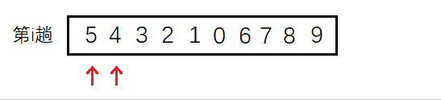

冒泡排序就是其中之一，我们对其最差的情况分析。相邻两数相比，第一趟交换 $N-1$ 次，第二趟交换 $N-2$ 次，……，第 $i$ 趟交换 $N-i$ 次。故精确的算法次数应为 $F(N)=N-1+N-2+...+N-i+...+1+0=N×(N-1)/2$ 。故复杂度为 $O(N^2)$ 。

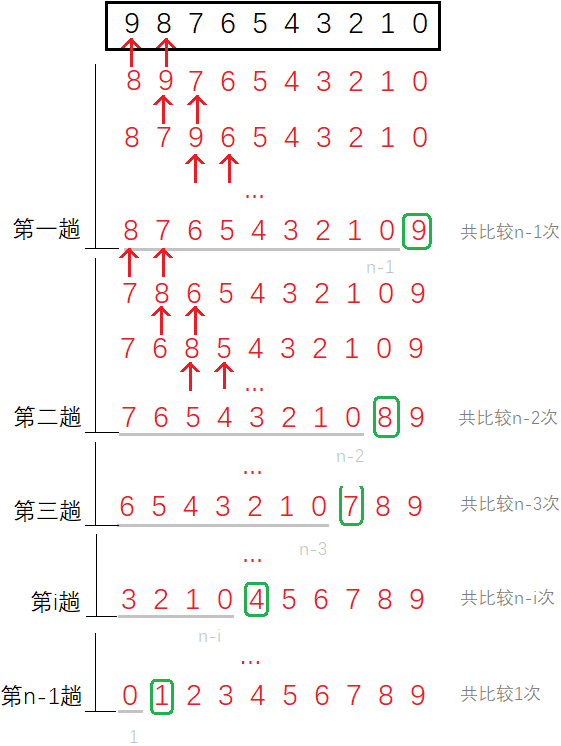

> 也可以看比较的次数，由于每趟最后一次只比较不交换，所以每趟比较的次数都比交换的次数多一次。但是并不影响其的复杂度。

###### 例4

```c
int BinarySearch(int* a, int n, int x)
{
	int begin = 0;
	int end = n - 1;
	while (begin < end)
    {
		int mid = begin + ((end - begin) >> 1);
		if (a[mid] < x)
			begin = mid + 1;
		else if (a[mid] > x)
			end = mid;
		else
			return mid;
	}
	return -1;
}
```

> 计算算法的复杂度不可仅看循环的层数，还要看算法的思想。 二分查找同样具有最好情况和最坏情况，仍然要对其最坏情况（找不到）进行分析。

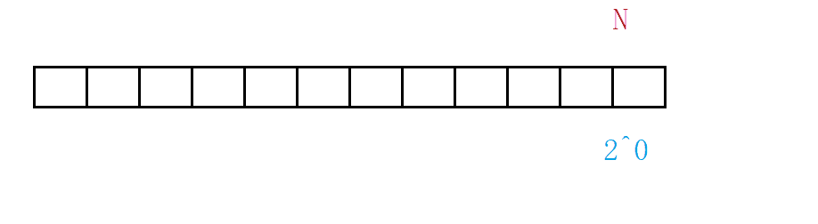

对于这样的每次折半的情况，可以形象的用“折纸法”理解，一张纸对折一次去掉一半再对折再舍弃，假设一共折了 $x$ 次，就找到了该数字。也就是 $2^x=N$，所以次数$x=log_2N$ 。

> 对数阶 $O(log_2N)$，也可以省略底数写成 $O(logN)$。二分查找这个对数阶是非常优秀的算法，$20=log_2(1000000)$，一百万个数仅需查找20次。

###### 例5

```c
long Factorial(size_t N)
{
	if (0 == N)
		return 1;
	return Fac(N - 1) * N;
}
```

 递归算法的复杂度取决于两个因素：递归深度和每次递归调用次数。

> 递归深度即是一共递归的层数，也就是创建栈帧的次数。每次递归调用次数是递归函数内调用自身的次数。

显然本题的深度是 $O(N)$，调用次数是 $1$，故复杂度是 $O(N)$ 。

###### 例6

```c
long Fibonacci(size_t N)
{
    if(N < 3)
        return 1;
    return Fib(N-1) + Fib(N-2);
}
```

斐波那契递归的思想是类似于二叉树的，但是后面缺少了一部分，如图所示：

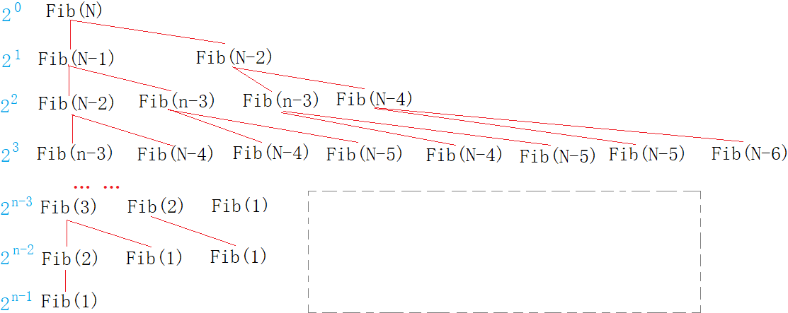

如果没有缺失的话就是完整二叉树，将缺少的部分设为 $X$，精确次数就是：
$$
F(N)=2^0+2^1+2^2+...+2^{N-1}-X=2^N-1-X
$$
由于 $X$ 远小于 $2^N-1$，故算法复杂度 $O(N)=2^N$。

### 1.2 空间复杂度

#### 空间复杂度定义

空间复杂度也是数学表达式，**用来度量算法运行时额外使用空间的大小**。

同样，空间复杂度不是无意义的实际的精确的字节数。**空间复杂度计算临时开辟变量的个数**，基本规则规则和时间复杂度类似，也采用大O渐进表示法。

##### 示例

###### 例1

```c
void BubbleSort(int* a, int n) {
	assert(a);
	for (size_t end = n; end > 0; --end) {
		int exchange = 0;
		for (size_t i = 1; i < end; ++i) {
			if (a[i - 1] > a[i]) {
				Swap(&a[i - 1], &a[i]);
				exchange = 1;
			}
		}
		if (exchange == 0)
			break;
	}
}
```

冒泡排序算法仅创建了常数个变量，所以空间复杂度是 $O(1)$。

> 虽然变量`end`,`i`每次循环都创建一次，但其实从内存角度看，每次所占空间并不会发生变化，一般都开辟在同一块空间。

###### 例2

```c
long long* Fibonacci(size_t n) {
    if (n == 0)
        return NULL;
    long long* fibArray = (long long*)malloc((n + 1) * sizeof(long long));
    fibArray[0] = 0;
    fibArray[1] = 1;
    for (int i = 2; i <= n; ++i) {
        fibArray[i] = fibArray[i - 1] + fibArray[i - 2];
    }
    return fibArray;
}
```

包括循环变量和该斐波那契数组，开辟量级为$N$个的变量。故空间复杂度为 $O(N)$ 。

###### 例3

```c
long long Factorial(size_t N)
{
    if(N == 0)
        return 1;
    return Fac(N - 1) * N;
}
```

每次递归创建一个栈帧，每个栈帧中都是常数个变量，$N$次递归的空间复杂度为 $O(N)$ 。

>  递归的空间复杂度与递归深度有关。

###### 例4

```c
long Fibonacci(size_t N)
{
    if(N < 3)
        return 1;
    return Fib(N-1) + Fib(N-2);
}
```

斐波那契每次递归同样创建常数个变量，从斐波那契栈帧创建图中可以看出，递归中会有重复的项，这些重复的栈帧创建又销毁。

空间不同于时间是可以重复利用的，所以这些重复的栈帧仅占用一次的空间。所以$Fib(N)$,$Fib(N-1)$,...,$Fib(1)$这些栈帧都分配一次的空间足矣。故时间复杂度为 $O(N)$ 。

#### 常见复杂度

常见的算法复杂度如下表，复杂度由上到下依次递增：

| 简称   | 大O表示    | 示例      |
| :----- | :--------- | :-------- |
| 常数阶 | $O(1)$     | $k$       |
| 对数阶 | $O(logn)$  | $klog_2n$ |
| 线性阶 | $O(n)$     | $kn$      |
| 对数阶 | $O(nlogn)$ | $klog_2n$ |
| 平方阶 | $O(n^2)$   | $kn^2$    |
| 立方阶 | $O(n^3)$   | $kn^3$    |
| 指数阶 | $O(2^n)$   | $k2^n$    |
| 阶乘阶 | $O(n!)$    | $kn!$     |

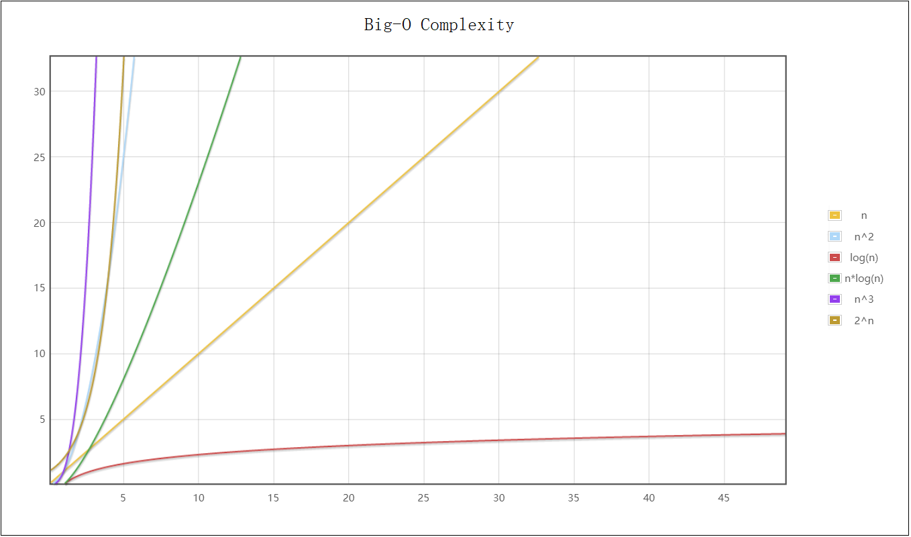

最低的是常数次$O(1)$，其次是对数阶$O(logn)$，然后是线性阶$O(n)$，再高就是平方阶$O(n^2)$，最大是指数阶$O(2^n)$ 。

> 前三个算是优秀算法，而平方阶是复杂的算法，指数阶阶乘阶的算法万万不可取。

### 1.3 复杂度OJ题

#### 消失的数字

##### 思路1

先排序数组，检查排序结果相邻元素的差值。若差值不为1二者之间的缺值就是消失的数字。

> 时间复杂度为 $O(nlog_2n)$，空间复杂度 $O(1)$

```c
int cmp_int(const void* e1, const void* e2) {
    return *(int*)e1 - *(int*)e2;
}
int missingNumber(int* nums, int numsSize) {
    int flag = 1;
    //qsort
    qsort(nums, numsSize, sizeof(nums[0]), cmp_int);
    //元素个数为1
    if (numsSize == 1) {
        return numsSize - nums[0];
    }
    for (int i = 0; i < numsSize - 1; i++) {
        if (nums[i +1] - nums[i] != 1) {
            flag = 0;
            return nums[i] + 1;
        }
    }
    //缺失的数字为最大值或0
    if (flag == 1) {
        if (nums[0] == 0) {
            return numsSize;
        }
        else {
            return 0;
        }
    }
    return 0;
}
```

##### 思路2

将数组中的元素写到另一个数组的对应下标位置上，没有值的位置下标即为消失的数字。

> 时间复杂度为 $O(n)$，空间复杂度 $O(n)$

```c
int missingNumber(int* nums, int numsSize) {
    int tmp[200000] = { 0 };
    memset(tmp, -1, 200000 * sizeof(int));
    //移入元素
    for (int i = 0; i < numsSize; i++) {
        tmp[nums[i]] = nums[i];
    }
    //寻找位置
    for (int i = 0; i <= numsSize; i++) {
        if(tmp[i] == -1) {
            return i;
        }
    }
    return 0;
}
```

##### 思路3

将0到n的元素之和减去数组元素之和，得到的结果即为消失的数字。

> 时间复杂度为 $O(n)$，空间复杂度 $O(1)$

```c
int missingNumber(int* nums, int numsSize) {
    int sumOfNum = 0;
    int sumOfNums = 0;
    for (int i = 0; i <= numsSize; i++) {
        sumOfNum += i;
    }
    for (int i = 0; i < numsSize; i++) {
        sumOfNums += nums[i];
    }
    return sumOfNum - sumOfNums;
}
```

##### 思路4

将$x$与 $[0,n]$ 的数字遍历异或，在与数组元素遍历异或，最后结果即为消失的数字。

> 时间复杂度为 $O(n)$，空间复杂度 $O(1)$

```c
int missingNumber(int* nums, int numsSize) {
    int xor = 0;
    //和[0,n]异或
    for (int i = 0; i <= numsSize; i++) {
        xor ^= i;
    }
    //和数组异或
    for (int i = 0; i < numsSize; i++) {
        xor ^= nums[i];
    }
    return xor;
}
```

#### 旋转数组

##### 思路 1

数组尾删一次在头插原数组的尾元素，循环 $k$ 次。

> 时间复杂度为 $O(k×n)$，空间复杂度 $O(1)$

```c
void rotate(int* nums, int numsSize, int k) {
    while (k--) {
        int tmp = nums[numsSize - 1];
        int end = numsSize - 1;
        while (end > 0) {
            nums[end] = nums[end - 1] ;
            end--;
        }
        nums[end] = tmp;
    }
}
```

##### 思路 2

开辟同等大小的数组，后 $n-k$ 个元素先转移过去，在转移前 $k$ 个元素，在返回数组。

> 时间复杂度为 $O(n)$，空间复杂度 $O(n)$

```c
void rotate(int* nums, int numsSize, int k) {
    int tmp[200] = { 0 };
    //后k个
    for (int i = 0; i < k; i++) {
        tmp[i] = nums[numsSize - k + i];
    }
    //前k个
    for (int i = 0; i < numsSize - k; i++) {
        tmp[i + k] = nums[i];
    }
    //转移
    for (int i = 0; i < numsSize; i++) {
        nums[i] = tmp[i];
    }
}

```

##### 思路 3

前 $n-k$ 个元素逆置，后 $k$ 个元素逆置，再整体逆置。

> 时间复杂度为 $O(n)$，空间复杂度 $O(1)$

```c
void reserve(int* nums, int left, int right) {
    while (left < right) {
        int tmp = nums[left];
        nums[left] = nums[right];
        nums[right] = tmp;
        left++;
        right--;
    }
}
void rotate(int* nums, int numsSize, int k) {
    //1. 前n-k个逆置
    reserve(nums, 0, numsSize -k - 1);
    //2. 后k个逆置
    reserve(nums,numsSize - k, numsSize - 1);
    //3. 再整体逆置
    reserve(nums, 0, numsSize - 1);
}
```

## 2. 线性表

> 线性表是n个具有相同特性的元素的序列。常见的线性表有顺序表、链表、栈、队列、字符串。

### 2.1 顺序表

#### 顺序表的定义

顺序表是用一段**连续的存储单元依次存储数据的线性结构**，底层结构一般采用数组。

顺序表必须从头向后依次存储，在数组上进行数据的增删查改。一般分为动态顺序表和静态顺序表。

##### 顺序表结构体

```c
typedef int T;
typedef struct _seqlist
{
    T* _a;
    size_t _size;
    size_t _cap;
}seqlist;
```

- 静态顺序表定义简单，容量固定，`size`用于记录有效元素个数。
- 动态顺序表使用动态开辟数组，`capacity`用于记录数组容量。

#### 顺序表的接口

| 名称         | 接口                                            |
| ------------ | ----------------------------------------------- |
| 初始化       | `void seqlist_init(seqlist* l)`                 |
| 销毁         | `void seqlist_destroy(seqlist* l)`              |
| 尾插         | `void seqlist_push_back(seqlist* l, int n)`     |
| 尾删         | `void seqlist_pop_back(seqlist* l)`             |
| 任意位置插入 | `void seqlist_insert(seqlist* l, int i, int n)` |
| 任意位置删除 | `void seqlist_erase(seqlist* l, int i) `        |

##### 尾插尾删

尾插有三种情况：顺序表没有空间、空间已满需扩容、空间未满直接插入。

尾删要考虑到有效元素个数为0的情况。

```c
void seqlist_push_back(seqlist* l, int n)
{
    assert(l);
    if (l->_size == l->_cap || l->_cap == 0)
    {
        int nc = l->_cap ? l->_cap * 2 : 4;
        int* p = realloc(l->_a, nc * sizeof(int));

        if (p != NULL)
        {
            l->_a = p;
            l->_cap = nc;
        }
    }
    l->_a[l->_size++] = n;
}

void seqlist_pop_back(seqlist* l)
{
    assert(l && l->_size > 0);
    l->_size--;
}
```

动态开辟内存是有内存消耗的，异地拷贝也会增加时间消耗，所以尽量每次开辟大一点以减少开辟次数。

> realloc存在“原地扩”和“异地扩”，如果后面有足够大的空间就原地扩，反之则重新开辟空间将拷贝原空间内容并释放原空间，称为异地扩。

##### 任意位置插入删除

```c
void seqlist_insert(seqlist* l, int i, int n)
{
    assert(l && l->_size >= i && i >= 0);

    if (l->_size == l->_cap || l->_cap == 0)
    {
        int nc = l->_cap ? l->_cap * 2 : 4;
        int* p = malloc(nc * sizeof(int));
        if (p != NULL)
        {
            memcpy(p, l->_a, l->_size * sizeof(int));
            free(l->_a);
            l->_a = p;
        }
        l->_cap = nc;
    }

    for (size_t j = l->_size; j > i; j--)
    {
        l->_a[j] = l->_a[j - 1];
    }

    l->_a[i] = n;
    l->_size++;
}

void seqlist_erase(seqlist* l, int i)
{
    assert(l && l->_a && 0 <= i && i < l->_size);

    for (size_t j = i; j < l->_size - 1; j++)
    {
        l->_a[j] = l->_a[j + 1];
    }

    l->_size--;
}
```

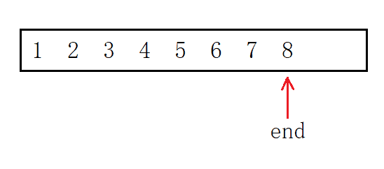

头插首先将整体也就是下标从`0`到`size-1`的元素后移一个位置。为防止内容覆盖，则必须从后向前移，方法是定义“尾指针”，每次减一从后向前遍历，最后增加一个元素即可。

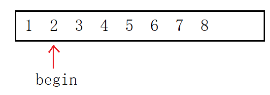

头删则是将下标为`1`到`size-1`的元素前移一个位置，定义“头指针”指向第二个元素从前向后遍历，正好将第一个元素覆盖。

##### 其他接口

```c
void seqlist_init(seqlist* l)
{
    assert(l);
    l->_a = NULL;
    l->_size = l->_cap = 0;
}
void seqlist_destroy(seqlist* l)
{
    assert(l);
    free(l->_a);
    l->_a = NULL;
    l->_size = l->_cap = 0;
}
```

结构体成员数组使用的是动态开辟的空间所以记得初始化和销毁内存。

#### 数组面试题

##### 例1 [移除元素](https://leetcode-cn.com/problems/remove-element/)

移除数组 `nums`中所有数值等于 `val` 的元素，并返回移除后数组的新长度。

###### 思路 1

> 时间复杂度为 $O(N^2)$，空间复杂度为 $O(1)$

```c
int removeElement(int* nums, int numsSize, int val) {
    int number = numsSize;
    int* pnums = nums;
    while (pnums < nums + number) {
        if (*pnums == val) {
            int begin = pnums - nums;
            //begin是该元素的下标，numsSize-begin是该元素之后的元素个数
            while (begin < numsSize - 1) {
                nums[begin] = nums[begin + 1];
                begin++;
            }
            number--;
        }
        else {
            pnums++;
        }
    }
    return number;
}
```

###### 思路 2

> 时间复杂度为 $O(N)$，空间复杂度为 $O(N)$

```c
int removeElement(int* nums, int numsSize, int val) {
    int tmp[200] = { 0 };
    int j = 0;
    //转移不是val的元素
    for (int i = 0; i < numsSize; i++) {
        if(nums[i] != val) {
            tmp[j] = nums[i];
            j++;
        }
    }
    //赋值给nums
    for(int i = 0; i < j; i++) {
        nums[i] = tmp[i];
    }
    return j;
}
```

###### 思路 3

快慢指针，通过指针分别指向。可以用指针也可以用下标的方式。

> 时间复杂度为 $O(N)$，空间复杂度为 $O(1)$

```c
int removeElement(int* nums, int numsSize, int val) {
    int* src = nums;
    int* dst = nums;
    //1. 指针版
    while (src - nums < numsSize) {
        if (*src != val) {
            *dst = *src;
            dst++;
        }
        src++;
        //是与不是，src都要++；只有赋值后dst才++
    }
    return dst - nums;
    //2. 下标版
    int src = 0, dst = 0;
    while(src < numsSize) {
        if(nums[src] != val) {
            nums[dst] = nums[src];
            dst++;
        }
        src++;
    }
    return dst;
}
```

##### 例2 [数组去重](https://leetcode-cn.com/problems/remove-duplicates-from-sorted-array/)

删除有序数组 `nums` 中重复出现的元素，使每个元素只出现一次，返回删除后数组的新长度。

找到一段相同数字的区间，只留一个。

```c
int removeDuplicates(int* nums, int numsSize) {
    int begin = 0, end = 1;
    int dst = 1;
    if(numsSize == 0) {
        return 0;
    }
    while (end < numsSize) {
        if(nums[begin] == nums[end]) {
            end++;
        }
        else {
            begin = end;
            nums[dst] = nums[begin];
            end++;
            dst++;
        }
    }
    return dst;
}
```

##### 例3 [合并数组](https://leetcode-cn.com/problems/merge-sorted-array/)

两个按非递减顺序排列的整数数组`nums1`和`nums2`，合并`nums2`到`nums1`中，使合并后的数组同样按非递减顺序排列。

###### 思路 1

开辟新数组，将两数组的元素相比取其小值放入新数组中。

> 时间复杂度为 $O(M+N)$，空间复杂度为 $O(M+N)$

```c
void merge(int* nums1, int nums1Size, int m, int* nums2, int nums2Size, int n) {
    int i = 0, j = 0, dst = 0;
    int nums3[200] = { 0 };
    while (i < m && j < n) {
        if (nums1[i] <= nums2[j]) {
            nums3[dst] = nums1[i];
            dst++, i++;
        }
        else {
            nums3[dst] = nums2[j];
            dst++, j++;
        }
    }
    //剩余元素
    while (i < m) {
        nums3[dst] = nums1[i];
        dst++, i++;
    }
    while (j < n) {
        nums3[dst] = nums2[j];
        dst++, j++;
    }
    for(int i = 0; i < m + n; i++) {
        nums1[i] = nums3[i];
    }
}
```

###### 思路 2

无需开辟新数组，从大到小比较和移动元素。

> 时间复杂度为 $O(min\lbrace m,n \rbrace)$，空间复杂度为 $O(1)$

```c
void merge(int* nums1, int nums1Size, int m, int* nums2, int nums2Size, int n) {
    int i = m - 1, j = n - 1;
    int dst = m + n - 1;
    while (i >= 0 && j >= 0) {
        if (nums2[j] >= nums1[i]) {
            nums1[dst] = nums2[j];
            dst--, j--;
        }
        else {
            nums1[dst] = nums1[i];
            dst--, i--;
        }
    }
    while (j >= 0) {
        nums1[dst] = nums2[j];
        dst--, j--;
    }
}
```

比较`i`和`j`下标的元素，将其大者放入`dst`下标的位置。若`i`先走到0，则将`j`剩余的元素拷贝到`dst`。`j`走到0，标志程序运行结束。

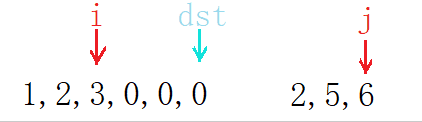

#### 顺序表的缺陷

- 缺点：
  - 动态扩容时，易产生内存碎片，存在一定程度上的空间浪费。
  - 头部和任意位置的插入删除，需要挪动数据。
- 优点：支持随机访问。

> 增删需要挪动数据，这是线性表最大的缺陷。
>
> 频繁扩容时间消耗大，倍数扩容有空间浪费。
>
> 支持随机访问是线性表的重要的特点，很多算法中要求结构支持随机访问，如二分查找和快排。

### 2.2 单链表

> 顺序表的增删要挪动数据，为解决该问题，就出现了一种新的存储形式：链表。

#### 单链表的定义

单链表是一种物理上的非连续、非顺序的存储结构。数据元素的逻辑顺序通过链表中的指针链接次序实现。

- 逻辑结构：表现数据之间的关系而想象出的逻辑图，便于理解。

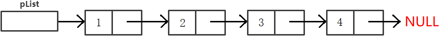

- 存储结构：体现了数据在内存中的存储形式，描述的是内存中物理结构。

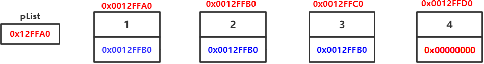

> 单链表是最简单的链表结构，其他包括双头链表、带头不带头链表、循环链表等。

##### 单链表结构体

```c
typedef struct _singlenode
{
    int _data;
    struct _singlenode* _next;
} slnode;
```

链表结点包含数据域和指针域，数据域用于存储数据，指针域指向下一个结点。通过`next`指针就可以将所有的结点从头串到尾。

```c
SLTNode* BuySLTNode(SLTDataType x)
{
    SLTNode* new_node = (SLTNode*)malloc(sizeof(SLTNode));
    if (new_node == nullptr)
        exit(1);
    new_node->data = x;
    new_node->next = nullptr;

    return new_node;
}

SLTNode* n1 = BuySLTNode(1);
SLTNode* n2 = BuySLTNode(2);
SLTNode* n3 = BuySLTNode(3);
SLTNode* n4 = BuySLTNode(4);
```

> `n1`、`n2`、`n3`、`n4`和动态开辟出来的资源有何关系？

动态开辟出来的资源都放在内存上，`malloc`会返回对应的内存地址也就是指针，我们用一个指针变量接收该返回值。

也就是说，`n1`等变量内部存储的值是资源的存储地址。

#### 单链表的接口

| 名称         | 接口                                              |
| ------------ | ------------------------------------------------- |
| 尾插         | `void slist_push_back(slnode** l, int n)`         |
| 尾删         | `void slist_pop_back(slnode** l)`                 |
| 头插         | `void slist_push_front(slnode** l, int n)`        |
| 头删         | `void slist_pop_front(slnode** l)`                |
| 任意位置前插 | `void slist_insert(slnode** l, slnode* p, int n)` |
| 任意位置后插 | `void slist_insert_after(slnode* l, int n)`       |
| 任意位置删除 | `void slist_erase(slnode** l, slnode* p)`         |
| 任意位置后删 | `void slist_erase_after(slnode** l)`              |

##### 尾插头插

操作单链表只能从头结点开始遍历。插入结点后须将前后链接起来。

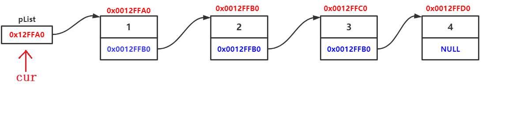

> 考虑到结点个数为0的情况，插入会修改实参头节点`plist`，故需要传二级指针`&plist`。

尾插要将新结点的地址存入尾结点的指针域。

```c
void slist_push_back(slnode** l, int n)
{
    assert(l && *l);
    if (!(*l)->_next)
    {
        *l = newnode(n);
    }
    else
    {
        slnode* tail = *l;
        while (tail->_next != NULL)
        {
            tail = tail->_next;
        }

        tail->_next = newnode(n);
    }
}
```

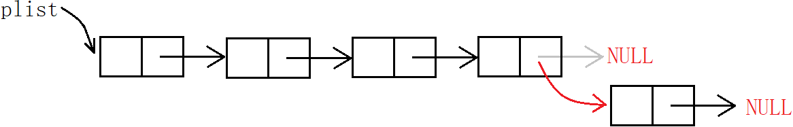

头插则将新结点的地址存入头指针，再将第二个结点`phead->next`存入新结点的指针域。

```c
void slist_push_front(slnode** l, int n)
{
    assert(l);
    slnode* nnode = newnode(n);
    nnode->_next = *l;
    *l = nnode;
}
```

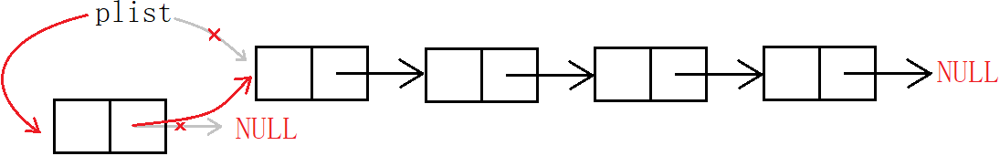

> 头插必然要修改指针`plist`的值，故必然要传头指针的地址。

##### 尾删头删

尾删，先释放尾结点，然后置空上一个结点的指针域。

```c
void slist_pop_back(slnode** l)
{
    assert(l && *l);

    if (!(*l)->_next)
    {
        free(*l);
        *l = NULL;
    }
    else
    {
        slnode* prev = NULL;
        slnode* tail = *l;

        while (tail->_next)
        {
            prev = tail;
            tail = tail->_next;
        }

        prev->_next = NULL;
        free(tail);
    }
}
```

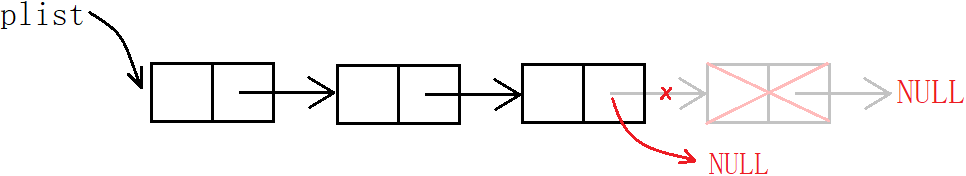

头删，先释放头结点，再将头指针指向第二个结点。

```c
void slist_pop_front(slnode** l)
{
    assert(l && *l);
    slnode* next = (*l)->_next;
    free(*l);
    *l = next;
}
```

> 由于链表必须从头访问，若先销毁头结点则无法向后遍历，故需要临时变量暂存第二个结点的地址。

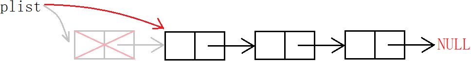

##### 随机插入

```c
void slist_insert(slnode** l, slnode* p, int n)
{
    assert(l && *l, && p);

    slnode* cur = *l;
    while (cur->_next != p)
    {
        cur = cur->_next;
    }

    slnode* nnode = newnode(n);

    if (*l == p)
    {
        *l = nnode;
        nnode->_next = p;
    }
    else
    {
        cur->_next = nnode;
        nnode->_next = p;
    }
}
```

```c
void slist_insert_after(slnode* l, int n)
{
    assert(l);
    slnode* next = l->_next;
    slnode* nnode = newnode(n);
    l->_next = nnode;
    nnode->_next = next;
}
```

可以看出后插复杂度为$O(1)$，前插复杂度为$O(N)$ 。单链表的结构致使其被当作复杂结构的子结构更方便。

##### 随机删除

```c
void slist_erase(slnode** l, slnode* p)
{
    assert(l && *l && p);

    slnode* cur = *l;
    while (cur->_next != p)
    {
        cur = cur->_next;
    }

    if (*l == p)
    {
        *l = p->_next;
    }
    else
    {
        cur->_next = p->_next;
    }
}
void slist_erase_after(slnode** l)
{
    assert(l && *l);
    slnode* next = (*l)->_next;
    free(*l);
    *l = next;
}
```

#### 链表面试题

| 题目链接                                                     | 题解链接                                                     |
| ------------------------------------------------------------ | ------------------------------------------------------------ |
| [移除结点](https://leetcode-cn.com/problems/remove-linked-list-elements/) | [【简单易懂 注意点明确 注释丰富】C++ 203. 移除链表元素](https://leetcode.cn/problems/remove-linked-list-elements/solutions/2707719/jian-dan-yi-dong-zhu-yi-dian-ming-que-zh-48p5/) |
| [反转链表](https://leetcode-cn.com/problems/reverse-linked-list/) | [【简单易懂 注意点明确 注释动图】206. 反转链表](https://leetcode.cn/problems/reverse-linked-list/solutions/2707751/jian-dan-yi-dong-zhu-yi-dian-ming-que-zh-xo7y/) |
| [中间结点](https://leetcode-cn.com/problems/middle-of-the-linked-list/) | [【简单易懂 快慢指针 图解】C++ 876. 链表的中间结点](https://leetcode.cn/problems/middle-of-the-linked-list/solutions/2707783/jian-dan-yi-dong-kuai-man-zhi-zhen-tu-ji-7jn6/) |
| [输出结点](https://leetcode.cn/problems/kth-node-from-end-of-list-lcci/description/) | [【简单易懂 前后指针 图解】C++ 面试题 02.02. 返回倒数第 k 个节点](https://leetcode.cn/problems/kth-node-from-end-of-list-lcci/solutions/2707816/jian-dan-yi-dong-qian-hou-zhi-zhen-tu-ji-qotg/) |
| [合并链表](https://leetcode.cn/problems/merge-two-sorted-lists/description/) | [【简单易懂 前后指针 图解】C++ 21. 合并两个有序链表](https://leetcode.cn/problems/merge-two-sorted-lists/solutions/2707885/jian-dan-yi-dong-qian-hou-zhi-zhen-tu-ji-2z1y/) |
| [链表分割](https://www.nowcoder.com/practice/0e27e0b064de4eacac178676ef9c9d70) | [题解 #链表分割#](https://www.nowcoder.com/discuss/601934634988937216) |
| [回文结构](https://www.nowcoder.com/practice/d281619e4b3e4a60a2cc66ea32855bfa) | [题解 #链表的回文结构#](https://nowcoder.com/discuss/601952384503296000) |
| [相交链表](https://leetcode-cn.com/problems/intersection-of-two-linked-lists/) | [【简单易懂 前后指针 图解】C++](https://leetcode.cn/problems/intersection-of-two-linked-lists/solutions/2708062/jian-dan-yi-dong-qian-hou-zhi-zhen-tu-ji-bi47/) |
| [环形链表 I](https://leetcode-cn.com/problems/linked-list-cycle/) | [【简单逻辑 原理解释 通俗易懂】141. 环形链表 I](https://leetcode.cn/problems/linked-list-cycle/solutions/2708064/jian-dan-luo-ji-yuan-li-jie-shi-tong-su-mgosu/) |
| [环形链表 II](https://leetcode-cn.com/problems/linked-list-cycle-ii/) | [【简单逻辑 原理解释 通俗易懂】C++ 142. 环形链表 II](https://leetcode.cn/problems/linked-list-cycle-ii/solutions/2708067/jian-dan-luo-ji-yuan-li-jie-shi-tong-su-p7mgp/) |
| [复杂链表的复制](https://leetcode-cn.com/problems/copy-list-with-random-pointer/) | [【简单逻辑 原理解释 通俗易懂】C++ 138. 随机链表的复制](https://leetcode.cn/problems/copy-list-with-random-pointer/solutions/2708068/jian-dan-luo-ji-yuan-li-jie-shi-tong-su-lq69s/) |

#### 链表的分类

##### 单向和双向链表

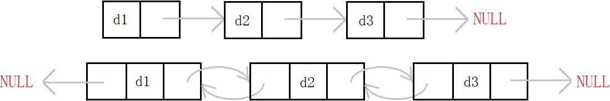

单链表存在不少缺陷，单纯使用单链表意义不大。因其存在缺陷，很多OJ题都将单链表作为考察对象。

##### 带头和不带头链表

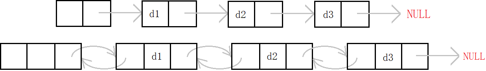

哨兵位的头结点不存储有效数据，因为不会修改头结点，不需要以二级指针的形式传参。但使用结束后需要释放。

##### 循环和非循环链表

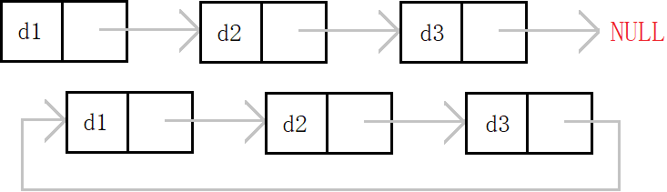

非循环链表即尾结点指向空。循环链表是一种特殊的带环链表，其尾结点指向头结点。

##### 两种重要形式链表

> 链表中最重要的形式有两种：无头单向非循环链表和带头双向循环链表。

- 普通链表结构最为简单。实际中单链表更多是作为复杂数据结构的子结构，如哈希桶、邻接表等。
- 带头双向循环链表，结构最为复杂。实际中的链表一般都是带头双向循环链表，结构虽复杂，但使用却较为简单。

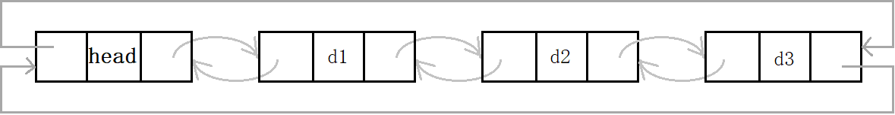

### 2.3 双向链表

#### 双向链表的定义

双向链表即**带头双向循环**链表，

1. 带头：带哨兵位的头结点，方便尾插和传参。
2. 双向：每个结点有两个指针域，存储前驱和后继两个结点的地址。
3. 循环：链表的尾结点不指向空，而是尾结点指向头结点，头结点指向为尾结点。

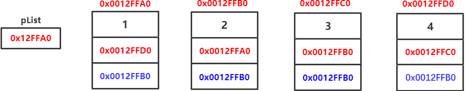

##### 双向链表结构体的定义

```c
typedef struct _dlink_list_node
{
    int _data;
    struct _dlink_list_node* _prev;
    struct _dlink_list_node* _next;
}dlnode;
```

双向链表的结构看似复杂，但由于结构优势，各种操作的实现却更为简单。

双向链表的“无死角”结构使得任意操作都具有普适性，不需要考虑特殊情况，任意结点都有前驱后继。

#### 双向链表的接口实现

| 名称   | 接口                                       |
| ------ | ------------------------------------------ |
| 初始化 | `void dllist_init(dlnode** l)`             |
| 销毁   | `void dllist_destroy(dlnode** l)`          |
| 尾插   | `void dllist_push_back(dlnode* l, int n)`  |
| 尾删   | `void dllist_pop_back(dlnode* l)`          |
| 头插   | `void dllist_push_front(dlnode* l, int n)` |
| 头删   | `void dllist_pop_front(dlnode* l)`         |

##### 双向链表尾插尾删

```c
void dllist_push_back(dlnode* l, int n)
{
    dlnode* newn = newnode(n);
    dlnode* prev = l->_prev;
    dlnode* next = l;

    newn->_next = next;
    next->_prev = newn;
    newn->_prev = prev;
    prev->_next = newn;
}
```

> 1. 带头链表不需要传二级指针，因为不会修改头指针。
> 2. 尾插找尾也不需要循环遍历，头结点的前驱即是尾结点。
> 3. 因为带头，代码对于链表为空即仅有头指针的情况同样适用。

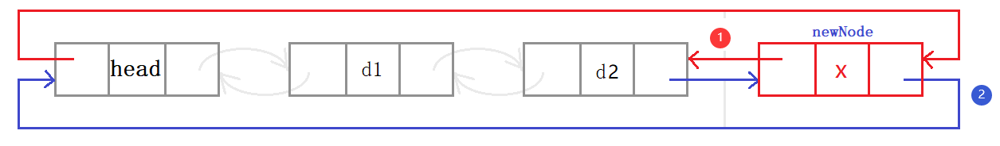

所以实现双向链表的增删查改时，只需要两步：

1. **找到操作结点**，
2. **修改操作结点**。

这便是双向链表的结构优势。

```c
void dllist_pop_back(dlnode* l)
{
    dlnode* deln = l->_prev;
    dlnode* prev = deln->_prev;
    dlnode* next = deln->_next;

    prev->_next = next;
    next->_prev = prev;
    free(deln);
}
```

先找到待操作的结点`deln`和其前后节点，再修改链接关系。

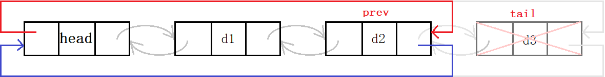

##### 双向链表头插头删

```c
void dllist_push_front(dlnode* l, int n)
{
    assert(l);

    dlnode* newn = newnode(n);
    dlnode* prev = l;
    dlnode* next = l->_next;

    newn->_next = next;
    next->_prev = newn;
    newn->_prev = prev;
    prev->_next = newn;
}
```

操作结点为`prev`，`next`，`newn`。分别修改前驱和后继即可。

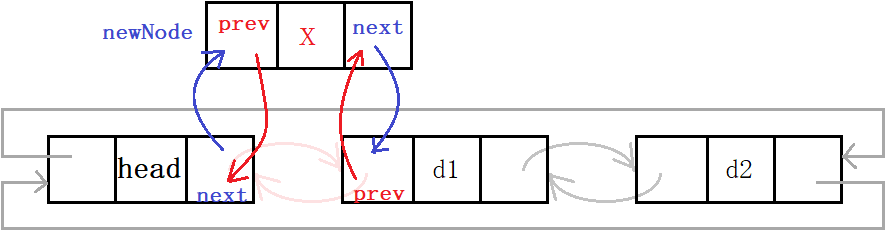

```c
void dllist_pop_front(dlnode* l)
{
    dlnode* deln = l->_next;
    dlnode* prev = deln->_prev;
    dlnode* next = deln->_next;

    prev->_next = next;
    next->_prev = prev;
    free(deln);
}
```

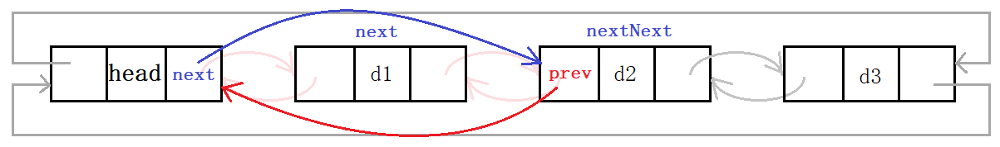

> 操作多个结点时，尽量多定义变量以避免混淆逻辑，简洁明了。避免写出`node->next->next...`。

##### 任意位置插入删除

```c
void ListInsert(LTNode* pos, LTDataType x) {
    assert(pos);
    //posPrev newNode pos
    LTNode* posPrev = pos->prev;
    LTNode* newNode = CreateNewNode(x);
    //1. posPrev & newNode
    posPrev->next = newNode;
    newNode->prev = posPrev;
    //2. newNode & pos
    newNode->next = pos;
    pos->prev = newNode;
}
void ListErase(LTNode* pos) {
    assert(pos);
    assert(pos->next != pos);
    LTNode* prev = pos->prev;
    LTNode* next = pos->next;
    //prev & next
    prev->next = next;
    next->prev = prev;
    free(pos);
}
```

##### 其他接口

```c
LTNode* ListInit() {
    LTNode* head = (LTNode*)malloc(sizeof(LTNode));
    if (head == NULL) {
        perror("Init::malloc");
        exit(-1);
    }
    head->next = head;
    head->prev = head;

    return head;
}
void ListDestroy(LTNode* phead) {
    assert(phead);
    LTNode* cur = phead->next;
    while (cur->next != phead) {
        LTNode* next = cur->next;
        free(cur);
        cur = next;
    }
    free(phead);
}
plist = NULL;
```

初始化时同样注意双向循环的结构。此时也可以不传递二级指针，可以利用返回值的方式传递给外部的实参`plist`。

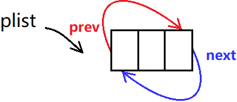

遍历双向链表需要注意循环的条件，从第一个有效结点`phead->next`开始，当其等于头结点时`cur==phead`结束。查找和打印都是同样的遍历的方法。

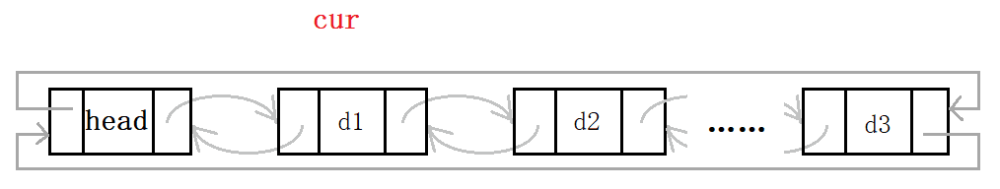

### 2.4 二者的区别和联系

> 链表和顺序表的对比。

顺序表即动态增长的数组，动态数组的优缺点是很明显的。

- 缺点：
  1. 动态扩容时，有时间消耗且产生内存碎片，存在一定程度上的空间浪费。
  2. 头部中部的插入删除，需要挪动数据，效率低。
- 优点：
  1. 支持随机访问。
  2. CPU高速缓冲命中率更高

> 增删操作必须要挪动数据，时间消耗不可忽略，这是线性表最大的缺陷。
>
> 倍数扩容也会带来不可避免的空间浪费。支持随机访问是线性表的重要的特点。

而链表利用指针将数据链接起来，结点之间不像数组元素一样强关联。

- 缺点：
  1. 结点之间需要通过指针链接。不支持随机访问。
  2. 链表存储数据同时还需存储前后指针，一定的消耗。
  3. CPU高速缓存命中率更低
- 优点：
  1. 按需合理申请空间，不存在空间浪费。
  2. 增删结点时无需挪动数据，效率高。

> 单链表不可以通过下标随机访问，必须从头结点开始遍历。

## 3. 栈和队列

> 栈和队列本质也是线性表。特殊在于它们的操作受到一些限制。

### 3.1 栈

#### 栈的定义

栈只允许在栈顶进行插入和删除。另一端被称为栈底。栈的元素遵循**后进先出**的原则。

> 后进先出，先进后出，即`LIFO`原则（Last In First Out）。

- 压栈：栈的插入操作被称为压栈，也可以叫做进栈、入栈。
- 出栈：栈的插入操作被称为出栈，或称弹栈。

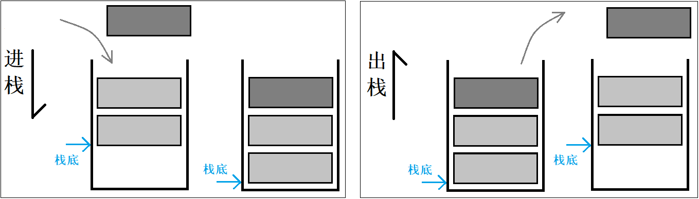

> 数据出入都在栈顶，类似于子弹上膛和发射。元素像子弹一样被压入弹夹，再一个个地打出去，这个过程便是压栈和出栈。

##### 栈的结构定义

栈可以使用数组和链表实现。数组栈比链式栈的结构优势更大一点。

> 数组进行尾插尾删的效率高，其次缓存命中率高。缺点是动态增容有一定的内存消耗。

```c
typedef struct stack
{
    int* _a;
    size_t _top;
    size_t _cap;
}stack;
```

#### 栈的实现

##### 初始化销毁

```c
void stack_init(stack* s)
{
    assert(s);
    s->_a = NULL;
    s->_top = s->_cap = 0;
}

void stack_destroy(stack* s)
{
    free(s->_a);
    s->_a = NULL;
    s->_top = s->_cap = 0;
}
```

top一般初始化为0。top总是下一个插入位置的下标，也代表栈元素个数。

##### 压入弹出

```c
void stack_push(stack* s, int n)
{
    assert(s);

    if (s->_top == s->_cap || s->_cap == 0)
    {
        size_t nc = s->_cap == 0 ? 4 : s->_cap * 2;

        int* p = (int*)malloc(nc * sizeof(int));
        if (p != NULL)
        {
            memcpy(p, s->_a, s->_top * sizeof(int));
            free(s->_a);

            s->_a = p;
            s->_cap = nc;
        }
    }
    s->_a[s->_top++] = n;
}

void stack_pop(stack* s)
{
    assert(s && s->_top > 0);
    s->_top--;
}
```

##### 获取栈顶

```c
int stack_top(stack* s)
{
    assert(s && s->_top > 0);
    return s->_a[s->_top - 1];
}
```

`top-1`为当前栈顶的下标。同样要保证栈非空。加上该测试函数，可以实现循环打印栈元素的功能。

##### 元素个数和判空

```c
size_t stack_size(stack* s)
{
    assert(s);
    return s->_top;
}

int stack_empty(stack* s)
{
    return !stack_size(s);
}
```

### 3.2 队列

#### 队列的定义

队列只允许在队尾进行插入，在队头进行删除。队列的元素遵循**先进先出**的原则。先进先出，后进后出，即`FIFO`原则。

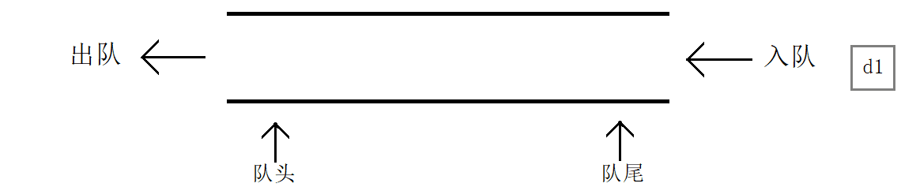

##### 队列的结构定义

```c
typedef struct _queue_node
{
    int _data;
    struct _queue_node* _next;
} qnode;

typedef struct _queue
{
    qnode* _head;
    qnode* _tail;
    int _size;
}queue;
```

- 队列的底层结构采用链表，方便头删元素。
- 队列用两个指针标识队头队尾，方便访问队头和队尾元素。

#### 队列的实现

##### 初始化销毁

```c
void queue_init(queue* q)
{
    q->_size = 0;
    q->_head = q->_tail = NULL;
}

void queue_destroy(queue* q)
{
    qnode* cur = q->_head;
    while (cur)
    {
        qnode* next = cur->_next;
        free(cur);
        cur = next;
    }
    q->_size = 0;
    q->_head = q->_tail = NULL;
}
```

##### 入队出队

```c
void queue_push(queue* q, int n)
{
    qnode* p = (qnode*)malloc(sizeof(qnode));
    if (p)
    {
        p->_data = n;
        p->_next = NULL;
    }

    if (!q->_tail)
    {
        q->_head = q->_tail = p;
    }
    else
    {
        q->_tail->_next = p;
        q->_tail = p;
    }
    q->_size++;
}

void queue_pop(queue* q)
{
    q->_head = q->_head->_next;
    q->_size--;
}
```

`tail`队尾后再链上新结点，再将`tail`指针指向新结点。出队是将`head`指针指向下一个结点并将头节点释放掉即可。

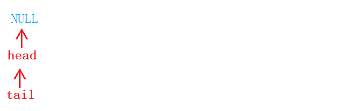

##### 获取头尾

```c
int queue_front(queue* q)
{
    return q->_head->_data;
}

int queue_back(queue* q)
{
    return q->_tail->_data;
}
```

##### 元素个数和判空

```c
int queue_size(queue* q)
{
    return q->_size;
}
int queue_empty(queue* q)
{
    return q->_size == 0;
}
```

### 3.3 OJ题

##### 1 [判断有效括号](https://leetcode-cn.com/problems/valid-parentheses/)

给定一个只包括 `(`,`)`,`{`,`}`,`[`,`]` 的字符串 `s` ，判断字符串是否有效。

```c
bool isValid(char* s) {
    ST st;
    StackInit(&st);
    while (*s) {
        if (*s == '(' || *s == '[' || *s == '{') {
            StackPush(&st, *s);
        }
        else {
            //栈无元素，无法与右括号匹配
            if (StackEmpty(&st)) {
                StackDestroy(&st);
                return false;
            }
            STDataType ret = StackTop(&st);
            if ((ret == '(' && *s != ')') ||
                (ret == '[' && *s != ']') ||
                (ret == '{' && *s != '}'))
            {
                StackDestroy(&st);
                return false;
            }
            else {
                StackPop(&st);
            }
        }
        s++;
    }
    if (StackEmpty(&st)) {
        StackDestroy(&st);
        return true;
    }
    else {
        StackDestroy(&st);
        return false;
    }
}
```

利用栈的先进后出，后进先出的特点。

1. 将字符串`s`从前向后遍历将其中所有左括号依次入栈，
2. 等待遇到右括号时再利用后进先出的特点就可将最近的左括号与右括号对比。
3. 若匹配成功则出栈一次，下一次就可以找到前一个左括号与之后的右括号进行匹配。

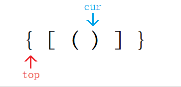

##### 2 [队列实现栈](https://leetcode-cn.com/problems/implement-stack-using-queues/)

使用两个队列实现一个后入先出的栈，并支持普通栈的全部四种操作（`push`、`top`、`pop` 和 `empty`）

> 如用数组用链表实现，换成用队列实现栈。即利用队列的结构和接口函数，也就是队列的特点实现出一个结构，该结构具有栈的特点。

```c
typedef struct {
    Queue q1;
    Queue q2;
} MyStack;
```

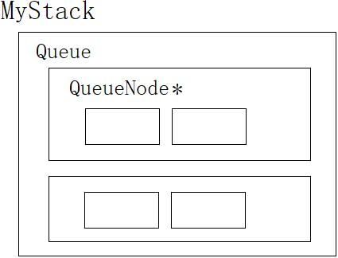

```c
MyStack* myStackCreate() {
    MyStack* st = (MyStack*)malloc(sizeof(MyStack));
    if (st == NULL)
        exit(-1);

    QueueInit(&st->q1);
    QueueInit(&st->q2);
    return st;
}
//调用函数创建堆区结构体并返回

void myStackPush(MyStack* obj, int x) {
    assert(obj);
    //向非空队列Push
    if (!QueueEmpty(&obj->q1))
        QueuePush(&obj->q1, x);
    else
        QueuePush(&obj->q2, x);
}

int myStackPop(MyStack* obj) {
    assert(obj);
    // 定义空与非空队列
    Queue* emptyQ = &obj->q1;
    Queue* nonEmptyQ = &obj->q2;
    if (!QueueEmpty(&obj->q1)) {
        nonEmptyQ = &obj->q1;
        emptyQ = &obj->q2;
    }

    //将非空队列前n-1个元素Push到空队列
    while (QueueSize(nonEmptyQ) > 1) {
        QueuePush(emptyQ, QueueFront(nonEmptyQ));
        QueuePop(nonEmptyQ);
    }

    //Pop最后一个元素并返回
    int top = QueueFront(nonEmptyQ);
    QueuePop(nonEmptyQ);
    return top;
}

int myStackTop(MyStack* obj) {
    assert(obj);
    //返回非空队列队尾元素
    if (!QueueEmpty(&obj->q1))
        return QueueBack(&obj->q1);
    else
        return QueueBack(&obj->q2);
}

bool myStackEmpty(MyStack* obj) {
    assert(obj);
    return QueueEmpty(&obj->q1) && QueueEmpty(&obj->q2); //二者皆空才为空
}

void myStackFree(MyStack* obj) {
    assert(obj);
    QueueDestroy(&obj->q1); //释放队列结点
    QueueDestroy(&obj->q2); //释放结构体

    free(obj);
}
```

1. `Push`，由于栈和队列都是从固定的一端入，故模拟入栈直接向非空队列入即可。

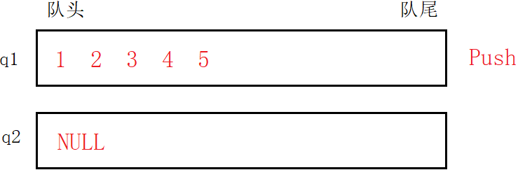

2. `Pop`，模拟出栈时，就要考虑到二者的不同，先删除队列中的前$n-1$个元素并将其入到另一个空队列中。直至第$n$个元素再将其删除。

> 队头出数据，队尾入数据，正好能将非空队列前$n$个元素按照原顺序插入到空队列中。非空队列仅剩最后一个元素再删除掉。将所插队列视为出栈后的栈，便实现模拟出栈的过程。

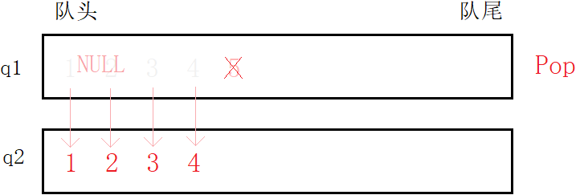

3. `Top`，直接调用队列读取队尾元素的接口函数即可。

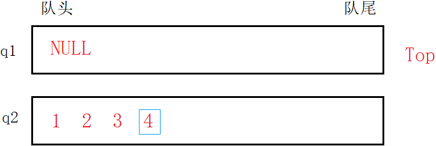

完成任意操作后都会产生一个空队列和一个非空队列。通过加以判断可以将非空队列视为待操作对象。也就是每次操作都是操作非空队列。

##### 3 [栈实现队列](https://leetcode-cn.com/problems/implement-queue-using-stacks/)

使用两个栈实现先入先出队列。队列应当支持一般队列支持的所有操作（`push`、`pop`、`peek`、`empty`）

```c
/**
 * 结构体定义
 **/
typedef int STDataType;
typedef struct Stack {
    STDataType* a;
    int top;
    int capacity;
}ST;
typedef struct {
    ST pushST;
    ST popST;
} MyQueue;
```

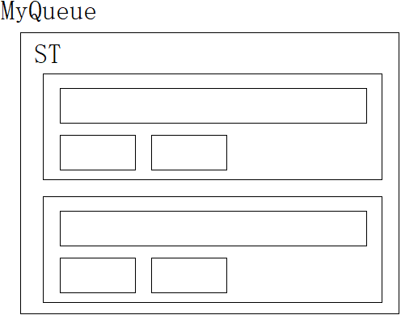

```c
/**
 * 接口函数定义
 **/
MyQueue* myQueueCreate() {
    MyQueue* pq= (MyQueue*)malloc(sizeof(MyQueue));
    if (pq == NULL) {
        exit(-1);
    }
    StackInit(&pq->pushST);
    StackInit(&pq->popST);
    return pq;
}

void myQueuePush(MyQueue* obj, int x) {
    StackPush(&obj->pushST, x);
}

int myQueuePop(MyQueue* obj) {
    //出栈为空，将入栈所有元素移到出栈
    if (StackEmpty(&obj->popST)) {
        while (!StackEmpty(&obj->pushST)) {
            StackPush(&obj->popST, StackTop(&obj->pushST));
            StackPop(&obj->pushST);
        }
    }
    //删除栈顶即队头元素
    int front = StackTop(&obj->popST);
    StackPop(&obj->popST);
    return front;
}

int myQueuePeek(MyQueue* obj) {
    //出栈为空，将入栈所有元素移到出栈
    if (StackEmpty(&obj->popST)) {
        while (!StackEmpty(&obj->pushST)) {
            StackPush(&obj->popST, StackTop(&obj->pushST));
            StackPop(&obj->pushST);
        }
    }
    //返回栈顶即队头元素
    return StackTop(&obj->popST);
}

bool myQueueEmpty(MyQueue* obj) {
    return StackEmpty(&obj->pushST) && StackEmpty(&obj->popST);
}

void myQueueFree(MyQueue* obj) {
    free(&obj->pushST);
    free(&obj->popST);
    free(obj);
}
```

> 由于栈的特点后进先出，将栈中元素移入另一个栈中会造成“逆置”的现象。此时将元素插入到非空栈中会导致顺序发生错误。故指定两个栈分别为入栈`pushST`和出栈`popST`，分别负责入栈和出栈。

1. `Push`，将直接将元素插入到负责入栈的`pushST`中。

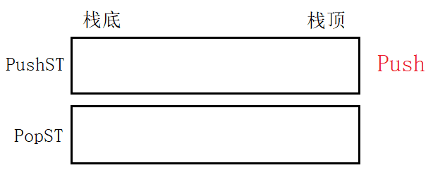

2. `Pop`，`popST`为空，就将`pushST`的元素移到`popST`。再从`popST`栈顶出栈就等于删除`pushST`的栈底元素。

> 将元素从“入栈”移到“出栈”，等于将元素逆置，逆置后的栈出栈操作而言已然和队列的出队一样。相当于将栈底的元素从栈底出栈，也就是从先进后出变成先进先出，模拟实现了出队。


入栈`pushST`和出栈`popST`互不影响，分别完成入队的出队的任务。只要`popST`为空，就将`pushST`中元素移入即可。

##### 4 [实现循环队列](https://leetcode-cn.com/problems/design-circular-queue/)

循环队列可由数组和链表两种方式实现，数组则是通过下标循环，链表是循环链表。

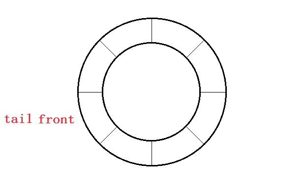

1. 循环队列同样是队列，满足队列的所有性质，
2. 循环队列空间大小固定且可重复利用，
3. 需要多开辟一个元素的空间以用于判满。

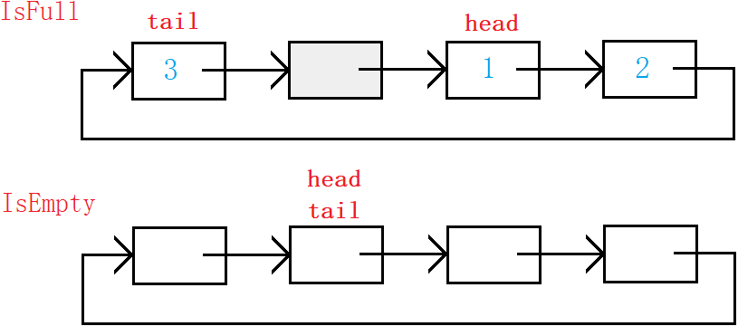

> 由图可得`tail->next==head`即队列满，`tail==head`即队列空。数组利用下标控制即可。利多开一块的空间来判满。

###### 数组实现

```c
/**
 * 结构体定义
 **/
typedef struct {
    int* a;
    int front;
    int tail;
    int k;
} MyCircularQueue;
/**
 * 接口函数定义
 **/
MyCircularQueue* myCircularQueueCreate(int k) {
    //为结构体开辟空间
    MyCircularQueue* cq = (MyCircularQueue*)malloc(sizeof(MyCircularQueue));
    //开辟数组
    cq->a = (int*)malloc((k + 1) * sizeof(int));
    cq->k = k;
    cq->front = cq->tail = 0;
    return cq;
}

bool myCircularQueueEnQueue(MyCircularQueue* obj, int value) {
    assert(obj);
    //插入判断非满
    if (myCircularQueueIsFull(obj)) {
        return false;
    }
    obj->a[obj->tail] = value;
    obj->tail++;
    //回到数组中对应位置
    obj->tail %= obj->k + 1;
    return true;
}

bool myCircularQueueDeQueue(MyCircularQueue* obj) {
    assert(obj);
    //删除判断非空
    if (myCircularQueueIsEmpty(obj)) {
        return false;
    }
    obj->front++;
    obj->front %= obj->k + 1;
    return true;
}

int myCircularQueueFront(MyCircularQueue* obj) {
    assert(obj);
    if (myCircularQueueIsEmpty(obj)) {
        return -1;
    }
    return obj->a[obj->front];
}

int myCircularQueueRear(MyCircularQueue* obj) {
    assert(obj);
    if (myCircularQueueIsEmpty(obj)) {
        return -1;
    }
    /*
    if (obj->tail == 0)
        return obj->a[obj->k];
    else
        return obj->a[obj->tail - 1];
    */
    int i = (obj->tail + obj->k) % (obj->k + 1);
    return obj->a[i];
}

bool myCircularQueueIsEmpty(MyCircularQueue* obj) {
    assert(obj);
    return obj->front == obj->tail;
}

bool myCircularQueueIsFull(MyCircularQueue* obj) {
    assert(obj);
    /*
    if (obj->tail == obj->k)
        return obj->front == 0;
    else
        return obj->tail + 1 == obj->front;
    */
    return obj->tail % (obj->k + 1) == obj->front;
    //tail % (K + 1) + 1 == front
}

void myCircularQueueFree(MyCircularQueue* obj) {
    assert(obj);
    free(obj->a);
    free(obj);
}
```

数组实现，必须要考虑下标溢出的问题。当下标在数组内时，模等上数组长度其值不受影响，当下标溢出时，模等上数组长度就回到数组内对应位置。

> 下标溢出几个单位，模等数组长度后就会回到数组内第几位。

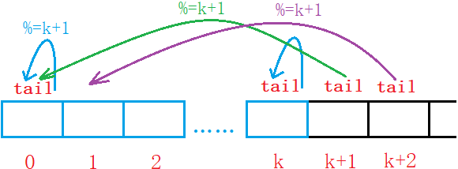

###### 链表实现

```c
typedef int SLTDataType;

typedef struct SLTNode {
    SLTDataType data;
    struct SLTNode* next;
}SLTNode;

typedef struct {
    SLTNode* head;
    SLTNode* tail;
    int k;
} MyCircularQueue;

MyCircularQueue* myCircularQueueCreate(int k) {
    MyCircularQueue* pq = (MyCircularQueue*)malloc(sizeof(MyCircularQueue));
    if (pq == NULL)
        exit(-1);
    pq->k = k;
    //开辟链表
    pq->head = SListNewNode();
    pq->tail = pq->head;
    while (k--) {
        pq->tail->next = SListNewNode();
        pq->tail = pq->tail->next;
    }
    //头尾相连
    pq->tail->next = pq->head;
    //初始化指针
    pq->tail = pq->head;

    return pq;
}

bool myCircularQueueEnQueue(MyCircularQueue* obj, int value) {
    assert(obj);
    if (myCircularQueueIsFull(obj)) {
        return false;
    }
    SListInsert(obj->tail, value);
    obj->tail = obj->tail->next;
    return true;
}

bool myCircularQueueDeQueue(MyCircularQueue* obj) {
    assert(obj);
    if (myCircularQueueIsEmpty(obj)) {
        return false;
    }
    obj->head = obj->head->next;
    return true;
}

int myCircularQueueFront(MyCircularQueue* obj) {
    assert(obj);
    if (myCircularQueueIsEmpty(obj)) {
        return -1;
    }
    return obj->head->data;
}

int myCircularQueueRear(MyCircularQueue* obj) {
    assert(obj);
    if (myCircularQueueIsEmpty(obj)) {
        return -1;
    }
    SLTNode* cur = obj->head;
    while (cur->next != obj->tail) {
        cur = cur->next;
    }
    return cur->data;
}

bool myCircularQueueIsEmpty(MyCircularQueue* obj) {
    assert(obj);
    return obj->head == obj->tail;
}

bool myCircularQueueIsFull(MyCircularQueue* obj) {
    assert(obj);
    return obj->tail->next == obj->head;
}

void myCircularQueueFree(MyCircularQueue* obj) {
    assert(obj);
    SLTNode* cur = obj->head;
    while (cur->next != obj->head) {
        SLTNode* next = cur->next;
        free(cur);
        cur = next;
    }
    free(cur);
    free(obj);
}
```

## 4. 二叉树

> 链表和数组都是线性结构，而树是非线性结构。树是依靠分支关系定义出的一种层次结构。社会亲缘和组织结构都可以用树来表示。
>

### 4.1 树

#### 树的定义

**树是递归定义的，任意一个树都是由一个根结点和多个子树构成**，而其中每个子树也是由一个根结点和多个子树构成。

> - 根结点：每个树有且仅有的一个根结点，根结点无前驱结点。
> - 子树：分成多个互不相交的集合，而每个集合都是一个类似的子树。

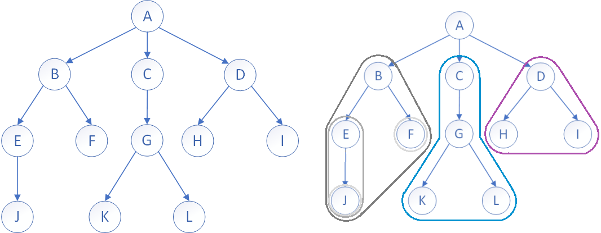

如右图所示，

1. 根结点 $A$ 下面有三个子树，这三个子树又分别以结点 $B$，$C$，$D$ 为根结点。
2. $B$ 结点之下又有两个子树，分别以 $E$，$F$ 为根结点。
3. 结点 $F$ 可以看成只有根结点的树，其子树为空。

> 任何树都可以被分成根和子树。

- 子树是不相交的。
- 每个节点有且仅有一个父节点。
- 一个N个节点的树有N-1条边。

#### 树的相关概念

| 名称           | 定义                                                         |
| :------------- | :----------------------------------------------------------- |
| **叶结点**     | 没有子结点的结点，即整个树中最下方的结点，也称终端结点       |
| **分支结点**   | 含有子结点的结点，除根结点以外的内部结点，或称非终端结点     |
| **子结点**     | 一个结点的子树的根结点，即一个结点的下一个结点               |
| **父结点**     | 若该结点含有子结点，则该结点即为该子结点的父节点             |
| **兄弟结点**   | 所属于相同父节点的子结点，互为兄弟结点                       |
| **结点的层次** | 从根开始，根结点为第1层，根的子结点为第2层，以此类推         |
| **树的高度**   | 树中各个结点的层次的最大值称为树的高度，可以看成树的深度     |
| 结点的度       | 拥有的子树的个数，即子结点的个数，即为结点的度               |
| 树的度         | 树中各个节点的度的最大值称为树的度，可以看成是树的宽度       |
| 堂兄弟结点     | 父节点在同一层次的结点，即其父节点是一个同结点的子节点       |
| **祖先结点**   | 从根结点到该结点，所在分支上的所有结点，都是该结点的祖先结点 |
| 子孙结点       | 与祖先相反，以祖先结点为根的子树中的所有结点都为祖结点的子孙 |
| 森林           | 所有互不相交的树的集合称为森林，一个结点的所有子树即是一个森林 |

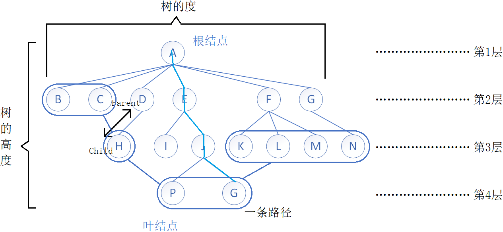

#### 树的结构

> 定义树的结构的方式有很多种，关键在于如何表示相邻结点之间的关系。

##### 孩子表示法

孩子表示法，若已知树的度 $N$，我们这样定义。

```c
struct TreeNode
{
    TNDataType data;
    struct Node* subs[N]; // 存储其所有子结点的指针
};
```

已知树的度，故`subs[N]`足够存储，但不可避免的是一定会浪费空间。

```c
struct TreeNode
{
    TNDataType data;
    SeqList sl;//顺序表存储
};
typedef struct TreeNode* SLDataTypde;
```

针对浪费空间和树的度未知的问题，可以使用线性表替代静态数组存储子结点的指针。但缺点是结构过于复杂。

双亲表示法，结点存自身数据和父结点的下标。用结构体数组存储结点的信息，遍历数组即遍历二叉树。

```c
struct TreeNode
{
    TNDataTypde data;
    int parenti;
};
```

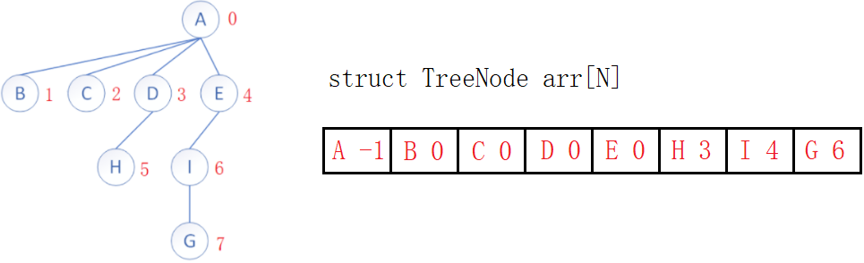

##### 孩子兄弟表示法

> 上面的方式各有优劣，表示树结构的最优方法是**左孩子右兄弟表示法**。

```c
struct TreeNode
{
    TNDataType data;

    struct TreeNode* firstChild;
    struct TreeNode* nextBrother;
};
```

结点的指针域只存两个指针：

- `firstChild`指向该结点的第一个子结点，
- `nextBrother`指向子结点右边的第一个兄弟结点。以此像单链表的形式链接兄弟节点。

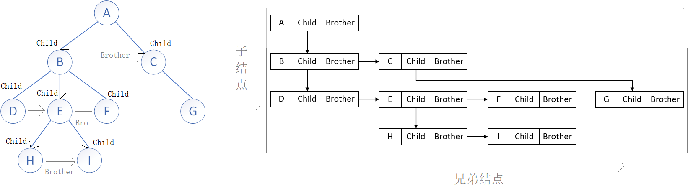

> 第一层，根结点 $A$ ，无兄弟结点。
>
> 第二层，结点 $A$ 的第一个子结点为 $B$，其兄弟结点为 $C$。
>
> 第三层，结点 $B$ 的第一个子结点为 $D$，其兄弟结点为 $E$，$F$。结点 $C$ 的子结点为 $G$。
>
> 第四层，结点 $D$ 无子结点，结点 $E$ 有子结点为 $H$。结点 $F$，$G$ 无子结点 … ….

只要确定根结点，其余所有的结点都可以从其父结点或兄弟结点的指针处找到，如果没有指针就为空。

这种方法不需要确定树的度 $N$，也不需要使用线性表存储，结构不复杂也不浪费空间，不失为树结构的最优表示法。

> 当打开文件树时，弹出的一系列子文件夹，更类似于先找到子结点再找到其兄弟结点。

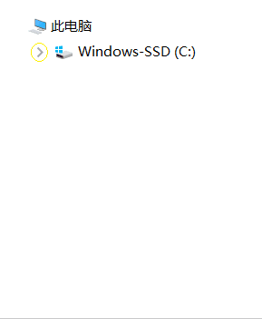

### 4.2 二叉树

> 用于存储和管理数据，最常见的是二叉树。

#### 二叉树的定义

二叉树的每个结点可无子树或者有一个或两个子树，分别称为左子树和右子树。如图：

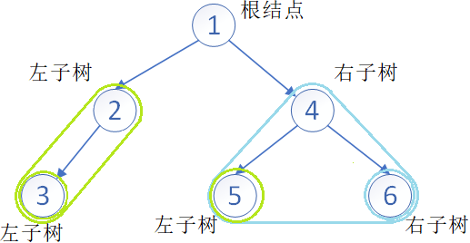

- 二叉树不存在度大于2的结点，二叉树的度最大为2。

> 度为0时树为空。度为1时是线性结构，度为2时存在可能有两个子树的结点。

- 二叉树中结点的子树有左右之分，且次序不可颠倒。
- 任意二叉树由以下几种情况复合而成：

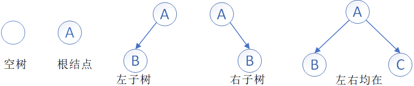

##### 特殊二叉树

二叉树中有两种特殊的二叉树，分别是满二叉树和完全二叉树。

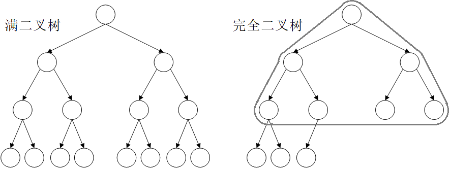

**满二叉树**：所有的叶结点都在最后一层，也就是所有分支结点都有两个子树，也就是每层结点数都到达最大值，这样的数就是满二叉树。

> 假设满二叉树的层数 $h$，则第 $h$ 层的结点数为 $2^{h-1}$，结点总数是$2^h-1$ 。
>
> 若已知结点总数为 $N$， 则树的高度为 $log_2(N+1)$。

**完全二叉树**：完全二叉树的前 $n-1$ 层为满二叉树，最后一层可不满但一定是从左至右连续。

> 满二叉树是一种特殊的完全二叉树。

##### 二叉树的性质

1. 二叉树的第 $i$ 层上最多有 $2^{i-1}$ 个结点。
2. 对于深度为 $h$ 的二叉树，最大结点数为 $2^h-1$，最少节点数为 $2^{h-1}$。
3. 任意二叉树，假设其叶结点个数 $n0$ 总比度为2的分支结点 $n2$ 个数大 $1$，即 $n_0=n_2+1$。

> 二叉树的特点就是：每增加一个分支结点，必然会增加一个叶节点。

4. 完全二叉树度为 $1$ 的结点个数，要么为 $0$，要么为 $1$。
5. 若满二叉树结点总数为 $N$， 则树的高度为 $h=log_2(N+1)$。

#### 二叉树的结构

> 普通二叉树的增删查改无甚意义，更多是学习对二叉树结构的控制。为后期学习搜索二叉树、AVL树和红黑树夯实基础。

##### 顺序存储

顺序存储即**用数组按层序一层一层的存储**。

但“缺枝少叶”的树不好用数组存储，若不浪费空间便不好规律地表示结构。故一般**数组只适用于表示完全二叉树**。

更重要的是，可以利用数组下标计算结点的父子结点位置。如图：

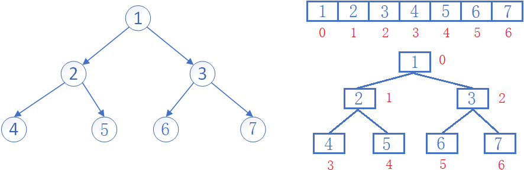

$$
\begin{aligned}
\text{leftChild} = \text{parent} \times 2 + 1 \\
\text{rightChild} = \text{parent} \times 2 + 2
\end{aligned}
$$

$$
\text{parent} = (\text{child} - 1) \; / \; 2
$$

如果子节点下标越界，则说明子节点不存在。

##### 链式存储

使用链表表示二叉树，更加的直观。通常方案有两种一个是二叉链表，一个是三叉链表。二叉链表即存数据域和左右指针域，三叉则多存一个父结点指针。

> 当前数据结构一般都是二叉链，红黑树等高阶数据结构会用到三叉链。当前仅作了解。

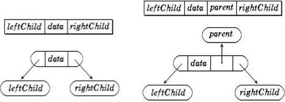

### 4.3 堆

#### 堆的定义

**堆是完全二叉树的一种应用**，故堆采用数组作底层结构。

> 需注意，这个堆是一种数据结构，和内存中的堆没有关系。

定义一个值的集合 $\lbrace k_0,k_1,k_2,...,k_{n-1} \rbrace$，将其以二叉树的形式顺序存储于数组中，且满足一定规律：
$$
K_i ≤ K_{2*i+1}\; \&\& \;  K_i ≤ K_{2*i+2}
$$

- 要求**每个结点都比其子结点小或相等，这样的堆被称为小堆或小根堆**。

$$
K_i ≥ K_{2*i+1}\; \&\& \;  K_i ≥ K_{2*i+2}
$$

- 要求**每个结点都比其子结点大或相等，这样的堆被称为大堆或大根堆**。

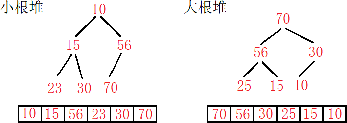

可以看出，堆是一个完全二叉树，且堆中某个结点的值总是不大于或不小于其子结点的值。**但堆并不是有序的，只有存储堆的数组有序，才称堆有序**。

#### 堆的实现

**堆的逻辑结构是一个完全二叉树，物理结构是一个数组**。也可认为完全二叉树实际上是个数组，或着把数组想象成完全二叉树。

##### 堆的结构

```c
typedef int HPDataType;

typedef struct heap {
    HPDataType* a;
    int size;
    int capacity;
}heap;
```

##### 堆的插入

```c
void HeapPush(heap* php, HPDataType x)
{
    assert(php);
    if (php->size == php->capacity)
    {
        int newCapacity = php->capacity == 0 ? 4 : php->capacity * 2;
        HPDataType* tmp = (HPDataType*)realloc(php->a, sizeof(HPDataType) * newCapacity);
        if (tmp != NULL)
        {
            php->a = tmp;
            php->capacity = newCapacity;
        }
    }
    php->a[php->size] = x;
    php->size++;

    //调整
    AdjustUp(php->a, php->size, php->size - 1);
}
```

堆插入就是尾插进数组，本质是在二叉树上加叶结点。

由于插入值不一定，堆的性质可能被破坏。但**插入新结点只会影响其到根结点的这条路径上的结点**，故需要顺势向上调整，一直交换结点直到满足堆的性质。


##### 向上调整

```c
void AdjustUp(HPDataType* a, int size, int child)
{
    assert(a);
    int parent = (child - 1) / 2;

    while (child > 0)
    {
        //大堆
        if (a[child] > a[parent])
            Swap(&a[child], &a[parent]);
        else
            break;

        //迭代
        child = parent;
        parent = (child - 1) / 2;
    }
}
```

向上调整算法，从`child`处一直向上找父结点，满足子结点比父节点大或小的条件就交换，直到调整到根结点或不满足条件为止。

> 堆的向上调整较为容易，因为结点的父结点只有一个，只需要和父节点比较即可。

##### 堆的删除

```c
void HeapPop(heap* php)
{
    assert(php);
    assert(!HeapEmpty(php));

    //删除
    php->a[0] = &php->a[php->size - 1];
    php->size--;

    //调整
    AdjustDown(php->a, php->size, 0);
}
```

堆的删除就是删除堆顶元素，但不能简单的将数组整体向前挪一位，这样会使破坏堆的结构。

应该先修改堆顶元素的值为数组末尾元素的值，再删除数组末尾元素。此时再从堆顶位置向下调整，就能恢复堆结构。

##### 向下调整

```c
//大根堆
void AdjustDown(HPDataType* a, int size, int parent)
{
    int child = parent * 2 + 1;

    while (child < size) // 等遍历到叶节点时，child迭代到叶节点的子节点必越界
    {
        if (child + 1 < size && a[child + 1] > a[child]) // 选出大子结点
            child++;

        //交换
        if (a[child] > a[parent])
            Swap(&a[child], &a[parent]);
        else
            break;

        //迭代
        parent = child;
        child = parent * 2 + 1;
    }
}
```

把尾元素换到堆顶，必然会改变堆的性质。但根结点的左右子树还是保持原有的性质。所以只需要将堆顶元素逐步向下调整。

以大根堆为例，从根开始，将当前结点与其较大的子结点进行交换，直到走到叶结点或不满足条件为止。


> 将较大的子结点换上来就是在恢复大堆性质，将较小的子结点交换上来是在恢复小堆性质。

堆的插入删除的时间复杂度，也就是向上向下调整算法的时间复杂度都是 $logN$。

##### 建堆

给出数组`a`，数组逻辑上可以看成完全二叉树，但并不一定是堆。**建堆就是将数组调整成堆**。

###### 方法1：向上调整

从根结点开始，依次将数组元素“插入”堆，与其说是“插入”不如说是“加入”。利用下标遍历数组，每插入一个就调整一次。

> 假设需要将`a`排成升序，不妨先试试将`a`数组构建成小堆：

```c
//建堆
void HeapBuild(int* a, int sz) {
    //向上调整
    for (int i = 1; i < sz; i++) {//从第二个结点开始遍历到尾结点
        AdjustUp(a, sz, i);
    }
}
```


每加入一个元素，就向上调整。思想上其实和接口`Push`是一样的，都是插入再调整。也可以理解为“边建边调”。


###### 方法2：向下调整

此时数组当然还不是堆，向下调整算法要求左右子树必须满足堆的性质，才能将当前节点向下调整。应先从最后一个子树开始向下调整，从后向前倒着遍历。

> 准确来说，因为叶结点必然满足堆的性质，所以不用关心。应**从尾结点的父结点所在子树开始**，遍历到根结点进行调整。


```c
//建堆
void HeapBuild(int* a, int sz) {
    //向下调整
    for (int i = (sz - 1 - 1) / 2; i >= 0; i--) {//从最后一个叶结点的父结点开始到根结点
        AdjustDown(a, sz, i);
    }
}
```


从一个完全二叉树的尾结点的父结点开始，从后往前调，也可以看成“建完在调”。


> 建堆的两种方式，向上调整和向下调整都是可行的。建大堆还是建小堆，只要改比较符号即可。

###### 建堆复杂度

> 遍历数组n个节点，每个节点调整logn次，故向上调整建堆的时间复杂度为$O(n*logn)$ 。
>
> 向上调整算法复杂度过高，建堆一般配合堆排序使用的是**向下调整算法**。


向下调整的最复杂情况是从根结点一直调整到叶结点，并以满二叉树为例，看最复杂情况。

假设当前树有 $n$ 个结点，树的高度为 $h$ ，可得：

1. 第 1 层有 $2^0$ 个结点，每个结点最多调整 $h-1$ 次，
2. 第 2 层有 $2^1$ 个结点，每个结点最多调整 $h-2$ 次，
3. 以此类推，第 $h-1$ 层有 $2^{h-2}$ 个结点，每个结点最多调整 $1$ 次。

精确计算下，第 $x$ 层的所有节点的总调整次数，应为 $2^{x-1}*(h-x)$。


> $T(n)$ 为差比数列，利用错位相减法得 $T(n)$ 关于 $h$ 的表达式，再由 $n=2^h-1$,$h=log_2{(n+1)}$ 将$T(n)$转换成关于的$n$的表达式。

由此可得，**向下调整建堆的时间复杂度为 $O(n)$**。

#### 3.4 堆的应用

##### 堆排序

> 将数组排成升序，建成大堆还是小堆呢？
>
> 如果建成小堆，每次只能确定一个最小值，若想选出次小的数，就要从下一个位置开始重新建堆，整体复杂度为 $O(N^2)$，显然是不可取的。

升序需建大堆，逻辑如下：

1. 建大堆，选出最大的数；
2. 首尾元素互换，致使最大的数被移至末尾；
3. 将尾元素排除出堆，继续开始向下调整，选出次大的数被移到首位。

再首尾互换，如此循环往复，直到调整到根结点，时间复杂度为$O(N*logN)$ 。


由此可得，**排升序建大堆，排降序建小堆**。


```c
void HeapSort(int* a, int n)
{
    //1. 建堆
    for (int i = (n - 2) / 2; i >= 0; --i)
        AdjustDown(a, n, i);

    //2. 排序
    for (int i = sz - 1; i > 0; i--) // i==0就结束，i=0时无意义且逻辑错误
    {
        Swap(&a[0], &a[i]); // 首尾互换
        AdjustDown(a, i, 0);// 向下调整
    }
}
```

##### Top-K问题

Top-K问题，在N个元素中找出前K个最值。**依旧是升序建大堆，降序建小堆**。

> 最容易想到的方案：建立一个 N 个数的大堆。去堆顶 K 次。缺点：浪费空间，复杂度高。那什么样的好呢？

1. 用前 $K$ 个数建立一个 $K$ 个元素的小堆；
2. 剩下 $N-K$ 个元素跟堆顶比较，比堆顶大则替换堆顶并向下调整；
3. 遍历结束，最后小堆中的 $K$ 个元素就是最大值。

> 此方法本质可以理解成：遍历N个数，取其最大值放到K个数的集合中。

```c
void TopK(int* a, int n, int k)
{
    int minHeap[5];

    // 建堆
    for (int i = 0; i < k; i++)
        minHeap[i] = a[i];
    for (int i = (k - 2) / 2; i >= 0; --i)
        AdjustDown(minHeap, k, i);

    // 比较
    for (int i = k; i < n; i++)
    {
        if (val > minHeap[0])
        {
            minHeap[0] = a[i];
            AdjustDown(minHeap, k, 0);
        }
    }
}
```

最坏情况可以是数组剩余N-K个数全部被K个数大，全部要进堆调整。时间复杂度为 $O(N*logK)$，空间复杂度为 $O(K)$。

### 4.4 二叉树的链式结构

#### 二叉树的遍历

##### 链式结构

> 二叉树结构不利于存储数据，其增删查改没有意义。二叉树的价值体现在一些特定的二叉树上，如AVL树、红黑树、B树等。

二叉树的特点在于**树可以被分成三个部分：根结点，左子树，右子树**。空树是不可再分的最小单位。


##### 前中后序遍历

| 遍历方式          | 解释                                       |
| ----------------- | ------------------------------------------ |
| 前序遍历/先序遍历 | 先访问根结点，再访问左子树，最后访问右子树 |
| 中序遍历          | 先访问左子树，再访问根结点，最后访问右子树 |
| 后序遍历          | 先访问左子树，再访问右子树，最后访问根结点 |

上述二叉树以前序、中序、后序遍历所得结果分别为：
$$
A\quad B\quad D\quad \0\quad \0\quad \0\quad C\quad E\quad \0\quad \0\quad F\quad \0\quad \0
$$

$$
\0\quad D\quad \0\quad B\quad \0\quad A\quad \0\quad E\quad \0\quad C\quad \0\quad F\quad \0
$$

$$
\0\quad \0\quad D\quad \0\quad B\quad \0\quad \0\quad E\quad \0\quad \0\quad F\quad C\quad A
$$

> 前中后序遍历都是递归分治思想的体现。写出空树才能反映出遍历的全部过程，省略掉空树就是结果。


```c
//前序遍历
void PreOrder(BTNode* root)
{
    if (root == NULL) {
        printf("\\0 ");
        return;
    }
    printf("%c ", root->data);

    PreOrder(root->left);
    PreOrder(root->right);
}

//中序遍历
void InOrder(BTNode* root)
{
    if (root == NULL) {
        printf("\\0 ");
        return;
    }
    InOrder(root->left);
    printf("%c ", root->data);
    InOrder(root->right);
}

//后序遍历
void PostOrder(BTNode* root)
{
    if (root == NULL) {
        printf("\\0 ");
        return;
    }
    PostOrder(root->left);
    PostOrder(root->right);

    printf("%c ", root->data);
}
```


**三种遍历方式的递归调用逻辑完全相同，访问结点的顺序是相同的。只是打印数据的时机不同，故结果不同**。

##### 层序遍历

层序遍历即从上往下一层一层遍历，层序遍历用队列实现。

```c
void levelOrder(BTNode* root) {
    if (root == NULL) {
        return;
    }
    Queue q;
    QueueInit(&q);
    //1. 头结点入队
    QueuePush(&q, root);
    while (!QueueEmpty(&q)) {
        BTNode* front = QueueFront(&q);
        printf("%d ", front->data);
        //2. 队头出队
        QueuePop(&q);
        //3. 子结点入队
        if (front->left) {
            QueuePush(&q, front->left);
        }
        if (front->right) {
            QueuePush(&q, front->right);
        }
    }
    QueueDestroy(&q);
}
```

1. 创建一个队列，先入根结点，
2. 出队头结点，再入队头的子结点。这样一层结束会把下一层全带进队。

3. 队列为空时，遍历结束。

> 保持队列不为空的情况下循环往复，最后一层遍历完子结点全为空才会导致队列元素越来越少最终队列为空。


#### 二叉树的练习


递归也就是分治思想，分而治之——大事化小，小事化了。接下来的几个二叉树基础练习全部采用递归的策略实现。

##### 二叉树结点个数

```c
//1.
void BinaryTreeSize(BTNode* root, int* pcount) {
    if (root == NULL) {
        return;
    }
    (*pcount)++;
    BinaryTreeSize(root->left, pcount);
    BinaryTreeSize(root->right, pcount);
}
//2.
int BinaryTreeSize(BTNode* root)
{
    if (root == NULL)
        return 0;

    return BinaryTreeSize(root->left) + BinaryTreeSize(root->right) + 1;
}
```

使用计数器的话，要像OJ一样传入主函数中变量的地址。不推荐。

用递归分治的思想的话，求任意树的结点个数都可以看成**一类相同的问题**，即左子树结点个数+右子树结点个数+1，然后再去大事化小：

##### 二叉树叶结点个数

```c
int BinaryTreeLeafSize(BTNode* root) {
    //为空
    if (root == NULL)
        return 0;
    //为叶
    if (root->left == NULL && root->right == NULL)
        return 1;
    //非空
    return BinaryTreeLeafSize(root->left) + BinaryTreeLeafSize(root->right);
}
```

空树的叶节点个数为0。其他普通树的叶结点个数是其左右子树的叶结点个数之和。
叶结点特征是左右子结点都为空。


##### 二叉树任意层结点个数

```c
int BinaryTreeLevelkSize(BTNode* root, int k) {
    if (root == NULL)
        return 0;
    if (k == 1)
        return 1;

    return BinaryTreeLevelkSize(root->left, k-1) + BinaryTreeLevelkSize(root->right, k-1);
}
```

1. 求A树的第$k$层结点个数，可以转化成就其左右子树，即B树的第$k-1$层结点个数+C树的第$k-1$层结点个数。
2. 求B树的第$k-1$层结点个数，即D树的第$k-2$层结点个数+`null`树的第$k-2$层结点个数。
3. 以此类推，空树结点个数为0，当k=1即遍历到第k层的结点。非空k也不等于0则转换成求左右子树的结点个数。

##### 二叉树高度

```c
int BinaryTreeDepth(BTNode* root) {
    if (root == NULL)
        return 0;

    return max(BinaryTreeDepth(root->left), BinaryTreeDepth(root->right)) + 1;
}
```

空树的高度为0，其他树的高度是左右子树的高度最大值+1即可。

求树的结点总数和求树的高度都是经典的后序遍历问题，都是先遍历左右树再访问根结点。

##### 二叉树查找

```c
BTNode* BinaryTreeFind(BTNode* root, BTDataType x)
{
    if (root == NULL)
        return NULL;
    if (root->data == x)
        return root;

    BTNode* ret = BinaryTreeFind(root->left, x);
    if (ret)
        return ret;

    ret = BinaryTreeFind(root->right, x);
    if (ret)
        return ret;

    return NULL;
}
```

二叉树查找结点是典型的前序遍历。A不是就到A的左右子树中去找。第三种情况下，必须加以判断，不为空时才返回不然无法遍历右子树。

##### 二叉树销毁

```c
void BinaryTreeDestroy(BTNode* root) {
    if (!root) {
        return;
    }
    BinaryTreeDestroy(root->left);
    BinaryTreeDestroy(root->right);
    free(root);
}
```

释放了结点就找不到它的子结点了，所以采用后序遍历的方式。

### 4.5 二叉树的OJ题

| OJ链接                                                       | 题解链接                                                     |
| ------------------------------------------------------------ | ------------------------------------------------------------ |
| [单值二叉树](https://leetcode-cn.com/problems/univalued-binary-tree/) | [题解链接](https://leetcode.cn/problems/univalued-binary-tree/solutions/1993014/by-8hasefu1-kb3n/) |
| [相同二叉树](https://leetcode-cn.com/problems/same-tree/) | [题解链接](https://leetcode.cn/problems/same-tree/solutions/1993011/by-8hasefu1-2mpj/?orderBy=newest_to_oldest) |
| [对称二叉树](https://leetcode-cn.com/problems/symmetric-tree/) | [题解链接](https://leetcode.cn/problems/symmetric-tree/solutions/1993013/by-8hasefu1-l1ti/) |
| [前](https://leetcode-cn.com/problems/binary-tree-preorder-traversal/)[中](https://leetcode-cn.com/problems/binary-tree-inorder-traversal/)[后序遍历](https://leetcode-cn.com/problems/binary-tree-postorder-traversal/) | [题解链接](https://leetcode.cn/problems/binary-tree-postorder-traversal/solutions/1994908/by-8hasefu1-eapg/) |
| [另一棵树的子树](https://leetcode-cn.com/problems/subtree-of-another-tree/) | [题解链接](https://leetcode.cn/problems/subtree-of-another-tree/solutions/1993010/by-8hasefu1-ek0y/?orderBy=newest_to_oldest) |
| [判断完全二叉树](https://leetcode.cn/problems/check-completeness-of-a-binary-tree/description/) | [题解链接](https://leetcode.cn/problems/check-completeness-of-a-binary-tree/solutions/1953087/by-8hasefu1-of6e/) |
| [遍历创建树](https://www.nowcoder.com/practice/4b91205483694f449f94c179883c1fef) | [题解链接](https://www.nowcoder.com/discuss/post/426279733878415360) |

## 5. 二叉搜索树

> 普通二叉树的意义不大，只有加上一些性质才能发挥其作用。比如堆和二叉搜索树。

### 5.1 二叉搜索树的概念

二叉搜索树又称二叉排序树，它可以是一颗空树，或者是一个满足如下性质的二叉树：

- 如果左子树不为空，**左子树上所有节点的值都小于根节点**；
- 如果右子树不为空，**右子树上所有节点的值都大于根节点**；

且它的左右子树，也满足上述性质。


```cpp
template<class K>
struct bstree_node
{
    bstree_node<K>(K key)
        : _left(nullptr), _right(nullptr), _key(key)
    {}

    bstree_node<K>* _left;
    bstree_node<K>* _right;
    K _key;
};

template<class K>
class bstree
{
public:
  typedef bstree_node<K> node;
private:
    node* _root = nullptr;
};
```

二叉搜索树最大的问题是会退化，比如顺序插入时就会退化成一个链表。


搜索二叉树的效率体现在搜索上，最坏情况搜索高度次。所以树的高度越低，性能越好。所以一般不会使用单纯的搜索二叉树，而是使用升级版的AVL树和红黑树。

### 5.2 二叉搜索树的接口

#### 查找

若根节点不为空：

- 如果节点值等于 $key$，返回 $true$，
- 如果节点值小于 $key$，到其右子树中查找，
- 如果节点值大于 $key$，到其左子树中查找，

走到空树还没找到，则返回 $false$。


##### 非递归查找

```cpp
bool find(const K& key)
{
    node* cur = _root;
    while (cur)
    {
        if (key < cur->_key)
            cur = cur->_left;
        else if (key > cur->_key)
            cur = cur->_right;
        else
            return true;
    }
    return false;
}
```

二叉搜索树的查找非常的迅速，在二叉树相对平衡的情况下，时间复杂度高度次 $O(logN)$。最差是线性状态，为 $O(N)$。

##### 递归查找

```cpp
bool find_r(const K& key)
{
    return _find_r(_root, key);
}

bool _find_r(node* root, const K& key)
{
    if (root == nullptr)
        return false;

    if (key < root->_key)
        return _find_r(root->_left, key);
    else if (key > root->_key)
        return _find_r(root->_right, key);
    else
        return true;
}
```

#### 中序遍历

二叉搜索树的中序遍历结果，就是树中元素排成升序的结果。

```cpp
void inorder()
{
    _inorder(_root);
    std::cout << std::endl;
}

void _inorder(node* root)
{
    if (root == nullptr)
        return;

    _inorder(root->_left);
    std::cout << root->_key << " ";
    _inorder(root->_right);
}
```

一般成员函数在类外调用时，无法直接传入成员变量作参数。故可以将主体逻辑包装成子函数，再由成员函数去调用即可。

```cpp
void testBSTree()
{
    BSTree<int> t;
    int a[] = { 7,1,3,6,4,8,7,9,3,2,5 }; //排序数组
    for (auto e : a) {
        t.Insert(e); //插入二叉搜索树
    }
    t.Inorder(); //中序遍历
}
```

如上代码，相当于利用二叉搜索树排序数组，而二叉搜索树结构天然具有排序加去重的功能。

#### 插入

二叉搜索树的插入也很简单，共分两种情况：

1. 树为空，则直接插入，
2. 树不为空，则按性质查找到插入位置，再插入新节点。


`cur`指针进行比较并向下移动的同时，父指针`parent`始终指向`cur`的父节点。当`cur`走到空的时候，就创建新节点并链接到父节点的指针上。

1. 插入的值比当前节点的值小，则插入到左子树中，
2. 反之，比当前节点的值大，则插入到右子树中。

##### 非递归插入

```cpp
bool insert(const K& key)
{
    if (_root == nullptr)
    {
        _root = new node(key);
        return true;
    }

    node* cur = _root;
    node* parent = nullptr;

    while (cur)
    {
        if (key < cur->_key)
        {
            parent = cur;
            cur = cur->_left;
        }
        else if (key > cur->_key)
        {
            parent = cur;
            cur = cur->_right;
        }
        else
            return false;
    }

    if (key < parent->_key)
        parent->_left = new node(key);
    else
        parent->_right = new node(key);

    return true;
}
```

可见，二叉搜索树的每次插入都是把节点放在叶节点的位置上。

##### 递归插入

```cpp
bool insert_r(const K& key)
{
    return _insert_r(_root, key);
}

bool _insert_r(node*& root, const K& key)
{
    if (root == nullptr)
    {
        root = new node(key);
        return true;
    }

    if (key < root->_key)
        return _insert_r(root->_left, key);
    else if (key > root->_key)
        return _insert_r(root->_right, key);
    else
        return false;
}
```

参数类型是**节点指针的引用**，使得root不仅是节点指针，还是其父节点的左或右孩子指针，修改root也就修改了父节点的左右孩子。


#### 删除

二叉搜索树的难点在于删除，因为节删除节点需要维护剩余节点的链接关系。

删除叶节点很容易，释放节点并置空父节点的指针即可。删除非叶结点，可以将子树中满足条件的节点替换上来。

如果节点不存在先返回 $false$，如果存在，则分以下几种情况：

| 直接删除               | 解释                                                   |
| ---------------------- | ------------------------------------------------------ |
| 删除的节点有单个子节点 | 左为空就让父节点指向右子树，右为空就让父节点指向左子树 |
| 删除的节点无子节点     | 归类到上一类处理                                       |


| 替换删除                 | 解释                                               |
| ------------------------ | -------------------------------------------------- |
| 删除的节点左右子节点都有 | 用左树的最大节点，或右树的最小节点，替换被删节点。 |


1. 先将左树最大节点或右树最小节点覆盖待删除的节点。
2. 再将左树最大节点的左孩子，或右树最小节点的右孩子托付给父节点。

##### 非递归删除

```cpp
bool erase(const K& key)
{
    node* parent = nullptr;
    node* cur = _root;

    while (cur)
    {
        if (key < cur->_key)
        {
            parent = cur;
            cur = cur->_left;
        }
        else if (key > cur->_key)
        {
            parent = cur;
            cur = cur->_right;
        }
        else
        {
            if (!cur->_left)
            {
                if (parent == nullptr)
                    _root = _root->_right;
                else if (cur == parent->_left)
                    parent->_left = cur->_right;
                else
                    parent->_right = cur->_right;
                delete cur;
            }
            else if (!cur->_right)
            {
                if (parent == nullptr)
                    _root = _root->_left;
                else if (cur == parent->_left)
                    parent->_left = cur->_left;
                else
                    parent->_right = cur->_left;
                delete cur;
            }
            else
            {
#ifdef 方式1
                node* min = cur->_right;
                while (min->_left)
                    min = min->_left;

                K minkey = min->_key;
                erase(min->_key);
                cur->_key = minkey;
#endif

#ifdef 方式2
                node* min_parent = cur;
                node* min = cur->_right;

                while (min->_left)
                {
                    min_parent = min;
                    min = min->_left;
                }

                cur->_key = min->_key;

                if (min == min_parent->_left)
                    min_parent->_left = min->_right;
                else
                    min_parent->_right = min->_right;
                delete min;
#endif
            }
            return true;
        }
    }
    return false;
}
```


##### 递归删除

```cpp
bool erase_r(const K& key)
{
    return _erase_r(_root, key);
}

bool _erase_r(node*& root, const K& key)
{
    if (root == nullptr)
        return false;

    if (key < root->_key)
        return _erase_r(root->_left, key);
    else if (key > root->_key)
        return _erase_r(root->_right, key);
    else
    {
        node* del = root;

        if (!root->_left)
            root = root->_right;
        else if (!root->_right)
            root = root->_left;
        else
        {
            node* min = root->_right;
            while(min->_left)
                min = min->_left;

            // min = min->_right; // ERR
            root->_key = min->_key;
            // return _erase_r(min, min->_key); // ERR
            return _erase_r(root->_right, min->_key);
        }

        delete del;
        return true;
    }
}
```

### 5.3 二叉搜索树的应用

搜索树有两种应用，`key`搜索模型和`key/value`搜索模型。此外，二叉搜索树插入重复值会失败，所以自带去重功能。

#### key搜索模型

key搜索模型查找返回真假，只能用来判断数据是否存在。应用场景如存储车牌号判断是否放行等。

#### kv搜索模型

通过`key`查找对应`value`，两个值是强相关的映射关系。 应用场景如中英互译，身份绑定等。

```cpp
template<class K, class V>
struct bstree_node
{
    bstree_node<K, V>* _left;
    bstree_node<K, V>* _right;
    K _key;
    V _val;

    bstree_node<K, V>(const K& key, const V& val)
        : _key(key), _val(val), _left(nullptr), _right(nullptr)
    {}
};

template<class K, class V>
class bstree
{
    typedef bstree_node<K, V> node;
public:
    bool insert(const K& key, const V& val)
    {
        if (_root == nullptr)
        {
            _root = new node(key, val);
            return true;
        }

        node* parent = nullptr;
        node* cur = _root;

        while (cur)
        {
            if (key < cur->_key)
            {
                parent = cur;
                cur = cur->_left;
            }
            else if (key > cur->_key)
            {
                parent = cur;
                cur = cur->_right;
            }
            else
                return false;
        }

        if (key < parent->_key)
            parent->_left = new node(key, val);
        else if (key > parent->_key)
            parent->_right = new node(key, val);

        return true;
    }

    node* find(const K& key)
    {
        node* cur = _root;

        while (cur)
        {
            if (key < cur->_key)
                cur = cur->_left;
            else if (key > cur->_key)
                cur = cur->_right;
            else
                return cur;
        }
        return nullptr;
    }

    bool erase(const K& key)
    {
        node* parent = nullptr;
        node* cur = _root;

        while (cur)
        {
            if (key < cur->_key)
            {
                parent = cur;
                cur = cur->_left;
            }
            else if (key > cur->_key)
            {
                parent = cur;
                cur = cur->_right;
            }
            else
            {
                if (!cur->_left)
                {
                    if (!parent)
                        _root = _root->_right;
                    else if (cur == parent->_left)
                        parent->_left = cur->_right;
                    else
                        parent->_right = cur->_right;
                    delete cur;
                }
                else if (!cur->_right)
                {
                    if (!parent)
                        _root = _root->_left;
                    else if (cur == parent->_left)
                        parent->_left = cur->_left;
                    else
                        parent->_right = cur->_left;
                    delete cur;
                }
                else
                {
                    node* min_parent = cur;
                    node* min = cur->_right;

                    while (min->_left)
                    {
                        min_parent = min;
                        min = min->_left;
                    }

                    cur->_key = min->_key;
                    cur->_val = min->_val;

                    if (min == min_parent->_left)
                        min_parent->_left = min->_right;
                    else
                        min_parent->_right = min->_right;
                    delete min;
                }

                return true;
            }
        }
        return false;
    }

    void inorder()
    {
        _inorder(_root);
        cout << endl;
    }

    void _inorder(node* root)
    {
        if (!root)
            return;

        _inorder(root->_left);
        cout << root->_key << "-" << root->_val << endl;
        _inorder(root->_right);
    }

private:
    node* _root = nullptr;
}
```

### 5.4 oj题

| OJ链接                                                       | 题解链接                                                     |
| ------------------------------------------------------------ | ------------------------------------------------------------ |
| [606. 根据二叉树创建字符串](https://leetcode.cn/problems/construct-string-from-binary-tree/) | [题解](https://leetcode.cn/problems/construct-string-from-binary-tree/solutions/2291966/jian-ji-ming-liao-zhu-shi-jiang-jie-di-g-iudh/) |
| [102. 二叉树的分层遍历](https://leetcode.cn/problems/binary-tree-level-order-traversal/) | [题解](https://leetcode.cn/problems/binary-tree-level-order-traversal/solutions/2291972/jian-ji-ming-liao-c-er-cha-shu-de-ceng-x-ndwk/) |
| [107. 二叉树的层序遍历 II](https://leetcode.cn/problems/binary-tree-level-order-traversal-ii/) | [题解](https://leetcode.cn/problems/binary-tree-level-order-traversal-ii/solutions/2293279/jian-ji-ming-liao-cpp-er-cha-shu-de-ceng-tn7m/) |
| [236. 二叉树的最近公共祖先](https://leetcode.cn/problems/lowest-common-ancestor-of-a-binary-tree/) | [题解](https://leetcode.cn/problems/lowest-common-ancestor-of-a-binary-tree/solutions/2293330/jian-ji-ming-liao-cpp-er-cha-shu-de-zui-ggk53/) |
| [剑指 Offer 36. 二叉搜索树与双向链表](https://leetcode.cn/problems/er-cha-sou-suo-shu-yu-shuang-xiang-lian-biao-lcof/) | [题解](https://leetcode.cn/problems/er-cha-sou-suo-shu-yu-shuang-xiang-lian-biao-lcof/solutions/2294534/tong-su-xiang-xi-jie-shi-cpp-er-cha-sou-6b4nk/) |
| [105. 从前序与中序遍历序列构造二叉树](https://leetcode.cn/problems/construct-binary-tree-from-preorder-and-inorder-traversal/) | [题解](https://leetcode.cn/problems/construct-binary-tree-from-preorder-and-inorder-traversal/solutions/2294541/cong-qian-xu-yu-zhong-xu-bian-li-xu-lie-mrrur/) |
| [106. 从中序与后序遍历序列构造二叉树](https://leetcode.cn/problems/construct-binary-tree-from-inorder-and-postorder-traversal/) | [题解](https://leetcode.cn/problems/construct-binary-tree-from-inorder-and-postorder-traversal/solutions/2294542/cong-zhong-xu-yu-hou-xu-bian-li-xu-lie-g-byuq/) |
| [144. 二叉树的前序遍历](https://leetcode.cn/problems/binary-tree-preorder-traversal/) | [题解](https://leetcode.cn/problems/binary-tree-preorder-traversal/solutions/2294543/er-cha-shu-de-qian-xu-bian-li-by-8hasefu-3l7s/) |
| [94. 二叉树的中序遍历](https://leetcode.cn/problems/binary-tree-inorder-traversal/) | [题解](https://leetcode.cn/problems/binary-tree-inorder-traversal/solutions/2294544/er-cha-shu-de-zhong-xu-bian-li-by-8hasef-vpz7/) |
| [145. 二叉树的后序遍历](https://leetcode.cn/problems/binary-tree-postorder-traversal/) | [题解](https://leetcode.cn/problems/binary-tree-postorder-traversal/solutions/2339883/dong-tu-jian-ji-ming-liao-cpp-fei-di-gui-i7jx/) |

## 6. 排序

> 常见并实用的排序有如下八种。


### 6.1 插入排序

#### 直接插入排序

##### 基本思想

直接插入排序是最简单的插入排序，摸扑克牌时，需要将摸到的牌按顺序插入到已有的牌中，这里便运用了直接插排的思想。

插入排序的定义：把待排的元素按规则逐个插入到一个有序序列中，直到所有元素插完为止，得到一个新的有序序列。


##### 代码实现


首先有一个有序数组，此外有一个元素待插入到该数组中。

1. 只要当前元素大于待插元素，就将当前元素向后移动一位，
2. 直到当前元素比待插元素小或相等或者下标越界，然后退出循环，
3. 将待插元素插入当前下标位置的下一个位置。


> 如图所示，我们把数组end位置的后一个元素作为待插元素x。

```c
//1. 单趟排序 -- 针对一个元素的排序
void InsertSort(int* a, int n)
{
    int end = n - 2;
    int x = a[end + 1];

    while (end >= 0)
    {
        if (a[end] > x)
            a[end + 1] = a[end];
        else
            break;

        end--;
    }
    a[end + 1] = x;
}
```

排序一般分为内外两层循环，内循环调整当前待插元素位置，而外循环决定调整待插元素。

最开始 $end=0$，也就是不存在已排好的数据，

1. 将数组的尾部元素 $end$ 的下一个元素看成待插元素 $x$ ，再将待插元素运用单趟排序插入数组中。
2. 将数组尾部下标 $end$ 向后挪一位，重复上述过程。
3. 以此类推，直到 $end$ 指向整个数组的尾部，整个数组就都有序。

故只要加一个外循环，**控制标识尾部指针 $end$ 遍历为 $[0,n-1)$**，这样便能完成对整个数组的排序。


```c
void insert_sort(int* a, int n)
{
    for (int i = 0; i < n - 1; i++)
    {
        int end = i;
        int x = a[i + 1];

        while (end >= 0)
        {
            if (a[end] > x)
                a[end + 1] = a[end];
            else
                break;
            end--;
        }

        a[end + 1] = x;
    }
}
```


##### 复杂度分析

- 最好情况为数组有序或接近有序，但仍需遍历一遍，时间复杂度为$O(n)$，
- 最坏情况为数组逆序，所有元素都要调整，时间复杂度为$O(n^2)$ 。

> 外循环循环 $n$ 次，内循环次数从1开始逐次增加。故总循环次数为等差数列之和 $1+2+…+n-1$。

无额外空间消耗，空间复杂度为 $O(1)$ 。

> 直接插排对于数组接近有序的情况非常的快，而在数组完全逆序的情况下表现非常慢。

#### 希尔排序

直接插排在数据不接近有序的情况下表现的不尽人意。故Shell想出在直接插排的前面进行预排序，使得数据接近有序，这样直接插排的性能就得到优化，这就是希尔排序。

##### 分组预排

先预排序数组，使数组变得接近有序（大的尽量在后面，小的尽量在前面），此时再去直接插排。

**按`gap`分组，对分组产生的“小数组”，使用直接插入排序**。

- 假设 gap 为3，则每三个元素分成一组，将一组的元素看成一个数组，忽略数组中其他元素。


> 4,5,2,0 为一组，3,1,8 为一组，6,7,9 为一组。gap 同时也是组的个数。

- 将每个分组产生的“数据小组”看成一个数组，对每一个这样的数组进行直接插排，过程如图所示：


> 预排序所得结果虽不是完全有序，但相对于原数组确实是更加有序的。


##### 代码实现

###### 单组预排

```c
void ShellSort(int* a, int n)
{
    int gap = 3;
    for (int j = 0; j < gap; j++) // 分3组
    {
        for (int i = j; i < n - gap; i += gap)
        {
            int end = i;
            int x = a[end + gap];

            while (end >= j)
            {
                if (a[end] > x)
                    a[end + gap] = a[end];
                else
                    break;

                end -= gap;
            }

            a[end + gap] = x;
        }
    }
}
```

`gap`即是间隔长度，也是组的个数。

1. 第一层循环：控制“分组小数组”的起始位置。
2. 第二层循环：执行间距为 gap 的预排，也就是小组的直接插排。

###### 多组预排

```cpp
void shell_sort(int* a , int n)
{
    int gap = n;
    while (gap > 0) // gap不断减小分组预排多次
    {
        gap = gap / 3 + 1; // 保证最后一定gap=1执行最后一次直接插排

        for (int j = 0; j < gap; j++)
        {
            for (int i = j; i < n - gap; i += gap)
            {
                int end = i;
                int x = a[end + gap];

                while (end >= j)
                {
                    if (a[end] > x)
                        a[end + gap] = a[end];
                    else
                        break;

                    end -= gap;
                }

                a[end + gap] = x;
            }
        }
    }
}
```

> 对于预排序来说，`gap`越大，效果越差，但时间消耗越小；而`gap`越小，效果越好，但时间消耗就越大。

由于直接插排的复杂度特点，可能逐步减小的希排复杂度比一次直接插排的复杂度更低。故**执行多次预排来优化预排结果。控制 gap 不断减小到1，最后 gap==1 时执行最后的直接插排**。

###### 简化版本

```c
void ShellSort(int* a, int n)
{
    int gap = n;
    while (gap > 0)
    {
        gap = gap / 3 + 1;

        for (int i = 0; i < n - gap; i++)
        {
            int end = i;
            int x = a[end + gap];
            while (end >= 0)
            {
                if (a[end] > x)
                    a[end + gap] = a[end];
                else
                    break;

                end -= gap;
            }

            a[end + gap] = x;
        }
    }
}
```


简化了控制多组的循环，原来是一组一组排，变成了多组一起排。

##### 复杂度分析

> 希排的时间复杂度分析较为复杂，下面简单推理一下。

###### 单组预排的复杂度

最坏情况下，假设数组有 $n$ 个元素分成 $gap$ 组，则每组有 $n/gap$ 个元素。

- 单组预排的复杂度大概为 $T(n,gap)=1+2+3+...+n/gap$ ，
- 总共 gap 组复杂度大概为 $F(n,gap)=(1+2+3+...+n/gap)*gap$ 。

也得：

$$
\begin{align}
\text{Min}&:\lim_{gap→n}F(n,gap)=O(n)\\
\text{Max}&:\lim_{gap→1}F(n,gap)=O(n^2)
\end{align}
$$

即：gap越大，效果越差，但时间消耗越小；而gap越小，效果越好，但时间消耗就越大。所以执行多次预排更合理。

###### 多组预排的复杂度

多组预排，最好情况下仅遍历一遍数组，时间复杂度为$O(n)$。

在控制多组预排的循环中，若`gap/=2`，大概预排 $log_2n$ 次；若`gap=gap/3+1`，大概预排 $log_3n$ 次。

每次预排的gap不停的变化，导致复杂度较难计算，**研究表明希排的复杂度为 $O(nlogn)$，大概为 $O(n^{1.3})$**。

> 虽然希尔排序用的都是直接插入排序，但希尔排序的精髓在于其思想非常的难得，这使得排序的复杂度得到质的优化。

### 6.2 选择排序

选择排序是每次选出一个最值，将其放到固定的位置上。而“如何选”就是直接选排和堆排的区别了。

#### 直接选择排序

##### 基本思想

1. 遍历一遍，选出规定范围内的最大值和最小值，
2. 将最大值和范围末尾元素交换，将最小值和范围起始元素交换，
3. 将起始和末尾的位置“排除”出数组，进一步缩小范围。

再重复上述步骤直到选完为止。


##### 代码实现

简单版：一次找一个极值。

```c
void select_sort(int* a, int n)
{
    for (int i = n - 1; i > 0; i--)
    {
        int mi = 0;
        for (int j = 0; j <= i; j++)
        {
            if (a[j] > a[mi])
                mi = j;
        }
        swap(a[i], a[mi]);
    }
}
```

提升版：一次找两个极值。

```c
void select_sort(int* a, int n)
{
    for (int b = 0, e = n - 1; b < e; b++, e--)
    {
        int maxi = b, mini = b;
        for (int j = b; j <= e; j++)
        {
            if (a[j] > a[maxi])
                maxi = j;
            if (a[j] < a[mini])
                mini = j;
        }
        swap(a[b], a[mini]);
        if (b == maxi)
            maxi = mini;
        swap(a[e], a[maxi]);
    }
}
```


一次遍历找两个最值的方法在交换时存在隐患，可能存在如下情况：

<u>最大值与尾元素交换时，尾元素可能刚好又是最小值，就导致意外将最小值放到了原本最大值的位置</u>。`min_i`就失效了，因此要修正`min_i`为`max_i`。

##### 复杂度分析

一次找一个最值和找两个最值，二者的复杂度具体算式分别为：
$$
T_1(n)=n+n-1+...+0\quad\quad T_2(n)=n+n-2+n-4+...+0
$$
时间复杂度都是 $O(n^2)$，找一个和找两个的优化仅仅在量上优化。

直接选排在最好情况和最坏情况一样，都需要一次不差地将范围内所有元素遍历一遍，故最好情况的时间复杂度仍是 $O(n^2)$。

也就是说，**直接选排在任何情况下的复杂度都是 $O(n^2)$**，所以直接选排的效果比直接插排差。

#### 堆排序

##### 基本思想

堆排序要**先对数组建堆再不断向下调整**，建堆时间复杂度为 $O(n)$。排升序建大堆，排降序建小堆。

1. 向下调整算法要求结点的左右子树都是堆，故从后往前遍历，从第一个非叶子结点开始向下调整建堆。
2. 建堆完成后，把堆顶元素和尾元素交换，再向下调整将次大的数调至堆顶，直至调整完数组。

> 数组首尾元素互换，堆顶的最值就被放在了数组末尾，尾指针减1，再向下调整把次大的数调整到堆顶，再首尾互换，次大的数就放在了倒数第二位置。

> 依此类推，直到尾指针指向数组首元素，就排完了整个数组。


##### 代码实现


```c
void AdjustDown(int* a, int n, int parent)
{
    int child = parent * 2 + 1;
    while (child < n)
    {
        if (child + 1 < n && a[child + 1] > a[child])
            child++;

        if (a[child] > a[parent])
            Swap(&a[child], &a[parent]);
        else
            break;

        parent = child;
        child = parent * 2 + 1;
    }
}
void HeapSort(int* a, int n)
{
    //建堆
    for (int i = (n - 1 - 1) / 2; i >= 0; i--)
        AdjustDown(a, n, i);

    //堆排序
    for (int i = n - 1; i > 0; i--)
    {
        Swap(&a[0], &a[i]);
        AdjustDown(a, i, 0);
    }
}
```

##### 复杂度分析

虽然堆排序也是选择排序，但堆排序利用了堆的性质大幅缩减了比较的次数，达到了 $O(nlogn)$。可见堆排和希排属于同一级别的排序。

[具体推算见堆章节](/docs/DS/4-二叉树#_3-堆)

### 6.3 交换排序

交换排序就是通过交换两个元素来修正序列的顺序。快速排序和冒泡排序都是交换排序，区别在于如何交换这两个元素。

#### 冒泡排序

##### 基本思想

**相邻两数进行比较，满足交换条件就交换**。每趟排序将一个最值放到末尾。

> - 第一趟排序比较前 $n-1$ 数，共比较 $n-1$ 次，将最大数放到第 $n$ 个位置；
> - 第二趟排序比较前 $n-2$ 数，共比较 $n-2$ 次，将次最大数放到第 $n-1$ 个位置；
> - 第 $i$ 趟排序比较前 $n-i$ 数，共比较 $n-i$ 次，将次最大数放到第 $n-i+1$ 个位置；


共排序 $n-1$ 趟，每趟排序比上一趟少比较 $1$ 个数，共将 $n-1$ 个数放到末尾，最后一个自然放到了开头。

##### 代码实现


```c
void BubbleSort(int* a, int n)
{
    //多趟排序 - 控制次数
    for (int i = 0; i < n; i++)
    {
        bool no_swap = true;
        //单趟排序 - 控制边界
        for (int j = 1; j < n - i; j++)
        {
            if (a[j - 1] > a[j])
            {
                Swap(&a[j - 1], &a[j]);
                no_swap = false;
            }
        }

        if (no_swap)
            break;
    }
}
```

通过加上`no_swap`的判断条件优化，单趟排序结束后如果一次交换都没发生，就说明数组已经有序，就可以停止排序了。

##### 复杂度分析

冒泡排序的时间复杂度为 $O(n^2)$ ，其最好情况即数组顺序有序的情况下，时间复杂度为 $O(n)$。

###### 插排 选排 冒泡比较

首先，直接选排的时间复杂度一直是都是 $O(n^2)$，所以选择排序的效率是最差的。其次，直接插排和冒泡排序在最坏情况下也都是 $O(n^2)$，所以应对比一下二者的一般情况下的表现：

当数组顺序有序时，直接插排和冒泡都是 $O(n)$。当数组接近有序时，此时二者的原理不同就体现出优劣了：

以 $ 1 \quad2\quad3\quad4\quad6\quad5$ 为例：

1. 冒泡排序需要两趟排序，第一趟比较 $n-1$ 次将6放到末尾，第二趟比较 $n-2$ 次确认完全有序，共比较了 $n-1+n-2$ 次。
2. 直接插排共排序5趟，前4趟每趟比较1次共4次，第5趟时，5和6、4和5 发生比较，一共比较了$n-2+2=n$ 次。

**冒泡排序每趟都要从头开始比较到最终位置，而插入排序只会从无序的部分开始向前比较**。冒泡排序是”从后向前排“，插入排序是”从前向后排“。


> 从箭头的长度可以看出，冒泡排序每趟排序都是从头遍历到后才完成一趟排序，**就算前半部分呈有序状之后每趟同样会再遍历一遍**。
>
> 插入排序时从前向后排序，当数组接近有序时每趟排序只会比较2次，**之后的排序不会重复遍历之前已排好的有序部分**。

让二者排序一个很长的前半部分有序后半部分无序的数组时二者的区别就体现出来了。

#### 快速排序

快速排序是对冒泡排序的一种改进，在思想上具有巨大进步，是 Hoare 提出的一种整体思路类似于二叉树结构的一种排序方法，距今大约有60年之久。

##### 基本思想

快速排序的递归思想类似于二叉树结构的遍历。

1. 任取待排数组中的某个元素作为关键字`key`，
2. 通过一趟排序将该数组分割成两部分，**左数组的所有元素均小于该关键值，右数组的所有元素均大于该关键值**。

这就是一趟排序的流程，再对所得两个子数组分别重复上述过程，直至整个数组有序。

每次单趟排序都让数组整体更有序一些。快速排序的实现必须先理解清楚单趟排序，之后每趟排序都是最初的单趟排序的缩小版。

##### Horae 版本


一般选最左边或最右边的元素作为关键字`key`。


单趟排序完成后，<u>使数组中比`key`小的元素在数组的左边，比`key`大的在数组的右边</u>，最后关键字`key`也到了最终位置。


**单趟排序的作用是将关键字`key`放到正确位置，顺便整理了一下数组使之更加有序**。类似于冒泡排序的将最大值放到尾处的最终位置，都是一趟排序排好一个数。


```c
// 递归版本1. Horae 版本
void quick_sort(int* a, int n)
{
    std::function<void(int*,int,int)> _sort = [&_sort](int* a, int le, int ri) {
        if (le >= ri)
            return;

        int i = le, l = le, r = ri;
        while (l < r) {
            while (l < r && a[r] >= a[i]) r--;
            while (l < r && a[l] <= a[i]) l++;
            swap(a[l], a[r]);
        }

        swap(a[l], a[i]);
        _sort(a, le, l - 1); // [le, l(r)-1] [l(r)+1,  i]
        _sort(a, l + 1, ri);
    };
    _sort(a, 0, n - 1);
}
```

在找左找右的代码中，有两个必须注意的问题，

1. 移动下标的循环条件必须加上`left<right`的条件，防止下标越界，
2. `a[left]<=a[keyi]`要加上等于的情况，以免指针遇到与key相等的元素无法移动，造成死循环。
3. `keyi`记录key元素的下标而不是值，因为最后交换需要下标。

> 看到这里，可以先把下面的排序主函数用上，实现完整的快排。[跳转到快排主函数](#judge)

###### 左右先走问题分析

> 当左右下标相遇后的该位置的值要与`key`交换，但有没有可能左右下标相遇位置的元素比key大，导致这个比key大的数被换到了左边呢？

不会出现这样的问题，因为在左右指针移动时，有这样的规定：

- **选最左边的值作`key`时，右边的下标`r`先走**，保证左右相遇时的值比key要小。
- **选最右边的值作`key`时，左边的下标`l`先走**，保证左右相遇时的值比key要大。

我们以选最左边作key，右边先走为例解释一下，在左右下标移动的过程中，无非有两种情况：

1. 特殊情况：数组中无比key小的数，右下标一次性就到了最左边与左下标相遇。这样key与key进行交换。
2. 一般情况：数组中间有比key小的数，右下标经历几番波折才与左下标相遇。
    - 要么最后右到了左的位置，该左下标的值一定已在上一轮交换中被换成比key小的数。
    - 要么最后左到了右的位置，此位置的值自然比key小。

只要按照**左作key右先走、右作key左先走**的规定，就不会出错。


##### 挖坑法

> 挖坑法是针对单趟排序 Hoare 版本的简化变形。


> 左边挖坑右边填，右边挖坑左边填。

一样是<u>左边作key右边先走，右边作key左边先走</u>，同样以选最左边作`key`为例。

1. 将最左边的值用临时变量 key 保存起来，形成一个坑位。
2. 右下标先走，找比 key 小的值，找到放到左边的坑位中，自身又形成了一个坑位。
3. 左下标再走，找比 key 大的值，找到放到右边的坑位中，自身又形成了一个坑位。

以此类推，左右下标相遇后停止循环，再将`key`中的值放到当前下标所在位置的坑位中，就完成了单趟排序。

```c
//2. 挖坑法
int Partition2(int* a, int left, int right)
{
    int key = a[left];
    int pivot = left   // 定义坑位

    while (left < right)
    {
        while (left < right && a[right] >= key)
            --right;
        a[pivot] = a[right]; // 右下标的值放到左边的坑位中
        pivot = right;

        while (left < right && a[left] <= key)
            ++left;
        a[pivot] = a[left]; // 左下标的值放到右边的坑位中
        pivot = left;
    }

    a[pivot] = key;
    return pivot;
}
```

> 挖坑法更简单流行，所以一般选择题所遇到的排序问题，默认都考察挖坑法。

##### 前后指针法

> 前后指针版比较难以理解，但是代码比较简单。涉及到双指针的问题，一般拆开看，思考每个指针的作用，再放到一起看就明了了。

- 左边作key，`cur`起始位置在第2个元素，`prev`指向`cur`前1个位置，**排序有效区间是第2个元素到尾元素**。
- 右边作key，`cur`起始位置在第1个元素，`prev`指向`cur`前1个位置，**排序有效区间是首元素到倒数第2个元素**。


2. `cur`向后遍历数组，找比 key 小的元素（升序）。找到后`++prev`，再交换 cur 和 prev 的元素。
3. `cur`遍历完数组后，将 key 与 prev 元素交换。

> 左边作key时可直接交换，右边作key时先++prev，将大的值交换到右边。


由上图可以看出：

1. `cur`的任务就是遍历数组找比key小的值；
2. `prev`的任务是紧跟比key大的值，以便进行交换。保证 $[keyi+1,prev]$ 的值比 $a[keyi]$ 小， $[prev,cur]$ 的值比 $a[keyi]$ 大。

整个过程看起来就是，cur 把比 key 小的数往左放，prev 把比 key 大的数向右推。

```c
//左边作key
int Partition(int* a, int left, int right)
{
    int keyi = left;
    int cur = left + 1, prev = cur - 1;

    while (cur <= right) // 有效区间
    {
        if (a[cur] < a[keyi] && ++prev != cur) // cur找小
            Swap(&a[cur], &a[prev]);
        ++cur;
    }

    Swap(&a[keyi], &a[prev]);
    return prev;
}

//右边作key
int Partition(int* a, int left, int right)
{
    int keyi = right;
    int cur = left, prev = cur - 1;

    while (cur < right) // 有效区间
    {
        if (a[cur] < a[keyi] && ++prev != cur) // cur找小
            Swap(&a[cur], &a[prev]);
        ++cur;
    }

    Swap(&a[keyi], &a[++prev]); // 把大的换到右边
    return prev;
}
```

> 前后指针版本可能较难理解，但实现却是最简单的，一般面试的时候都可以写这种。

##### <a id="judge">递归版本</a>

单趟排序之后，分出了左右子区间，倘若左右子区间都是有序的，那么整个排序就完成了。

至于左右子区间怎么使其有序，则是再将**左右子区间分别视为一个数组，继续对其执行单趟排序**。不断分割直至所得“数组”仅有一个元素时默认排序完成。

这便是整体排序的递归结构，类似于二叉树的前序遍历。


```c
void QuickSort(int* a, int left, int right)
{
    if (left >= right) // 区间只有一个值或区间不存在
        return;

    int keyi = Partition1(a, left, right); // 单趟排序
    QuickSort(a, left, keyi - 1);          // 递归左区间
    QuickSort(a, keyi + 1, right);         // 递归右区间
}
```

从上述代码看出，每次排序都将数组分成这样的三部分 $[left, key-1]$ 和 $key$ 和 $[key+1, right]$。key 所在位置已经排好序，再对前后两个子区间进行分治，递归调用即可。


##### 复杂度分析

快速排序的时间复杂度和`key`的选择有很大的关系。如果每次我们都选到整个数组的中位数，也就是最佳情况，此时递归结构如图所示：


1. **时间复杂度就是数组长度乘二叉树高度，即 $n*logn = O(nlogn)$**。
2. 因为要建立栈桢，空间复杂度为 $O(logn)$ 。

> 当然上述的复杂度建立在每次都选到数组中位数的情况，是最佳情况。

##### 快排的缺陷和优化

1. 如果每次 key 都是整个数组的最值，那么每趟排序就不能使数组整体相对有序，这样复杂度就变成$O(n^2)$。可用三数取中优化。
2. 递归结构越到底层递归次数越多，而越到底层排序区间越小，这样递归的性价比太低，可用小区间优化解决。
3. 当数组元素完全相同时，基本快排无法优化要使用三路划分，复杂度为$O(n^2)$，应提前避免这种情况。

###### 三数取中

快排复杂度非常依赖`key`的值，最优情况是每次都选到或接近中位数的元素递归后呈现二叉树的结构。

最差情况则是数组顺序有序或接近有序时仍每次选择最左或最右边的最值作为`key`，如图所示：


这种情况下快排类似于冒泡排序，时间复杂度为 $O(n^2)$。此时若数据量大递归太多还容易栈溢出。

> 那如何解决快排面对数组有序的选key问题呢？解决方案叫三数取中。

选出整个数组的最左、最右、中间三者的中间数作`key`。

```c
void GetMidIndex(int* a, int left, int right)
{
    int midi = left + ((right - left) >> 1);
    //取中逻辑
    if (a[left] < a[right])   /** left < right **/
    {
        if (a[midi] < a[left])       //mid < left < right
            return left;
        else if (a[midi] < a[right]) //left < mid < right
            return midi;
        else                         //left < right < mid
            return right;
    }
    else                      /** left >= right **/
    {
        if (a[midi] > a[left])       //mid > left >= right
            return left;
        else if (a[midi] > a[right]) //left >= mid >= right
            return midi;
        else                         //left > right > mid
            return right;
    }
}
void QuickSort(int* a, int left, int right)
{
    //...

    //三数取中
    int midi = GetMidIndex(a, left, right);
    Swap(&a[left], &a[midi]);

    //...
}
```

三数取中尽量保证了选到的`key`不大不小尽量是中间值，以尽量保证递归结构是一棵完美的二叉树，避免了数组有序时的最坏情况。

###### 小区间优化


如图所示，当递归深到一定层次的时候，递归的区间就愈发的小，但递归的次数却多了起来。

> 假设有1000个数，最后一行接近 $2^9$ 次调用，倒数第二行接近 $2^8$ 次调用。占了总次数的绝大部分，而最后两层却只为排好几个数。代价太大。

为了避免这样的情况，减少递归次数，可以使用小区间优化。

小区间优化是指，当递归区间小到一定程度时（例如仅有10个元素），利用其他排序进行排序，以减少递归次数。

```c
//递归版本
void QuickSort(int* a, int left, int right)
{
    if (left >= right)
        return;

    //小区间优化
    if (right - left < 10) {
        InsertSort(a + left, right - left + 1);
        return;
    }

    int keyi = Partition3(a, left, right);
    QuickSort(a, left, keyi - 1);
    QuickSort(a, keyi + 1, right);
}
```

小区间意味着数组接近有序，而直接插排对接近有序的数组排序效果最好，所以小区间优化选择使用直接插排。

#####  非递归版本

复杂递归一般难以用循环实现，快排的二叉树形递归称为双路递归。双路递归可以用栈的结构模拟。

将排序区间的左右下标保存到栈中，按照先入后出的特点，先入右区间再入左区间，让单趟排序函数读取栈里的左右下标来排序数组。


```cpp
void QuickSortNonR(int* a, int left, int right)
{
    Stack st;
    StackInit(&st);

    StackPush(&st, left);
    StackPush(&st, right);

    while (!StackEmpty(&st))
    {
        // 读取左右下标
        int end = StackTop(&st);
        StackPop(&st);
        int begin = StackTop(&st);
        StackPop(&st);

        int keyi = Partition1(a, begin, end);
        // [begin,keyi-1] keyi [keyi+1,end]

        if (keyi + 1 < end) // 保证区间长度>1
        {
            StackPush(&st, keyi + 1);
            StackPush(&st, end);
        }
        if (begin < keyi - 1) // 保证区间长度>1
        {
            StackPush(&st, begin);
            StackPush(&st, keyi - 1);
        }
    }

    StackDestroy(&st);
}
```
```cpp
void QuickSortNonR(int* a, int left, int right)
{
    stack<int> s;
    s.push(left);
    s.push(right);

    while (!s.empty())
    {
        int end = s.top();
        s.pop();
        int bgn = s.top();
        s.pop();

        int keyi = partition(a, bgn, end);

        if (keyi + 1 < end)
        {
            s.push(keyi + 1);
            s.push(end);
        }
        if (bgn < keyi - 1)
        {
            s.push(bgn);
            s.push(keyi - 1);
        }
    }
}
```

>  非递归就是把原本存入递归栈帧中的区间左右下标存入栈结构中，每次循环即相当于一次递归。

### 6.4 归并排序

归并操作在此并不是第一次出现，合并两个有序数组的操作就叫做归并。[合并有序数组](https://leetcode-cn.com/problems/merge-sorted-array/)


归并两个数组，就是每次选出最小值放到新数组中，单趟排序复杂度为 $O(n)$。

#### 基本思想

> 如何归并数组的左右子序列是有序的呢？

这便要使用递归分治的思想：

1. 一个数组看作两个分开的区间，如果这两个区间有序就可以进行归并；
2. 这两个区间再分开看成四个区间，若这四个区间有序就可以进行归并；……
3. 如此循环往复，当区间只有一个元素或没有时就认为是有序的。


由上图可以看出：

1. 先递归分解数组，不停对半拆分成多个区间，直至区间内仅有一个元素或没有元素。
2. 再归并合并区间，先将最小的序列归并成有序序列，两个有序的序列不断合并，直至整个数组完成合并。

#### 递归版本

```cpp
//递归子函数
void _MergeSort(int* a, int left, int right, int* tmp)
{
    if (left >= right)
        return;

    // 递归
    int mid = (left + right) >> 1;

    _merge_sort(a, left, mid, tmp);      // [left , mid  ]
    _merge_sort(a, mid + 1, right, tmp); // [mid+1, right]

    // 归并
    int i = left;
    int i1 = left, i2 = mid + 1;
    while (i1 <= mid && i2 <= right)
        tmp[i++] = a[i1] < a[i2] ? a[i1++] : a[i2++];

    while (i1 <= mid)
        tmp[i++] = a[i1++];
    while (i2 <= right)
        tmp[i++] = a[i2++];

    memcpy(a + left, tmp + left, sizeof(int) * (right - left + 1));
}

//归并排序主函数
void MergeSort(int* a, int n)
{
    int* tmp = (int*)malloc(sizeof(int) * n);
    assert(tmp);

    _MergeSort(a, 0, n - 1, tmp);

    free(tmp);
    tmp = NULL;
}
```

递归分解到只有一个元素时，开始两两归并成一个数组。具体是归并到新数组`tmp`中，再逐个拷贝回`a`数组。


#### 非递归版本

> 快排非递归使用栈是因为每次排序区间的下标是不确定的，只能入栈来解决。归并的非递归不用借助其他数据结构，因为归并排序是严格的二分，排序区间的下标是确定的。

不用递归我们就可以跳过递归分解的步骤，直接将数组划分区间。第一次循环11归并，第二次循环22归并，第三次循环44归并，知道整个数组归并完成。


```cpp
void MergeSortNonR(int* a, int n)
{
    int* tmp = new int[n];

    int ranger = 1;
    while (ranger < n)
    {
        for (int begin = 0; begin < n; begin += ranger * 2)
        {
            // [bgn, bgn+rgr-1] [bgn+rgr, bgn+rgr*2-1]
            int i1 = begin, i2 = begin + ranger;
            int i = begin;
            while (i1 < begin + ranger && i2 < begin + ranger * 2)
                tmp[i++] = a[i1] < a[i2] ? a[i1++] : a[i2++];

            while (i1 < begin + ranger)
                tmp[i++] = a[i1++];
            while (i2 < begin + ranger * 2)
                tmp[i++] = a[i2++];

            memcpy(a + begin, tmp + begin, sizeof(int) * (ranger * 2));
        }
        ranger *= 2;
    }

    delete[] tmp;
}
```

这样固然简单，但是如果数组的长度不是2的次方，就存在越界访问的问题。

> 如果数组有10个元素，在22归的时候就会出现越界访问。同理，如果数组有奇数个元素，11归的时候就越界。


可见问题是，没有处理好**数组末尾处归并区间越界**的问题。

实际上，归并左右区间 $[begin1,end1][begin2,end2]$ 中只有 $begin1$ 不会越界。其他都有越界的可能。故总共有三种情况：

| 情况          | 解决方案                                     |
| ------------- | -------------------------------------------- |
| $end1$ 越界   | 修正$end1$为数组末尾，屏蔽 $[begin2,end2]$。 |
| $begin2$ 越界 | 屏蔽 $[begin2,end2]$。                       |
| $end2$ 越界   | 修正$end2$为数组末尾。                       |

```cpp
void MergeSortNonR(int* a, int n)
{
    int* tmp = new int[n];

    int ranger = 1;
    while (ranger < n)
    {
        for (int i = 0; i < n; i += ranger * 2)
        {
            // [i, i+rgr-1] [i+rgr, i+rgr*2-1]
            int b1 = i, b2 = i + ranger;
            int e1 = i + ranger - 1, e2 = i + 2 * ranger - 1;

            if (e1 >= n) {       // end1 越界
                e1 = n-1;
                b2 = n, e2 = n - 1;
            }
            else if (b2 >= n) {  // begin2 越界
                b2 = n, e2 = n - 1;
            }
            else if (e2 >= n) {  // end2 越界
                e2 = n - 1;
            }

            int j = i;
            while (b1 <= e1 && b2 <= e2)
                tmp[j++] = a[b1] < a[b2] ? a[b1++] : a[b2++];

            while (b1 <= e1)
                tmp[j++] = a[b1++];
            while (b2 <= e2)
                tmp[j++] = a[b2++];

            memcpy(a + i, tmp + i, sizeof(int) * (e2 - i + 1)); // 灵活区间长度
        }

        //memcpy(a, tmp, sizeof(int) * n);
        ranger *= 2;
    }

    delete[] tmp;
}
```

- 拷贝区间长度`e2-i+1`而不是`e2-b1+1`，因为`b1`在归并过程中已被改变。
- 当然，`end1`和`begin2`越界的情况，也可以直接`break`。因为末尾区间不会被归并只会拷过来拷回去，但要记得此时不能归并完整个数组再拷贝，会把随机值拷贝回去。

```cpp
void MergeSortNonR(int* a, int n)
{
    int* tmp = new int[n];

    int ranger = 1;
    while (ranger < n)
    {
        for (int i = 0; i < n; i += ranger * 2)
        {
            int b1 = i, b2 = i + ranger;
            int e1 = i + ranger - 1, e2 = i + 2 * ranger - 1;

            if (e1 >= n)        // end1 越界
                break;
            else if (b2 >= n)   // begin2 越界
                break;
            else if (e2 >= n)   // end2 越界
                e2 = n - 1;

            int j = i;
            while (b1 <= e1 && b2 <= e2)
                tmp[j++] = a[b1] < a[b2] ? a[b1++] : a[b2++];

            while (b1 <= e1)
                tmp[j++] = a[b1++];
            while (b2 <= e2)
                tmp[j++] = a[b2++];

            memcpy(a + i, tmp + i, sizeof(int) * (e2 - i + 1)); // 灵活区间长度
        }

        ranger *= 2;
    }

    delete[] tmp;
}
```

#### 复杂度分析

从归并排序的解析图看，归并排序和快排类似，都是二叉树形的双路递归。区别是快排是“先序”，归并是“后序”。


所以**归并排序的时间复杂度是严格的 $O(nlogn)$**，空间复杂度是 $O(n)$。

> 快排的时间复杂度依赖选key所以不是严格的$O(nlogn)$。

> 归并排序的空间复杂度，精确来说要加上栈桢的消耗，是$O(n+logn)$，但$O(logn)$太小可以忽略。

因为归并排序有额外的空间消耗，故实际中用的并不多。

### 6.5 计数排序

#### 基本思想

计数排序不比较元素，而是统计每个元素的出现次数。

1. 根据数组中元素的范围，开辟足够的空间。
2. 将数组中的元素按数值无重复地映射到新空间的下标上。统计并存储元素出现的次数。
3. 根据元素出现的次数，将元素写回到原数组中。


相对映射：

1. 根据数组元素中的最大值和最小值，二者之间的区间范围就是映射空间的大小。
2. 映射位置是元素值 $x$ 减去最小值 $min$。

#### 代码实现

```cpp
void count_sort(int* a, int n)
{
    // 求范围
    int mx = a[0], mi = a[0];
    for (int i = 0; i < n; i++) {
        mx = max(a[i], mx);
        mi = min(a[i], mi);
    }

    int len = mx - mi + 1;
    int* count = new int[len]{0};
    // 统计个数
    for (int i = 0; i < n; i++)
        count[a[i] - mi]++;

    // 写回数组
    for (int i = 0, j = 0; i < len; i++) {
        while (count[i]--)
            a[j++] = i;
    }
}
```

#### 复杂度分析

两次遍历数组足以完成计数排序，时间复杂度为 $O(max(n,\;range))$。

也意味着**计数排序适合数据范围比较集中的整数数组**。如果数组元素如果有正有负也不适合计数排序。

### 6.6 复杂度稳定性分析

稳定性的定义：

如果能保证相同的元素的相对位置不变就是稳定的，反之就是不稳定的。如果该排序能做到稳定，那它就是稳定的，反之则是不稳定的。

稳定性的意义：

稳定性只在特殊的情况下有价值，一般没什么用。

对于一个整数，数字的值属性就是其全部意义。但对于复杂的类型，位置的改变可能会违背我们的需求规则。

> 比如考试成绩分数相同的情况下就要看交卷的早晚，如果如果更改位置就无法保证交卷早的在前面交卷迟的在后面了。

| 排序     | 时间复杂度   | 空间复杂度 | 稳定性 | 解释                                 |
| -------- | ------------ | ---------- | ------ | ------------------------------------ |
| 直接插排 | $O(n^2)$     | $O(1)$     | 稳定   | 如果想等，直接在后面停住             |
| 希尔排序 | $O(n^{1.3})$ | $O(1)$     | 不稳定 | 分组预排，可能调换位置               |
| 直接选排 | $O(n^2)$     | $O(1)$     | 不稳定 | 交换的时候，可能会把后面的换到前面来 |
| 堆排     | $O(nlogn)$   | $O(1)$     | 不稳定 | 向下调整时，可能会改变相对位置       |
| 冒泡排序 | $O(n^2)$     | $O(1)$     | 稳定   | 如果相等，不会发生交换               |
| 快排     | $O(nlogn)$   | $O(logn)$  | 不稳定 | 单趟排序相互交换无法保证稳定性       |
| 归并排序 | $O(nlogn)$   | $O(n)$     | 稳定   | 归并操作就是稳定的                   |

直接选排不稳定如下图：


堆排序不稳定如下图：


