# 数据结构进阶

## 1. string

### 1.1 string类的定义

C语言中，字符串以`'\0'`结尾的一些字符的集合。为操作方便，同时提供了一些关于 str 库函数，但这些库函数和字符串是分离的，并不符合面向对象的思想。

string是 C++ 中管理字符数组的一个类，是 STL中的一个容器，把字符串交由string管理，减轻了编程难度。

[string官方文档](https://legacy.cplusplus.com/reference/string/string/)

```cpp
template <class T>
class basic_string{
    //...
private:
    T* str;
    //...
};

typedef basic_string<char>string; //string是模版类basic_string的一个实例
```

`string`是表示字符串的类。在底层上实际上是`basic_string`的别名。

> 在使用string类时，必须包含`#include<string>`头文件，以及展开命名空间。

### 1.2 string类的接口

#### 特殊成员函数

##### 构造函数

| 构造函数                                                 | 说明                          |
| -------------------------------------------------------- | ----------------------------- |
| **`string()`**                                           | **构造空string对象**          |
| **`string(const char* s)`**                              | **用C字符串构造**             |
| **`string(conststring& s)`**                            | **拷贝构造函数**              |
| `string(conststring& s, size_t pos, size_t len = npos)` | s对象的pos位置向后取len个长度 |
| `string(size_t n,char c)`                                | 构造 n 个字符 c 的类对象      |

```cpp
strings1;                  // 默认构造
strings2("hellostring");  // 构造函数
strings3 = "hellostring"; // 构造函数
strings4(s3);              // 拷贝构造
strings5(s3, 0);           // 构造函数
strings6(s3, 0, 25);       // 构造函数
strings7(10, '*');         // 构造函数
```

##### 赋值重载

| 赋值重载                                   | 说明                     |
| ------------------------------------------ | ------------------------ |
| **`string& operator=(conststring& str)`** | **使用string对象赋值**。 |
| **`string& operator=(const char* s)`**     | **使用C字符串赋值**。    |
| `string& operator=(char c)`                | 用字符赋值。             |

```cpp
s7 = "ab"; // 赋值重载
s8 = s7;   // 赋值重载
```

#### 容量操作

| 一般接口    | 说明                                           |
| ----------- | ---------------------------------------------- |
| **`size`**  | **返回string对象有效字符长度，不包含`\0`**。 |
| `length`    | 和 size 作用相同，历史习惯用法。               |
| `max_size`  | 字符串最长的大小。                             |
| `capacity`  | 返回对象所占空间总大小，vs下不包含`\0`。       |
| **`empty`** | **判断对象是否为空**。                         |
| **`clear`** | **清空有效字符，不包含`\0`**。                 |

```cpp
cout << s.size()     << endl; // 返回有效字符长度
cout << s.length()   << endl;
cout << s.max_size() << endl; // 最大长度
cout << s.capacity() << endl; // 所占空间
cout << s1.empty()   << endl; // 判空
s.clear();                    // 清空
```

##### 增容机制

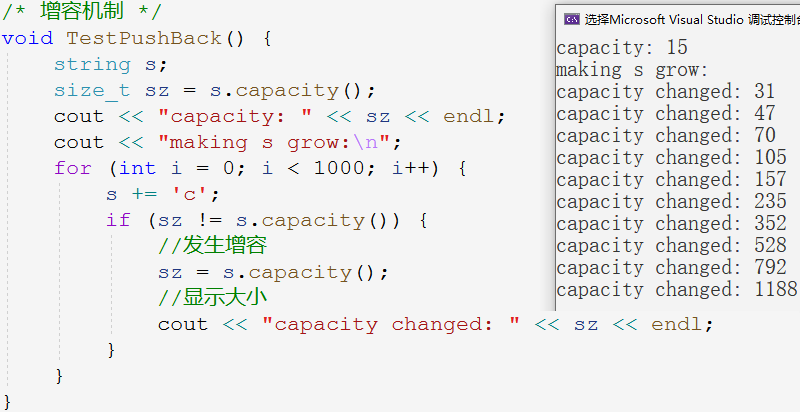

第一次增容从16变到32，为2倍增长。之后就是 48、71、106 ……，为1.5左右的增速。这是vs下的增容机制。

Linux 下是每次按2倍增容。

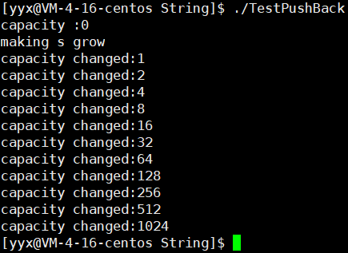

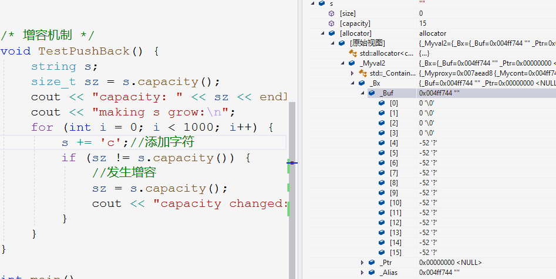

起始分配的16个字节，是在栈上开辟的空间`_Buf`。之后再增容就全部拷贝到堆上`_Ptr`再增容。

##### 修改容量

| 容量接口      | 说明                                                         |
| ------------- | ------------------------------------------------------------ |
| **`reserve`** | **考虑到内存对齐，开辟指定大小左右的空间**                   |
| **`resize`**  | **将有效字符个数改成 n，多出的空间用字符 c 填充，未指定 c 则初始化为空字符**。 |
|               | n < _size：指定大小比原长度小，则删去多余的内容；            |
|               | _size <= n <= _capacity：指定大小比容量小，则只扩大字符串的长度 _size； |
|               | n > _capacity：指定大小比容量大，则先扩充容量，再扩大字符串的长度 _size 。 |

```cpp
s.reserve(100); // 为字符串对象提前开辟好100左右字节的容量，以免之后的增容
s.reserve(10);  // 由于已开辟的空间大于指定的空间，故本次修改无效

s.resize(100);      // 修改有效字符个数为100个
s.resize(100, 'x'); // 修改有效字符个数为100个，新内容初始化为'x'
s.resize(10);       // 修改有效字符个数为100个，删除了多余的内容
```

`reserve`是修改空间容量大小、`resize`是修改有效字符个数。

`reserve`只能增容不能释放。`resize`修改字符个数的同时也有可能顺带增加容量，相当于修改容量加上初始化内容。

#### 访问操作

| 下标访问                                        | 说明                             |
| ----------------------------------------------- | -------------------------------- |
| **`char& operator[] (size_t pos)`**             | **获取对象下标的字符，支持修改** |
| **`const char& operator[] (size_t pos) const`** | **获取对象下标的字符，禁止修改** |
| `char& at(size_t pos)`                          | 和`[]`作用一直，历史习惯用法     |
| ` char& back()`                                 | 获取末尾字符                     |
| `char& front()`                                 | 获取开头字符                     |

| 迭代器接口          | 说明                                                         |
| ------------------- | ------------------------------------------------------------ |
| **`begin`,`end`**   | **begin 返回起始位置的迭代器，end 返回尾字符的下一个位置的迭代器**。 |
| **`rbegin`,`rend`** | **rbegin 返回反向起始位置的迭代器，end 返回反向尾字符的下一个位置的迭代器**。 |
| `cbegin`,`cend`     | `begin`和`end`的 const 常量版本                              |

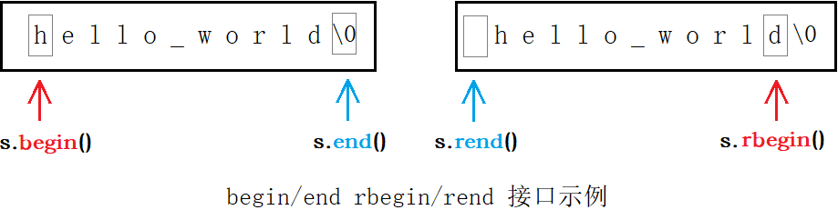

迭代器是专门为迭代遍历容器的一种机制。迭代器是一个对象，可以指向容器中的某个元素，通过迭代器就可以操作它指向的元素。所以迭代器可以想象成指针。

```cpp
string::iterator it = s.begin();
while (it != s.end())
{
    cout << *it << " ";
    it++;
}
cout << endl;
```

- **迭代器统一采用左闭右开的策略**，begin指向起始位置是有效元素，end指向末尾位置是无效位置。
- `iterator`是迭代器的类型名，但迭代器类型前必须指明类域，因为它是在类里定义的。
- 迭代器按照定义方式分成以下四种：正向迭代器、常量正向迭代器、反向迭代器、常量反向迭代器。

```cpp
//正向迭代器
string::iterator it = s.begin();
while (it != s.end()) {
    *it += 1;
    it++;
}
//反向迭代器
string::reverse_iterator rit = s.rbegin();
while (rit != s.rend()) {
    *rit -= 1;
    rit++;
}
//常量正向迭代器
string::const_iterator cit = s.cbegin();
while (cit != s.cend()) {
    cout << *cit << " ";
    cit++;
}
cout << endl;
//常量反向迭代器
string::const_reverse_iterator  crit = s.crbegin();
while (crit != s.crend()) {
    cout << *crit << " ";
    crit++;
}
cout << endl;
```

> 常量迭代器不支持对容器进行修改，一般用于常对象，或者防止函数内修改对象。

`[]`重载更方便快捷，所以string对象一般使用`[]`遍历。但迭代器是通用的，对于其他非线性的容器如树、图等，不支持使用`[]`访问遍历。

##### 范围 for

范围for循环被称为语法糖，自动判断范围大小。在实际编译时，范围 for 会被替换成迭代器。所以说，能用迭代器的容器就一定能用范围 for。

```cpp
for (auto& e : s) {
    e -= 1;
    cout << e << " ";
}
cout << endl;
```

#### 修改操作

| 修改接口                                           | 说明                     |
| -------------------------------------------------- | ------------------------ |
| **`string& operator+= (conststring& str)`**       | **追加字符串或字符**     |
| `void push_back(char c)`                           | 追加字符                 |
| `string& append(conststring& str)`                | 追加字符串               |
| `string& assign(conststring& str)`                | 覆盖有效数据，相当于赋值 |
| `string& insert(size_t pos, conststring& str)`    | 指定位置插入             |
| `string& erase(size_t pos = 0, size_t len = npos)` | 指定位置删除             |

```cpp
s1.push_back('c'); // 尾插字符

s1.append("ddd"); // 尾插字符串
s1.append(s2);

s1 += "sss"; // += 字符串
s1 += s2;    // += 对象
```

`push_back`和`append`较为局限，`operator+=`可以尾插字符串、字符和string对象。

> insert，erase 使用不多，仅作了解即可。

C++中读取一行有两种接口：

| getline              | 函数声明                                            |
| -------------------- | --------------------------------------------------- |
| **全局函数 getline** | **`istream& getline (istream& is,string& str)`**   |
| cin 成员 getline     | `istream& istream::getline (char* s, streamsize n)` |

```cpp
strings;
getline(cin, s); // 推荐这种，可以直接使用string对象

char str[BUFF_SIZE] = {0};
cin.getline(buff, BUFF_SIZE);
```

#### 查找操作

| 查找接口                                                     | 说明                 |
| ------------------------------------------------------------ | -------------------- |
| **`const char* c_str()`**                                    | **获取C格式字符串**  |
| **`size_t find (conststring& str, size_t pos = 0)`**        | **指定位置顺序查找** |
| `size_t rfind (conststring& str, size_t pos = npos)`        | 指定位置逆序查找     |
| `size_t find_first_of (conststring& str, size_t pos = 0)`   | 顺序查找任意字符     |
| `size_t find_last_of (conststring& str, size_t pos = npos)` | 逆序查找任意字符     |
| **`stringsubstr (size_t pos = 0, size_t len = npos) `**     | **截取子串**         |

```cpp
strings1 = "hello world i love you";
size_t pos = s1.find(' ');

while (pos !=string::npos)
{
    s1.replace(pos, 1, "%20");
    pos = s1.find(' ', pos + 3);
}

cout << s1 << endl;
```

> 面试时常考察string的细节问题，由于时间关系，一般要求实现四大默认成员函数。涉及动态内存管理、深浅拷贝、异常处理等类和对象的基本功。

###string类的实现

string类针对四大默认成员函数的实现方法分为两种：传统写法和现代写法。

- 传统写法的string类，可读性高，
- 现代写法的string类，代码简洁，实现巧妙，代码维护性高。

#### string类的传统写法

##### 构造析构

```cpp
string(const char* str = "")
    :_str(new char[strlen(str) + 1]) // 在堆上开辟和str一样大小的空间
{
    strcpy(_str, str);
}
~string() {
    delete[] _str;
    _str = nullptr;
}
```

- 构造函数初始化`_str`时，不可直接时用`str`初始化`_str`，以致`_str`存储在栈上无法实现增容等一系列操作。**须动态开辟一个和`str`一样大的空间，再将`str`的内容拷贝到`_str`中**。
- 构造函**数参数一般采用全缺省的形式**，因为`strings;`只构造对象不初始化时其值默认为空值`""`。

##### 拷贝构造

实际上两个对象应该有各自独立的字符串，**拷贝构造应实现二者内容相同，即实现深拷贝而非浅拷贝**。

```cpp
//拷贝构造
string(conststring& s)
    :_str(new char[strlen(s._str) + 1])
{
    strcpy(_str, s._str);
}
```

##### 赋值重载

```cpp
string& operator=(conststring& s) {
    if (this != &s) { // 避免自赋值
        char* tmp = new char[strlen(s._str) + 1]; // 先开辟空间再释放原空间
        strcpy(tmp, s._str);
        delete[] _str; //释放后再赋值，避免空间不够或浪费
        _str = tmp;
    }
    return *this;
}
```

两个对象的`_str`变量不能直接进行拷贝，因为目标空间大小可能不够需要扩容，空间太大也会浪费空间。所以最好**先释放原空间再按照原字符串大小开辟新空间**。
**须避免自赋值**，因为释放`_str`也就释放了原字符串`s._str`，然后会导致将乱码拷贝给`_str`中。
不要将`new`开辟的空间直接赋值给`_str`，因为`new`可能开辟失败抛异常并结束程序，此时已将`_str`释放掉。最好**开辟空间先赋值临时变量，再将临时变量赋值给`_str`**。

####string类的现代写法

> 现代写法实现的更加巧妙。

##### 拷贝构造

```cpp
string(conststring& s)
    : _str(nullptr)
{
   stringtmp(s._str); //利用构造函数构造出临时对象
    swap(_str, tmp._str);
}
```

必须将字符串`_str`初始化为空，不然等到出作用域，调用`tmp`的析构函数时释放`tmp._str`也就是随机值地址会出错。

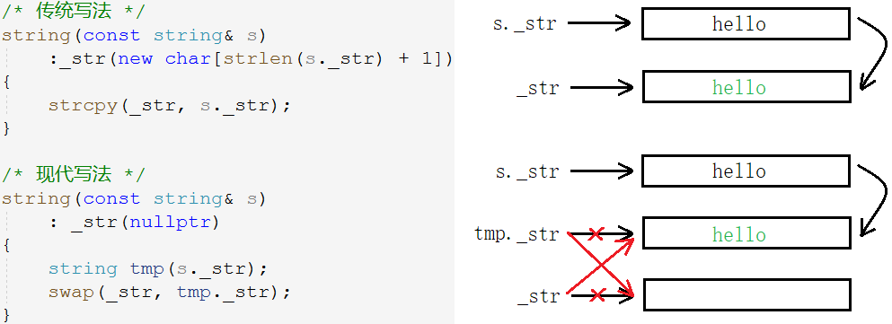

##### 赋值重载

```cpp
string& operator=(conststring& s)
{
    if (this != &s) {
       stringtmp(s); //利用拷贝构造构造出临时对象
        swap(_str, tmp._str);
    }
    return *this;
}
// 更精炼版
string& operator=(strings)
{
    swap(_str, s._str);
    return *this;
}
```

`_str`和`tmp._str`的交换，达到了一石二鸟的效果：
   - 利用临时对象将`s`的数据交换到了操作对象中，相当于进行了赋值。
   - 和拷贝构造不同的是，`_str`指向的原有数据，经交换后在析构函数内被`tmp._str`顺带释放，就无需手动释放了。
更精炼版利用传值调用产生临时拷贝的特点，直接使用`s`当作临时对象，免去构造临时对象`tmp`，同时也能达到顺带释放的效果。
   - 但由于传值拷贝的特点，无法判断自赋值的情况，不过并不影响程序运行。

#### string类的模拟实现

```cpp
/* 传统写法 */
//构造函数
string(const char* str)
    : _size(strlen(str))
    , _capacity(_size)
{
    _str = new char[_capacity + 1];
    strcpy(_str, str);
}
//拷贝构造
string(conststring& s)
    : _size(s._size)
    , _capacity(s._capacity)
{
    _str = new char[_capacity + 1];
    strcpy(_str, s._str);
}
//赋值重载
string& operator=(conststring& s)
{
    if (this != &s) {
        char* tmp = new char[s._capacity + 1];
        strcpy(tmp, s._str);
        delete[] _str;
        _str = tmp;
        _size = s._size;
        _capacity = s._capacity;
    }
    return *this;
}
//析构函数
~string()
{
    delete[] _str;
    _str = nullptr;
    _size = _capacity = 0;
}
/* 现代写法 */
//swap 交换两个对象的成员变量
void swap(string& s)
{
    std::swap(_str, s._str);
    std::swap(_size, s._size);
    std::swap(_capacity, s._capacity);
}
//拷贝构造
string(conststring& s)
    : _str(nullptr)
{
   stringtmp(s._str);
    swap(tmp);
}
//赋值重载
string& operator=(strings)
{
    swap(s);
    return *this;
}
```

> 默认成员函数实现完毕，接下来就是实现string类的增删查改的细节。

##### resize

将有效字符个数改成 n，多出的空间用字符 c 填充，未指定 c 则初始化为空字符。故分为三种情况：

n < \_size：指定大小比原长度小，则删去多余的内容；
\_size <= n <= _capacity：指定大小比容量小，则只扩大字符串的长度 _size；
n > _capacity：指定大小比容量大，则先扩充容量，再扩大字符串的长度 _size 。

```cpp
void resize(size_t n, char ch = '\0')
{
    if (n < _size)
    {
        _size = n;
        _str[_size] = '\0';
    }
    else /* n >= _size */
    {
        if (n > _capacity)
            reserve(n);

        memset(_str + _size, ch, n - _size);
        _size = n;
        _str[_size] = '\0';
    }
}
```

##### insert

```cpp
string& insert(size_t pos, char ch)
{
    assert(pos <= _size); //== 时尾插

    if (_size == _capacity)
        reserve(_capacity == 0 ? 4 : _capacity * 2);

    //后移一位 [pos,_size]
    size_t end = _size + 1;
    while (end > pos)
    {
        _str[end] = _str[end - 1];
        end--;
    }

    _size++;
    _str[pos] = ch; //插入元素 pos
    return *this;
}

string& insert(size_t pos, const char* str)
{
    assert(pos <= _size);

    size_t len = strlen(str);
    if (_size + len >= _capacity)
        reserve(_size + len);

    size_t end = _size + 1;
    while (end > pos)
    {
        _str[end - 1 + len] = _str[end - 1];
        end--;
    }

    _size += len;
    strncpy(_str + pos, str, len);//插入字符串 pos
    return *this;
}

string& insert(size_t pos, conststring& s)
{
    assert(pos < _size);
    insert(pos, s._str);
    return *this;
}
```

end 与 pos 比较，尤其是步进条件为 end–– ，当 pos == 0 时，end会从零减到无符号整数的最大值。

插入前须先将元素后移，end 从后向前遍历，始终在所移元素的后一个位置，利用str[i]=str[i-1]将元素后移。

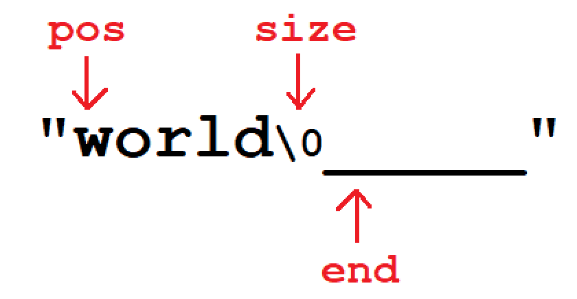

[面试string类的一种正确写法 CoolShell](https://coolshell.cn/articles/10478.html)

[string的“读时也拷贝”技术  CoolShell](https://coolshell.cn/articles/1443.html)

[string的 Copy-On-Write 技术 CoolShell](https://coolshell.cn/articles/12199.html#特性)

## 2. vector

vector是用数组实现的、可变长度的顺序容器，本质是一种类模板。

```cpp
template <
    class T, // 元素类型
    class Alloc = allocator<T> > // 空间配置器类型

class vector; // 类模板声明
```

### 2.1 vector的接口

#### 默认成员函数

| 接口声明                                                  | 解释                       |
| --------------------------------------------------------- | -------------------------- |
| **`vector()`**                                            | **默认构造**               |
| `vecotr(size_type n, const_value_type& val=value_type())` | 填充构造，填充n个元素      |
| `vector(InputIter first, InputIter last)`                 | 范围构造，迭代器区间初始化 |
| **`vector(const vector& v)`**                             | **拷贝构造**               |
| **`vector& operator=(const vector& x)`**                  | **赋值重载**               |

#### 容量操作

| 容量操作                                                     | 解释                           |
| ------------------------------------------------------------ | ------------------------------ |
| **`size_type size()`**                                       | **元素个数**                   |
| **`size_type capacity()`**                                   | **容量大小**                   |
| `size_type max_size()`                                       | 最大能存储的元素个数（无意义） |
| **`void resize(size_type n, value_type val = value_type());`** | **增减有效元素个数**           |

```cpp
v.reserve(100);   // 扩容到100
v.resize(100, 1); // 有效元素个数变为100,新增元素初始化为1
v.resize(10);     // 有效元素个数变为10
```

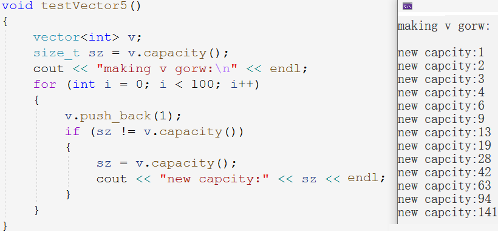

> 由图可知，vs下vector按1.5倍增容。

#### 访问操作

| 接口声明                                         | 解释                   |
| ------------------------------------------------ | ---------------------- |
| **`reference operator[](size_type n)`**          | **返回下标位置的引用** |
| `const_reference operator[] (size_type n) const` |                        |
| `reference at(size_type n)`                      |                        |
| `const_reference at (size_type n) const`         |                        |

`[]`重载和`at`的区别是，`[]`越界会断言报错，`at`是抛异常。

| 迭代器接口      | 解释                             |
| --------------- | -------------------------------- |
| `begin`         | 起始位置的迭代器                 |
| `end`           | 末尾元素的下一个位置的迭代器     |
| `rbegin`        | 反向起始位置的迭代器             |
| `rend`          | 反向末尾元素的下一个位置的迭代器 |
| `cbegin`,`cend` | begin 和 end 的 const 版本       |

`[]`重载就已经能方便的访问 vector，但并不意味着放弃迭代器。大部分容器都支持迭代器访问，且迭代器使用简单规范统一。

STL 中容器的迭代器区间都是采用 $[first,last)$ 左闭右开的方式。

```cpp
//[]
for (size_t i = 0; i < v.size(); i++) {
    v1[i] += 1;
}

//iterator
vector<int>::iterator it = v.begin();
while (it != v.end()) {
    cout << *it << " ";
    it++;
}

for (auto e : v) {
    cout << e << " ";
}
```

#### 修改操作

| 接口声明                                                     | 解释                   |
| ------------------------------------------------------------ | ---------------------- |
| **`void push_back (const value_type& val)`**                 | **尾插**               |
| **`void pop_back()`**                                        | **尾删**               |
| **`iterator insert (iterator pos, const value_type& val)`**  | **迭代器位置插入**     |
| `void insert (iterator pos, size_type n, const value_type& val);` | 迭代器位置插入         |
| `void insert (iterator pos, InputIter first, InputIter last)` | 迭代器位置插入一段区间 |
| **`iterator erase (iterator pos)`**                          | **迭代器位置删除**     |
| `iterator erase (iterator first, iterator last)`             | 删除一段迭代器区间     |
| `void assign (size_type n, const value_type& val)`           | 覆盖数据               |

```cpp
v.insert(ret, 30);
v.insert(ret, 2, 30);
v.insert(ret, v2.begin(), v2.end());
v1.erase(pos);
v1.erase(v1.begin(), v1.end());
```

```cpp
#include <algorithm>
// 查找接口
template <class InputIter, class T>
   InputIter find (InputIter first, InputIter last, const T& val);
```

### 2.2 vector的模拟实现

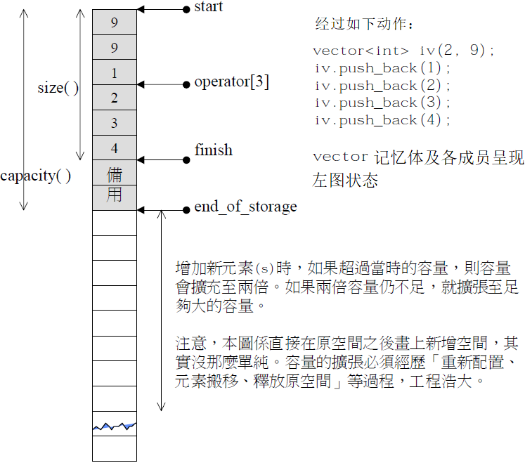

#### 类的定义

```cpp
template <class T, class Alloc = alloc>
class vector {
public:
    typedef T* iterator;
    // ...
private:
    iterator start;
    iterator finish;
    iterator end_of_storage;
}
```

这个结构和顺序表结构稍有不同，但本质是一样的。只是将容量和元素个数的变量用指向对应位置的迭代器代替。

```cpp
class Seqlist {
    T* _a;            /* start */
    size_t _size;     /* finish - start */
    size_t _capacity; /* end_of_storage - start */
}
```

#### 默认成员函数

```cpp
//default constructor
vector()
    : _start(nullptr)
    , _finish(nullptr)
    , _end_of_storage(nullptr)
{}
//fill constructor
vector(size_t n, const T& val = T()) // 引用临时对象可延长其声明周期
    : _start(nullptr)
    , _finish(nullptr)
    , _end_of_storage(nullptr)
{
    resize(n, val);
}
//copy constructor
vector(const vector<T>& v)
    : _start(nullptr)
    , _finish(nullptr)
    , _end_of_storage(nullptr)
{
    _start = new T[v.capacity()];
    for (size_t i = 0; i < v.capacity(); i++)
    {
        _start[i] = v._start[i];
    }
    _finish = _start + v.size();
    _end_of_storage = _start + v.capacity();
}
```

```cpp
//range constructor
template <class InputIterator>
vector(InputIterator first, InputIterator last)
    : _start(nullptr)
    , _finish(nullptr)
    , _end_of_storage(nullptr)
{
    while (first != last)
    {
        push_back(*first++);
    }
}
//destructor
~vector()
{
    delete[] _start;
    _start = _finish = _end_of_storage = nullptr;
}

// 现代写法
//copy constructor
vector(const vector<T>& v)
    : _start(nullptr)
    , _finish(nullptr)
    , _end_of_storage(nullptr)
{
    vector<T> tmp(v.begin(), v.end());
    swap(tmp);
}
//operator=
vector<T>& operator=(vector<T> v)  /* pass by value */
{
    swap(v);
    return *this;
}
```

> 从范围构造可以看出类模板中的函数也可以是函数模板。

##### 迭代器的分类

函数模板的模板参数要传迭代器区间时，命名是有规定的，范围构造中的`InputIterator`就是一种指定的迭代器类型。因容器的结构各有不同，迭代器分为五种类型：

| 名称            | 特性                                   | 适用容器              |
| --------------- | -------------------------------------- | --------------------- |
| 输入/输出迭代器 | 只读迭代器只能读取，只写迭代器可以写入 | 无实际容器            |
| 单向迭代器      | ++，读写                               | forward_list          |
| 双向迭代器      | ++，––，读写                           | list, map, set        |
| 随机迭代器      | ++，––，+，–，读写                     | deque, vector,string|

可以看出，下方的迭代器类型是上方的父类，也就是说**下方迭代器满足上方的所有要求**。

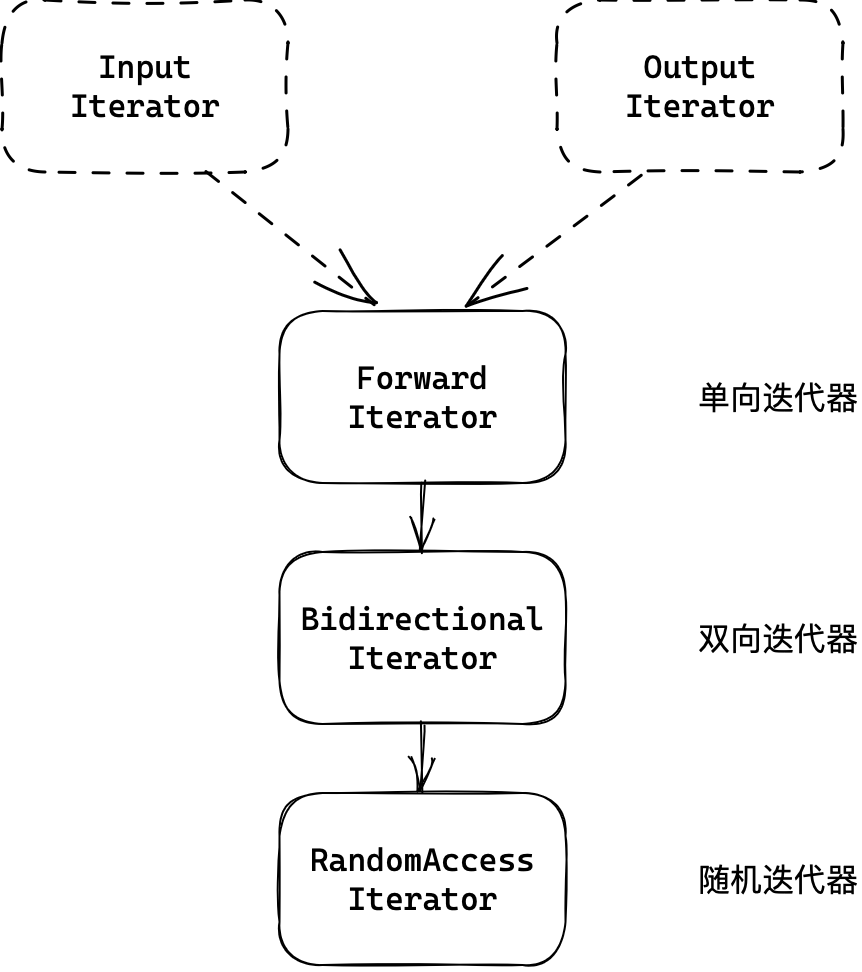

划分出不同的迭代器类型，是为了限制传入的迭代器，因为其必须满足要求才能完成接下来的函数。

函数指明迭代器为`InputIterator`，意味着满足要求的迭代器都可以传入，起提示的作用。

> 当然，模版不区分类型，语法上所有迭代器都可以传入，但可能无法完成编译。

#### 容量接口

##### memcpy 浅拷贝问题

```cpp
vector<string> v;
v.push_back("11111111111111");
v.push_back("11111111111111");
v.push_back("11111111111111");
v.push_back("11111111111111");
v.push_back("11111111111111"); // 增容浅拷贝
```

出现问题是因为正好数组需要增容。模拟实现的`reserve`函数使用`memcpy`将原空间的内容按字节拷贝至新空间。

若 vector 存储的是内置类型，则浅拷贝没问题。
若 vector 存储的是自定义类型，浅拷贝使得新旧变量指向同一块空间。深拷贝调用拷贝构造或者赋值重载。

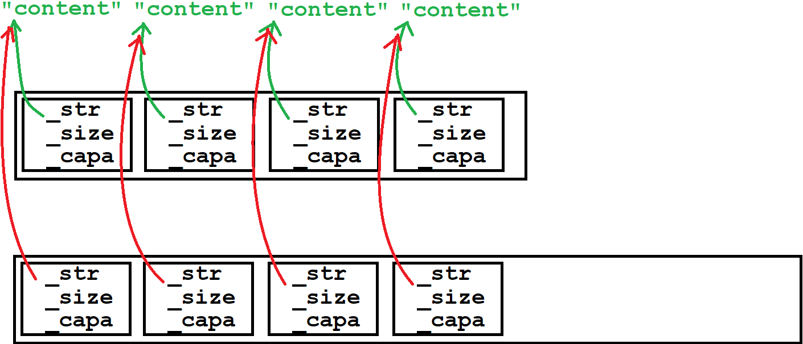

```cpp
void reserve(size_t n)
{
    if (n > capacity())
    {
        T* tmp = new T[n];
        size_t oldSize = size();

        if (_start)
        {
            //memcpy(tmp, _start, size() * sizeof(T)); // err
            for (int i = 0; i < size(); i++)
            {
                tmp[i] = _start[i];//_start指向的空间存任意类型都能完成深拷贝
            }

            delete[] _start;
        }

        _start = tmp;
        _finish = _start + oldSize;
        _end_of_storage = _start + n;
    }
}
```

```cpp
void resize(size_t n, T val = T())
{
    if (n > size())
    {
        reserve(n);
        while (_finish != _start + n)
        {
            *_finish = val;
            ++_finish;
        }
    }
    else
    {
        _finish = _start + n;
    }
}
```

#### 修改接口

```cpp
iterator insert(iterator pos, const T& val)
{
    assert(_start <= pos && pos <= _finish); // 检查pos位置是否合法
    // 增容
    if (_finish == _end_of_storage)
    {
        size_t sz = pos - _start;
        reserve(capacity() == 0 ? 4 : capacity() * 2); //增容会导致迭代器失效，迭代器位置陈旧
        pos = _start + sz; //增容后更新pos
    }

    // 后移 [pos,_finish)
    for (iterator end = _finish; end > pos; --end)
    {
        *end = *(end - 1);
    }

    // 插入
    *pos = val;
    ++_finish;
    return pos; //返回迭代器最新位置
}
```

- 增容改变`_start`，但迭代器`pos`并没有跟着改变，仍然指向原空间，也就是迭代器失效。
- 迭代器`pos`实参并没有改变仍然指向错误位置，故函数返回更新的`pos`。

```cpp
iterator erase(iterator pos)
{
    assert(_start <= pos && pos < _finish);

    for (iterator begin = pos + 1; begin < _finish; begin++)
    {
        *(begin - 1) = *begin;
    }

    _finish--;
    return pos; //返回删除数据的下一个位置
}
```

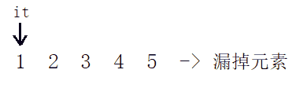

- erase **挪动数据后 pos 指向元素会发生变化**，同样会导致迭代器失效。
- 返回删除数据的下一个位置，通过返回值更新迭代器。

### 2.3 vector的OJ题

| 题目                                                         | 题解                                                         |
| ------------------------------------------------------------ | ------------------------------------------------------------ |
| [只出现一次的数字](https://leetcode.cn/problems/single-number/description/) | [【简洁明了】只出现一次的数字 I](https://leetcode.cn/problems/single-number/solutions/2148111/jian-ji-ming-liao-zhi-chu-xian-yi-ci-de-resn0/) |
| [杨辉三角](https://leetcode.cn/problems/pascals-triangle/description/) | [【简洁明了】cpp 杨辉三角](https://leetcode.cn/problems/pascals-triangle/solutions/2148504/jian-ji-ming-liao-cpp-yang-hui-san-jiao-r68z0/?orderBy=newest_to_oldest) |
| [删除有序数组中的重复项](https://leetcode.cn/problems/remove-duplicates-from-sorted-array/) | [【双指针 简单明了】数组去重](https://leetcode.cn/problems/remove-duplicates-from-sorted-array/solutions/2148460/shuang-zhi-zhen-jian-dan-ming-liao-shu-z-9p32/?orderBy=newest_to_oldest) |
| [只出现一次的数字 II](https://leetcode.cn/problems/single-number-ii/) | [【简单明了 注释】只出现一次的数字](https://leetcode.cn/problems/single-number-ii/solutions/2149532/jian-dan-ming-liao-zhu-shi-zhi-chu-xian-1iwno/) |
| [只出现一次的数字 III](https://leetcode.cn/problems/single-number-iii/) | [【详细解析】只出现一次的数字 系列 I II III](https://leetcode.cn/problems/single-number-iii/solutions/2152031/xiang-xi-jie-xi-zhi-chu-xian-yi-ci-de-sh-1vsp/) |
| [多数元素](https://leetcode.cn/problems/majority-element/description/) | [【哈希 排序 投票】三种解法 简洁明了](https://leetcode.cn/problems/majority-element/solutions/2148590/ha-xi-pai-xu-tou-piao-san-chong-jie-fa-j-qzoi/) |
| [连续子数组的最大和](https://leetcode.cn/problems/lian-xu-zi-shu-zu-de-zui-da-he-lcof/) | [【动归】连续子数组的最大和](https://leetcode.cn/problems/lian-xu-zi-shu-zu-de-zui-da-he-lcof/solutions/2148610/dong-gui-lian-xu-zi-shu-zu-de-zui-da-he-ovcf3/) |
| [电话号码的字母组合](https://leetcode-cn.com/problems/letter-combinations-of-a-phone-number/) | [【注释解析 回溯】电话号码字母组合](https://leetcode.cn/problems/letter-combinations-of-a-phone-number/solutions/2148604/zhu-shi-jie-xi-hui-su-dian-hua-hao-ma-zi-uokb/) |

## 3. list

[list (cplusplus.com)](http://www.cplusplus.com/reference/list/list/)

list是双向链表，forward_list是单向链表。

```cpp
template <
    class T, //模板参数T
    class Alloc = allocator<T> //空间配置器
         >
class list; //类模板
```

> 关于链表，数据结构处已经讨论过，不再赘述。

### 3.1 list的使用

#### 增删查改

| 默认成员函数                                                 | 说明           |
| ------------------------------------------------------------ | -------------- |
| **`list ()`**                                                | **默认构造**   |
| `list (size_type n, const value_type& val = value_type())`   | 填充构造       |
| `list (InputIter first, InputIter last)`                     | 范围构造       |
| `list (const list& li)`                                      | 拷贝构造       |
| `list& operator= (const list& x)`                            | 赋值重载       |
| **访问接口**                                                 | **说明**       |
| **`reference front()`**                                      | **取头元素**   |
| `reference back()`                                           | 取尾元素       |
| **容量接口**                                                 | **说明**       |
| `bool empty() const`                                         | 判空           |
| `size_type size() const`                                     | 元素个数       |
| `void resize (size_type n, value_type val = value_type())`   | 修改元素个数   |
| **修改接口**                                                 | **说明**       |
| **`void push_front (const value_type& val)`**                | **头插**       |
| **`void pop_front()`**                                       | **头删**       |
| **`void push_back (const value_type& val)`**                 | **尾插**       |
| **`void pop_back()`**                                        | **尾删**       |
| **`iterator insert (iterator position, const value_type& val)`** | **迭代器插入** |
| `void insert (iterator position, size_type n, const value_type& val)` | 迭代器插入     |
| `void insert (iterator position, InputIter first, InputIter last)` | 迭代器插入     |
| **`iterator erase (iterator position)`**                     | **迭代器删除** |
| `iterator erase (iterator first, iterator last)`             | 迭代器删除     |
| `void assign (InputIter first, InputIter last)`              | 重置链表       |
| `void assign (size_type n, const value_type& val)`           | 重置链表       |
| `void clear()`                                               | 清空链表       |

#### 功能接口

| **功能接口**                                                 | **说明**         |
| ------------------------------------------------------------ | ---------------- |
| `void reverse()`                                             | 逆置链表         |
| `void sort(Compare comp = cmp)`                              | 排序链表         |
| `void unique()`                                              | 链表去重         |
| `void remove (const value_type& val)`                        | 删除所有指定元素 |
| `void merge (list& x, Compare comp = cmp`                    | 归并两个链表     |
| `void splice (iterator position, list& x)`                   | 接合整个链表     |
| `void splice (iterator position, list& x, iterator i)`       | 接合单个元素     |
| `void splice (iterator position, list& x, iterator first, iterator last)` | 接合一段区间     |

```cpp
lt.sort();
```

list 不支持随机访问，所以不支持算法库中的 sort。

单独内置一个 sort 接口，使用的是归并排序，但效率不高。当需要对数据进行排序的时候，不要选择链表。

```cpp
lt.sort();
lt.unique();
```

去重接口可以去掉链表中的重复元素，但**前提是需先将链表排成有序状态**。

```cpp
lt.remove(1);
```

删除链表中所有指定值的元素，不是指定下标位置的元素。

```cpp
lt.splice(pos, list);              // 转移整个链表
lt.splice(pos, list, i);           // 转移单个节点
lt.splice(pos, list, first, last); // 转移一段区间
```

接合函数能将一个链表中的一个或多个节点，转移到另一个链表中的指定迭代器位置。可转移整个链表，可转移链表内的一个元素，转移一个迭代器区间。

**splice 的功能是转移不是拷贝**，原链表中的该节点将不复存在。

> list 不支持随机访问，实际中用的不多。list 的重点在于模拟实现。

### 3.2 list的模拟实现

#### list的定义

```cpp
// listnode
template<class T>
struct __list_node
{
    __list_node<T>* _prev;
    __list_node<T>* _next;
    T _data;

    __list_node<T>(const T& t = T())
        : _data(t), _prev(nullptr), _next(nullptr)
    {}
};

// list
template <class T>
class list
{
public:
    typedef __list_node<T> Node;
    list() {
        empty_init();
    }
private:
    Node* _head;
}
```

__list_node 是链表节点类，list 是链表类，他的成员是 \_\_list_node 类型的指针，作链表的带头节点。

> 一般供他人使用的类，都用 struct 定义，因为 struct 定义的类成员默认都是公有的。

#### 默认成员函数

```cpp
/* default constructor */
void empty_init()
{
    _head = new Node(x);
    _head->_prev = _head;
    _head->_next = _head;
}

list()
{
    empty_init();
}
```

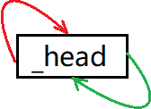

```cpp
/* copy constructor */
//传统写法
list<T>(const list<T>& lt)
{
    empty_init();
    for (auto e : lt)
        push_back(e);
}
//现代写法
list<T>(const list<T>& lt)
{
    empty_init();
    list<T> tmp(lt.begin(), lt.end());
    swap(_head, tmp._head);
}
```

```cpp
/* = operator */
//传统写法
list<T>& operator=(const list<T>& lt)
{
    if (this != &lt) {
        clear();
        for (auto e : lt)
            push_back(e);
    }
    return *this;
}
//现代写法
list<T>& operator=(list<T> lt)
{
    swap(_head, lt._head);
    return *this;
}
```

```cpp
/* deconstructor */
void clear()
{
    iterator it = begin();
    while (it != end())
    {
        it = erase(it);
    }
}

~list<T>()
{
    clear();
    delete _head;
}
```

#### 迭代器

迭代器模拟指针，意图像指针一样遍历容器。

list 的底层实现并不是 vector 一样的连续空间，而是通过节点地址链接前后，故 list 实现上述操作就需要自行实现一个迭代器类再重载这些运算符。

##### 正向迭代器

```cpp
template<class T, class Ref, class Ptr>
struct __list_iterator
{
    typedef __list_node<T> list_node;
    typedef __list_iterator<T, Ref, Ptr> self;

    __list_iterator(list_node* n) : _node(n)
    {}

    Ref operator*() {
        return _node->_data;
    }
    Ptr operator->() {
        return &_node->_data;
    }

    self& operator++() {
        _node = _node->_next;
        return *this;
    }
    self& operator--() {
        _node = _node->_prev;
        return *this;
    }

    bool operator!=(const self& s) {
        return _node != s._node;
    }

    list_node* _node;
};
```

> list 容器的迭代器是双向迭代器，不支持随机访问，没有重载`+,+=,-,-=`。

迭代器的拷贝构造、赋值重载都只需要浅拷贝指针。析构函数无需释放任何资源，节点交由链表进行管理。所以这些编译器默认生成就可以。

###### 解引用箭头

```cpp
template <class T, class Ref, class Ptr> // 交由list类控制
struct __list_iterator
{
    typedef __list_iterator<T, Ref, Ptr> iterator;
    Ref operator* () { return  _node->_data; }
    Ptr operator->() { return &_node->_data; }
    //...
};

class list
{
public:
    typedef __list_iterator<T, T&, T*> iterator;                   // 传入普通类型
    typedef __list_iterator<T, const T&, const T*> const_iterator; // 传入常量类型
}
```

可以给迭代器类增加引用和指针类型的模版参数，分别给`*`和`->`重载函数返回值使用。

相当于把具体的元素引用和指针类型交给外界控制。就不需要单独实现一个常量迭代器了。

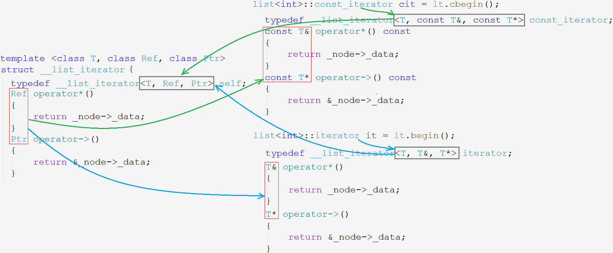

当元素是自定义类型时，箭头操作符可以让迭代器直接访问到自定义类型的内部成员。如：

```cpp
struct AA
{
    AA(int a1 = 0, int a2 = 0) : _a1(a1), _a2(a2) {}
    int _a1;
    int _a2;
};

void test_list()
{
    list<AA> lt;
    lt.push_back(AA(1, 1));
    lt.push_back(AA(2, 2));

    list<AA>::iterator it = lt.begin();
    while (it != lt.end())
    {
        cout << it->_a1 << ":" << it->_a2 << " "; // ->直接访问AA内部成员
        ++it;
    }
    cout << endl;
}
```

> `it->AA()->_a1`，省略了一个`->`。

##### 反向迭代器

反向迭代器同样是个适配器，所以它被单独实现在一个文件中。

```cpp
template <class Iterator, class Ref, class Ptr>
struct reverse_iterator
{
    Iterator _it;
    typedef reverse_iterator self;

    reverse_iterator(Iterator it) // 利用正向迭代器构造出反向迭代器
        :_it(it)
    {}

    self& operator++() // 反向迭代器++，就是正向迭代器--
    {
        --_it;
        return *this;
    }

    self& operator--() // 反向迭代器--，就是正向迭代器++
    {
        ++_it;
        return *this;
    }

    bool operator!=(const self& it) // 反向迭代器是否相等，就是正向迭代器是否相等
    {
        return _it != it._it;
    }

    Ref operator*()
    {
        Iterator tmp = _it;
        return *--tmp;       // 前一个位置的迭代器
    }
    Ptr operator->()
    {
        Iterator tmp = _it;
        return &*--tmp;
    }
};
```

> 反向迭代器是对正向迭代器的封装。源码实现使用类型萃取难度较高，我们不使用。

反向迭代器解引用和箭头不是访问当前位置，而是**前一个位置**。

```cpp
//list源码
iterator begin() { return (link_type)((*node).next); }
iterator end() { return node; }

reverse_iterator rbegin() { return reverse_iterator(end()); }
reverse_iterator rend() { return reverse_iterator(begin()); }

const_iterator begin() const { return (link_type)((*node).next); }
const_iterator end() const { return node; }

const_reverse_iterator rbegin() const { return const_reverse_iterator(end()); }
const_reverse_iterator rend() const { return const_reverse_iterator(begin()); }
```

**所有容器的迭代器`begin/end()`和`rbegin/rend()`指向的位置正好对应相反**。目的是设计出对称形式，因此解引用时返回的是上一个位置的数据。

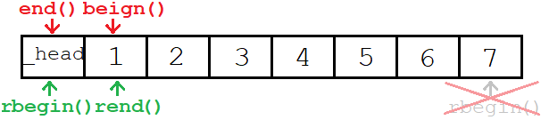

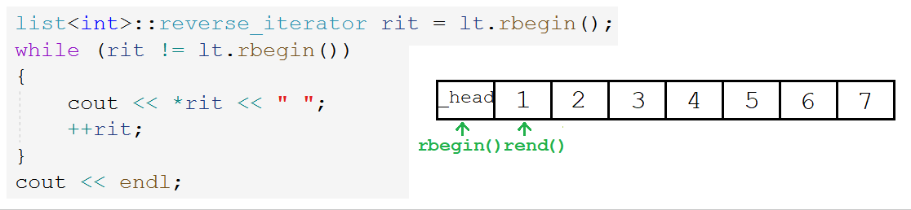

##### 迭代器接口

```cpp
template<class T>
class list
{
public:
    typedef __list_iterator<T, T&, T*> iterator;
    typedef __list_iterator<T, const T&, const T*> const_iterator;
    typedef reverse_iterator<iterator, T&, T*> reverse_iterator;
    typedef reverse_iterator<const_iterator, const T&, const T*> const_reverse_iterator;

    iterator begin() { return iterator(_head->_next); }
    iterator end()   { return iterator(_head); }

    const_iterator begin() const { return const_iterator(_head->_next); }
    const_iterator end()   const { return const_iterator(_head); }

    reverse_iterator rbegin() { return reverse_iterator(end()); }
    reverse_iterator rend()   { return reverse_iterator(begin()); }

    const_reverse_iterator rbegin() const { return const_reverse_iterator(end()); }
    const_reverse_iterator rend()   const { return const_reverse_iterator(begin()); }
};
```

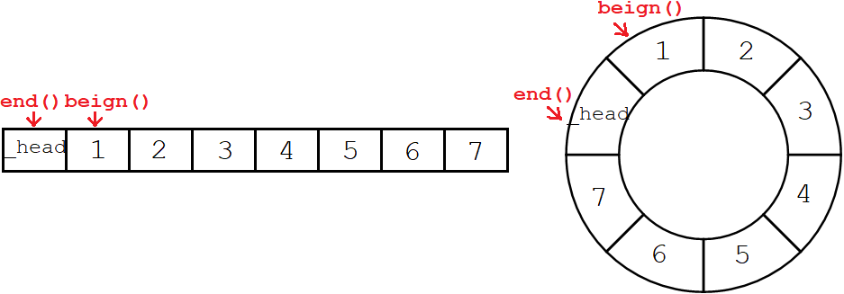

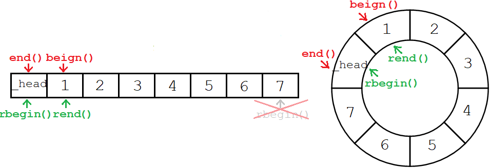

#### 基本功能

```cpp
iterator insert(iterator pos, const T& x)
{
    Node* newNode = new Node(x);
    Node* prev = pos._node->_prev;
    Node* cur = pos._node;

    // prev - newNode - cur
    prev->_next = newNode;
    newNode->_prev = prev;

    cur ->_prev = newNode;
    newNode->_next =  cur;

    return iterator(newNode); //返回迭代器
}
iterator erase(iterator pos)
{
    assert(pos != end());

    Node* prev = pos._node->_prev;
    Node* next = pos._node->_next;

    delete pos._node;

    // prev - pos - after
    prev->_next = next;
    next->_prev = prev;

    return iterator(next);
}
```

- list 的插入操作迭代器不会失效，因为迭代器 pos 的值不会改变，始终指向原来的节点。
- list 的删除操作迭代器一定失效，因为节点已经被释放了，应修正为 pos 下一个位置。

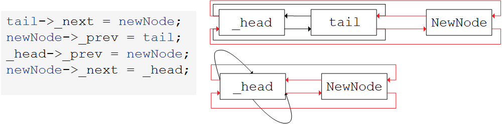

```cpp
void push_back(const T& x) { insert(end(), x); }
void push_front(const T& x) { insert(begin(), x); }

void pop_back() { erase(--end()); }
void pop_front() { erase(begin()); }
```

### 3.3 list对比vector

| 容器       | vector                                  | list                               |
| ---------- | --------------------------------------- | ---------------------------------- |
| 底层结构   | 连续物理空间                            | 空间不连续                         |
| 随机访问   | 支持随机访问                            | 不支持随机访问                     |
| 插入删除   | 非尾部插入删除要移动数据，效率低 $O(n)$ | 任意位置的插入删除效率高 $O(1)$    |
| 空间利用率 | 增容代价大，倍数扩容存在一定的空间浪费  | 按需申请空间，不存在浪费           |
| 迭代器     | 原生指针支持随机访问                    | 迭代器类模拟指针行为，支持双向访问 |
| 适用场景   | 高效存储，随机访问，不关心增删效率      | 频繁使用插入删除，不关心随机访问   |

vector与list两种容器各有优劣，实际上vector用的更多些。因为vector支持随机访问，其次空间浪费也不是太严重的问题。

## 4. stack&queue

### 4.1 介绍

#### stack

栈是一种特殊的线性表，只允许固定一端进行插入和删除。

能够插入删除的一端被称为栈顶，另一端被称为栈底。栈的元素遵循后进先出的原则。

> 栈的插入被称为压栈、进栈、入栈，删除被称为出栈、弹栈。

后进先出，先进后出，$LIFO$ 原则（Last In First Out）。

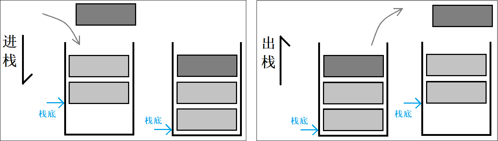

#### queue

队列同样是一种特殊的线性表，和栈相反，队列只允许在其一端进行插入而在另一端进行删除。

插入数据的一端被称为队尾，删除的另一端被称为队头。队列的元素遵循先进先出的原则。

> 入队列就是队尾插入数据，出队列就是队头删除数据。

先进先出，后进后出，即 $FIFO$ 原则（First In First Out）。


### 4.2 接口

#### stack

STL中的栈和队列不是容器而是容器适配器。

```cpp
template <class T, class Container = deque<T> >
class stack;
```

stack 的底层可以使用任何容器，只要该容器支持`empty`、`back`、`push_back`、`pop_back`这些接口。如果没有为stack指定底层容器，默认使用deque。

| 接口声明                                                     | 解释     |
| ------------------------------------------------------------ | -------- |
| `explicit stack (const container& ctnr = container())`       | 构造函数 |
| `bool empty() const`                                         | 判空     |
| `size_type size() const`                                     | 元素个数 |
| `value_type& top()`                                          | 栈顶元素 |
| `void push (const value_type& val)`                          | 尾插     |
| `void pop()`                                                 | 尾删     |
| `bool operator== (const stack<T,Ctnr>& lhs, const stack<T,Ctnr>& rhs)` | 关系运算 |

#### queue

```cpp
template <class T, class Container = deque<T> >
class queue;
```

queue也是容器适配器。底层容器要求和stack一样。

| 接口声明                                                     | 解释     |
| ------------------------------------------------------------ | -------- |
| `explicit queue (const container& ctnr = container())`       | 构造函数 |
| `bool empty() const`                                         | 判空     |
| `size_type size() const`                                     | 元素个数 |
| `value_type& front()`                                        | 队头元素 |
| `value_type& back()`                                         | 队尾元素 |
| `void push (const value_type& val)`                          | 尾插     |
| `void pop()`                                                 | 头删     |
| `bool operator== (const stack<T,Ctnr>& lhs, const stack<T,Ctnr>& rhs)` | 关系运算 |

### 4.3 OJ

#### 最小栈

[最小栈](https://leetcode-cn.com/problems/min-stack/)

```cpp
class MinStack {
public:
    void push(int val) {
        st.push(val);
        if (minST.empty() || val <= minST.top()) {
            minST.push(val);
        }
    }
    void pop() {
        if (st.top() == minST.top()) {
            minST.pop();
        }
        st.pop();
    }
    int top() {
        return st.top();
    }
    int getMin() {
        return minST.top();
    }
private:
    stack<int> st;
    stack<int> minST;
};
```

准备两个栈，一个用来正常入栈出栈，一个用来存储最小值。

当入栈元素大于当前最小值时，只入到普通栈，不入最小栈。
当入栈元素小于等于当前最小值时，将其入到普通栈，也入到最小栈中。

出栈时，判断栈顶元素是否和最小值相等，相等则把最小栈中的元素也弹出。

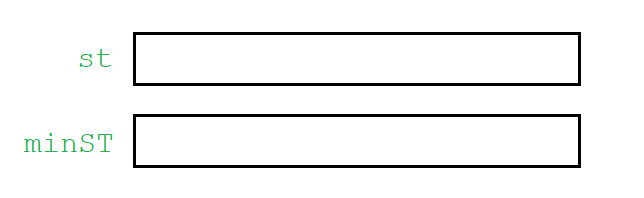

#### 验证栈序列

[验证栈序列](https://leetcode.cn/problems/validate-stack-sequences/) / [剑指 Offer 3栈的压入、弹出序列](https://leetcode.cn/problems/zhan-de-ya-ru-dan-chu-xu-lie-lcof/)

一个入栈序列对应多种出栈序列，只能拿一个栈用来模拟，如果能匹配出当前的出栈序列，则两者是匹配的。

```cpp
class Solution {
public:
    bool IsPopOrder(vector<int> pushV, vector<int> popV) {
        stack<int> st; // 模拟栈
        int popi = 0;  // 出数组指针
        for (auto& e : pushV) {
            st.push(e); // 入栈数组只管向栈中入元素
            while (!st.empty() && st.top() == popV[popi]) { // 出栈数组和模拟栈进行比较
                st.pop();
                ++popi;
            }
        }
        return st.empty(); // 出栈数组遍历结束或栈为空
    }
};
```

定义一个模拟栈，定义两个指针指向出入数组的起始位置，向后遍历。

入栈数组只管向栈中入元素，只有出栈数组和模拟栈进行比较：当栈顶元素和出栈指针所指元素相等时，将栈顶元素出栈并++出栈指针。

**成功示例**

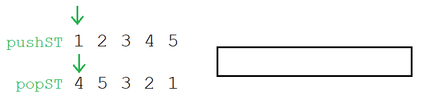

**不成功示例**

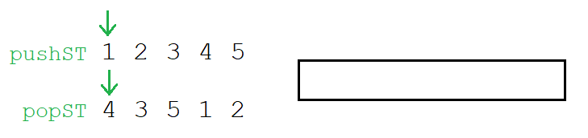

待入栈数组遍历结束后，若出栈数组遍历结束或栈为空，说明匹配成功，若栈中仍有元素或出栈数组未遍历结束，说明匹配不成功。

#### 逆波兰表达式求值

[逆波兰表达式求值](https://leetcode-cn.com/problems/evaluate-reverse-polish-notation/)

中缀表达式转后缀表达式的目的是，将操作符按照运算顺序从左到右依次排好，方便计算机进行运算。

**中缀转后缀**

遍历中缀字符串：

- 遇到操作数，直接输出。
- 遇到操作符，如果是空栈，直接入栈；如果栈非空，将其与栈顶比较优先级；
- 优先级比栈顶元素高，则入栈，比栈顶低或相等，栈顶出栈并输出。
- 遍历结束后，将栈中元素全部输出。

**后缀运算**

遍历后缀表达式：

- 遇到操作数，直接入栈。
- 遇到操作符，连续取两个栈顶元素（先出为右，后出为左）作操作数与其运算，运算结果入栈。
- 遍历结束后，栈顶即结果。

```cpp
class Solution {
public:
    int evalRPN(vector<string>& tokens) {
        stack<int> st;
        for (auto& s : tokens) {
            if (s == "+" || s == "-" || s == "*" || s == "/") {
               stringoptor(s); //得操作符
                int op2 = st.top(); //先出为右操作数
                st.pop();
                int op1 = st.top(); //后出为左操作数
                st.pop();
                switch(s[0]) {
                case '+':
                    st.push(op1 + op2);//将运算结果入栈
                    break;
                case '-':
                    st.push(op1 - op2);
                    break;
                case '*':
                    st.push(op1 * op2);
                    break;
                case '/':
                    st.push(op1 / op2);
                    break;
                }
            }
            else {
                st.push(stoi(s)); // 操作数入栈，待遍历得操作符与之运算
            }
        }
        return st.top();//返回栈顶元素
    }
};
```

#### 用栈实现队列

[用栈实现队列](https://leetcode-cn.com/problems/implement-queue-using-stacks/)

使用两个栈，一个用来入，一个用来出。

只要出栈为空，就将入栈中的数据全部导入出栈。只有当出栈为空时，才会导入，以免打乱顺序。保证了出栈和取数据时有元素。

```cpp
class MyQueue {
public:
    void push(int x) {
        _pushST.push(x);
    }

    int pop() {
        int tmp = peek(); //返回队头数据的同时进行了转移判断
        _popST.pop();
        return tmp;
    }

    int peek() {
        if (_popST.empty()) { // 只需要在取数据处判断是否需要转移数据
            while (!_pushST.empty()) {
                _popST.push(_pushST.top());
                _pushST.pop();
            }
        }
        return _popST.top();
    }

    bool empty() {
        return _popST.empty() && _pushST.empty();
    }
private:
    stack<int> _pushST;
    stack<int> _popST;
};
```

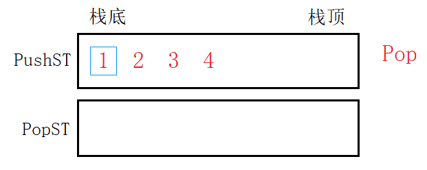

入栈`pushST`和出栈`popST`互不影响，分别完成入队的出队的任务。只要`popST`为空，就将`pushST`中元素移入即可。

#### 用队列实现栈

[用队列实现栈](https://leetcode-cn.com/problems/implement-stack-using-queues/)

用队列实现栈，需要考虑栈是先进后出的结构，都是顺序容器插入操作一致，删除操作需要将队列中的前`n-1`个元素移入另一个队列，只留最后一个元素。

```cpp
class MyStack {
public:
    void push(int x) {
        q1.push(x);
    }
    int pop() {
        int tmp = top();
        q1.pop();
        swap(q1, q2);//pop之后交换，把q2变成q1，相当于栈出了栈顶
        return tmp;
    }
    int top() {
        while(q1.size() > 1) {
            q2.push(q1.front());
            q1.pop();
        }
        int tmp = q1.front();
        return tmp;
    }
    bool empty() {
        return q1.empty() && q2.empty();
    }
private:
    queue<int> q1;
    queue<int> q2;
};
```

### 4.4 模拟实现

#### stack

适配器是一种设计模式。数据结构栈可以用数组和链表实现，C++中栈被实现成容器的适配器，通过复用底层容器的接口。

```cpp
template <class T> class stack {
    void push(const T& x) {
        _v.push_back(x);
    }
    //...
private:
    vector<T> _v;
}
```

> 直接将容器 vector 作成员变量，所有接口都调用 vector 的接口即可。

```cpp
template <class T, class Container = deque<T>>
class stack {
public:
    void push(int x) {
        _con.push_back(x);
    }
    void pop() {
        _con.pop_back();
    }
    bool empty() const {
        return _con.empty();
    }
    bool size() const {
        return _con.size();
    }
    T& top() const {
        return _con.back();
    }
private:
    Container _con;
};
```

STL直接将容器类型作为类模板参数传入，支持自定义底层容器，并采用缺省参数的形式，指定默认容器为 deque。

#### queue

```cpp
template<class T, class Container = deque<T>>
class queue
{
public:
    void push(const T& x) {
        _con.push_back(x);
    }
    void pop() {
        _con.pop_front();
    }
    T& front() {
        return _con.front();
    }
    T& back() {
        return _con.back();
    }
    size_t size() {
        return _con.size();
    }
    bool empty() {
        return _con.empty();
    }

private:
    Container _con;
};
```

> queue也是容器适配器，只要按照queue的特性，将适配容器的接口换一下即可。

#### deque

##### deque的介绍

vector和list在随机访问和插入删除的方面各有优劣，为均衡二者的特性，STL设计了一种容器叫做双端队列 deque。

双端队列deque是一种双端的、“连续”空间的数据结构。双端表示可以在头尾两端进行插入和删除，且时间复杂度为O(1)。

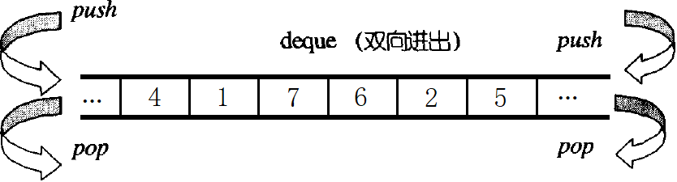

| 增删接口                                  | 解释     |
| ----------------------------------------- | -------- |
| `void push_back (const value_type& val)`  | 尾插     |
| `void push_front (const value_type& val)` | 头插     |
| `void pop_back()`                         | 尾删     |
| `void pop_front()`                        | 头删     |
| **访问接口**                              | **解释** |
| `reference operator[] (size_type n)`      | 随机访问 |
| `reference front()`                       | 头部元素 |
| `reference back()`                        | 尾部元素 |

##### deque的原理

deque底层并不是真正连续的空间，而是由一个中控指针数组保存每个用来存储数据的小连续空间buffer的地址。类似于一个动态的二维数组，如下图所示：


从中控数组的中部开始使用，头插使用前面的buffer，尾插使用后面的buffer。头插就向前开辟，尾插就向后开辟。

- 头部操作无需挪动数据，头插头删效率高。
- 扩容只开辟buffer，空间浪费少。
- 中控数组扩容只拷贝指针，扩容代价低。
- 先计算所在buffer再计算buffer内位置，可以支持随机访问。

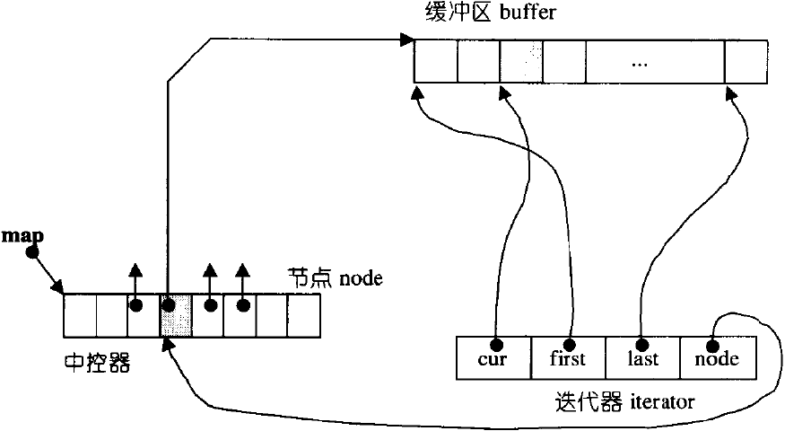

> 如果单个buffer大小不固定，则需要迭代器支持随机访问，效率变低。

deque的迭代器有四个指针：

- `cur`指向buffer当前数据位置
- `first`指向buffer起始位置
- `last`指向buffer结束位置
- `node`反向指向本buffer在中控数组的位置

##### deque的优劣

| vector的缺点                                 | deque                                      |
| -------------------------------------------- | ------------------------------------------ |
| 扩容消耗高，空间浪费，头插头删效率低         | 扩容消耗低，空间浪费不严重，头插头删效率高 |
| **vector的优点**                             | **deque**                                  |
| 支持随机访问，连续空间缓存命中率高           | 支持伪随机访问，连续空间缓存命中率较高     |
| **list的缺点**                               | **deque**                                  |
| 按需申请释放，不支持随机访问                 | 申请次数少，支持伪随机访问                 |
| **list的优点**                               | **deque**                                  |
| 任意位置的插入删除效率高，按需申请不存在浪费 | 头尾插入删除效率高，空间浪费不严重         |

deque基本兼具两大容器的优点，缺点是中部增删效率低，且做不到两大容器的极致。

但栈和队列只需要头尾的插入删除，所以stack和queue使用deque作为默认适配容器。

> deque颇具局限性，仅作了解。

### 4.5 priority_queue

#### 接口使用

优先级队列priority_queue同样是个容器适配器，不同于stack和queue只是对容器的简单封装。它有三个模板参数：

```cpp
template <class T, /* 数据类型 */
          class Container = vector<T>, /* 适配容器 */
          class Compare = less<typename Container::value_type> > /* 仿函数 */
class priority_queue;
```

priority_queue要求底层容器必须具有随机访问迭代器，支持`empty`,`size`,`front`,`push_back`,`pop_back`几种接口，一般使用vector作底层容器。

priority_queue就是堆，能够实现堆的各种算法。因为要维护容器本身的特性，所以不支持遍历。

```cpp
class Compare = less<typename Container::value_type>
```

priority_queue默认数值大优先级高，也就是默认大堆。想要排成小堆，需要指定priority_queue的仿函数参数，传入`greator<T>`。

| 接口声明                                                     | 解释     |
| ------------------------------------------------------------ | -------- |
| `priority_queue (Compare& cmp = Compare(), Container& ctnr = Container())` | 构造函数 |
| `bool empty() const`                                         | 判空     |
| `size_type size() const`                                     | 元素个数 |
| `value_type& top()`                                          | 栈顶元素 |
| `void push (const value_type& val)`                          | 尾插     |
| `void pop()`                                                 | 尾删     |

[Top-K](https://leetcode-cn.com/problems/kth-largest-element-in-an-array/)

```cpp
class Solution {
public:
    //建大堆会选出整个数组的最大值，减小堆才能选出第k大的数
    int findKthLargest(vector<int>& nums, int k) {
        vector<int>::iterator pos = nums.begin() + k;
        //k个数的小堆
        priority_queue<int, vector<int>, greater<int>> pq(nums.begin(), nums.begin() + k);
        while (pos != nums.end()) {
            if (*pos > pq.top()) {
                pq.pop();
                pq.push(*pos);
            }
            ++pos;
        }
        return pq.top();
    }
};
```

#### 模拟实现

##### 基本接口

```cpp
template<class T, class Container = std::vector<T>, class Compare = less<T>>
class priority_queue
{
public:
    void push(const T& x) {
        _con.push_back(x);
        adjust_up(_con.size() - 1); //向上调整
    }
    void pop() {
        swap(_con[0], _con[size() - 1]);
        _con.pop_back();
        adjust_down(0); //向下调整
    }
    bool empty() const {
        return _con.empty();
    }
    int size() const {
        return _con.size();
    }
    T& top() const {
        return _con.front();
    }
private:
    Container _con;
    Compare _cmp;
};
```

##### 向上向下调整算法

```cpp
void adjust_up(int child)
{
    int parent = (child - 1) / 2;

    while (child > 0)
    {
        if (_cmp(_con[parent], _con[child]))
            swap(_con[parent], _con[child]);
        else
            break;

        child = parent;
        parent = (child - 1) / 2;
    }
}

void adjust_down(int parent)
{
    int child = parent * 2 + 1;

    while (child < _con.size())
    {
        if (child + 1 < _con.size() && _cmp(_con[child], _con[child + 1]))
            child++;

        if (_cmp(_con[parent], _con[child]))
            swap(_con[parent], _con[child]);
        else
            break;

        parent = child;
        child  = parent * 2 + 1;
    }
}
```

堆插入就是数组尾插一个元素，然后向上调整。

此时堆的性质可能被破坏，不过只会影响该结点到根结点所在路径上的所有结点，故顺势向上调整：一直交换结点数值直到满足堆的性质即可。


堆删除就是将尾元素覆盖到堆顶，然后向下调整。

只是堆顶元素不满足性质，其左右子树还是原样。只需将堆顶元素逐步向下调整：将根结点与其较大/小的子结点交换，只要父结点比子结点中任意一个大/小，就进行交换，直到交换到叶结点或不满足条件为止。

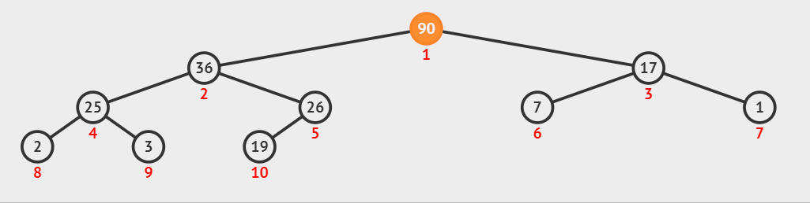

##### 仿函数

决定大堆还是小堆，在于向上/向下调整算法中的父子节点的比较关系：

```cpp
if (_cmp(_con[parent], _con[child])) {
    swap(_con[parent], _con[child]);
}

if (child + 1 < _con.size() && _cmp(_con[child], _con[child + 1])) {
    child++;
}
```

比较大小操作符写死不便用户修改，使用宏定义，函数指针都比较复杂，还有一种简单的方式就是仿函数。

仿函数又名函数对象，本质是对象，通过重载`()`操作符模仿函数的调用方式。

仿函数相当于更高级的泛型，使用仿函数能够改变执行逻辑，仿函数内部的实现完全由用户自定，拥有极大的自定义空间。

```cpp
template <class T>
struct less {
    bool operator()(const T& left, const T& right) const {
        return left < right;
    }
};
template <class T>
struct greater {
    bool operator()(const T& left, const T& right) const {
        return left > right;
    }
};

Less less;
less(1, 2);
Greater greater;
greater(1, 2);
```

仿函数本质是一种类型，所以可以作模版参数，让用户定义类的时候指定。

```cpp
template <class T, class Container = vector<T>, class Compare = Less<T>>
class priority_queue {
    void adjust_up(int child) {
        if (_cmp(_con[parent], _con[child]))
            //...
    }
    void adjust_down(int parent) {
        if (child + 1 < _con.size() && _cmp(_con[child], _con[child + 1]))
            //...
        if (_cmp(_con[parent], _con[child]))
            //...
    }
    Compare _cmp;
};
```

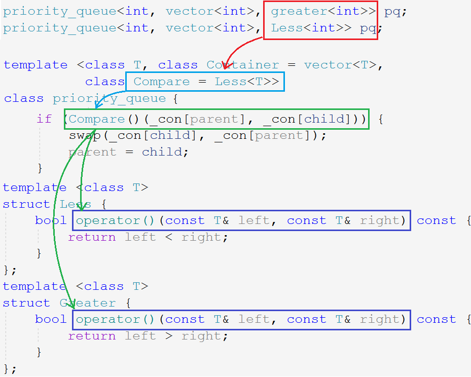

```cpp
#include <iostream>
#include <vector>

namespace
{
template<class T>
struct less
{
    bool operator()(const T& x, const T& y)
    {
        return x < y;
    }
};

template<class T>
struct greater
{
    bool operator()(const T& x, const T& y)
    {
        return x > y;
    }
};

template<class T, class Container = std::vector<T>, class Compare = less<T>>
class priority_queue
{
public:
    void adjust_up(int child)
    {
        int parent = (child - 1) / 2;

        while (child > 0)
        {
            if (_cmp(_con[parent], _con[child]))
                swap(_con[parent], _con[child]);
            else
                break;

            child = parent;
            parent = (child - 1) / 2;
        }
    }

    void adjust_down(int parent)
    {
        int child = parent * 2 + 1;

        while (child < _con.size())
        {
            if (child + 1 < _con.size() && _cmp(_con[child], _con[child + 1]))
                child++;

            if (_cmp(_con[parent], _con[child]))
                swap(_con[parent], _con[child]);
            else
                break;

            parent = child;
            child  = parent * 2 + 1;
        }
    }

    void push(const T& x)
    {
        _con.push_back(x);
        adjust_up(_con.size() - 1);
    }

    void pop()
    {
        _con[0] = _con[_con.size() - 1];
        _con.pop_back();
        adjust_down(0);
    }

    size_t size()
    {
        return _con.size();
    }

    bool empty()
    {
        return _con.empty();
    }

    T& top()
    {
        return _con[0];
    }

private:
    Container _con;
    Compare _cmp;
};

}
```

## 5. map&set

> STL容器分为序列式容器和关联式容器。

- 序列式容器vector、list等底层为线性数据结构，数据元素之间没有联系，一般用来存储数据。
- 关联式容器map、set等底层采用平衡搜索树，存储的是`<key/value>`式的键值对，数据检索效率高。

### 5.1 容器

#### set

```cpp
template < class T,                        // T 元素数据类型
           class Compare = less<T>,        // compare 该数据类型的比较函数
           class Alloc = allocator<T>>     // Alloc 空间配置器
class set;
```

set就是K模型的容器，按照搜索树的规则存储元素，具有排序和去重的功能。

**set等搜索树容器都不支持修改元素，会破坏搜索树结构**。find的返回值被`const`修饰。

##### 接口

| 增加                                                         | 解释         |
| ------------------------------------------------------------ | ------------ |
| **`pair<iterator,bool> insert (const value_type& val)`**     | **单个插入** |
| `iterator insert (iterator position, const value_type& val)` | 迭代器插入   |
| `void insert (InputIterator first, InputIterator last)`      | 范围插入     |

```cpp
set<int> s;
s.insert(3);
s.insert(1);
s.insert(5);
s.insert(8);
s.insert(8);
s.insert(2);
s.insert(2);

std::set<int>::iterator it = s.begin();
while (it != s.end()) {
    cout << *it << " ";
    ++it;
}
// 1 2 3 5 8 //set底层是平衡搜索树，所以可以去重和排序
```

| 删除                                          | 解释           |
| --------------------------------------------- | -------------- |
| **`size_type erase (const value_type& val)`** | **指定值删除** |
| `void erase (iterator position)`              | 迭代器删除     |
| `void erase (iterator first, iterator last)`  | 范围删除       |

**值删除接口返回的是删除元素的个数，可通过此判断是否删除成功**。

```cpp
size_t ret = s.erase(30);
std::cout << ret << std::endl; // 使用值删除时，返回值是删除元素的个数
```

| 查找                                              | 解释       |
| ------------------------------------------------- | ---------- |
| **`iterator find (const value_type& val) const`** | **值查找** |
| `size_type count (const value_type& val) const`   | 返回个数   |

```cpp
set<int>::iterator pos = s.find(30);
if (pos != s.end())
    s.erase(pos);

int cnt = s.count(30);
if (cnt == 1)
    cout << "ok" << endl;
```

#### multiset

**multiset没有去重机制，允许键值重复**。其底层也是搜索树，插入相同元素时，可以放到该节点的任意子节点。

**对于键值重复的节点，查找返回的是中序遍历遇到的第一个节点**。

> 比如查找值为10的节点，在找到第一个10时，会到他的左子树去找，直到遇到比10小的数。

```cpp
std::multiset<int> s;
s.insert(3);
s.insert(1);
s.insert(5);
s.insert(5);
s.insert(2);
s.insert(2);

multiset<int>::iterator it = s.begin();
while (it != s.end()) {
    std::cout << *it << " ";
    ++it;
}
// 1 2 2 3 5 5
```

##### 接口

```cpp
multiset<int>::iterator pos = s.find(1);
while (pos != s.end() && *pos == 1)
{
    s.erase(pos);
    ++pos;
}
```

**删除和迭代器遍历操作不可以放在一起，删除就改变了原有树的结构，再`++pos`就访问非法空间了**。可以用下面更简单的方式。

```cpp
while (pos != s.end())
{
    s.erase(pos);
    std::cout << "找到了" << std::endl;
    pos = s.find(1);
}

int ret = 1;
while (ret)
{
    ret = s.erase(1);
    std::cout << "找到了" << std::endl;
}
```

#### map

map底层也是平衡搜索树，map的元素按照键值key进行排序。map支持下标访问符，可以找到与key对应的value。

##### 定义

键值对是表示具有对应关系的一种结构，一般只有两个成员key和value，key代表键值，value表示对应的数据。

```cpp
template <class T1, class T2>
struct pair
{
  typedef T1 first_type;
  typedef T2 second_type;
  first_type first;
  second_type second;

  pair(const T1& a, const T2& b) : first(a = T1()), second(b = T2())
  {}
};
```

pair就是键值对，实际上是一个结构体，被map当作元素类型使用。

```cpp
template < class Key,                                     // map::key_type
           class T,                                       // map::mapped_type
           class Compare = less<Key>,                     // map::key_compare
           class Alloc = allocator<pair<const Key,T> >    // map::allocator_type
         > class map;
```

##### 接口

```cpp
typedef Key key_type;
typedef T mapped_type;
typedef pair<const Key, T> value_type;
```

| 增加                                                     | 解释         |
| -------------------------------------------------------- | ------------ |
| **`pair<iterator,bool> insert (const value_type& val)`** | **单个插入** |

```cpp
dict.insert(pair<string,string>("arrary", "数组"));
dict.insert(make_pair("string", "字符串"));
dict.insert({"sort", "排序"});

auto ret = m.insert({"sort", "[[排序]]"});
cout <<(ret.first)->first << (ret.first)->second << ret.second << endl; // sort 排序 0
```

插入返回的是迭代器和布尔值的键值对。布尔值表示插入是否成功。

- 树中无重复key值的元素则插入成功，迭代器表示插入位置。
- **树中存在相同key值的元素则插入失败，迭代器表示该相同key值元素的位置**。

| 查找                                    | 解释     |
| --------------------------------------- | -------- |
| **`iterator find (const key_type& k)`** | **查找** |

```cpp
stringstr;
while (cin >> str) {
    map<string,string>::iterator it = m.find(str);
    if (it != m.end()) {
        cout << it->first << "-" << it->second << endl;
    }
}
```

| 删除                                         | 解释           |
| -------------------------------------------- | -------------- |
| **`size_type erase (const key_type& k)`**    | **指定值删除** |
| `void erase (iterator position)`             | 迭代器删除     |
| `void erase (iterator first, iterator last)` | 范围删除       |

`erase`删除节点可以传迭代器，也可以传`key`进行遍历删除。

| 下标访问                                          | 解释         |
| ------------------------------------------------- | ------------ |
| **`mapped_type& operator[] (const key_type& k)`** | **下标访问** |
| `mapped_type& at (const key_type& k)`             | 下标访问     |

`[]`**基本功能是查找，此外兼具插入和修改**。

```cpp
count_map["pg"];         // 插入
cout << count_map["pg"]; // 查找
count_map["pg"] = 111;   // 修改
count_map["tz"] = 888;   // 插入+修改
```

调用`insert`，无则插入有则查找，返回value的引用表示支持修改。

> 他的内部实现是：

```cpp
mapped_type& operator[] (const key_type& k)
{
    return insert(make_pair(k,mapped_type())).first->second;
    // pair<iterator, bool> ret = insert(make_pair(k, mapped_type()));
    // return ret.first->second;
}
```

```cpp
stringarr[] = {"西瓜","西瓜","苹果","西瓜","苹果","苹果","西瓜","苹果","香蕉","苹果","香蕉","梨"};
map<string, int> count_map;

for (auto& e : arr)
    count_map[e]++;
for (auto& kv: count_map)
    cout << kv.first << ": " << kv.second << endl;
```

#### multimap

`multimap`和`map`的区别是可存在重复数据。所以`multimap`无法重载`[]`操作符。

`count`可以用来统计同一`key`值元素的出现次数。

### 5.2 底层结构

#### AVL树

##### AVL树的定义

搜索树的查找效率高，但如果数据有序或接近有序，搜索树就会退化成单支树，查找效率就会变成线性的。

使用AVL树插入新结点时会对树进行调整，保证每个结点的左右子树高度之差的绝对值不超过1。从而降低树的高度，减少平均搜索长度。

一棵AVL树要么是空树，要么是具有如下性质的搜索树：

- 该树的左右子树都是AVL树，
- **左右子树的高度之差（简称平衡因子）的绝对值不超过1**。

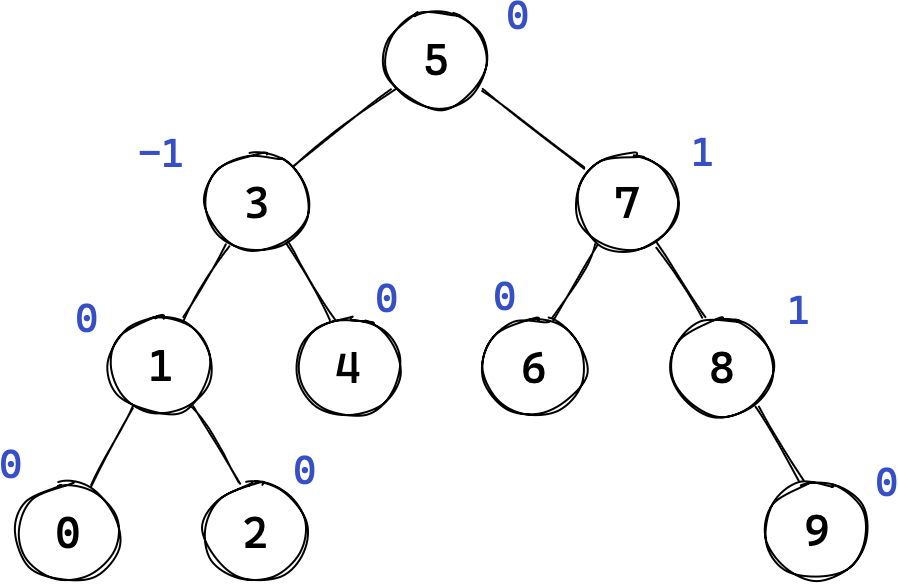

> 使用平衡因子只是AVL树的一种实现方式。

这样的树是高度平衡的，它的高度维持在 $logn$ 左右，搜索的时间复杂度就是 $O(logn)$。

```cpp
template<class K, class V>
struct avl_node
{
    avl_node<K, V>* _left;
    avl_node<K, V>* _right;
    avl_node<K, V>* _parent;

    pair<K, V> _kv;
    int _bf; // balance factor

    avl_node<K, V>(const pair<K, V>& kv)
        : _kv(kv), _bf(0), _left(nullptr), _right(nullptr), _parent(nullptr)
    {}
};

template<class K, class V>
class avl_tree
{
    avl_node<K, V>* _root = nullptr;
};
```

###### AVL树的性能

AVL是一棵严格平衡的二叉搜索树，可以保证查询效率 $O(logn)$ 。但插入删除时要维护平衡，会出现多次旋转，性能很低下。

因此，如果需要一种查询高效且有序的数据结构，且不常改变结构，可以考虑AVL树。AVL树在实际中不太常用，因为存在红黑树。

##### 更新平衡因子

如图所示，**插入节点会改变新节点到根的路径上所有节点的平衡因子**。所以要先更新平衡因子，再对树旋转处理。

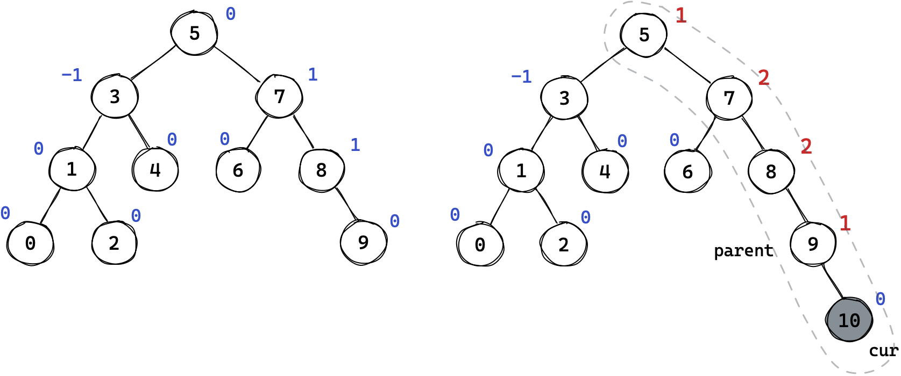

如果插入在父节点的左边，父节点的平衡因子要减1；如果插入在父节点的右边，父节点的平衡因子要加1。

如果父节点的平衡因子更新为0，说明所在树已经平衡且高度未变，不会影响到上层节点。
如果父节点的平衡因子更新为1/-1，说明所在树高度发生变化；
如果父节点的平衡因子更新为2/-2，说明子树已经不平衡，需要旋转处理。


```cpp
bool Insert(const pair<K, V>& kv)
{
    if (_root == nullptr)
    {
        _root = new Node(kv);
        return true;
    }

    Node* parent = nullptr;
    Node* curr = _root;

    while (curr)
    {
        if (curr->_kv.first < kv.first) {
            parent = curr;
            curr = curr->_right;
        }
        else if (curr->_kv.first > kv.first) {
            parent = curr;
            curr = curr->_left;
        }
        else {
            return false;
        }
    }

    curr = new Node(kv);
    if (parent->_kv.first < kv.first)
        parent->_right = curr;
    else
        parent->_left = curr;
    curr->_parent = parent;

    // 控制平衡
    // 更新平衡因子
    // 旋转处理异常平衡因子

    while (parent) // 更新到根
    {
        // 更新
        if (curr == parent->_left)
            parent->_bf--;
        else if (curr == parent->_right)
            parent->_bf++;

        // 检测
        if (parent->_bf == 0) { // 已经平衡，更新结束
            break;
        }
        else if (parent->_bf == 1 || parent->_bf == -1) // 向上更新
        {
            curr = parent;
            parent = parent->_parent;
        }
        else if (parent->_bf == 2 || parent->_bf == -2) // 平衡被打破，开始旋转
        {
            if (parent->_bf == -2 && curr->_bf == -1)
                RotateR(parent);
            else if (parent->_bf == 2 && curr->_bf == 1)
                RotateL(parent);
            else if (parent->_bf == -2 && curr->_bf == 1)
                RotateLR(parent);
            else if (parent->_bf == 2 && curr->_bf == -1)
                RotateRL(parent);
            break;
        }
        else {
            assert(false); // 树构建出错
        }
    }
    return true;
}
```

##### AVL树的旋转

> 先看如图所示的树结构的抽象图，节点下方的矩形代表多种可能，分别是a，b，c子树，其高度都是h。

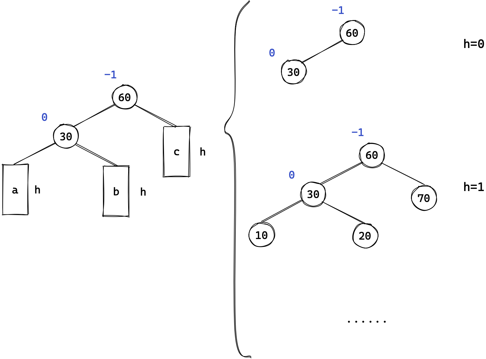

旋转的方式有四种，目的是<u>在搜索树规则下平衡二叉树，平衡的结果就是树的整体高度减1</u>，提高搜索效率。

旋转后树中各节点的平衡因子达到最佳状态，不需要继续向上更新平衡因子。

###### 右单旋

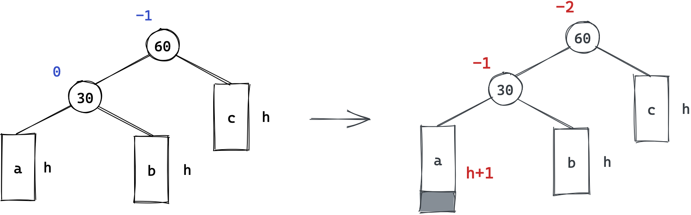

> 左树新增节点，高度+1，导致父节点bf=–1，爷节点bf=–2。此时平衡被破坏，就会引发右单旋。

**右单旋就是把`bf=-2`的节点旋转至`bf=-1`的节点的右子树上**。此时，`bf=-1`的节点是否存在右子树，有两种情况但可以统一处理。

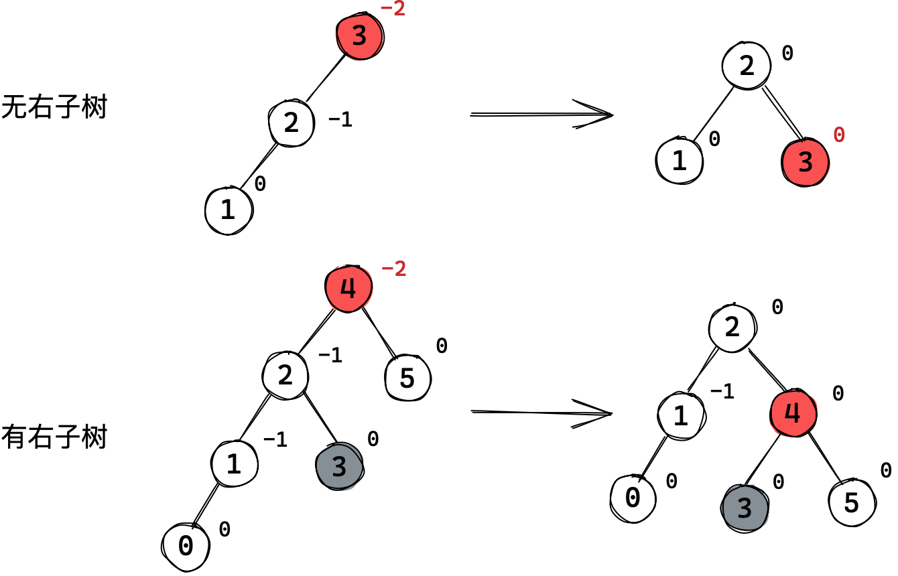

先把`bf=-1`的节点的右子树链接到`bf=-2`的节点的左边，
再将`bf=-2`的节点链接到`bf=-1`的节点的右边。
最后`bf=-1`的节点作当前树的根，和整棵树链接。

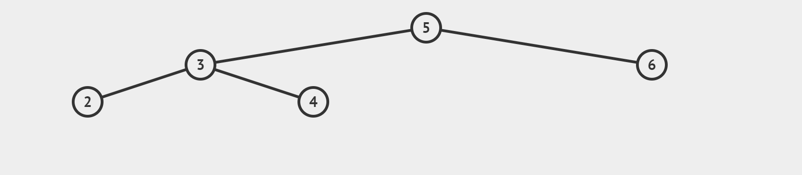

```cpp
void rotate_r(node* parent)
{
    node* subl = parent->_left;
    node* sublr = subl->_right;

    parent->_left = sublr;
    if (sublr) sublr->_parent = parent;

    node* pparent = parent->_parent;

    subl->_right = parent;
    parent->_parent = subl;

    if (parent == _root)
    {
        _root = subl;
        subl->_parent = nullptr;
    }
    else
    {
        if (pparent->_left == parent)
            pparent->_left = subl;
        else
            pparent->_right = subl;
        subl->_parent = pparent;
    }

    parent->_bf = 0;
    subl->_bf = 0;
}
```

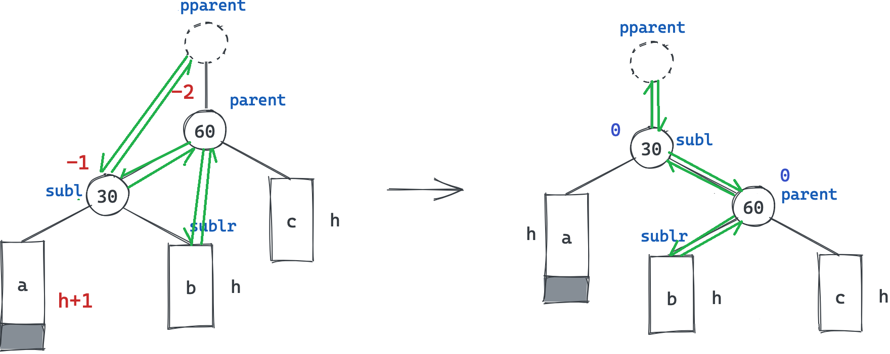

###### 左单旋

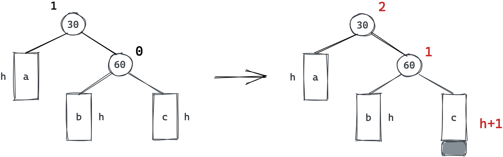

左单旋和右单旋正好相反。**左单旋就是把`bf=2`的节点旋转至`bf=1`的节点的左子树上**。

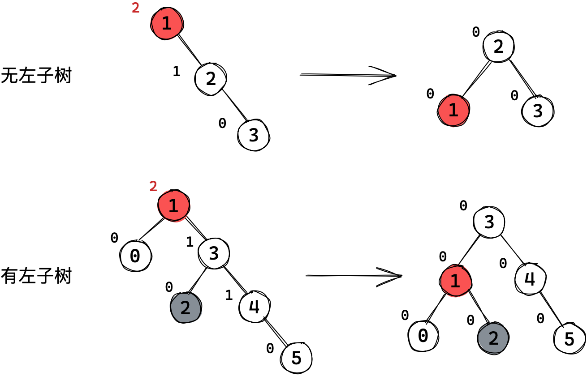

先把`bf=1`的节点的左子树链接到`bf=2`的节点的右边。
再将`bf=2`的节点链接到`bf=1`的节点的左边。
最后`bf=-1`的节点作当前树的根，和整棵树链接。

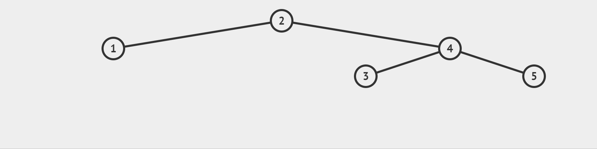

```cpp
void rotate_l(node* parent)
{
    node* subr = parent->_right;
    node* subrl = parent->_left;

    parent->_right = subrl;
    if (subrl) subrl->_parent = parent;

    node* pparent = parent->_parent;

    subr->_left = parent;
    parent->_parent = subr;

    if (parent == _root)
        _root = subr;
    else
    {
        if (pparent->_left == parent)
            pparent->_left = subr;
        else
            pparent->_right = subr;
    }
    subr->_parent = pparent;

    parent->_bf = 0;
    subr->_bf = 0;
}
```

###### 左右双旋

左单旋右单旋分别是左高左旋和右高右旋。

左右双旋的情况如下图所示，<u>对于下半部分来说左边高，对于上半部分来说右边高</u>。

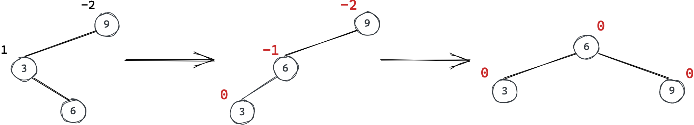

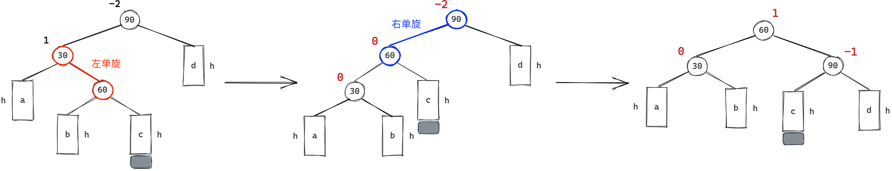

**先以`bf=1`的节点为轴进行左单旋**；
**再以`bf=-2`的节点为轴进行右单旋**。

```cpp
void RotateLR(Node* parent) { // 双旋就是由两个单旋组成
    RotateL(parent->_left);
    RotateR(parent);
    //...
}
```

####### 更新平衡因子

两个单旋会把节点的平衡因子都变成0，显然是不正确的。根据插入节点的位置不同，左右双旋的平衡因子更新有三种情况：

> 可以通过`subLR`节点的平衡因子的值来判断三种情况。不管树有多高，我们只在乎新节点在`subLR`的左右。

| 插入情况              | 如何判断      | 结果                                    |
| --------------------- | ------------- | --------------------------------------- |
| `subLR`本身就是新节点 | `subLR.bf=0`  | `parent.bf=0`,`subL.bf=0`,`subLR.bf=0`  |
| 新节点在`subLR`的左边 | `subLR.bf=-1` | `parent.bf=0`,`subL.bf=-1`,`subLR.bf=0` |
| 新节点在`subLR`的右边 | `subLR.bf=1`  | `parent.bf=1`,`subL.bf=0`,`subLR.bf=0`  |

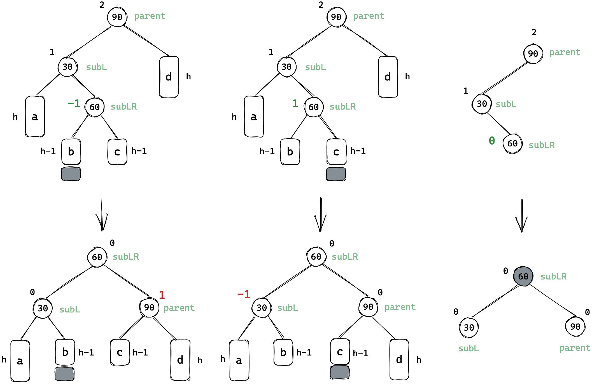

```cpp
void rotate_lr(node* parent)
{
    node* subl = parent->_left;
    node* sublr = subl->_right;

    int bf = sublr->_bf; // 记录sublr的平衡因子用以判断

    rotate_l(parent->_left);
    rotate_r(parent);

    if (bf == 0) // sublr就是新节点
    {
        parent->_bf = 0;
        subl->_bf = 0;
        sublr->_bf = 0;
    }
    else if (bf == 1) // 插入在sublr的左边
    {
        parent->_bf = 0;
        subl->_bf = -1;
        sublr->_bf = 0;
    }
    else if (bf == -1) // 插入在sublr的右边
    {
        parent->_bf = 1;
        subl->_bf = 0;
        sublr->_bf = 0;
    }
    else
    {
        assert(false);
    }
}
```

###### 右左双旋

右左双旋和左右双旋正好相反，<u>对于下半部分来说右边高，对于上半部分来说是左边高</u>。

**先以`bf=-1`的节点为轴进行右单旋**；
**再以`bf=2`的节点为轴进行左单旋**。

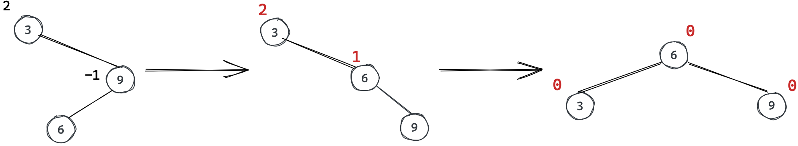

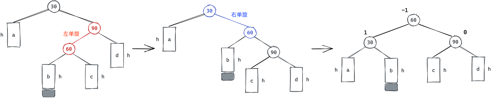

####### 更新平衡因子

右左双旋同样存在如下三种情况：

| 插入情况              | 如何判断      | 结果                                    |
| --------------------- | ------------- | --------------------------------------- |
| `subRL`本身就是新节点 | `subRL.bf=0`  | `parent.bf=0`,`subR.bf=0`,`subRL.bf=0`  |
| 新节点在`subRL`的左边 | `subRL.bf=-1` | `parent.bf=0`,`subR.bf=1`,`subRL.bf=0`  |
| 新节点在`subRL`的右边 | `subRL.bf=1`  | `parent.bf=-1`,`subR.bf=0`,`subRL.bf=0` |

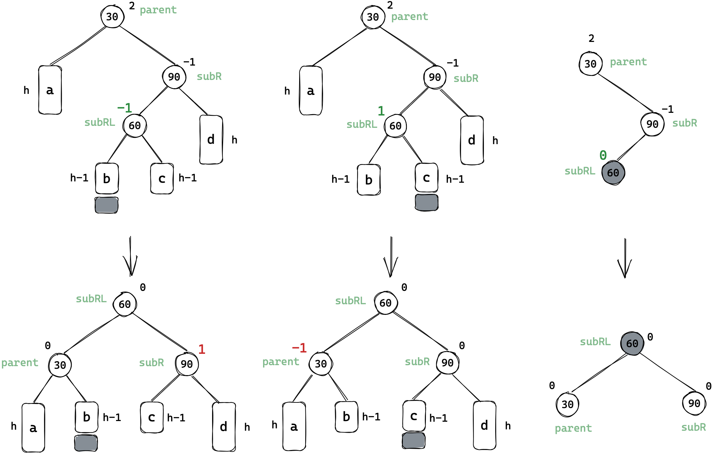

```cpp
void rotate_rl(node* parent)
{
    node* subr = parent->_right;
    node* subrl = subr->_left;

    int bf = subrl->_bf;

    rotate_r(parent->_right);
    rotate_l(parent);

    if (bf == 0)
    {
        parent->_bf = 0;
        subr->_bf = 0;
        subrl->_bf = 0;
    }
    else if (bf == -1)
    {
        parent->_bf = 0;
        subr->_bf = 1;
        subrl->_bf = 0;
    }
    else if (bf == 1)
    {
        parent->_bf = -1;
        subr->_bf = 0;
        subrl->_bf = 0;
    }
    else
    {
        assert(false);
    }
}
```

##### AVL树的验证

```cpp
void inorder()
{
    _inorder(_root);
    cout << endl;
}
void _inorder(node* root)
{
    if (!root) return;

    _inorder(root->_left);
    cout << root->_kv.first << ":" << root->_kv.second << " ";
    _inorder(root->_right);
}

bool is_balance()
{
    return _is_balance(_root);
}
bool _is_balance(node* root)
{
    if (!root)
        return true;

    int lh  = height(root->_left);
    int rh = height(root->_right);

    if (rh - lh != root->_bf)
    {
        cout << root->_kv.first << "  but now:" << root->_bf << endl;
        cout << root->_kv.first << "should be:" << rh - lh << endl;
        return false;
    }

    return abs(rh - lh) < 2
        && _is_balance(root->_left) && _is_balance(root->_right);
}

int height(node* root)
{
    if (!root)
        return 0;

    int lh = height(root->_left);
    int rh = height(root->_right);

    return rh > lh ? rh + 1 : lh + 1;
}
```

> AVL树、红黑树、B树都是了解性的数据结构，到此足矣。
>

#### 红黑树

##### 红黑树的定义

红黑树也是一种二叉搜索树，每个结点上都带有红或黑两种颜色。

通过限制整条从根到叶路径上的结点的着色方式，**确保整棵树中最长路径的长度不超过最短路径的两倍，因而是接近平衡的**。

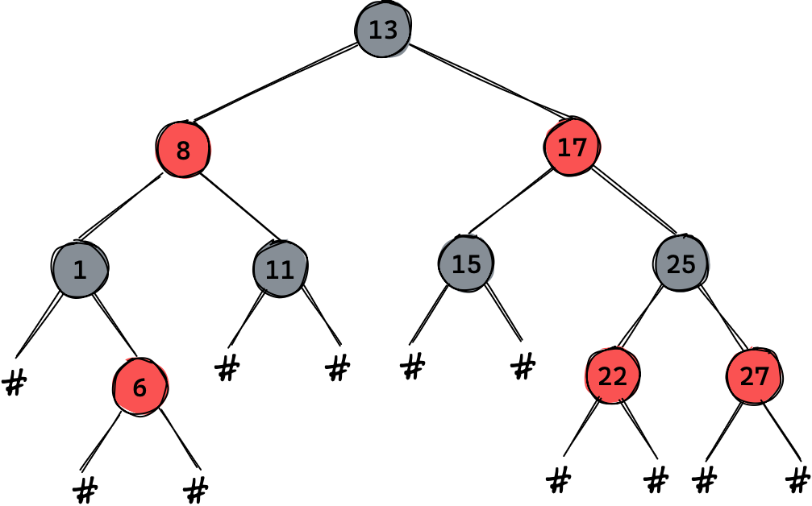

###### 红黑树的性质

每个结点不是红色就是黑色。
根节点是黑色的。
**红色节点的子结点必须都是黑色的**。（不能出现连续的红色节点）
**每条路径所含的黑色结点数量相等**。
每个空结点都是黑色的，空节点也认为是叶结点。
对于红黑树，我们认为从根到空算一条路径。

###### 搜索效率推导

从红黑树的性质看，最短路径肯定全是黑色节点，最长路径肯定是黑红相间的。

假设黑节点数量为$X$，则路径的长度满足 $X≤path\_length≤2X$，即红黑树的高度满足 $X≤h≤2X$。

首先完全二叉树的高度和节点数量的关系是 $2^h-1=N$。推导到红黑树的节点个数满足：

$$
\begin{aligned}
2^{X}-1≤N≤2^{2X}-1 \\
\frac{1}{2}×log_2N≤X≤log_2N \\
\quad log_4N≤X≤log_2N
\end{aligned}
$$

**红黑树的搜索效率为 $logN≤O(N)≤2logN$**。

红黑树是接近平衡，AVL树是严格平衡。但CPU的速度快，二者差距不明显，且维护AVL树结构更花时间，所以红黑树应用更多。

###### 红黑树的结构

```cpp
enum COLOR {
    RED,
    BLACK
};

template <class K, class V>
struct rbtree_node {
    rbtree_node* _left;
    rbtree_node* _right;
    rbtree_node* _parent;
    pair<K, V> _kv;
    COLOR _col;
};

template <class K, class V>
class rb_tree {
    rbtree_node<K, V>* _root;
    // ...
};
```

##### 红黑树的插入

红黑树也是搜索二叉树，插入的步骤都是一样的，不同的是维护插入后树的结构。

由于红黑树的性质，每条路径的黑节点数量必须相同，**故新插入节点统一采用红色，对整个树的影响最小**。

```cpp
bool insert(const pair<K, V> kv)
{
    if (_root == nullptr) {
        _root = new Node(kv);
        cur->_col = BLACK;
        return true;
    }

    node* parent = nullptr;
    node* cur = _root;

    while (cur) {
        if (cur->_kv.first < kv.first) {
            parent = cur;
            cur = cur->_right;
        }
        else if (cur->_kv.first > kv.first) {
            parent = cur;
            cur = cur->_left;
        }
        else {
            return false;
        }
    }

    cur = new Node(kv);
    if (parent->_kv.first < kv.first)
        parent->_right = cur;
    else
        parent->_left = cur;
    cur->_parent = parent;

    // 控制平衡
    // ...
}
```

> 处理红黑树我们需要确认三个节点：插入新节点 $cur$、父节点 $p$、叔节点 $u$、爷节点 $g$。

插入后，如果父节点是黑节点，则无需处理。**只有当父节点是红节点时，就出现了连续红节点，需要处理**：

| 情况                            | 解决方案  |
| ------------------------------- | --------- |
| p为红，g为黑，**u为红**         | 变色      |
| p为红，g为黑，**u为黑或不存在** | 旋转+变色 |

###### 变色情况

p为红，g为黑，**u为红**

- **将父节点叔节点变黑，爷节点变红**。
- `cur`指向爷节点，继续向上遍历。直到父节点为空或条件不满足。

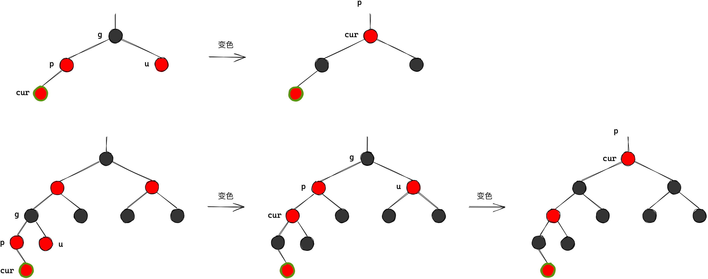

```cpp
if (grandpa->_left == parent) // 父在左
{
    Node* uncle = grandpa->_right;

    /* 情况一：u存在且为红 */
    if (uncle && uncle->_col == RED) // 叔节点存在且为红
    {
        // 变色
        parent->_col = uncle->_col = BLACK;
        grandpa->_col = RED;

        // 向上调整
        curr = grandpa; // 越过父节点直接跳到爷节点
        parent = grandpa->_parent;
    }
    //...
}
else // 父在右
{
    Node* uncle = grandpa->_left;

    /* 情况一：u存在且为红 */
    if (uncle && uncle->_col == RED) // 叔节点存在且为红
    {
        // 变色
        parent->_col = uncle->_col = BLACK;
        grandpa->_col = RED;

        // 向上调整
        curr = grandpa; // 越过父节点直接跳到爷节点
        parent = grandpa->_parent;
    }
    //...
}
```

###### 旋转情况

p为红，g为黑，**u为黑或不存在**。

> 此时我们根据爷父子三个节点呈现出的“形状”而选择旋转方式。

| 情况                   | 旋转方案 |
| ---------------------- | -------- |
| 子是父的左，父是爷的左 | 右单旋   |
| 子是父的右，父是爷的右 | 左单旋   |
| 子是父的右，父是爷的左 | 左右双旋 |
| 子是父的左，父是爷的右 | 右左双旋 |

旋转后需要改色，**上面的一个改为黑色，下面的两个改红色**。

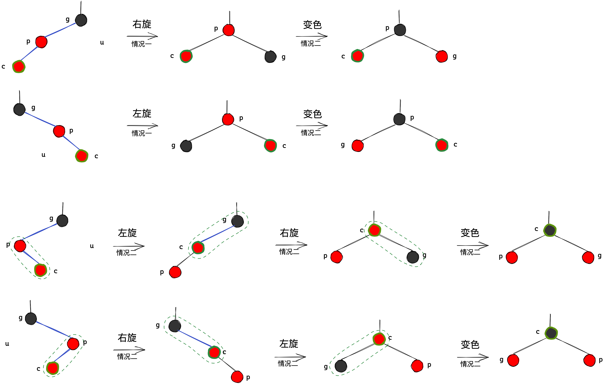

```cpp
if (grandpa->_left == parent)
{
    node* uncle = grandpa->_right;

    if (uncle && uncle->_col == RED)
    {}
    else
    {
        if (parent->_left == cur)
        {
            rotate_r(grandpa);
            cur->_col = grandpa->_col = RED;
            parent->_col = BLACK;
        }
        else
        {
            rotate_l(parent);
            rotate_r(grandpa);
            grandpa->_col = parent->_col = RED;
            cur->_col = BLACK;
        }
        break;
    }
}
else
{
    node* uncle = grandpa->_left;

    if (uncle && uncle->_col == RED)
    {}
    else
    {
        if (parent->_left == cur)
        {
            rotate_r(parent);
            rotate_l(grandpa);
            grandpa->_col = parent->_col = RED;
            cur->_col = BLACK;
        }
        else
        {
            rotate_l(grandpa);
            cur->_col = grandpa->_col = RED;
            parent->_col = BLACK;
        }
        break;
    }
}
```

###### 代码实现

```cpp
bool insert(const pair<K, V>& kv)
{
    if (!_root)
    {
        _root = new node(kv);
        _root->_col = BLACK;
        return true;
    }

    node* parent = nullptr;
    node* cur = _root;

    while (cur)
    {
        if (cur->_kv.first < kv.first)
        {
            parent = cur;
            cur = cur->_right;
        }
        else if (cur->_kv.first > kv.first)
        {
            parent = cur;
            cur = cur->_left;
        }
        else
        {
            return false;
        }
    }

    cur = new node(kv);
    if (parent->_kv.first < kv.first)
        parent->_right = cur;
    else
        parent->_left = cur;
    cur->_parent = parent;

    while (parent && parent->_col == RED)
    {
        node* grandpa = parent->_parent;

        if (grandpa->_left == parent)
        {
            node* uncle = grandpa->_right;

            if (uncle && uncle->_col == RED)
            {
                parent->_col = uncle->_col = BLACK;
                grandpa->_col = RED;

                cur = grandpa;
                parent = cur->_parent;
            }
            else
            {
                if (parent->_left == cur)
                {
                    rotate_r(grandpa);
                    cur->_col = grandpa->_col = RED;
                    parent->_col = BLACK;
                }
                else
                {
                    rotate_l(parent);
                    rotate_r(grandpa);
                    grandpa->_col = parent->_col = RED;
                    cur->_col = BLACK;
                }
                break;
            }
        }
        else
        {
            node* uncle = grandpa->_left;

            if (uncle && uncle->_col == RED)
            {
                parent->_col = uncle->_col = BLACK;
                grandpa->_col = RED;

                cur = grandpa;
                parent = cur->_parent;
            }
            else
            {
                if (parent->_left == cur)
                {
                    rotate_r(parent);
                    rotate_l(grandpa);
                    grandpa->_col = parent->_col = RED;
                    cur->_col = BLACK;
                }
                else
                {
                    rotate_l(grandpa);
                    cur->_col = grandpa->_col = RED;
                    parent->_col = BLACK;
                }
                break;
            }
        }
    }

    _root->_col = BLACK;
    return true;
}

private:
void rotate_l(node* parent)
{
    node* subr = parent->_right;
    node* subrl = subr->_left;

    parent->_right = subrl;
    if (subrl) subrl->_parent = parent;

    node* pparent = parent->_parent;

    subr->_left = parent;
    parent->_parent = subr;

    if (parent == _root)
        _root = subr;
    else
    {
        if (pparent->_left == parent)
            pparent->_left = subr;
        else
            pparent->_right = subr;
    }
    subr->_parent = pparent;
}

void rotate_r(node* parent)
{
    node* subl = parent->_left;
    node* sublr = subl->_right;

    parent->_left = sublr;
    if (sublr) sublr->_parent = parent;

    node* pparent = parent->_parent;

    subl->_right = parent;
    parent->_parent = subl;

    if (parent == _root)
    {
        _root = subl;
        subl->_parent = nullptr;
    }
    else
    {
        if (pparent->_left == parent)
            pparent->_left = subl;
        else
            pparent->_right = subl;
        subl->_parent = pparent;
    }
}
```

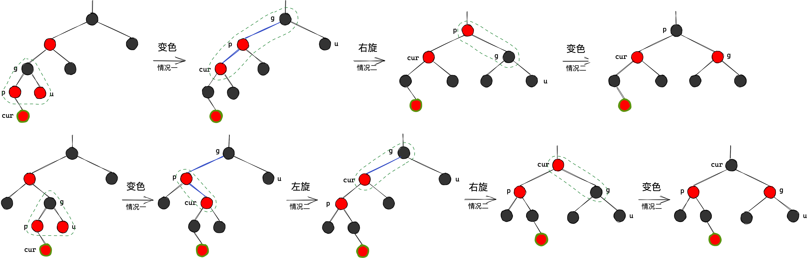

##### 红黑树的验证

```cpp
bool is_rbtree()
{
    if (_root && _root->_col == RED)
        return false;

    int mark = -1;
    return check(_root, mark, 0);
}

bool check(node* root, int& mark, int cnt)
{
    if (!root)
    {
        if (mark == -1)
            mark = cnt;
        else if (mark != cnt)
        {
            cout << "block nodes count error\n" << endl;
            return false;
        }
        return true;
    }

    if (root->_col == BLACK)
        cnt++;

    if (root->_col == RED && root->_parent->_col == RED)
    {
        cout << "consecutive red nodes "
             << root->_parent->_kv.first << " and "
             << root->_kv.first << endl;
        return false;
    }

    return check(root->_left, mark, cnt) && check(root->_right, mark, cnt);
}
```

[红黑树](https://www.cnblogs.com/fornever/archive/2011/12/02/2270692.html)

### 5.3 实现封装

> map和set如何复用同一棵红黑树呢？

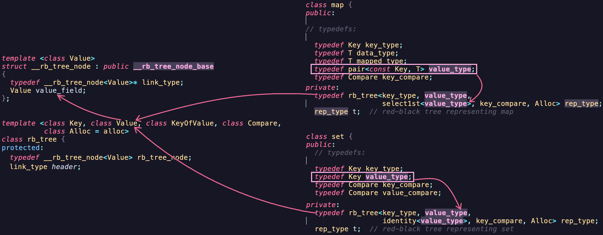

#### 整体设计

```cpp
template <class Key, class T, class Compare = less<Key>, class Alloc = alloc>
class map {
    typedef Key key_type;
    typedef pair<const Key, T> value_type;
    typedef rb_tree<key_type, value_type,
                      select1st<value_type>, key_compare, Alloc> rep_type;
    rep_type t;
}

template <class Key, class Compare = less<Key>, class Alloc = alloc>
class set {
    typedef Key key_type;
    typedef Key value_type;
    typedef rb_tree<key_type, value_type,
                  identity<value_type>, key_compare, Alloc> rep_type;
    rep_type t;
}

template <class Key, class Value, class KeyOfValue, class Compare, class Alloc = alloc>
class rb_tree {
    typedef __rb_tree_node<Value> rb_tree_node;
}

template <class Value>
struct __rb_tree_node {
    Value value_field;
};

set<K>    -> rb_tree<K, K>                 -> rb_tree_node<K>
map<K, V> -> rb_tree<K, pair<const K, V> > -> rb_tree_node<pair<const K, V> >
```

| 模版参数     | 作用                                                         |
| ------------ | ------------------------------------------------------------ |
| `Key`        | **可以直接拿到`Key`类型，编译模版的时候需要确定`Key`类型**   |
| `Value`      | **决定了树节点元素存储的数据的类型**                         |
| `KeyOfValue` | 仿函数，用来获取`Value`中的`Key`值，如果是`map`就是取`kv.first`如果是`set`就是`K` |
| `Compare`    | 仿函数，`Key`类型的比较函数                                  |

```cpp
template<class V>
struct rbt_node
{};
template<class K, class V, class KeyOfValue, class Compare>
class rb_tree
{};

template<class K, class CmpOfKey = less<K>>
class set
{
    bool insert(const K& key) { t.insert(key); }
    class KeyOfVal { K& operator()(const K& key) { return key; } };
    rb_tree<K, K, KeyOfVal, CmpOfKey> t;
};

template<class K, class V, class CmpOfKey = less<K>>
class map
{
    bool insert(const pair<const K, V>& kv) { t.insert(kv); }
    class KeyOfVal { K& operator()(const pair<const K, V>& kv) { return kv.first; } };
    rb_tree<K, pair<const K, V>, KeyOfVal, CmpOfKey> t;
};
```

#### 红黑树

##### 默认函数

```cpp
template<class V>
struct rbt_node
{
    rbt_node<V>* _left;
    rbt_node<V>* _right;
    rbt_node<V>* _parent;

    V _val;
    COLOR _col;

    rbt_node<V>(const V& val)
        : _left(nullptr), _right(nullptr), _parent(nullptr)
        , _val(val), _col(RED)
    {}
};

template<class K, class V, class KeyOfValue, class Compare>
class rb_tree
{
public:
    typedef rbt_node<V> node;

public:
    rb_tree()
    {}

    rb_tree(const rb_tree& t)
    {
        _root = copy(_root);
    }

    rb_tree& operator=(const rb_tree t)
    {
        if (this != &t)
        {
            swap(_root, t._root);
        }
        return *this;
    }

    ~rb_tree()
    {
        destroy(_root);
        _root = nullptr;
    }

private:
    node* copy(node* root)
    {
        if (!root)
            return nullptr;

        node* new_node = new node(root->_kv);
        new_node->_left = copy(root->_left);
        new_node->_right = copy(root->_right);
        return new_node;
    }

    void destroy(node* root)
    {
        if (!root)
            return;

        destroy(root->_left);
        destroy(root->_right);
        delete root;
    }

    bool insert(const V& val)
    {
        // ...
        if (_kov(cur->_val) < _kov(val))
        else if (_kov(cur->_val) > _kov(val))
        // ...
    }

private:
    KeyOfValue _kov;
    Compare _cmp;
    node* _root = nullptr;
};
```

##### 插入函数

```cpp
pair<iterator, bool> insert(const V& val)
{
    if (!_root)
    {
        _root = new node(val);
        _root->_col = BLACK;
        return {iterator(_root), true};
    }

    node* parent = nullptr;
    node* cur = _root;

    while (cur)
    {
        if (_cmp(_kov(cur->_val), _kov(val)))
        {
            parent = cur;
            cur = cur->_right;
        }
        else if (_cmp(_kov(val), _kov(cur->_val)))
        {
            parent = cur;
            cur = cur->_left;
        }
        else
        {
            return {iterator(cur), false};
        }
    }

    cur = new node(val);
    if (_cmp(_kov(parent->_val), _kov(val)))
        parent->_right = cur;
    else
        parent->_left = cur;
    cur->_parent = parent;

    while (parent && parent->_col == RED)
    {
        node* grandpa = parent->_parent;

        if (grandpa->_left == parent)
        {
            node* uncle = grandpa->_right;

            if (uncle && uncle->_col == RED)
            {
                parent->_col = uncle->_col = BLACK;
                grandpa->_col = RED;

                cur = grandpa;
                parent = cur->_parent;
            }
            else
            {
                if (parent->_left == cur)
                {
                    rotate_r(grandpa);
                    cur->_col = grandpa->_col = RED;
                    parent->_col = BLACK;
                }
                else
                {
                    rotate_l(parent);
                    rotate_r(grandpa);
                    grandpa->_col = parent->_col = RED;
                    cur->_col = BLACK;
                }
                break;
            }
        }
        else
        {
            node* uncle = grandpa->_left;

            if (uncle && uncle->_col == RED)
            {
                parent->_col = uncle->_col = BLACK;
                grandpa->_col = RED;

                cur = grandpa;
                parent = cur->_parent;
            }
            else
            {
                if (parent->_left == cur)
                {
                    rotate_r(parent);
                    rotate_l(grandpa);
                    grandpa->_col = parent->_col = RED;
                    cur->_col = BLACK;
                }
                else
                {
                    rotate_l(grandpa);
                    cur->_col = grandpa->_col = RED;
                    parent->_col = BLACK;
                }
                break;
            }
        }
    }

    _root->_col = BLACK;
    return {iterator(cur), true};
}
```

##### 迭代器

```cpp
template<class V, class Ref, class Ptr>
struct __rb_tree_iterator
{
    typedef __rb_tree_node<V> node;
    typedef __rb_tree_iterator<V, Ref, Ptr> self;

    node* _node = nullptr;

    __rb_tree_iterator<V, Ref, Ptr>(node* node)
        : _node(node)
    {}

    // support normal iter construt const iter
    __rb_tree_iterator(const __rb_tree_iterator<V, V&, V*>& it)
        : _node(it.node)
    {}

    Ref operator*()
    {
        return _node->_val;
    }
    Ptr operator->()
    {
        return &_node->_val;
    }

    bool operator==(const self& s)
    {
        return _node == s._node;
    }
    bool operator!=(const self& s)
    {
        return _node != s._node;
    }
};
```

库中是将根节点带个头节点，头节点的左孩子指向整个树的最左节点，右孩子指向整个树的最右节点；

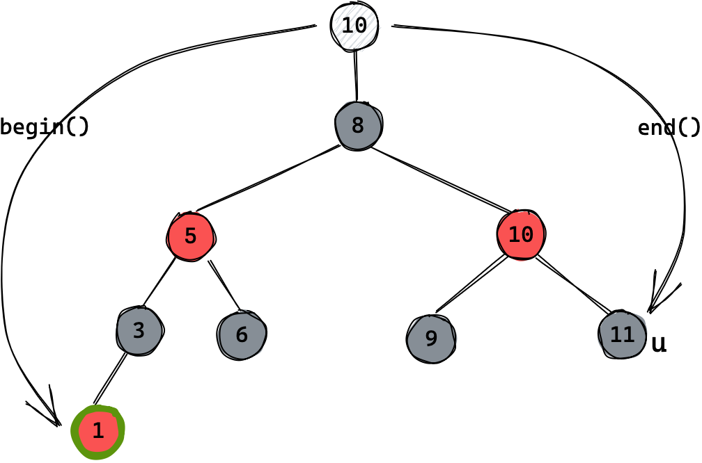

- 如果节点的右子树不为空，下一个位置就是节点的**右子树的最左节点**。
- 如果节点的右子树为空，向上遍历，找到某个节点，满足该节点是其父亲的左，该父亲就是下一个位置。

```cpp
self& operator++()
{
    if (_node->_right)
    {
        node* left = _node->_right;
        while (left->_left)
        {
            left = left->_left;
        }
        _node = left;
    }
    else
    {
        node* cur = _node;
        node* parent = cur->_parent;

        while (parent && parent->_right == cur)
        {
            cur = parent;
            parent = cur->_parent;
        }
        _node = parent;
    }
    return *this;
}

self& operator--()
{
    if (!_node) assert(false); // can't do that

    if (_node->_left)
    {
        node* right = _node->_left;
        while (right->_right)
        {
            right = right->_right;
        }
        _node = right;
    }
    else
    {
        node* cur = _node;
        node* parent = cur->_parent;

        while (parent && parent->_left == cur)
        {
            cur = parent;
            parent = cur->_parent;
        }
        _node = parent;
    }
    return *this;
}
```

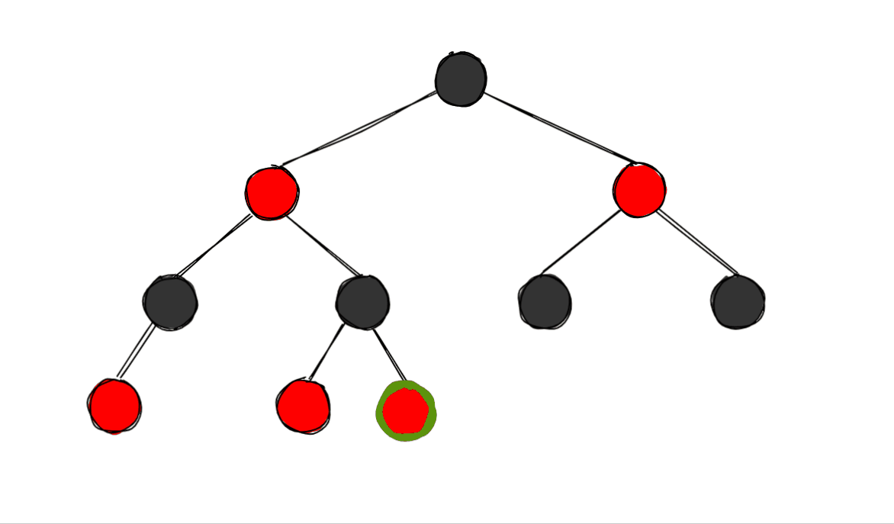

#### set

```cpp
template<class K, class Compare = less<K>>
class set
{
private:
    struct KeyOfVal {
        const K& operator()(const K& key) { return key; }
    };

public:
    typedef rb_tree<K, K, KeyOfVal, Compare> rep_type;
    typedef typename rep_type::const_iterator iterator; // use const iter
    typedef typename rep_type::const_iterator const_iterator;

public:
    pair<iterator, bool> insert(const K& key) { return _t.insert(key); }
    iterator find(const K& key) { return _t.find(key); }
    void inorder() { _t.inorder(); }

public:
    iterator begin() { return _t.begin(); }
    iterator end() { return _t.end(); }

private:
    rb_tree<K, K, KeyOfVal, Compare> _t;
};
```

#### map

```cpp
template<class K, class V, class Compare = less<K>>
class map
{
private:
    struct KeyOfVal {
        const K& operator()(const pair<const K, V>& kv) { return kv.first; }
    };

public:
    typedef rb_tree<K, pair<const K, V>, KeyOfVal, Compare> rep_type;
    typedef typename rep_type::iterator iterator;
    typedef typename rep_type::const_iterator const_iterator;

public:
    iterator find(const K& key) { return _t.find(key); }
    pair<iterator, bool> insert(const pair<const K, V>& kv) { return _t.insert(kv); }
    V& operator[](const K& key) { return _t.insert(make_pair(key, V())).first->second; }
    void inorder() { _t.inorder(); }

    iterator begin() { return _t.begin(); }
    iterator end() { return _t.end(); }

private:
    rep_type _t;
};
```

## 6. hash

### 6.1 unordered容器

当节点非常多时，map和set查询效率也不够理想。C++11新增`unordered_map, unordered_set`等底层为哈希的关联式容器。

`unordered`意为无序的，即存储遍历不按`key`排序。所以`unordered`系列容器只有单向迭代器。

| 容器                                    | 底层   | 区别         |
| --------------------------------------- | ------ | ------------ |
| set / map                               | 红黑树 | 排序加去重   |
| multiset / multimap                     | 红黑树 | 排序不去重   |
| unordered_set / unordered_map           | 哈希   | 去重不排序   |
| unordered_multiset / unordered_multimap | 哈希   | 不排序不去重 |

#### 效率对比

```cpp
int n = 10000000;
vector<int> v;
srand((unsigned int)time(nullptr));
for (int i = 0; i < n; i++) {
    v.push_back(rand());
    v.push_back(i);
}

set<int> s;
unordered_set<int> us;

int begin1 = clock();
for (auto e : v) {
    s.insert(e);
}
int end1 = clock();

//
int begin2 = clock();
for (auto e : v) {
    us.insert(e);
}
int end2 = clock();

cout << "set insert: " << end1 - begin1 << endl;
cout << "unordered_set insert: " << end2 - begin2 << endl;
```

- 当插入随机值且数据量很大时，unordered_set比set快3倍左右。
- 当插入有序值且数据量很大时，unordered_set比set慢2倍左右。
- unordered_set的查找效率极高，这得益于哈希的底层结构。

set更适合有序重复度低的数据，unordered_set更适合随机重复度高的数据。**综合来看，unordered系列容器比map/set效率要更好些**。

### 6.2 哈希

#### 哈希的定义

哈希也叫做散列，记数排序就体现了哈希思想。

计数排序为统计数字出现的个数，<u>为每个数字都开辟了对应的一块空间</u>，用来记录其出现的个数，每遇到就加一。

**将一个元素和一个位置建立映射关系，这就是哈希的本质**。

##### 哈希函数

> 搜索树中key与元素的存储位置没有直接映射。因此查找必须经历多次比较key。搜索效率还是不够理想。

最理想的搜索方法是：不经任何比较，一次性直接得出元素的存储位置。

<u>通过某种函数（hashFunc）使元素 key 与它的存储位置之间能够建立映射关系</u>，那么就可以一次性找到该元素。

###### 除留余数法

例如，存在数据集合 $[1,7,6,4,5,9]$，将哈希函数设置为 $hash(key)=key\;\%\;capacity$，$capacity$ 为存储空间总的大小。


###### 自定义哈希函数

常见的数据类型如整数，库中自带哈希函数，但有些类型比如自定义类型，需要我们自定义哈希函数。

可以把哈希函数设计成仿函数，对不同类型添加特化处理。

```cpp
template<class K>
struct Hash {
    size_t operator()(const K& key) {
        return key;
    }
};
// 特化
template<>
struct Hash<string> {
    //BKDR
    size_t operator()(conststring& s) {
        size_t val = 0;
        for (auto ch : s) {
            val = val * 131 + ch;
        }
        return val;
    }
};
```

如果我们自定义类型作key，可以单独为其设计一个哈希函数，并在创建哈希表时作参数传进去。

```cpp
struct Date {
    int _year;
    int _month;
    int _day;
};
struct HashDate {
    size_t operator()(const Date& date) {
        return date._year + date._month + date._day;
    }
};
```

##### 哈希冲突

很可能存在不同数值映射到同一位置的情况，比如$10\%10=0,\;20\%10=0$。这就是哈希冲突或称哈希碰撞。

一般哈希冲突是不可避免的，冲突越多效率越低，故提高哈希效率在于如何解决哈希冲突。解决哈希冲突的两种常见的方法是：闭散列和开散列。

#### 哈希冲突的解决

##### 闭散列/开放定址法

闭散列，又称开放定址法。**当发生哈希冲突时，把元素放到冲突位置后的下一个空位中**。

> 如何寻找空位呢？一般有线性探测和二次探测。如果没有空位，可以闭散列扩容。

###### 两种探测方式

| 探测方式 | 解释                                              | 问题                               |
| -------- | ------------------------------------------------- | ---------------------------------- |
| 线性探测 | 从冲突位置向后遇到的第一个空位，就是存放位置      | 连续位置冲突越来越多，引发洪水效应 |
| 二次探测 | 每次向后跳过 $i^2$ 个长度，如遇到空位就是存放位置 | 能缓解拥堵，快满时“绕圈”现象明显。 |

如何表示元素位置是否存在、为空、被删除？要为每个位置数据增加状态标记。


二次探测在得到位置后如果发生冲突，第一次向后跳过$1^2$个长度、第二次$2^2$个长度，如此类推，直到遇到空位置。

```cpp
bool insert(const pair<K, V>& kv)
{
    if (_table.size() == 0 || _size * 10 / _table.size() >= 7)
    {
        size_t new_size = _size == 0 ? 10 : _table.size() * 2;
        hash_table<K, V> new_hash;
        new_hash._table.resize(new_size);

        for (auto& data : _table)
            if (data._st == EXIST)
                new_hash.insert(data._kv);

        _table.swap(new_hash._table);
    }

    size_t hashi = kv.first % _table.size();

    size_t i = 1;
    size_t idx = hashi;
    while (_table[idx]._st == EXIST)
    {
        if (_table[idx]._kv.first == kv.first)
            return false;

        idx += i;     // 线性探测
        idx += i * i; // 二次探测
        idx %= _table.size();
    }

    _table[idx]._kv = kv;
    _table[idx]._st = EXIST;
    ++_size;
    return true;
}
```

###### 闭散列扩容

> 当二次探测总是在正确位置“绕圈”时，只能用扩容解决问题。但什么时候该扩容呢？扩容多大呢？

载荷因子可以衡量哈希表的装载程度，它的定义是：
$$
\alpha \; = \;表中元素个数\;/\;表的总长度
$$
负载因子越小，冲突概率越低，效率越高，但空间浪费就多。

使用闭散列时，荷载因子是决定哈希效率的重要因素，应严格限制在0.7-0.8以下。超过0.8，查表的缓存不命中率指数级上升。

哈希表的扩容要维护原有数据的存放位置。数据搬迁很麻烦，不如将原数据插入到新表。


```cpp
bool insert(const pair<K, V>& kv)
{
    if (_table.size() == 0 || _size * 10 / _table.size() >= 7)
    {
        size_t new_size = _size == 0 ? 10 : _table.size() * 2;
        hash_table<K, V> new_hash;
        new_hash._table.resize(new_size);

        for (auto& data : _table)
        {
            if (data._st == EXIST)
                new_hash.insert(data._kv);
        }

        _table.swap(new_hash._table);
    }
    // ...
}
```

```cpp
HashNode<K, V>* Find(const K& key) {
    if (_table.size() == 0)
        return nullptr;

    HashFunc hf;

    size_t pos = hf(key) % _table.size();
    size_t index = pos;
    size_t i = 0;

    while (_table[index]._status == EXIST) {
        if (_table[index]._kv.first == key) {
            return &_table[index];
        }

        ++i;
            index = pos + i;
            index %= _table.size();
    }

    return nullptr;
}
bool Erase(const K& key) {
    HashNode<K, V>* ret = Find(key);
    if (ret == nullptr)
        return false;
    else {
        ret->_status = EMPTY;
        --_n;
        return true;
    }
}
```

##### 开散列/拉链法/哈希桶

> 闭散列的线性探测和二次探测都会加剧哈希冲突，现实中几乎不会使用闭散列。

开散列又称拉链法、链地址法、开链法、哈希桶。

**具有相同地址的key归于一个集合（桶），桶中元素通过链表链接起来，各链表的头结点存储在哈希表中**。从根本上解决了冲突的问题。


```cpp
template<class K, class V>
struct hash_node
{
    pair<K, V> _kv;
    hash_node<K, V>* _next;

    hash_node<K, V>(const pair<K, V>& kv) : _kv(kv), _next(nullptr)
    {}
};

template<class K, class V>
class hash_table
{
public:
    typedef hash_node<K, V> node;
public:
    ~hash_table<K, V>() {
        for (auto cur : _table) {
            while (cur) {
                node* next = cur->_next;
                delete cur;
                cur = next;
            }
        }
    }

private:
    vector<node*> _table;
    size_t _size;
};
```

###### 开散列实现

桶由链表实现，本质效率和线性探测一样。如果桶中节点过多会影响哈希表的性能。必须在适当条件下对哈希表增容。让哈希表处于最佳状态。

开散列的最佳情况是每个哈希桶中刚好挂一个节点。如果再插入必然会发生冲突。因此**当元素个数等于桶的个数时，可以给哈希表增容**。


开散列扩容复用插入逻辑的话，会浪费原节点，最好是遍历原表节点放到新表中。

```cpp
bool insert(const pair<K, V>& kv)
{
    if (_table.empty() || _size == _table.size())
    {
        size_t new_size = _size == 0 ? 10 : _table.size() * 2;
        vector<node*> new_table(new_size);

        for (auto cur : _table)
        {
            while (cur)
            {
                size_t hashi = cur->_kv.first % _table.size();
                node* next = cur->_next;

                cur->_next = new_table[hashi];
                new_table[hashi] = cur;

                cur = next;
            }
            cur = nullptr;
        }

        _table.swap(new_table);
    }

    size_t hashi = kv.first % _table.size();

    node* new_node = node(kv);
    new_node->_next = _table[hashi];
    _table[hashi] = new_node;
    return true;
}
```

```cpp
node* find(const K& key)
{
    if (_table.empty())
        return nullptr;

    size_t hashi = key % _table.size();
    node* cur = _table[hashi];

    while (cur)
    {
        if (cur->_kv.first == key)
            return cur;

        cur = cur->_next;
    }

    return nullptr;
}

bool erase(const K& key)
{
    if (_table.empty())
        return false;

    size_t hashi = key % _table.size();
    node* cur = _table[hashi];
    node* prev = nullptr;

    while (cur)
    {
        if (cur->_kv.first == key)
        {
            if (!prev)
            {
                _table[hashi] = cur->_next;
            }
            else
            {
                prev->_next = cur->_next;
            }
            delete cur;
            return true;
        }

        prev = cur;
        cur = cur->_next;
    }
    return false;
}
```

### 6.3 模拟实现

> 哈希表的实现比红黑树要简单不少，但是它的封装比较繁琐。

根据哈希表原理，实现unordered系列容器，需要对key类型作出如下要求：

| 参数                 | 解释                                 |
| -------------------- | ------------------------------------ |
| `Hash=hash<Key>`     | **支持取模或支持映射到整数进行取模** |
| `Pred=equal_to<Key>` | **支持判断相等的函数**               |

```cpp
template < class Key,  									// unordered_map::key_type
           class Value,									// unordered_map::mapped_type
           class Hash = hash<Key>, 						// unordered_map::hasher
           class Pred = equal_to<Key>, 					// unordered_map::key_equal
           class Alloc = allocator<pair<const Key,T>>   // unordered_map::allocator_type
         > class unordered_map;
```

#### 改造哈希表

- unordered_map/unordered_set要复用同一个哈希表，同样要提供仿函数`KeyOfVal`。
- 哈希只支持单向迭代器，所以只有++。
- 哈希表遍历是从头到尾遍历每个桶，必须能访问表中的数组，所以必须提供哈希表对象的指针。

```cpp
template<class K, class V, class HashFunc, class KeyOfVal, class EqualKey>
class hash_table;

template<class K, class V, class HF, class KOV, class Ref, class Ptr>
struct __hash_iterator
{
    typedef __hash_node<V> node;
    typedef hash_table<K, V, HF, KOV> hash_table;
    typedef __hash_iterator<K, V, HF, KOV, V&, V*> iterator;
    typedef __hash_iterator<K, V, HF, KOV, Ref, Ptr> self;

    node* _node;
    const hash_table* _ht;

    __hash_iterator(node* n, const hash_table* ht) : _node(n), _ht(ht)
    {}

    __hash_iterator(const iterator& it) : _node(it._node), _ht(it._ht)
    {}

    Ref operator*() { return _node->_val; }

    Ptr operator->() { return &_node->_val; }

    bool operator==(const self& s) { return _node == s._node; }

    bool operator!=(const self& s) { return !this->operator==(s); }

    self& operator++()
    {
        if (_node->_next)
        {
            _node = _node->_next;
        }
        else
        {
            size_t hashi = _ht->_hash(_ht->_kov(_node->_val)) % _ht->_table.size();
            ++hashi;

            while (hashi < _ht->_table.size())
            {
                if (_ht->_table[hashi])
                {
                    _node = _ht->_table[hashi];
                    break;
                }
                ++hashi;
            }

            if (hashi == _ht->_table.size())
                _node = nullptr;
        }
        return *this;
    }
};
```

```cpp
template<class V>
struct __hash_node
{
    V _val;
    __hash_node<V>* _next;
    __hash_node<V>(const V& val) : _val(val), _next(nullptr)
    {}
};

template<class K, class V, class HashFunc, class KeyOfVal>
class hash_table
{
public:
    typedef __hash_node<V> node;
    typedef __hash_iterator<K, V, HashFunc, KeyOfVal, V&, V*> iterator;
    typedef __hash_iterator<K, V, HashFunc, KeyOfVal, const V&, const V*> const_iterator;

    template<class K, class V, class HF, class KOV, class Ref, class Ptr>
    friend struct __hash_iterator;

public:
    const_iterator begin() const
    {
        for (auto cur : _table)
        {
            if (cur) return const_iterator(cur, this);
        }
        return end();
    }

    const_iterator end() const
    {
        return const_iterator(nullptr, this);
    }

    iterator begin()
    {
        for (auto cur : _table)
        {
            if (cur) return iterator(cur, this);
        }
        return end();
    }

    iterator end()
    {
        return iterator(nullptr, this);
    }

public:
    std::pair<iterator, bool> insert(const V& val)
    {
        auto pos = find(_kov(val));
        if (pos != end())
            return {pos, false};

        if (_table.empty() || _table.size() == _size)
        {
            size_t new_size = _table.empty() ? 10 : _table.size() * 2;
            std::vector<node*> new_table(new_size);

            for (auto& cur : _table)
            {
                while (cur)
                {
                    size_t hashi = _hash(_kov(cur->_val))%new_table.size();
                    node* next = cur->_next;

                    cur->_next = new_table[hashi];
                    new_table[hashi] = cur;

                    cur = next;
                }
            }

            _table.swap(new_table);
        }

        size_t hashi = _hash(_kov(val)) % _table.size();
        node* new_node = new node(val);

        new_node->_next = _table[hashi];
        _table[hashi] = new_node;
        ++_size;

        return {iterator(new_node, this), true};
    }

    iterator find(const K& key)
    {
        if (_table.empty())
            return end();

        size_t hashi = _hash(key) % _table.size();
        node* cur = _table[hashi];

        while (cur)
        {
            if (_hash(_kov(cur->_val)) == _hash(key))
                return iterator(cur, this);

            cur = cur->_next;
        }

        return end();
    }

    bool erase(const K& key)
    {
        if (_table.empty())
            return false;

        size_t hashi = _hash(key) % _table.size();
        node* cur = _table[hashi];
        node* prev = nullptr;

        while (cur)
        {
            if (_hash(_kov(cur->_val)) == _hash(key))
            {
                if (!prev)
                {
                    _table[hashi] = cur->_next;
                }
                else
                {
                    prev->_next = cur->_next;
                }
                delete cur;
                return true;
            }

            prev = cur;
            cur = cur->_next;
        }
        return false;
    }

private:
    std::vector<node*> _table;
    size_t _size = 0;

    KeyOfVal _kov;
    HashFunc _hash;
};
```

#### 封装容器

##### unordered_set

```cpp
template<class K, class Hash = hash<K>>
class unordered_set
{
private:
    struct KeyOfVal {
        const K& operator()(const K& key) const { return key; }
    };

public:
    typedef hash_table<K, K, Hash, KeyOfVal> rep_type;
    typedef typename rep_type::const_iterator iterator;
    typedef typename rep_type::const_iterator const_iterator;

public:
    std::pair<iterator, bool> insert(const K& key) { return _ht.insert(key); }

    size_t erase(const K& key) { return _ht.erase(key); }

    iterator find(const K& key) { return _ht.find(key); }

    iterator begin() { return _ht.begin(); }
    iterator end() { return _ht.end(); }

    const_iterator begin() const { return _ht.begin(); }
    const_iterator end() const { return _ht.end(); }

private:
    rep_type _ht;
};
```

##### unordered_map

```cpp
template<class K, class V, class Hash = hash<K>>
class unordered_map
{
private:
    struct KeyOfVal {
        const K& operator()(const std::pair<const K, V>& kv) const {
            return kv.first;
        }
    };

public:
    typedef hash_table<K, std::pair<const K, V>, Hash, KeyOfVal> rep_type;
    typedef typename rep_type::iterator iterator;
    typedef typename rep_type::const_iterator const_iterator;

public:
    std::pair<iterator, bool> insert(const std::pair<K, V>& kv) { return _ht.insert(kv); }

    size_t erase(const K& key) { return _ht.erase(key); }

    iterator find(const K& key) { return _ht.find(key); }

    iterator begin() { return _ht.begin(); }
    iterator end() { return _ht.end(); }

    const_iterator begin() const { return _ht.begin(); }
    const_iterator end() const { return _ht.end(); }

    V& operator[](const K& key) { return _ht.insert({key, V()}).first->second; }

private:
    rep_type _ht;
};
```

### 6.4 哈希应用

#### 位图

哈希是存在一定空间消耗的，在处理海量数据的情况下可以选择位图。

##### 位图的定义

位图用一段空间的每个比特位：

- 比特位的位置映射到特定的元素；
- 比特位的值即01来表示二元状态。

位图可以记录某个元素的某个二元状态，通常用于处理海量数据，且数据无重复的场景。通常是用来判断某个数据存不存在。

<u>位图的大小和数据量无关，而是和数据最大值有关</u>。整型最大能表示42亿多。故位图最大为$500MB$。

##### 位图的优劣

- 位图的查找速度快。节省空间。
- 但位图只能处理整数，只能记录二元状态。

##### 位图的实现


位图就是将元素以绝对映射的方式到下标位置。

以一个字节八个比特位为一组，$x/8$ 得元素在第几个组，然后 $x\%8$ 得元素在组中第几个比特位。

```cpp
template <size_t N>
class bit_set
{
public:
    bit_set() { _bits.resize(N / 8 + 1); }

    void set(size_t x)
    {
        int i = x / 8; // 字节位
        int j = x % 8; // 比特位
        _bit[i] |= (1 << j); // 比特位置1
    }

    void reset(size_t x)
    {
        int i = x / 8;
        int j = x % 8;
        _bit[i] &= ~(1 << j) // 比特位置0
    }

    bool test(size_t x)
    {
        int i = x / 8;
        int j = x % 8;
        return _bit[i] & (1 << j); // 探测该比特位
    }

private:
    vector<char> _bits;
};
```

整数相除会丢弃余数，所以加一个字节保证空间大小一定满足要求。

```cpp
//开满大小的位图
bitset<(size_t)-1> bs1;
bitset<0xffffffff> bs2;
```

##### 位图的应用

###### 问题一

> 给定40亿个整数，设计算法找到只出现一次的整数？

找到只出现一次的整数，需要两个位图，<u>一个保存这些数的是否出现一次，一个保存是否出现</u>。

```cpp
template <size_t N>
void handlequestion2(vector<int>& in, vector<int>& out)
{
    bitset<N> bs1;
    bitset<N> bs2;

    for (auto e : in) {
        if (!_bs2.test(x)) {
            _bs1.set(x);
            _bs2.set(x);
        }
        else {
            _bs1.reset(x);
        }
    }
    for (int i = 0; i < N; i++)
        if (_bs1.test(i))
            v.push_back(i);
}
```

###### 问题二

> 给两个文件，分别有100亿个整数，我们只有1G内存，如何找到两个文件交集？

思路一：将第一个文件中的整数set到位图中，再遍历第二个文件的整数test该位图，如果已经存在则属于交集，输出后再将其reset防止重复。

```cpp
template <size_t N>
void handlequestion2(vector<int>& in1, vector<int>& in2, vector<int>* out)
{
    bitset<N> bs;
    for (auto e : in1) {
        bs.set(e);
    }
    for (auto e : in2) {
        if (bs.test(e)) {
            bs.reset(e);
            out->push_back(e);
        }
    }
}
```

思路二：两个文件分别set到两个位图，取两个位图相与后的结果，就是交集。

```cpp
template <size_t N>
void handlequestion2(vector<int>& in1, vector<int>& in2, vector<int>* out)
{
    bitset<N> bs1;
    bitset<N> bs2;

    for (auto e : in1) bs1.set(e);
    for (auto e : in2) bs2.set(e);

    for (int i = 0; i < N; i++) {
        if (bs1.test(i) && bs2.test(i))
            out->push_back(i);
    }
}
```

###### 问题三

> 100亿个整数，1G内存，找到出现不超过2次的整数。

两个位图可表示4种状态，可以描述出现0次，出现1次，出现2次，2次以上。

```cpp
template <size_t N>
void handlequestion3(vector<int>& in, vector<int>* out)
{
    bitset<N> bs1;
    bitset<N> bs2;
    if(bs1.test(x) == false && bs2.test(x) == false) // 00 -> 01
    {
        bs1.set(x);
    }
    else if (bs1.test(x) == true && bs2.test(x) === false) // 01 -> 10
    {
        bs1.reset(x);
        bs2.set(x);
    }
    else if (bs1.test(x) == false && bs2.test(x) === true) // 10 -> 11
    {
        bs1.set(x);
        bs2.set(x);
    }

    for (int i = 0; i < N; i++) {
        if ((_bs1.test(i) && !_bs2.test(i)) || (!_bs1.test(i) && _bs2.test(i)))
            v->push_back(i);
    }
}
```

#### 布隆过滤器

> 位图只能处理整数，布隆过滤器可以处理任意类型。

##### 布隆过滤器的定义

有些类型虽不可直接映射，但可以通过哈希函数转整数间接映射。可以认为，布隆过滤器就是加上哈希函数的位图。

但使用哈希函数就不可避免会发生哈希冲突。发生冲突会导致误判，将一个不存在的元素误判为存在。

解决冲突的方式：

使用更大空间，自然会减少冲突的概率。
**多副本映射，使用多个哈希函数，将同一元素映射在不同位置上，降低误判的概率**。


倘若某个元素的位置都被其他元素映射了，那它就会被误判存在。也就是说，**结果存在不一定对，结果不存在一定对。所以尽量使用布隆过滤器判断“不在”**。

##### 布隆过滤器的优劣

| 优点                 | 解释                                           |
| -------------------- | ---------------------------------------------- |
| **查询效率高**       | $O(K)$，K是映射副本的个数，属于常数次。        |
| **占存小，保密性高** | 不存储元素本身，只存储映射状态。               |
| **缺点**             | **解释**                                       |
| 有误判率             | 不能准确判断元素是否存在。                     |
| 不能删除             | 如果采用计数方式删除，可能会存在计数回绕问题。 |

##### 布隆过滤器的实现

[布隆过滤器](https://zhuanlan.zhihu.com/p/43263751)

模版参数`N`表示需要映射的元素个数，但防止冲突一个元素需要多个比特位，那具体要开辟多大空间呢？
$$
布隆过滤器大小=4.3*映射的元素个数
$$

```cpp
#pragma once
#include <iostream>
#include "bitset.hpp"
using namespace std;
using namespace test;

struct BKDRHash {
    size_t operator()(conststring& s) {
        int val = 0;
        for (auto e : s) val = val * 131 + e;
        return val;
    }
};
struct APHash {
    size_t operator()(conststring& s) {
        size_t hash = 0;
        size_t ch = 0, i = 0;
        for (auto ch : s) {
            if (i++ & 1 == 0) hash ^= ((hash << 7) ^ ch ^ (hash >> 3));
            else hash ^= (~(hash << 11) ^ ch ^ (hash >> 5));
        }
        return hash;
    }
};
struct DJBHash {
    size_t operator()(conststring& s) {
        size_t hash = 5381;
        for (auto ch : s) hash += (hash << 5) + ch;
        return hash;
    }
};

template <size_t N,
          size_t MUL = 4,
          class K =string,
          class Hash1 = BKDRHash,
          class Hash2 = APHash,
          class Hash3 = DJBHash>
class bloom_filter
{
public:
    void set(const K& key)
    {
        size_t i1 = Hash1()(key) % _len;
        size_t i2 = Hash2()(key) % _len;
        size_t i3 = Hash3()(key) % _len;
        _bs.set(i1);
        _bs.set(i2);
        _bs.set(i3);
    }

    bool test(const K& key)
    {
        size_t i1 = Hash1()(key) % _len;
        size_t i2 = Hash2()(key) % _len;
        size_t i3 = Hash3()(key) % _len;
        return _bs.test(i1) && _bs.test(i2) && _bs.test((i3));
    }

private:
    bitset<N * MUL> _bs;
    size_t _len = MUL * N;
};
```

##### 布隆过滤器的应用

> 如何使布隆过滤器支持删除？

布隆过滤器本身不支持删除。因为在发生冲突的情况下将比特位置0，可能会导致误判不在。

利用多个位图，每个元素占有多个比特位，存储引用计数。会导致耗费空间变多，布隆过滤器优势减弱。

#### 哈希切分

##### 应用一

> 给两个文件，分别有100亿个query，我们只有1G内存，如何找到两个文件交集？

先将文件A和文件B分别各切分成200个小文件。

利用哈希函数，算出每个query的映射位置，是多少就放进多少号文件。比如文件A中的某个query的哈希结果是3，就放到A3号文件中，B中的query也同理。

因为文件A和文件B用同一个哈希函数，所以两个文件中相同的query一定进入了同一个编号的小文件中。所以只要对比编号相同的哈希桶是否存在相同的元素即可。

> 小文件就相当于是一个哈希桶，相同哈希结果的query会到同一个桶中。


如果$A_i$和$B_i$两个桶太大，超过内存限制，可以换一个哈希算法，再对这两个桶切分一次。

##### 应用二

> 给一个超过100G大小的日志文件存着IP地址，我们只有1G内存，设计算法找到出现次数TopK的IP地址？

遍历文件读取IP，`i=BKDR(ip)%100`下标为多少，IP就进入编号为多少的文件。

通过哈希算法一定会将相同的IP进入同一个文件，所以统计该文件内各IP的次数就是该IP的出现次数。

[一致性哈希](https://blog.csdn.net/a745233700/article/details/120814088)

[哈希与加密](https://www.cnblogs.com/leoo2sk/archive/2010/10/01/hash-and-encrypt.html)
