# 命令行基础

## 1. 基础指令

使用Linux系统的第一步就是先熟悉Linux的各种指令，之后才能谈Linux的系统编程和网络编程。

### 1.1 pwd

```shell
$ pwd ## 显示用户当前所在目录
/home/yyx/test
```

Linux 下的路径以`/`作为路径分隔符，Windows 下以`\`作为路径分隔符。而路径就是由目录和路径组成的。

### 1.2 cd

```shell
$ cd 目录名 ## 进入指定目录
$ cd .     ## 返回当前目录
$ cd ..    ## 返回上级目录
$ cd ~     ## 进入用户家目录
$ cd -     ## 返回上一次访问的目录
```

大部分操作系统中，组织文件的基本结构就是一颗多叉树，每一个节点都是目录或文件，Linux系统也不例外。

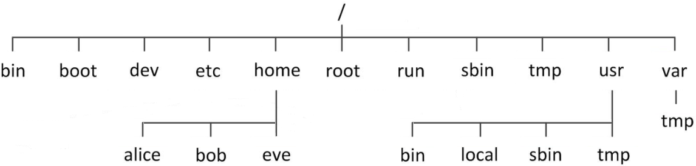

从上图可以看出，采用路径的方式可以确定一个文件的位置。

| 路径类型 | 解释                                                         |示例|
| -------- | ------------------------------------------------------------ | -------- |
| 绝对路径 | 从根目录到文件所在目录再加上文件名，具有唯一性 |`/home/yyx/test.c`|
| 相对路径 | 相对当前地址的路径，不以根目录开头不具有唯一性 |`yyx/test.c`、`./a.out`|

> `./a.out`是可以执行可执行程序，本质也是相对路径。

### 1.3 ls

```shell
$ ls [选项] [目录或文件]
```

- 对于目录，列出当前目录下所有子目录和文件
- 对于文件，列出该文件的文件名和其他信息

> 文件是内容和属性的总和，属性是文件的名称，创建日期这些信息等等。

```shell
$ ls              ## 查看当前目录下的文件
lighthouse  www  yyx
$ ls /home        ## 查看指定目录下的文件
lighthouse  www  yyx
$ ls -a           ## 列出当前目录下全部文件，包括隐藏文件
.  ..  lighthouse  www  yyx
$ ls -l           ## -l 列出文件的详细属性
total 8
-rw-rw-r-- 1 yyx yyx   10 Dec 14 06:36 myfile.c
drwxrwxr-x 2 yyx yyx 4096 Dec 14 06:32 test
$ ls -al -d code  ## 对于目录默认显示目录下的文件，-d 查看目录本身的属性
drwxrwxr-x 3 yyx yyx 4096 Jan 25 05:23 code
```

`.`代表当前路径、`..`代表上级路径，任何目录下都有这两个文件，他们都是隐藏文件。

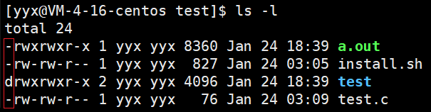

> 文件属性开头的一串字符串的起始字符分别为`d`和`-`，分别代表文件类型是目录和普通目录。

- `-i`输出文件的 i 节点的索引信息。
- `-k`以 k 字节的形式表示文件的大小。
- `-n`用数字的 UID，GID 代替名称。
- `-F`在每个文件名后附上说明文件类型的字符。`*`表示可执行普通文件，`/`表示目录，`@`表示符号链接，`|`表示FIFOs，`=`表示套接字。
- `-r`对目录反向排列。
- `-t`按时间顺序排列。
- `-s`在文件名前输出该文件的大小。
- `-R`类似于树层序遍历的形式，递归列出所有子目录下的文件。
- `-1`一行输出一个文件。

### 1.4 touch

```shell
$ touch [选项] 文件 ## 新建一个不存在的文件，或更新文件的修改时间
```

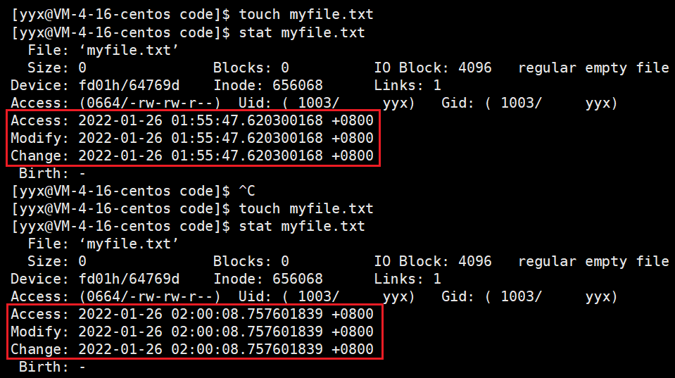

可以看到，对已有文件使用 touch 命令更新文件的时间，图中的三种时间的概念分别是：

| 时间        | 解释                                               |
| ----------- | -------------------------------------------------- |
| Access time | 最近一次访问文件的时间                             |
| Modify time | 最近一次修改文件的时间                             |
| Change time | 最近一次更改文件属性的时间，包括权限，大小，属性等 |

1 当仅读取或访问文件时，仅改变 access time；
2 当修改文件内容时，modify time、change time 会改变；
3 当修改文件权限属性时，change time 改变。

- `-a`，或`--time=atime`或`--time=accses`或`--time=use`只更改存取时间。
- `-c`，或`--no-create`不建立任何文件。
- `-m`，或`-time=mtime`或`--time=modify`只更改变动时间。
- `-d`，使用指定的日期时间，而非现在的时间。
- `-f`，此参数将忽略不予处理，仅负责解决 BSD 版本 touch指令的兼容问题。
- `-r`，把指定文件或目录的时间日期，设成和参考文档或目录的日期时间。
- `-t`，使用指定的日期时间，而非现在的时间。

### 1.5 mkdir

```shell
$ mkdir [选项] 目录名 ## 指定位置创建一个目录
$ mkdir -p  p1/p2/p3 ## -p，建立多个目录，按目录层级自动创建目录
$ tree .
.
|-- p1
|   `-- p2
|       `-- p3
`-- test.c
```

### 1.6 rmdir & rm

```shell
$ rmdir [选项] 目录名
$ rmdir -p p1/p2/p3  ## 删除多个空目录，若子目录被删除后父目录变为空目录，就连带父目录一起删除
```

rmdir 和 mkdir 相对应，一个是创建目录一个是删除目录，但 rmdir 只能删除空目录。

rm 命令可以同时删除文件和目录。

```shell
$ rm -f test ## 强制删除属性为只读或称写保护的文件
$ rm -r test ## 递归删除目录及其下所有文件
$ rm -i test ## 删除前逐一询问确认是否删除
```

> 当使用`rm -rf`删除文件时，必须要明确删除那些内容以及是否能承担删除的后果，不能有误操作，Linux没有回收站机制。

### 1.7. man

```shell
$ man [选项] 命令
```

Linux中命令有很多，不可能全部记住，man指令就是查看联机手册获取帮助。

- `-k`，根据关键字搜索联机帮助。
- `num`，只查看第 num 章节的内容。
- `-a`，显示所有章节的内容。

该手册共有9章，第一章是默认的命令，第二章是系统调用函数，第三章是库调用的函数，最常用的就是这三章。

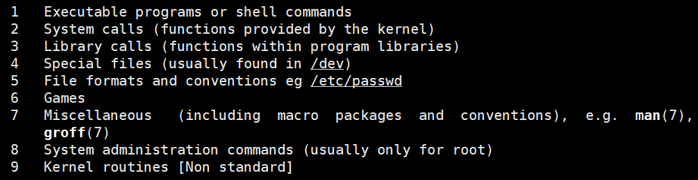

### 1.8. cp

```shell
$ cp [选项] src文件或目录 dst文件或目录 ## 复制文件或目录，到另一个文件或目录中
$ cp p1.c p2.c    ## 1 p1.c 拷贝到文件 p2.c
$ cp p1.c code    ## 2 p1.c 拷贝到目录 code
$ cp -r dir1 dir2 ## 3 dir1 拷贝到目录 dir2
```

- `-f`，强行复制文件或目录，不论目标文件或目录的权限以及是否存在。
- `-i`，若覆盖文件前会先询问用户。
- `-r`，递归拷贝该目录下的文件和子目录到另一个目录中。

### 1.9. mv

```shell
$ mv [选项] src文件或目录 dst文件或目录 ## 移动文件或目录，一般用于备份文件和目录
$ mv file.txt dir2 ## 剪切文件至目录
$ mv dir2 dir      ## 重命名文件
```

### 1.10 cat

```shell
$ cat [选项] [文件]      ## 将文件内容输出到标准输出
```

```shell
$ cat test.c -n         ## 对输出的所有行加行号显示
     1  #include <stdio.h>
     2  int main()
     3  {
     4    printf("hello\n");
     5    return 0;
     6  }
$ cat test.c -b         ## 仅对非空的输出行加行号显示
     1  #include <stdio.h>
     2  int main()
     3  {
     4    printf("hello\n");
     5    return 0;
     6  }
$ cat test.c -b
     1  #include <stdio.h>
     2  int main()
     3  {

     4    printf("hello\n");

     5    return 0;
     6  }
$ cat test.c -s         ## 不输出多行空行，仅用一行代替
#include <stdio.h>
int main()
{

  printf("hello\n");

  return 0;
}
```

> tac指令可以逆序输出内容，cat 是正序输出。

### 1.11 more & less

```shell
$ more [选项] 文件
```

more可以输出满屏但不跳过前面的部分。`-n`对所有行加行号，输出时按 q 退出。

- 按回车一行行输出，按空格多行输出。
- 输出的时候输入`/`+行数，可以跳转到相应的行数附近，但是这样的搜索仅能向下搜。

```shell
$ less [选项] 文件
```

less 也是对文件进行分页显示的工具，是Linux中最为常用的查看文件内容的工具，功能很强大。

less 比起 more 更加有弹性，使用 less 可以随意浏览文件，使用 less 可以用上下键和 PgUp PgDn 进行上下翻阅。less 具有更多的搜索功能，不仅能向上搜还可以向下搜。而且 less 在查看时不会将整个文件都加载到内存中。

- `-i`，忽略搜索时的大小写
- `-N`，显示行号
- `/`向下搜索字符串，`?`向上搜索字符串。

> 所以当查看大文件时，less 更具优势。

### 1.12 head & tail

head 和 tail 是文本的局部查看工具，可以显示开头或结尾某个数量的局部内容。

```shell
$ head [选项] 文件
$ tail [选项] 文件
```

- `-n`，head 默认显示文件的前十行内容至标准输出，加上 -n 选项可以查看指定行数的内容。tail 则相反。
- `-f`，tail 命令带上`-f`选项，可以不断刷新地显示尾部内容，可以看到最新的文件内容，一般用于查看日志文件。

> 有了头部尾部的查看，如何进行中间局部的显示呢？

使用 echo 命令可以输出字符串，默认输出到标准输出中，但可以重定向至文件中。也可以将文件中的内容输入至程序，即输入重定向。

```shell
$ echo "hello yyx, hello linux"
hello yyx, hello linux
$ echo "hello yyx, hello linux" > log.txt  ## 输出重定向
$ cat log.txt
hello yyx, hello linux
$ echo "hello yyx, hello linux" >> log.txt ## 追加重定向
$ cat log.txt
hello yyx, hello linux
hello yyx, hello linux
$ cat < log.txt ## 输入重定向
hello yyx, hello linux
```

利用输入输出重定向，可以将文件的部分内容输出到另一个文件再输出该文件的部分，就完成了局部查看的功能。如：

```shell
## 1.
$ head -120 file.txt > log.txt ## 将file.txt前120行输出到log.txt
$ tail -20 log.txt ## 输出log.txt的后20行
hello 100
hello 101
hello 102
...
hello 118
hello 119
## 2.
$ head -120 file.txt | tail -20 #利用管道也可以
```

> 将 file.txt 前120行输出到 log.txt，再输出 log.txt 的后20行，这样就完成了 file.txt 的局部输出的功能。管道可以将前命令的处理结果输出给后一个命令。

### 1.13 date

```shell
$ date [选项] [格式]
```

date 命令可以显示当前时间，如：

```shell
$ date
Thu Jan 27 00:10:02 CST 2022
```

使用者可以预设显示的格式，格式符号前需加上一个`+`再接数个标记，常用的标记如下：

- `%Y`是年份，`%m`是月份，`%d`是日期；
- `%H`是小时，`%M`是分钟，`%S`是秒钟，中间的间隔符号可随意设置。
- `%F`相当于`%Y-%m-%d`，`%X`相当于`%H:%M:%S`。

```shell
$ date +%Y-%m-%d\ %H:%M:%S
2022-01-27 00:17:08
$ date +%s
1643215957           ## 获取时间戳
$ date -d@1643215957 ## 换算时间戳
Thu Jan 27 00:52:37 CST 2022
```

上面这样的一串数字就是时间戳，代表着从1970年1月1号0时0分0秒开始到现在所过的秒数。计算机利用时间戳来记录时间，日志中涵盖时间信息。

### 1.14 cal

```sh
$ cal [参数] [月份] [年份]
```

cal 命令可以显示阳历。具体由如下选项。

- `-3`，显示系统时间的前一个月、当前月、后一个月的日历。
- `-j`，显示当前时间是今年的第多少天。
- `年份`，直接输入年份，显示当前一整年的日历。

```sh
$ cal -3
    December 2021         January 2022          February 2022
Su Mo Tu We Th Fr Sa  Su Mo Tu We Th Fr Sa  Su Mo Tu We Th Fr Sa
          1  2  3  4                     1         1  2  3  4  5
 5  6  7  8  9 10 11   2  3  4  5  6  7  8   6  7  8  9 10 11 12
12 13 14 15 16 17 18   9 10 11 12 13 14 15  13 14 15 16 17 18 19
19 20 21 22 23 24 25  16 17 18 19 20 21 22  20 21 22 23 24 25 26
26 27 28 29 30 31     23 24 25 26 27 28 29  27 28
```

### 1.15 find

find 命令可以在目录树中搜索文件，并执行指定的操作。find指令提供了相当多的查找选项，功能十分强大，所以学习成本也比较高。当然遍历一个非常大的文件系统时，也会消耗一定的时间。

现阶段只讲解一种方式，即在指定目录下查找特定文件：

```sh
$ find pathname -name
```

```sh
$ find . -name test.c ## 在当前目录下查找名为test.c的文件
./code/test.c
```

### 1.16 grep

与 find 类似，find指令是在目录树中查找文件，grep指令是在文件中查找字符串。grep指令叫查找字符串指令，也可以叫行过滤指令。功能是在指定文件中查找指定的字符串，并将满足条件的行全部打印出来。

```sh
$  cat file.txt | grep 99 ## 在file.txt中查找字符串99所在行
$ grep 99 file.txt
```

- `-i`，忽略指定字符串的大小写。
- `-n`，将打印结果加上行号显示
- `-v`，反向搜索，即只输出不满足条件的行

```sh
$ grep -in 'Linux' file.txt
5:Hello Linux
6:hello linux
```

> grep 也支持正则表达式。

### 1.18 zip & unzip

```sh
$ zip 压缩文件.zip 文件
$ unzip 压缩文件.zip
```

Linux中压缩工具比较多，这里只介绍两个，一个是 zip/unzip，一个是 tar。

一般情况下，zip 只针对指定的文件进行压缩，所以想要压缩目录及其下的文件时，就要带上`-r`选项。

- `-r`，递归压缩，压缩当前目录及其下的所有文件。
- `-d`，解压时指定解压到的目录。

```sh
$ zip -r code.zip code #压缩目录code为code.zip
  adding: code/ (stored 0%)
  adding: code/test.c (deflated 10%)
  adding: code/dir/ (stored 0%)
$ unzip code.zip -d .. #解压文件code.zip至上级目录
Archive:  code.zip
   creating: code/
  inflating: code/test.c
   creating: code/dir/
```

### 1.19 tar

```sh
$ tar [-czf] 打包文件.tgz 文件 #压缩
$ tar [-xzf] 打包文件.tgz 文件 #解压
```

tar 是Linux 下进行打包压缩或解包解压的工具。tar所创建的压缩文件后缀为`tar.gz`，一般简写成`tgz`。

- `-c` (create)，表示创建一个新文件；`-x` ，表示解压一个文件。

- `-z`(zip)，表示采用 gzip 的算法压缩文件，若不带该选项的话就是只打包不压缩。
- `-f`(filename)，表示指明压缩文档的名称，-f 后必须紧跟档名不能再加其他选项。
- `-v`(visual)，表示压缩过程中显示压缩文件。
- `-C`，表示指定压缩到指定目录。

```sh
$ tar -czvf code.tgz code ## 压缩code为code.tgz
code/
code/test.c
code/dir/
$ ls
code  code.tgz
$ tar xzvf code.tgz -C .. ## 解压code.tgz至上级目录
code/
code/test.c
code/dir/
$ ls
code  code.zip
```

> 打包和压缩的区别在于：打包是指将一大堆文件或目录变成一个总的文件，压缩则是将一个大的文件通过一些压缩算法变成一个小文件。
>
> 为什么要区分这两个概念呢？Linux中的很多压缩程序只能针对一个文件进行压缩，这样当你想要压缩一大堆文件时，你就得先借助另外的工具将这一大堆文件先打成一个包，然后再就原来的压缩程序进行压缩。

### 1.20 bc

Linux下的计算器，输入计算式就会自动将答案打印到屏幕。

```sh
$ echo "1+2+3+4" | bc
10
```

### 1.21 uname

uname 用于查看系统的信息。

```sh
$ uname
Linux
$ uname -a
Linux VM-4-16-centos 3.10.0-1160.11.1.el7.x86_64 #1 SMP Fri Dec 18 16:34:56 UTC 2020 x86_64 x86_64 x86_64 GNU/Linux
## 主机名 -- VM-4-16-centos
## 内核版本 -- 3.10.0-1160.11.1.
## 发行版本 -- el7
## CPU结构 -- x86_64
```

### 1.22 shutdown

```sh
shutdown [选项]
```

- `-h`，将系统的服务停掉后，立即关机。
- `-r`，在将系统的服务停掉之后就重新启动。
- `-t sec` ，-t 后面加秒数，亦即过几秒后关机。

### 1.23 Tab ^C ^R ^D

Tab 键可以帮助我们将命令自动补全，如果由多个会在下方排列出来提供查看。

```sh
$ wh
whatis    whereis   which     while     whiptail  who       whoami
```

Ctrl+C 可以终止一切正在运行的程序，比如死循环打印时就可以使用 ^C：

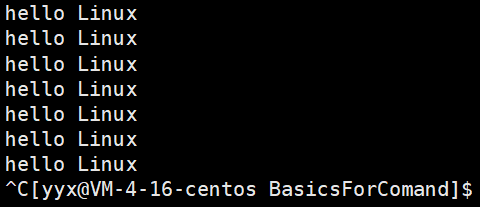

Ctrl+R 可以快速搜索历史输入的命令，再按回车就可以直接运行。或者直接输入`history`查看历史命令。

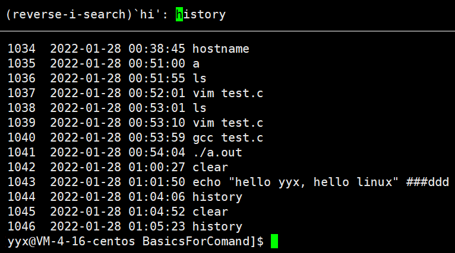

Ctrl+D 可以直接退出登录，再按一次就可以关掉xshell。

## 2. 权限管理

### 2.0 Shell运行原理

```sh
$ ..
```

输入指令的黑框就是命令行，输入的命令就叫做指令。使用which可以查看命令所在的目录，实际上命令就是一项可执行文件。

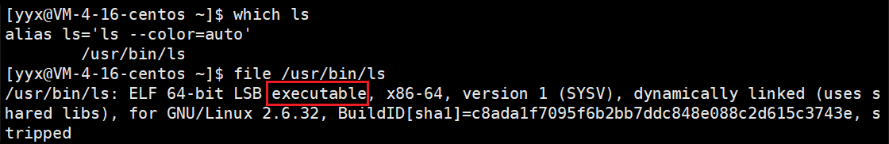

一般操作系统，包括 Linux，指的是内核（kernel）和外壳程序。以 Windows 为例，Windows 的外壳就是Windows 的图形界面，而 Linux 的外壳即 shell，内核就是 Linux内核。

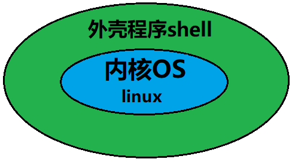

如果直接让用户与操作系统内核沟通，那么用户就必须熟悉操作系统，这样学习成本太高也不安全。所以 Linux 设立 shell 作为媒介中间人给操作系统传达用户的指令。

shell 的定义就是命令行解释器，用于将使用者的命令翻译给操作系统核心处理，再将核心的处理结果翻译给用户。

> 对比 Windows，我们也不是直接和内核沟通，而是通过图形界面完成点击等一系列动作去操作系统。

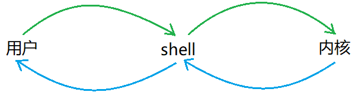

如果说 **shell 是命令行解释器是所有外壳程序的统称，bash 就是 Linux 下的具体一款命令行解释器**，bash 是最常用的一种 shell，是 Linux 下默认的 shell。

> 如果将 shell 比喻成程序员是一种职业，bash 就是在座的你我一个具体的人。

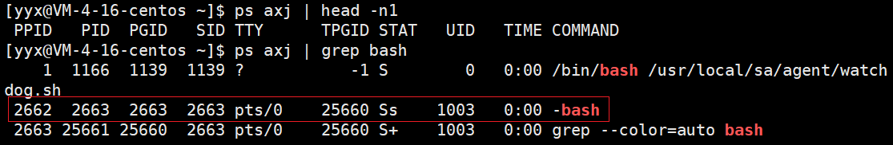

### 2.1 权限的定义

Linux 中默认存在两类用户，一类叫 root 即超级管理员，具有非常高的权限，其他都是普通用户，具有一般权限。可以使用`su`进行用户切换：

```sh
$ su - ## 切换成root
Password:
Last failed login: Fri Jan 28 03:23:06 CST 2022 on pts/0
```

> root用户的权限非常高，所以两类用户的权限界限必须明确。

在系统管理中，**权限是指 特定的用户 是否对 特定的资源 具有 特定的权力**。

> 不是VIP就不能看会员电影，不是职员就不能进入办公室，权限是针对某个事物的一项特定的属性来划分不同的人具有不同的权限。

通常，针对某个特定资源分配给用户不同的权限，系统则自动地强制执行这些权限。对于文件这项系统资源来说，人就对应着文件访问者，事物属性对应着文件类型及访问权限。

#### 文件访问者

文件访问者分为三种：拥有者（owner），所属组（group），其他人（others）。

| 角色   | 解释                                                         |
| ------ | ------------------------------------------------------------ |
| 拥有者 | 即创建文件的用户，这不难理解                                 |
| 所属组 | 拥有者所在的组，如果文件访问者之分拥有者和其他人的话，不便于多用户协作 |
| 其他人 | 除了拥有者和所属组之外的都是其他人                           |

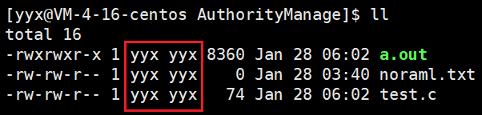

上图用红框框出的第一列是文件的拥有者，第二列是所属组。由于用户较少所以自成一组。

拥有者、所属组和其他，都是针对文件访问划分出的角色，而 root 和普通用户指的是具体的用户人。

> 后面一列是文件的大小，再后面一列是文件的最近修改时间。

### 2.2 权限的设计

#### 文件类型和访问权限

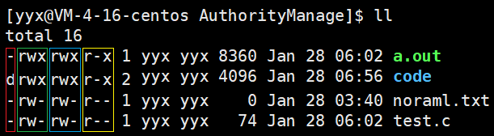

可以清晰地看出，前面的一整块共有10列，共分成4组，第一列自成一组，之后每三列成一组，分别是红、绿、蓝、黄。

文件属性的第一列，用以区分文件类型，一般有两种：`-`代表普通文件，`d`代表目录。Linux 中不以文件后缀作为区分文件的方式，只以属性的第一列区分。

> `c`代表字符设备文件，`b`块设备文件，`p`管道文件，`l`链接文件。这些目前仅作了解。

#### 权限的表示

文件属性的剩下九列，三列一组总共三组，分别代表的是文件拥有者、所属组和其他人对文件的权限。

文件自身具有的权限属性分为三种，读`r`，写`w`，执行`x`。

##### 字符表示法

> 字符表示法就是上图中对应的表示方式。

- 第一组，代表拥有者对该文件的权限。三列分别代表读`r`、写`w`、执行`x`，具有权限就用字符表示，不具有则用`-`表示。顺序不能乱。
- 以此类推，后面两组分别是所属组和其他人的权限，表示方法相同。

| 表示  | 说明           | 表示  | 说明       |
| ----- | -------------- | ----- | ---------- |
| `r--` | 只读           | `-w-` | 只写       |
| `--x` | 执行           | `rw-` | 可读可写   |
| `r-x` | 可读可执行     | `-wx` | 可写可执行 |
| `rwx` | 可读可写可执行 | `---` | 无任何权限 |

##### 8进制表示法

既然每一个权限位所表示的状态只有两种，要么具有要么不具有，这样就可以用二进制表示（具有用1表示，不具有用0表示）。转化成八进制就是从0到7共八个数字，所以用八进制也可以表示。

| 权限符号 | 二进制 | 八进制 |
| -------- | ------ | ------ |
| `r--`    | 100    | 4      |
| `-w-`    | 010    | 2      |
| `--x`    | 001    | 1      |
| `rw-`    | 110    | 6      |
| `r-x`    | 101    | 5      |
| `rwx`    | 111    | 7      |
| `-wx`    | 011    | 3      |
| `---`    | 000    | 0      |

> 上述两种表示方法，都会在之后的权限设置的命令中使用到。

### 2.3 权限的设置

修改文件的权限分为两种，一是修改文件的读写执行属性，二是修改文件的拥有者和所属组。先看第一种：

#### chmod

```sh
$ chmod u+r fileName
```

`chmod`可以针对三种访问者修改文件的读写执行权限。具体如下：

```shell
## u表示拥有者user
$ chmod u+r file.txt ## 给拥有者添加读权限
$ chmod g-w file.txt ## 给所属组取消写权限
$ chmod o-x file.txt ## 给其他人取消执行权限
```

`u`,`g`,`o`分别表示三种访问者，`+`,`-`分别表示添加和取消，`r`,`w`,`x`分别表示读写执行。之后再带上文件名即可。

```sh
$ chmod u+r file.txt     ## 修改单个访问者的单个权限
$ chmod u-r+wx file.txt  ## 修改单个访问者的多个权限
$ chmod u+r,g-x file.txt ## 修改多个访问者的多个权限
$ chmod u-r file.txt test.c ## 连续操作多个文件
```

#### chown & chgrp

chown 可用于修改文件的拥有者，chgrp 则是用于修改文件的所属组。

```sh
$ chown usrname fileName
$ chgrp usrname fileName
```

```sh
$ chown root file.txt
chown: changing ownership of ‘file.txt’: Operation not permitted
## 可以看出，文件是不能随便更改所有者给别的用户的，即使是文件所有者也不行
```

```sh
$ chgrp root file.txt
-rwxrwx--- 1 yyx  root   20 Jan 29 07:15 file.txt
## 可以将文件所属组设置为成员，达到让其查看管理的目的
```

```sh
$ sudo chown root:root file.txt
## 这样可以将文件的拥有者和所属组一起修改
```

#### 目录的权限

> 目录的读写执行分别又代表什么意义呢？与普通文件有什么不同呢？

```sh
d-wx------ 2 yyx yyx 4096 Jan 29 08:06 code
$ ls code ## 不具备读权限，无法查看目录下内容
ls: cannot open directory code: Permission denied

dr-x------ 2 yyx yyx 4096 Jan 29 08:06 code
$ touch code/file.txt ## 不具备写权限，无法创建或删除文件
touch: cannot touch ‘code/file.txt’: Permission denied

drw------- 2 yyx yyx 4096 Jan 29 08:06 code
$ cd code ## 不具备执行权限，无法进入目录
-bash: cd: code: Permission denied
```

| 权限        | 解释                       |
| ----------- | -------------------------- |
| `r`读权限   | 能够查看目录下的内容       |
| `w`写权限   | 能够下目录下创建或删除文件 |
| `x`执行权限 | 能够进入目录               |

##### 粘滞位

一般目录对于other用户是不具有写权限的，也就意味着other用户无法在他人的目录下创建或删除文件。

如果我们要建立一个共享目录，让所有人都可以往里面放东西，就要对这个共享目录给所有人加上写权限，就会带来这样的安全问题：

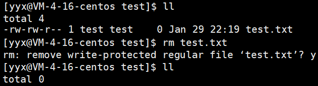

根据目录的权限规定，只要用户对目录具有写入权限，该用户就能删除目录下的任意文件。

如果不想让非目录所有者用户具有删除目录下文件的权限，针对这种需求，Linux 下可以使用粘滞位解决。

```sh
$ chmod o+t dirName
```

注意，粘滞位是对目录进行修改的，对目录下的所有文件生效。

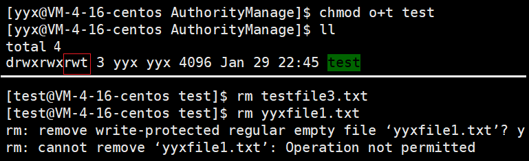

**`t`相当于权限缩小版的`w`，致使 other 无法删除其他用户的文件**。

所以当一个目录被设置为粘滞位时，则该目录下的文件只能由 root 超级管理员，目录所有者，文件的所有者，三者可以删除。

#### 默认权限的设置

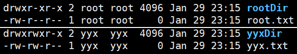

上图分别是 root 和 普通用户 创建的目录和普通文件的默认权限，稍加分析可得：

- 普通用户所创的普通文件和目录都只限制了 other 的写入权限，普通文件本身不具有执行权限。
- root 在此基础上还限制了所属组的写入权限。

> 普通用户的普通文件权限可表示为0664，目录可表示为0775。下面将介绍为什么默认权限会是这个样子。

##### 文件掩码umask

实际上，文件或目录在其新建之初的默认权限（起始权限）用八进制数位表示分别为0666和0777。起始权限还要受到权限掩码 umask 的影响，才会变成默认权限值。

换句话说，文件的默认权限是可以更改的，更改文件掩码 umask 的值即可。umask 可以这样设置和查看：

```sh
$ umask ## 查看
0002
$ umask 0002 ## 设置
```

**将起始权限值“减去”文件掩码值后，所得结果就是文件生成的默认权限值**。“减去”掩码的操作是这样的：将文件权限值都用二进制表示，起始权限值和文件掩码值每位一一对应，倘若文件掩码的某个数位为1，那么该位的结果必须为0。

```sh
  110 110 110   ## 起始权限
- 000 000 010   ## 文件掩码
----------------
  110 110 100   ## 默认权限

  111 111 111   ## 起始权限
- 000 000 010   ## 文件掩码
----------------
  111 111 101   ## 默认权限
```

这样的“减法”运算，就可以将文件掩码取反后再和起始权限相与即可，即`mask&(~mask)`。本质也就是过滤掉文件掩码中的1。

## 3. 开发工具

> 如 Visual Studio、IDEA 这样的集编写编译调试运行以及各种复杂功能于一身的开发工具，叫做集成开发环境 IDE。Linux 下一般使用代码编辑工具 vi/vim，编译工具 gcc/g++，调试工具 gdb。

### 3.1 编辑工具vim

vim，它是一款十分强大的多模式的文本编辑器，所有的类 unix 系统都会内置 vi 编辑器，目前使用较多的是 vim 编辑器，是 vi 的升级版。

虽说 vim 是个文本编辑器，但它更专注于代码的编写，具有语法高亮等功能。

```shell
$ vim fileName ## 使用vim打开文件，文件不存在则会创建文件。
```

#### 1.1 vim 的基本模式

vim 基本的模式有三：命令模式（normal mode）插入模式（insert mode）底行模式（command mode），vim 启动默认进入命令模式。

- 命令模式下输入`i`可以进入输入模式，再按`Esc`键就可以回退到命令模式。
- 命令模式下输入`:`即可进入底行模式，再按`Esc`键就可以回退到命令模式。
- 底行模式下输入`wq`可以保存退出。

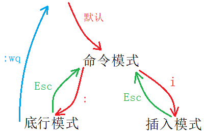

> 知悉上述基本的模式切换方法后，再逐个介绍模式。

##### 命令模式（normal）

vim 启动默认进入命令模式。此状态下敲击键盘动作会被 Vim 识别为命令，而非输入字符。

可进行的操作有：控制光标移动，字符、单词或行的删改，移动或复制粘贴文本内容，切换到插入或底行模式。

##### 底行模式（command）

命令模式只有一些最基本的命令，因此仍要依靠底线命令模式输入更多命令。

命令模式下输入`:`即可进入底行模式，底线命令模式可以输入多个字符的命令，可用的命令非常多。

##### 插入模式（insert）

文本编辑模式。一般要先退回到命令模式才能进到底行模式。

> vim 总共有13种模式，但这三个基本模式已经能满足我们大部分需求，其他模式会在之后的使用中学习。

#### 1.2 vim 一般模式命令集

##### 切换模式

- 切换到插入模式：`i`,`a`,`o`，进入底行模式：`Esc`。
- `i`是从光标的位置开始输入，`a`选项会将光标向后移动一位，`o`选项在所在行下方另起一行。
- `Esc`退回到命令模式后并光标向前移动一位。

##### 光标移动

- ⬅`H`、⬇`J`、⬆`K`、➡`L`，相当于方向键。
- 光标锚点跳至行首`^`、行尾`$`；跳至文章起始`gg`、末尾`G`；跳至指定行`n+gg`/`n+G`。
- 移动到下一个单词的起始`w`，移动到单词的末尾`e`，反向单词距移动`b`。（字符、字母、字母数字组合都被视为单词）
- `Ctrl+B`光标向下翻页，`Ctrl+F`向上翻页；`Ctrl+U`向下移动半页，`Ctrl+D`向上移动半页。

##### 删改内容

- 删除当前字符`x`，删除多个字符`n+x`；反向删除字符`X`，反向删多个字符`n+X`。
- 删除单词`dw`，删除当前行`dd`。
- 替换当前字符`r`，替换多个字符`n+r`，进入替换模式`R`。
- 修改当前单词`cw`，修改多个单词`cnw`。
- 字母大小写转换`~`。

##### 移动或复制内容

- 复制当前单词`yw`，复制多个单词`n+yw`。
- 复制当前行`yy`，复制多行`n+yy`。
- 剪切/删除当前行`dd`，剪切/删除多行`n+dd`。
- 粘贴到当前行下方`p`，粘贴多次`n+p`。

##### 撤销或恢复内容

- 撤销操作`u`。
- 恢复操作`Ctrl+r`。

##### 批量化注释或放开内容

- 批量化注释
  1 先将光标移动到待注释的内容的起始行，
  2 再`shift+i`将光标移动到行首并进入插入模式，
  3 再`Ctrl+v`进入行可视化模式，
  4 然后`jk`控制光标移动到待注释的内容的结束行，
  5 最后输入行注释`//`，再按`Esc`回到命令模式。
- 批量化放开
  1 先将光标移动到待注释的内容的起始行，
  2 其次`shift+6`将光标移动到行首，
  3 再`Ctrl+v`进入行可视化模式，
  4 然后`jk`控制光标移动到待注释的内容的结束行，再`hl`横向移动光标扩选行首的`//`。
  5 最后输入`d`就能将所选行的行首注释标识删除。

#### 1.3 vim 底行模式命令集

> 底行模式命令有很多，目前掌握这几个就行。

##### 保存退出

- 底行模式下输入`w`可以保存文件，输入`q`可以退出程序。带上`!`表示强制执行。

##### 显式行号

- 显示行号`set nu`，取消行号`set nonu`。
- 跳转至某行，输入行号`n`即可。

##### 多文件操作

- 分屏操作多个文件`vs fileName`，切换操作文件/光标`Ctrl+w+w`。

##### 查找字符

1 `/Keyword`，输入`/`再输入查找的字符，在按`n`可以跳转至下一个关键字所在位置。
2 `?keyword`，输入`/`再输入查找的字符，在按`n`可以跳转至上一个关键字所在位置。
3 可直接使用`shift+*`，查找当前光标所在的单词。

[Vim 从入门到精通 (github.com)](https://github.com/wsdjeg/vim-galore-zh_cn)

[最全 Vim 键位图 (runoob.com)](https://www.runoob.com/w3cnote/all-vim-cheatsheat.html)

### 3.2 编译工具gcc/g++

gcc/g++ 分别是 C/C++ 的编译器。

```shell
$ gcc [选项] 编译文件 [选项] 目标文件
$ g++ [选项] 编译文件 [选项] 目标文件
```

> 接下来将通过使用 gcc 分段编译程序，来熟悉 gcc/g++ 的使用。

#### 2.1 C/C++编译基本步骤

前面已经学过 C/C++ 程序基本的编译过程，也使用过 gcc 进行查看程序的翻译步骤：

1 预处理（进行宏替换）
2 编译（生成汇编代码）
3 汇编（生成二进制目标文件）
4 链接（生成可执行文件或库文件）

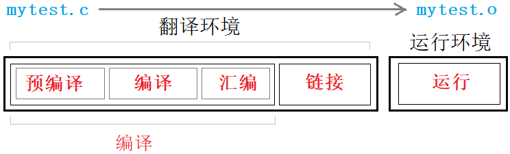

##### 预处理

预处理的功能主要包括**替换宏，文件包含，条件编译，删除注释**等。

```shell
$ gcc -E test.c -o test.i ## 完成预处理
```

选项`-E`让翻译在预处理结束后停下来，预处理完的文件一般后缀为`.i`。

##### 编译

编译时，gcc 会**检查代码规范、语法错误**，确定代码所做的工作，检查无误后 gcc 会生成汇编代码。

```shell
$ gcc -S test.i -o test.s ## 完成编译
```

编译阶段会生成汇编代码，以供接下来的汇编阶段使用。一般编译结束生成的代码文件的后缀为`.s`。

##### 汇编

汇编阶段将编译所形成的汇编代码**生成目标文件**，也就是二进制文件。

```shell
$ gcc -c test.s -o test.o ## 完成汇编
```

虽然生成的是二进制目标文件，但仍然不可直接运行，准确的来说该文件是可重定向目标文件。

##### 链接

上述编译过程结束，最后要进行链接。链接完成之后，就生成了可执行文件。

```shell
$ gcc -o test test.o ## 完成链接
```

链接是**将本文件和项目中其他源文件或者库文件链接在一起**。如图所示：

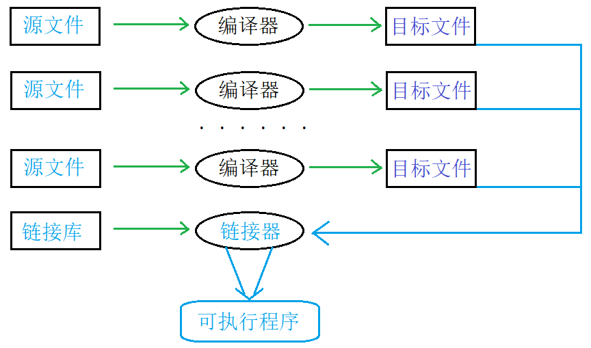

> 通常写程序时，就`include`了语言本身所提供的链接库文件，至于链接库文件到底是什么，接下来会讲解。

当然编译 C/C++ 程序，不需要上述这么复杂，直接执行即可：

```shell
$ gcc test.c -o test
$ gcc -o test test.c
```

#### 2.2 链接库

##### 函数库的概念

语言本身会提供语言级别的库，库可以看成一套头文件和一套库文件。可以通过引用对应的头文件，来使用这些库。

使用`lld`命令可以查看可执行程序所依赖的第三方库：

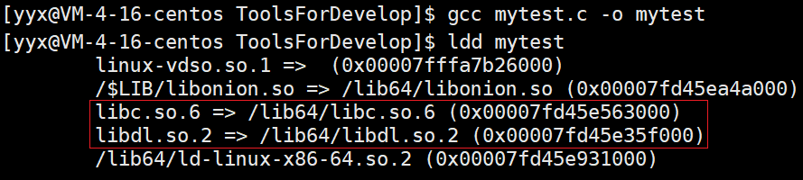

Linux 下的 C 静态库叫作`libcxxx.a`，动态库叫做`libcxxx.so`。一般去掉前后缀，`xxx`就是库名。

将用户所写的程序文件和第三方库提供的方法关联起来，这就叫链接。链接又分为静态链接和动态链接。


由上图可以看出，gcc 默认采用动态链接的方式生成的可执行程序。

```shell
$ gcc test.c -o test                  ## 默认动态方式
$ gcc test.c -o test_static -static   ## 采用静态方式
```

**静动态链接两者最大的区别就在于链接的时机不一样，静态链接是在形成可执行程序前，而动态链接是在程序执行时**。

##### 静态链接

链接要确定多文件相互调用函数的地址，静态链接会将库的内容拷贝到可执行程序中。然后才能生成可执行程序文件，所以说**静态链接发生在形成可执行程序之前**。

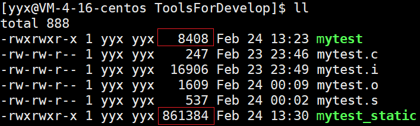

> 由上图可以看出，静态链接生成的文件比动态链接的体积大得多。

静态链接的缺点：

1 **浪费空间**，链接会将库内容放入目标文件，文件体积较大。每个程序文件都会加入库的内容，造成空间浪费。
2 **更新较为麻烦**，每次修改库的源码，都要重新链接库生成新可执行程序。

静态链接的优点：

可执行程序中已经具备了所有需要的东西，不需要到其他文件中查找，在执行的时候**运行速度快**。

##### 动态链接

动态链接把程序按模块拆分成独立的部分，并把链接这个过程推迟到了运行时再进行，运行时由操作系统的装载程序加载库。

> 运行程序1时会将程序1加载到内存中，然后再加载所需库文件，再运行程序2时，内存中已有库文件就不会再次加载，直接链接到程序2中即可。

动态链接的优点：

1 **避免空间浪费**，即使多个程序依赖于同一个库，库内容不会在内存中存在多份，而是多个程序执行时共享。
2 **维护比较方便**，只要替换原库文件，运行程序时，系统会自动使用新库进行链接。库和程序相互独立，更新库不会对程序造成影响，提高了可维护性和可扩展性。

动态链接的缺点：

链接推迟到程序运行时，每次执行程序都需要进行链接，性能有一定损失，**运行速度相对慢一点**。

[深入浅出静态链接和动态链接 (csdn.net)](https://blog.csdn.net/kang___xi/article/details/80210717)

#### 2.3 gcc 选项

- `-static` 采用静态链接。
- `-g` 生成调试模式生成程序。
- `-shared` 此选项将尽量使用动态库，所以生成文件比较小，但是需要系统由动态库。
- `-O0`,`-O1`,`-O2`,`-O3` 编译器的4个优化级别，–O0没有优化,–O1为缺省值，–O3优化级别最高。
- `-w` 不生成任何警告信息，`-Wall` 生成所有警告信息。

### 3.3 调试工具gdb

> gdb 是 Linux 下用于调试代码的工具，这个工具成本高难度也不低且不是很方便直观但仍需掌握。

#### 3.1 背景知识

生成程序有两种模式：Debug 和 Release 模式。

Linux 下 gcc/g++ 编译出的可执行程序，默认是 Release 模式。要使用 gdb 调试，必须在代码编译的时候加上调试信息。

```shell
$ gcc test.c -o test_debug -g ## 加上调试信息

$ gdb test_debug              ## 进入gdb调试
(gdb) quit                    ## 退出gdb
```

#### 3.2 gdb 选项

##### 调试命令（debug）

| 名称     | 命令   | 解释                                          |
| -------- | ------ | --------------------------------------------- |
| 开始运行 | `run`  | 相当于开始调试`F5`，会运行至程序结束          |
| 逐语句   | `step` | 相当于`F11`，有函数会进入函数内部             |
| 逐过程   | `next` | 相当于`F10`，不会进入函数内部，执行整条语句； |

> 像逐过程、逐语句这样的命令一次输入之后，可直接回车仍会再次执行。

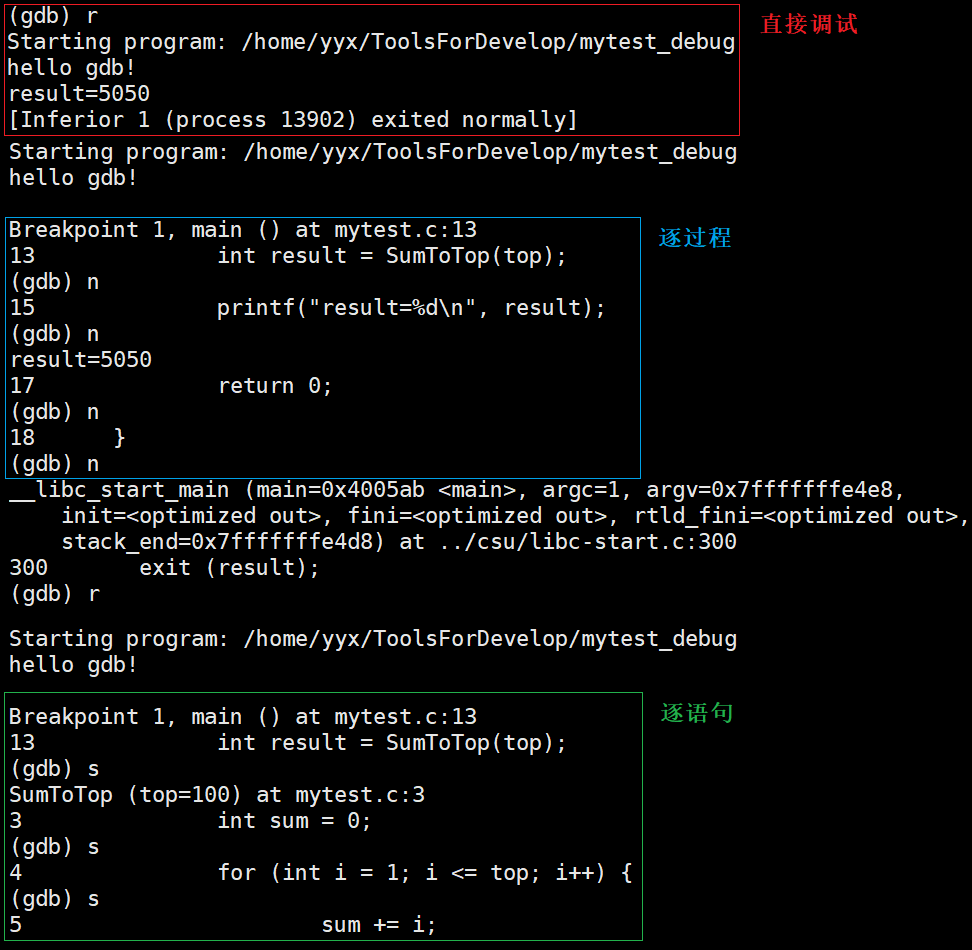

##### 显示代码（list）

| 名称         | 命令          | 解释                                                  |
| ------------ | ------------- | ----------------------------------------------------- |
| 可指定行号   | `list + [N]`  | 从第 N 行开始显示 10 行代码，可接着上次的位置继续打印 |
| 可指定函数名 | `list + Name` | 从函数起始位置左右开始显示代码。                      |

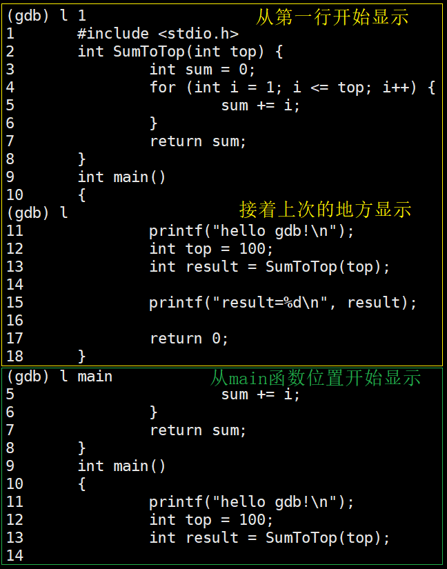

##### 断点命令（breakpoint）

| 名称       | 命令              | 解释                                          |
| ---------- | ----------------- | --------------------------------------------- |
| 某行打断点 | `b + N`           | 在某行打上断点                                |
| 函数打断点 | `b + FuncName`    | 在函数内起始位置打断点                        |
| 查看断点   | `info + b`        | 显示断点信息列表                              |
| 删除断点   | `d + b + N`       | 删除序号为 N 的断点，省略序号就是删除所有断点 |
| 启用断点   | `enable + b + N`  | 启用序号为 N 的断点，省略序号就是启用所有断点 |
| 禁用断点   | `disable + b + N` | 禁用序号为 N 的断点，省略序号就是禁用所有断点 |

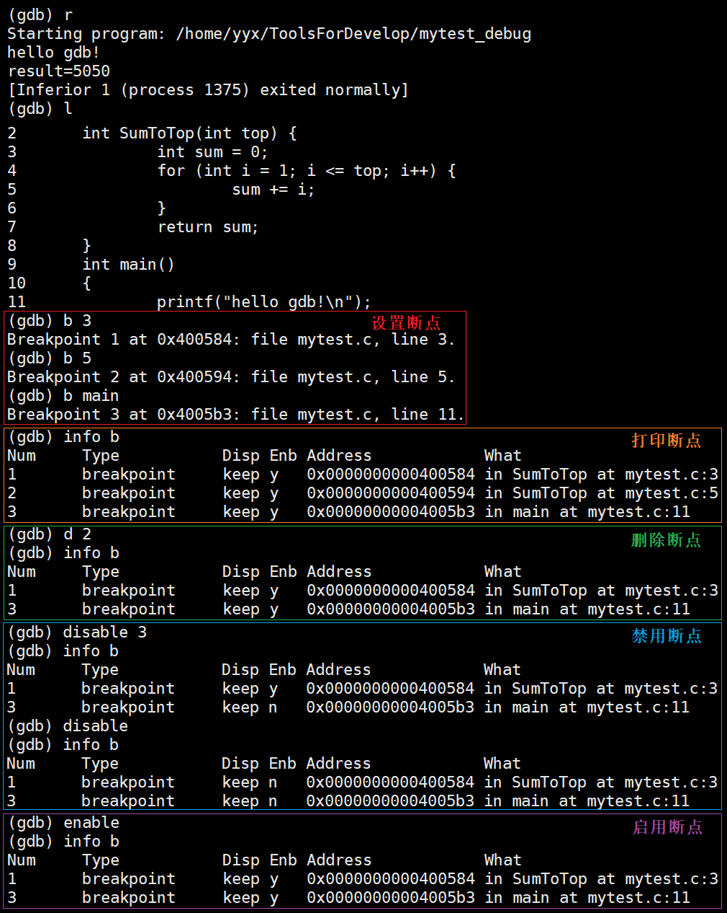

##### 变量命令（variable）

| 名称 | 命令 | 解释 |
| ---- | ---- | ---- |
| 监视变量     |  `display + ValName`  |以列表的形式常显示在屏幕下方，类似于vs中的监视      |
| 取消监视     | `undisplay + N`   |去掉监视列表中的序号为 N 的变量的常显示      |
| 查看变量     | `p + Name`   | 打印变量的值，不会常显示     |
|修改变量      |  `set + Name`  | 设置指定变量的值 |

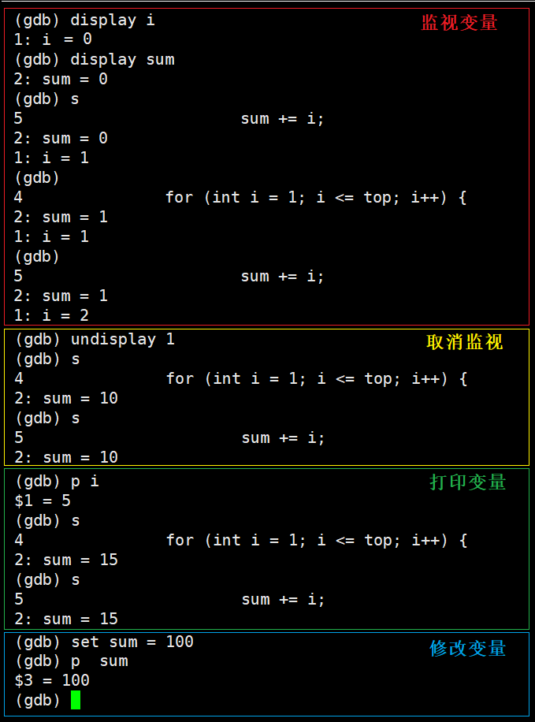

##### 特殊调试命令

| 名称         | 命令        | 解释                                                  |
| ------------ | ----------- | ----------------------------------------------------- |
| 结束当前函数 | `finish`    | finish 会直接结束当前函数的调用，并停止在函数返回位置 |
| 继续运行     | `continue`  | continue 继续运行至下一个断点，相当于`F5`             |
| 运行至指定行 | `until + N` | 运行至当前函数内部的第 N 行                           |

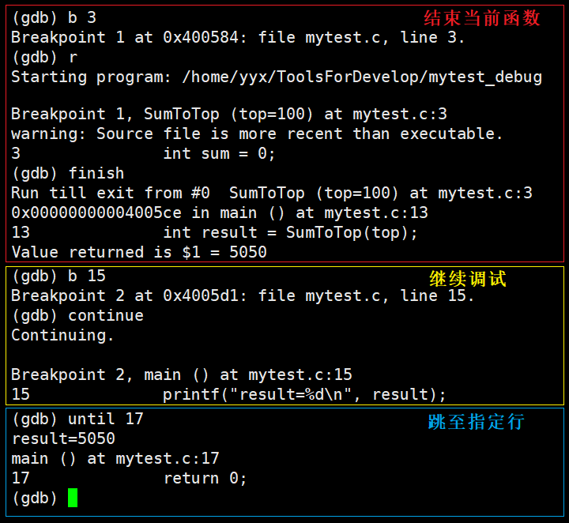

##### 其他命令

| 名称     | 命令              | 解释                       |
| -------- | ----------------- | -------------------------- |
| 调用堆栈 | `breaktrace`/`bt` | 查看程序各级栈帧的调用情况 |

### 3.4 构建工具Makefile

> 之前在 IDE 中写代码时，没有关心过文件的编译顺序以及代码的依赖关系，因为 IDE 可以自动构建项目。

#### 自动化构建工具

工程中的源文件不计其数，按类型、功能和模块放在若干目录中。

Makefile 可以指定编译顺序，甚至更复杂的操作。使用 make指令就可以自动编译项目，前提是所在目录下有Makefile 文件。

#### Makefile的编写

```makefile
target : requires
  command
```

| 名称         | 介绍                     |
| ------------ | ------------------------ |
| **target**   | 需要生成的目标文件       |
| **requires** | 生成目标文件所依赖的文件 |
| **command**  | make 需要执行的命令      |

Makefile 指明了编译代码的两个要素：**依赖关系和依赖方法**。

- 可执行文件依赖于源文件，这就是依赖关系。
- 通过 gcc 编译源文件形成可执行文件，这是依赖方法。

```makefile
mytest:mytest.c ## 依赖关系
    gcc -o mytest_make mytest.c -std=c99 ## 依赖方法

.PHONY:clean
clean:
    rm -f mytest_make
```

- Makefile 默认第一个目标的是真目标，其他都是伪目标，输入 make 命令默认执行真目标。
- `.PHONY`是一个关键字，表示目标总是可执行的，就是在依赖文件没发生更改的情况下，也可以执行该目标。
- Makefile中可使用特殊符号：`$@`代表目标文件，`$^`代表其后指定的所有依赖文件。
- Makefile 只会编译被修改的或者未编译的源文件，以节省时间。

##### Makefile的原理

###### 依赖关系和依赖方法

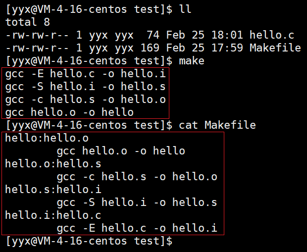

由上图可以看出，

1 依赖关系：`.out`文件依赖`.o`文件，`.o`文件依赖`.s`文件，`.s`文件依赖`.i`文件，`.i`文件依赖`.c`文件。
2 依赖方法：`gcc -option hello.* -o hello.*`。

```makefile
mycode : mycode.o
  gcc -o mycode.o -c mycode.s
mycode.s : mycode.i
  gcc -o mycode.s -S mycode.i
mycode.i : mycode.c
  gcc -o mycode.i -E mycode.c

.PHONY:clean
clean:
  rm -rf mycode mycode.o mycode.s mycode.i
```

执行 .out 依赖 .o，执行 .o 依赖 .s，执行 .s 依赖 .i，执行 .i 依赖 .c 文件，找到 .c 后再一步一步反向编译到可执行文件。

> Makefile 文件可以像上述这样将所有步骤写出来，但一般不这样写，写的越简单越好。

[跟我一起写 Makefile (csdn.net)](https://blog.csdn.net/weixin_38391755/article/details/80380786)

### 3.5 上传工具git

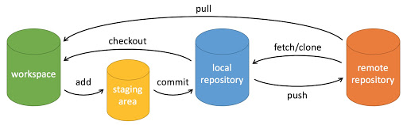

| 创建命令           | 解释                                 |
| ------------------ | ------------------------------------ |
| git init           | 新建版本库                           |
| git clone          | 克隆版本库                           |
| **提交命令**       | **解释**                             |
| git add            | 添加文件到暂存区                     |
| git commit -m 'xx' | 将暂存区文件提交至本地仓库           |
| git push           | 同步代码至远程仓库                   |
| git pull           | 下载代码至本地仓库                   |
| git rm             | 删除工作区文件。                     |
| **查看命令**       | **解释**                             |
| git status         | 查看仓库当前的状态，显示有变更的文件 |
| git log            | 查看仓库提交历史                     |
| git blame          | 以列表形式显示文件修改记录           |
| git diff           | 比较暂存区和工作区文件的差异         |
| **分支命令**       | **解释**                             |
| git branch         | 查看本地所有分支                     |
| git branch -r      | 查看远程所有分支                     |
| git checkout       | 切换所有分支                         |
| git merge          | 合并分支                             |
| git branch -d      | 删除分支                             |

[github-git-cheat-sheet (runoob.com)](https://www.runoob.com/manual/github-git-cheat-sheet.pdf)

[Git - Reference (git-scm.com)](http://git-scm.com/docs)

[git 简明指南 (runoob.com)](https://www.runoob.com/manual/git-guide/)
