# 进程相关

## 1. 进程理解

### 1.1 计算机体系

#### 冯诺依曼体系

一般主流的计算机，都遵循冯诺依曼体系。

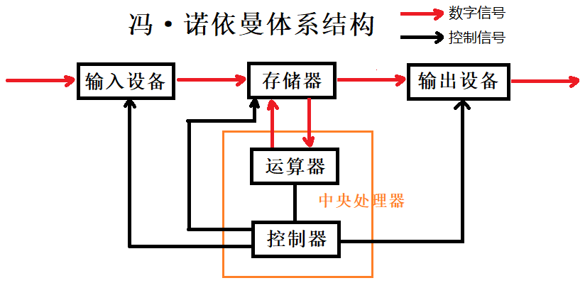

计算机硬件的体系结构如下：

| 设备归类       | 具体                   | 解释                                                 |
| -------------- | ---------------------- | ---------------------------------------------------- |
| 输入单元       | 键盘、鼠标、网卡等     | 以内存为视角，输入信号的被称为输入设备               |
| 输出单元       | 显示器，打印机、网卡等 | 以内存为视角，输出信号的被称为输出设备               |
| 存储器         | 内存                   | 存储器指的是内存，并不是磁盘等外部设备               |
| 运算器和控制器 | 中央处理器（CPU）      | 运算器执行数学运算和逻辑运算，控制器执行指令控制逻辑 |

- 输入输出设备都被称为外设。输入设备和输出设备并不是非此即彼的，根据使用情况可归为不同的类。
- 内存是体系结构的核心。**外设只能读写内存，同样CPU只能读写内存，CPU和外设之间不可直接交互**。

内存分为不同级别的存储单元，如下图所示：

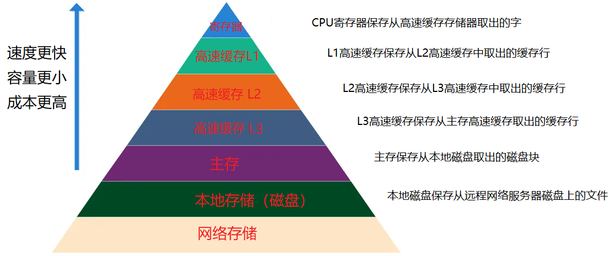

#### 操作系统的定义

> 系统启动之前是作为文件存储在磁盘中的。只有启动的操作系统才有意义。

##### 操作系统的目的

- **对下：与硬件交互，管理所有的软硬件资源**；
- **对上：为用户程序提供一个稳定、高效、安全的执行环境**。

操作系统的定义：<u>操作系统就是一款针对软硬件资源进行管理工作的软件</u>。

操作系统的核心思想就是管理，是对各种资源进行决策和执行。决策需要各种硬软件资源的信息，执行就需要下属的硬软件执行对应的指令。

##### 计算机整体结构

计算机体系结构在宏观上指的是冯诺依曼体系结构。还可以划分的更具体一些：

- 操作系统之下是一些硬件，如网卡、磁盘等，和硬件对应的驱动程序。
- 操作系统内置最基本的系统软件：进程管理、内存管理、文件系统、驱动管理。通过这些系统级软件，管理软硬件资源。
- 操作系统之上就是各种软件和用户级程序。

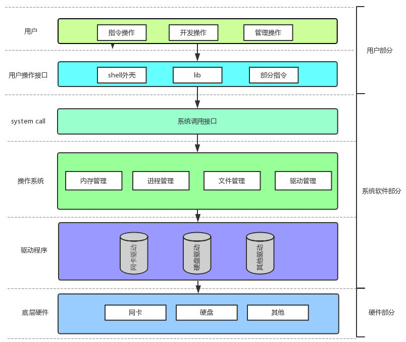

##### 管理的本质

对于系统中繁多的硬软件资源，管理起来十分复杂。<u>从操作系统的角度看，管理就是先描述、再组织</u>。

| 步骤   | 解释                                                         |
| ------ | ------------------------------------------------------------ |
| 先描述 | **先描述管理对象，再用特定的数据结构将管理对象组织起来**。   |
| 再组织 | **对个体资源的管理工作，就变成了某个数据结构的增删查改**。所有资源都是以这样的管理方式管理起来的。 |

> 以进程管理为例，首先定义出一个描述进程的结构体，即进程控制块 PCB，再将该结构体对象组织起来。

#### 系统调用和库函数

操作系统对下管理软硬件资源，对上提供良好的运行环境。操作系统提供各种系统级的接口给用户级软件，以实现基本功能。

##### 系统调用

操作系统对外表现为一个整体，但是会提供一些接口，供上层开发使用。这部分由操作系统提供的接口，叫做系统调用。

##### 语言库函数

系统调用使用较为复杂，功能较为基础，对用户的要求也比较高。

所以语言创造者对部分系统调用进行一定程度的封装，集成成了库。有了库函数，就更利于上层开发者进行二次开发。

##### 二者的关系

语言库函数在系统调用之上，是上下层的关系。

当然，不是所有库函数都调用系统接口，一般只有和系统硬件交互的函数才会调用系统接口。

> 比如C语言库函数 `printf`，由C语言的开发人员封装了系统提供的硬件接口。

### 1.2 进程的概念

#### 进程的定义

> 肤浅的来说，加载到内存中的程序就叫做进程。但这并不完善。

运行中的系统存在大量的进程，操作系统该如何管理这些进程呢？仍然是先描述再组织。

**进程在形成之初，操作系统就会为其创建进程控制块 PCB**。进程控制块PCB用于描述进程，其中存储着进程的所有属性。

Linux 系统中，PCB 就是一个名为`task_struct`的结构体。

> Linux 查看进程的命令：

```shell
$ ps axj | head -1 && ps axj | grep 'myproc'
 PPID   PID  PGID   SID TTY      TPGID STAT   UID   TIME COMMAND
25486 29733 29733 25486 pts/0    29733 S+    1003   0:00 ./myproc ## 正在运行的myproc进程
```

**启动程序的本质，就是在内存上创建进程**。

##### 进程和程序的区别

- 程序本质就是文件，是编译生成的二进制可执行文件。
- 程序被加载到内存中，系统自动为其创建PCB，以管理该进程。故**进程是程序的代码数据与进程相关内核数据结构的总和**。

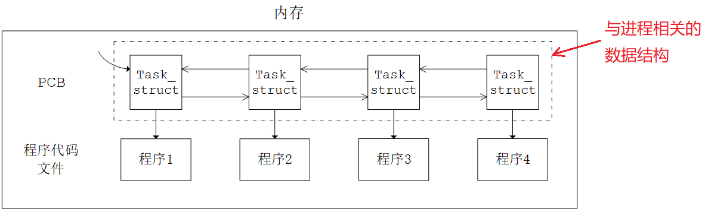

操作系统在处理进程时， 不是直接操作程序而是读写PCB，因为PCB中含有程序的所有属性。也就是说，**进程管理与进程对应的程序毫无关系，只与进程的PCB强相关**。

##### PCB的内部构成

[task_struct结构](https://www.cnblogs.com/tongyan2/p/5544887.html)

- 进程编号 —— 每个进程都有编号或称标识符，也就是 PID，具有唯一性用来区别于其他进程。

```cpp
#include <sys/types.h>
#include <unistd.h>
pid_t getpid(void);
pid_t getppid(void);
```

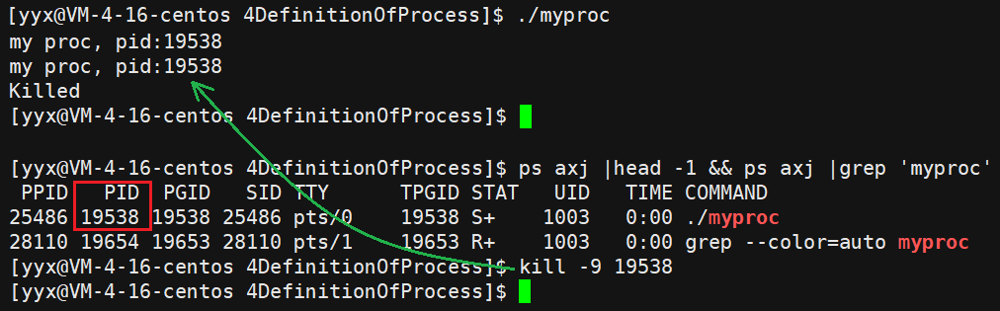

一般在命令行运行的进程，其父进程都是`-bash`。

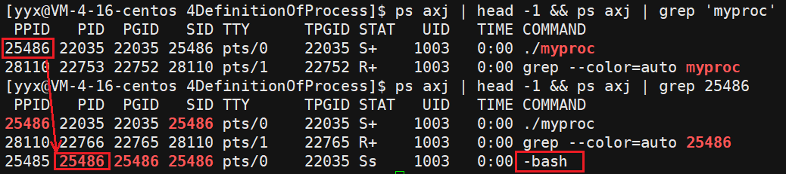

- 进程状态 —— 包括进程退出时的退出码、退出信号、任务状态等。

进程结束时的返回值就是返回给系统的退出码，最后被父进程获取。比如 main 函数结束时的`return 0;`。任务状态描述进程的运行状态，比如有等待状态，死亡状态，阻塞状态，挂起状态等。

```shell
$ echo $? ## 获取最近一次执行命令的退出码
```

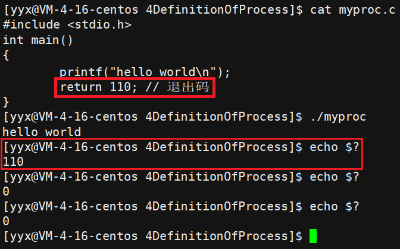

- 优先级 —— 进程很多而 CPU 只有几个，不可能同时运行多个进程，优先级决定了进程的运行先后顺序。
- 程序计数器 —— 或称 pc 指针，保存程序中即将被执行的指令的地址。
- 内存指针 —— 指向程序代码和进程相关数据的指针，还有和其他进程共享内存块的指针。
- I/O状态 —— 包含显式的IO请求，分配给进程的IO设备，被进程使用的文件列表。
- 审计信息 —— CPU 中有调度模块，负责均衡地调度在运行的进程，使之能较为公平的获得CPU资源得以被执行。而调度模块需要的参考信息就是存在 PCB 中的审计信息。

  上下文数据 —— 包含进程对应程序的执行状况等信息的数据。

###### 上下文数据

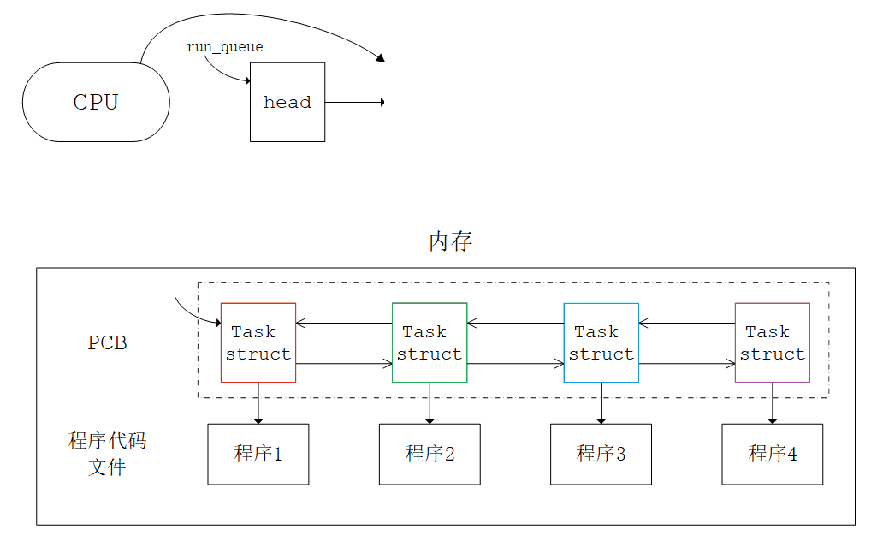

> 如图所示，CPU需要在不同的进程之间来回调度，以保证每个进程相对公平地获取资源。

保存上下文：进程之间的来回切换，必须确保在进程被切换后，其的临时数据被更新并存储在它对应的 PCB 中，以便之后再接着上次继续执行。

恢复上下文：这些临时数据就叫做上下文数据，都被存储在寄存器中，当进程被执行时，其 PCB 中的上下文数据就交给了 CPU，以便 CPU 接着上次的地方继续执行。

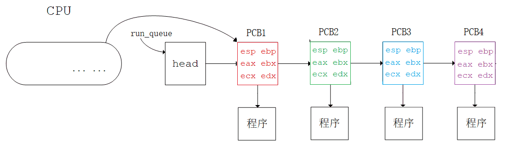

#### 进程的查看

查看进程信息可查看系统目录`/proc`：

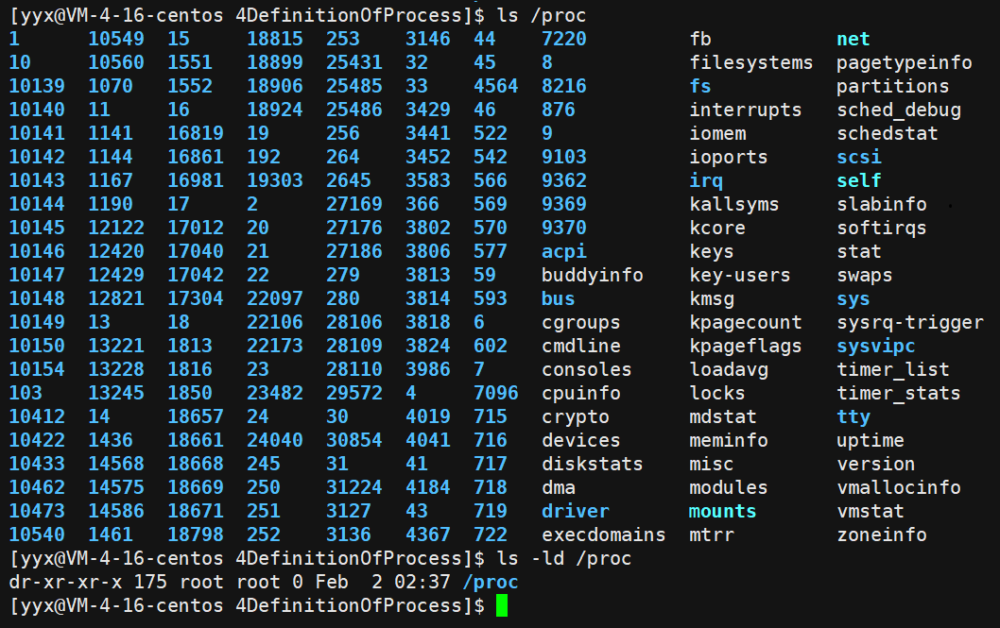

Linux 系统提供以查看文件的方式查看进程。每个进程创建之初都会在`/proc`目录下创建一个目录，并以进程编号命名。进程结束时自动消失。

> 该目录是虚拟目录，并不是真实存储在磁盘上的。

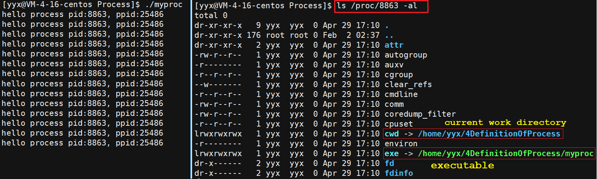

#### 进程的创建

当我们在系统上运行程序时，也就是创建了一个进程。系统调用 fork 就是在程序中创建子进程。

```cpp
#include <sys/types.h>
#include <unistd.h>
pid_t fork(void);
```

fork 之后会出现两个执行流，一个是原有进程的，一个是 fork 创建出来的进程。

##### fork的返回值

fork 的返回值分两种情况：

进程创建失败时：给父进程都返回负值，不存在子进程；
进程创建成功时：给父进程返回子进程的`pid`，给子进程返回`0`。

> 如何理解两个返回值？

fork函数返回之际，创建进程的核心任务已经完成，此时子进程已被创建完成，开始被 CPU 调度。

**所以 `return` 语句理应被父子进程都执行一遍**。因此父子进程都会得到一个返回值。返回值不同，也是发生了写时拷贝。

> 为什么要有两个返回值？

父进程只有一个，而子进程有多个。

父进程只能通过返回值的形式获取子进程的 pid 去管理子进程，而子进程可通过 getppid 函数可获得父进程的id。

```cpp
pid_t id = fork();
if (id == 0)     // child
{}
else if (id > 0) // parent
{}
else             // fail
{}
```

fork之后，父子运行的先后问题不受用户控制，和CPU调度状态有关。

##### fork的原理

fork 成功后，系统中多出一个进程。**父子进程共用一份程序的代码数据，创建出来的是子进程的内核数据结构**。

- 子进程的内核数据结构 PCB 也会以父进程的为模板，来初始化自己的内核数据结构；
- 子进程和父进程访问同一份代码和数据，也就是**执行和访问父进程fork之后的代码和数据**。

> 代码和数据在运行过程中被修改怎么办？

由于程序代码在运行时是不可被修改的，父子进程共享一份代码即可。

一般情况下，数据也是共享的，但如果**某个执行流修改数据，此时该数据就会发生“写时拷贝”**。

操作系统将该数据在内存中拷贝一份，修改方访问新数据，原数据留给其他执行流访问，以保证数据的独立性。

### 1.3 进程的状态

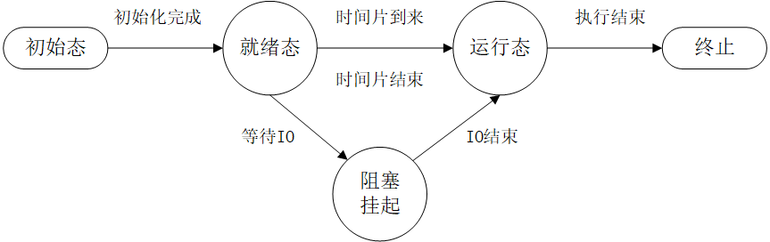

| 抽象状态 | 解释                                     |
| -------- | ---------------------------------------- |
| 运行态   | 进程获得处理器                           |
| 就绪态   | 进程被剥夺处理器，时间片结束             |
| 阻塞态   | 进程因等待某种资源就绪，导致进程无法推进 |
| 挂起态   | 进程的代码和数据被交换到磁盘中           |

> 以上是描述进程的抽象状态模型。以下是Linux系统中进程状态的具体设计。

#### 查看进程状态

进程状态信息保存在进程 task_struct 中。进程状态用于**描述该进程所处的状态**，意义是便于操作系统快速判断进程的状态，进而更高效地管理进程。

| 进程状态 | 状态       | 解释                                                         |
| -------- | ---------- | ------------------------------------------------------------ |
| **R**    | running    | 可能是就绪态或运行态。可能正在被CPU调用，可能在运行队列中等待时间片。 |
| **S**    | sleeping   | 可中断休眠，进程等待资源就绪，进程被放入资源就绪等待队列中。 |
| D        | disk sleep | 不可中断休眠，进程等待磁盘IO时间过长，操作系统将其状态设为D，防止误杀。 |
| T        | stopped    | 暂停状态，恢复后成后台进程。`19`号信号可暂停进程，`18`号信号可继续进程。 |
| t        | tracked    | 追踪暂停状态，进程被追踪，遇到断点而暂停。                   |
| X        | dead       | 终止死亡状态，内核数据结构和代码数据都被释放。               |
| **Z**    | zombie     | 僵尸状态，进程结束不会立即退出，维持在僵尸状态等待系统检测回收。 |

进程不仅可以等待CPU调度，也可以等待资源就绪。

- 等待CPU调度的进程和正在被CPU调度的进程都处于`R`状态，在运行队列中随时被调用。
- 等待资源就绪的进程处于`S/D`状态，被放入所等待资源的等待队列中，以待条件就绪并完成任务。

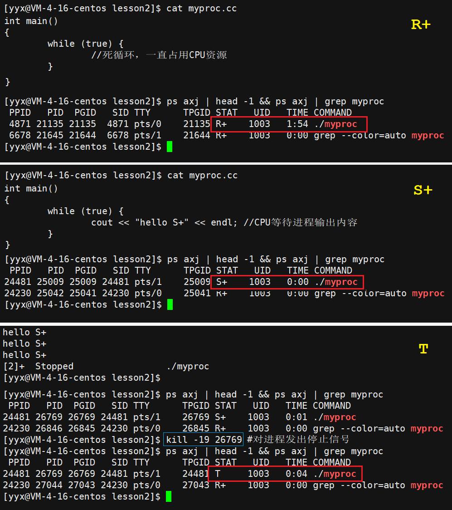

#### 两种特殊状态

```shell
## 命令行监控进程状态脚本
while :;
    do ps axj | head -1 && ps axj | grep myproc | grep -v grep;
    sleep 1;
    echo "/################################################################/";
done
```

##### 僵尸进程

一般进程结束时需要回收资源，**进程检测和回收的工作由该进程的父进程承担**。如果进程没有被回收，就会一直处于Z状态。

> 父进程休眠中，将子进程杀死，父进程就无法回收子进程，因此可以看到子进程的僵尸状态。

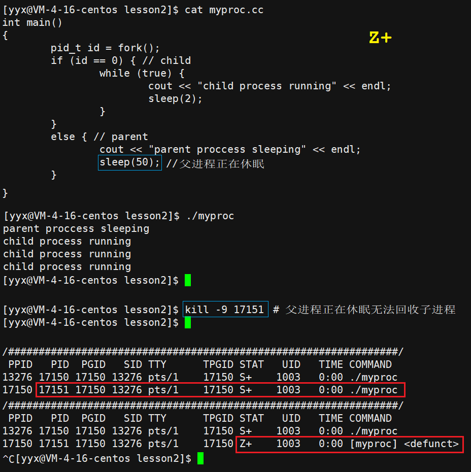

只要父进程没有调用wait或waitpid，子进程就一直没被回收，一直保持僵尸状态。

倘若进程一直不被回收，就造成了内存泄漏，所以要避免僵尸进程。

> 如何避免的问题放到进程控制	中在详谈。

##### 孤儿进程

父进程在子进程结束之前退出，**子进程的父进程就变为1号进程**。称子进程被操作系统“领养”，该子进程就被叫做“孤儿进程”。

进程必须有个父进程，否则最终会变成僵尸进程，造成内存泄漏。

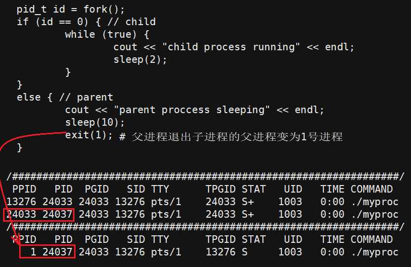

##### 区别

- 僵尸进程是父进程休眠中子进程终止，子进程无法被收尸。
- 孤儿进程是子进程运行中父进程终止，子进程被系统领养。

### 1.4 进程优先级

#### 优先级的概念

> 一般计算机中 CPU 只有一两个而进程可能有小一千个。资源太少而进程太多，进程必须要排队等待调度。

故赋予进程“优先级”（priority）的属性，提高或降低进程原本的优先权，促使其优先或延迟被 CPU 处理，可以提升系统运行的效率。

##### 进程的性质

- 竞争性：系统进程数目众多，而只有少量资源，所以进程之间是具有竞争属性的。
- 独立性：多进程运行，需要独享各种资源，多进程运行期间互不干扰。
- 并行：多个进程在多个 CPU 下分别同时进行运行，这称之为并行，真正意义上的多进程同时运行。
- 并发：多个进程在一个 CPU 下采用进程切换的方式，一段时间内，让多个进程都得以推进，称之为并发。

#### 查看进程优先级

```shell
$ ps -l -a ## 查看进程相关信息
F S   UID   PID  PPID  C PRI  NI ADDR SZ WCHAN  TTY          TIME CMD
0 S  1003 24805 24154  0  80   0 -  1833 hrtime pts/1    00:00:00 myproc
0 R  1003 24970 24704  0  80   0 - 38595 -      pts/2    00:00:00 ps
```

| 标识符 | 解释     | 含义                                                         |
| ------ | -------- | ------------------------------------------------------------ |
| UID    | UserID   | 创建进程的用户的编号                                         |
| PRI    | priority | 表示进程的基础优先级，值越低优先级越高                       |
| NI     | nice     | 优先级的修正值，取值范围$[-20,19]$共40个级别，调整 NI 值就是调整优先级。<br/>$80+NI=PIR_{new}$，初始值加修正值才是进程的真正优先级。 |

一般进程的 PRI 都是80，PRI 不同说明进程大类不同。在此基础上使用修正值动态调整，二者区分开，便于查看调整幅度。

#### 调整进程优先级

> 进程优先级由系统管理，人为修改可能导致效率降低。

```shell
$ man sched_get_priority_max
$ nice
$ renice
```

更推荐使用简单的`top`指令，输入`r`，输入对应进程编号，以及 NI 值。

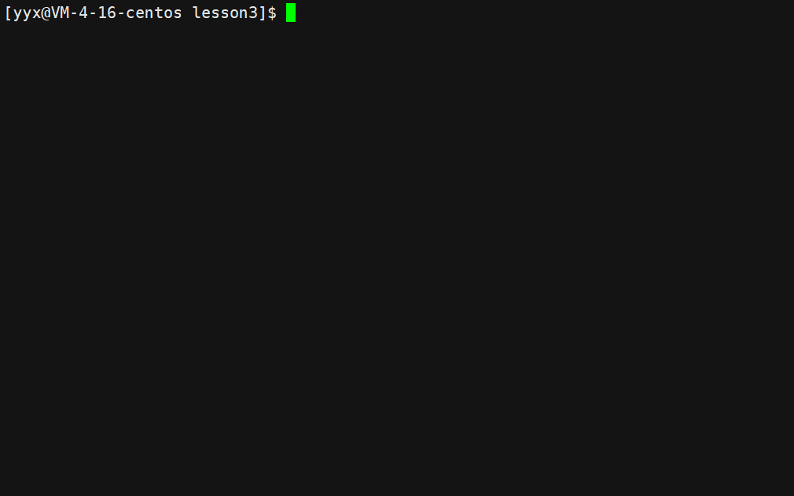

- $PIR$ 显示的都是调整之后的新优先级值。是 $80+NI$，这个$NI$是本次输入的修正值。

> 不管之前进程的优先级是多少，每次修改都是从初始值80起算。修改之后的 PIR 显示的都是初始值 80 加上输入的修正值 NI。

- 不管输入的 $NI$ 值是多少，修正的范围只有$[-20,19]$。换言之，输入的值超出这个范围就使用最值。

优先级不是绝对的、是一种相对的概念，如果调整的跨度很大，很可能导致其他进程被搁置，产生“饥饿问题”。

调度器就是要让所有进程都较为均衡地享受到 CPU 资源。

### 1.5 环境变量

#### 环境变量的概念

环境变量指操作系统中用来**指定系统运行环境的一些参数，环境变量是系统级的变量，属于全局变量**。

操作系统执行程序首先需要确定程序的位置。系统指令不需要指明路径，是因为指令的所在目录都被放入环境变量`PATH`中，每个目录以`:`分隔。

```shell
$ echo $PATH
/usr/local/bin:/usr/bin:/usr/local/sbin:/usr/sbin:/home/yyx/.local/bin:/home/yyx/bin
```

> 查找指令就是按顺序查找PATH中的路径，找不到则报错。

```shell
$ export PATH=$PATH:/home/yyx/test ## 添加PATH
$ echo $PATH
/usr/local/bin:/usr/bin:/usr/local/sbin:/usr/sbin:/home/yyx/.local/bin:/home/yyx/test
```

 `export`是内存级的修改，仅本次登录有效。永久保存需要将`export`语句放入`.bash_profile`文件内。

#### 环境变量的查看

- `PATH`：系统级指令的搜索路径；
- `HOME`：当前用户的工作目录（家目录）；
- `SHELL`：系统命令行解释器的具体名称，通常是 bin/bash 等；

> 使用 env 命令可直接查看所有环境变量。

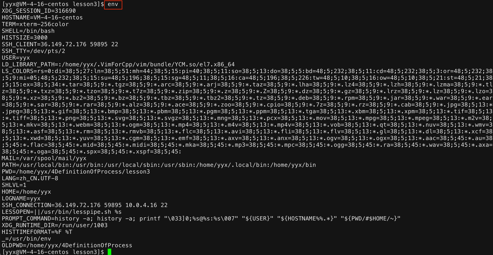

#### 环境变量的设置获取

##### 指针数组envp

```cpp
int main(int argc, char* argv[], char* envp[]);
```

`main`函数的第三个参数`envp`，传入的是系统环境变量表。最后放入`NULL`标识结束位置。

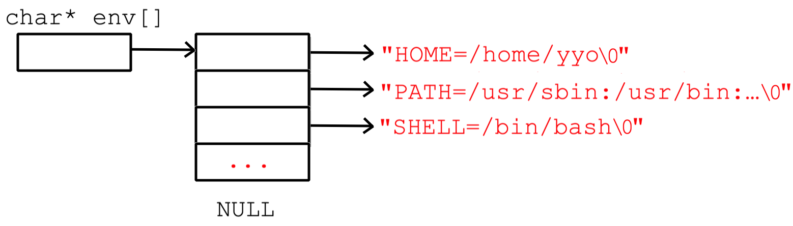

```cpp
int main(int argc, char* argv[], char* envp[])
{
    for (int i = 0; envp[i]; i++)
        printf("env[%d]->%s\n", i, env[i]);
}
```

##### 环境变量指针environ

```cpp
int main()
{
    extern char** environ; // 声明环境变量指针

    for (int i = 0; environ[i]; i++)
        printf("environ[%d]->%s\n", i, environ[i]);
}
```

环境变量指针`environ`是系统的一个全局变量。和主函数的参数`envp[]`一样用法。

##### put/get/setenv

一般都是用系统调用 _put/setenv_ 和 _getenv_，来使用环境变量。

```cpp
#include <stdlib.h>
// putenv
int putenv(char *string);
// setenv
int setenv  (const char *name, const char *value, int overwrite);
int unsetenv(const char *name);
// getenv
char *getenv(const char *name);
```

环境变量主要是用来给父子进程传递数据。

导入环境变量的是`putenv`和`setenv`，获取环境变量的是`getenv`。

- putenv 是直接字符串地址放到环境变量表中。如果字符串数组出了作用域，环境变量就没了。
- setenv 会将环境变量字符串拷贝一份放到环境变量表中。相比之下更保险。

#### 环境变量的全局属性

每一个主动创建的进程都是由 bash 启动的，他们都是 bash 的子进程。新起 bash 时会从文件导入环境变量，手动启动的进程的环境变量都是由 bash 导入的。

也就是说，环境变量是可以被继承的。命令行运行的进程从命令行解释器处继承环境变量，而子进程也会从父进程处继承环境变量。

这样，环境变量就影响了整个用户系统。

#### 命令行参数

```cpp
int main (int argc, char* argv[]);
```

`argc`,`argv`分别指 **参数个数** _argument counter_ 和**参数值** _argument value_。

```shell
$ ls -a -b -c -d  ## argc = 6, argv = {"ls", "-a", "-b", "-c", "-d"}
```

- `argc`是命令行参数的个数。
- `argv`是各个参数字符串组成的字符串数组。最后放入`NULL`标识结束位置。

```cpp
// for (int i = 0; argv[i]; i++)
   for (int i = 0; i < argc; i++)
       printf("argv[%d]->%s\n", i, argv[i]);
```

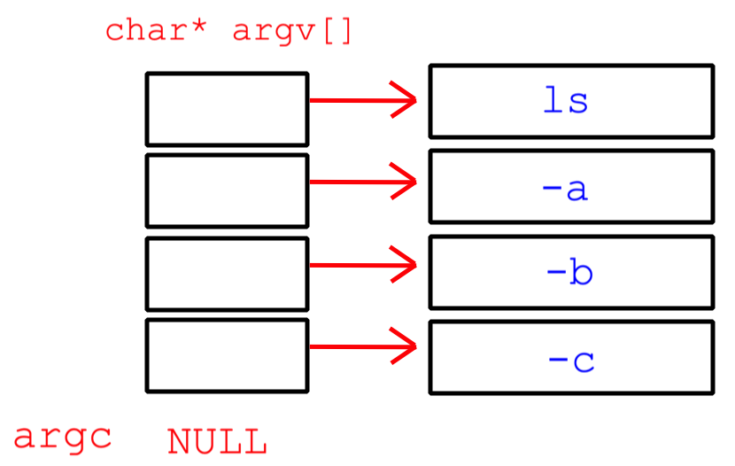

```shell
$ ./myproc -a -b -c
argv[0]->./myproc
argv[1]->-a
argv[2]->-b
argv[3]->-c
```

### 1.6 进程地址空间

#### 虚拟地址空间的定义

在C/C++动态内存管理章节处，有个程序地址空间的概念。但从语言的角度，无法深入理解这个概念，因为它是操作系统中的概念。

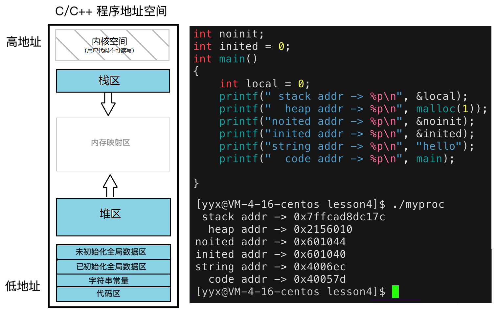

> 多打印几个变量可以看到堆栈相向而生的现象，栈区由高到低，堆区由低到高。

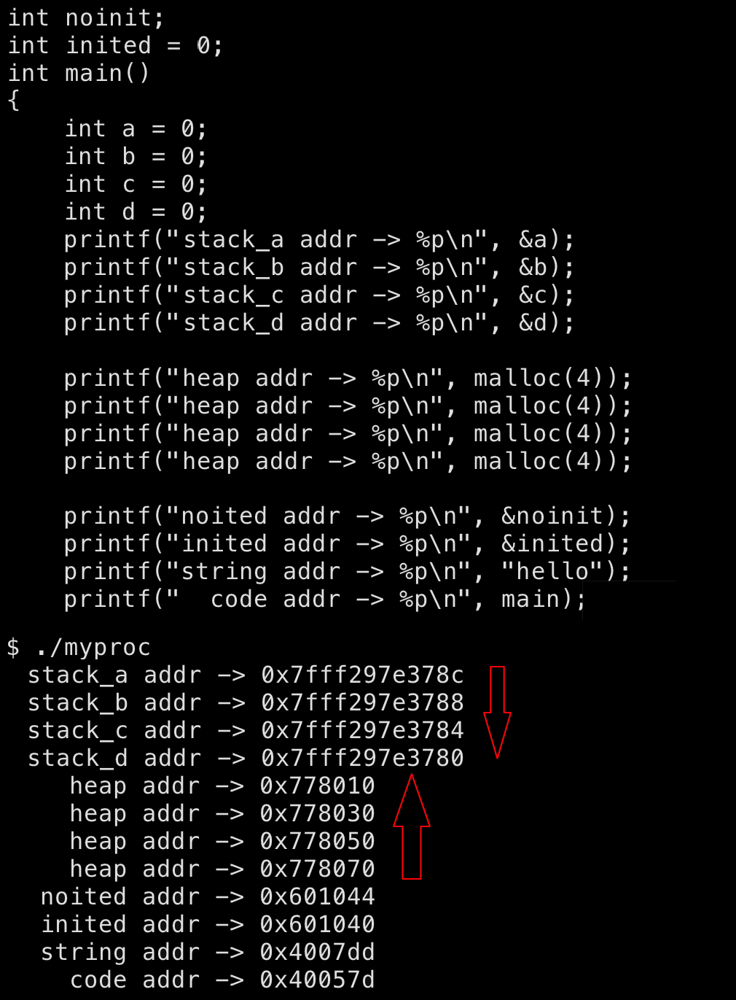

```cpp
// 如下代码，子进程修改了父进程的数据，应当发生写时拷贝，
// 也就是会拷贝一份`g_val`单独给子进程使用，
// 此时父子进程同时打印`g_val`的地址，理论上地址应该不同？
int g_val = 0;

int main()
{
    if (fork() == 0) // child
    {
        printf("child proc change, g_val=%3d, &g_val=%p\n", g_val, &g_val);
        g_val = 200;
        printf("child proc done  , g_val=%3d, &g_val=%p\n", g_val, &g_val);
    }
    else // parent
    {
        sleep(1);
        printf("parent proc check, g_val=%3d, &g_val=%p\n",g_val, &g_val);
    }
}
```

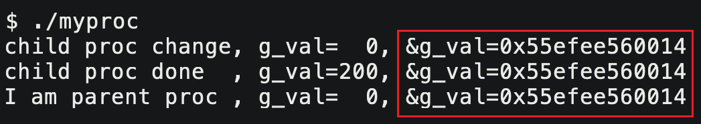

> 发生写时拷贝，那父子进程的`g_val`应该是两个不同的变量，那为什么打印出来的地址确实一样的呢？

这就意味着，**打印出的地址并不真实的物理地址，而是虚拟的逻辑地址**。语言层的地址都是虚拟地址，由操作系统链接到真实地址。

系统角度来看，程序使用的是**进程虚拟地址空间**。

每个进程都拥有一个进程地址空间，每一个进程都认为自己独占物理内存，不考虑其他进程的内存使用，从而更好地管理内存。

进程地址空间具体就是结构体`mm_struct`，用来描述内存区域。和`task_struct`一样是内核数据结构。

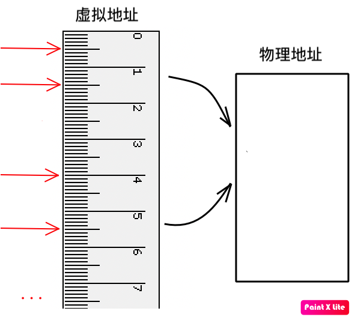

虚拟地址又称线性地址，就像一把刻度尺，只需要起始和结束下标就可以确定一段区域。物理内存中是没有什么栈区堆区这样的区域概念的，就是单纯的存放数据，由操作系统间接映射两者。

```cpp
// 内核中的`mm_struct`里面就是这样的一堆整型变量，虚拟出的栈堆等内存区域的下标
struct mm_struct
{
    size_t stack_begin;
    size_t stack_end;
    size_t heap_begin;
    size_t heap_end;
    //...
    size_t malloc_begin = 0x778010, malloc_end = 0x778014;
    // 在内存上开辟了4字节的空间，就是创建了这样的下标变量
};
```

进程并不需要关心真实地址，它就认为自己的`mm_struct`代表整个内存，都属于当前进程的。由操作系统充当中间人，将真实地址和虚拟地址关联映射起来。

操作系统通过页表和 MMU，将虚拟地址和物理地址关联映射起来。

MMU 也叫做内存管理单元，集成在 CPU 中，它的作用是查页表。
页表是用操作系统提供的一张映射表，如图所示，其左侧一列存放虚拟地址，右侧一列存放虚拟地址所映射的真实地址。

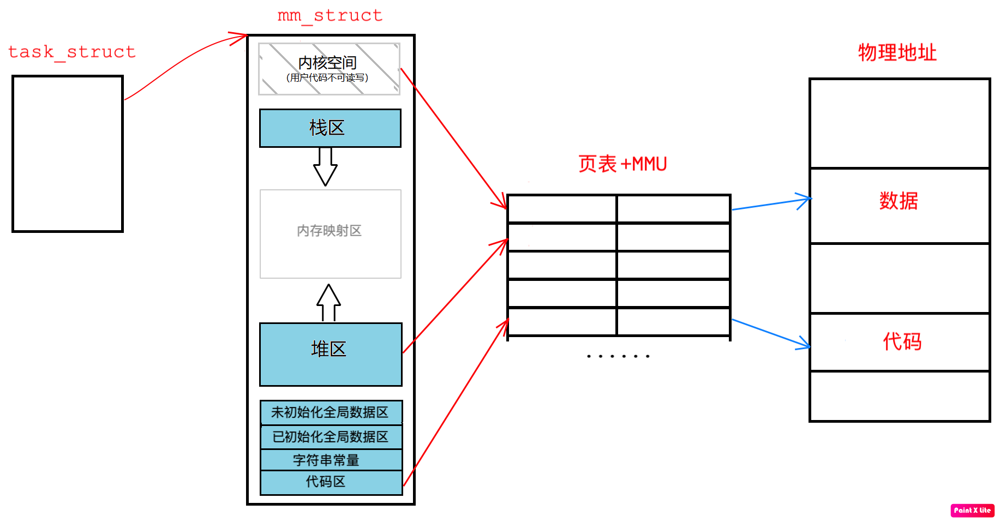

进程控制块`task_struct`，进程地址空间`mm_struct`以及页表都是进程相关的数据结构，都是在进程创建之初形成的。

##### 回到开头的问题

> 创建子进程以父进程为模版，继承父进程的代码数据还有进程数据结构。但当子进程修改时，操作系统重新开辟一段空间给子进程，这就是写时拷贝。

写时拷贝是**在物理内存上重开空间，页表将虚拟地址映射到新位置**。<u>写时拷贝完全是系统底层实现的，并没涉及语言层</u>，虚拟地址不会被修改，打印结果自然一样。

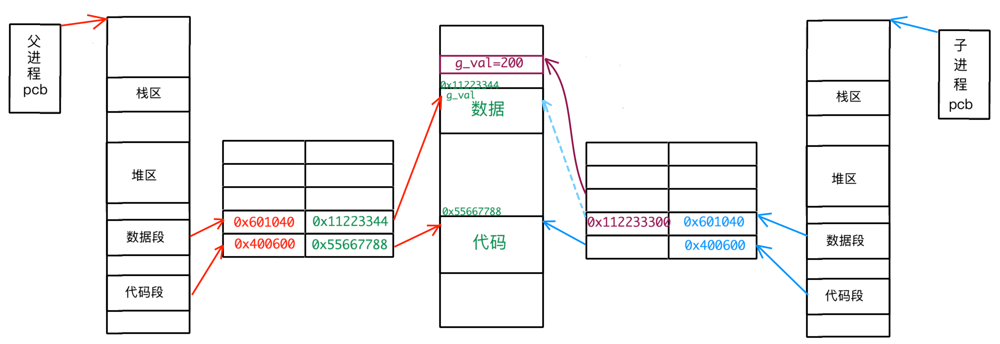

> 通过写时拷贝这样的机制，也维护了进程独立性。

```cpp
pid_t id = fork(); // 父子进程fork返回值不同，id变量也发生了写时拷贝
if (id == 0)
{}
else if (id > 0)
{}
```

#### 进程地址空间的意义

地址空间作为中间层，**实现对进程的内存操作进行风险管控，保护内存和进程安全**。
   - 通过页表对访问的地址进行管控，<u>防止进程访问非法空间</u>，导致程序出错或威胁进程安全。
   - 页表也会针对虚拟地址所在区域，<u>给进程在访问内存的时候设置读写权限</u>。
**将进程管理和内存管理解耦**，实现软件层面上的分离。
   - 内存申请和开辟在时间上区分开来，<u>高效使用内存，避免浪费</u>。

> 申请内存只是在 mm_struct 划出一段区域，等到使用时再将虚拟地址和物理内存作映射。基于缺页中断的内存管理，便于操作系统更高效的分配内存资源。

**CPU能够以统一的方式看待进程的代码和数据**，且虚拟地址的划分是相对确定的，调用的方式也相对统一。

> 每个进程都有独立的地址空间，其程序的入口函数的地址是一致的，这样 CPU 在调度进程时就可以更加快捷。差异化会造成更多特殊情况，更加容易出错。

  - 通过页表的映射，各种<u>数据可以随意存储在物理内存中，大大节省了空间</u>，且不会影响 CPU 读取效率。

> CPU访问的也是虚拟地址，再通过页表映射到真实地址。

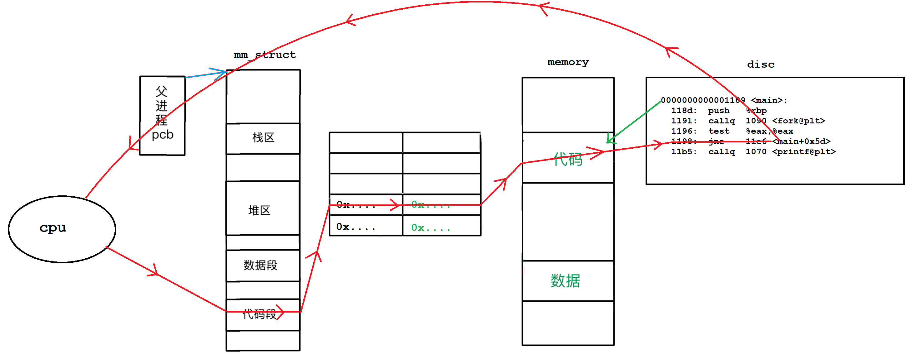

## 2. 进程控制

### 2.1 进程创建

fork 是代码创建进程的一种方式，它从已存在的进程中创建一个新进程。原进程为父进程，新进程叫做子进程。

```cpp
#include <unistd.h>
pid_t fork(void);
```

分配新内存块和内核数据结构给子进程，
将父进程部分数据结构拷贝给子进程，
添加子进程到系统进程列表中，
fork返回，调度器开始调度。

> 简而言之，fork之后，就有两个代码相同的进程，且它们都运行到相同的地方。从此便开始分道扬镳，各自独立。

进程创建成功，给父进程返回子进程的 PID，给子进程返回 0。
进程创建失败，给父进程返回 -1，并设置错误码。没有子进程产生，父进程依旧运行。

#### 写时拷贝

一般数据和代码是共享的，只有一份。代码一般不改，修改的都是数据。

**当数据被修改时，系统便为修改者单独创建一份空间，以供其使用，其他进程仍旧使用原变量**。

子进程的页表由父进程的拷贝而来，父子进程的页表中的地址映射是相同的。当写入数据时，操作系统底层会自动将数据，拷贝一份到新空间，再重新建立修改方的页表映射，将虚拟地址映射到新空间处。

### 2.2 进程终止

#### 进程退出的概念

> 进程创建完毕，就到了进程的终止。

进程运行终止无非有三种结果：

程序运行完毕，结果正确；
程序运行完毕，结果不正确；
程序异常终止。

```shell
$ echo $? ## 输出最近一次进程的退出码
```

一般进程运行正确返回值为 $0$ 代表 $success$ ；进程运行错误，返回非零值作为错误码，一个错误码对应着一个错误信息。

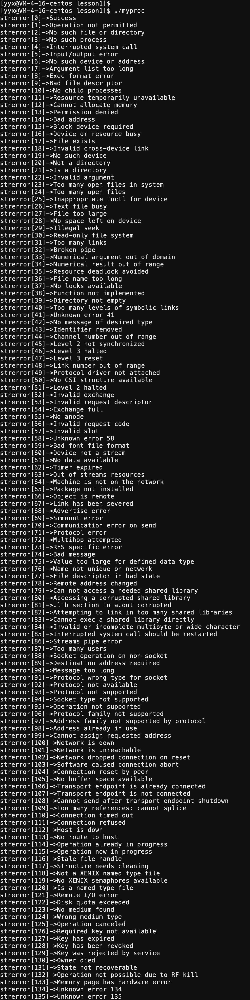

**退出码只能确定程序运行完毕结果是否正确**。当程序异常退出时，此时返回值就没有意义了。

#### 进程退出的方式

##### 进程正常退出

main函数return返回，则进程退出；其他函数返回，只是函数运行结束。

###### exit

```cpp
#include <stdlib.h>
void exit(int status);
```

- exit 放在任意位置都可以结束进程，程序只会执行到 exit 就结束。
- 参数是退出码，可以是任意整数，也可以用宏标识符`EXIT_SUCCESS`和`EXIT_FIALURE`。
- **exit 在结束进程的同时，还会刷新缓冲区**。

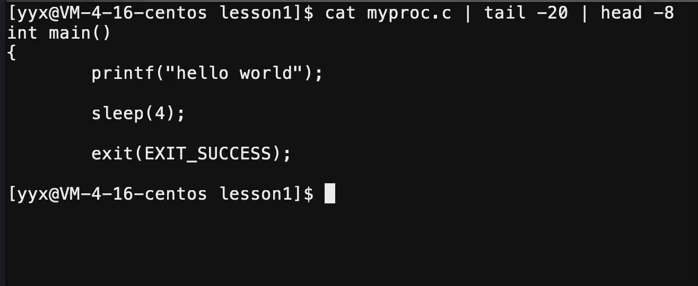

###### _exit

```cpp
#include <unistd.h>
void _exit(int status);
```

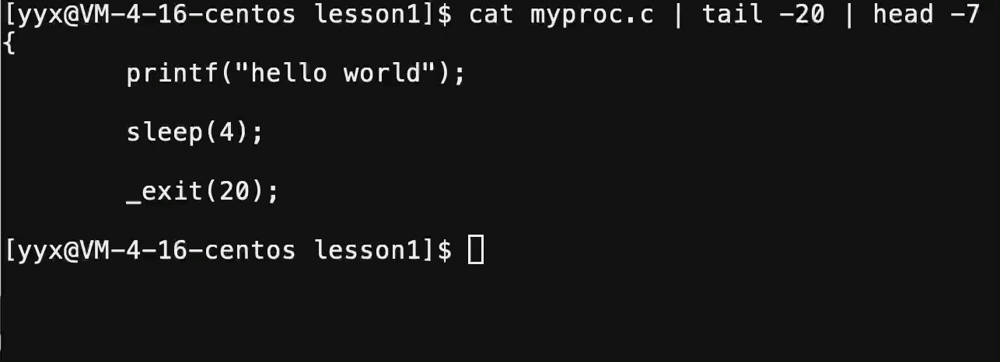

> `_exit`只强制终止进程，不进行进程的后续收尾工作。

- `_exit`是`exit`的子函数，只负责退出程序。**_exit 没有清理函数和冲刷缓冲区关闭IO流的任务**。

创建进程本质上是系统中多出一个进程，就要多出进程相关的数据结构。

故进程退出也就意味着释放为其开辟的内核数据结构，如进程控制块、地址空间、页表及相关映射关系和为程序开辟的空间等等。

##### 进程异常退出

主函数`return`、`exit`、`_exit`的方式都是正常退出，除此之外还有异常退出的情况。这个我们放到进程信号处讨论。

### 2.3 进程等待

> 子进程是为了帮助父进程完成某种任务的，而父进程通常需要获得子进程运行的结果。

#### 进程等待的定义

父进程使用`wait`,`waitpid`函数来等待子进程完成任务并退出，这个过程就叫做进程等待。

如果父进程不进行等待，子进程就会一直保持僵尸状态，造成内存泄漏。换句话说，**父进程调用`waitpid`接口等待子进程，就可以避免僵尸进程的产生，避免内存泄漏**。

- 要使父进程获取子进程的退出信息，必须保证父进程在子进程之后退出。
- 程序正常结束，需要其退出码，异常结束，需要其获取信号。退出码和退出信号就是所谓的退出信息。

#### 进程等待的方式

当一个进程进入僵尸状态时，就变得“刀枪不入”，发送`kill -9`信号也无济于事，因为进程已经死去。所以最好由父进程等待的方式解决问题。

```cpp
#include <sys/types.h>
#include <sys/wait.h>
pid_t wait(int *status);
pid_t waitpid(pid_t pid, int *status, int options);
```

等待成功返回所终止的子进程 PID，等待失败则返回 $-1$。

##### wait

```cpp
pid_t id = fork();
if (id == 0) { // child
    int cnt = 5;
    while (cnt--) {
        printf("child proccess[%d] running, cnt:%d\n",getpid(), cnt);
        sleep(1);
    }
}
else { // parent
    sleep(10); // 此处父进程不进行等待会直接退出，子进程就是僵尸进程
    pid_t ret = wait(NULL);
    if (ret > 0)
        printf("parent proccess wait[%d] seccess\n", ret);
    else
        printf("parent proccess wait failed\n");
}
```

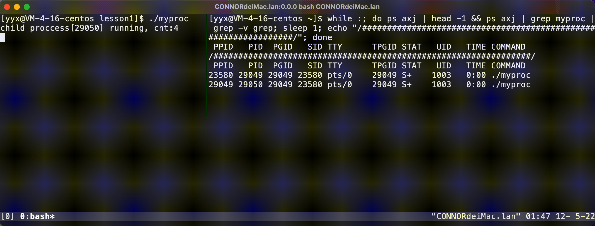

##### waitpid

```cpp
pid_t waitpid(pid_t pid, int *status, int options);
```

| 组成        | 说明                                                         |
| ----------- | ------------------------------------------------------------ |
| 返回值      | 正常返回时，返回收集信息的子进程 PID，返回–1表示等待错误。   |
| 参数 pid    | `pid`为指定进程ID，等待的是指定的某个进程，若设为–1，则等待的是任意一个进程。 |
| 参数 status | `status`是输出型参数，父进程传入该变量，借此获取进程的退出结果。 |
| 参数 option | `option`为等待方式。设0代表默认行为，即阻塞等待，设为`WNOHANG`，代表非阻塞等待。 |

###### 参数status

> 进程正常结束依靠返回值传递信息，而进程异常终止需要`status`向父进程返回。

进程异常终止往往是因为其收到了某种信号。故可以通过进程是否收到信号或收到何种信号，判定进程是否异常终止或异常原因。

此时需要进程返回两种信息，一是退出码，二是信号。

如果没收到信号，则退出码就是我们所需要的退出信息。
如果收到了信号，此时不需要关心退出码，只看退出信号。

`status`一个整数是退出码和信号的结合。其中$32$个比特位目前只使用**最低的$16$比特位**，高位暂时不管。

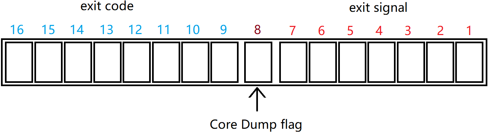

- **下标 $[0,7)$ 的 7 个比特位代表终止信号**；
- **下标 $[8,16)$ 这 8 个比特位代表退出码**；
- 下标为 $7$ 的比特位代表`code dump`标志暂时不管。

> 当下标 $[8,15]$ 的次低8位为0时，说明没有收到信号，当次低8位不为0时，再去考虑 $[0,6]$ 的低7位。

```cpp
pid_t id = fork();
if (id == 0) { //child
    int cnt = 3;
    while (cnt--) {
        printf("child proccess[%d] running, cnt:%d\n", getpid(), cnt);
        sleep(1);
    }
    exit(0);
}
else { // parent
    int status = 0;
    pid_t ret = waitpid(id, &status, 0);
    if (ret > 0) {
        printf("waited[%d], code:%d, signal:%d\n", ret, status >> 8, status & 0x7f);
    }
    else {
        printf("parent proccess wait failed\n");
    }
}
//                              FEDC BA98   7654 3210
//                                        |
// status - 0000 0000 0000 0000 xxxx xxxx | xxxx xxxx
// 0xff                         1111 1111 |
// ox7f                                     0111 1111
```

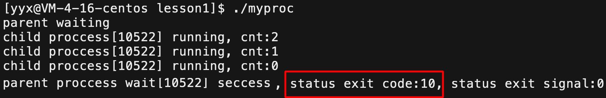

实际开发中不要写易错的位操作，直接使用宏即可。

- `WIFEXITED`判断进程是否正常退出，正常退出返回1，否则返回0。
- `WEXITSTATUS`返回进程退出码。
- `WTERMSIG`返回进程退出信号。

```cpp
if (ret > 0)
{
    if (WIFEXITED(status)) // 判断进程是否正常终止
        printf("exit code:%d\n", WEXITSTATUS(status)); // 返回进程退出码
    else
        printf("exit signal:%d\n", WTERMSIG(status));  // 返回进程退出信号
}
```

###### 参数option

参数`option`意为等待方式。设为0代表默认行为，即阻塞等待，也可设置为`WNOHANG`，代表非阻塞等待。

等待方式指父进程等待子进程的方式。而阻塞和非阻塞，指父进程等待时所处的状态。

- 阻塞等待：在子进程执行任务期间，父进程一直保持阻塞状态，直至子进程运行结束。
- 非阻塞等待：不断地的轮询检测子进程的运行状态，保持自身进程为非阻塞的等待状态。

非阻塞等待时，不会等待子进程结束再返回，此时返回值有三种情况：

返回值等于`0`，代表没有子进程退出，则需要再次等待；
返回值大于`0`，表示退出的子进程PID，父进程等待成功。
返回值小于`0`，等待失败。

```cpp
pid_t id = fork();
if (id == 0) { //child
    int cnt = 3;
    while (cnt--) {
        printf("child proccess[%d] running, cnt:%d\n", getpid(), cnt);
        sleep(1);
    }
    exit(0);
}
else {
    int status = 0;
    /* 轮询检测方案 */
    while (1)
    {
        pid_t ret = waitpid(id, &status, WNOHANG);
        if (ret == 0) { // 1.子进程并未结束
            printf("parent do other things\n");
        }
        else if (ret > 0) { // 2.子进程退出成功
            printf("wait[%d] seccess, code:%d, signal:%d\n",
                   ret, (status >> 8) & 0xff, status & 0x7f);
            break;
        }
        else { // 等待失败
            printf("parent wait failed\n");
            break;
        }
        sleep(1);
    }
}
```

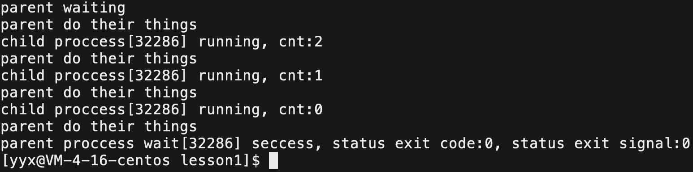

###### core dump

进程退出时，会设置其退出码和退出信号，表明进程退出的结果和原因。

必要的话，**系统会进行核心转储，就是将异常退出的进程在内存中的代码和数据以文件的形式转储在磁盘上，以便后期调试**。

> centos默认关闭Core Dump 功能，设置方式如图所示：


core dump可以帮助我们更加方便地调试，可以直接显示错误的行数。进入gdb后输入`core-file core.pid`加载core文件。


`waitpid`可以获取子进程的退出信息，退出码、退出信号以及core dump标志位。如果进程异常退出，且形成core dump文件的话，core dump标志位就会被设置为1。

```c
if (fork() == 0)
{
    while (1) {
        printf("hello proc:%d\n", getpid());
        sleep(1);
    }
    exit(1);
}
int status = 0;
waitpid(-1, &status, 0);
printf("core dump: %d\n" , (status >> 7) & 1);
```

> 查看7号手册signal章节，只有收到处理动作为Core的信号，才会进行核心转储。

#### 进程等待的底层

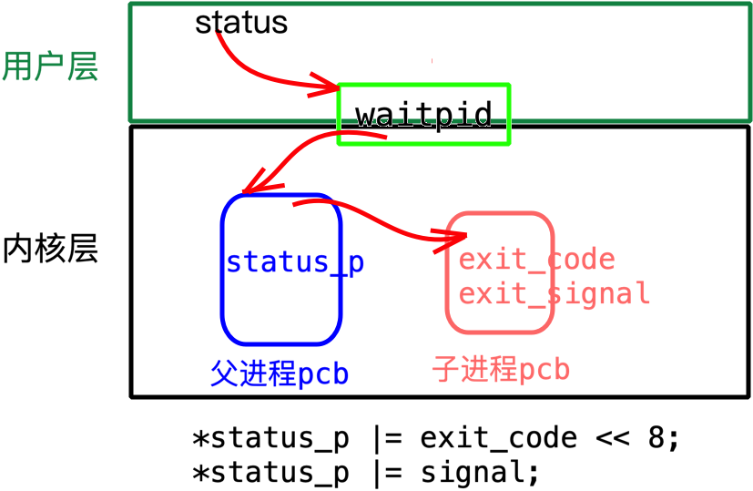

用户层，用户传入参数`status`给`waitpid`为获取进程退出结果。

进程退出时，系统会将退出码和退出信号分别写入进程PCB中的两个变量`exit_code`和`exit_signal`中。

内核层，父进程在子进程僵尸状态时将 PCB 中的退出码和信号和父进程传入的`status_p`进行运算：

```cpp
*status_p |= exit_code << 8;
*status_p |= exit_signal;
```

父进程的`status_p`就获得了子进程退出结果，再通过`waitpid`接口返回给用户层。

### 2.4 进程程序替换

> 如果想让子进程执行一个“全新的程序”，可以使用进程程序替换。

#### 替换原理

只将内存中子进程的代码数据替换成新程序的代码数据，并修改部分页表映射，就可以让子进程执行新的程序。

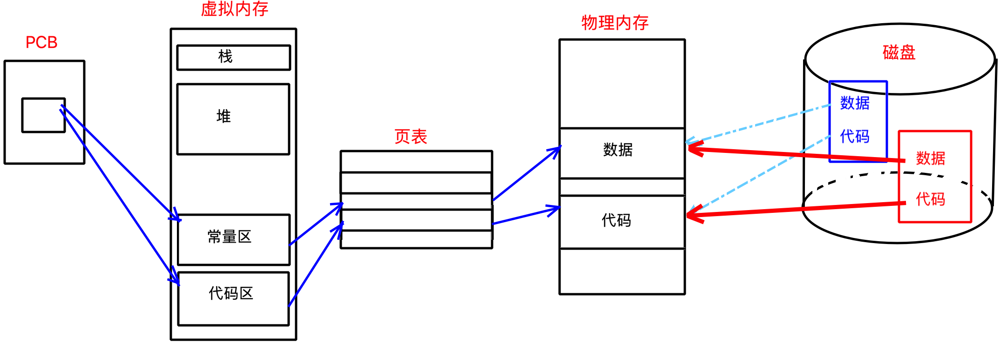

这种进程不变，仅仅替换当前进程的代码和数据的技术就叫做进程的程序替换。

> 进程替换的原理比较简单，但程序替换这个概念是非常重要的。

程序的本质就是一个文件，程序文件包含程序代码和数据。将程序的代码和数据加载到当前进程的对应内存空间上。可能会因代码变化而稍调页表数据，但这不是重点。

**重点是用旧进程的壳子套入新程序的代码数据，“旧瓶装新酒”，并没有创建任何的进程**。

#### 替换函数

系统调用是以`exec`开头的函数，称为`exec*`系列函数。

```cpp
#include <unistd.h>
extern char **environ;
int    (const char* path, const char* arg, ...);
int execv  (const char* path, char* const argv[]);

int execlp (const char* file, const char* arg, ...);
int execvp (const char* file, char* const argv[]);

int execle (const char* path, const char* arg, ..., char* const envp[]);
int execve (const char* path, char* const argv[],   char* const envp[]);

int execvpe(const char* file, char* const argv[],   char* const envp[]);
```

```cpp
int main()
{
    printf("proc[%d] is running\n", getpid());
    execl("/usr/bin/ls", "ls", "-al", NULL); // 进程程序替换

    printf("do other things..\n");
    printf("do other things..\n");
    printf("do other things..\n");
}

$ ./myproc
proccess [4205] is running
total 28
drwxrwxr-x 2 yyx yyx 4096 May 13 01:18 .
drwxrwxr-x 4 yyx yyx 4096 May 13 00:49 ..
-rw-rw-r-- 1 yyx yyx   67 May 13 00:51 Makefile
-rwxrwxr-x 1 yyx yyx 8512 May 13 01:18 myproc
-rw-rw-r-- 1 yyx yyx  296 May 13 01:18 myproc.c
```

进程程序替换后，**进程的代码数据全部会被替换，原程序中替换函数调用之后的代码不会被执行**。

程序替换的本质就是把程序代码和数据加载到当前进程的上下文中。系统中程序的运行加载，也都是使用`execl`程序替换函数的。

> 进程替换会将程序的所有代码都替换掉，若想之后的代码不被替换，可以创建子进程进行程序替换。

```cpp
int main()
{
    if (fork() == 0) { //child -- 进行程序替换
        //exec*
        exit(1);
    }
    //parent -- 等待子进程
    waitpid(-1, NULL, 0);
    printf("parent proc waited success\n");
}
```

父子进程的代码是共享的，**子进程程序替换时，修改了代码也会发生写时拷贝**。

##### 返回值

程序替换一旦成功，原程序的后续代码就不会被执行。也就是说，`exec*`函数**执行成功就不需要返回值，只有调用失败了才会有返回值**。

```cpp
int main()
{
    execl("/usr/bin/top","top" NULL);
    int ret = execl("/" "ls"， "-al", NULL); // error
    printf("%d\n"， ret);
    printf("there is something\n");
}

$. /myproc
-1
there is something
there is something
```

#### 接口对比

进程程序替换虽然有多种接口，根据参数的不同，名称也跟着变化。但本质都是一类的。

| 名称组成          | 解释                                       |
| ----------------- | ------------------------------------------ |
| `l`列表`list`     | 使用可变参数列表传递命令行参数             |
| `v`数组`vector`   | 使用数组传递命令行参数                     |
| `p`环境变量`PATH` | 在环境变量`PATH`中自动查找可执行程序的路径 |
| `e`环境变量`env`  | 传递给新程序自行维护的环境变量`env`        |

##### 参数arg&argv

```cpp
int execl (const char* path, const char* arg, ...);
int execv (const char* path, char* const argv[]);
```

- `arg,...`是可变参数列表，就是执行目标程序所需的**命令行参数，以字符串的形式传递**。最后要带上空`NULL`，标识字符串数组的结尾。
- `argv`是命令行参数数组，也就是把命令行参数和`NULL`放到一个数组中，以数组的形式作参数。本质和`arg,...`一样的。

```cpp
execl("/usr/bin/ls", "ls", "-l", "-a", NULL);

const char* const argv[] = {
    "ls",
    "-a",
    "-l",
    NULL
};
execv("/usr/bin/ls", (char** const)argv);
```

##### 参数path&file

```cpp
int execl  (const char* path, const char *arg, ...);
int execlp (const char* file, const char *arg, ...);
```

- 参数为`path`时，指的是目标程序文件所在的全路径。
- 参数为`file`时，函数名带`p`表示会在环境变量`PATH`中寻找命令，故参数`file`只要传文件名即可。

```cpp
execl("/usr/bin/ls", "ls", "-l", "-a", NULL);
execlp("ls",         "ls", "-l", "-a", NULL);
```

##### 参数envp

```cpp
int execle(const char* path, const char* arg, ..., char* const envp[]);
int execve(const char* path, char* const argv[],   char* const envp[]);
```

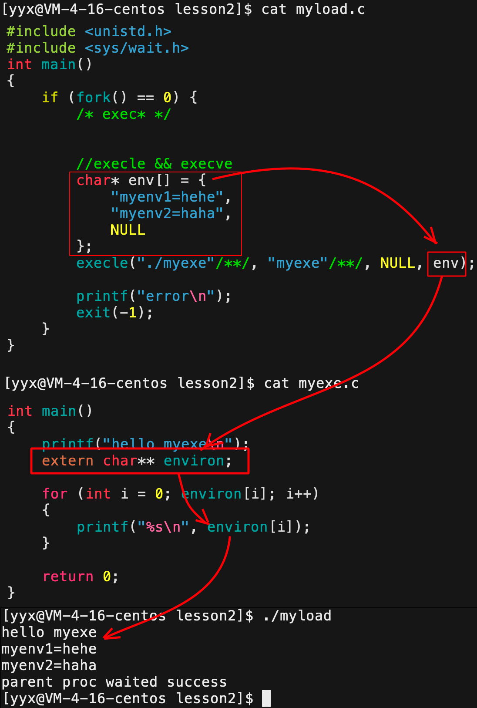

`execle`是为程序替换的新程序传递环境变量。

新程序使用系统定义变量`extern char** environ`可以获得这些环境变量。当然，自定义环境变量会将系统环境变量覆盖。

##### 总结

所有接口的本质都相同，做出多种版本只是为使用方便。**以上所有进程程序替换函数都是库函数，都是系统调用函数`execve`的代码复用**。

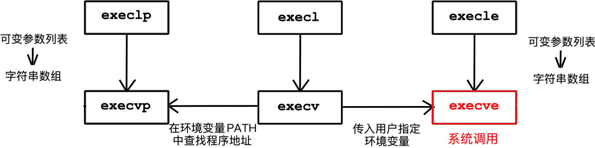

## 3. 进程间通信

进程是独立的，但有时又需要进程之间相互协同工作，此时就需要进程间通信。进程间通信可以用来：

- 数据传输：一个进程需要将它的处理结果交付给另一个进程。
- 资源共享：多个进程共享一份资源。
- 通知事件：一个进程需要向另一个或一组进程发送消息，以通知某种事件的发生。
- 进程控制：一个进程控制另一个进程的执行或终止。

进程具有独立性，不能互相访问资源，所以通信的成本很高。**进程间通信需要操作系统作中间人，提供通信的媒介**。

**进程间通信的前提是两个进程能访问到一份公共的资源**。该资源具有暂存资源的能力，能够让双方读写。

- 资源的具体组织形式不重要，可以简单的看作一段内存。
- 该公共资源一定属于操作系统，不能属于单个进程。

公共资源的呈现形式由设计者决定，可能以文件的方式如管道。**资源组织形式不同导致存在很多种通信方式**。早期标准设计者定制了多种通信标准，有管道，SystemV共享内存，POSIX信号量。

### 3.1 管道

#### 匿名管道

匿名管道是通过父子进程打开相同文件而设计的。子进程会**继承父进程的文件数组，这样子进程也会打开父进程打开的文件**。

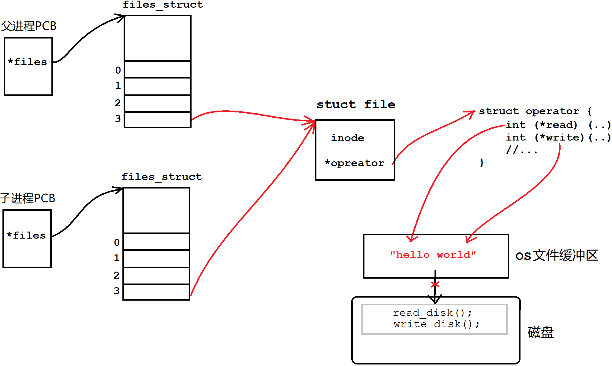

父子进程指向同一份文件，该文件是内存级文件，不允许刷新缓冲区，使得数据只停留在缓冲区内。系统使用其内核缓冲区作为进程间通信的公共资源，进程就可以读写缓冲区的内容了。

**这种基于文件读写实现的进程间通信的方式，就叫做管道**。

##### 匿名管道的原理

进程以读和写方式打开同一个文件；
创建子进程，子进程同样会以读和写方式打开该文件；
**关闭父进程的读端或写端，再关闭子进程的写端或读端，以保证管道单向通信的性质**。

> 管道是个只能单向通信的通信信道，父子进程只能保留一个读端或者写端，且要么父读子写要么父写子读。

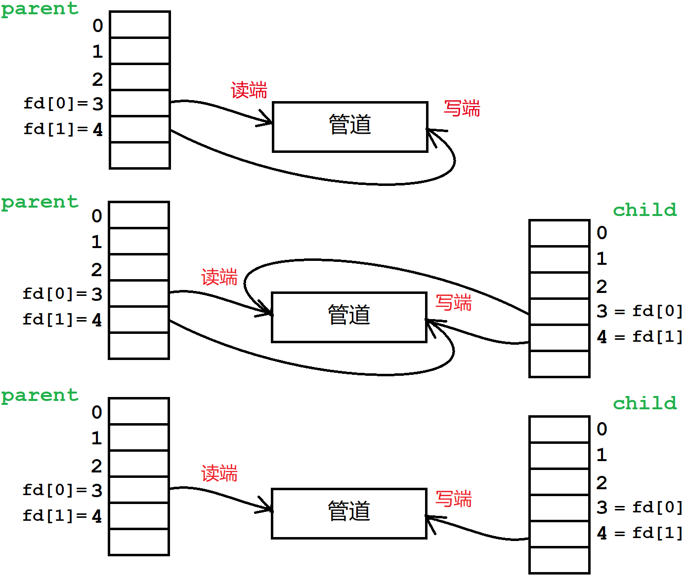

##### 匿名管道的接口

```cpp
#include <unistd.h>
int pipe(int pipefd[2]);
```

`pipefd[2]`是一个输出型参数，通过 pipefd 数组获取管道文件的读写端描述符。**默认`pipefd[0]`是读端，`pipefd[1]`是写端**。

```cpp
int main()
{
    int pipefd[2];
    if ( pipe(pipefd) != 0 )
        perror("pipe");

    printf("pipefd[0]:%d\n", pipefd[0]);
    printf("pipefd[1]:%d\n", pipefd[1]);
}
$ ./pipe
pipefd[0]:3
pipefd[1]:4
```

管道创建成功返回 $0$，不成功则返回 $-1$。

```cpp
int main()
{
    int pipefd[2];
    if (pipe(pipefd) != 0)
        perror("pipe fail:");

    //目的：子进程写，父进程读
    if (fork() == 0) // child
    {
        close(pipefd[0]); //关读
        const char* msg = "hello world";
        while (1)
        {
            write(pipefd[1], msg, strlen(msg));
            sleep(1);
        }
        exit(0);
    }

    // parent
    close(pipefd[1]); //关写
    while (1)
    {
        char buff[64] = {0};
        ssize_t ret = read(pipefd[0], buff, sizeof(buff) - 1);
        if (ret >= 0)
        {
             printf("child write:%s\n", buff);
        }
        else if (ret == 0)
        {
            printf("read finished\n");
            break;
        }
        else
        {
            printf("read failed\n");
            break;
        }
        sleep(1);
    }
    return 0;
}
```

##### 父子一对多管道通信分析

循环创建多个管道和子进程，最后实际上并不是左图而是右图。

```cpp
for (int i = 0; i < CHILD_PROC_NUM; i++)
{
    int pipefd[2];
    pipe(pipefd);

    pid_t id = fork();
    if (id == 0) {
        close(pipefd[1]);
    } else {
        close(pipefd[0]);
    }
}
```

每次创建子进程都会继承上一次创建的管道，这样后续的子进程都会打开之前的子进程管道的写端。

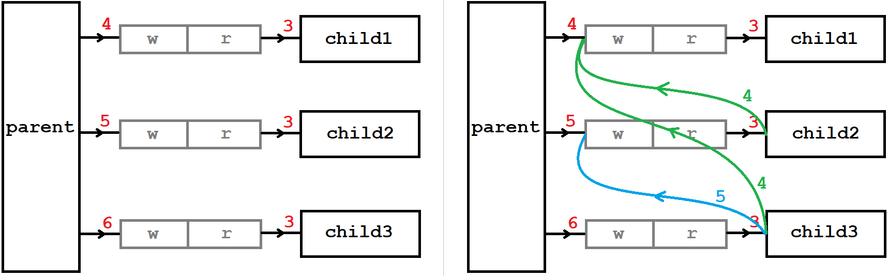

除第一个子进程不需要以外，**之后的每一个子进程都要关闭，创建它之前就存在的写端文件描述符**。

> 例如，子进程2需要关4，子进程3需要关4和5，以此类推。

```cpp
std::vector<int> wfds; // 用来保存历次创建的管道写端fd
for (int i = 0; i < CHILD_PROC_NUM; i++)
{
    int pipefd[2];
    pipe(pipefd);

    pid_t id = fork();

    if (id == 0)
    {
        for (auto fd : wfds) // 关闭其中存在的写端fd
            close(fd);

        close(pipefd[1]);
        //...
    }
    else
    {
        close(pipefd[0]);
        //...
        wfds.push_back(pipefd[1]); // 每次创建新增管道写端fd文件，以待后续关闭
    }
}
```

如果不做这样的工作，后续我们无法通过关闭父进程的写端来让子进程结束读取任务，因为子进程还存在其他写端。

#### 管道的性质

##### 管道的特点

管道是一个只能单向通信的通信信道。
管道的生命周期是随进程的。进程退出后管道也会被系统释放。
匿名管道适用于具有“血缘关系”的进程进行通信，常用于父子通信。
管道自带同步互斥机制，原子性写入。

##### 管道的读写规则

管道是面向字节流的。管道的大小是65536字节即64KB。
管道读写次数不是严格匹配的，读写次数没有强相关。
管道没数据的话，读端要等待；管道满的话，写端要等待。
写端关闭，读端会读到文件结尾。读端关闭，系统会向写端发送`SIGPIPE`信号终止进程。
写入的数据量小于`PIPE_BUF(4KB)` ，管道保证写入原子性。管道满了的话，读取量小于4KB时，写端也会阻塞。

#### 命名管道

> 匿名管道只能提供父子进程的通信，命名管道支持任意进程的通信。

##### 命名管道的原理

- 匿名管道是通过子进程继承父进程的所打开的文件，将该文件的内核缓冲区作为通信资源。
- **命名管道是让两个进程通过路径打开同一个文件，将该文件的内核缓冲区作为通信资源**。

> 命名管道的实现方式比匿名更加简单，通过文件路径进程就能打开同一个文件，同时也是以文件作载体，所以它也是管道。

##### 命名管道的接口

```shell
$ mkfifo myfifo                  ## 创建管道文件
$ echo "hello world" > myfifo    ## 写入管道文件
$ cat myfifo                     ## 读取管道文件
```

```c
#include <sys/types.h>
#include <sys/stat.h>
int mkfifo(const char *pathname, mode_t mode);
```

- 如果管道文件存在就会报错，这样保证管道文件最新。
- 权限 mode 会受到 umask 的影响。

**命名管道同样是以文件为载体的，管道创建成功后，将其当作文件打开并读写即可**。当然数据只存在于文件的内核缓冲区中，不会刷新到磁盘。

```cpp
//server.cc
int main()
{
    umask(00);
    int ret = mkfifo(FIFO_NAME.c_str(), MODE);
    if (ret < 0)
        perror("mkfifo");

    int rfd = open(FIFO_NAME.c_str(), O_RDONLY);
    if (rfd < 0)
        perror("open");

    while (true)
    {
        char buff[BF_SIZE];
        ssize_t s = read(rfd, buff, sizeof(buff) - 1);

        if (s > 0)
        {
            buff[s] = 0;
            std::cout << "client## " << buff << std::endl;
        }
        else if (s == 0)
        {
            std::cout << "client quit, i am out" << std::endl;
            break;
        }
        else
        {
            std::cout << "client error" << strerror(errno) << std::endl;
            break;
        }
    }

    close(rfd);
    unlink(FIFO_NAME.c_str()); // remove fifo file
}
//client.cc
int main()
{
    int wfd = open(FIFO_NAME.c_str(), O_WRONLY);
    if (wfd < 0)
        perror("open");

    std::string input;
    while (true)
    {
        std::cout << "input:> ";
        getline(std::cin, input); // getline不会保留回车

        // char buff[BF_SIZE] = {0};
        // fgets(buff, sizeof(buff), stdin); // fgets会保留回车
        // buff[strlen(buff) - 1] = 0;

        if (input == "quit")
            break;
        ssize_t s = write(wfd, input.c_str(), input.size());
        assert(s >= 0);
    }
    close(wfd);
}
```

> 命名管道也是基于字节流的，所以进程通信的时候需要双方定制通信协议，但目前不考虑这个问题，留到网络部分学习。

多个进程谁先调用`open`打开管道文件，就让谁`mkfifo`创建管道，没有管道文件`open`就会出错返回。

打开管道文件时，只有读写双方都打开才会解除阻塞。

[进程间通讯-管道，以及open函数打开管道阻塞的原则](https://www.cnblogs.com/lsxkugou/p/14171705.html)

[mkfifo创建管道，调用open打开失败](https://blog.csdn.net/markton1990/article/details/127328950)

### 3.2 SystemV共享内存

进程间通信技术不断发展，最终演变出一个SystemV标准。该标准提供了三个进程间通信方案：共享内存，消息队列，信号量。我们只讨论共享内存方案。

#### 共享内存的原理

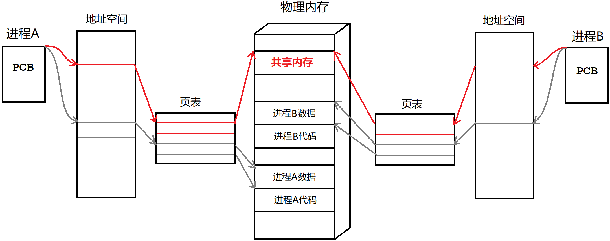

**共享内存的本质是让参与通信的进程关联上同一块内存空间，读写该空间从而实现通信**。

开辟一块内存空间，并将地址返回给用户。
让参与通信的进程“挂接”上这块空间，并进行内存读写。
让进程“去挂接”上共享内存。并释放共享内存。

> 这就是共享内存的核心原理。

类似进程和文件的管理，操作系统也会对系统中使用的共享内存进行管理。**描述共享内存的数据结构中存储其属性信息，操作系统对共享内存的管理就变成了对该数据结构的增删查改**。

#### 共享内存的使用

##### 创建shmget

```c
int shmget (key_t key, size_t size, int shmflg);
```

| 参数       | 解释                                                         |
| ---------- | ------------------------------------------------------------ |
| **key**    | 共享内存的数据结构中，用以唯一标识共享内存的数。可用ftok生成<br>内核用 key 唯一确定共享内存，用户层用 id 进行管理共享内存 |
| **size**   | 建议是4KB的整数倍，内存申请的最小单位为4KB                   |
| **shmflg** | `IPC_CREAT`：共享内存不存在就创建，存在就获取返回<br>`IPC_EXCL`：搭配`IPC_CREAT`，表示不存在就创建，存在就报错返回（得到最新内存）<br>必须设置访问权限以及`umask`防止后续无法挂接。 |
| **返回值** | 返回该共享内存在用户层面上的唯一标识`shmid`，出错返回 –1     |

```cpp
//server
key_t key = ftok(PATH_NAME, PROJECT_ID);
int shmid = shmget(key, 4096, IPC_CREAT | IPC_EXCL | 0664); // 创建共享内存
//client
key_t key = ftok(PATH_NAME, PROJECT_ID);
int shmid = shmget(key, 4096, IPC_CREAT); // 查找共享内存
```

从`IPC_CREAT`和`IPC_EXCL`的含义来看，一定是一个进程创建共享内存，一个进程查找共享内存。

进程运行结束，共享内存仍然存在，说明共享内存独立于进程，是由系统单独管理的。

##### 控制shmctl

```c
int shmctl (int shmid, int cmd, struct shmid_ds* buf);
```

| 参数      | 解释                                                         |
| --------- | ------------------------------------------------------------ |
| **shmid** | 待操作的共享内存编号                                         |
| **cmd**   | 对共享内存的操作，选项有`IPC_STAT`获取属性、`IPC_SET`设置属性、`IPC_RMID`删除共享内存 |
| **buf**   | 用来设置进内核或获取内核的共享内存结构体                     |

> 控制共享内存仅作了解。

```c
shmctl(shmid, IPC_RMID, NULL);
printf("key:%u, shmid:%d\n, shm has been deleted\n", key, shmid);
```

##### 关联/去关联shmat shmdt

```c
void* shmat (int shmid, const void* shmaddr, int shmflg) ; /*attach*/
int   shmdt (const void* shmaddr);                         /*detach*/
```

> shmaddr、shmflg 设置为 0 即可，无需关心。

- shmat 挂接成功返回共享内存的所在地址，失败返回 –1。
- shmdt 通过共享内存的地址去挂接，成功返回 0，失败返回 –1。

管道是以文件为载体的，业务逻辑就转化为对文件的操作。而共享内存是以一段内存空间为载体的，`shmat`函数返回起始地址，所以业务逻辑是一系列的指针操作。

```c
char* addr = (char*)shmat(shmid, NULL, 0);

printf("%s\n", addr); // 将空间看作字符串，按字符串的方式读取

shmdt(addr);
shmctl(shmid, IPC_RMID, NULL);
```

##### 共享内存的指令

```shell
$ ipcs            ## 显示systemV所有通信方案的使用情况
$ ipcs -m         ## 显示共享内存的使用情况
$ ipcrm -m shmid  ## 释放指定的共享内存
```

```shell
$ ipcs

------ Message Queues --------
key        msqid      owner      perms      used-bytes   messages

------ Shared Memory Segments --------
key        shmid      owner      perms      bytes      nattch     status
0x00000000 0          root       644        80         2
0x00000000 1          root       644        16384      2
0x00000000 2          root       644        280        2
0x0002fd94 4          yyx        0          4096       0

------ Semaphore Arrays --------
key        semid      owner      perms      nsems
0x000000a7 0          root       600        1

$ ipcs -m

------ Shared Memory Segments --------
key        shmid      owner      perms      bytes      nattch     status
0x00000000 0          root       644        80         2
0x00000000 1          root       644        16384      2
0x00000000 2          root       644        280        2
0x0002fd94 4          yyx        0          4096       0

$ ipcrm -m 4
```

#### 共享内存的特点

- **共享内存生命周期随内核，与进程无关**。
- **共享内存是所有进程间通信方案中最快的**，因为其以一块裸露内存作载体，不存在数据拷贝。
- **共享内存不提供任何同步或互斥机制**，需要程序员自己保证数据安全。

## 4. 进程信号


### 4.1 信号的产生

#### 信号的概念

> 生活中也存在信号，如红绿灯，除了信号本身还有信号触发时人们的动作，如：闻鸡起舞，红灯停绿灯行。

系统中也存在信号，**信号是系统发送给进程的**，进程需要在合适的时候处理信号，因此进程必须明确各种信号对应的动作。

Linux共有62种信号，前31个是普通信号，后31个是实时信号。实时信号不作考虑。

```shell
$ kill -l
 1) SIGHUP        2) SIGINT      3) SIGQUIT      4) SIGILL      5) SIGTRAP
 6) SIGABRT       7) SIGBUS      8) SIGFPE       9) SIGKILL	   10) SIGUSR1
11) SIGSEGV      12) SIGUSR2    13) SIGPIPE	    14) SIGALRM    15) SIGTERM
16) SIGSTKFLT	 17) SIGCHLD	18) SIGCONT	    19) SIGSTOP	   20) SIGTSTP
21) SIGTTIN      22) SIGTTOU	23) SIGURG	    24) SIGXCPU    25) SIGXFSZ
26) SIGVTALRM    27) SIGPROF    28) SIGWINCH    29) SIGIO	   30) SIGPWR
31) SIGSYS
```

Linux中信号用宏来表示，数字是宏值，单词是宏名。

##### 信号的产生

当然，进程必须能够分辨信号和明确指定信号的处理方式，以便在信号到来时能够及时处理。也就是说，**进程在信号产生前就应该具有识别和处理信号的能力**。

信号可能随时产生，也就是说，**信号的产生对进程来说是异步的**。

##### 信号的保存

> 实际生活人们收到某种信号时，可能并不会立即处理因为此时还在处理其他事情。比如闹钟响起时赖床。

进程在收到信号时也可能无法立即处理，因为进程可能正在处理优先级更高的任务，只能将信号暂存起来，等到合适的时候再进行处理。也就是说**，进程具有暂时保存信号的能力**。

信号本身也是数据，可被暂存在PCB中。系统提供多种发送信号的方式，但**本质都是让系统向进程控制块中写入数据**。

我们已经知道，产生信号实际是操作系统在向进程发送信号。**信号本身也是数据，发送信号的本质就是向PCB中写入信号数据**。

进程只关心是否收到信号及是几号信号，因此**进程中采用整型位图来标识进程是否收到某种信号**，比特位位置代表信号编号，比特位内容代表是否收到信号。

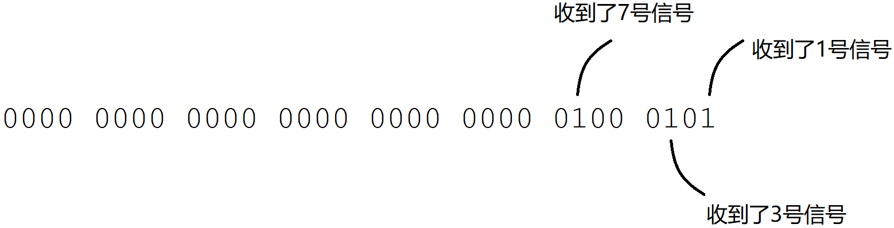

> 系统向进程发送信号就是向进程 task_struct 的信号位图的对应位置写入1。

[Linux信号说明](https://blog.csdn.net/u011607971/article/details/116067734)

#### 注册信号处理动作

前面已经说过，进程在信号产生前就必须明确对信号的处理方式。

- 分辨信号：进程能够分辨系统设计好的共62种信号。
- 处理方式：一般信号有默认动作、忽略动作、自定义动作。
  - 默认动作：信号的默认行为，如`SIGKILL`的杀死自身进程。
  - 忽略动作：忽略掉该信号，不做出任何反应，也是一种信号处理的方式。
  - 自定义动作：要求内核返回用户态执行用户注册的行为，我们称之为捕捉一个信号。

```cpp
// signal 注册进程对信号 signum 的处理动作为函数 handler，并返回旧的处理方法
#include <signal.h>
typedef void (*sighandler_t)(int); // handler 函数指针
sighandler_t signal(int signum, sighandler_t handler);
```

```c
void handler(int sig)
{
    printf("process:%d, signal number:%d\n", getpid(), sig);
}
int main()
{
    signal(2, handler); // 通过signal注册对2号信号的处理动作，并没有实际信号产生
    while (1)
    {
        printf("hello proc:%d\n", getpid());
        sleep(1);
    }
    return 0;
}
```

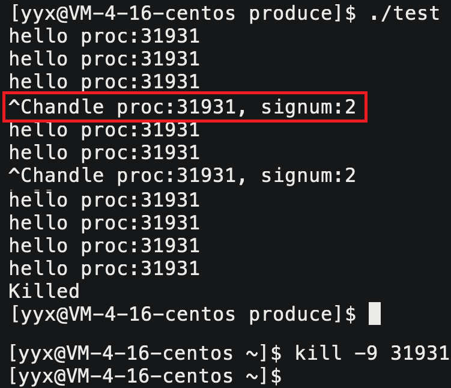

**通过`signal`接口注册对某个信号的处理动作，相当于是一种预定的注册机制，并没有任何信号产生**。

> 9号`SIGKILL`信号和19号`SIGSTOP`信号无法被注册。

#### 信号产生的方式

产生信号共有4种大方式，信号产生的方式繁多，但底层都是系统向进程发送信号。

| 方式     | 具体解释                                                     |
| -------- | ------------------------------------------------------------ |
| 系统指令 | 指令`kill`或者键盘发送快捷键`^C`,`^Z`等。                    |
| 系统调用 | 系统提供多种发送信号的接口，方便我们在代码中设置信号。       |
| 软件条件 | 某些软件条件不具备，触发信号发送的条件，操作系统向进程发送信号。 |
| 硬件异常 | 进程运行中出现错误导致软硬件出现异常，被操作系统甄别并处理。 |

##### 系统指令

| 输入   | 含义                                                        |
| ------ | ----------------------------------------------------------- |
| `kill` | 向进程发送任意号信号                                        |
| `^C`   | 向进程发送2号信号`SIGINT`，默认是终止进程。                 |
| `^\`   | 向进程发送3号信号`SIGQUIT`，默认是终止进程并进行core dump。 |
| `^Z`   | 向进程发送20号信号`SIGTSTP`，默认是停止进程。               |

```shell
$ ./a.out &   ## 将进程放到后台执行
$ fg          ## 将后台进程调至前台
```

> 键盘产生的信号，只能作用于前台进程，后台进程无标准输入所以无法使用键盘发送信号。

##### 系统调用

###### kill

```c
#include <sys/types.h>
#include <signal.h>
int kill(pid_t pid, int sig); // kill函数向指定进程发送指定信号
```

```c
int main(int argc, char** argv)
{
    if (argc != 3) {
        std::cout << "Usage:\n\t./mykill -signo pid" << std::endl;
        exit(1);
    }

    int sig = stoi(argv[1] + 1);
    int pid = stoi(argv[2]);

    if (kill(pid, sig) < 0)
        perror("mykill");
    else
        std::cout << "kill -" << sig << " " << pid << std::endl;

    return 0;
}
```

###### raise

```c
#include <signal.h>
int raise(int signum); // raise函数给自身进程发送指定信号
```

```c
void handler(int signo)
{
    std::cout << "get a signal: " << signo << endl;
}

int main()
{
    signal(SIGINT, handler);

    while (true)
    {
        sleep(1);
        raise(SIGINT);
    }
    return 0;
}
```

###### abort

```c
#include <stdlib.h>
void abort(void); // abort函数给自身进程发送6号信号SIGABRT
```

```c
int main()
{
    if (fork() == 0)
    {
        std::cout << "i am child process" << std::endl;
        abort();
    }

    int status = 0;
    waitpid(-1, &status, 0);
    std::cout << "exit code: " << (status >> 8) << ", signal: " << (status & 0x7F) << endl;

    return 0;
}
```

> abort是C库函数，不仅会发送信号还会调用exit终止程序。

##### 软件条件

由于软件条件的不就绪而触发信号。例如管道所有读端关闭，写端的条件不就绪，系统就会向其发送SIGPIPE信号。

###### alarm

`alarm`设置一个计时器，计时结束后向自身进程发送14号`SIGALRM`信号终止进程。

```c
#include <unistd.h>
unsigned int alarm(unsigned int seconds);
```

- 参数是设置闹钟的时间。参数为0表示取消闹钟。
- 返回值是上一次alarm闹钟的剩余时间，如果之前没有设定过则返回0。每次调用alarm都会覆盖之前的闹钟并重新设定。

```cpp
int main()
{
    int cnt = 5;
    alarm(cnt);

    while (true)
    {
        std::cout << "remaining time: " << cnt-- << std::endl;
        sleep(1);
    }

    return 0;
}
```

##### 进程异常

```cpp
int main()
{
    *(int*)11223344 = 100; // 野指针
}

$ ./test
Segmentation fault //带有野指针等错误的程序运行起来，进程会崩溃。
```

运行存在异常问题的程序时，会导致CPU、MMU等硬件会出现异常，致使操作系统就会向进程发出对应的信号。

- 如地址越界、权限不足等段错误，MMU在查找页表后会直接报错，进程会收到11号`SIGSEGV`信号。
- 除零等浮点数溢出错误会导致CPU中状态寄存器出现异常，进程就会收到8号`SIGFPE`信号。

```cpp
void handler(int signum) {
    printf("get a sigal num:%d\n", signum);
    exit(1);
}

int maln()
{
    signal(SIGSEGV, handler);
    *(int*)11223344 = 100; // 野指针
}
$ ./test
get a sigal num:11

int main()
{
    signal(SIGFPE,  handler);
    int a = 1 / 0;
}
$ ./test
get a sigal num:8
```

### 4.2 信号的保存

进程可能正在处理优先级更高的事情故不能及时处理信号，所以进程使用信号位图来暂存已收到的信号。

#### 信号状态的概念

| 概念     | 解释                                                         |
| -------- | ------------------------------------------------------------ |
| 信号递达 | 执行信号处理动作就叫做信号递达。                             |
| 信号未决 | 信号产生但并未递达的状态称为信号未决，就是信号被暂存在pcb信号位图中。 |
| 信号阻塞 | 系统允许进程屏蔽/阻塞某些信号。此时信号是未决的，因阻塞故无法递达，解除阻塞方可递达。 |

执行信号的忽略动作就说明信号已被处理，只是处理动作就是什么都不做，但已递达。

阻塞表示信号被屏蔽，信号被阻塞就代表信号不可能被递达，但可以是未决的，直至解除阻塞方可递达。

#### 信号保存的方式

> 这些概念在 pcb 中是如何表示的呢？

进程PCB中有三张表，分别是`block`表，`pending`表，`handler`表，如图所示：

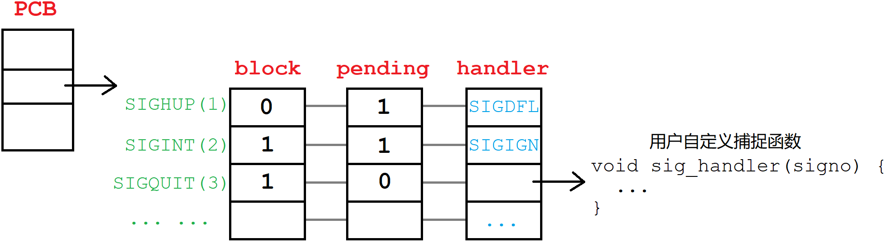

| 表名    | 内容                                     | 本质                                      |
| ------- | ---------------------------------------- | ----------------------------------------- |
| pending | 为1表示收到信号，为0反之                 | `pending`位图表示是否收到信号             |
| block   | 为0表示信号被阻塞，为1反之               | `block`位图表示是否阻塞信号。信号屏蔽字。 |
| handler | `SIGDFL(0)`，`SIGIGN(1)`，自定义函数地址 | `handler`函数指针数组存储信号处理动作。   |

> 三张表横着看，一行对应一个信号，首先是否收到，然后是否屏蔽，其次是其处理方法。

 ```c
 //伪代码
 if (block & (1 << (signo - 1))) { //被阻塞
     //...
 }
 else { //未阻塞
     if (pending & (1 << (signo - 1))) { //未阻塞且已收到
        handler[signo - 1](signo);
         return 0;
     }
 }
 ```

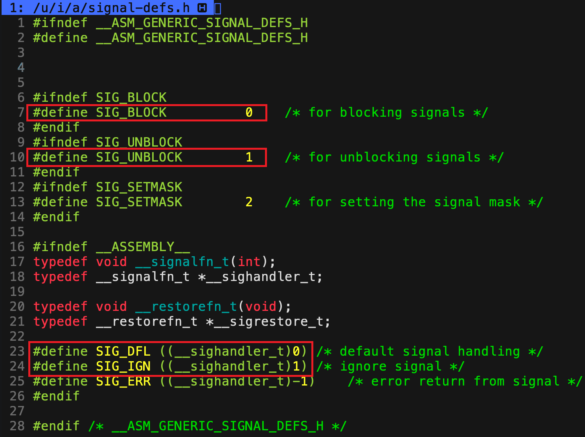

- 一个信号如果被 block，即使其被 pending，也不能被 handler。
- 一个信号没有被 block，如果其被 pending，进程将会在合适的时候进行 handler。
- 一个信号如果被 handler，那么其一定被 pending，且一定不能被 block。

> 这三张表涵盖了信号是否被屏蔽，是否收到，处理方法是什么，此时进程就具有识别信号的能力。

#### 信号集的操作

> 系统为用户提供了修改信号的数据类型和接口。

##### 信号位图类型 sigset_t

为防止用户误操作，信号的各种操作必须使用系统提供的数据类型：

```c
sigset_t set; // 信号位图结构类型

// source code
typedef struct {
    unsigned long int __val[_SIGSET_NWORDS];
} __sigset_t;

typedef __sigset_t sigset_t;
```

可以使用`sigset_t`变量，操作内核中的未决和阻塞位图。虽然`sigset_t`本质是位图，但不允许自行位运算，只能用系统提供的接口。

##### 信号调用接口

一般操作信号的步骤是：

先设置好自定义信号位图，也就是使用`sigset_t`类型定义的用户变量。
再将该变量写入内核数据结构中。

用来修改用户信号变量的一系列接口：

```c
#include <signal.h>
int sigemptyset( sigset_t *set );  // 全部置0
int sigfillset ( sigset_t *set );  // 全部置1

int sigaddset( sigset_t *set, int signo );  // 加入信号
int sigdelset( sigset_t *set, int signo );  // 删除信号

int sigismember( const sigset_t *set, int signo );  // 判断是否存在
```

用来将位图变量设置进进程PCB的信号位图的接口：

###### 读取/修改信号阻塞集 sigprocmask

`sigprocmask`用来读取或者修改进程PCB中的信号阻塞位图。

```c
#include <signal.h>
int sigprocmask(int how, const sigset_t *set, sigset_t *oldset);
```

| 变量     | 解释                                                         |
| -------- | ------------------------------------------------------------ |
| `set`    | 设置进内核的信号阻塞集，不需要可以设为`NULL`                 |
| `oldset` | 获取内核中的信号阻塞集，不需要可以设为`NULL`                 |
| `how`    | 设置信号的方式，选项有三种：`SIG_BLOCK`，`SIG_UNBLOCK`，`SIG_SETMASK`： |

| how参数的选项 | 解释                                                       |
| ------------- | ---------------------------------------------------------- |
| `SIG_BLOCK`   | 将set中值为1的信号设置进内核阻塞表中，相当于`mask|=set`。  |
| `SIG_UNBLOCK` | 将set中值为1的信号在内核中解除阻塞，相当于`mask&=(~set)`。 |
| `SIG_SETMASK` | 直接将内核中的阻塞位图替换为set，相当于`mask=set`。        |

```c
void showBlockset(sigset_t* set)
{
    for (int signo = 1; signo < 32; signo++)
        if (sigismember(set, signo)) std::cout << "1";
        else                         std::cout << "0";
    std::cout << std::endl;
}

int main()
{
    sigset_t set, oset;
    sigemptyset(&set);
    sigemptyset(&oset);

    sigaddset(&set, SIGINT);
    sigprocmask(SIG_SETMASK, &set, &oset);

    while (true)
    {
        showBlockset(&set);
        sleep(1);
    }
    return 0;
}
```

###### 读取信号未决集 sigpending

pending表由系统自行管理无需设置，`sigpending`只能获取进程的pending位图。

```c
#include <signal.h>
int sigpending(sigset_t *set);
```

```c
int main()
{
    sigset_t set, pset;
    sigemptyset(&set);

    sigaddset(&set, SIGINT);
    sigprocmask(SIG_BLOCK, &set, nullptr);

    int cnt = 0;
    while (true)
    {
        sigpending(&pset);
        showBlockset(&pset);

        if (cnt++ == 10)
            sigprocmask(SIG_UNBLOCK, &set, nullptr);
        sleep(1);
    }
}
```

###### 读取/修改信号处理集 sigaction

`signal`和`sigaction`接口没有区别，都是注册对单个信号的处理方法。

```c
#include <signal.h>
int sigaction(int signum, const struct sigaction *act, struct sigaction *oldact);

struct sigaction {
    void   (*sa_handler)(int);
    sigset_t sa_mask;
    int      sa_flags;
    // ...
};
```

| 参数     | 解释                                         |
| -------- | -------------------------------------------- |
| `signum` | 需要设置的信号                               |
| `act`    | 设置进内核的信号处理集，不需要可以设为`NULL` |
| `oldact` | 获取内核中的信号处理集，不需要可以设为`NULL` |

当某个信号的处理方法正在被调用时，系统会暂时将该信号屏蔽，等处理完该信号时，再对该信号解除阻塞。

如果想在处理某个信号的同时，将其他信号也作屏蔽，则可以使用`sa_mask`字段。

```c
void handler(int signo)
{
    std::cout << "get a signal: " << signo << std::endl;
    sigset_t set;
    sigprocmask(SIG_BLOCK, nullptr, &set);

    for (int sig = 1; sig < 32; sig++)
    {
        if (sigismember(&set, sig)) cout << '1';
        else cout << '0';
    }
    cout << endl;
}

int main()
{
    struct sigaction act;
    act.sa_handler = handler;
    act.sa_flags = 0;
    sigaddset(&act.sa_mask, 1);
    sigaction(SIGINT, &act, nullptr);

    raise(SIGINT);
    return 0;
}
```

### 4.3 信号的处理

#### 信号处理的时机

信号的产生是异步的，信号产生时当前进程可能正在进行更重要的工作，信号必须要被延时处理，具体要取决于操作系统和进程的状态。

> 进程会在合适的时候处理未决的信号，那什么是合适的时候呢？

**当进程从内核态切换到用户态的时候，进程会在系统的指导下，会进行信号的检测和处理**。

每次状态切换只会处理一个信号，并且是先将pending位图中信号位置置零，再去调用信号处理方法。

##### 内核态和用户态的概念

进程在执行代码时会不断的切换用户态和内核态，<u>执行用户代码时处于用户态，执行内核代码时处于内核态</u>。

- 执行用户态的代码时，进程必须为用户态，必须受到操作系统的监管。
- 执行内核级的代码时，进程必须为内核态，提升身份权限以执行内核代码。再次执行用户代码时必须转为用户态，否则可能影响系统安全。

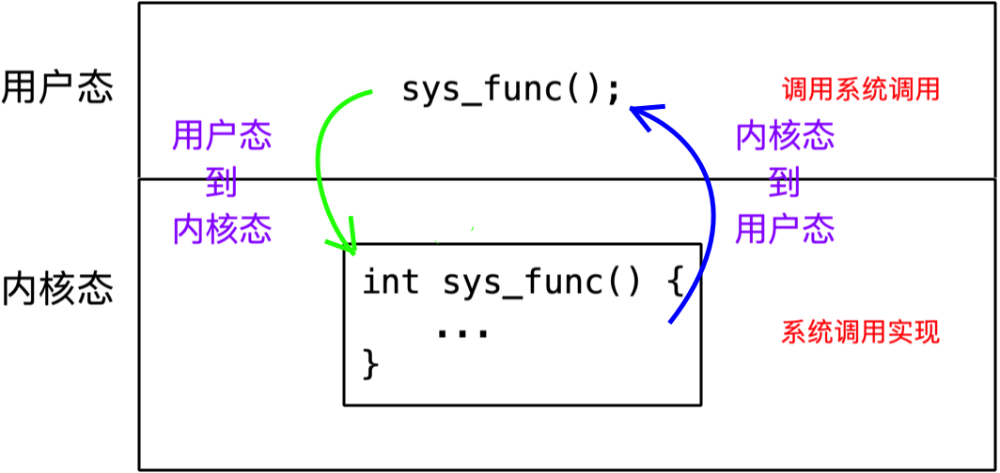

> 调用系统调用，会发生进程状态转变，并不是只有这一种情况才会发生状态转变。

程序运行起来，用户和内核的代码数据都是要被加载到内存中的。

进程地址空间分为用户空间和内核空间，分别通过用户级页表和内核级页表映射到用户代码数据和内核代码数据。

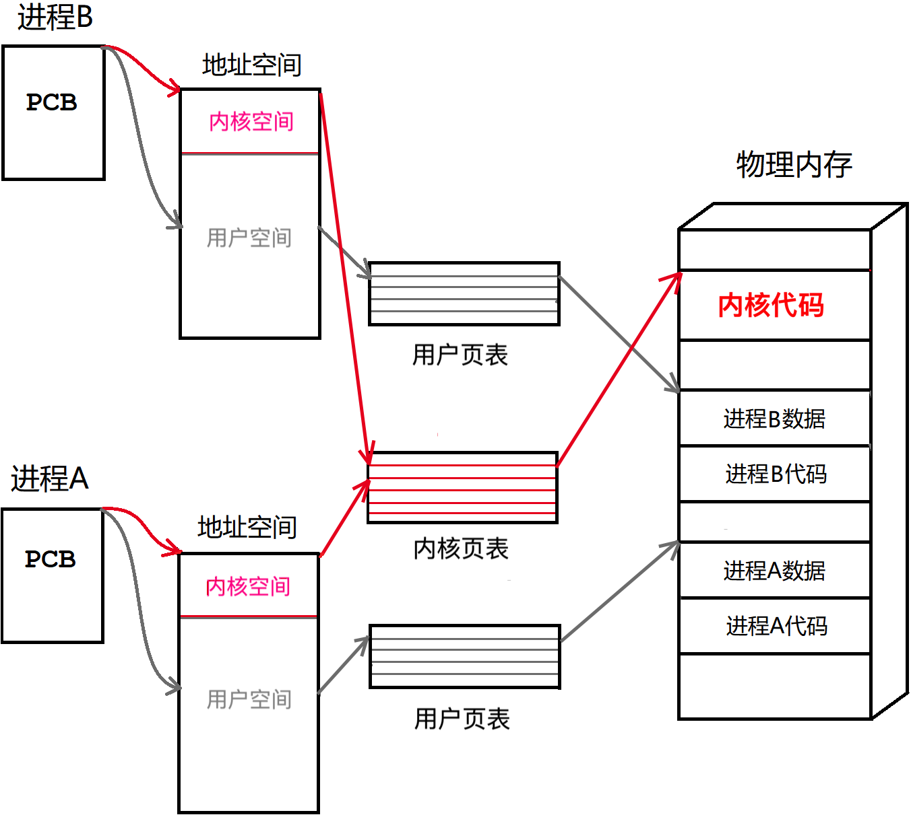

**用户页表每个进程都有有一份，而内核页表只有一份，被所有进程空间共享**。这样既保证了进程独立性，也保证了每个进程都能访问到内核代码。

> CPU中的CR3寄存器中的数值表示代码执行级别。如果执行级别不够，CPU中状态寄存器出错，进而系统发送信号终止进程。

#### 信号处理的过程

**当进程从内核态返回到用户态的时候，会进行信号的检测和处理工作**。以调用系统接口为例：

用户代码中调用系统接口，进程由用户态进入内核态；
系统接口调用完毕后，检测并处理信号；
如果信号处理动作是默认或忽略，直接处理并返回。如果是自定义捕捉，需返回用户态，调用handler方法。
**自定义捕捉方法执行后，不能直接返回用户代码，需返回内核态，调用`sys_sigreturn`返回用户代码**。

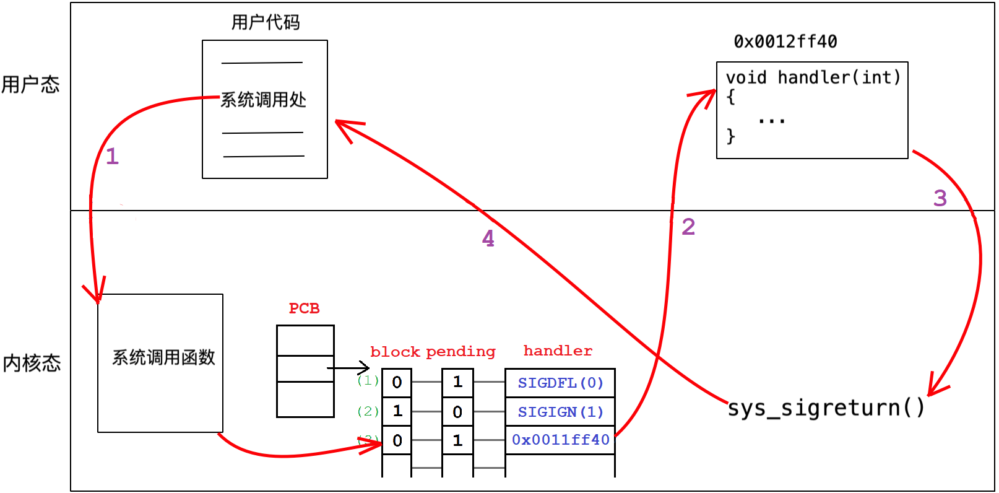

- 执行信号处理自定义方法时，必须返回用户态。如果使用内核态执行用户代码，会对系统安全造成威胁。
- 信号处理完后，无法直接返回用户代码，因为处理信号时用户代码执行到什么位置是不清楚的，需要通过`sys_sigreturn()`返回对应位置。

进程进行信号检测处理的具体流程如上图所示，类似无穷大符号：

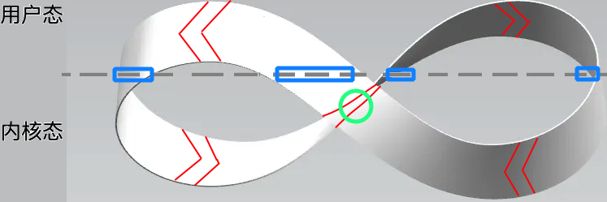

> 每次经过分界线都是一次状态的切换，而交叉点可以看作信号检测并处理的点。

从处理逻辑来看，信号的产生是异步的，信号的处理是同步的。进入内核态后处理信号，处理后返回用户代码，始终是一个执行流。
