# 网络基础

## 1. 网络常识

### 1.1 网络的发展历程

人们在利用计算机工作时，通常都需要多人协作，所以免不了要进行数据交互。没有网络的话数据就需要人来拷贝，这样效率大大降低，所以慢慢的网络就出来了。

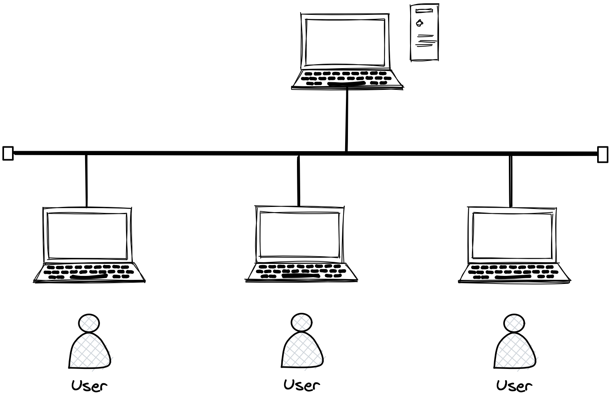

> 上图就是计算机网络的雏形，一台机器用来共享数据，其他人通过网线连接到该机器。

#### 局域网

局域网又叫LAN。几台计算机可以由交换机连接在一起形成局域网，多个局域网之间可以由路由器连接在一起实现跨局域网通信，形成一个更大的局域网。

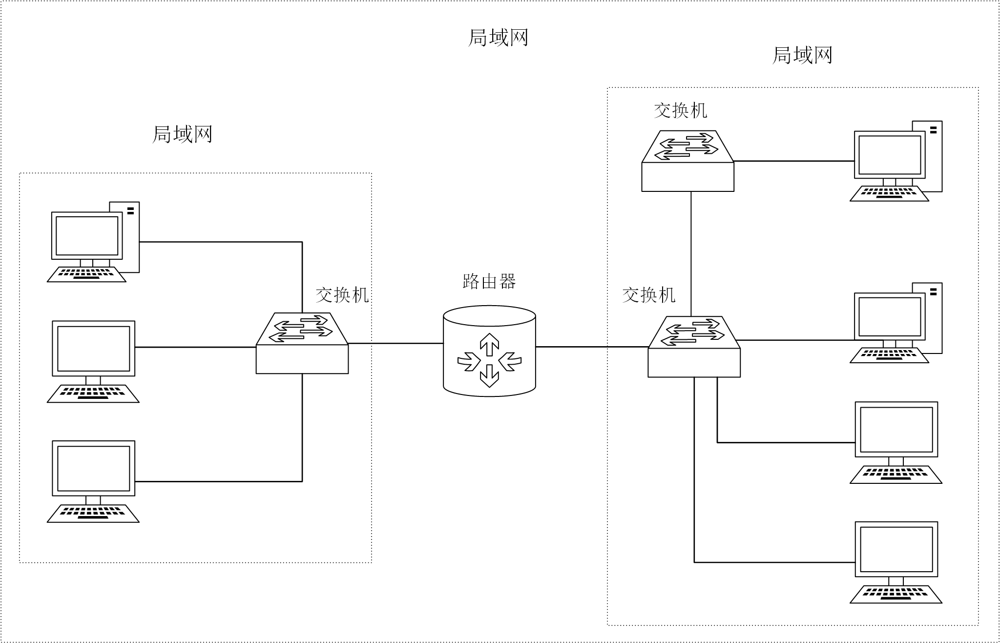

#### 广域网

广域网WLAN：将相隔千里的计算机都连接在一起，就可以称为广域网。广域网和局域网是相对的概念，一个比较大的局域网就可以称为广域网。

两台主机不在同一个网段，它们之间用路由器连接，就可以将整体称为广域网。

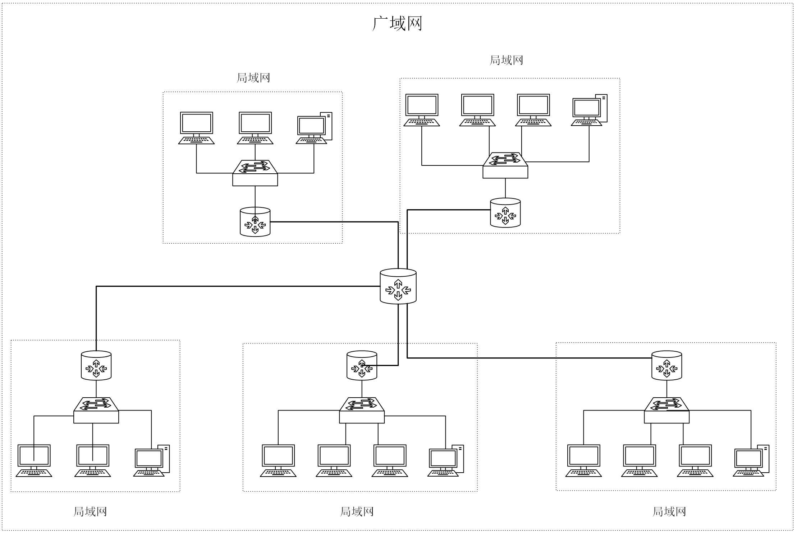

只要在同一个网段内就在一个局域网，广域网就没有这么明确的定义了，甚至会折中出“城域网”的概念。

### 1.2 网络协议的概念

计算机协议本质就是由程序员做出一种约定，是网络通信的双方必须遵守的规则，并根据协议发出各种信息，对方做出对应的响应。


计算机的生产商有很多，操作系统也很多，网络设备也很多，如何让不同的网络设备之间能相互通信呢？那么所有设备都必须遵循同一个标准，这个标准就是网络协议。

#### 理解协议分层

先看一个打电话的例子， 使用同一种语言的互相通信，不管底层的通信设备如何变化，都能转化成同一种语言。

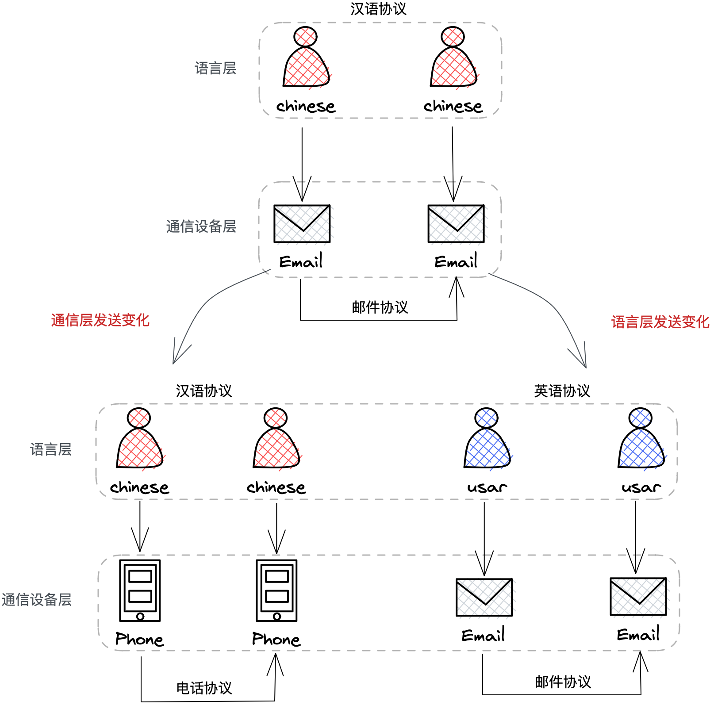

层状结构是一种很优秀的设计，它一定程度上实现了”解耦“，实现了解耦后，任何一层都可以进行替换，即便在某层中出现BUG，也可以将问题聚焦到指定的一层中，不会影响到其他层。

> 那具体协议与协议之间是怎么分层的呢？不同的软件实现的协议分层是有差别的。

从软件分层的角度看，软件就是代码和数据的集合，也就是各种函数和各种对象，在代码上从逻辑角度进行分层，层与层直接存在交互，数据在层之间进行流动，这就是软件分层的策略。

#### OSI七层模型

OSI组织设计了一个七层网络模型，是一个逻辑上定义的规范，实际上并不真实存在。

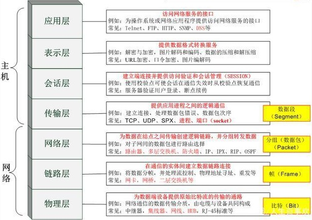

实际中将规范落地的时候，并没有完全遵照该模型，定义出来了真实的TCP/IP五层（或四层）协议。

#### TCP/IP四层模型

TCP/IP模型是在工程实践中真实存在的模型， TCP/IP是纯软件的协议：自底向上分别是**数据链路层、网络层、传输层、应用层**。

物理层我们不作考虑，因此称TCP/IP四层协议。

| 模型层     | 解释                                                         |
| ---------- | ------------------------------------------------------------ |
| 物理层     | 负责光电信号的传递，决定了物理层面的概念。                   |
| 数据链路层 | 负责设备之间的数据帧的传送和识别，如帧同步、冲突检测、数据校验。 |
| 网络层     | 负责地址管理和路由选择，通过路由规划出两台主机之间的数据传输路线。 |
| 传输层     | 负责两台主机之间的数据传输，确保数据的传输。                 |
| 应用层     | 负责应用程序间沟通，如SMTP、FTP、Telnet。                    |

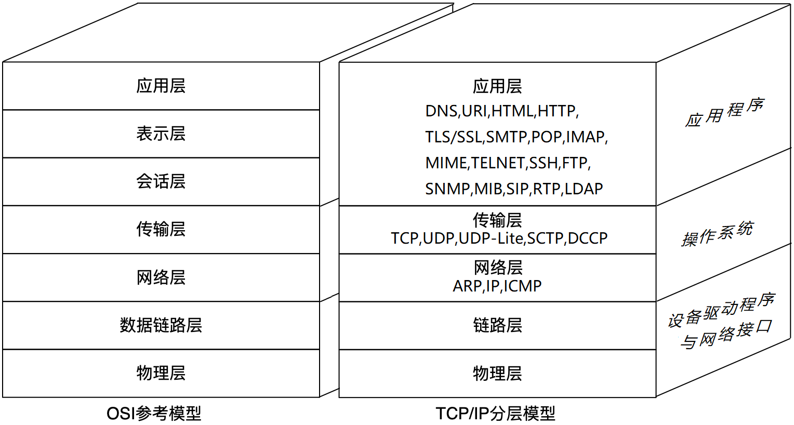

> 网络在哪里呢？

网络协议栈也是分层的，它是贯穿于计算机体系结构的一个软件，尤其是TCP/IP协议栈，是属于操作系统的一部分。

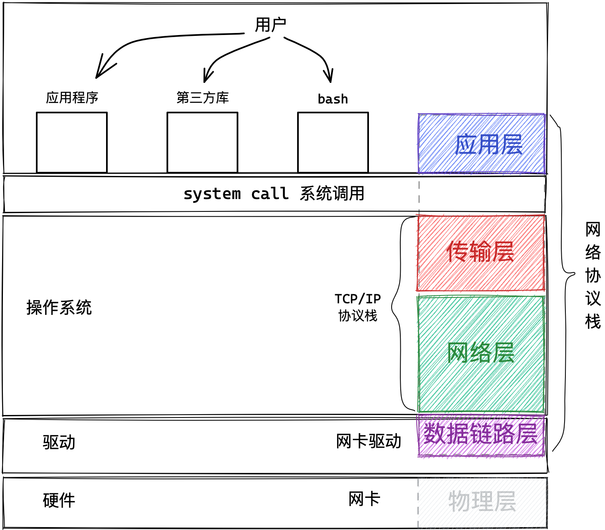

- 应用层是操作系统之上的应用程序，属于用户进程，由用户使用。
- 传输层和网络层是操作系统内核的两层网络协议栈。
- 链路层是操作系统之下的网络设备的驱动程序。
- 物理层是硬件设备，不做考虑。

[网络模型的概念](http://blog.csdn.net/superjunjin/article/details/7841099)

### 1.3 网络传输的流程

我们以TCP/IP协议的通信过程为例认识一下网络传输的基本过程。

#### 3.1 局域网通信

先看局域网中两台主机通信的示意图，左右两边各是一台主机：

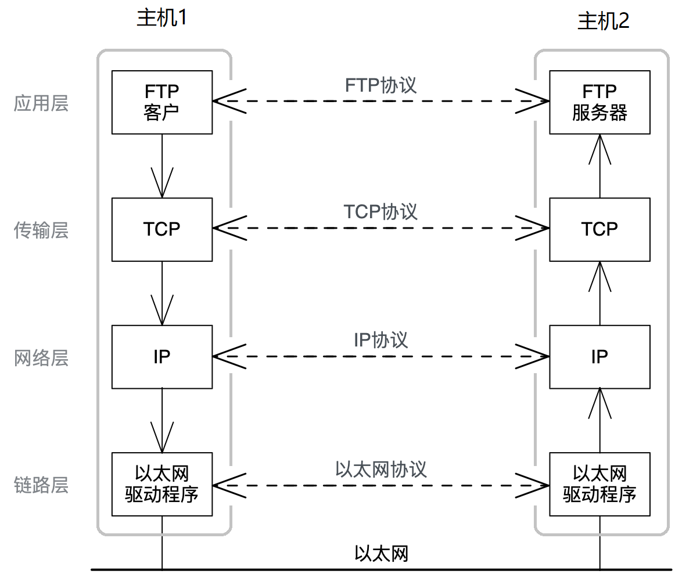

数据从一台主机到另一台主机，不是直接从应用层“飞到”另一台主机的应用层。而是经过如下的步骤：

1. 数据从应用层产生，自顶向下经过传输层、网络层、链路层，最后到达以太网（物理层）
2. 在网线中传输到另一台联网主机上，自底向上经过链路层、网络层、传输层，最后到达应用层。

##### 封装解包分用

- **数据自顶向下到达一个协议栈时，需要添加当前栈的报头，这个过程叫封装**。
- **数据自底向上到达一个协议栈时，需要拿去当前栈的报头，这个过程叫解包**。

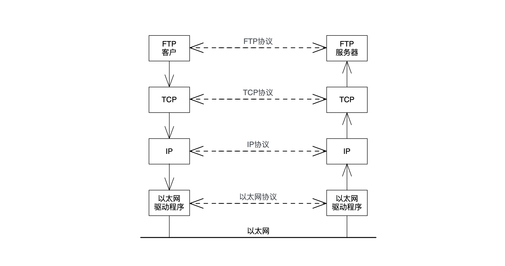

如图所示，**同等的协议栈层会拿到同样的协议报文，这意味着可以忽略底层实现，仿佛是对等的协议栈直接进行通信**。

实际上并不是，这就是封装的好处，不需要考虑底层的实现。

##### 报头的理解

报头类似于快递单上的快递信息。

**报头用来指导当前层进行某种协议**，传输层的报头指导如何传输，网络层的报头指导路径选择，链路层的报头指导如何转发。

**报文由两部分组成报头和有效载荷**，只有当前层的报头被认为是报头，之后的都是有效载荷。

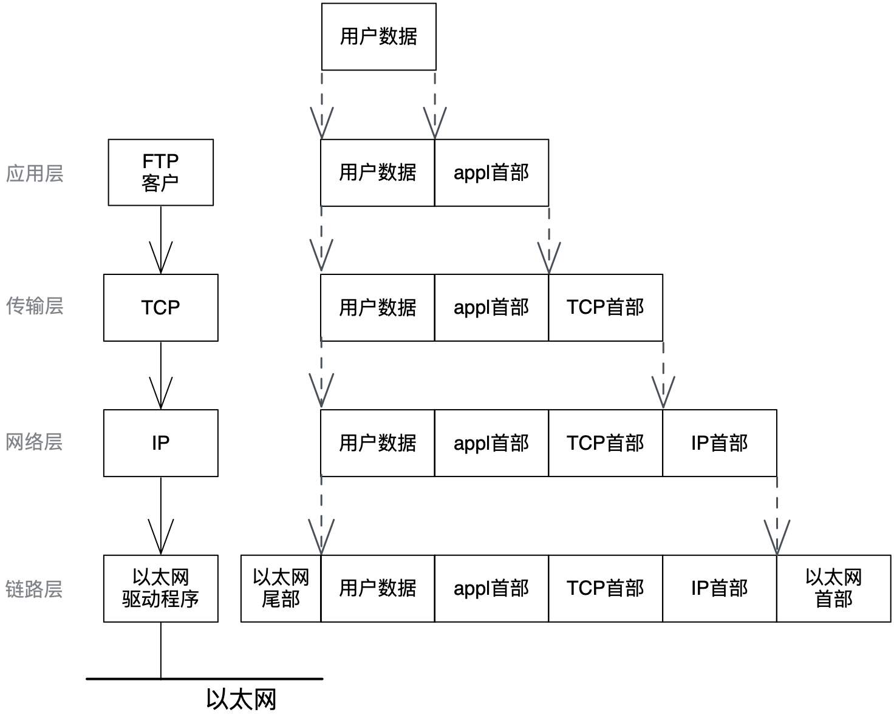

报头也是数据，是一种结构化的数据，在语言角度就是位段：

```c
struct my_hdr {
    unsigned int src:16;
    unsigned int dst:16;
    unsigned int type:8;
    unsigned int len:24;
}
```

> 封装就是将报头变量拷贝到有效载荷的前面，解包就是用报头指针向后加一即可。

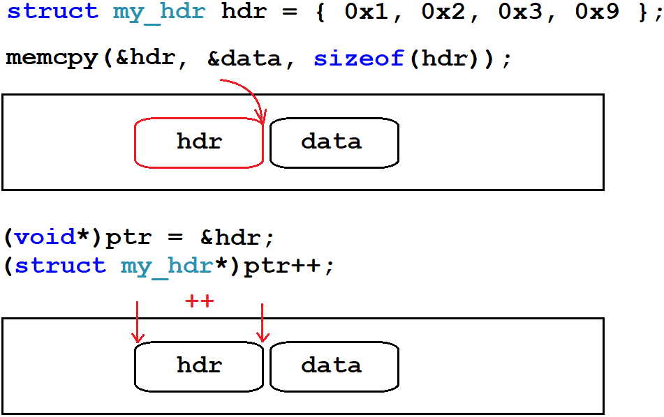

几乎每一层协议的报头字段中，都要包含两种字段：

1. 明确报头和有效载荷的边界，将有效载荷交给上层协议栈的过程叫做解包。
2. 报文的有效载荷选择交给上层哪一种协议叫做分用。

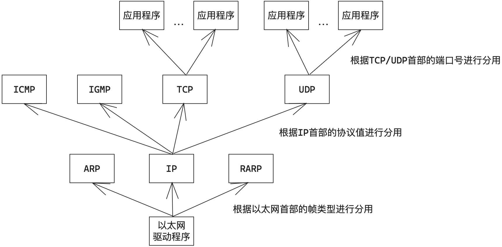

#### 3.2 局域网通信原理

局域网通信类似于上课，在课堂上老师单独和某位同学交流，虽然只是叫该同学一个人，但教室内的所有同学都听到对话，只是默认不予回答。

**局域网内的网络资源被所有设备共享**，一台主机发出信息，局域网内所有的设备都会收到。

只不过报文的报头中包含目标设备的MAC地址，其他设备就会识别到不是发给自己的，就会将报文直接丢弃。

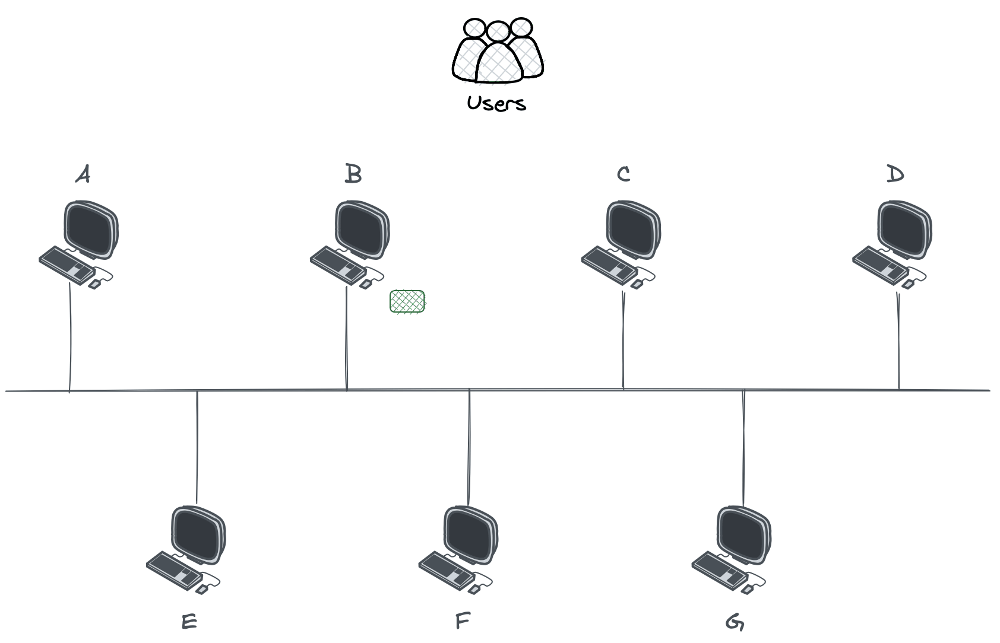

同时发送报文会导致数据碰撞，所以**任何时刻都只能有一台主机在局域网中发送消息**。每台主机都有碰撞检测和碰撞避免的算法，如果发生碰撞，后者会延迟发送。

所有主机任何时刻都可能向局域网内发送数据，**局域网网络就是临界资源，需要互斥访问**，所以只要不停向局域网内发送数据，就是攻击该局域网。

#### 3.3 广域网通信

两台主机跨网络，进行广域网通信的过程示意图如下：

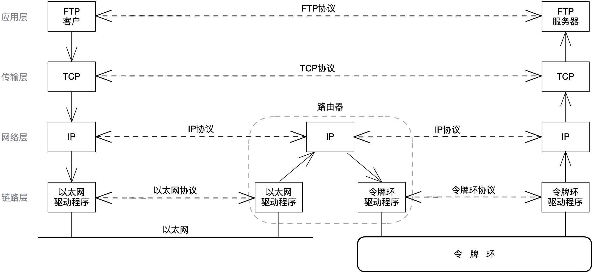

两台主机跨网络，进行广域网通信是需要路由器的，左边是以太网，右边是令牌环，甚至是无线LAN。

> 虽然两边主机不在同一个局域网，但两边主机和路由器算在一个局域网，本质还是局域网通信。

##### IP地址和MAC地址

在网络中存在两种地址，一个是IP地址，一个是MAC地址。

- IP地址用来标识广域网中的不同主机。
- MAC地址用来标识局域网内的不同主机。

> 长度为48位 6个字节。一般用16进制数字加冒号的形式来表示（例如：08:00:27:03:fb:19），具有唯一性。

网络传输类似于运输快递，对于快递点而言，需要知道两套地址信息：

| 地址        | 含义                       | 特点               |
| ----------- | -------------------------- | ------------------ |
| 一对IP地址  | 最初从哪来，最终到哪去     | 起点终点，几乎不变 |
| 一对MAC地址 | 上一站从哪来，下一站到哪去 | 持续变化           |

> IP地址对MAC地址的变化具有指导意义。

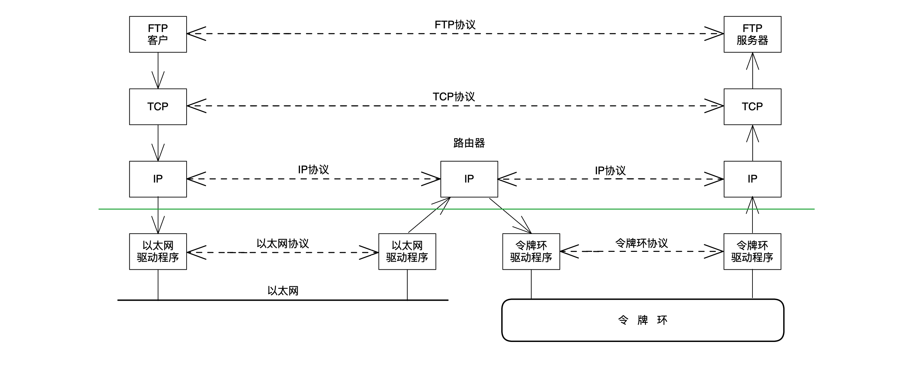

IP层报头会封装目的IP地址，就是目标主机的IP，链路层报头会封装目的MAC地址，该MAC地址只能是路由器的MAC地址。

如图所示，在数据链路层，经路由器一直在进行解包和封装。源主机发的和路由器及目的主机收的报文都是一样的，故IP层及向上部分，可以忽略底层的差异。

## 2. 应用层

### 2.1 协议

#### 序列化的概念

> 结构化的数据不能直接进行传输，一般要转化成字符串再放到网络传输。

将结构内容转化成字符串，称为序列化。将字符串转化为结构数据，称为反序列化。

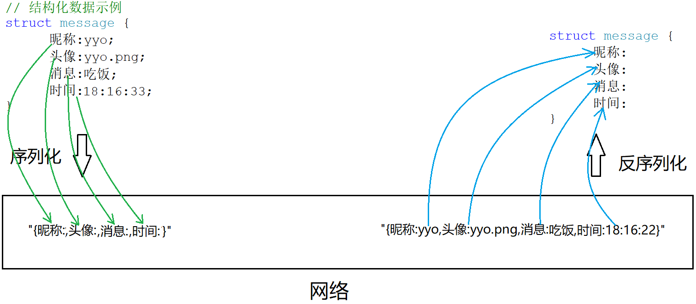

序列化本质就是将数据的使用和数据的传输进行解耦。**方便应用层进行通信和使用数据**。

#### jsoncpp

```shell
## 安装jsoncpp
$ yum  install jsoncpp-devel
$ apt  install libjsoncpp-dev
$ brew install jsoncpp
```

```cpp
std::string serialize()
{
    Json::Value root;
    root["res"] = _res;
    root["st"] = _st;
    return Json::FastWriter().write(root);
}

void deserialize(const std::string& rsp)
{
    Json::Value root;
    Json::Reader reader;
    reader.parse(rsp, root);
    _res = root["res"].asInt();
    _st = root["st"].asInt();
}
```

### 2.2 HTTP

HTTP协议是一种应用层协议，HTTP内部自行实现了网络通信、序列化和反序列化、协议细节。

#### 1.0 URL

URL就是”网址“，网络上可请求的图片、文字、视频、音频等内容都称为“资源”，网址就是一种定位网络资源的方式。

**通过IP+端口+路径的方式，就可以唯一地定位一个网络资源**。

> IP被域名代替，应用层协议所采用的端口号是确定的。由浏览器和DNS服务自动添加转换，用户感知不到。

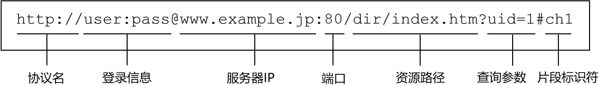

##### URL编解码

```txt
/ : . ? & ## @ + <space> ...
```

这些符号在URL中已具有特殊意义，所以它们作为普通字符时就必须转义。将字符的ASCII码值的16进制数字，再前面加上`%`，编码成`%XY`的格式。

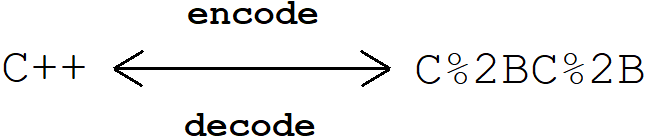

[URL转码工具](https://tool.chinaz.com/Tools/urlencode.aspx)

#### HTTP的格式

##### HTTP请求格式

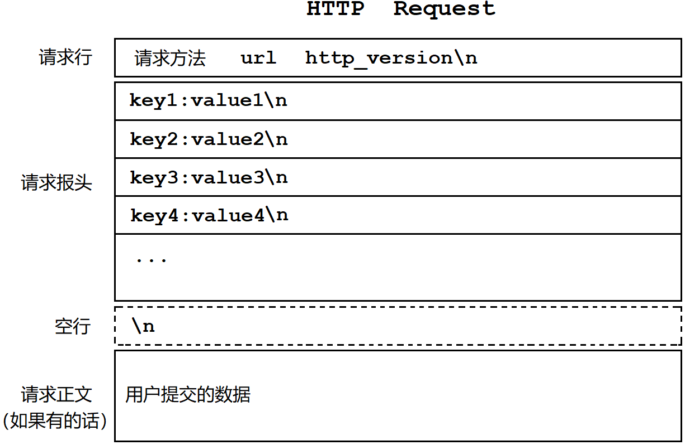

| 组成     | 内容                                                         |
| -------- | ------------------------------------------------------------ |
| 请求行   | `GET`,`POST`等是请求方法，`url`是请求资源的路径，`http_version`是协议版本，以空格隔开 |
| 请求报头 | 一般有多组请求属性，每组属性都是键值对，以`\n`分隔           |
| 空行     | 用来隔开请求报头和请求正文                                   |
| 请求正文 | 空行之后都是正文，允许为空。如果正文存在，报头中有`Content-Length`属性来表示正文长度 |

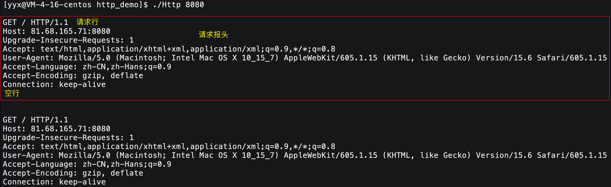

> 如何读取一个完整的报文呢？

1. 读到空行的时候，说明获取所有报头内容。
2. 解析报头`Content-Length`属性，确定正文大小，准确读取正文。

##### HTTP响应格式

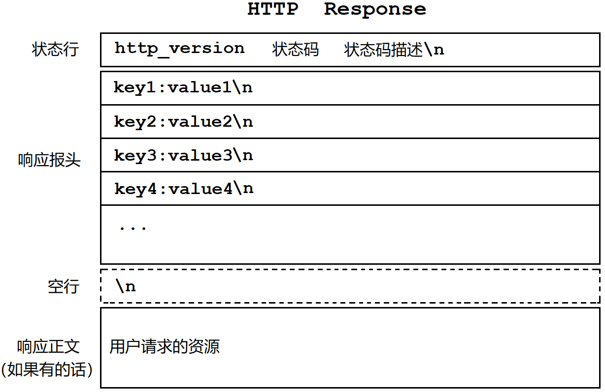

| 组成     | 内容                                                         |
| -------- | ------------------------------------------------------------ |
| 状态行   | HTTP版本，状态码，状态码描述，以空格分隔                     |
| 响应报头 | 一般有多组响应属性，每组属性都是键值对，以`\n`分隔           |
| 空行     | 用来隔开响应报头和响应正文                                   |
| 响应正文 | 空行之后都是正文，允许为空。如果正文存在，报头中会有属性`Content-Length`来表示长度 |

#### HTTP的方法

| 方法    | 说明                   | 支持协议版本 |
| ------- | ---------------------- | ------------ |
| GET     | 获取资源               | 1.0      |
| POST    | 传输实体资源           | 1.0      |
| PUT     | 传输文件               | 1.0      |
| HEAD    | 获得报文首部           | 1.0      |
| DELETE  | 删除文件               | 1.0      |
| OPTIONS | 询问支持的方法         |          |
| TRACE   | 追踪路径               |          |
| CONNECT | 要求用隧道协议连接代理 |          |
| LINK    | 建立和资源之间的联系   | 1.0          |
| UNLINE  | 断开连接关系           | 1.0          |

> 一般为安全起见，都不开放除GET POST以外的其他方法。

##### GET/POST

| 名称 | 场景                   | 区别                       | 隐私性                          |
| ---- | ---------------------- | -------------------------- | ------------------------------- |
| GET  | 获取资源，也可提交参数 | 通过URL提交，存在大小限制  | 直接回显在URL栏中               |
| POST | 常用于提交参数         | 通过正文提交，长度不受限制 | 不回显在URL栏中，私密但不是安全 |

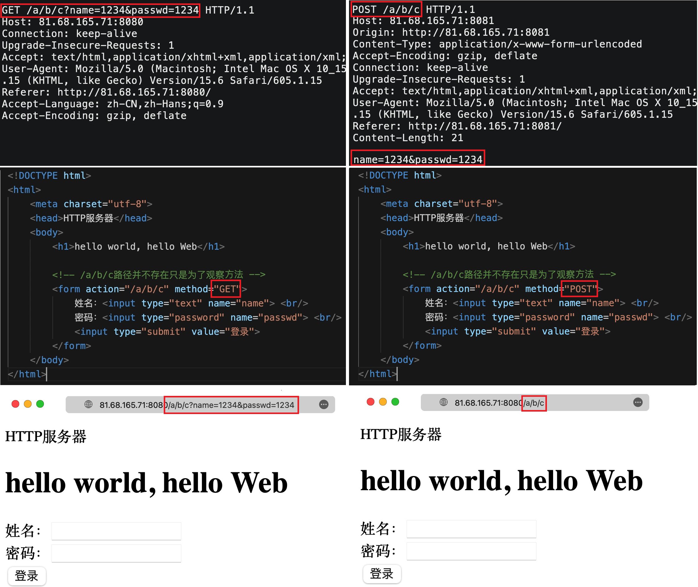

#### HTTP的状态码

> HTTP协议状态码标准混乱不一。

| 状态码 | 类别          | 翻译       | 解释                   | 常见状态码                        |
| ------ | ------------- | ---------- | ---------------------- | --------------------------------- |
| 1XX    | Informational | 信息性     | 接收的请求正在处理     | 不常见                            |
| 2XX    | Success       | 成功       | 请求正常处理完毕       | 200 (OK)                          |
| 3XX    | Redirection   | 重定向     | 需要附加操作以完成请求 | 302 (Redirect)                    |
| 4XX    | Client Error  | 客户端错误 | 服务器无法处理请求     | 403 (Forbidden) / 404 (Not Found) |
| 5XX    | Server Error  | 服务端错误 | 服务器处理请求出错     | 504 (Bad Gateway)                 |

- 404属于客户端错误，是客户端访问不存在的资源。浏览器不会处理404响应，需要服务器返回错误页面。
- 服务端程序出现错误崩溃等问题，就是服务器错误，状态码应设置为504。
- 3XX的状态码代表重定向，意思是自动跳转到其他页面。使用属性`Location`表示新地址。
  - 301是永久重定向，一般是网站域名更换，本质更改了浏览器本地标签。
  - 302/307是临时重定向，登录付款的自动返回，每次访问都会对新地址发起请求。

#### HTTP的报头

| 报头属性       | 解释                                                         |
| -------------- | ------------------------------------------------------------ |
| Content-Type   | 正文的数据类型 [content-type对照表](https://blog.csdn.net/weixin_39527281/article/details/115322144) |
| Content-Length | 正文的长度                                                   |
| Connection     | 请求的是否保持长连接                                         |
| Host           | 客户端告知服务器，所请求的服务程序的IP和端口                 |
| User-Agent     | 声明用户的操作系统和浏览器版本                               |
| referer        | 当前页面是从哪个页面跳转过来的                               |
| location       | 搭配3XX状态码使用，告诉客户端接下来要去哪里访问              |
| Cookie         | 用于在客户端存储少量信息，通常用于实现会话（session）的功能  |

#### cookie和session

HTTP只负责网络资源传输，**HTTP本身是一种无状态的协议**，不会记录历史请求的相关信息。类似记录登录信息这样方便的上网体验是由Cookie提供的，也就是说，Cookie提供“会话保持”的功能。

**cookie本质是一个保存用户的私密信息的文件**。

1. 用户登录认证成功后，
2. 浏览器根据响应属性中的`Set-Cookie`，将数据保存在本地cookie中，
3. 后续对该网站的请求都会添加属性`Cookie`，所以有效期内就可以自动登录了。

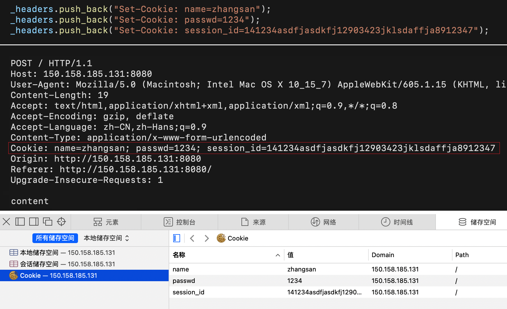

Cookie不仅有自定义字段，还有如下属性：

| 属性     | 解释                                                         |
| -------- | ------------------------------------------------------------ |
| domain   | 可以访问该Cookie的域名。                                     |
| path     | 设置某个目录下的程序或者单个程序可以使用该Cookie。           |
| httponly | js脚本将无法读取到cookie信息，这样能有效的防止XSS攻击，窃取cookie内容。 |
| secure   | 是否仅用安全协议传输该Cookie。                               |
| expires  | 指定cookie的生命周期。默认cookie只在会话期间存在。max-age用秒来设置cookie的生存期。 |

> 一旦Cookie盗取，就可以盗取用户信息。单纯使用Cookie是有安全隐患的，需要搭配session使用。

**session将用户私密信息保存在服务端**。

1. 客户端登录认证成功后，服务端会形成session文件，保存用户的私密信息。
2. 服务器构建响应时，添加属性`Set-Cookie: session_id=123 `，称为当前用户的会话ID。
3. 浏览器本地形成cookie文件，保存该session_id，每次请求都携带该session_id。

本地Cookie中只存储session_id，session_id具有唯一性，服务端根据session_id在服务端查找用户信息。

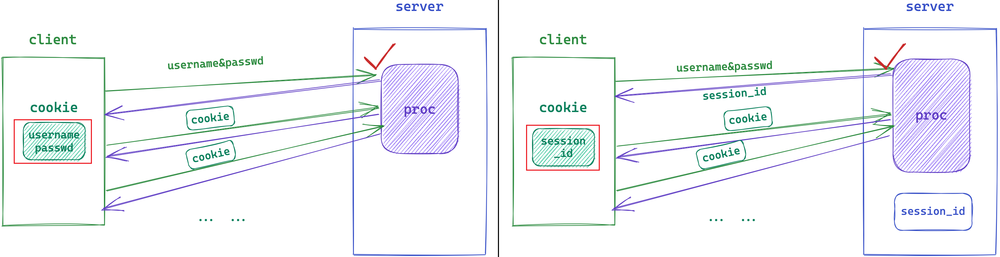

虽然无法解决第三方冒充用户身份，但**cookie和session可以避免用户信息在网络上传输**。

#### 简单HTTP服务器

按照HTTP协议的请求与响应内容，实现最简单的HTTP服务器。

```c
struct http_request
{
    std::string _method;
    std::string _url;
    std::string _version;

    std::vector<std::string> _headers;
    std::string _content;

    std::string _path;

    http_request(const std::string& reqstr) { deserialize(reqstr); }

    void deserialize(const std::string reqstr)
    {
        std::stringstream reqss(reqstr);
        std::string line;
        getline(reqss, line);
        std::stringstream(line) >> _method >> _url >> _version;
        _path += WEB_ROOT;
        if (_url.back() == '/') _path += "index.html";
        else _path += _url;
        while (getline(reqss, line))
            _headers.push_back(line);
        getline(reqss, _content);
    }
};
struct http_response
{
    http_response(const http_request& req) : _version("HTTP/1.0"), _path(req._path)
    {
        struct stat st;
        if (stat(_path.c_str(), &st) < 0) {
            _stcode = 404;
            _stdesc = "Not Found";
            _path = WEB_ROOT + "404.html";
        }
        else {
            _stcode = 200;
            _stdesc = "OK";
        }
        std::ifstream ifs(_path, std::ios_base::binary);
        std::string line;
        while (getline(ifs, line))
            _content += line;
        _headers.push_back("Content-Type: " + get_type());
        _headers.push_back("Content-Length: " + std::to_string(_content.size()));
    }

    std::string _version;
    int _stcode;
    std::string _stdesc;
    std::vector<std::string> _headers;
    std::string _path;
    std::string _content;

    std::string serialize()
    {
        std::stringstream ss;
        ss << _version << ' ' << _stcode << ' ' << _stdesc << SEP;
        for (auto& e : _headers)
            ss << e << SEP;
        ss << SEP;
        ss << _content;
        return ss.str();
    }
};
std::string callback(const std::string& msg)
{
    return http_response(http_request(msg)).serialize();
}
int main(int argc, char* argv[])
{
    uint16_t port = std::stoi(argv[1]);
    std::unique_ptr<http_server> tsvr(new http_server(callback, port));
    tsvr->init();
    tsvr->start();
}
```

### 2.3 HTTPS

#### 加密方式

HTTPS相比HTTP多了一个数据的加密解密层，即TLS/SSL。

TLS/SSL属于应用层，数据只有在应用层应用层被加密解密，传输层网络层链路层没有加密概念。

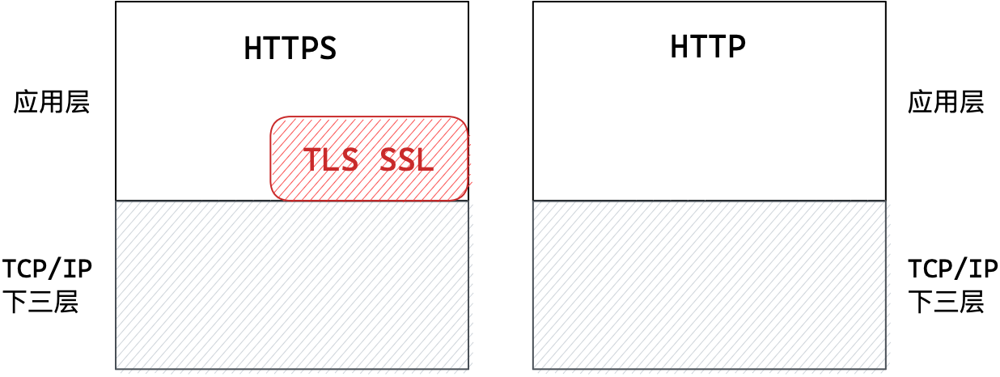

> 加密解密有如下几种方式。

##### 对称加密

对称加密，也称单密钥加密，用同一个密钥进行加密和解密。

使用对称加密，就必须先让通信双方获得密钥，就必须将密钥明文传输给另一方，那密钥就可被窃取，所以对称加密是不可取的。

##### 非对称加密

非对称加密，就是使用两个密钥。所有人公开的公钥和只有一方具有的私钥。用公钥加密须用私钥解密，用私钥加密须用公钥解密。

- 公钥加密的数据只有私钥能解密，所以从公钥一方到私钥一方的通信是安全的。
- 私钥加密的数据所有人都能解密，所以从私钥一方到公钥一方的通信是不安全的。

**非对称加密只能保证单向安全的通信，反向通信无法保证安全**。

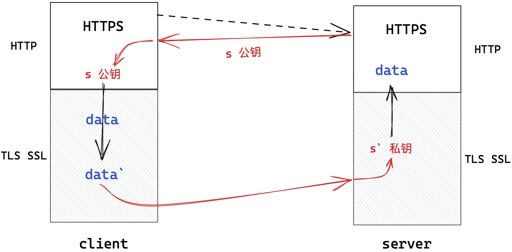

##### 全对称加密

1. 客户端和服务器分别创建自己的公私密钥，通信前先交换双方的公钥。
2. 双方都采用非对称加密，双方都使用对端的公钥加密数据发给对端，对端用自己的私钥解密。

> 虽然可以保证双向通信安全，但时间成本太高效率太低，同样不可取。

##### 混合加密

> 实际是将两种加密方式混合使用的。

密钥本质也是数据，用非对称加密将密钥发给对端，这样双方就获得一个对称加密的密钥。之后就可以进行对称加密通信了。

###### 密钥协商

客户端收到服务端发来到公钥，并用该公钥生成一个密钥，使用非对称加密加密该密钥并发给服务器。服务器用私钥解密获得该密钥。

###### 对称加密通信

自此通信双方都有一个对称加密的密钥，以上称为密钥协商。之后双方可以使用该密钥进行对称加密通信。

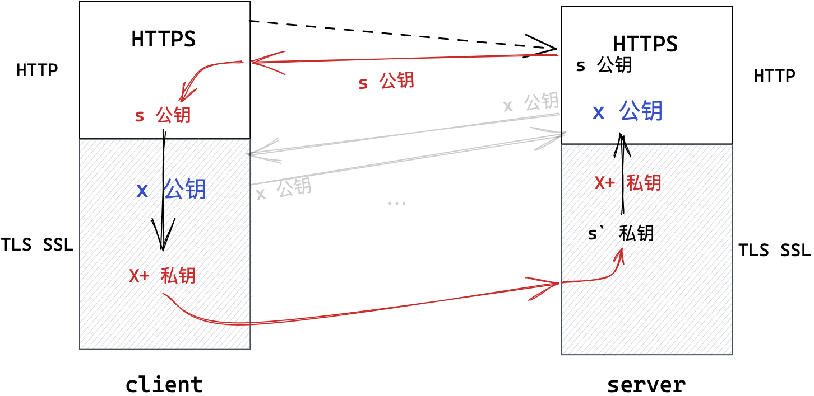

##### 中间人风险

> 这样做真的就万无一失了吗？其实不然，在上述密钥协商阶段是存在中间人私自更换密钥的风险的。

 在密钥协商阶段，**服务端发送的明文公钥`S`，被中间人截取替换成了中间人的公钥`M`，再发给客户端**。
2. 客户端生成对称密钥`X`并使用中间人公钥`M`加密，然后将加密结果`M+(X)`发送给服务器。
3. **中间人截取到加密结果，用私钥`M'`解密，得到密钥`X`，再用服务端的公钥`S`加密将其加密并发往服务器**。
4. 服务器用`S'`对其解密得到密钥`X`。

自此通信双方的对称加密密钥`X`被中间人获取，数据加密形同虚设且毫不知情。

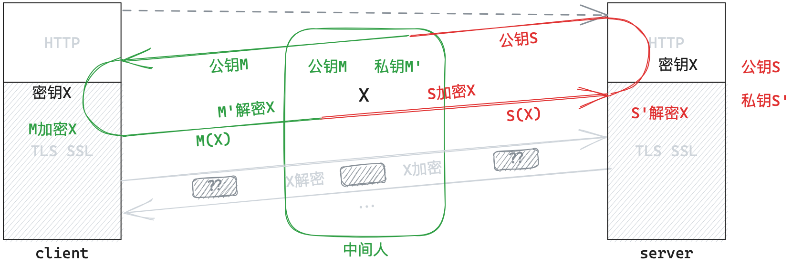

**上述问题的关键在于：客户端无法判断服务器发来的明文公钥是否被篡改**。因此，我们必须赋予客户端辨别篡改的能力。

#### 数据防篡改

> 如何防止如何识别数据的内容是否被篡改呢？

##### 预备知识

###### 数字摘要/数字指纹

对文本内容利用单向哈希算法，生成固定长度的、具有唯一性的、不可逆的字符序列，该字符序列就称为数字指纹/数字摘要。

数字摘要不是严格的加密，因为无法反推出文本内容，所以只能进行数据对比。

> 对传输来的文本重新生成哈希结果，对比两者哈希结果是否相同，就能看出文本是否被篡改。

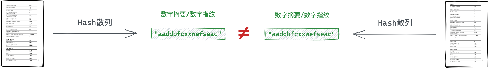

###### 数字签名

对数字指纹/数字摘要进行加密，加密结果就称为数字签名。

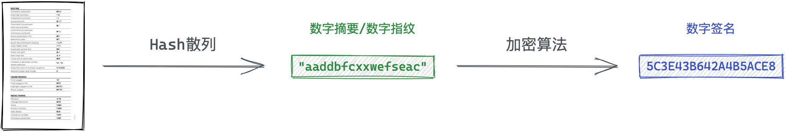

##### CA证书机构

由此出现一种权威机构CA证书机构。

- 服务商将自身信息提交给CA机构，CA机构审核通过后形成证书颁发给服务端。
- 服务端将证书发给客户端，客户端验证证书后，使用证书内公钥进行密钥协商。

> 本质就是在加密通信前，服务端不再传输公钥，而是传输证书。可以保证公钥不被篡改。

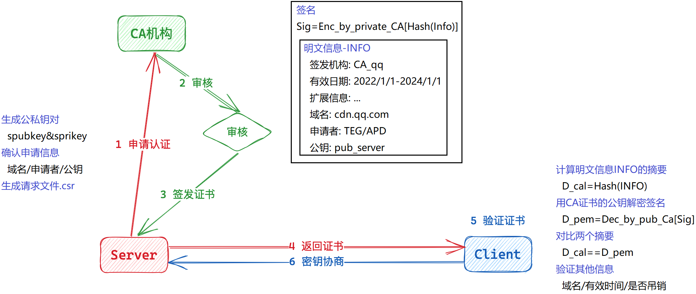

###### 如何生成证书？

1. CA机构将服务商的信息生成数字指纹，并用CA机构私钥生成数字签名。
2. 再将服务商的信息和签名放到一起，称为证书。

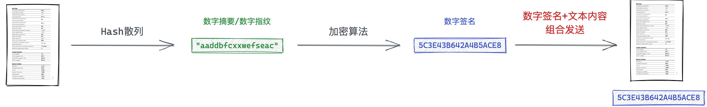

###### 客户端如何验证证书？

1. 客户端收到证书之后，对其中服务商信息重新生成数字指纹，
2. 再将证书中的数字签名用CA公钥解密出数字指纹。
3. 对比两者数字指纹，如果相等说明证书没有被篡改。

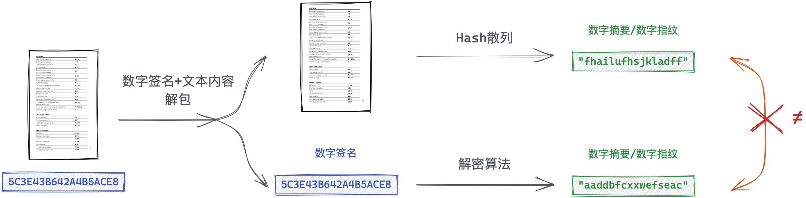

###### 是否存在中间人风险？

此时中间人仍能获取并解密证书，但**中间人没有CA机构私钥`A'`因此无法生成数字签名，也就无法篡改证书**。

客户端收到证书后进行校验，证书中服务商信息和数字签名不管哪一个被修改都可以识别。

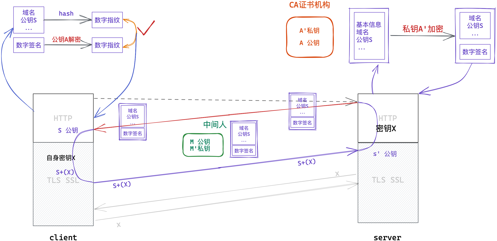

#### 最终加密方案

> 最终方案就是混合加密+CA证书。

客户端请求服务器后，服务器不再明文返回公钥，而是返回CA机构颁发的证书。可以防止公钥被篡改，就不存在中间人风险了。

1. 客户端向服务器请求连接，
2. 服务器返回网站证书，客户端验证证书无误，并提取公钥加密对称密钥，发往服务端。
3. 服务端利用自身私钥解密，得到对称密钥，
4. 自此双方开始对称加密通信。

## 3. 传输层TCP/UDP

### 3.1 预备知识

#### 端口号的理解

在TCP/IP协议中，用如下所示的五元组来标识一个通信程序：

| 组成             | 解释                     |
| ---------------- | ------------------------ |
| 源IP，源端口     | 标识数据来源的主机的进程 |
| 目的IP，目的端口 | 标识数据目标的主机的进程 |
| 协议号           | 使用的协议的编号         |

端口号标识主机上的网络进程。一些知名的服务绑定的端口一般是不变的，如下图所示：

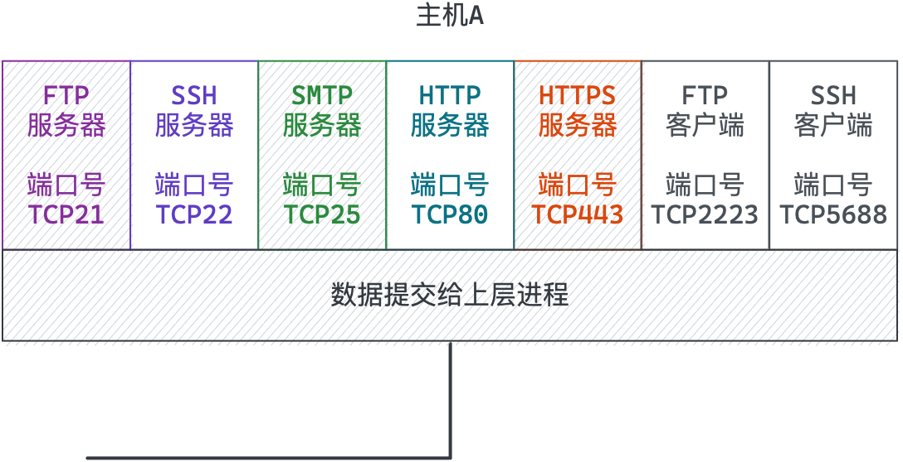

虽然端口号和这些网络协议没有绑定关系，但这些端口号和服务的联系是早已被习惯和接受的，擅自更改可能导致服务无法访问。

> 一般0-1023给应用层协议使用。

#### netstat

```shell 
netstat -nltp ##  查看网络进程的状态
```

| 选项          | 解释                                     |
| ------------- | ---------------------------------------- |
| `n[number]`   | 将主机名:程序名显示成IP地址:端口号的形式 |
| `l[isten]`    | 只显示正在监听状态的套接字               |
| `t[cp]/u[dp]` | 显示TCP或UDP协议的进程                   |
| `p[rocess]`   | 显示程序的PID和进程名                    |

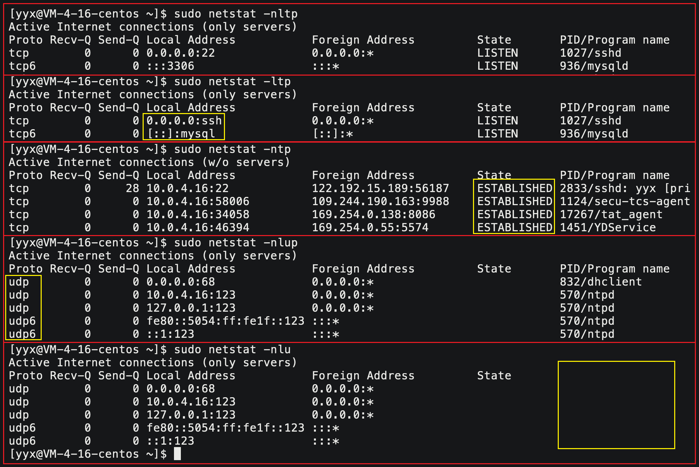

### 3.2 UDP

#### UDP协议格式

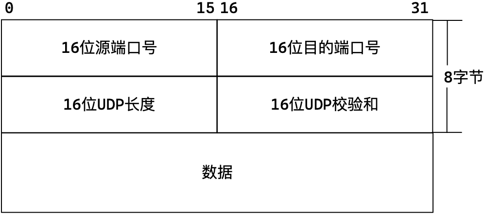

```c
struct udp_heander { // 示例
    uint32_t src_port: 16;
    uint32_t dst_port: 16;
    uint32_t total: 16;
    uint32_t check: 16;
}
```

封装解包只需从头添加或截取一个8字节报头即可，剩下的就是有效载荷。

分用是根据目的端口决定交付给哪个进程。

#### UDP的特点

| 特点       | 解释                                                         |
| ---------- | ------------------------------------------------------------ |
| 无连接     | 根据IP和端口直接进行传输，不需要建立连接。                   |
| 不可靠     | 没用确认、重传机制，UDP不会返给上层数据传输的情况。          |
| 面向数据报 | 不能控制报文的个数和数据量，接收只能按报文的大小一次性将报文全部收取上来。 |

> 发送一次性发送了100个字节，接收也必须一次性接受100个字节。

UDP用16个比特位表示报文长度，故整个UDP报文最大只有65536字节即64KB。

UDP协议几乎没有策略，有数据就发送，没有策略就是UDP的策略。

#### UDP缓冲区

- UDP不保证可靠性，所以**没有发送缓冲区**，sendto直接将数据交给内核。
- UDP**有接收缓冲区**，可作短暂停留，但该缓冲区不保证报文的顺序。如果满了就无法接收新数据。
- UDP发送接收不冲突，所以**支持全双工**。

数据到内核后，具体什么时候发，一次发多少，发送失败怎么办，完全由内核传输层控制。这就是传输层的任务，提供传输数据的策略。

#### 基于UDP的应用层协议

| 协议  | 名称                         |
| ----- | ---------------------------- |
| NFS   | 网络文件系统                 |
| TFTP  | 简单文件传输协议             |
| DHCP  | 动态主机配置协议             |
| BOOTP | 启动协议（用于无盘设备启动） |
| DNS   | 域名解析协议                 |

### 3.3 TCP

传输层是”做决策“的，比如超时重传，确认应答，流量控制，拥塞控制都是TCP协议的传输策略。

#### 2.0 TCP协议格式

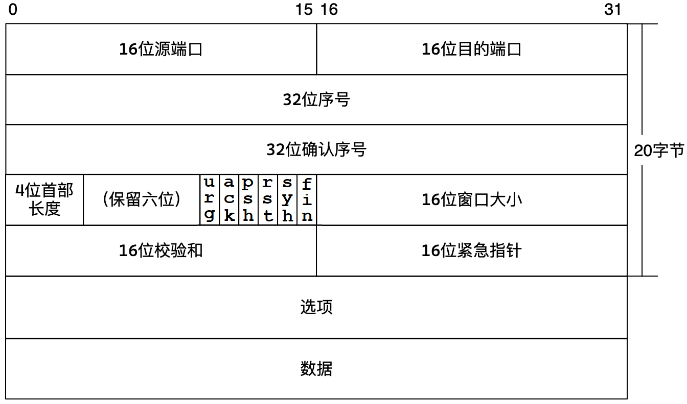

##### 4位首部长度

TCP报头包含选项，不带选项的标准报头长度是20个字节。

4位首部长度表示报头的长度，最大值为15，但单位是4字节。也就是说TCP报头最大长度为60字节。

> TCP协议是如何做到封装解包分用？
>
> 提取报头看4位首部长度就是报头的具体长度，数据放缓冲区里由应用层自行读取。

##### 32位序号和确认序号

报文有了编号就支持并发多个报文。32位序号和确认序号就是报文的编号，用来对报文排序和去重。

> 报文中既有序号又有确认序号，因为一个报文既可以携带数据又可以作为应答。

##### 16位窗口大小

16位窗口大小表示接收缓冲区的剩余容量。本质是告知对方自身的数据接受能力。

对方可以调整发送策略，防止数据丢弃，这是TCP的流量控制策略。

##### 6个标志位

标志位表示报文的类型，共有6个标志位，设置报文的类型只需将对应比特位置1。

| 标志位 | 含义              | 解释                               |
| ------ | ----------------- | ---------------------------------- |
| `ACK`  | `acknowledge`确认 | 表示确认报文，一定携带确认序号     |
| `SYN`  | `synchronize`同步 | 表示请求连接，底层会进行三次握手   |
| `RST`  | `reset`重置       | 表明重置连接，底层会重新建立连接   |
| `PSH`  | `push`提交        | 表示催促接收端尽快清空接收缓冲区   |
| `URG`  | `urgent`紧急      | 表示16位紧急指针有效，该功能不常见 |
| `FIN`  | `finish`结束      | 表示结束连接，底层会进行四次挥手   |

##### 16位紧急指针

紧急指针本质是紧急数据距有效载荷起始位置的偏移量，前提是紧急指针标志位有效。紧急数据只有一个字节。

紧急数据不会在缓冲区排队，可以通过特定接口直接读取。

#### 确认应答

##### 保证收到

> TCP的可靠性的核心机制为序号的确认应答机制。

双方地位对等，一方发送数据，一方必须应答。

只有收到确认，才能确定上一条消息被对方接收了。这就是确认应答，确认应答的意义在于保证上一条消息一定被收到。

但总会有最新的报文不会被应答，所以TCP并不是100%可靠的。

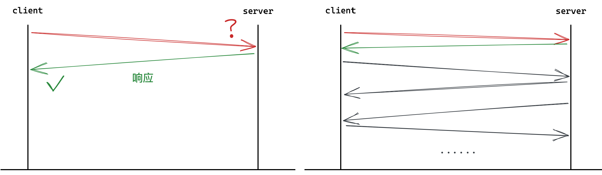

##### 保证顺序

> 可靠性除了保证收到，也要保证按序到达。

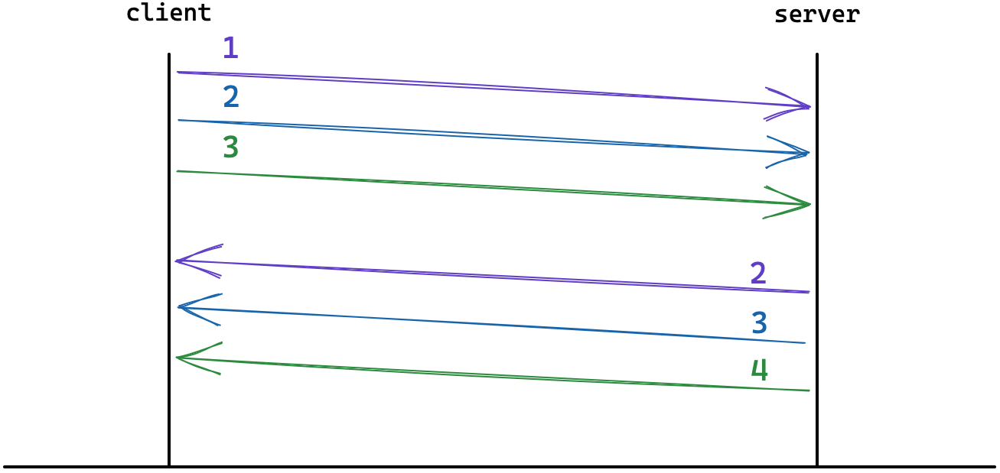

32位确认序号表示对指定序号的报文作确认。

- **确认序号是被确认报文的序号值+1**，表示亟待收到的报文的编号。
- **确认序号是对历史所有报文的应答**，允许历史确认报文丢失。

> 报文中既有序号又有确认序号，因为一个报文既可以携带数据又可以作为应答。这是捎带应答机制。

###### 底层细节

缓冲区可看成字符数组，数据进来是按字节存放的。

报文的序号是字节流的末尾下标，应答的确认序号正好是下次数据的起始位置，下次可直接从该位置提取数据。

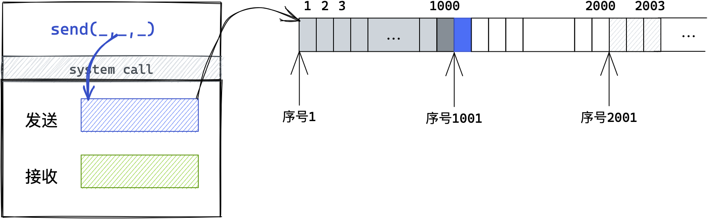

#### 延迟应答

收到报文后，稍微等待上层取走数据，此时再应答接收窗口就会更大。

延迟应答的策略：

数量限制：每隔N个包应答一次，时间限制：超过最大延迟时间就应答一次。

#### 捎带应答

一般不会单纯的应答，都是在向对方发送数据的同时对上一条报文作应答。

#### 超时重传

报文发出后，在一定时间内如果没有收到应答报文，就认为对端没有收到数据，只能再次发送。

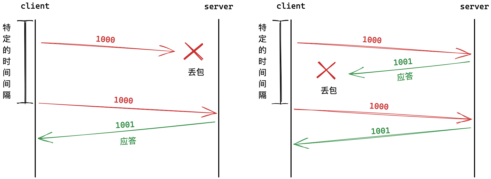

不管是数据丢了还是应答丢了，发送端都认为数据报文丢失，都会触发超时重传。

重传报文的序号不变，接收端发现序号重复可直接丢弃。

> 特定时间是多长呢？

超时重传时间是浮动的，一般是500ms的倍数。

第一次超过500ms就重传，第二次超过2\*500ms重传，第三次超过4\*500ms重传。超过一定次数，认定对端异常强制关闭连接。

#### 快速重传

并发报文时，如果某个报文丢失，那么之后都只会对丢失的前一个报文作应答。

如果发送端收到三次以上重复确认的报文，就认为该序号报文已丢失会立即补发，这就是快重传。对重传报文的确认序号就是下一次发送的位置。

> 两次重复可能是乱序到达，三次最有可能是丢失。

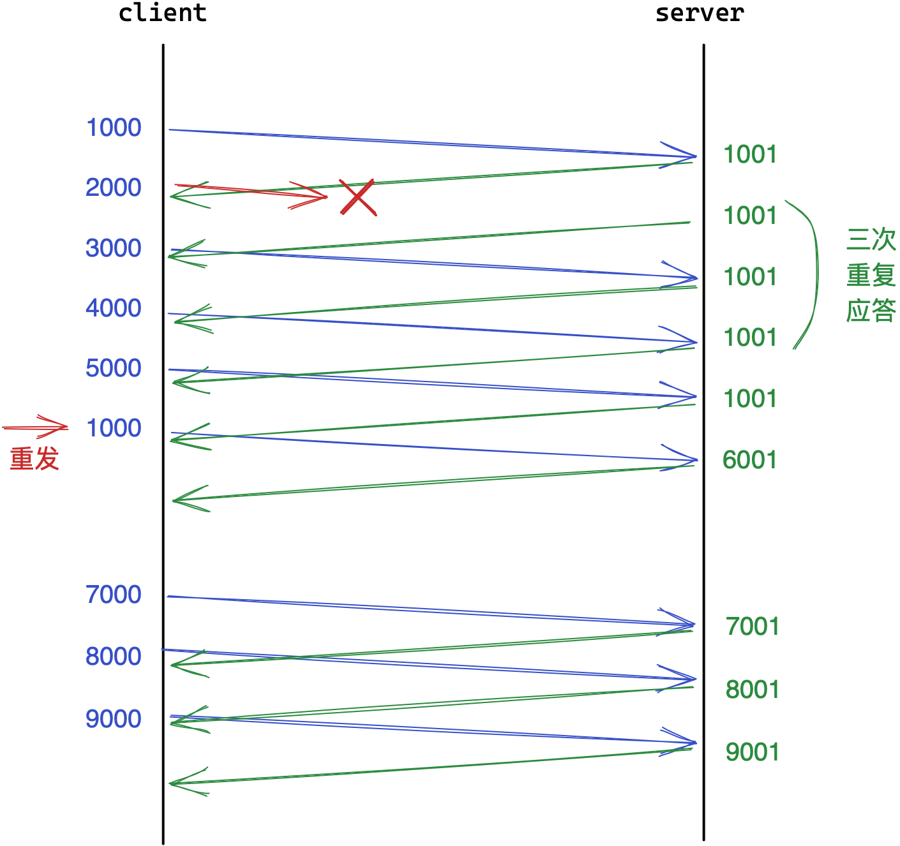

> 快重传和超时重传有什么区别？

快重传和超时重传的触发条件不同，超时重传是超出特定时间后收到应答，快重传是收到三次以上重复确认序号的应答。

快重传可提高重传效率，超时重传保证丢失报文一定重传，二者并不矛盾。

> 如果没有触发快重传，则一定会触发超时重传。

#### 连接管理

##### 三次握手

TCP协议是面向连接的，建立连接就是进行三次握手。三次握手实际上就是三次报文交换。

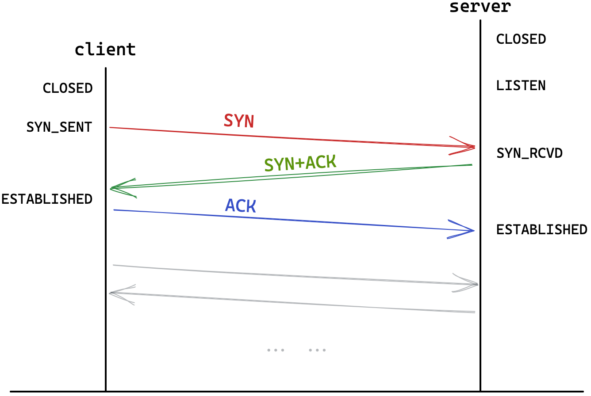

1. 客户端发送SYN报文，表示请求连接。
2. 服务端收到后，返回SYN和ACK报文，表示请求连接并应答。
3. 客户端收到后，发送ACK报文作应答。

最后一次握手没有应答，所以三次握手可能会失败。握手未完成如果收到客户端的数据，服务器会发送RST报文，以重置连接。

###### 三次握手的意义

- 三次握手以最小成本可以验证双向通信的网络状态。
- 三次握手可以避免双方连接资源消耗不对等，容易造成SYN洪水攻击。
- 最后一次无保证的握手由客户端发起，异常连接也由客户端承受，减轻服务器压力。

##### 四次挥手

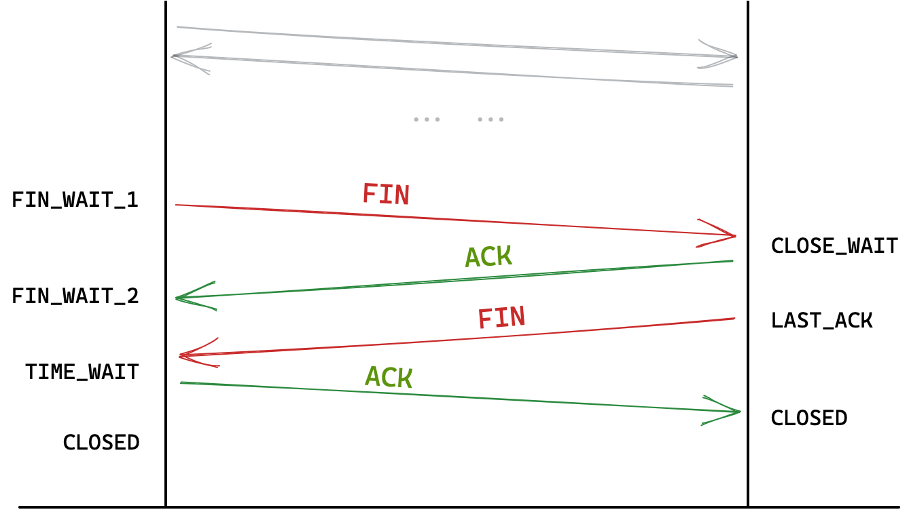

> 握手一定是浏览器主动发起，而通信双方都有可能随时发起挥手。

1. A向B发送FIN报文，B回应ACK报文。
2. B再向A发送FIN报文，然后A再给B应答。

四次挥手是关闭连接达成共识的最小次数。

###### TIME_WAIT

主动退出的一方会在TIME_WAIT状态停留一段时间，为保证残余报文全部接收，保证对端收到第四次挥手ACK。此时资源并未释放，端口也被占用。

在创建套接字代码处使用接口`setsockopt`，可以解决上述情况。

```c
int opt = 1;
setsockopt(sock, SOL_SOCKET, SO_REUSEADDR, &opt, sizeof(opt));
```

> 服务无法立即重启，可能会造成损失。

###### CLOSE_WAIT

作为被动断开连接的一方，不调用close释放连接就会一直保持CLOSE_WAIT。所以一定要防止文件描述符泄漏，底层维护连接很占用系统资源。

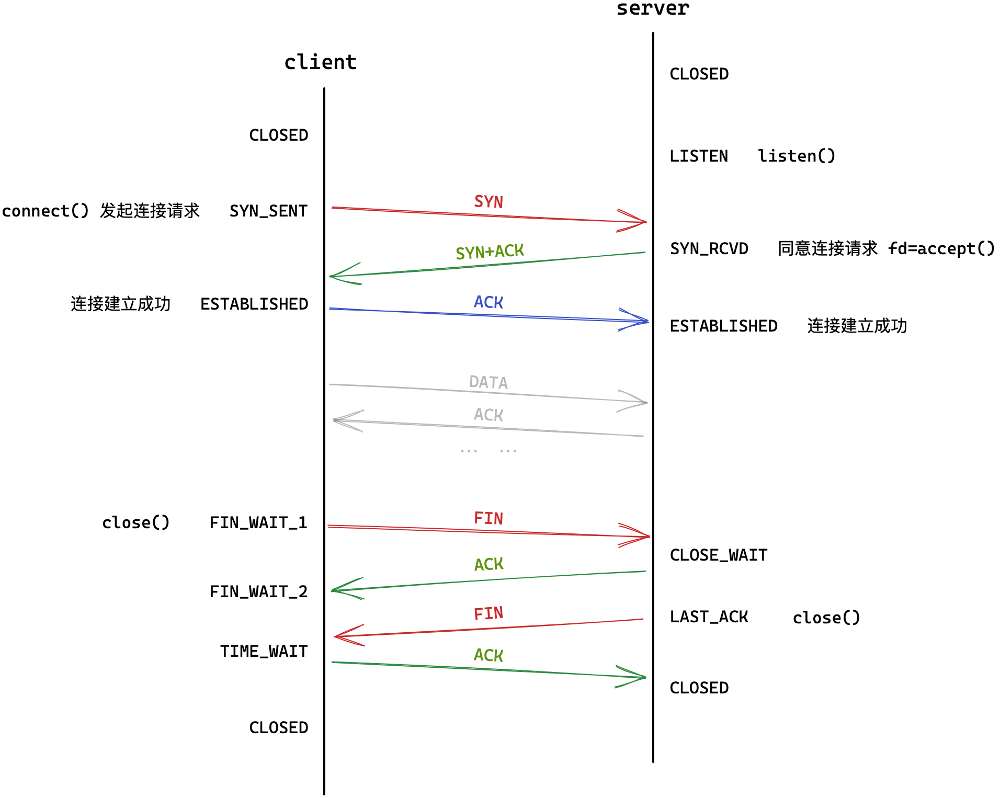

#### 滑动窗口

> 报文不是串行发送的，而是一次一批。重叠等待时间以提高效率。

滑动窗口可理解为发送缓冲区上的一个窗口。窗口从头向后运动，窗口上的数据就是即将被发送的数据。

- 窗口大小表示无需等待应答而可继续发送数据的最大值。
- 窗口的大小不是固定的，根据对方的窗口大小动态调整。

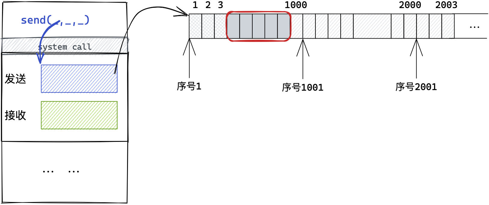

##### 实现细节

当我们收到确认报文时，窗口左下标移动至确认序号的位置，右下标向后偏移窗口大小长度，可保证发送量在对端接受范围内。

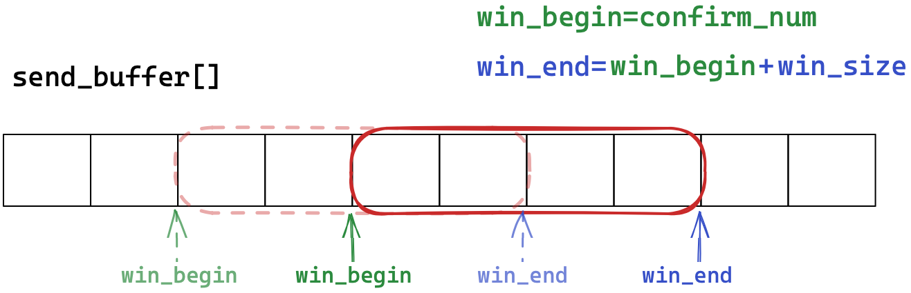

#### 流量控制

> 接收端处理数据的能力有大有小，因此要动态调整发送数据的速度。

接收端将缓冲区余量放入报头中的16位窗口大小，发送端可据此调整发送速度，这就是TCP的流量控制。

三次握手时就会携带窗口大小，双方会据此设置各自滑动窗口初始值。

如果接收缓冲区满了，会通知对方窗口为0。

如果窗口恢复，会通知对方窗口更新。发送端也可发送窗口探测包，获取当前窗口大小。

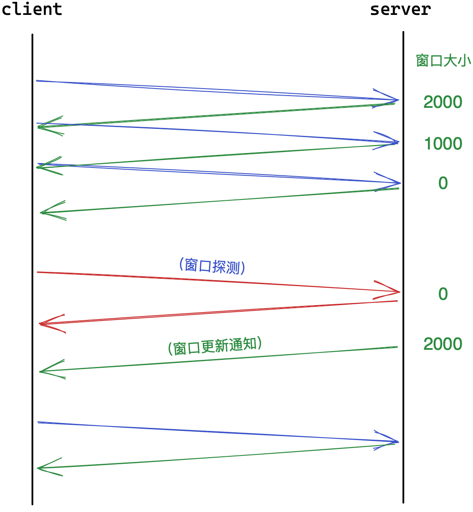

#### 拥塞控制

> 拥塞控制着眼于整个网络。大面积丢包可能是网络出现问题，此时所有主机重传大量数据涌入网络会导致瘫痪。

网络状态只能通过试探得知，我们通过慢启动机制不停的试探网络当前的拥塞程度。

引入拥塞窗口描述拥塞程度，表示最大多少量会造成拥塞。发送方会取接收窗口和拥塞窗口中较小值，作为滑动窗口的大小。

- 拥塞窗口初始大小为1，每次发送报文，窗口大小会增长。
- 起初呈指数级增长，到达慢启动阈值时，转变为线性增长。
- 一旦发生超时重传，窗口恢复至初始值1，调整慢启动阈值为上次最大拥塞窗口的一半。

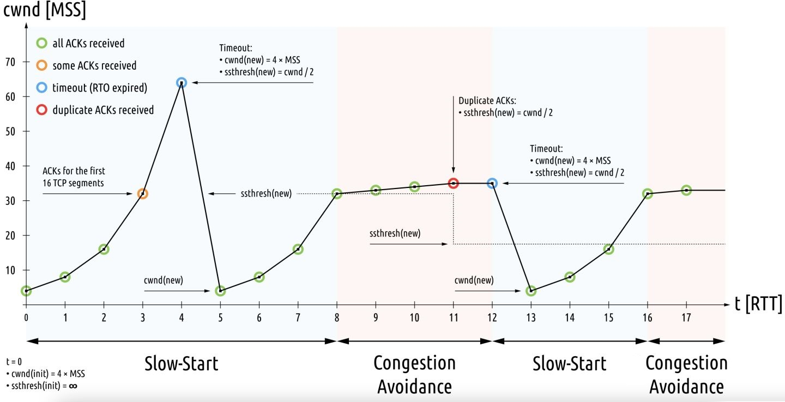

#### 半连接全连接

##### 全半连接的概念

- 建立好但没有被上层提取的连接叫做全连接，维护在内核中的全连接队列。
- 没有完全建立好的连接，也就是握手没有完成的连接，叫做半连接，保存在内核中的半连接队列。

##### 全半连接的性质

全连接队列的长度就是backlog+1。

如果全连接队列已满，新的连接就不会握手成功，位于半连接队列里，时间过长就会消失。

accept后连接就会从全连接队列里删去，给新连接腾出位置。

> 如果设定backlog值为1，那么只能有两个链接是正常的ESTABLISHED，除此之外都是SYN_RECV状态。


> 半连接队列由内核控制，可有效预防SYN攻击。

##### 全连接队列的意义

- 全连接队列本质就是等待区，可以的话全连接能立即变成正常连接，最大化利用系统的连接资源，不会出现空闲浪费的情况。
- 全连接队列过长，维护成本变高，等待时间变长，用户体验不好。

## 4. 网络层

### 4.1 IP协议

对于网络传输来说，TCP负责决策，IP负责执行。 IP协议是以较大概率将数据跨网络传输到对端主机上，TCP在此基础上负责可靠性和效率。

#### IP协议段格式


| 字段         | 解释                                                         |
| ------------ | ------------------------------------------------------------ |
| 4位版本      | 表示IP协议的版本，IPv4就填4，不兼容IPv6                      |
| 4位首部长度  | 以4字节为单位，表示报头长度                                  |
| 8位服务类型  | 3位优先权，4位TOS，1位保留。支持设置最小延迟，最大吞吐量，最高可靠性，最小成本 |
| 16位总长度   | 表示整个报文的长度                                           |
| 8位生存时间  | 每经过一个节点生存时间就减1，如果生存时间减到0报文就被废弃，用来清理无效报文 |
| 8位协议      | 表示有效载荷使用的上层协议                                   |
| 32位源目的IP | IP协议需要IP地址，对应TCP协议需要端口号                      |

#### 网段划分

##### 网络号和主机号

IP地址分为两个部分，网络号和主机号：

- 网络号：保证相互连接的两个网段具有不同的标识。
- 主机号：同一网段内的主机，具有不同的主机号。

根据网络号查找目标网络，进入目标网络后，再查找并对比IP中的主机号，就确定了目标主机。


##### 分类划分法

最开始时提出一种划分网络号和主机号的方案，把所有IP地址分为五类，如下图所示：


这种划分的方法叫分类划分法，分类划分法的过于粗暴局限，导致很多浪费和紧缺。

##### 子网掩码划分法

CIDR划分法在分类划分法的基础上，引入子网掩码来划分网络号和主机号。

子网掩码本质是左半部分全1右半部分全0的32位整数。IP地址和子网掩码进行按位与就是网络号，后面就是主机号。

#### 公网IP和私有IP

局域网IP地址只用于局域网内的通信，不能直接连到公网上。规定用于局域网的私有IP地址：

| IP                          | 地址数             |
| --------------------------- | ------------------ |
| 10.\*/8                     | 共16,777,216个地址 |
| 172.16.\*/12 ~ 172.31.\*/12 | 共1,048,576个地址  |
| 192.168.\*/16               | 共65,536个地址     |


公网IP在整个网络都不能重复，但私网IP在不同网段内是可以重复的。

#### 报文分片

链路层限制有效载荷的大小，一般为1500字节。如果IP报文过大，就必须分成多个数据包交给链路层。分片和组装都是IP协议的任务。

分片会提高报文丢失的风险，所以一般不分片。传输层控制会报文的大小，这样IP层就不需要分片。

一旦数据包丢失，所有数据包都会丢弃，反映到传输层就是触发重传。

| 字段       | 解释                                                         |
| ---------- | ------------------------------------------------------------ |
| 16位标识   | 报文的标识各不相同，分片报文的标识是一致的，可以根据标识查找分片的报文 |
| 13位片偏移 | 片偏移表示分片报文的有效载荷距原始有效载荷起始位置的偏移量   |
| 3位标志    | 1位保留，1位禁止分片，1位更多分片：为1表示中间报文，为0表示为结尾报文 |

> 如果报文丢失了，如何检验呢？

1. 如果没有查找到片偏移为0的报文，就说明首位报文丢失。
2. 如果当前报文片偏移加上报文长度不等于下一个报文的片偏移，则说明中间报文丢失。
3. 如果3位标志中最后一位为0，表示当前报文就是结尾报文。

> 一个3420字节的IP报文，可以分成3个分别是1480、1480、440，再给加上报头即可。

$$
\begin{aligned}
&=3420 \\
&=20+3400 \\
&=20+(1480+1480+440) \\
&\Rightarrow(20+1480)+(20+1480)+(20+440)
\end{aligned}
$$


> 接收端如何判断收到的报文是普通报文还是分片报文？

1. 如果片偏移不为零，一定是分片报文，
2. 如果片偏移为0，但3位标志最后一位为1，则一定是分片报文；
3. 除此以外，都是普通报文。

#### 路由

路由器能横跨两个网络，所以要配两个IP，LAN口连接内网，WAN口连接外网。

IP数据包的传输时，路由器将目的IP与路由表进行对比：

1. 如果对应得上就说明目标主机就在自身子网内，就直接发送到目标主机
2. 如果访问的不是子网内的主机，就将源IP替换成路由器的WAN口IP，也就是将报文转发到外网。


## 5. 数据链路层

IP路径选择的能力是建立在链路层节点之间跳转的功能的基础上。凡是能够进行跳转的节点，一定在同一个网段内是直接相连的节点。

### 5.1 以太网

> 以太网是一种技术标准。包含链路层和物理层的内容。以太网是应用最广泛的局域网技术，还有令牌环、无线LAN等。

局域网通信的方式就是一个节点将数据放到网络里，所有节点都能拿到并对比MAC地址，是给自己的就接收，不是就抛弃。

#### 以太网帧格式


| 字段     | 解释                                                         |
| -------- | ------------------------------------------------------------ |
| 目的地址 | 目的MAC地址                                                  |
| 源地址   | 源MAC地址                                                    |
| 类型     | 有效载荷的类型，0800表示IP数据报，0806表示ARP请求应答，0835表示RARP请求应答 |
| PAD      | 以太网帧数据不能少于46不能大于1500字节，否则就要添加PAD就是随机值 |

> 如何进行封装和解包呢？

1. 类型决定报文的有效载荷要交付给上层那一个协议；
2. 具体类型报文的报头都是定长的，按其规则封装和解包即可。

#### MAC地址

MAC地址用来标识链路层中节点，长度为6字节48位。一般表示形式：08:00:27:03:fb:19。MAC地址随网卡绑定，一般不支持修改。

#### MTU

MTU是MAC帧的大小上限，以太网帧中的数据长度规定最小46字节，最大1500字节。ARP数据包的长度不够46字节,要在后面补填充PAD。

不同的数据链路层标准的MTU是不同的，如果一个数据包从以太网路由到拨号链路上，数据包长度大于拨号链路的MTU了，则需要对数据包进行分片。

### 5.2 ARP协议

#### ARP协议的作用

路由器想将外界数据包转发进局域网，需要先对数据报封装MAC帧。就需要通过目的IP获得目的MAC地址，该工作由ARP协议负责。


ARP协议工作在链路层，是局域网协议，专门处理ARP请求和响应，处理完成后自动在交给MAC帧协议发送给目的主机。

#### ARP数据报格式


加粗部分是ARP协议报文格式，将ARP协议报文部分替换成有效载荷就是MAC帧协议报文格式。

| 字段                        | 解释                                                         |
| --------------------------- | ------------------------------------------------------------ |
| 硬件类型                    | 1表示以太网                                                  |
| 协议类型                    | 0x0800为IP地址                                               |
| 硬件地址长度                | 6为以太网MAC地址，不变                                       |
| 协议地址长度                | 4为IP协议地址，不变                                          |
| op                          | 1表示ARP请求，2表示ARP应答                                   |
| 发送端MAC地址，发送端IP地址 | 请求方或者响应方填写自身的MAC地址和IP地址，接收方提取以待后用 |
| 接收端MAC地址，接收端IP地址 | 请求方填写接收方的IP地址，接收方MAC地址全F表示未知           |

#### 3.3 ARP的流程

> 如果路由器知道IP对应的MAC地址，那就可以直接发送，如果不知道，就要使用ARP协议获取目的MAC。

 路由器广播包含ARP请求的数据帧，所有主机都会向上交付给ARP协议。
2. ARP协议获取ARP请求中的目的IP地址，不是本机直接丢弃，是本机做出应答。
3. 目的主机返回ARP应答发给路由器，其中包含自身的MAC地址。


一般主机会缓存子网内其他主机IP和MAC地址。由于IP是动态分配的，缓存的生命周期一般不长。可以使用`arp -a`查看：


## 6. 其他协议

### 6.1 DNS协议

#### 4.1 域名

主域名是用来识别主机名称和主机所属的组织机构的一种分层结构的名称。

| 性质     | 内容  | 解释                                                         |
| -------- | ----- | ------------------------------------------------------------ |
| 一级域名 | com   | 表示这是一个企业域名，同级的还有"net"网络提供商）,"org"(非盈利组织）等 |
| 二级域名 | baidu | 域名                                                         |
| 前缀     | www   | 只是一种习惯用法，来表示主机支持的协议                       |

#### 4.2 输入URL后的事情

这是一个经典的面试题，能牵扯到所有网络知识点，没有固定答案越细越好，可以参考：https://blog.csdn.net/wuhenliushui/article/details/20038819/

 有知识框架，有条理
2. 组织语言，清晰表达
3. 掌握细节程度

针对这个问题我想分成如下三步去谈：
第一层：在应用层，将一个URL请求一直到浏览器返回，把这个过程给你详细的表述一下。
第二层：应用层谈完之后，再谈谈细节问题，因为细节太多了，所以我只能以关键字的方式给你呈现。
第三层：当把前面的两个大步骤讲完，然后还会再补充一些细节，那么这个问题呢一个大思路。

第一、我们谈第一个就是应用层，首先输入URL之后点击回车，先域名解析拿到IP地址，紧接着浏览器会发起HTTP请求，服务器会收到HTTP请求，然后读取请求，进而进行分析HTTP请求。分析完之后，根据分析字段得到要求的资源，上传的参数等等。然后构建HTTP响应，如响应行、属性、正文等等，再发送给浏览器，浏览器拿到HTTP响应要对HTTP响应做分析，更重要的是提取相应的正文比如网页，然后浏览器会解释网页的这些标签语言，同步的也要对浏览器界面进行相关的渲染，把我们所需要的网页内容给展示出来。如此就完成一整个HTTP请求和响应，这是我回答问的第一阶段。那么上面实际上是一个整体的过程，也是用户最能感知到的，也是一般程序员最清楚的。

第二、那么下面要谈的就是细节，当我们实际发起一个HTTP的时候，底层其实使用的是TCP套接字编程。底层实际上将我们的数据以字节流的方式拷贝并发送过去。然后TCP协议经过自己的流量控制、拥塞控制，确认应当、链接管理、超时重传、延迟应答等各种机制来保证自己的数据报被对方可靠高效地获取。

第三、TCP将数据交给IP层，存在各种路径选择、子网划分、查找路由表等过程，IP数据报分片组装等特殊情况，到链路层会有局域网转发、ARP协议等相关细节。当然过程中也会存在各种异常情况。

### 6.2 ICMP协议

#### 5.1 ICMP的功能

ICMP本质就相当于IP层的“调试接口”，可从应用层直接访问IP层的功能，测试IP层代码的准确性。主要功能包括：

 确认IP包是否成功到达目标主机。
2. 返回IP包被丢弃的原因。

> ICMP也是基于IP协议工作的，但是它并不是传输层的功能，因此仍然把它归为网络层。
>
> ICMP只能搭配IPv4使用，IPv6需要用ICMPv6。

总之，ICMP报文能够诊断出错原因。


#### 5.2 基于ICMP的命令

##### ping命令

```shell
$ ping localhost
PING localhost (127.0.0.1):56 data bytes
64 bytes from 127.0.0.1: icmp_seq=0 tt1=64 time=0.086 ms
64 bytes from 127.0.0.1: icmp_seq=1 ttl=64 time=0.183 ms
64 bytes from 127.0.0.1: icmp_seq=2 ttl=64 time=0.143 ms
--- Localhost ping statistics ---
4 packets transmitted, 4 packets received, 0.0% packet loss
round-trip min/avg/max/stddev = 0.086/0.150/0.187/0.041 ms
```

ping的是域名。ping命令不光能验证网络的连通性，同时也会统计响应时间和TTL。

ping命令会先发送一个ICMP Echo Request 给对端，对端接收到之后会返回一个 ICMP Echo Reply。

> telnet是23端口, ssh是22端口, 那么ping是什么端口？

**ping 命令基于网络层的ICMP，而端口号是传输层的概念，网络层中根本就没有端口号**。

### 6.3 NAT协议

#### 6.1 NAT技术背景

NAT技术是解决IP地址不足的主要手段，是路由器的一个重要功能。

NAT能够将私有IP对外通信时转为全局IP，是一种将私有IP和全局IP相互转化的技术。

#### 6.2 NAT IP转换过程

- 私有网络中的数据经路由器转发到服务器时，路由器会将IP报文中源IP替换成路由器的WAN口IP。
- 公共网络中的数据经路由器转进私有网络时，路由器会将IP报文中目的IP替换回发起请求的主机IP。

##### NATP转化表

在NAT路由器内部，有一张自动生成的用于地址转换的表。两边可以互为键值，数据出去时“向外”转换，数据进来时“向内”转换。

这种映射关系是由路由器自动维护的，第一次发送报文时就会生成这个表项。

不同主机访问同一个公网服务，或者主机的多个进程访问同一个公网服务时。报文中的源端口号会被路由器用来区分不同进程。


#### 6.3 NAT技术的缺陷

由于NAT依赖这个转换表，所以有诸多限制：

- 路由器外部主机无法向内部主机建立连接；
- 转换表的生成和销毁都需要额外开销；
- 通信过程中一旦路由器异常，即使存在热备所有的TCP连接也都会断开。

#### 6.4 代理服务器

##### 正向代理和反向代理

现在的路由器往往都具备NAT功能，通过NAT设备进行中转，完成子网设备和其他子网设备的通信过程。

代理服务器看起来和NAT设备有点像：

1. 客户端向代理服务器发送请求，代理服务器将请求转发给服务器；
2. 服务器返回结果给代理服务器，然后又把结果回传给客户端。


如图所示，靠近用户的代理服务器，叫做正向代理。优点有：

1. 身份认证。
2. 加速内网服务。
3. 筛查非法请求。

如图所示，靠近服务器的代理服务器，叫做反向代理。优点有：

1. 进行业务转发，实现负载均衡。
2. 防止恶意攻击服务器。

##### NAT和代理的区别

| 角度 | NAT                                | 代理服务器                               |
| ---- | :--------------------------------- | ---------------------------------------- |
| 应用 | 网络基础设备，解决的是IP不足的问题 | 贴近具体应用，比如通过代理进行加速或翻墙 |
| 底层 | 工作在网络层，直接替换IP地址       | 工作在应用层                             |
| 使用 | 一般部署在局域网的出口             | 可以在局域网，也可以在广域网，也可以跨网 |
| 位置 | 一般集成在路由器等设备上           | 需要部署在服务器上                       |
