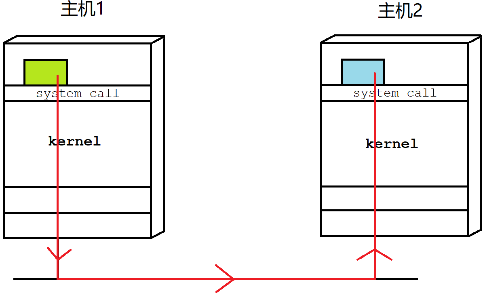
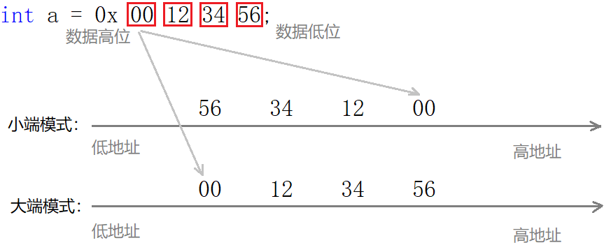
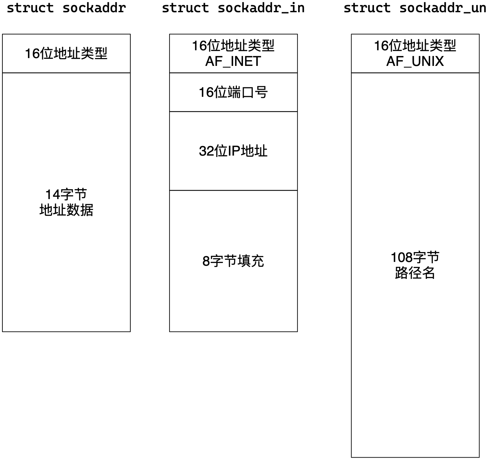
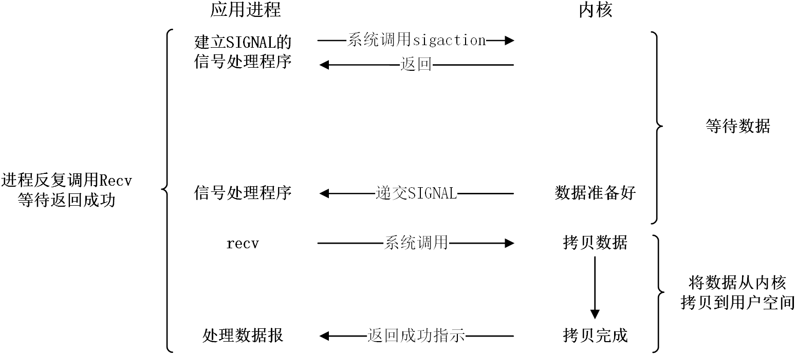
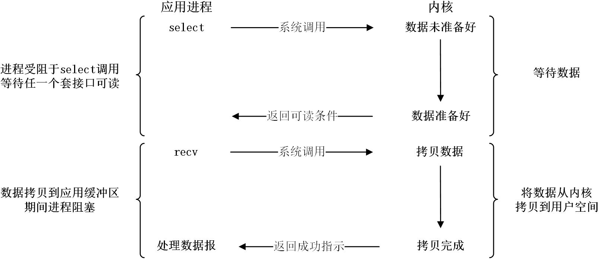
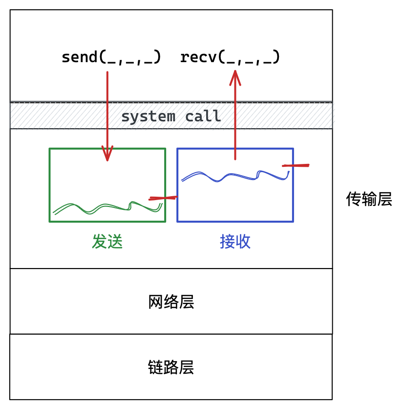
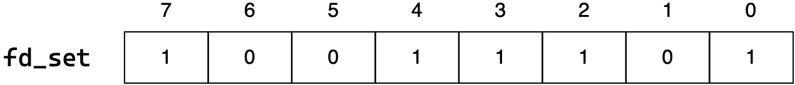
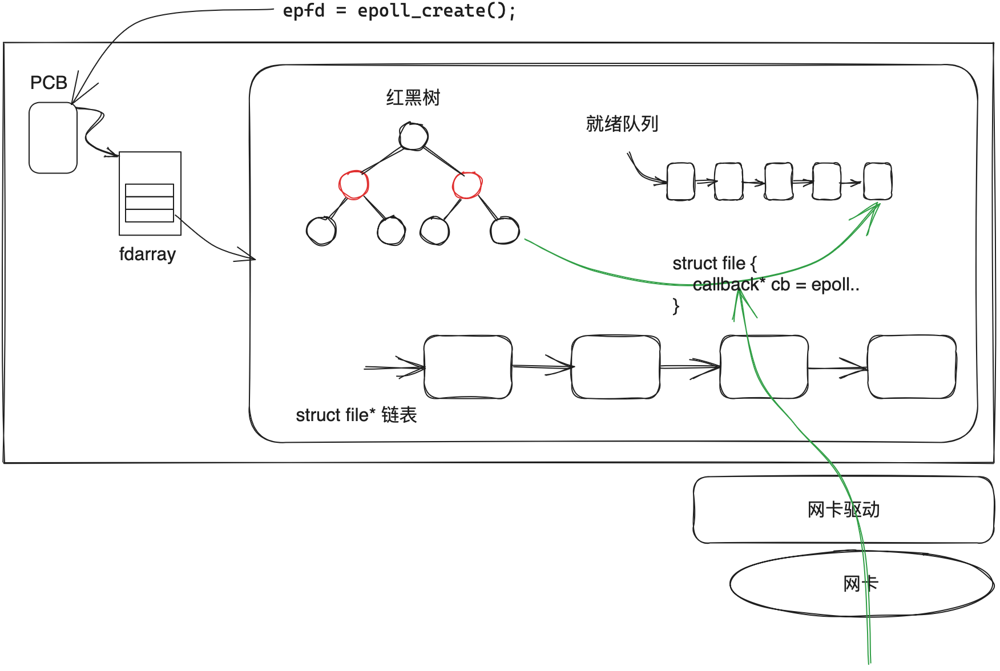

# 网络编程

## 1. 网络套接字

### 1.1 网络编程概念

#### IP地址和端口号

数据实际是由进程产生和接收的，IP确定了主机，但还要进一步确定主机上的网络进程。**网络通信的本质就是跨网络的两台主机之间的进程间通信**。

| 概念 | 作用                                   |
| ---- | -------------------------------------- |
| IP   | IP地址唯一的标识了互联网中的一台主机。 |
| 端口 | 端口号唯一地标识主机上的一个网络进程。 |

> 源端口号确定源主机上的网络进程，目的端口号确定目的主机上的网络进程。

IP和端口就能标识互联网上的唯一一台机器上的唯一一个进程。



> 可以把整个网络看作是一个大操作系统，所有的网络行为就可看作是这个系统内的进程间通信。
>
> 进程具有独立性，进程间通信的前提是先让不同的进程看到同一份资源，而网络通信的临界资源就是网络。

#### 理解网络字节序

当跨主机传输数据时，必须考虑且强制规定字节序。规定：**网络中的数据一律都采用大端的形式**。



> 一般从低到高地将数据发出，所以接收时也是先收到低地址数据，便于存储。

所以系统提供了库函数，可将数据进行主机和网络字节序的转化，如下：

```cpp
#include <arpa/inet.h>
uint32_t htonl(uint32_t hostlong);   // 主机 转 网络 长整型
uint16_t htons(uint16_t hostshort);  // 主机 转 网络 短整型
uint32_t ntohl(uint32_t netlong);    // 网络 转 主机 长整型
uint16_t ntohs(uint16_t netshort);   // 网络 转 主机 短整型
```

#### sockaddr结构体

通信方式有很多种，比如TCP/IP属于是`AF_INET`，域间套接字属于`AF_UNIX`。各家协议都有自己的套接字结构体。

接口设计者提供一个通用结构体叫`sockaddr`。各种结构体可以强转成`sockaddr`，接口内部可以通过前16位数据判断具体协议类型。



```cpp
#include <netinet/in.h>
#include <apra/inet.h>

#define	__SOCKADDR_COMMON(sa_prefix) \
  sa_family_t sa_prefix##family // sa_family_t(unsigned short) sin_family

typedef uint16_t in_port_t;   // 端口类型
typedef uint_32_t in_addr_t;  // IP 类型
struct in_addr
  {
    in_addr_t s_addr;
  };

/* Structure describing an Internet socket address.  */
struct sockaddr_in
  {
    __SOCKADDR_COMMON (sin_);   /* Protocol Family.  */
    in_port_t sin_port;			/* Port number.  */
    struct in_addr sin_addr;	/* Internet address.  */

    /* Pad to size of `struct sockaddr'.  */
    unsigned char sin_zero[sizeof (struct sockaddr) -
               __SOCKADDR_COMMON_SIZE -
               sizeof (in_port_t) -
               sizeof (struct in_addr)];
  };
```

### 1.2 网络编程接口

#### 通用接口

| 接口     | 解释                                     |
| -------- | ---------------------------------------- |
| socket() | 创建套接字本质就是打开文件，与网络无关。 |
| bind()   | 本质是将IP端口和套接字文件关联。         |

##### socket

```cpp
#include <sys/types.h>
#include <sys/socket.h>
//1. 创建套接字
int socket(int domain, int type, int protocol);
```

| 参数       | 解释                                                         |
| ---------- | ------------------------------------------------------------ |
| domain     | 指定通信方式的协议家族，TCP/UDP使用`AF_INET`即可             |
| type       | 指定通信协议，UDP传`SOCK_DGRAM`，TCP传`SOCK_STREAM`          |
| protocol   | TCP/UDP统一传0                                               |
| **返回值** | **调用成功返回网络套接字文件的文件描述符**，调用失败返回负值。 |

```cpp
int sock = socket(AF_INET, SOCK_DGRAM, 0);
if (sock < 0) {
    std::cerr << "socket error: " << errno << std::endl;
    exit(1);
}
```

##### bind(server)

```cpp
//2. 绑定IP端口
int bind(int socket, const struct sockaddr *address, socklen_t address_len);
```

建立网络连接需要确定IP和端口，但云服务器不允许绑定固有IP，使用`INADDR_ANY`让系统自动绑定。

**客户端不需要显式绑定，系统自行分配端口号冲突**。

> 首次发送数据的时候会自动绑定。

| 参数       | 解释                                                     |
| ---------- | -------------------------------------------------------- |
| socket     | socket接口的返回值                                       |
| address    | 套接字信息结构体地址和长度，用来指定机器相关的套接字信息 |
| **返回值** | 返回值成功返回0，失败返回–1                              |

```cpp
struct sockaddr_in local;

local.sin_family = AF_INET;          // 协议家族
local.sin_port = htons(port);        // 端口

local.sin_addr.s_addr = INADDR_ANY;  // IP地址由系统决定，用于云服务器
local.sin_addr.s_addr = inet_addr(_ip.c_str()); // 将点分十进制的IP串转化成32位整数并改为大端序列

if (bind(sock, (struct sockaddr*)&local, sizeof(local)) < 0) {
    std::cerr << "bind error: " << errno << std::endl;
    exit(1);
}
```

##### close

```cpp
int close(int fd);
```

关闭套接字文件，系统层面是释放文件资源，网络层面是TCP四次挥手。

#### UDP接口

##### recvfrom

```cpp
#include <sys/socket.h>
ssize_t recvfrom(int socket,
                 void *restrict buffer, size_t length,
                 int flags,
                 struct sockaddr *restrict address, socklen_t *restrict address_len);
```

| 参数              | 解释                                |
| ----------------- | ----------------------------------- |
| socket            | 网络套接字的文件描述符              |
| buffer / length   | 接收数据的接受缓冲区 / 缓冲区的长度 |
| flags             | 接收数据的方式默认为0               |
| address / addrlen | 发送者的套接字结构体的地址 / 长度   |
| **返回值**        | 实际接收的字符个数                  |

```cpp
struct sockaddr_in peer;
socklen_t len = sizeof(peer);
ssize_t s = recvfrom(sock, buf, sizeof(buf)-1, 0, (struct sockaddr*)&peer, &len);
if (s > 0) {
    buf[s] = 0;
    std::cout << "server ## " << std::endl << buf << std::endl;
}
else
    std::cerr << "recvfrom error" << std::endl;
```

##### sendto

```cpp
#include <sys/socket.h>
ssize_t sendto((int socket,
                const void *message, size_t length,
                int flags,
                const struct sockaddr *dest_addr, socklen_t dest_len);
```

| 参数              | 解释                            |
| ----------------- | ------------------------------- |
| socket            | 网络套接字的文件描述符          |
| message / length  | 发送字符数组的地址 / 数组的长度 |
| flags             | 发送数据的方式默认为0           |
| address / addrlen | 接受者的套接字结构体地址 / 长度 |
| **返回值**        | 实际发送的字符个数              |

```cpp
//server
s = sendto(_sock, buf, strlen(buf), 0, (struct sockaddr*)&peer, len);
//client
struct sockaddr_in server;
server.sin_family = AF_INET;
server.sin_addr.s_addr = inet_addr(_sip.c_str());
server.sin_port = htons(_sport);
ssize_t s = sendto(_sock, msg.c_str(), msg.size(), 0, (sockaddr*)&server, sizeof(server));
```

#### TCP接口

##### listen

```cpp
//3. 开始监听 TCP server
int listen(int socket, int backlog);
```

TCP是面向连接的通信协议，所以在通信前需先建立连接。

**listen的本质是设置套接字为listen监听状态，允许用户进行连接**。

##### accept

```cpp
//4. 接收请求 TCP server
int accept(int sockfd, struct sockaddr *addr, socklen_t *addrlen);
```

**accept表示正式建立与客户端的连接**。本质阻塞式的等待三次握手完成，并将连接提取到应用层。

> socket返回的sock_fd用来监听连接。accept返回的sock_fd是用来通信的fd。

##### connect (client)

```cpp
//5. 建立连接 TCP client
int connect(int sockfd, const struct sockaddr *addr, socklen_t addrlen);
```

**connect的作用是主动向服务端发起连接**。本质是向服务器端发起TCP的三次握手，并等待握手完成。

##### recv/send

```cpp
ssize_t recv(int sockfd, void *buf, size_t len, int flags);
ssize_t send(int sockfd, const void *buf, size_t len, int flags);

ssize_t read(int fildes, void *buf, size_t nbyte);
ssize_t write(int fildes, const void *buf, size_t nbyte);
```

网络数据收发接口，本质是读写文件。

TCP协议是流式套接字，TCP收发接口和文件读写非常像，仅多了方式参数`flags`。

#### IP格式转换接口

```cpp
// 字符串IP 转 网络整数IP
in_addr_t inet_addr(const char *cp);
in_addr_t inet_network(const char *cp);
int inet_aton(const char *cp, struct in_addr *inp);
int inet_pton(int af, const char *src, void *dst);

// 网络整数IP 转 字符串IP
char* inet_ntoa(struct in_addr in); // 非线程安全
const char *inet_ntop(int af, const void *src, char *dst, socklen_t size);
```

#### 套接字接口封装

```cpp
namespace inet {
struct api {
    enum {
        udp = SOCK_DGRAM,
        tcp = SOCK_STREAM,
    };
    static int Socket(int proto) {
        int fd = socket(AF_INET, proto, 0);
        if (fd < 0) throw std::runtime_error("socket failed");
        return fd;
    }
    static void Bind(int sock, const std::string& ip, uint16_t port) {
        struct sockaddr_in local;
        memset(&local, 0, sizeof(local));

        local.sin_family = AF_INET;
        local.sin_addr.s_addr = inet_addr(ip.c_str());
        local.sin_port = htons(port);

        if (bind(sock, (struct sockaddr*)&local, sizeof(local)) < 0)
            throw std::runtime_error("bind error");
    }
    static void Bind(int sock, uint16_t port) {
        struct sockaddr_in local;
        memset(&local, 0, sizeof(local));
        local.sin_family = AF_INET;
        local.sin_addr.s_addr = INADDR_ANY;
        local.sin_port = htons(port);
        if (bind(sock, (struct sockaddr*)&local, sizeof(local)) < 0)
            throw std::runtime_error("bind error");
    }
    static void Listen(int sock, int backlog) {
        if (listen(sock, backlog) < 0)
            throw std::runtime_error("listen error");
    }
    static void Connect(int sock, const std::string& ip, uint16_t port, int trytime = 1) {
        struct sockaddr_in peer;
        memset(&peer, 0, sizeof(peer));
        peer.sin_family = AF_INET;
        peer.sin_addr.s_addr = inet_addr(ip.c_str());
        peer.sin_port = htons(port);
        while (trytime-- > 0 && connect(sock, (struct sockaddr*)&peer, sizeof(peer)) < 0) {
            if (trytime == 0) throw std::runtime_error("connect failed");
            sleep(1);
        }
    }
    static int Accept(int sock, std::string* ip = nullptr, uint16_t* port = nullptr) {
        struct sockaddr_in peer;
        socklen_t len = sizeof(peer);
        memset(&peer, 0, len);
        int fd = accept(sock, (struct sockaddr*)&peer, &len);
        if (ip)   *ip = inet_ntoa(peer.sin_addr);
        if (port) *port = ntohs(peer.sin_port);
        return fd;
    }
    static int Recv(int sock, std::string* msg, size_t len) {
        msg->clear();
        std::unique_ptr<char[]> buf(new char[len]{0});
        ssize_t s = recv(sock, buf.get(), len, 0);
        if (s > 0) {
            buf[s] = 0;
            *msg = buf.get();
        }
        return s;
    }
    static int Send(int sock, const std::string& msg) {
        return send(sock, msg.c_str(), msg.size(), 0);
    }
    static int Recvfrom(int sock, std::string* msg, size_t len,
                        std::string* ip = nullptr, uint16_t* port = nullptr) {
        msg->clear();
        std::unique_ptr<char[]> buf(new char[len]{0});
        struct sockaddr_in peer;
        socklen_t sklen = sizeof(peer);
        memset(&peer, 0, sklen);
        ssize_t s = recvfrom(sock, buf.get(), len, 0, (struct sockaddr*)&peer, &sklen);
        if (s > 0) {
            buf[s] = 0;
            *msg = buf.get();
        }
        if (ip)   *ip = inet_ntoa(peer.sin_addr);
        if (port) *port = ntohs(peer.sin_port);
        return s;
    }
    static int Sendto(int sock, const std::string& msg,
                      const std::string& ip, uint16_t port) {
        struct sockaddr_in peer;
        memset(&peer, 0, sizeof(peer));
        peer.sin_family = AF_INET;
        peer.sin_addr.s_addr = inet_addr(ip.c_str());
        peer.sin_port = htons(port);
        ssize_t s =
            sendto(sock, msg.c_str(), msg.size(), 0, (struct sockaddr*)&peer, sizeof(peer));
        return s;
    }
};

namespace tcp {
class server {
public:
    server(uint16_t port, int backlog = 12) : _sock(0), _port(port), _backlog(backlog) {
        init();
    }
    server(const std::string& ip, uint16_t port, int backlog = 12)
        : _sock(0), _ip(ip), _port(port), _backlog(backlog) {
        init();
    }
    int accept(std::string* cip = nullptr, uint16_t* cport = nullptr) {
        Accept(_sock, cip, cport);
    }
    int recv(int sock, std::string* msg, size_t len) {
        return inet::api::Recv(sock, msg, len);
    }
    int send(int sock, const std::string& msg) {
        return inet::api::Send(sock, msg);
    }
    ~server() { close(_sock); }
private:
    void init() {
        _sock = inet::api::Socket(inet::api::tcp);
        if (_ip.empty()) inet::api::Bind(_sock, _port);
        else inet::api::Bind(_sock, _ip, _port);
        inet::api::Listen(_sock, _backlog);
    }
protected:
    int _sock;
    std::string _ip;
    uint16_t _port;
    int _backlog;
};
class client
{
public:
    client(const std::string& svr_ip, uint16_t svr_port, int trytime = 1)
        : _sock(0), _sip(svr_ip), _sport(svr_port), _trytime(trytime) {
        _sock = inet::api::Socket(inet::api::tcp);
        inet::api::Connect(_sock, _sip, _sport, _trytime);
    }
    int send(const std::string& msg) { return inet::api::Send(_sock, msg); }
    int send(int sock, const std::string& msg) { return inet::api::Send(sock, msg); }
    int recv(std::string* msg, size_t len) { return inet::api::Recv(_sock, msg, len); }
    int recv(int sock, std::string* msg, size_t len)
    { return inet::api::Recv(sock, msg, len); }
    ~client() { close(_sock); }
protected:
    int _sock;
    std::string _sip;
    uint16_t _sport;
    int _trytime;
};
}

namespace udp {
class server {
public:
    server(uint16_t port) : _sock(0), _port(port) {
        init();
    }
    server(const std::string& ip, uint16_t port) : _sock(0), _ip(ip), _port(port) {
        init();
    }
    int sendto(const std::string& msg, const std::string& cip, uint16_t cport) {
        return inet::api::Sendto(_sock, msg, cip, cport);
    }
    int recvfrom(std::string* msg, size_t len,
                 std::string* cip = nullptr, uint16_t* cport = nullptr) {
        return inet::api::Recvfrom(_sock, msg, len, cip, cport);
    }
    ~server() { close(_sock); }
private:
    void init() {
        _sock = inet::api::Socket(inet::api::udp);
        if (_ip.empty()) inet::api::Bind(_sock, _port);
        else inet::api::Bind(_sock, _ip, _port);
    }
protected:
    int _sock;
    std::string _ip;
    uint16_t _port;
};

class client {
public:
    client(const std::string& svr_ip, uint16_t svr_port)
        : _sock(0), _sip(svr_ip), _sport(svr_port) {
        _sock = inet::api::Socket(inet::api::udp);
    }
    int sendto(const std::string& msg)
    { return inet::api::Sendto(_sock, msg, _sip, _sport); }
    int recvfrom(std::string* msg, size_t len)
    { return inet::api::Recvfrom(_sock, msg, len); }
    ~client() { close(_sock); }
protected:
    int _sock;
    std::string _sip;
    uint16_t _sport;
};
}
}
```

### 1.3 网络通信设计

#### UDP通信

##### UDP客户端

```cpp
class udp_client
{
public:
    udp_client(std::string sip, uint16_t sport) : _sock(0), _sip(sip), _sport(sport)
    {}

    ~udp_client() {
        close(_sock);
        _sender.join();
        _recver.join();
    }

    void init() {
        _sock = socket(AF_INET, SOCK_DGRAM, 0);
        if (_sock < 0) exit(SOCKET_ERR);
        _sender = std::thread(&udp_client::send, this);
        _recver = std::thread(&udp_client::recv, this);
    }

void send()
{
    struct sockaddr_in peer;
    peer.sin_family = AF_INET;
    peer.sin_addr.s_addr = inet_addr(_sip.c_str());
    peer.sin_port = htons(_sport);

    while (true)
    {
        std::string msg;
        std::cout << "please input:> ";
        getline(std::cin, msg);
        sendto(_sock, msg.c_str(), msg.size(), 0, (struct sockaddr*)&peer, sizeof(peer));
    }
}

void recv()
{
    while (true)
    {
        char buf[1024] = {0};
        struct sockaddr_in tmp;
        socklen_t len = sizeof(tmp);
        ssize_t s = recvfrom(_sock, buf, sizeof(buf), 0, (struct sockaddr*)&tmp, &len);
        if (s > 0) buf[s] = 0;
        else continue;
        std::cout << "server return## " << buf << std::endl;
    }
}

private:
    int _sock;
    std::string _sip;
    uint16_t _sport;

    std::thread _sender;
    std::thread _recver;
};
```

##### UDP服务端

```cpp
class udp_server
{
public:
udp_server(uint16_t port) : _sock(0), _port(port)
{}

~udp_server()
{
    close(_sock);
}

void init()
{
    _sock = socket(AF_INET, SOCK_DGRAM, 0);
    if (_sock < 0) exit(SOCKET_ERR);

    struct sockaddr_in local;
    local.sin_family = AF_INET;
    local.sin_addr.s_addr = INADDR_ANY;
    local.sin_port = htons(_port);

    if (bind(_sock, (struct sockaddr*)&local, sizeof(local)) < 0)
        exit(BIND_ERR);
}

void start()
{
    char buf[1024] = {0};
    while (true)
    {
        struct sockaddr_in peer;
        socklen_t len = sizeof(peer);

        ssize_t s = recvfrom(_sock, buf, sizeof(buf), 0, (struct sockaddr*)&peer, &len);
        if (s > 0) buf[s] = 0;
        else continue;

        std::string cip = inet_ntoa(peer.sin_addr);
        uint16_t cport = ntohs(peer.sin_port);
        std::cout << '[' << cip << ':' << cport << "] " << buf << std::endl;;

        std::string rsp = buf;
        sendto(_sock, rsp.c_str(), rsp.size(), 0, (struct sockaddr*)&peer, sizeof(peer));
    }
}

private:
    int _sock;
    uint16_t _port;
};
```

#### TCP通信

##### TCP客户端

```cpp
class tcp_client
{
public:
    tcp_client(std::string sip, uint16_t sport) : _sock(0), _sip(sip), _sport(sport)
    {}

    ~tcp_client()
    {
        close(_sock);
    }

    void init()
    {
        // 1. socket
        _sock = socket(AF_INET, SOCK_STREAM, 0);
        if (_sock < 0)
        {
            std::cerr << "socket error" << std::endl;
            exit(SOCKET_ERR);
        }
        std::cout << "socket success " << _sock << std::endl;

        // 2. connect
        struct sockaddr_in peer;
        memset(&peer, 0, sizeof(peer));
        peer.sin_family = AF_INET;
        peer.sin_port = htons(_sport);
        inet_aton(_sip.c_str(), &peer.sin_addr);

        int cnt = 5;
        while (connect(_sock, (struct sockaddr*)&peer, sizeof(peer)) < 0)
        {
            std::cerr << "connect failed, remaining try " << cnt-- << std::endl;
            if (cnt == 0)
            {
                std::cerr << "connect error" << std::endl;
                exit(CONNECT_ERR);
            }
            sleep(1);
        }
        std::cout << "connect success" << std::endl;
    }

    void start()
    {
        while (true)
        {
            std::string msg;
            std::cout << "please input:> ";
            getline(std::cin, msg);

            send(_sock, msg.c_str(), msg.size(), 0);

            char buf[1024] = {0};
            ssize_t s = recv(_sock, buf, sizeof(buf), 0);
            if (s > 0)
            {
                buf[s] = 0;
                std::cout << "server return " << buf << std::endl;
            }
            else if (s == 0)
            {
                close(_sock);
                std::cout << "server quit" << std::endl;
                break;
            }
            else
            {
                close(_sock);
                std::cerr << "recv error " << strerror(errno) << std::endl;
                break;
            }

        }
    }

private:
    int _sock;
    std::string _sip;
    uint16_t _sport;
};
```

##### TCP服务端

```cpp
class tcp_server
{
public:
    using func_t = std::function<std::string(const std::string&)>;
public:
    tcp_server(func_t func, uint16_t port)
        : _listen_sock(0), _port(port), _quit(false), _func(func)
    {}

    ~tcp_server() {
        close(_listen_sock);
    }

    void init()
    {
        // 1. socket
        _listen_sock = socket(AF_INET, SOCK_STREAM, 0);
        if (_listen_sock < 0)
            exit(SOCKET_ERR);
        INFO("socket success %d", _listen_sock);

        // 2. bind
        struct sockaddr_in local;
        memset(&local, 0, sizeof(local));
        local.sin_family = AF_INET;
        local.sin_addr.s_addr = INADDR_ANY;
        local.sin_port = htons(_port);

        if (bind(_listen_sock, (struct sockaddr*)&local, sizeof(local)) < 0)
            exit(BIND_ERR);
        INFO("bind success");

        // 3. listen
        if (listen(_listen_sock, backlog) < 0)
            exit(LISTEN_ERR);
        INFO("listen success");
    }

    void start()
    {
        signal(SIGCHLD, SIG_IGN);

        while (!_quit)
        {
            struct sockaddr_in peer;
            socklen_t len = sizeof(peer);
            int sock = accept(_listen_sock, (struct sockaddr*)&peer, &len);
            if (sock < 0)
                continue;

            std::string cip = inet_ntoa(peer.sin_addr);
            uint16_t cport = ntohs(peer.sin_port);
            std::string cli = '['+cip+':'+std::to_string(cport)+']';

            INFO("accept success sock %d %s", sock, cli.c_str());

            //v1
            service(sock, cli);

            //v2
            pid_t id = fork();
            if (id < 0)
            {
                std::cerr << "fork failed" << std::endl;
                close(sock);
                continue;
            }
            else if (id == 0)
            {
                close(_listen_sock);
                if (fork() > 0) exit(0); // 孤儿孙子进程提供服务，孤孙进程由操作系统负责回收
                service(sock, cli);
                close(sock);
                exit(0);
            }
            else
            {
                close(sock); // hand it to childproc, must close it to save resources
                pid_t res = waitpid(id, nullptr, 0);
                if (res == id)
                    std::cout << "wait childproc success " << id << std::endl;
            }

            //v3
            pthread_t tid;
            thread_args* data = new thread_args(this, sock, cli);
            pthread_create(&tid, nullptr, routine, data);
            pthread_detach(tid);

            std::thread th(&tcp_server::service, this, sock, cli);
            th.detach();

            //v4
            task t(&tcp_server::service, this, sock, cli);
            thread_pool<task>::get_instance()->push(t);
        }
    }

    static void* routine(void* args)
    {
        thread_args* td = static_cast<thread_args*>(args);
        td->ts->service(td->sock, td->cli);
        delete td;
        return nullptr;
    }

    void service(int sock, const std::string& cli)
    {
        char buf[1024] = {0};
        ssize_t s = recv(sock, buf, sizeof(buf) - 1, 0);
        if (s > 0) {
            buf[s] = 0;
            send(sock, buf, strlen(buf), 0);
        }
        else if (s == 0) {
            INFO("%s quit, cancel service", cli.c_str());
            break;
        }
        else {
            ERROR("recv error %s", strerror(errno));
            break;
        }
        close(sock);
    }
private:
    int _listen_sock;
    uint16_t _port;
    bool _quit;
};
```

网络套接字编程的本质是利用系统调用从零编写应用层，不是使用应用层。

## 2. 高级IO

内存和外设的交互叫做IO，网络IO就是将数据在内存和网卡间拷贝。

IO本质就是等待和拷贝，一般等待耗时往往远高于拷贝耗时。所以提高IO效率就是尽可能减少等待时间的比重。

| IO模型   | 简单对比解释                                 |
| -------- | -------------------------------------------- |
| 阻塞IO   | 阻塞等待数据到来                             |
| 非阻塞IO | 轮询等待数据到来                             |
| 信号驱动 | 信号递达时再来读取或写入数据                 |
| 多路转接 | 让大批线程等待，自身读取数据                 |
| 异步通信 | 让其他进程或线程进行等待和读取，自身获取结果 |

### 2.1 阻塞IO

执行流在某个文件描述符下读取数据时，执行流一直等待IO条件就绪后读取数据，这就是阻塞IO。


### 2.2 非阻塞IO

执行流会以循环的方式反复尝试读取数据，如果IO条件未就绪，执行流会直接返回继续其他任务。


#### 非阻塞读取方式

可通过fcntl设置文件的状态。

非阻塞读取时，数据未就绪是以出错的形式返回的，错误码为`EAGIN`或`EWOULDBLOCK`，信号导致读取未成功错误码为`EINTR`。

```cpp
void set_nonblock(int fd)
{
    int fl = fcntl(fd, F_GETFL);
    if (fl < 0) {
        perror("fcntl failed");
        return;
    }
    if (fcntl(fd, F_SETFL, fl | O_NONBLOCK) < 0) {
        perror("fcntl failed");
        return;
    }
}

int main() {
    set_nonblock(0);
    char buf[64] = {0};

    while (true) {
        ssize_t n = read(0, buf, sizeof(buf) - 1);
        if (n > 0)
        {
            buf[n - 1] = 0;
            std::cout << buf << std::endl;
        }
        else if (n == 0)
        {
            perror("end of file");
            break;
        }
        else
        {
            if (errno == EAGAIN || errno == EWOULDBLOCK) // 非阻塞数据未就绪返回
                continue;
            else if (errno == EINTR) // IO被信号中断返回
                continue;
            else
            {
                perror("read error");
                break;
            }
        }
    }
    return 0;
}
```

> 较为鸡肋，一般不用。

### 2.3 信号驱动

IO事件就绪时，内核通过SIGIO信号通知进程。等待的过程是异步的，但拷贝数据是同步的，所以我们认为信号驱动也是同步IO。



> 但信号处理是异步的，所以数据提取可能不及时。

### 2.4 多路转接

内核提供select、poll、epoll等多路转接方案，最高可同时等待几百个文件。拷贝数据的任务仍由进程完成，等待数据的任务交给内核。



### 2.5 异步通信

只要自身完全没有参与IO等待和拷贝就是异步通信，否则就是同步。

将缓冲区提供给异步接口，接口等待并拷贝将数据至缓冲区，最后通知进程。进程不参与IO可直接处理数据，所以是异步的。


> 异步IO系统提供有一些对应的系统接口，但大多使用复杂，也不建议使用。异步IO也有更好的替代方案。

#### IO事件就绪

IO事件就绪可分为读事件就绪和写事件就绪。

一般接收缓冲区设有高水位，高于该水位读事件就绪，发送缓冲区设有低水位，低于该水位写事件就绪。

> 因为频繁读写内核缓冲区需要状态切换，会附带一系列的处理工作，导致效率下降。



## 3. 多路转接

> Linux下多路转接的方案常见的有三种：select、poll、epoll，select出现是最早的，使用也是最繁琐的。

### 3.1 select

#### select的接口

select能够等待多个fd的IO条件是否就绪。

```c
#include <sys/select.h>
int select(int nfds, fd_set* rfds, fd_set* wfds, fd_set* efds, struct timeval* timeout);

struct timeval {
    time_t       tv_sec;   /* seconds */
    suseconds_t  tv_usec;  /* microseconds */
};
```

| 参数        | 解释                                                         |
| ----------- | ------------------------------------------------------------ |
| `nfds`      | fd的总个数，select遍历fdset结构的范围（被等待的fd的最大值+1） |
| `readfds`   | 调用时表示需要关注的读事件，返回时表示那些事件已经就绪       |
| `writefds`  | 调用时表示需要关注的写事件，返回时表示那些事件已经就绪       |
| `exceptfds` | 调用时表示需要关注的异常事件，返回时表示那些事件已经就绪。如对端关闭，读写异常等 |
| `timeout`   | 调用时表示本次调用阻塞等待时间，返回时表示此次返回剩余的等待时间 |
| 返回值      | 大于0表示就绪fd的个数，为0表示本次调用结束，–1表示出错       |

##### fd_set的接口

`fd_set`是文件描述符的位图结构，下标表示文件描述符，比特位内容表示是否需要等待。



```c
// fd_set操作函数
void FD_CLR  (int fd, fd_set *set); // 清除
int  FD_ISSET(int fd, fd_set *set); // 检测
void FD_SET  (int fd, fd_set *set); // 设置
void FD_ZERO (        fd_set *set); // 置零
```

#### select的使用

```cpp
const int GPORT = 8080;
const int GSIZE = 10;
enum event_type {
    read_event   = 0x1 << 1,
    write_event  = 0x1 << 2,
    except_event = 0x1 << 3,
};
struct fd_collection {
    fd_collection() {}
    fd_collection(const fd_collection& fds) {
        _rfds = fds._rfds, _wfds = fds._wfds, _efds = fds._efds, _maxfd = fds._maxfd;
    }
    bool set(int event, int fd) {
        if (_fdarr.size() >= GSIZE) return false;
        if (event & read_event)   _rfds.set(fd);
        if (event & write_event)  _wfds.set(fd);
        if (event & except_event) _wfds.set(fd);
        _fdarr.push_back(fd);
        if (_maxfd < fd) _maxfd = fd;
        return true;
    }
    void clear(int fd) {
        _rfds.clear(fd);
        _wfds.clear(fd);
        _efds.clear(fd);
        for (int i = 0; i < _fdarr.size(); i++)
            if (_fdarr[i] == fd) _fdarr[i] = -1;
    }
    class file_descptrs {
    public:
        file_descptrs() { bzero(); }
        ~file_descptrs() {}
        void set  (int fd) { FD_SET(fd, &_set);          }
        void clear(int fd) { FD_CLR(fd, &_set);          }
        bool isset(int fd) { return FD_ISSET(fd, &_set); }
        void bzero()       { FD_ZERO(&_set);             }
        fd_set* get() { return &_set; }
    private:
        fd_set _set;
    };
    file_descptrs _rfds;
    file_descptrs _wfds;
    file_descptrs _efds;
    std::vector<int> _fdarr;
    int _maxfd = -1;
};

class select_server : public inet::tcp::server {
public:
    select_server(uint16_t port) : server(port), _wouldblock(true)
    {}
    select_server(uint16_t port, int sec, int usec) : server(port), _timeout({sec, usec})
    {}
    void start() {
        _fds.set(read_event, _sock);
        while (true) {
            int n = 0;
            struct timeval timeout = _timeout;
            fd_collection fds_cp(_fds);

if (_wouldblock)
n = select(fds_cp._maxfd+1, fds_cp._rfds.get(), fds_cp._wfds.get(), fds_cp._efds.get(),  nullptr);
else
n = select(fds_cp._maxfd+1, fds_cp._rfds.get(), fds_cp._wfds.get(), fds_cp._efds.get(), &timeout);
            switch (n) {
            case 0: INFO("time out: %.2f", timeout.tv_sec + timeout.tv_usec / 1.0 / 1000);
                break;
            case -1: ERROR("select error, %d %s", errno, strerror(errno));
                break;
            default: handler_event(fds_cp);
                break;
            }
        }
    }
private:
    void handler_event(fd_collection& resfds) {
        for (auto fd : _fds._fdarr) {
            if (fd == -1) continue;
            if (resfds._rfds.isset(fd)) {
                if (fd == _sock)  {
                    acceptor();
                } else {
                    std::string buf;
                    recver(fd, &buf);
                }
            }
            if (resfds._wfds.isset(fd)) {
                std::string msg = "test";
                sender(fd, msg);
            }
            if (resfds._efds.isset(fd)) {
                WARN("excepton event occurred, fd: %d", fd);
            }
        }
    }
    void acceptor() {
        std::string cip;
        uint16_t cport;
        int sock = accept(&cip, &cport);
        INFO("a connect %d has been accepted [%s:%d]", sock, cip.c_str(), cport);
        // if (!_fds.set(read_event | write_event | except_event, sock))
        if (!_fds.set(read_event, sock)) {
            close(sock);
            WARN("connect close, fd array is full");
        }
    }
    void recver(int fd, std::string* buf) {
        ssize_t s = recv(fd, buf, 1024);
        if (s > 0) {
            std::cout << *buf << std::endl;
        }
        else {
            if (s == 0) INFO("client quit");
            else WARN("recv error, %d %s", errno, strerror(errno));
            _fds.clear(fd);
            close(fd);
        }
    }
    void sender(int fd, const std::string& msg) {
        size_t s = send(fd, msg);
        if (s <= 0) {
            if (s == 0) INFO("client quit");
            else WARN("send error, %d %s", errno, strerror(errno));
            _fds.clear(fd);
            close(fd);
        }
    }
private:
    bool _wouldblock;
    struct timeval _timeout;
    fd_collection _fds;
};
```

#### select的优缺点

| 优点                                                       |
| ---------------------------------------------------------- |
| 一次等待多个fd，使IO等待时间重叠，一定程度上提高IO效率     |
| **缺点**                                                   |
| 调用前要重新设置fd集，调用后要遍历检测就绪fd，需要额外数组 |
| select能够检测fd的个数上限太小                             |
| 频繁地将用户数据拷贝到内核中                               |
| select内部遍历fd_set结构以检测就绪                         |

### 3.2 poll

> poll相比select在使用和实现上都有进步。不过重点是epoll。

#### poll的接口

```c
#include <poll.h>
int poll(struct pollfd* fds, nfds_t nfds, int timeout);

struct pollfd {
    int    fd;       /* file descriptor */
    short  events;   /* events to look for */
    short  revents;  /* events returned */
};
```

| 参数                        | 解释                                    |
| --------------------------- | --------------------------------------- |
| `timeout`                   | 阻塞等待时间，不过采用整数单位是毫秒。  |
| `struct pollfd* `和`nfds_t` | pollfd结构体数组以及数据长度            |
|                             | `struct pollfd.fd`：关注的文件描述符    |
|                             | `struct pollfd.events`：关注的事件类型  |
|                             | `struct pollfd.revents`：就绪的事件类型 |

| 事件类型      | 描述                                                        |
| ------------- | ----------------------------------------------------------- |
| **`POLLIN`**  | 数据（包括普通数据和优先数据）可读                          |
| `POLLRDNORM`  | 普通数据可读                                                |
| `POLLRDBAND`  | 优先级带数据可读（Linux 不支持）                            |
| `POLLPRI`     | 高优先级数据可读，比如 TCP 带外数据                         |
| **`POLLOUT`** | 数据（包括普通数据和优先数据）可写                          |
| `POLLWRNORM`  | 普通数据可写                                                |
| `POLLWRBAND`  | 优先级带数据可写                                            |
| `POLLRDHUP`   | TCP 连接被对方关闭，或者对方关闭了写操作，它由GNU引入       |
| `POLLERR`     | 错误                                                        |
| `POLLHUP`     | 挂起。比如管道的写端被关闭后，读端描述符将收到 POLLHUP 事件 |
| `POLLNVAL`    | 文件描述符没有打开                                          |

#### poll的使用

```cpp
const int   default_port    = 8080;
const int   default_size    = 20;
const int   default_timeout = -1;
const int   default_fd      = -1;
const short default_event   = 0;

class poll_server : public inet::tcp::server {
public:
    poll_server(uint16_t port) : server(port), _fds(new struct pollfd[default_size])
        , _cap(0), _timeout(default_timeout) {
        pollfd_arr_init();
    }
    void pollfd_arr_init() {
        for (int i = 0; i < default_size; i++) pollfd_init(_fds[i]);
    }
    void pollfd_init(struct pollfd& pf) {
        pf.fd = default_fd;
        pf.events = default_event;
        pf.revents = default_event;
    }
    void pollfd_clear(struct pollfd& pf) {
        pf.fd = default_fd;
        pf.events = default_event;
        pf.revents = default_event;
    }
    void start() {
        _fds[0].fd = _sock;
        _fds[0].events = POLLIN;
        ++_cap;
        while (true) {
            int timeout = _timeout;
            switch (poll(_fds.get(), _cap, timeout)) {
            case 0: INFO("time out: %d", timeout); break;
            case -1: ERROR("select error, %d %s", errno, strerror(errno)); break;
            default: event_handler(); break;
            }
        }
    }
private:
    void event_handler() {
        for (int i = 0; i < _cap; i++) {
            auto& fd = _fds[i].fd;
            auto& revents = _fds[i].revents;
            if (revents & POLLIN) {
                if (fd == _sock) {
                    acceptor();
                } else {
                    std::string buf;
                    recver(i, &buf);
                }
            }
            if (revents & POLLOUT) {
                std::string msg = "test";
                sender(i, msg);
            }
            if (revents & POLLERR){
                WARN("excepton event occurred, fd: %d", fd);
            }
        }
    }
    void acceptor() {
        std::string cip;
        uint16_t cport;
        int newfd = accept(&cip, &cport);
        if (_cap >= default_size) {
            close(newfd);
            WARN("connect close, fd array is full");
            return;
        }
        for (int i = 0; i < default_size; i++) {
            if (_fds[i].fd == default_fd) {
                _fds[i].fd = newfd;
                _fds[i].events = POLLIN | POLLOUT;
                _cap++;
                break;
            }
        }
        INFO("a connect %d has been accepted [%s:%d]", newfd, cip.c_str(), cport);
    }
    void recver(int i, std::string* buf) {
        ssize_t s = recv(_fds[i].fd, buf, 1024);
        if (s > 0) {
            std::cout << *buf << std::endl;
        } else {
            if (s == 0) INFO("client quit");
            else WARN("recv error, %d %s", errno, strerror(errno));
            close(_fds[i].fd);
            pollfd_clear(_fds[i]);
            --_cap;
        }
    }
    void sender(int i, const std::string& msg) {
        size_t s = send(_fds[i].fd, msg);
        if (s <= 0) {
            if (s == 0) INFO("client quit");
            else WARN("send error, %d %s", errno, strerror(errno));
            close(_fds[i].fd);
            pollfd_clear(_fds[i]);
            --_cap;
        }
    }
private:
    std::unique_ptr<struct pollfd[]> _fds;
    int _cap;
    int _timeout;
};
```

#### poll的优缺点

| 优点                                             |
| ------------------------------------------------ |
| 监视fd的个数无上限                               |
| 将事件输入输出分离，避免原始数据被修改           |
| **缺点**                                         |
| 返回后仍需要遍历数组检测就绪事件                 |
| poll内部仍需要内核自己遍历检测就绪事件           |
| 每次调用都要将pollfd结构从内核空间拷贝到用户空间 |

### 3.3 epoll

#### epoll的接口

```c
#include <sys/epoll.h>
int epoll_create(int size);
int epoll_ctl(int epfd, int op, int fd, struct epoll_event *event);
int epoll_wait(int epfd, struct epoll_event *events, int maxevents, int timeout);

typedef union epoll_data {
    void*    ptr;
    int      fd;
    uint32_t u32;
    uint64_t u64;
} epoll_data_t;

struct epoll_event {
    uint32_t     events;    /* Epoll events */
    epoll_data_t data;      /* User data variable */
};
```

| epoll_create   | 负责创建epoll模型                    |
| -------------- | ------------------------------------ |
| `size`         | 目前size被忽略，为兼容可写128/256    |
| 返回值         | epoll句柄                            |
| **epoll_ctl**  | **负责用户告诉内核那些事件需要关注** |
| `epfd`         | epoll句柄                            |
| `op`           | 指定相关操作                         |
|                | `EPOLL_CTL_ADD`：添加事件            |
|                | `EPOLL_CTL_MOD`：修改事件            |
|                | `EPOLL_CTL_DEL`：删除事件            |
| `fd`           | 事件关注的文件描述符                 |
| `epoll_event`  | 用来指定fd上关注的事件               |
| **epoll_wait** | **负责内核告诉用户那些事件就绪**     |
| `epfd`         | epoll句柄                            |
| `epoll_event`  | 输出缓冲区，存放已就绪的事件         |
| `maxevents`    | 缓冲区的长度                         |
| `timeout`      | 阻塞等待的时间                       |
| 返回值         | 就绪事件的个数                       |

| events宏常量取值 | 解释                                                 |
| ---------------- | ---------------------------------------------------- |
| **`EPOLLIN`**    | 表示对应的文件描述符可以读（包括对端SOCKET正常关闭） |
| **`EPOLLOUT`**   | 表示对应的文件描述符可以写                           |
| `EPOLLPRI`       | 表示对应的文件描述符有紧急的数据可读（带外数据）     |
| **`EPOLLERR`**   | 表示对应的文件描述符发生错误                         |
| `EPOLLHUP`       | 表示对应的文件描述符被挂断                           |
| `EPOLLET`        | 将EPOLL设为边缘触发（Edge Triggered）模式            |
| `EPOLLONESHOT`   | 只监听一次事件，本次之后自动将该fd删去               |

#### epoll的使用

[epoll_server 封装最终版](https://gitee.com/yourfriendyo/cpp_code_review/blob/master/4-8Multiplexing/epoll/)

#### epoll的原理

1. epoll模型中用红黑树保存注册的fd和事件，用就绪队列保存就绪的fd和事件。
2. epoll_ctl的本质就是新增修改删除红黑树的节点，并对fd对应的文件中注册回调函数。
3. 如果事件就绪，内核在将硬件数据拷贝至内核缓冲区后，还会自动执行回调将红黑树节点添加到就绪队列中。
4. epoll_wait负责检查是否有事件就绪，本质就是检测就绪队列为空。



#### epoll的工作模式

> epoll有两种工作方式，分别是水平触发LT和边缘触发ET。

##### LTET的概念

- LT水平触发：只要事件一直就绪，就会一直通知。
- ET边缘触发：只有事件就绪或再次就绪时，才会通知一次。

###### LT水平触发

事件就绪时，可以不立刻处理或只部分处理。

只要事件处于就绪状态，每次调用epoll_wait都会通知该事件就绪，直到处理完毕处于未就绪状态。

###### ET边缘触发

设置事件为EPOLLET，表示对于该事件使用ET模式。

事件就绪时必须一次性处理清空数据，否则下次是不会通知该事件就绪的，直到该事件再次就绪。

##### LTET的读写特点

数据剩余ET不会提醒，所以必须一次性读取所有数据，但如果读取时刚好无数据就会被阻塞。 所以ET必须采用非阻塞读写。

LT模式事件就绪时读取一定不会被阻塞，因为一定有数据。

##### LTET的效率对比

一般ET的效率>=LT的效率。原因如下：

1. 一般ET通知次数比LT少，也就是系统调用次数少。
2. ET会倒逼程序员一次读取全部数据，所以底层TCP会更新出更大的滑动窗口。

##### LTET的应用场景

- ET要求程序必须一次性读取所有数据，再让上层处理，ET重IO效率。
- LT可以只交付部分数据，尽快让上层处理，LT重处理效率。

ET高IO，LT高响应。

#### epoll的优缺点

| 优点         | 解释                                               |
| ------------ | -------------------------------------------------- |
| 接口分离解耦 | 每次调用不需要重新设置事件集，做到输入输出事件分离 |
| 使用简单高效 | 调用后用户不需要遍历，内核提供就绪事件缓冲区       |
| 轻量数据拷贝 | 不需要频繁的进行将数据从内核和用户之间的拷贝       |
| 无遍历效率高 | 底层不需要遍历，利用回调将就绪事件添加到就绪队列中 |
| 没有数量限制 | 文件描述符数目无上限                               |

#### epoll的写入设置

- 只有读取缓冲区有数据，读事件才会就绪。所以读事件可以一直关注，我们称为常设置。
- 只要写入缓冲区没有满，写事件就一直就绪。所以写事件按需设置，写入完成后立即关闭，否则会一直触发。

一般构建响应后，直接发送数据，只有当缓冲区满的时候，再将没写完的数据交给epoll处理。

> select、poll、epoll都是如此，但epoll的ET模式可以常设置写事件。
